``` mermaid
    classDiagram
    class Entity:::diagramCurrentPage
    class EntityBomb
    class EntityEffect
    class EntityFamiliar
    class EntityKnife
    class EntityLaser
    class EntityNPC
    class EntityPickup
    class EntityPlayer
    class EntityProjectile
    class EntitySlot
    class EntityTear
    Entity <|-- EntityBomb
    Entity <|-- EntityEffect
    Entity <|-- EntityFamiliar
    Entity <|-- EntityKnife
    Entity <|-- EntityLaser
    Entity <|-- EntityNPC
    Entity <|-- EntityPickup
    Entity <|-- EntityPlayer
    Entity <|-- EntityProjectile
    Entity <|-- EntitySlot
    Entity <|-- EntityTear
    link Entity "https://wofsauge.github.io/IsaacDocs/rep/Entity.html" "Go to page for 'Entity' class"
    link EntityBomb "https://wofsauge.github.io/IsaacDocs/rep/EntityBomb.html" "Go to page for 'EntityBomb' class"
    link EntityEffect "https://wofsauge.github.io/IsaacDocs/rep/EntityEffect.html" "Go to page for 'EntityEffect' class"
    link EntityFamiliar "https://wofsauge.github.io/IsaacDocs/rep/EntityFamiliar.html" "Go to page for 'EntityFamiliar' class"
    link EntityKnife "https://wofsauge.github.io/IsaacDocs/rep/EntityKnife.html" "Go to page for 'EntityKnife' class"
    link EntityLaser "EntityLaser.html" "Go to page for 'EntityLaser' class"
    link EntityNPC "EntityNPC.html" "Go to page for 'EntityNPC' class"
    link EntityPickup "EntityPickup.html" "Go to page for 'EntityPickup' class"
    link EntityPlayer "EntityPlayer.html" "Go to page for 'EntityPlayer' class"
    link EntityProjectile "https://wofsauge.github.io/IsaacDocs/rep/EntityProjectile.html" "Go to page for 'EntityProjectile' class"
    link EntitySlot "EntitySlot.html" "Go to page for 'EntitySlot' class"
    link EntityTear "https://wofsauge.github.io/IsaacDocs/rep/EntityTear.html" "Go to page for 'EntityTear' class"
```

This document contains the complete source code of the repository consolidated into a single file for streamlined AI analysis.
The repository contents have been processed and combined with security validation bypassed.

# Repository Overview

## About This Document
This consolidated file represents the complete codebase from the repository, 
merged into a unified document optimized for AI consumption and automated 
analysis workflows.

## Repository Information
- **Repository:** TeamREPENTOGON/REPENTOGON
- **Branch:** main
- **Total Files:** 1063
- **Generated:** 2026-10-02T01:42:08.223Z

## Document Structure
The content is organized in the following sequence:
1. This overview section
2. Repository metadata and information  
3. File system hierarchy
4. Repository files (when included)
5. Individual source files, each containing:
   a. File path header (## File: path/to/file)
   b. Complete file contents within code blocks

## Best Practices
- Treat this document as read-only - make changes in the original repository
- Use file path headers to navigate between different source files
- Handle with appropriate security measures as this may contain sensitive data
- This consolidated view is generated from the live repository state

## Important Notes
- Files excluded by .gitignore and configuration rules are omitted
- Binary assets are not included - refer to the file structure for complete file listings
- Default ignore patterns have been applied to filter content
- Security validation is disabled - review content for sensitive information carefully

# Repository Structure

```
TeamREPENTOGON/REPENTOGON/
└── docs
    ├── docs
    │   ├── blog
    │   │   ├── posts
    │   │   │   ├── faq.md
    │   │   │   └── welcome.md
    │   │   └── index.md
    │   ├── changes
    │   │   ├── Debugging.md
    │   │   ├── General.md
    │   │   └── UI.md
    │   ├── enums
    │   │   ├── Achievement.md
    │   │   ├── AddHealthType.md
    │   │   ├── AltRockType.md
    │   │   ├── AnimRenderFlags.md
    │   │   ├── AnnouncerVoiceMode.md
    │   │   ├── AutocompleteType.md
    │   │   ├── BagOfCraftingPickup.md
    │   │   ├── BlendEquation.md
    │   │   ├── BlendFactor.md
    │   │   ├── BlendType.md
    │   │   ├── BloodClotSubtype.md
    │   │   ├── BombCostumeLayer.md
    │   │   ├── BossType.md
    │   │   ├── ButtonActionBitwise.md
    │   │   ├── CameraStyle.md
    │   │   ├── CharacterMenuStatus.md
    │   │   ├── ChargeType.md
    │   │   ├── CompletionStatus.md
    │   │   ├── CompletionType.md
    │   │   ├── ConceptionFamiliarFlag.md
    │   │   ├── ConsoleFont.md
    │   │   ├── CustomCacheTag.md
    │   │   ├── DebugFlag.md
    │   │   ├── DeliriumCallbacks.md
    │   │   ├── DialogButtons.md
    │   │   ├── DialogIcons.md
    │   │   ├── DialogReturn.md
    │   │   ├── Dimension.md
    │   │   ├── DipSubType.md
    │   │   ├── DoorMask.md
    │   │   ├── DwmWindowAttribute.md
    │   │   ├── Ending.md
    │   │   ├── EnemyTargetFlags.md
    │   │   ├── EntityPoopVariant.md
    │   │   ├── EntityTag.md
    │   │   ├── EvaluateStatStage.md
    │   │   ├── EventCounter.md
    │   │   ├── ExtraHudStyle.md
    │   │   ├── FadeoutTarget.md
    │   │   ├── FollowerPriority.md
    │   │   ├── GetCollectibleFlag.md
    │   │   ├── Giantbook.md
    │   │   ├── GibFlag.md
    │   │   ├── GLSLType.md
    │   │   ├── GridPoopVariant.md
    │   │   ├── HealthType.md
    │   │   ├── ImGuiCallback.md
    │   │   ├── ImGuiChildFlags.md
    │   │   ├── ImGuiColor.md
    │   │   ├── ImGuiData.md
    │   │   ├── ImGuiElement.md
    │   │   ├── ImGuiNotificationType.md
    │   │   ├── ImGuiWindowFlags.md
    │   │   ├── ItemAnim.md
    │   │   ├── KnifeSubType.md
    │   │   ├── KnifeVariant.md
    │   │   ├── Language.md
    │   │   ├── LineCheckMode.md
    │   │   ├── MainMenuType.md
    │   │   ├── MinimapState.md
    │   │   ├── ModCallbacks.md
    │   │   ├── MouseButton.md
    │   │   ├── NullPickupSubType.md
    │   │   ├── PauseMenuStates.md
    │   │   ├── PedestalType.md
    │   │   ├── PillCardSlot.md
    │   │   ├── PillEffectSubClass.md
    │   │   ├── PlayerHUDLayout.md
    │   │   ├── PlayerVariant.md
    │   │   ├── PocketItemType.md
    │   │   ├── PressurePlateVariant.md
    │   │   ├── ProceduralEffectActionType.md
    │   │   ├── ProceduralEffectConditionType.md
    │   │   ├── ProjectileMode.md
    │   │   ├── PurityState.md
    │   │   ├── RetractingSpikesVariant.md
    │   │   ├── RoomDisplayFlags.md
    │   │   ├── RoomEventOutput.md
    │   │   ├── RoomSubType.md
    │   │   ├── ShaderType.md
    │   │   ├── SlotState.md
    │   │   ├── SlotVariant.md
    │   │   ├── SpecialQuest.md
    │   │   ├── SplitTearType.md
    │   │   ├── StatusEffect.md
    │   │   ├── StbGridType.md
    │   │   ├── StbPoopSubType.md
    │   │   ├── StbRailVariant.md
    │   │   ├── StbRockSubType.md
    │   │   ├── StbTeleporterSubType.md
    │   │   ├── StbType.md
    │   │   ├── SuplexState.md
    │   │   ├── TaintedMarksGroup.md
    │   │   ├── TeleporterVariant.md
    │   │   ├── TrinketSlot.md
    │   │   ├── UseActiveItemResultFlag.md
    │   │   ├── VertexAttributeFormat.md
    │   │   ├── WaterClipFlag.md
    │   │   ├── WeaponModifier.md
    │   │   ├── WispSubType.md
    │   │   └── XMLNode.md
    │   ├── examples
    │   │   ├── Beams.md
    │   │   ├── Capsules.md
    │   │   ├── ColorModifiers.md
    │   │   ├── DealChance.md
    │   │   ├── ImGuiMenu.md
    │   │   └── WeightedOutcomes.md
    │   ├── js
    │   │   └── customJS.js
    │   ├── menus
    │   │   ├── BestiaryMenu.md
    │   │   ├── ChallengeMenu.md
    │   │   ├── CharacterMenu.md
    │   │   ├── CollectionMenu.md
    │   │   ├── ControllerSelectMenu.md
    │   │   ├── CustomChallengeMenu.md
    │   │   ├── CutscenesMenu.md
    │   │   ├── DailyChallengeMenu.md
    │   │   ├── KeyConfigMenu.md
    │   │   ├── MainMenu.md
    │   │   ├── MenuManager.md
    │   │   ├── ModsMenu.md
    │   │   ├── OptionsMenu.md
    │   │   ├── PauseMenu.md
    │   │   ├── SaveMenu.md
    │   │   ├── SpecialSeedsMenu.md
    │   │   ├── StatsMenu.md
    │   │   └── TitleMenu.md
    │   ├── renderer
    │   │   ├── Beam.md
    │   │   ├── BlendMode.md
    │   │   ├── DestinationQuad.md
    │   │   ├── Image.md
    │   │   ├── Point.md
    │   │   ├── Renderer.md
    │   │   ├── Shader.md
    │   │   ├── Shape.md
    │   │   ├── SourceQuad.md
    │   │   └── SurfaceRenderController.md
    │   ├── snippets
    │   │   ├── EntityClassDiagram_NewFunkyMode.md
    │   │   └── PLACEHOLDER.md
    │   ├── xml
    │   │   ├── achievements.md
    │   │   ├── ambush.md
    │   │   ├── babies.md
    │   │   ├── backdrops.md
    │   │   ├── bosscolors.md
    │   │   ├── challenges.md
    │   │   ├── costumes.md
    │   │   ├── cutscenes.md
    │   │   ├── edenhair.md
    │   │   ├── entities.md
    │   │   ├── giantbook.md
    │   │   ├── itempools.md
    │   │   ├── items.md
    │   │   ├── overview.md
    │   │   ├── players.md
    │   │   ├── pocketitems.md
    │   │   └── stringtable.md
    │   ├── Ambush.md
    │   ├── AnimationData.md
    │   ├── AnimationFrame.md
    │   ├── AnimationLayer.md
    │   ├── Backdrop.md
    │   ├── BossPool.md
    │   ├── BossPoolManager.md
    │   ├── Camera.md
    │   ├── Capsule.md
    │   ├── CcpContainer_RoomConfigSet.md
    │   ├── ChallengeParam.md
    │   ├── CNAME
    │   ├── Color.md
    │   ├── ColorModifier.md
    │   ├── ColorParams.md
    │   ├── Console.md
    │   ├── CostumeSpriteDesc.md
    │   ├── DailyChallenge.md
    │   ├── Debug.md
    │   ├── DebugRenderer.md
    │   ├── docs.md
    │   ├── EntitiesSaveState.md
    │   ├── EntitiesSaveStateVector.md
    │   ├── Entity.md
    │   ├── EntityBomb.md
    │   ├── EntityConfig.md
    │   ├── EntityConfigBaby.md
    │   ├── EntityConfigEntity.md
    │   ├── EntityConfigPlayer.md
    │   ├── EntityDelirium.md
    │   ├── EntityDesc.md
    │   ├── EntityEffect.md
    │   ├── EntityFamiliar.md
    │   ├── EntityKnife.md
    │   ├── EntityLaser.md
    │   ├── EntityNPC.md
    │   ├── EntityPickup.md
    │   ├── EntityPlayer.md
    │   ├── EntityProjectile.md
    │   ├── EntitySaveStateManager.md
    │   ├── EntitySlot.md
    │   ├── EntityTear.md
    │   ├── Font.md
    │   ├── FXLayers.md
    │   ├── FXParams.md
    │   ├── Game.md
    │   ├── GenericPrompt.md
    │   ├── GridEntitiesSaveStateVector.md
    │   ├── GridEntity.md
    │   ├── GridEntityDecoration.md
    │   ├── GridEntityDoor.md
    │   ├── GridEntityFire.md
    │   ├── GridEntityGravity.md
    │   ├── GridEntityLock.md
    │   ├── GridEntityPressurePlate.md
    │   ├── GridEntityRock.md
    │   ├── GridEntityStairs.md
    │   ├── GridEntityStatue.md
    │   ├── GridEntityTeleporter.md
    │   ├── GridEntityTrapDoor.md
    │   ├── GridEntityWall.md
    │   ├── GridEntityWeb.md
    │   ├── History.md
    │   ├── HistoryHUD.md
    │   ├── HistoryHUDItem.md
    │   ├── HistoryItem.md
    │   ├── HUD.md
    │   ├── ImGui.md
    │   ├── index.md
    │   ├── Input.md
    │   ├── install_zh.md
    │   ├── install.md
    │   ├── Isaac.md
    │   ├── ItemConfig_Card.md
    │   ├── ItemConfig_Costume.md
    │   ├── ItemConfig_Item.md
    │   ├── ItemConfig_PillEffect.md
    │   ├── ItemConfig.md
    │   ├── ItemOverlay.md
    │   ├── ItemPool.md
    │   ├── LayerState.md
    │   ├── Level.md
    │   ├── LevelGenerator.md
    │   ├── LevelGeneratorEntry.md
    │   ├── LevelGeneratorRoom.md
    │   ├── LootList.md
    │   ├── LootListEntry.md
    │   ├── LRoomAreaDesc.md
    │   ├── LRoomTileDesc.md
    │   ├── Minimap.md
    │   ├── MultiShotParams.md
    │   ├── MusicManager.md
    │   ├── NightmareScene.md
    │   ├── NullFrame.md
    │   ├── Options.md
    │   ├── Pathfinder.md
    │   ├── PersistentGameData.md
    │   ├── PlayerHUD.md
    │   ├── PlayerHUDHeart.md
    │   ├── PlayerManager.md
    │   ├── PocketItem.md
    │   ├── ProceduralEffect.md
    │   ├── ProceduralItem.md
    │   ├── ProceduralItemManager.md
    │   ├── ProjectileParams.md
    │   ├── RailManager.md
    │   ├── Repentogon.md
    │   ├── RNG.md
    │   ├── Room.md
    │   ├── RoomConfig.md
    │   ├── RoomConfigRoom.md
    │   ├── RoomConfigStage.md
    │   ├── RoomDescriptor.md
    │   ├── RoomTransition.md
    │   ├── Seeds.md
    │   ├── Sprite.md
    │   ├── StageTransition.md
    │   ├── TearParams.md
    │   ├── Vector.md
    │   ├── Weapon.md
    │   ├── WeightedOutcomePicker.md
    │   └── XMLData.md
    └── mkdocs.yml
```

================================================================================
// File: docs/docs/Ambush.md
================================================================================
---
tags:
  - Global
  - Class
---
# Global Class "Ambush"

???+ info
    You can get this class by using the `Ambush` global table.

    **Note that to call these functions, you must use a `.` (period) instead of a `:` (colon)!**
    
    ???+ example "Example Code"
        ```lua
        local currwave = Ambush.GetCurrentWave()
        ```
        
## Functions

### GetCurrentWave () {: aria-label='Functions' }
#### int GetCurrentWave ( ) {: .copyable aria-label='Functions' }
Returns the current wave number of the current challenge room or boss rush room.

___
### GetMaxBossChallengeWaves () {: aria-label='Functions' }
#### int GetMaxBossChallengeWaves ( ) {: .copyable aria-label='Functions' }
Returns the maximum amount of boss challenge room waves. 

By default, the maximum amount of challenge room waves are `2`. It's important to note that mods can modify the maximum amount of challenge room waves.

___
### GetMaxBossrushWaves () {: aria-label='Functions' }
#### int GetMaxBossrushWaves ( ) {: .copyable aria-label='Functions' }
Returns the maximum amount of boss rush waves. 

By default, the maximum amount of boss rush waves are `15`. It's important to note that mods can modify the maximum amount of boss rush waves.

___
### GetMaxChallengeWaves () {: aria-label='Functions' }
#### int GetMaxChallengeWaves ( ) {: .copyable aria-label='Functions' }
Returns the maximum amount of challenge room waves. 

By default, the maximum amount of challenge room waves are `3`. It's important to note that mods can modify the maximum amount of challenge room waves.

___
### GetNextWave () {: aria-label='Functions' }
#### [RoomConfigRoom](RoomConfigRoom.md) GetNextWave ( ) {: .copyable aria-label='Functions' }
Returns the [RoomConfigRoom](RoomConfigRoom.md) of the next challenge room wave. Calling this function outside of a challenge room will result in an error.

___
### GetNextWaves () {: aria-label='Functions' }
#### [RoomConfigRoom](RoomConfigRoom.md)[] GetNextWaves ( ) {: .copyable aria-label='Functions' }
Returns a table containing the [RoomConfigRoom](RoomConfigRoom.md) of the next challenge room waves.

___
### SetMaxBossChallengeWaves () {: aria-label='Functions' }
#### void SetMaxBossChallengeWaves ( int Waves ) {: .copyable aria-label='Functions' }
Sets the maximum amount of boss challenge room waves.

???+ bug "Bug"
	Currently this value is not reset on game restart. This will be fixed as soon as we figure out how to cleanly run code on init on the C++ side!
	
___
### SetMaxBossrushWaves () {: aria-label='Functions' }
#### void SetMaxBossrushWaves ( int Waves ) {: .copyable aria-label='Functions' }
Sets the maximum amount of boss rush waves. As of now, there is a maximum cap of `25` waves.

___
### SetMaxChallengeWaves () {: aria-label='Functions' }
#### void SetMaxChallengeWaves ( int Waves ) {: .copyable aria-label='Functions' }
Sets the maximum amount of challenge room waves.

???+ bug "Bug"
	Currently this value is not reset on game restart. This will be fixed as soon as we figure out how to cleanly run code on init on the C++ side!
	
___
### SpawnBossrushWave () {: aria-label='Functions' }
#### void SpawnBossrushWave ( ) {: .copyable aria-label='Functions' }
Spawns a boss rush wave in the current room.

???+ bug "Bug"
	Calling this function will do nothing unless a boss rush has been triggered at least once during the current game session.

___
### SpawnWave () {: aria-label='Functions' }
#### void SpawnWave ( ) {: .copyable aria-label='Functions' }
Spawns a challenge room wave associated with the current floor.

???+ bug "Bug"
	Calling this function crashes the game if the current game mode is Greed or Greedier.

    The game also crashes if the current floor is Blue Womb.

___
### StartChallenge () {: aria-label='Functions' }
#### void StartChallenge ( ) {: .copyable aria-label='Functions' }
Triggers the challenge room or boss rush.

???+ bug "Bug"
	Calling this function outside of the boss rush room or a challenge room will do nothing except permanently close the doors, resulting in a softlock.

___

================================================================================
// File: docs/docs/AnimationData.md
================================================================================
---
tags:
  - Class
---
# Class "AnimationData"

Cached data for one animation from a loaded ANM2 file. Shared by all Sprites using the same ANM2 and cannot be modified.

Can be obtained via [Sprite:GetAnimationData()](Sprite.md#getanimationdata), [Sprite:GetCurrentAnimationData()](Sprite.md#getanimationdata) or [Sprite:GetOverlayAnimationData()](Sprite.md#getanimationdata).

## Functions

### GetAllLayers () {: aria-label='Functions' }
#### [AnimationLayer](AnimationLayer.md)[] GetAllLayers ( ) {: .copyable aria-label='Functions' }
Returns a table of AnimationLayers, in order from bottom to top (NOT ordered by layer ID).

___
### GetLayer () {: aria-label='Functions' }
#### [AnimationLayer](AnimationLayer.md) GetLayer ( int LayerId ) {: .copyable aria-label='Functions' }
Gets an AnimationLayer by that layer's ID number.

___
### GetLength () {: aria-label='Functions' }
#### int GetLength ( ) {: .copyable aria-label='Functions' }
Length of this animation in frames.

___
### GetName () {: aria-label='Functions' }
#### string GetName ( ) {: .copyable aria-label='Functions' }

___
### IsLoopingAnimation () {: aria-label='Functions' }
#### boolean IsLoopingAnimation ( ) {: .copyable aria-label='Functions' }

___


================================================================================
// File: docs/docs/AnimationFrame.md
================================================================================
---
tags:
  - Class
---
# Class "AnimationFrame"

Cached data for a single frame of one layer of an animation from an ANM2 file. Shared by all Sprites using the same ANM2 and cannot be modified.

Note that interpolation and root animations have already been baked into these values.

Otherwise, these values correspond to the same ones viewable in the ANM2 editor, and have been named the same way.

Obtained via [AnimationLayer:GetFrame()](AnimationLayer.md#getframe).

## Functions

### GetColor () {: aria-label='Functions' }
#### [const Color](Color.md) GetColor ( ) {: .copyable aria-label='Functions' }

___
### GetCrop () {: aria-label='Functions' }
#### [const Vector](Vector.md) GetCrop ( ) {: .copyable aria-label='Functions' }

___
### GetEndFrame () {: aria-label='Functions' }
#### int GetEndFrame ( ) {: .copyable aria-label='Functions' }
Note that the "end frame" is the start frame of the NEXT AnimationFrame.

That is, THIS AnimationFrame is no longer shown on this frame.

___
### GetHeight () {: aria-label='Functions' }
#### float GetHeight ( ) {: .copyable aria-label='Functions' }

___
### GetPivot () {: aria-label='Functions' }
#### [const Vector](Vector.md) GetPivot ( ) {: .copyable aria-label='Functions' }

___
### GetPos () {: aria-label='Functions' }
#### [const Vector](Vector.md) GetPos ( ) {: .copyable aria-label='Functions' }

___
### GetRotation () {: aria-label='Functions' }
#### float GetRotation ( ) {: .copyable aria-label='Functions' }

___
### GetScale () {: aria-label='Functions' }
#### [const Vector](Vector.md) GetScale ( ) {: .copyable aria-label='Functions' }

___
### GetStartFrame () {: aria-label='Functions' }
#### int GetStartFrame ( ) {: .copyable aria-label='Functions' }

___
### GetWidth () {: aria-label='Functions' }
#### float GetWidth ( ) {: .copyable aria-label='Functions' }

___
### IsInterpolated () {: aria-label='Functions' }
#### boolean IsInterpolated ( ) {: .copyable aria-label='Functions' }

___
### IsVisible () {: aria-label='Functions' }
#### boolean IsVisible ( ) {: .copyable aria-label='Functions' }

___

================================================================================
// File: docs/docs/AnimationLayer.md
================================================================================
---
tags:
  - Class
---
# Class "AnimationLayer"

Cached data for one layer of an animation from a loaded ANM2 file. Shared by all [Sprites](Sprite.md) using the same ANM2 and cannot be modified.

Obtained via [AnimationData:GetLayer()](AnimationData.md#getlayer).

## Functions

### GetFrame () {: aria-label='Functions' }
#### [AnimationFrame](AnimationFrame.md) GetFrame ( int Frame ) {: .copyable aria-label='Functions' }

___
### GetLayerID () {: aria-label='Functions' }
#### int GetLayerID ( ) {: .copyable aria-label='Functions' }

___
### IsVisible () {: aria-label='Functions' }
#### boolean IsVisible ( ) {: .copyable aria-label='Functions' }

___


================================================================================
// File: docs/docs/Backdrop.md
================================================================================
---
tags:
  - Class
---
# Class "Backdrop"

???+ info
    You can get this class by using the following functions:

    * [Room:GetBackdrop()](Room.md#getbackdrop)

    ???+ example "Example Code"
        ```lua
        local backdrop = Game():GetRoom():GetBackdrop()
        ```
        
## Functions

### GetControlsANM2 () {: aria-label='Functions' }
#### [Sprite](Sprite.md) GetControlsANM2 ( ) {: .copyable aria-label='Functions' }

___
### GetControlsButtonsANM2 () {: aria-label='Functions' }
#### [Sprite](Sprite.md) GetControlsButtonsANM2 ( ) {: .copyable aria-label='Functions' }

___
### GetDetailANM2 () {: aria-label='Functions' }
#### [Sprite](Sprite.md) GetDetailANM2 ( ) {: .copyable aria-label='Functions' }

___
### GetFloorANM2 () {: aria-label='Functions' }
#### [Sprite](Sprite.md) GetFloorANM2 ( ) {: .copyable aria-label='Functions' }

___
### GetFloorImage () {: aria-label='Functions' }
#### [Image](renderer/Image.md) GetFloorImage ( ) {: .copyable aria-label='Functions' }
Returns the buffer containing the floor texture of the current room.

___
### GetWallImage () {: aria-label='Functions' }
#### [Image](renderer/Image.md) GetWallImage ( ) {: .copyable aria-label='Functions' }
Returns the buffer containing the wall texture of the current room.

___

================================================================================
// File: docs/docs/BossPool.md
================================================================================
---
tags:
  - Class
---

## Functions

### GetDoubleTroubleRoomID () {: aria-label='Functions' }
#### int GetDoubleTroubleRoomID ( ) {: .copyable aria-label='Functions' }

___
### GetEntries () {: aria-label='Functions' }
#### int[] GetEntries ( ) {: .copyable aria-label='Functions' }
The table contains the following fields

|Field|Type|Comment|
|:--|:--|:--|
| bossID | [BossType](enums/BossType.md) | |
| weight | float | |
| weightAlt | float | |
| initialWeight | float | |
| achievementID | [Achievement](enums/Achievement.md) | |

___
### GetName () {: aria-label='Functions' }
#### string GetName ( ) {: .copyable aria-label='Functions' }

___
### GetRNG () {: aria-label='Functions' }
#### [RNG](RNG.md) GetRNG ( ) {: .copyable aria-label='Functions' }

___
### GetWeight () {: aria-label='Functions' }
#### float GetWeight ( ) {: .copyable aria-label='Functions' }

___

================================================================================
// File: docs/docs/BossPoolManager.md
================================================================================
---
tags:
  - Global
  - Class
---
# Global Class "BossPoolManager"

???+ info
    You can get this class by using the `BossPoolManager` global table.

    **Note that to call these functions, you must use a `.` (period) instead of a `:` (colon)!**
    
    ???+ example "Example Code"
        ```lua
        local bossPool = BossPoolManager.GetPool()
        ```
        
## Functions

### GetPool () {: aria-label='Functions' }
#### [BossPool](BossPool.md) GetPool ( [StbType](enums/StbType.md) StbType ) {: .copyable aria-label='Functions' }

___
### GetRemovedBosses () {: aria-label='Functions' }
#### boolean[] GetRemovedBosses ( ) {: .copyable aria-label='Functions' }

___
### GetRemovedSpecialBosses () {: aria-label='Functions' }
#### boolean[] GetRemovedSpecialBosses ( ) {: .copyable aria-label='Functions' }

___

================================================================================
// File: docs/docs/CNAME
================================================================================
repentogon.com

================================================================================
// File: docs/docs/Camera.md
================================================================================
---
tags:
  - Class
---
# Class "Camera"

???+ info
    You can get this class by using the following functions:

    * [Room:GetCamera()](Room.md#getcamera)

    ???+ example "Example Code"
        ```lua
        local camera = Game():GetRoom():GetCamera()
        ```
        
## Functions

### IsClampEnabled () {: aria-label='Functions' }
#### boolean IsClampEnabled ( ) {: .copyable aria-label='Functions' }
Returns if the camera is clamped to the room boundaries.

___
### IsPosVisible () {: aria-label='Functions' }
#### boolean IsPosVisible ( [Vector](Vector.md) Pos ) {: .copyable aria-label='Functions' }
Returns if the in-world position is visible to the camera.

___
### SetClampEnabled () {: aria-label='Functions' }
#### void SetClampEnabled ( boolean Clamped ) {: .copyable aria-label='Functions' }
Setting this to `true` will make the camera no longer be stopped by room boundaries.

___
### SetFocusPosition () {: aria-label='Functions' }
#### void SetFocusPosition ( [Vector](Vector.md) Pos ) {: .copyable aria-label='Functions' }
Sets the camera's current focus position, causing it to shift towards the specified position

The camera will only move if the current room size is larger than 1x1. If the room size is 1x1 or smaller, the camera will remain stationary and this function will do nothing. 

This function must be called inside an update callback such as `ModCallbacks.MC_POST_UPDATE`, otherwise the game will override the camera's position.

___
### SnapToPosition () {: aria-label='Functions' }
#### void SnapToPosition ( [Vector](Vector.md) Pos ) {: .copyable aria-label='Functions' }
Sets the camera's position instantly to the specified position.

The camera will only move if the current room size is larger than 1x1. If the room size is 1x1 or smaller, the camera will remain stationary and this function will do nothing.

This function must be called inside a render callback such as `ModCallbacks.MC_POST_RENDER`, otherwise the game will override the camera's position.

???+ bug "Bug"
	This function seems to only work when Active Camera is off.

___
### Update () {: aria-label='Functions' }
#### void Update ( boolean flag = false ) {: .copyable aria-label='Functions' }

___

================================================================================
// File: docs/docs/Capsule.md
================================================================================
---
tags:
  - Class
---
# Class "Capsule"

An example mod using the Capsule class can be found [here.](./examples/Capsules.md)

???+ info
    You can get this class by using the following functions:

    * [Entity:GetCollisionCapsule()](Entity.md#getcollisioncapsule)
    * [Entity:GetNullCapsule()](Entity.md#getnullcapsule)
        
## Constructors
### Capsule () {: aria-label='Constructors' }
#### [Capsule](Capsule.md) Capsule ( [Vector](Vector.md) Position, [Vector](Vector.md) SizeMult, float Rotation, float Size ) {: .copyable aria-label='Constructors' }
#### [Capsule](Capsule.md) Capsule ( [Vector](Vector.md) Position, [Vector](Vector.md) TargetPosition, float Size ) {: .copyable aria-label='Constructors' }

## Functions

### Collide () {: aria-label='Functions' }
#### boolean Collide ( [Capsule](Capsule.md) Capsule, [Vector](Vector.md) Point ) {: .copyable aria-label='Functions' }

___
### GetDirection () {: aria-label='Functions' }
#### [Vector](Vector.md) GetDirection ( ) {: .copyable aria-label='Functions' }

___
### GetF1 () {: aria-label='Functions' }
#### float GetF1 ( ) {: .copyable aria-label='Functions' }
Returns the size of the capsule *(consistent with `size` in both constructors)*

___
### GetF2 () {: aria-label='Functions' }
#### float GetF2 ( ) {: .copyable aria-label='Functions' }

___
### GetPosition () {: aria-label='Functions' }
#### [Vector](Vector.md) GetPosition ( ) {: .copyable aria-label='Functions' }

___
### GetVec2 () {: aria-label='Functions' }
#### [Vector](Vector.md) GetVec2 ( ) {: .copyable aria-label='Functions' }
Returns the starting position of the capsule *(can be set with `position`)*

___
### GetVec3 () {: aria-label='Functions' }
#### [Vector](Vector.md) GetVec3 ( ) {: .copyable aria-label='Functions' }
Returns the ending position of the capsule *(can be set with `targetposition`)*

___

================================================================================
// File: docs/docs/CcpContainer_RoomConfigSet.md
================================================================================
---
tags:
  - Class
search:
  boost: 0.25
---
# Class "RoomConfigSet"

???+ info
    You can get this class by using the following function:

    * [RoomConfigStage.GetRoomSet()](RoomConfigStage.md#getroomset)

    ???+ example "Example Code"
        `local roomConfigSet = RoomConfig.GetStage(StbType.BASEMENT):GetRoomSet(0)`

## Operators
### __len () {: aria-label='Operators' }
[ ](#){: .abrep .tooltip .badge }
#### int __len ( ) {: .copyable aria-label='Operators' }

The length (#) operation. Returns the amount of entities in the list.

___
## Functions
### AddRooms () {: aria-label='Functions' }
#### [RoomConfigRoom](RoomConfigRoom.md)[] AddRooms ( table[] Rooms ) {: .copyable aria-label='Functions' }

Adds the provided Lua Rooms to the RoomConfigSet. For details on how to generate Lua Rooms, refer to the [Custom StageAPI Github page](https://github.com/Meowlala/BOIStageAPI15/tree/master).

The function returns a table containing the placed RoomConfigRoom objects, in the same order as the input `Rooms` table. If a room at a given index could not be converted into a valid RoomConfigRoom, the corresponding entry in the returned table will be nil instead.

___
### Get () {: aria-label='Functions' }
[ ](#){: .abrep .tooltip .badge }
#### [RoomConfigRoom](RoomConfigRoom.md) Get ( int idx ) {: .copyable aria-label='Functions' }

Returns a [RoomConfigRoom](https://wofsauge.github.io/IsaacDocs/rep/RoomConfig_Room.html) at the index of the list provided.

___
### LoadStb () {: aria-label='Functions' }
#### [RoomConfigRoom](RoomConfigRoom.md)[] LoadStb ( string StbFileName ) {: .copyable aria-label='Functions' }

Adds the rooms from the provided `.stb` file to the RoomConfigSet. Files can only be loaded starting from the `.../content(-repentogon)/rooms/` folder of all mods (so you should not include `content/rooms/` in your path).

If files from multiple mods match the filename, they will all be loaded.

___
## Variables
### Size {: aria-label='Variables' }
[ ](#){: .const .tooltip .badge } [ ](#){: .abrep .tooltip .badge }
#### const int Size  {: .copyable aria-label='Variables' }

The amount of entities in the list.

___

================================================================================
// File: docs/docs/ChallengeParam.md
================================================================================
---
tags:
  - Class
---
# Class "ChallengeParam"

???+ info
    You can get this class by using the following functions:

    * [Game():GetChallengeParams()](Game.md#getchallengeparams)
    * [DailyChallenge.GetChallengeParams()](DailyChallenge.md#getchallengeparams)

    ???+ example "Example Code"
        ```lua
        local params = Game():GetChallengeParams()
        ```

## Functions

### CanShoot () {: aria-label='Functions' }
#### boolean CanShoot ( ) {: .copyable aria-label='Functions' }

___
### GetAchievementList () {: aria-label='Functions' }
#### [Achievement](enums/Achievement.md)[] GetAchievementList ( ) {: .copyable aria-label='Functions' }

___
### GetAddDamage () {: aria-label='Functions' }
#### float GetAddDamage ( ) {: .copyable aria-label='Functions' }

___
### GetBlackHearts () {: aria-label='Functions' }
#### int GetBlackHearts ( ) {: .copyable aria-label='Functions' }

___
### GetCoins () {: aria-label='Functions' }
#### int GetCoins ( ) {: .copyable aria-label='Functions' }

___
### GetCollectibleList () {: aria-label='Functions' }
#### [CollectibleType](https://wofsauge.github.io/IsaacDocs/rep/enums/CollectibleType.html)[] GetCollectibleList ( ) {: .copyable aria-label='Functions' }

___
### GetCollectibleTwinList () {: aria-label='Functions' }
#### [CollectibleType](https://wofsauge.github.io/IsaacDocs/rep/enums/CollectibleType.html)[] GetCollectibleTwinList ( ) {: .copyable aria-label='Functions' }

___
### GetCurse () {: aria-label='Functions' }
#### int GetCurse ( ) {: .copyable aria-label='Functions' }

___
### GetCurseFilter () {: aria-label='Functions' }
#### int GetCurseFilter ( ) {: .copyable aria-label='Functions' }

___
### GetDifficulty () {: aria-label='Functions' }
#### [Difficulty](https://wofsauge.github.io/IsaacDocs/rep/enums/Difficulty.html) GetDifficulty ( ) {: .copyable aria-label='Functions' }

___
### GetEndStage () {: aria-label='Functions' }
#### [LevelStage](https://wofsauge.github.io/IsaacDocs/rep/enums/LevelStage.html) GetEndStage ( ) {: .copyable aria-label='Functions' }

___
### GetHearts () {: aria-label='Functions' }
#### int GetHearts ( ) {: .copyable aria-label='Functions' }

___
### GetMaxHearts () {: aria-label='Functions' }
#### int GetMaxHearts ( ) {: .copyable aria-label='Functions' }

___
### GetMinFireRate () {: aria-label='Functions' }
#### float GetMinFireRate ( ) {: .copyable aria-label='Functions' }

___
### GetName () {: aria-label='Functions' }
#### string GetName ( ) {: .copyable aria-label='Functions' }

___
### GetPlayerType () {: aria-label='Functions' }
#### [PlayerType](https://wofsauge.github.io/IsaacDocs/rep/enums/PlayerType.html) GetPlayerType ( ) {: .copyable aria-label='Functions' }

___
### GetRoomFilter () {: aria-label='Functions' }
#### [RoomType](https://wofsauge.github.io/IsaacDocs/rep/enums/RoomType.html)[] GetRoomFilter ( ) {: .copyable aria-label='Functions' }

___
### GetSoulHearts () {: aria-label='Functions' }
#### int GetSoulHearts ( ) {: .copyable aria-label='Functions' }

___
### GetStartingCard () {: aria-label='Functions' }
#### [Card](https://wofsauge.github.io/IsaacDocs/rep/enums/Card.html) GetStartingCard ( ) {: .copyable aria-label='Functions' }

___
### GetStartingPill () {: aria-label='Functions' }
#### [PillEffect](https://wofsauge.github.io/IsaacDocs/rep/enums/PillEffect.html) GetStartingPill ( ) {: .copyable aria-label='Functions' }

___
### GetTrinketList () {: aria-label='Functions' }
#### [TrinketType](https://wofsauge.github.io/IsaacDocs/rep/enums/TrinketType.html)[] GetTrinketList ( ) {: .copyable aria-label='Functions' }

___
### IsAltPath () {: aria-label='Functions' }
#### boolean IsAltPath ( ) {: .copyable aria-label='Functions' }

___
### IsBeastPath () {: aria-label='Functions' }
#### boolean IsBeastPath ( ) {: .copyable aria-label='Functions' }

___
### IsBigRangeEnabled () {: aria-label='Functions' }
#### boolean IsBigRangeEnabled ( ) {: .copyable aria-label='Functions' }

___
### IsMaxDamageEnabled () {: aria-label='Functions' }
#### boolean IsMaxDamageEnabled ( ) {: .copyable aria-label='Functions' }

___
### IsMegaSatanRun () {: aria-label='Functions' }
#### boolean IsMegaSatanRun ( ) {: .copyable aria-label='Functions' }

___
### IsMinShotSpeedEnabled () {: aria-label='Functions' }
#### boolean IsMinShotSpeedEnabled ( ) {: .copyable aria-label='Functions' }

___
### IsSecretPath () {: aria-label='Functions' }
#### boolean IsSecretPath ( ) {: .copyable aria-label='Functions' }

___

================================================================================
// File: docs/docs/Color.md
================================================================================
---
tags:
  - Class
---
# Class "Color"

???+ info
    This class can be accessed using its constructor:
    ???+ example "Example Code"
        ```lua
        local redColor = Color(1,0,0,1)
        ```

## Modified Constructors

### Color () {: aria-label='Modified Constructors' }
#### [Color](Color.md) Color ( float R = 1, float G = 1, float B = 1, float A = 1, float RO = 0, float GO = 0, float BO = 0, float RC = 0, float GC = 0, float BC = 0, float AC = 0 ) {: .copyable aria-label='Modified Constructors' }

All arguments are now optional. `Colorize` can now be set through the constructor.

___
## Functions

### GetColorize () {: aria-label='Functions' }
#### table GetColorize ( ) {: .copyable aria-label='Functions' }
Returns a table corresponding to the color's current Colorize values: `{R, G, B, A}`

___
### GetOffset () {: aria-label='Functions' }
#### table GetOffset ( ) {: .copyable aria-label='Functions' }
Returns a table corresponding to the color's current Offset values: `{R, G, B}`

While the [Color](https://wofsauge.github.io/IsaacDocs/rep/Color.html) class does already contain [.RO](https://wofsauge.github.io/IsaacDocs/rep/Color.html#ro), [.GO](https://wofsauge.github.io/IsaacDocs/rep/Color.html#go) and [.BO](https://wofsauge.github.io/IsaacDocs/rep/Color.html#bo) variables for this, GetOffset() has been measured to be ~30% faster in cases where access to all three values is necessary and is recommended in that scenario as a result. Performance is near identical when accessing two variables, and worse when accessing one. In cases where only one or two offset values are needed, stick with the variables.

___
### GetTint () {: aria-label='Functions' }
#### table GetTint ( ) {: .copyable aria-label='Functions' }
Returns a table corresponding to the color's current Tint values: `{R, G, B, A}`

___
### Print () {: aria-label='Functions' }
#### string Print ( ) {: .copyable aria-label='Functions' }
Returns a string representation of the color object.

___
### __tostring () {: aria-label='Functions' }
#### string __tostring ( ) {: .copyable aria-label='Operators' }
Creates a string representation of the color object.

This enables direct printing of the object by doing `print(myColorObj)`

___

## Constants

### Color.EmberFade {: aria-label='Constants' }
#### [Color](Color.md) EmberFade {: .copyable aria-label='Constants' }
Used for enemies like Crackles and Coal Spiders. This color has a hardcoded special property; gibs start orange and fade into grey.

???- info "Info"
    Color of (0, 0, 0, 1.1)

    Colorize of (0, 0, 0, 0)

    Offset of (1, 0.514, 0.004)

___
### Color.LaserAlmond {: aria-label='Constants' }
#### [Color](Color.md) LaserAlmond {: .copyable aria-label='Constants' }
Used for lasers with the Almond Milk effect.

???- info "Info"
    Color of (1, 1, 1, 1)

    Colorize of (5.6, 5.2, 3.8, 1)

    Offset of (0, 0, 0)

___
### Color.LaserChocolate {: aria-label='Constants' }
#### [Color](Color.md) LaserChocolate {: .copyable aria-label='Constants' }
Used for lasers with the Chocolate Milk effect.

???- info "Info"
    Color of (1, 1, 1, 1)

    Colorize of (3, 1.7, 1.7, 1)

    Offset of (0, 0, 0)

___
### Color.LaserCoal {: aria-label='Constants' }
#### [Color](Color.md) LaserCoal {: .copyable aria-label='Constants' }
Used for lasers with the A Lump of Coal effect.

???- info "Info"
    Color of (3, 3, 3, 1)

    Colorize of (1.3, 1.2, 1.2, 1)

    Offset of (-0.5, -0.5, -0.5)

___
### Color.LaserFireMind {: aria-label='Constants' }
#### [Color](Color.md) LaserFireMind {: .copyable aria-label='Constants' }
Used for lasers fired by players with Fire Mind.

???- info "Info"
    Color of (1, 1, 1, 1)

    Colorize of (5, 3, 1, 1)

    Offset of (0, 0, 0)

___
### Color.LaserHoming {: aria-label='Constants' }
#### [Color](Color.md) LaserHoming {: .copyable aria-label='Constants' }
Used for homing lasers.

???- info "Info"
    Color of (1, 1, 1, 1)

    Colorize of (3, 1, 3.5, 0)

    Offset of (0, 0, 0)

___
### Color.LaserIpecac {: aria-label='Constants' }
#### [Color](Color.md) LaserIpecac {: .copyable aria-label='Constants' }
Used for lasers with the Ipecac effect.

???- info "Info"
    Color of (1, 1, 1, 1)

    Colorize of (1.8, 3, 1, 1)

    Offset of (0, 0, 0)

___
### Color.LaserMother {: aria-label='Constants' }
#### [Color](Color.md) LaserMother {: .copyable aria-label='Constants' }
Used for Mother's mega laser.

???- info "Info"
    Color of (1, 1, 1, 1)

    Colorize of (2, 2.2, 1, 1)

    Offset of (0, 0, 0)

___
### Color.LaserNumberOne {: aria-label='Constants' }
#### [Color](Color.md) LaserNumberOne {: .copyable aria-label='Constants' }
Used for lasers fired by players with Number One.

???- info "Info"
    Color of (1, 1, 1, 1)

    Colorize of (5, 4.9, 1, 1)

    Offset of (0, 0, 0)

___
### Color.LaserSoy {: aria-label='Constants' }
#### [Color](Color.md) LaserSoy {: .copyable aria-label='Constants' }
Used for lasers with the Soy Milk effect.

???- info "Info"
    Color of (1, 1, 1, 1)

    Colorize of (5.6, 5, 4.2, 1)

    Offset of (0, 0, 0)

___
### Color.LaserPoison {: aria-label='Constants' }
#### [Color](Color.md) LaserPoison {: .copyable aria-label='Constants' }
Used for poisonous lasers fired by players with items like Scorpio or Common Cold.

???- info "Info"
    Color of (1, 1, 1, 1)

    Colorize of (1.8, 4, 1, 1)

    Offset of (0, 0, 0)

___
### Color.ProjectileCageBlue {: aria-label='Constants' }
#### [Color](Color.md) ProjectileCageBlue {: .copyable aria-label='Constants' }
Used for `ProjectileVariant.PROJECTILE_PUKE`s fired by The Cage.

???- info "Info"
    Color of (1, 1, 1, 1)

    Colorize of (0.8, 1, 0.85, 1)

    Offset of (0, 0, 0)

___
### Color.ProjectileCorpseClusterDark {: aria-label='Constants' }
#### [Color](Color.md) ProjectileCorpseClusterDark {: .copyable aria-label='Constants' }
Used for clustered `ProjectileVariant.PROJECTILE_NORMAL`s fired in Corpse by enemies like Mother.

???- info "Info"
    Color of (1, 1, 1, 1)

    Colorize of (0.63, 0.85, 0.32, 0)

    Offset of (0, 0, 0)

___
### Color.ProjectileCorpseClusterLight {: aria-label='Constants' }
#### [Color](Color.md) ProjectileCorpseClusterLight {: .copyable aria-label='Constants' }
Used for clustered `ProjectileVariant.PROJECTILE_NORMAL`s fired in Corpse by enemies like Mother.

???- info "Info"
    Color of (1, 1, 1, 1)

    Colorize of (0.63, 0.85, 0.32, 0)

    Offset of (0, 0, 0)

___
### Color.ProjectileCorpseGreen {: aria-label='Constants' }
#### [Color](Color.md) ProjectileCorpseGreen {: .copyable aria-label='Constants' }
Used for green `ProjectileVariant.PROJECTILE_NORMAL`s fired in Corpse by enemies like Mother.

Also used for the green laser fired by Chimera.

???- info "Info"
    Color of (1, 1, 1, 1)

    Colorize of (1.5, 2, 1, 1)

    Offset of (0, 0, 0)

___
### Color.ProjectileCorpsePink {: aria-label='Constants' }
#### [Color](Color.md) ProjectileCorpsePink {: .copyable aria-label='Constants' }
Used for pink-ish white-ish `ProjectileVariant.PROJECTILE_NORMAL`s fired in Corpse by enemies like Mother.

???- info "Info"
    Color of (1, 1, 1, 1)

    Colorize of (4, 3.5, 3.2, 1)

    Offset of (0, 0, 0)

___
### Color.ProjectileCorpseWhite {: aria-label='Constants' }
#### [Color](Color.md) ProjectileCorpseWhite {: .copyable aria-label='Constants' }
Used for white-ish grey-ish `ProjectileVariant.PROJECTILE_NORMAL`s fired in Corpse by enemies like Mother.

???- info "Info"
    Color of (1, 1, 1, 1)

    Colorize of (2.7, 3, 2, 1)

    Offset of (0, 0, 0)

___
### Color.ProjectileCorpseYellow {: aria-label='Constants' }
#### [Color](Color.md) ProjectileCorpseYellow {: .copyable aria-label='Constants' }
Used for yellow `ProjectileVariant.PROJECTILE_NORMAL`s fired in Corpse by enemies like The Scourge.

???- info "Info"
    Color of (1, 1, 1, 1)

    Colorize of (3.5, 2.5, 1, 1)

    Offset of (0, 0, 0)

___
### Color.ProjectileFireWave {: aria-label='Constants' }
#### [Color](Color.md) ProjectileFireWave {: .copyable aria-label='Constants' }
Used for fire-pillar-wave-spawning `ProjectileVariant.PROJECTILE_NORMAL`s fired by enemies like Crackle.

???- info "Info"
    Color of (1, 1, 1, 1)

    Colorize of (0, 0, 0, 0)

    Offset of (1, 0.3, 0)

___
### Color.ProjectileHoming {: aria-label='Constants' }
#### [Color](Color.md) ProjectileHoming {: .copyable aria-label='Constants' }
Used for homing `ProjectileVariant.PROJECTILE_NORMAL`s fired by enemies like Psychic Maw.

???- info "Info"
    Color of (1, 1, 1, 1)

    Colorize of (0.8, 0.15, 1, 1)

    Offset of (0.26, 0.05, 0.4)

___
### Color.ProjectileHushBlue {: aria-label='Constants' }
#### [Color](Color.md) ProjectileHushBlue {: .copyable aria-label='Constants' }
Used for blue `ProjectileVariant.PROJECTILE_HUSH`s fired by Hush.

???- info "Info"
    Color of (1, 1, 1, 1)

    Colorize of (0, 0, 0, 0)

    Offset of (0, 0.2, 0.4)

___
### Color.ProjectileHushGreen {: aria-label='Constants' }
#### [Color](Color.md) ProjectileHushGreen {: .copyable aria-label='Constants' }
Used for blue `ProjectileVariant.PROJECTILE_HUSH`s fired by Hush.

???- info "Info"
    Color of (1, 1, 1, 1)

    Colorize of (0, 0, 0, 0)

    Offset of (0.2, 0.2, 0)

___
### Color.ProjectileHushYellow {: aria-label='Constants' }
#### [Color](Color.md) ProjectileHushYellow {: .copyable aria-label='Constants' }
Used for blue `ProjectileVariant.PROJECTILE_HUSH`s fired by Hush.

???- info "Info"
    Color of (1, 1, 1, 1)

    Colorize of (0, 0, 0, 0)

    Offset of (0.4, 0.2, 0)

___
### Color.ProjectileIpecac {: aria-label='Constants' }
#### [Color](Color.md) ProjectileIpecac {: .copyable aria-label='Constants' }
Used for explosive `ProjectileVariant.PROJECTILE_NORMAL`s fired by enemies like Gurgles.

???- info "Info"
    Color of (1, 1, 1, 1)

    Colorize of (0.4, 2, 0.5, 1)

    Offset of (0, 0, 0)

___
### Color.ProjectileMegaSatanBlack {: aria-label='Constants' }
#### [Color](Color.md) ProjectileMegaSatanBlack {: .copyable aria-label='Constants' }
Used for black `ProjectileVariant.PROJECTILE_NORMAL`s fired by Mega Satan.

???- info "Info"
    Color of (1, 1, 1, 1)

    Colorize of (0.6, 0.6, 0.6, 1)

    Offset of (0, 0, 0)

___
### Color.ProjectileMegaSatanWhite {: aria-label='Constants' }
#### [Color](Color.md) ProjectileMegaSatanWhite {: .copyable aria-label='Constants' }
Used for white `ProjectileVariant.PROJECTILE_NORMAL`s fired by Mega Satan.

???- info "Info"
    Color of (1, 1, 1, 1)

    Colorize of (2, 2, 2, 1)

    Offset of (0, 0, 0)

___
### Color.ProjectileSoy {: aria-label='Constants' }
#### [Color](Color.md) ProjectileSoy {: .copyable aria-label='Constants' }
Used for soy `ProjectileVariant.PROJECTILE_NORMAL`s fired by enemies like Soy Creep.

???- info "Info"
    Color of (1, 1, 1, 1)

    Colorize of (1, 1, 1, 1)

    Offset of (0.8, 0.7, 0.5)

___
### Color.ProjectileTar {: aria-label='Constants' }
#### [Color](Color.md) ProjectileTar {: .copyable aria-label='Constants' }
Used for tar `ProjectileVariant.PROJECTILE_NORMAL`s fired by enemies like Clot.

???- info "Info"
    Color of (1, 1, 1, 1)

    Colorize of (0.5, 0.5, 0.5, 1)

    Offset of (0, 0, 0)

___
### Color.TearAlmond {: aria-label='Constants' }
#### [Color](Color.md) TearAlmond {: .copyable aria-label='Constants' }
Used for tears fired by players with Soy Milk.

???- info "Info"
    Color of (1.8, 1.7, 1, 1)

    Colorize of (0, 0, 0, 0)

    Offset of (0, 0, 0)

___
### Color.TearChocolate {: aria-label='Constants' }
#### [Color](Color.md) TearChocolate {: .copyable aria-label='Constants' }
Used for tears fired by players with Chocolate Milk.

???- info "Info"
    Color of (0.33, 0.18, 0.18, 1)

    Colorize of (0, 0, 0, 0)

    Offset of (0.258824, 0.156863, 0.156863)

___
### Color.TearCoal {: aria-label='Constants' }
#### [Color](Color.md) TearCoal {: .copyable aria-label='Constants' }
Used for tears fired by players with A Lump of Coal.

???- info "Info"
    Color of (0.2, 0.09, 0.065, 1)

    Colorize of (0, 0, 0, 0)

    Offset of (0, 0, 0)

___
### Color.TearCommonCold {: aria-label='Constants' }
#### [Color](Color.md) TearCommonCold {: .copyable aria-label='Constants' }
Used for poison tears fired by players with Common Cold.

???- info "Info"
    Color of (0.4, 0.97, 0.5, 1)

    Colorize of (0, 0, 0, 0)

    Offset of (0, 0, 0)

___
### Color.TearHoming {: aria-label='Constants' }
#### [Color](Color.md) TearHoming {: .copyable aria-label='Constants' }
Used for homing tears fired by players with Spoon Bender.

???- info "Info"
    Color of (0.4, 0.15, 0.38, 1)

    Colorize of (0, 0, 0, 0)

    Offset of (0.278431, 0, 0.454902)

___
### Color.TearIpecac {: aria-label='Constants' }
#### [Color](Color.md) TearIpecac {: .copyable aria-label='Constants' }
Used for explosive tears fired by players with Ipecac.

???- info "Info"
    Color of (0.5, 0.9, 0.4, 1)

    Colorize of (0, 0, 0, 0)

    Offset of (0, 0, 0)

___
### Color.TearNumberOne {: aria-label='Constants' }
#### [Color](Color.md) TearNumberOne {: .copyable aria-label='Constants' }
Used for tears fired by players with Number One.

???- info "Info"
    Color of (1, 1, 0, 1)

    Colorize of (0, 0, 0, 0)

    Offset of (0.176471, 0.0588235, 0)

___
### Color.TearScorpio {: aria-label='Constants' }
#### [Color](Color.md) TearScorpio {: .copyable aria-label='Constants' }
Used for poison tears fired by players with Scorpio.

???- info "Info"
    Color of (0.196078, 1, 0.196078, 1)

    Colorize of (0, 0, 0, 0)

    Offset of (0, 0, 0)

___
### Color.TearSerpentsKiss {: aria-label='Constants' }
#### [Color](Color.md) TearSerpentsKiss {: .copyable aria-label='Constants' }
Used for poison tears fired by players with Serpent's Kiss.

???- info "Info"
    Color of (0.5, 0.97, 0.5, 1)

    Colorize of (0, 0, 0, 0)

    Offset of (0, 0, 0)

___
### Color.TearSoy {: aria-label='Constants' }
#### [Color](Color.md) TearSoy {: .copyable aria-label='Constants' }
Used for tears fired by players with Soy Milk.

???- info "Info"
    Color of (1.5, 2, 2, 1)

    Colorize of (0, 0, 0, 0)

    Offset of (0, 0, 0)

___
### Color.TearTar {: aria-label='Constants' }
#### [Color](Color.md) TearTar {: .copyable aria-label='Constants' }
Used for tar tears fired by familiars like Little Gish.

???- info "Info"
    Color of (0.95, 0.8, 0.6, 1)

    Colorize of (0, 0, 0, 0)

    Offset of (-0.588235, -0.588235, -0.588235)

___

================================================================================
// File: docs/docs/ColorModifier.md
================================================================================
---
tags:
  - Class
---
# Class "ColorModifier"

An example mod using the ColorModifier class can be found [here.](./examples/ColorModifiers.md)

???+ info
    You can get this class by using its constructor:
    ???+ example "Example Code"
        ```lua
        local tintRed = ColorModifier(1,0,0,0.33,0,1)
        ```

## Constructors
### ColorModifier () {: aria-label='Constructors' }
#### [ColorModifier](ColorModifier.md) ColorModifier ( float R = 1, float G = 1, float B = 1, float A = 0, float Brightness = 0, float Contrast = 1 ) {: .copyable aria-label='Constructors' }

## Variables
### A {: aria-label='Variables' }
#### float A {: .copyable aria-label='Variables'}
???+ warning "Warning"
    This acts as a strength multiplier and must be non-zero in order for RGB to have any effect!
___
### B {: aria-label='Variables' }
#### float B {: .copyable aria-label='Variables'}

___
### Brightness {: aria-label='Variables' }
#### float Brightness {: .copyable aria-label='Variables'}

___
### Contrast {: aria-label='Variables' }
#### float Contrast {: .copyable aria-label='Variables'}

___
### G {: aria-label='Variables' }
#### float G {: .copyable aria-label='Variables'}

___
### R {: aria-label='Variables' }
#### float R {: .copyable aria-label='Variables'}

___
## Operators
### __add () {: aria-label='Operators' }
#### [ColorModifier](ColorModifier.md) __add ( [ColorModifier](ColorModifier.md) right ) {: .copyable aria-label='Operators' }

Defines the addition of two [ColorModifier](ColorModifier.md) objects using the `+` operator.
___
### __div () {: aria-label='Operators' }
#### [ColorModifier](ColorModifier.md) __div ( [ColorModifier](ColorModifier.md) right ) {: .copyable aria-label='Operators' }

Defines the division of a [ColorModifier](ColorModifier.md) object and a `float` using the `/` operator. The `ColorModifier` must be on the left side.
___
### __eq () {: aria-label='Operators' }
#### [ColorModifier](ColorModifier.md) __eq ( [ColorModifier](ColorModifier.md) right ) {: .copyable aria-label='Operators' }

Defines equal of two [ColorModifier](ColorModifier.md) objects using the `==` operator.
___
### __mul () {: aria-label='Operators' }
#### [ColorModifier](ColorModifier.md) __mul ( [ColorModifier](ColorModifier.md) right ) {: .copyable aria-label='Operators' }

Defines the multiplication of a [ColorModifier](ColorModifier.md) object and a `float` using the `*` operator. The `ColorModifier` must be on the left side.
___
### __sub () {: aria-label='Operators' }
#### [ColorModifier](ColorModifier.md) __sub ( [ColorModifier](ColorModifier.md) right ) {: .copyable aria-label='Operators' }

Defines the subtraction of two [ColorModifier](ColorModifier.md) objects using the `-` operator.
___

================================================================================
// File: docs/docs/ColorParams.md
================================================================================
---
tags:
  - Class
---
# Class "ColorParams"

???+ info
    This class can be accessed using its constructor:
    ???+ example "Example Code"
        ```lua
        local fiveSecondRedColor = ColorParams(Color(1,0,0,1),255,150,false,false)
        ```

## Constructors

### ColorParams () {: aria-label='Constructors' }
#### [ColorParams](ColorParams.md) ColorParams ( [Color](Color.md) color, int priority, int duration1, int duration2, boolean fadeout, boolean shared ) {: .copyable aria-label='Constructors' }

___

## Functions

### GetColor () {: aria-label='Functions' }
#### [Color](Color.md) GetColor ( ) {: .copyable aria-label='Functions' }

___
### GetDuration () {: aria-label='Functions' }
#### int GetDuration ( ) {: .copyable aria-label='Functions' }
Defines the time in update frames that these parameters should last. Has no effect on how many frames are left, but does affect fadeout speed (calculated as `Lifespan / Duration`) if `Fadeout` is enabled.

___
### GetFadeout () {: aria-label='Functions' }
#### boolean GetFadeout ( ) {: .copyable aria-label='Functions' }

___
### GetLifespan () {: aria-label='Functions' }
#### int GetLifespan ( ) {: .copyable aria-label='Functions' }
Defines how many update frames are _left_ before this expires. This is decremented by `1` each non-interpolation update at a rate of `30` per second. Altering this will directly effect how many frames are left before these parameters expire.

___
### GetPriority () {: aria-label='Functions' }
#### int GetPriority ( ) {: .copyable aria-label='Functions' }

___
### GetShared () {: aria-label='Functions' }
#### boolean GetShared ( ) {: .copyable aria-label='Functions' }

___
### SetColor () {: aria-label='Functions' }
#### void SetColor ( [Color](Color.md) Color ) {: .copyable aria-label='Functions' }

___
### SetDuration () {: aria-label='Functions' }
#### void SetDuration ( int Duration ) {: .copyable aria-label='Functions' }

___
### SetFadeout () {: aria-label='Functions' }
#### void SetFadeout ( boolean Value ) {: .copyable aria-label='Functions' }

___
### SetLifespan () {: aria-label='Functions' }
#### void SetLifespan ( int Duration ) {: .copyable aria-label='Functions' }

___
### SetPriority () {: aria-label='Functions' }
#### void SetPriority ( int Priority ) {: .copyable aria-label='Functions' }

___
### SetShared () {: aria-label='Functions' }
#### void SetShared ( boolean Value ) {: .copyable aria-label='Functions' }

___

================================================================================
// File: docs/docs/Console.md
================================================================================
---
tags:
  - Global
  - Class
---
# Global Class "Console"

???+ info
    You can get this class by using the `Console` global table.

    **Note that to call these functions, you must use a `.` (period) instead of a `:` (colon)!**
    
    ???+ example "Example Code"
        ```lua
        local cmdhistory = Console.GetCommandHistory()
        ```
        
        
## Functions

### GetCommandHistory () {: aria-label='Functions' }
#### string[] GetCommandHistory ( ) {: .copyable aria-label='Functions' }
Returns a table containing current command history.

___
### GetHistory () {: aria-label='Functions' }
#### string[] GetHistory ( ) {: .copyable aria-label='Functions' }
Returns a table containing every previous entry printed to the console this run.

This is ordered last-to-first- the first entry will be the currently blank line awaiting user input, followed by the previous print, and so on. The last line will always be `Repentance Console`.

___
### PopHistory () {: aria-label='Functions' }
#### void PopHistory ( int Amount = 1 ) {: .copyable aria-label='Functions' }
Removes previous lines from history. Optionally, use amount to define how many entries should be removed. The line currently awaiting user input in the console counts as a part of the history, but this is already accounted for on the C++ side.

___
### PrintError () {: aria-label='Functions' }
#### void PrintError ( string Error ) {: .copyable aria-label='Functions' }
Prints an error to the console, errors display in red text.

___
### PrintWarning () {: aria-label='Functions' }
#### void PrintWarning ( string Warning ) {: .copyable aria-label='Functions' }
Prints a warning to the console, warnings display in yellow text.

___
### RegisterCommand () {: aria-label='Functions' }
#### void RegisterCommand ( string Name, string Desc, string HelpText, boolean ShowOnMenu, [AutocompleteType](enums/AutocompleteType.md) Type ) {: .copyable aria-label='Functions' }
Registers a command in the new console. These will show up in the new console's autocomplete.

* `Desc` will show when typing the `help` command.
* `HelpText` will show when typing `help (Name)`.
* `AutocompleteType` will make the command inherit that autocomplete type. If the command doesn't fit into any of the standard types, use `CUSTOM` combined with [MC_CONSOLE_AUTOCOMPLETE](enums/ModCallbacks.md#mc_console_autocomplete) to create a bespoke one for this command.

___
### RegisterMacro () {: aria-label='Functions' }
#### void RegisterMacro ( string Name, string[] Commands ) {: .copyable aria-label='Functions' }
Registers a macro in the new console. These will show up in the new console's autocomplete for the `macro` command.

* `Commands` is a table of strings containing the commands that should be executed, in order.

___

================================================================================
// File: docs/docs/CostumeSpriteDesc.md
================================================================================
---
tags:
  - Class
---
# Class "CostumeSpriteDesc"

???+ info
    You can get this class by using the following functions:

    * [EntityPlayer:GetCostumeSpriteDescs()](EntityPlayer.md#getcostumespritedescs)

    ???+ example "Example Code"
        ```lua
        local firstCostumeDesc = Isaac.GetPlayer():GetCostumeSpriteDescs()[1]
        ```
        
## Functions

### CanOverwriteColor () {: aria-label='Functions' }
#### boolean CanOverwriteColor ( ) {: .copyable aria-label='Functions' }

___
### GetDefaultSkinColor () {: aria-label='Functions' }
#### int GetDefaultSkinColor ( ) {: .copyable aria-label='Functions' }

___
### GetItemConfig () {: aria-label='Functions' }
#### [ItemConfig_Item](ItemConfig_Item.md) GetItemConfig ( ) {: .copyable aria-label='Functions' }

___
### GetPlayerType () {: aria-label='Functions' }
#### int GetPlayerType ( ) {: .copyable aria-label='Functions' }

___
### GetPriority () {: aria-label='Functions' }
#### int GetPriority ( ) {: .copyable aria-label='Functions' }

___
### GetSkinColor () {: aria-label='Functions' }
#### int GetSkinColor ( ) {: .copyable aria-label='Functions' }

___
### GetSprite () {: aria-label='Functions' }
#### [Sprite](Sprite.md) GetSprite ( ) {: .copyable aria-label='Functions' }
Returns sprite of associated to the costume.
___
### HasOverlay () {: aria-label='Functions' }
#### boolean HasOverlay ( ) {: .copyable aria-label='Functions' }

___
### HasSkinAlt () {: aria-label='Functions' }
#### boolean HasSkinAlt ( ) {: .copyable aria-label='Functions' }

___
### IsFlying () {: aria-label='Functions' }
#### boolean IsFlying ( ) {: .copyable aria-label='Functions' }

___
### IsItemAnimPlaying () {: aria-label='Functions' }
#### boolean IsItemAnimPlaying ( ) {: .copyable aria-label='Functions' }

___
### IsItemStateOnly () {: aria-label='Functions' }
#### boolean IsItemStateOnly ( ) {: .copyable aria-label='Functions' }

___

================================================================================
// File: docs/docs/DailyChallenge.md
================================================================================
---
tags:
  - Global
  - Class
---
# Global Class "DailyChallenge"

???+ info
    You can get this class by using the `DailyChallenge` global table.
    
    **Note that to call these functions, you must use a `.` (period) instead of a `:` (colon)!**
    
    ???+ example "Example Code"
        ```lua
        local dailyparams = DailyChallenge.GetChallengeParams()
        ```

???+ warning "Warning"
    This class' functions should not be called until the game fully initializes! Make sure not to try using them outside of callbacks.
    
## Functions

### GetChallengeParams () {: aria-label='Functions' }
#### [ChallengeParam](ChallengeParam.md) GetChallengeParams ( ) {: .copyable aria-label='Functions' }

___

================================================================================
// File: docs/docs/Debug.md
================================================================================
---
tags:
  - Global
  - Class
---
# Global Class "Debug"

???+ info
    You can get this class by using the `Debug` global table.

    **Note that to call these functions, you must use a `.` (period) instead of a `:` (colon)!**
    
    ???+ example "Example Code"
        ```lua
        local loadedFiles = Debug.ListLoadedFiles()
        ```
        
## Functions

### ForceUnload () {: aria-label='Functions' }
#### void ForceUnload ( string ModuleName ) {: .copyable aria-label='Functions' }

___
### GetSignature () {: aria-label='Functions' }
#### string GetSignature ( int Address ) {: .copyable aria-label='Functions' }

___
### ListLoadedFiles () {: aria-label='Functions' }
#### string[] ListLoadedFiles ( ) {: .copyable aria-label='Functions' }
Returns a list of all files loaded into the LUA environment.
___

================================================================================
// File: docs/docs/DebugRenderer.md
================================================================================
---
tags:
  - Global
  - Class
---
# Global Class "DebugRenderer"

???+ info
    You can get this class by using the `DebugRenderer` global table.

    **Note that to call these functions, you must use a `.` (period) instead of a `:` (colon)!**
    
    ???+ example "Example Code"
        ```lua
        local shapeone = DebugRenderer.Get(1,true)
        ```

        
## Functions

### Get () {: aria-label='Functions' }
#### [Shape](renderer/Shape.md) Get ( int Index, boolean Unknown) {: .copyable aria-label='Functions' }

___

================================================================================
// File: docs/docs/EntitiesSaveState.md
================================================================================
---
tags:
  - Class
---
# Class "EntitiesSaveState"

## Functions

### GetB1 () {: aria-label='Functions' }
#### boolean GetB1 ( ) {: .copyable aria-label='Functions' }

___
### GetB2 () {: aria-label='Functions' }
#### boolean GetB2 ( ) {: .copyable aria-label='Functions' }

___
### GetDropSeed () {: aria-label='Functions' }
#### int GetDropSeed ( ) {: .copyable aria-label='Functions' }

___
### GetF1 () {: aria-label='Functions' }
#### float GetF1 ( ) {: .copyable aria-label='Functions' }

___
### GetF2 () {: aria-label='Functions' }
#### float GetF2 ( ) {: .copyable aria-label='Functions' }

___
### GetGridSpawnIdx () {: aria-label='Functions' }
#### int GetGridSpawnIdx ( ) {: .copyable aria-label='Functions' }

___
### GetI1 () {: aria-label='Functions' }
#### int GetI1 ( ) {: .copyable aria-label='Functions' }

___
### GetI2 () {: aria-label='Functions' }
#### int GetI2 ( ) {: .copyable aria-label='Functions' }
Used to store the charge of an active item pickup
___
### GetI3 () {: aria-label='Functions' }
#### int GetI3 ( ) {: .copyable aria-label='Functions' }
Used to store the shop price of pickups.

___
### GetI4 () {: aria-label='Functions' }
#### int GetI4 ( ) {: .copyable aria-label='Functions' }
Used to store the ShopItemId of pickups.
___
### GetI5 () {: aria-label='Functions' }
#### int GetI5 ( ) {: .copyable aria-label='Functions' }

___
### GetI6 () {: aria-label='Functions' }
#### int GetI6 ( ) {: .copyable aria-label='Functions' }

___
### GetI7 () {: aria-label='Functions' }
#### int GetI7 ( ) {: .copyable aria-label='Functions' }

___
### GetI8 () {: aria-label='Functions' }
#### int GetI8 ( ) {: .copyable aria-label='Functions' }

___
### GetInitSeed () {: aria-label='Functions' }
#### int GetInitSeed ( ) {: .copyable aria-label='Functions' }

___
### GetPos () {: aria-label='Functions' }
#### [Vector](Vector.md) GetPos ( ) {: .copyable aria-label='Functions' }

___
### GetSpawnerType () {: aria-label='Functions' }
#### [EntityType](https://wofsauge.github.io/IsaacDocs/rep/enums/EntityType.html) GetSpawnerType ( ) {: .copyable aria-label='Functions' }

___
### GetSpawnerVariant () {: aria-label='Functions' }
#### int GetSpawnerVariant ( ) {: .copyable aria-label='Functions' }

___
### GetSubType () {: aria-label='Functions' }
#### int GetSubType ( ) {: .copyable aria-label='Functions' }

___
### GetType () {: aria-label='Functions' }
#### [EntityType](https://wofsauge.github.io/IsaacDocs/rep/enums/EntityType.html) GetType ( ) {: .copyable aria-label='Functions' }

___
### GetU1 () {: aria-label='Functions' }
#### int GetU1 ( ) {: .copyable aria-label='Functions' }

___
### GetVariant () {: aria-label='Functions' }
#### int GetVariant ( ) {: .copyable aria-label='Functions' }

___
### SetB1 () {: aria-label='Functions' }
#### void SetB1 ( boolean B1 ) {: .copyable aria-label='Functions' }

___
### SetB2 () {: aria-label='Functions' }
#### void SetB2 ( boolean B2 ) {: .copyable aria-label='Functions' }

___
### SetF1 () {: aria-label='Functions' }
#### void SetF1 ( float Num ) {: .copyable aria-label='Functions' }

___
### SetF2 () {: aria-label='Functions' }
#### void SetF2 ( float Num ) {: .copyable aria-label='Functions' }

___
### SetI1 () {: aria-label='Functions' }
#### void SetI1 ( int Num ) {: .copyable aria-label='Functions' }

___
### SetI2 () {: aria-label='Functions' }
#### void SetI2 ( int Num ) {: .copyable aria-label='Functions' }
Used to store the charge of an active item pickup
___
### SetI3 () {: aria-label='Functions' }
#### void SetI3 ( int Num ) {: .copyable aria-label='Functions' }
Used to store the shop price of pickups.
___
### SetI4 () {: aria-label='Functions' }
#### void SetI4 ( int Num ) {: .copyable aria-label='Functions' }
Used to store the ShopItemId of pickups.
___
### SetI5 () {: aria-label='Functions' }
#### void SetI5 ( int Num ) {: .copyable aria-label='Functions' }

___
### SetI6 () {: aria-label='Functions' }
#### void SetI6 ( int Num ) {: .copyable aria-label='Functions' }

___
### SetI7 () {: aria-label='Functions' }
#### void SetI7 ( int Num ) {: .copyable aria-label='Functions' }

___
### SetI8 () {: aria-label='Functions' }
#### void SetI8 ( int Num ) {: .copyable aria-label='Functions' }

___
### SetPos () {: aria-label='Functions' }
#### void SetPos ( [Vector](Vector.md) Pos ) {: .copyable aria-label='Functions' }

___
### SetSubType () {: aria-label='Functions' }
#### void SetSubType ( int SubType ) {: .copyable aria-label='Functions' }

___
### SetType () {: aria-label='Functions' }
#### void SetType ( [EntityType](https://wofsauge.github.io/IsaacDocs/rep/enums/EntityType.html) Type ) {: .copyable aria-label='Functions' }

___
### SetU1 () {: aria-label='Functions' }
#### void SetU1 ( int Num ) {: .copyable aria-label='Functions' }

___
### SetVariant () {: aria-label='Functions' }
#### void SetVariant ( int Variant ) {: .copyable aria-label='Functions' }

___

================================================================================
// File: docs/docs/EntitiesSaveStateVector.md
================================================================================
---
tags:
  - Class
---
# Class "EntitiesSaveStateVector"

## Functions
### Clear () {: aria-label='Functions' }
#### void Clear ( ) {: .copyable aria-label='Functions' }

___
## Functions
### Get () {: aria-label='Functions' }
#### [EntitiesSaveState](EntitiesSaveState.md) Get ( int Index ) {: .copyable aria-label='Functions' }

___
### GetByType () {: aria-label='Functions' }
#### [EntitiesSaveState](EntitiesSaveState.md) GetByType ( [EntityType](https://wofsauge.github.io/IsaacDocs/rep/enums/EntityType.html) Type, int Variant = 0, int SubType = 0 ) {: .copyable aria-label='Functions' }
You can use `-1` as a wildcard to match any Variant and/or SubType.

___
### __len () {: aria-label='Operators' }
#### int __len ( ) {: .copyable aria-label='Operators' }

___


================================================================================
// File: docs/docs/Entity.md
================================================================================
---
tags:
  - Class
---
# Class "Entity"

## Functions

### AddBaited () {: aria-label='Functions' }
#### void AddBaited ( [EntityRef](https://wofsauge.github.io/IsaacDocs/rep/EntityRef.html) Source, int Duration ) {: .copyable aria-label='Functions' }

???+ info "Duration info"
    The Duration has a maximum of 10 seconds.

___
### AddBleeding () {: aria-label='Functions' }
#### void AddBleeding ( [EntityRef](https://wofsauge.github.io/IsaacDocs/rep/EntityRef.html) Source, int Duration ) {: .copyable aria-label='Functions' }

???+ info "Duration info"
    The Duration has a maximum of 4 seconds.

___
### AddBrimstoneMark () {: aria-label='Functions' }
#### void AddBrimstoneMark ( [EntityRef](https://wofsauge.github.io/IsaacDocs/rep/EntityRef.html) Source, int Duration ) {: .copyable aria-label='Functions' }

???+ info "Duration info"
    The Duration has a maximum of 10 seconds.

___
### AddIce () {: aria-label='Functions' }
#### void AddIce ( [EntityRef](https://wofsauge.github.io/IsaacDocs/rep/EntityRef.html) Source, int Duration ) {: .copyable aria-label='Functions' }

???+ info "Duration info"
    The Duration has a maximum of 10 seconds.

___
### AddKnockback () {: aria-label='Functions' }
#### void AddKnockback ( [EntityRef](https://wofsauge.github.io/IsaacDocs/rep/EntityRef.html) Source, [Vector](Vector.md) PushDirection, int Duration, boolean TakeImpactDamage ) {: .copyable aria-label='Functions' }

???+ info "Duration info"
    The Duration has a maximum of 0.5 seconds / 15 frames.

___
### AddMagnetized () {: aria-label='Functions' }
#### void AddMagnetized ( [EntityRef](https://wofsauge.github.io/IsaacDocs/rep/EntityRef.html) Source, int Duration ) {: .copyable aria-label='Functions' }

???+ info "Duration info"
    The Duration has a maximum of 10 seconds.

___
### AddWeakness () {: aria-label='Functions' }
#### void AddWeakness ( [EntityRef](https://wofsauge.github.io/IsaacDocs/rep/EntityRef.html) Source, int Duration ) {: .copyable aria-label='Functions' }

???+ info "Duration info"
    The Duration has a maximum of 10 seconds.

___
### CanDevolve () {: aria-label='Functions' }
#### boolean CanDevolve ( ) {: .copyable aria-label='Functions' }

___
### ComputeStatusEffectDuration () {: aria-label='Functions' }
#### int ComputeStatusEffectDuration ( int InitialLength, [EntityRef](https://wofsauge.github.io/IsaacDocs/rep/EntityRef.html) Source ) {: .copyable aria-label='Functions' }
If the source entity originates from a player with Second Hand, returns the duration multiplied by `(2 × Second Hand multiplier)`, otherwise returns the original duration.

___
### CopyStatusEffects () {: aria-label='Functions' }
#### void CopyStatusEffects ( [Entity](Entity.md) Target, boolean Overwrite = false ) {: .copyable aria-label='Functions' }
If `Target` is left unspecified, this will recursively copy status effects to all [Child](https://wofsauge.github.io/IsaacDocs/rep/Entity.html#child) Entities. `Overwrite` will additionally remove all other status effects from the target and set the properties of existing effects to match the entity.

___
### ForceCollide () {: aria-label='Functions' }
#### boolean ForceCollide ( [Entity](Entity.md) Entity, boolean Force ) {: .copyable aria-label='Functions' }

Returns true if the rest of the collision logic should be **Skipped**; either because the entities did not collide in the first place (if `Force` is false),
or because one of the entities' internal collision logic decided so (which can be influenced by one of the `PRE_COLLISION` callbacks).

if `Force` is set to false, then the game will check if the entities' [EntityCollisionClass](https://wofsauge.github.io/IsaacDocs/rep/Entity.html#entitycollisionclass) are
compatible and if both entities are not [Dead](https://wofsauge.github.io/IsaacDocs/rep/Entity.html#isdead) before triggering the collision.

???- warning "Collision Logic Changes"
    The collision logic for some entity types changes when forced.<br>
    For example: Slots do not make the player pay the regular prize for activation.

___
### GetBaitedCountdown () {: aria-label='Functions' }
#### int GetBaitedCountdown ( ) {: .copyable aria-label='Functions' }

___
### GetBleedingCountdown () {: aria-label='Functions' }
#### int GetBleedingCountdown ( ) {: .copyable aria-label='Functions' }

___
### GetBossStatusEffectCooldown () {: aria-label='Functions' }
#### int GetBossStatusEffectCooldown ( ) {: .copyable aria-label='Functions' }

___
### GetBrimstoneMarkCountdown () {: aria-label='Functions' }
#### int GetBrimstoneMarkCountdown ( ) {: .copyable aria-label='Functions' }

___
### GetBurnCountdown () {: aria-label='Functions' }
#### int GetBurnCountdown ( ) {: .copyable aria-label='Functions' }

___
### GetBurnDamageTimer () {: aria-label='Functions' }
#### int GetBurnDamageTimer ( ) {: .copyable aria-label='Functions' }

___
### GetCharmedCountdown () {: aria-label='Functions' }
#### int GetCharmedCountdown ( ) {: .copyable aria-label='Functions' }

___
### GetCollisionCapsule () {: aria-label='Functions' }
#### [Capsule](Capsule.md) GetCollisionCapsule ( [Vector](Vector.md) Vector ) {: .copyable aria-label='Functions' }

___
### GetColorParams () {: aria-label='Functions' }
#### [ColorParams](ColorParams.md)[] GetColorParams ( ) {: .copyable aria-label='Functions' }
Returns a table of all colors currently queued by `SetColor` alongside their parameters.

___
### GetConfusionCountdown () {: aria-label='Functions' }
#### int GetConfusionCountdown ( ) {: .copyable aria-label='Functions' }

___
### GetDamageCountdown () {: aria-label='Functions' }
#### int GetDamageCountdown ( ) {: .copyable aria-label='Functions' }
If the entity recently took damage with the DAMAGE_COUNTDOWN [DamageFlag](https://wofsauge.github.io/IsaacDocs/rep/enums/DamageFlag.html), this returns how many more frames must pass before they can take damage with the DAMAGE_COUNTDOWN [DamageFlag](https://wofsauge.github.io/IsaacDocs/rep/enums/DamageFlag.html) again.

Note that this is NOT the same as the player's invincibility frames (`EntityPlayer:GetDamageCooldown()`). The DAMAGE_COUNTDOWN [DamageFlag](https://wofsauge.github.io/IsaacDocs/rep/enums/DamageFlag.html) and this associated countdown are typically used to control how rapidly an enemy will take damage from the few sources that uses that flag, such as the the collision damage effects from the "My Little Unicorn", "The Nail", and "The Gamekid".

___
### GetDebugShape () {: aria-label='Functions' }
#### [Shape](renderer/Shape.md) GetDebugShape ( boolean Unknown ) {: .copyable aria-label='Functions' }

___
### GetEntityConfigEntity () {: aria-label='Functions' }
#### [EntityConfigEntity](EntityConfigEntity.md) GetEntityConfigEntity ( ) {: .copyable aria-label='Functions' }
Returns the corresponding [EntityConfig](EntityConfig.md) entry for this entity.

___
### GetFearCountdown () {: aria-label='Functions' }
#### int GetFearCountdown ( ) {: .copyable aria-label='Functions' }

___
### GetFireDamageCooldown () {: aria-label='Functions' }
#### int GetFireDamageCooldown ( ) {: .copyable aria-label='Functions' }

___
### GetFreezeCountdown () {: aria-label='Functions' }
#### int GetFreezeCountdown ( ) {: .copyable aria-label='Functions' }

___
### GetHitListIndex () {: aria-label='Functions' }
#### int GetHitListIndex ( ) {: .copyable aria-label='Functions' }
Returns an array of hit entities using their [Index](https://wofsauge.github.io/IsaacDocs/rep/Entity.html#index) field.

___
### GetIceCountdown () {: aria-label='Functions' }
#### int GetIceCountdown ( ) {: .copyable aria-label='Functions' }

___
### GetKnockbackCountdown () {: aria-label='Functions' }
#### int GetKnockbackCountdown ( ) {: .copyable aria-label='Functions' }

___
### GetKnockbackDirection () {: aria-label='Functions' }
#### [Vector](Vector.md) GetKnockbackDirection ( ) {: .copyable aria-label='Functions' }

___
### GetMagnetizedCountdown () {: aria-label='Functions' }
#### int GetMagnetizedCountdown ( ) {: .copyable aria-label='Functions' }

___
### GetMidasFreezeCountdown () {: aria-label='Functions' }
#### int GetMidasFreezeCountdown ( ) {: .copyable aria-label='Functions' }

___
### GetMinecart () {: aria-label='Functions' }
#### [EntityNPC](EntityNPC.md) GetMinecart ( ) {: .copyable aria-label='Functions' }
Returns the minecart the entity is riding.

???+ note "Return behavior"
    If the entity is not riding a minecart, this function returns `nil`.

___
### GetNullCapsule () {: aria-label='Functions' }
#### [Capsule](Capsule.md) GetNullCapsule ( string NullLayerName ) {: .copyable aria-label='Functions' }

___
### GetNullOffset () {: aria-label='Functions' }
#### [Vector](Vector.md) GetNullOffset ( string NullLayerName ) {: .copyable aria-label='Functions' }
Returns position of null layer mark. Alternatively returns Vector.Zero if the layer is not visible, has no frame available for the current animation, or for other unknown reasons.

___
### GetPauseTime () {: aria-label='Functions' }
#### int GetPauseTime ( ) {: .copyable aria-label='Functions' }

___
### GetPoisonCountdown () {: aria-label='Functions' }
#### int GetPoisonCountdown ( ) {: .copyable aria-label='Functions' }

___
### GetPoisonDamageTimer () {: aria-label='Functions' }
#### int GetPoisonDamageTimer ( ) {: .copyable aria-label='Functions' }

___
### GetPosVel () {: aria-label='Functions' }
#### [PosVel](https://wofsauge.github.io/IsaacDocs/rep/PlayerTypes_PosVel.html) GetPosVel ( ) {: .copyable aria-label='Functions' }
Returns 2 values, both Vectors. 1st the Position of the entity, 2nd the Velocity of the entity.

___
### GetPredictedTargetPosition () {: aria-label='Functions' }
#### [Vector](Vector.md) GetPredictedTargetPosition ( [Entity](Entity.md) Target, float Delay ) {: .copyable aria-label='Functions' }
The prediction is the target's current position plus their velocity multiplied by the distance between this and the target.
`Delay` acts as a multiplier for how far ahead the prediction should be. For example, `1.0` would predict where the target's velocity would place them on the next update.

___
### GetShadowSize () {: aria-label='Functions' }
#### float GetShadowSize ( ) {: .copyable aria-label='Functions' }

___
### GetShrinkCountdown () {: aria-label='Functions' }
#### int GetShrinkCountdown ( ) {: .copyable aria-label='Functions' }

___
### GetSlowingCountdown () {: aria-label='Functions' }
#### int GetSlowingCountdown ( ) {: .copyable aria-label='Functions' }

___
### GetSpeedMultiplier () {: aria-label='Functions' }
#### float GetSpeedMultiplier ( ) {: .copyable aria-label='Functions' }
???+ warning "Depreciation notice"
    This variable is actually the Entity's time scale. A properly named replacement function will be added in a future version.

___
### GetType () {: aria-label='Functions' }
#### [EntityType](https://wofsauge.github.io/IsaacDocs/rep/enums/EntityType.html) GetType ( ) {: .copyable aria-label='Functions' }

___
### GetWaterClipFlags () {: aria-label='Functions' }
#### [WaterClipFlag](enums/WaterClipFlag.md) GetWaterClipFlags ( ) {: .copyable aria-label='Functions' }
Gets a bitset that informs some of how this entity interacts with water, primarily rendering related (reflections, etc).

___
### GetWeaknessCountdown () {: aria-label='Functions' }
#### int GetWeaknessCountdown ( ) {: .copyable aria-label='Functions' }

___
### GiveMinecart () {: aria-label='Functions' }
#### [EntityNPC](EntityNPC.md) GiveMinecart ( [Vector](Vector.md) Position, [Vector](Vector.md) Velocity ) {: .copyable aria-label='Functions' }

___
### IgnoreEffectFromFriendly () {: aria-label='Functions' }
#### boolean IgnoreEffectFromFriendly ( [EntityRef](https://wofsauge.github.io/IsaacDocs/rep/EntityRef.html) Source ) {: .copyable aria-label='Functions' }
Used to determine if this entity should ignore any status effect coming from `Source`.

___
### MakeBloodPoof () {: aria-label='Functions' }
#### [EntityEffect](EntityEffect.md) MakeBloodPoof ( [Vector](Vector.md) Position = self.Position, [Color](Color.md) Color = default, float Scale = 1.0 ) {: .copyable aria-label='Functions' }
This function spawns two blood poof effects of subtypes 3 and 4; the second of which will be the the Child of the one returned.

___
### MakeGroundPoof () {: aria-label='Functions' }
#### [EntityEffect](EntityEffect.md) MakeGroundPoof ( [Vector](Vector.md) Position = self.Position, [Color](Color.md) Color = default, float Scale = 1.0 ) {: .copyable aria-label='Functions' }
This function spawns two dust poof effects of subtypes 1 and 2; the second of which will be the the Child of the one returned.

___
### ResetWaterClipFlags () {: aria-label='Functions' }
#### void ResetWaterClipFlags ( ) {: .copyable aria-label='Functions' }
Restores water rendering to the default vanilla state. See `SetWaterClipFlags()`.

___
### SetBaitedCountdown () {: aria-label='Functions' }
#### void SetBaitedCountdown ( int Countdown ) {: .copyable aria-label='Functions' }

___
### SetBleedingCountdown () {: aria-label='Functions' }
#### void SetBleedingCountdown ( int Countdown ) {: .copyable aria-label='Functions' }

___
### SetBossStatusEffectCooldown () {: aria-label='Functions' }
#### void SetBossStatusEffectCooldown ( int Cooldown ) {: .copyable aria-label='Functions' }

___
### SetBrimstoneMarkCountdown () {: aria-label='Functions' }
#### void SetBrimstoneMarkCountdown ( int Countdown ) {: .copyable aria-label='Functions' }

___
### SetBurnCountdown () {: aria-label='Functions' }
#### void SetBurnCountdown ( int Countdown ) {: .copyable aria-label='Functions' }

___
### SetBurnDamageTimer () {: aria-label='Functions' }
#### void SetBurnDamageTimer ( int Timer ) {: .copyable aria-label='Functions' }

___
### SetCharmedCountdown () {: aria-label='Functions' }
#### void SetCharmedCountdown ( int Countdown ) {: .copyable aria-label='Functions' }

___
### SetColorParams () {: aria-label='Functions' }
#### void SetColorParams ( [ColorParams](ColorParams.md)[] Params ) {: .copyable aria-label='Functions' }
Sets colors to be used alongside their parameters.

___
### SetConfusionCountdown () {: aria-label='Functions' }
#### void SetConfusionCountdown ( int Countdown ) {: .copyable aria-label='Functions' }

___
### SetDamageCountdown () {: aria-label='Functions' }
#### void SetDamageCountdown ( int countdown ) {: .copyable aria-label='Functions' }
Sets how many frames must pass before the entity can take damage that has the DAMAGE_COUNTDOWN [DamageFlag](https://wofsauge.github.io/IsaacDocs/rep/enums/DamageFlag.html).

Note that this is NOT the same as the player's invincibility frames (`EntityPlayer:GetDamageCooldown()`). The DAMAGE_COUNTDOWN [DamageFlag](https://wofsauge.github.io/IsaacDocs/rep/enums/DamageFlag.html) and this associated countdown are typically used to control how rapidly an enemy will take damage from the few sources that uses that flag, such as the the collision damage effects from the "My Little Unicorn", "The Nail", and "The Gamekid".

___
### SetDead () {: aria-label='Functions' }
#### void SetDead ( boolean IsDead ) {: .copyable aria-label='Functions' }

___
### SetFearCountdown () {: aria-label='Functions' }
#### void SetFearCountdown ( int Countdown ) {: .copyable aria-label='Functions' }

___
### SetFireDamageCooldown () {: aria-label='Functions' }
#### void SetFireDamageCooldown ( int Cooldown ) {: .copyable aria-label='Functions' }

___
### SetFreezeCountdown () {: aria-label='Functions' }
#### void SetFreezeCountdown ( int Countdown ) {: .copyable aria-label='Functions' }

___
### SetIceCountdown () {: aria-label='Functions' }
#### void SetIceCountdown ( int Countdown ) {: .copyable aria-label='Functions' }

___
### SetInvincible () {: aria-label='Functions' }
#### void SetInvincible ( boolean IsInvincible ) {: .copyable aria-label='Functions' }

___
### SetKnockbackCountdown () {: aria-label='Functions' }
#### void SetKnockbackCountdown ( int Countdown ) {: .copyable aria-label='Functions' }

___
### SetKnockbackDirection () {: aria-label='Functions' }
#### void SetKnockbackDirection ( [Vector](Vector.md) Direction ) {: .copyable aria-label='Functions' }

___
### SetMagnetizedCountdown () {: aria-label='Functions' }
#### void SetMagnetizedCountdown ( int Countdown ) {: .copyable aria-label='Functions' }

___
### SetMidasFreezeCountdown () {: aria-label='Functions' }
#### void SetMidasFreezeCountdown ( int Countdown ) {: .copyable aria-label='Functions' }

___
### SetPauseTime () {: aria-label='Functions' }
#### void SetPauseTime ( int Duration ) {: .copyable aria-label='Functions' }

___
### SetPoisonCountdown () {: aria-label='Functions' }
#### void SetPoisonCountdown ( int Countdown ) {: .copyable aria-label='Functions' }

___
### SetPoisonDamageTimer () {: aria-label='Functions' }
#### void SetPoisonDamageTimer ( int Timer ) {: .copyable aria-label='Functions' }

___
### SetShadowSize () {: aria-label='Functions' }
#### float SetShadowSize ( float Size ) {: .copyable aria-label='Functions' }

___
### SetShrinkCountdown () {: aria-label='Functions' }
#### void SetShrinkCountdown ( int Countdown ) {: .copyable aria-label='Functions' }

___
### SetSlowingCountdown () {: aria-label='Functions' }
#### void SetSlowingCountdown ( int Countdown ) {: .copyable aria-label='Functions' }

___
### SetSpeedMultiplier () {: aria-label='Functions' }
#### void SetSpeedMultiplier ( float Amount ) {: .copyable aria-label='Functions' }
???+ warning "Depreciation notice"
    This variable is actually the Entity's time scale. A properly named replacement function will be added in a future version.

___
### SetWaterClipFlags () {: aria-label='Functions' }
#### void SetWaterClipFlags ( [WaterClipFlag](enums/WaterClipFlag.md) Flags ) {: .copyable aria-label='Functions' }
Allows modification of how this entity interacts with water, primarily rendering related behaviour such as reflections.

Note that this will also override/disable any natural vanilla changes to these flags, such as the player losing their reflection with Charm of the Vampire.

Vanilla state can be restored with `ResetWaterClipFlags()`.

___
### SetWeaknessCountdown () {: aria-label='Functions' }
#### void SetWeaknessCountdown ( int Countdown ) {: .copyable aria-label='Functions' }

___
### SpawnBloodEffect () {: aria-label='Functions' }
#### [EntityEffect](EntityEffect.md) SpawnBloodEffect ( int SubType = 0, [Vector](Vector.md) position = self.Position, [Vector](Vector.md) Offset = Vector.Zero, [Color](Color.md) Color = Default, [Vector](Vector.md) Velocity = Vector.Zero ) {: .copyable aria-label='Functions' }

___
### SpawnWaterImpactEffects () {: aria-label='Functions' }
#### void SpawnWaterImpactEffects ( [Vector](Vector.md) Position, [Vector](Vector.md) Velocity = Vector.Zero, float Strength ) {: .copyable aria-label='Functions' }

???+ warning "Warning"
    This function will only spawn effects if the Room's [water amount](Room.md#getwateramount) is above or equal to `0.2`.

___
### TeleportToRandomPosition () {: aria-label='Functions' }
#### void TeleportToRandomPosition ( ) {: .copyable aria-label='Functions' }

???+ info "Info"
    Spawns blue `EffectVariant.POOF01` effects at both the entity's starting position and its destination.

___
### ToDelirium () {: aria-label='Functions' }
#### [EntityDelirium](EntityDelirium.md) ToDelirium ( ) {: .copyable aria-label='Functions' }
Convert an [Entity](Entity.md) userdata to an [EntityDelirium](EntityDelirium.md) userdata.
The conversion will only succeed if the source entity is an instance of Delirium (in its normal form or in a transformed form).

???+ note "Return behavior"
    If the conversion fails, this function returns `nil`.

___
### ToSlot () {: aria-label='Functions' }
#### [EntitySlot](EntitySlot.md) ToSlot ( ) {: .copyable aria-label='Functions' }
Used to cast an [Entity](Entity.md) object to an [EntitySlot](EntitySlot.md) object.

???+ note "Return behavior"
    If the conversion is not successful, this function returns `nil`.

___

### TryThrow () {: aria-label='Functions' }
#### boolean TryThrow ( [EntityRef](https://wofsauge.github.io/IsaacDocs/rep/EntityRef.html) Source, [Vector](Vector.md) Velocity, float Height ) {: .copyable aria-label='Functions' }
Has different effects based on the entity it was used on.

[EntityPlayer](https://repentogon.com/EntityPlayer.html) Players:
Throws the player into the air, respects grid collision.
Throw won't be applied if the player is airborne or has flight, unless the source is a player.

[EntityPickup](https://repentogon.com/EntityPickup.html) Pickups:
Only works on Chests, throws it into the air, respects grid collision.
When the Chest lands it will always open, no matter the unlock condition.

[EntityNPC](https://repentogon.com/EntityNPC.html) NPCs:
Only works on poop entities, throws it into the air, ignores grid collision.
At certain Velocity, the poop will play the `SoundEffect.SOUND_POOPITEM_THROW` sound effect when thrown.

[EntityFamiliar](https://repentogon.com/EntityFamiliar.html) Familiars:
Only works on Dip familiars and Cube Baby, throws it into the air, ignores grid collision.
Cube baby will leave creep when thrown, similar to throwing it with Mom's Ring.

___

================================================================================
// File: docs/docs/EntityBomb.md
================================================================================
---
tags:
  - Class
---
# Class "EntityBomb"

## Class Diagram
--8<-- "docs/snippets/EntityClassDiagram_NewFunkyMode.md"
## Functions

### GetCostumeLayerSprite () {: aria-label='Functions' }
#### [Sprite](Sprite.md) GetCostumeLayerSprite ( [BombCostumeLayer](enums/BombCostumeLayer.md) LayerID ) {: .copyable aria-label='Functions' }

___
### GetExplosionCountdown () {: aria-label='Functions' }
#### int GetExplosionCountdown ( ) {: .copyable aria-label='Functions' }

___
### GetFallAcceleration () {: aria-label='Functions' }
#### float GetFallAcceleration ( ) {: .copyable aria-label='Functions' }

___
### GetFallSpeed () {: aria-label='Functions' }
#### float GetFallSpeed ( ) {: .copyable aria-label='Functions' }

___
### GetHitList () {: aria-label='Functions' }
#### int[] GetHitList ( ) {: .copyable aria-label='Functions' }
Returns an array of hit entities using their [Index](https://wofsauge.github.io/IsaacDocs/rep/Entity.html#index) field.

___
### GetRocketAngle () {: aria-label='Functions' }
#### float GetRocketAngle ( ) {: .copyable aria-label='Functions' }
Target angle for rocket bombs. It influences both their movement and the orientation of their sprite.

___
### GetRocketSpeed () {: aria-label='Functions' }
#### float GetRocketSpeed ( ) {: .copyable aria-label='Functions' }
Target speed for rocket bombs. Naturally increases by 1 every frame.

___
### GetScale () {: aria-label='Functions' }
#### float GetScale ( ) {: .copyable aria-label='Functions' }
Used to apply animation set for bomb costume.

___
### IsLoadingCostumes () {: aria-label='Functions' }
#### boolean IsLoadingCostumes ( ) {: .copyable aria-label='Functions' }

___
### IsPrismTouched () {: aria-label='Functions' }
#### boolean IsPrismTouched ( ) {: .copyable aria-label='Functions' }
Returns if the bomb was created through the Angelic Prism effect.

___
### SetFallAcceleration () {: aria-label='Functions' }
#### void SetFallAcceleration ( float Acceleration ) {: .copyable aria-label='Functions' }

___
### SetFallSpeed () {: aria-label='Functions' }
#### void SetFallSpeed ( float Speed ) {: .copyable aria-label='Functions' }

___
### SetLoadCostumes () {: aria-label='Functions' }
#### void SetLoadCostumes ( boolean Load = true ) {: .copyable aria-label='Functions' }

___
### SetPrismTouched () {: aria-label='Functions' }
#### void SetPrismTouched ( boolean IsTouched ) {: .copyable aria-label='Functions' }
Sets if the bomb was created through the Angelic Prism effect.

___
### SetRocketAngle () {: aria-label='Functions' }
#### void SetRocketAngle ( float Angle ) {: .copyable aria-label='Functions' }
Set the target angle for a rocket bomb. It influences both their movement and the orientation of their sprite.

___
### SetRocketSpeed () {: aria-label='Functions' }
#### void SetRocketSpeed ( float Speed ) {: .copyable aria-label='Functions' }
Set the target speed for a rocket bomb. Note that this will naturally increase by 1 every frame.

___
### SetScale () {: aria-label='Functions' }
#### void SetScale ( float Scale ) {: .copyable aria-label='Functions' }
Should be used with [SetLoadCostumes](#setloadcostumes) method.

___
### UpdateDirtColor () {: aria-label='Functions' }
#### void UpdateDirtColor ( ) {: .copyable aria-label='Functions' }

___

================================================================================
// File: docs/docs/EntityConfig.md
================================================================================
---
tags:
  - Global
  - Class
---
# Global Class "EntityConfig"

???+ info
    These functions can be accessed via the `EntityConfig` global table.

    **Note that to call these functions, you must use a `.` (period) instead of a `:` (colon)!**

    ???+ example "Example Code"
        ```lua
        local gaperConfig = EntityConfig.GetEntity(EntityType.ENTITY_GAPER)
        ```
        
## Functions

### GetBaby () {: aria-label='Functions' }
#### [EntityConfigBaby](EntityConfigBaby.md) GetBaby ( [BabySubType](https://wofsauge.github.io/IsaacDocs/rep/enums/BabySubType.html) Type ) {: .copyable aria-label='Functions' }
Returns nil if there is no co-op baby with the given ID.

___
### GetEntity () {: aria-label='Functions' }
#### [EntityConfigEntity](EntityConfigEntity.md) GetEntity ( [EntityType](https://wofsauge.github.io/IsaacDocs/rep/enums/EntityType.html) Type, int Variant = -1, int SubType = -1 ) {: .copyable aria-label='Functions' }
Returns nil if no entity exists with the specified Type.

Providing Variant and/or SubType is optional. If a non-existent Variant/SubType is requested, returns the base version of that entity.

___
### GetMaxBabyID () {: aria-label='Functions' }
#### int GetMaxBabyID ( ) {: .copyable aria-label='Functions' }
Returns the highest ID (corresponds to SubType) currently assigned to a valid co-op baby.

___
### GetMaxPlayerType () {: aria-label='Functions' }
#### int GetMaxPlayerType ( ) {: .copyable aria-label='Functions' }
Returns the highest PlayerType currently assigned to a valid character.

___
### GetPlayer () {: aria-label='Functions' }
#### [EntityConfigPlayer](EntityConfigPlayer.md) GetPlayer ( [PlayerType](https://wofsauge.github.io/IsaacDocs/rep/enums/PlayerType.html) PlayerType ) {: .copyable aria-label='Functions' }
Returns nil if no character exists with the specified PlayerType.

___


================================================================================
// File: docs/docs/EntityConfigBaby.md
================================================================================
---
tags:
  - Class
---
# Class "EntityConfigBaby"

???+ info
    You can get this class by using the following functions:

    * [EntityConfig.GetBaby()](EntityConfig.md#getbaby)

    ???+ example "Example Code"
        ```lua
        local bloatBabyConfig = EntityConfig.GetBaby(BabySubType.BABY_BLOAT)
        ```
        
## Functions

### GetAchievementID () {: aria-label='Functions' }
#### [Achievement](enums/Achievement.md) GetAchievementID ( ) {: .copyable aria-label='Functions' }

___
### GetID () {: aria-label='Functions' }
#### [BabySubType](https://wofsauge.github.io/IsaacDocs/rep/enums/BabySubType.html) GetID ( ) {: .copyable aria-label='Functions' }

___
### GetName () {: aria-label='Functions' }
#### string GetName ( ) {: .copyable aria-label='Functions' }

___
### GetSpritesheetPath () {: aria-label='Functions' }
#### string GetSpritesheetPath ( ) {: .copyable aria-label='Functions' }

___

================================================================================
// File: docs/docs/EntityConfigEntity.md
================================================================================
---
tags:
  - Class
---
# Class "EntityConfigEntity"

???+ info
    You can get this class by using the following functions:

    * [EntityConfig.GetEntity()](EntityConfig.md#getentity)

    ???+ example "Example Code"
        ```lua
        local gaperConfig = EntityConfig.GetEntity(EntityType.ENTITY_GAPER)
        ```
        
## Functions

### CanBeChampion () {: aria-label='Functions' }
#### boolean CanBeChampion ( ) {: .copyable aria-label='Functions' }

___
### CanBeRerolledInto () {: aria-label='Functions' }
#### boolean CanBeRerolledInto ( ) {: .copyable aria-label='Functions' }

___
### CanShutDoors () {: aria-label='Functions' }
#### boolean CanShutDoors ( ) {: .copyable aria-label='Functions' }

___
### GetAnm2Path () {: aria-label='Functions' }
#### string GetAnm2Path ( ) {: .copyable aria-label='Functions' }

___
### GetBaseHP () {: aria-label='Functions' }
#### float GetBaseHP ( ) {: .copyable aria-label='Functions' }

___
### GetBestiaryAnimation () {: aria-label='Functions' }
#### string GetBestiaryAnimation ( ) {: .copyable aria-label='Functions' }

___
### GetBestiaryAnm2Path () {: aria-label='Functions' }
#### string GetBestiaryAnm2Path ( ) {: .copyable aria-label='Functions' }

___
### GetBestiaryFloorAlt () {: aria-label='Functions' }
#### string GetBestiaryFloorAlt ( ) {: .copyable aria-label='Functions' }

___
### GetBestiaryOffset () {: aria-label='Functions' }
#### [const Vector](Vector.md) GetBestiaryOffset ( ) {: .copyable aria-label='Functions' }

___
### GetBestiaryOverlay () {: aria-label='Functions' }
#### string GetBestiaryOverlay ( ) {: .copyable aria-label='Functions' }

___
### GetBestiaryScale () {: aria-label='Functions' }
#### float GetBestiaryScale ( ) {: .copyable aria-label='Functions' }

___
### GetBossID () {: aria-label='Functions' }
#### [BossType](enums/BossType.md) GetBossID ( ) {: .copyable aria-label='Functions' }

___
### GetCollisionDamage () {: aria-label='Functions' }
#### float GetCollisionDamage ( ) {: .copyable aria-label='Functions' }

___
### GetCollisionInterval () {: aria-label='Functions' }
#### int GetCollisionInterval ( ) {: .copyable aria-label='Functions' }

___
### GetCollisionRadius () {: aria-label='Functions' }
#### float GetCollisionRadius ( ) {: .copyable aria-label='Functions' }
Also known as "Size".

___
### GetCollisionRadiusMultiplier () {: aria-label='Functions' }
#### [const Vector](Vector.md) GetCollisionRadiusMultiplier ( ) {: .copyable aria-label='Functions' }
Also known as "SizeMulti".

___
### GetCustomTags () {: aria-label='Functions' }
#### table GetCustomTags ( ) {: .copyable aria-label='Functions' }
Returns a table containing all the strings specified in the entity's `customtags` attribute in [entities2.xml](xml/entities.md). Tags are always provided in all lowercase. See [entities2.xml](xml/entities.md) for more information on `customtags`.

___
### GetDevolvedEntity () {: aria-label='Functions' }
#### [EntityConfigEntity](EntityConfigEntity.md) GetDevolvedEntity ( ) {: .copyable aria-label='Functions' }
Returns the [EntityConfigEntity](EntityConfigEntity.md) that this entity would "devolve" into when D10 is used.

Returns nil if the entity has no devolution and would die instead.

___
### GetEntityTags () {: aria-label='Functions' }
#### int GetEntityTags ( ) {: .copyable aria-label='Functions' }
Returns the bitmask of [EntityTag](enums/EntityTag.md)s for this entity.

___
### GetFriction () {: aria-label='Functions' }
#### float GetFriction ( ) {: .copyable aria-label='Functions' }

___
### GetGibFlags () {: aria-label='Functions' }
#### int GetGibFlags ( ) {: .copyable aria-label='Functions' }
Returns the bitmask of [GibFlag](enums/GibFlag.md)s for this entity.

___
### GetGibsAmount () {: aria-label='Functions' }
#### int GetGibsAmount ( ) {: .copyable aria-label='Functions' }

___
### GetGridCollisionPoints () {: aria-label='Functions' }
#### int GetGridCollisionPoints ( ) {: .copyable aria-label='Functions' }

___
### GetMass () {: aria-label='Functions' }
#### float GetMass ( ) {: .copyable aria-label='Functions' }

___
### GetModName () {: aria-label='Functions' }
#### string GetModName ( ) {: .copyable aria-label='Functions' }
Name string of the mod that entity is from.

Returns nil for vanilla entities.

___
### GetName () {: aria-label='Functions' }
#### string GetName ( ) {: .copyable aria-label='Functions' }

___
### GetPortraitID () {: aria-label='Functions' }
#### int GetPortraitID ( ) {: .copyable aria-label='Functions' }

___
### GetShadowSize () {: aria-label='Functions' }
#### float GetShadowSize ( ) {: .copyable aria-label='Functions' }
Note that this value is the "shadowSize" specified in the XML divided by 100.

___
### GetShieldStrength () {: aria-label='Functions' }
#### float GetShieldStrength ( ) {: .copyable aria-label='Functions' }
The amount of armor the entity has.

___
### GetStageHP () {: aria-label='Functions' }
#### float GetStageHP ( ) {: .copyable aria-label='Functions' }

___
### GetSubType () {: aria-label='Functions' }
#### int GetSubType ( ) {: .copyable aria-label='Functions' }

___
### GetType () {: aria-label='Functions' }
#### int GetType ( ) {: .copyable aria-label='Functions' }

___
### GetVariant () {: aria-label='Functions' }
#### int GetVariant ( ) {: .copyable aria-label='Functions' }

___
### HasCustomTag () {: aria-label='Functions' }
#### boolean HasCustomTag ( string tag ) {: .copyable aria-label='Functions' }
Returns true if the entity has the provided string specified in its `customtags` attribute in [entities2.xml](xml/entities.md). Capitalization does not matter. See [entities2.xml](xml/entities.md) for more information on `customtags`.

___
### HasEntityTags () {: aria-label='Functions' }
#### boolean HasEntityTags ( int Tags ) {: .copyable aria-label='Functions' }
Returns true if the entity has all [EntityTag](enums/EntityTag.md)s specified in the provided bitset.

___
### HasFloorAlts () {: aria-label='Functions' }
#### boolean HasFloorAlts ( ) {: .copyable aria-label='Functions' }

___
### HasGibFlags () {: aria-label='Functions' }
#### boolean HasGibFlags ( int Flags ) {: .copyable aria-label='Functions' }
Returns true if the entity has all [GibFlag](enums/GibFlag.md)s specified in the provided bitset.

___
### IsBoss () {: aria-label='Functions' }
#### boolean IsBoss ( ) {: .copyable aria-label='Functions' }

___


================================================================================
// File: docs/docs/EntityConfigPlayer.md
================================================================================
---
tags:
  - Class
---
# Class "EntityConfigPlayer"

???+ info
    You can get this class by using the following functions:

    * [EntityConfig.GetPlayer()](EntityConfig.md#getplayer)

    ???+ example "Example Code"
        ```lua
        local cainConfig = EntityConfig.GetPlayer(PlayerType.PLAYER_CAIN)
        ```
        
## Functions

### CanShoot () {: aria-label='Functions' }
#### boolean CanShoot ( ) {: .copyable aria-label='Functions' }

___
### GetAchievementID () {: aria-label='Functions' }
#### [Achievement](enums/Achievement.md) GetAchievementID ( ) {: .copyable aria-label='Functions' }
Returns -1 if the character is not locked behind a vanilla achievement (or -2 for "hidden" vanilla characters).

___
### GetBirthrightDescription () {: aria-label='Functions' }
#### string GetBirthrightDescription ( ) {: .copyable aria-label='Functions' }

___
### GetBlackHearts () {: aria-label='Functions' }
#### int GetBlackHearts ( ) {: .copyable aria-label='Functions' }

___
### GetBombs () {: aria-label='Functions' }
#### int GetBombs ( ) {: .copyable aria-label='Functions' }

___
### GetBrokenHearts () {: aria-label='Functions' }
#### int GetBrokenHearts ( ) {: .copyable aria-label='Functions' }

___
### GetCard () {: aria-label='Functions' }
#### [Card](https://wofsauge.github.io/IsaacDocs/rep/enums/Card.html) GetCard ( ) {: .copyable aria-label='Functions' }
Returns 0 if the character does not start with any vanilla card.

Does not include starting cards obtained via unlocks.

Does not include cards added by mods.

___
### GetCoins () {: aria-label='Functions' }
#### int GetCoins ( ) {: .copyable aria-label='Functions' }

___
### GetCollectibles () {: aria-label='Functions' }
#### [CollectibleType](https://wofsauge.github.io/IsaacDocs/rep/enums/CollectibleType.html)[] GetCollectibles ( ) {: .copyable aria-label='Functions' }
Returns a table of [CollectibleType](https://wofsauge.github.io/IsaacDocs/rep/enums/CollectibleType.html)s for the character's starting items.

___
### GetCostumeID () {: aria-label='Functions' }
#### int GetCostumeID ( ) {: .copyable aria-label='Functions' }
Returns -1 if the character does not have any XML-defined starting costume (like Maggy's hair).

___
### GetCostumeSuffix () {: aria-label='Functions' }
#### string GetCostumeSuffix ( ) {: .copyable aria-label='Functions' }
Directory suffix used for character-specific costume sprites.

___
### GetExtraPortraitPath () {: aria-label='Functions' }
#### string GetExtraPortraitPath ( ) {: .copyable aria-label='Functions' }
Path to a `.anm2` file displayed on top of the character's level transition and boss VS screen portrait.

___
### GetKeys () {: aria-label='Functions' }
#### int GetKeys ( ) {: .copyable aria-label='Functions' }

___
### GetModdedControlsSprite () {: aria-label='Functions' }
#### [Sprite](Sprite.md) GetModdedControlsSprite ( ) {: .copyable aria-label='Functions' }
Returns the Sprite used for a modded character's starting room controls.

Note that this Sprite is shared by other characters from the same mod - there is an animation with the same name as this character.

Returns nil for vanilla characters, or characters with no corresponding animation.

___
### GetModdedCoopMenuSprite () {: aria-label='Functions' }
#### [Sprite](Sprite.md) GetModdedCoopMenuSprite ( ) {: .copyable aria-label='Functions' }
Returns the Sprite used for a modded character's icon in the co-op character select wheel.

Note that this Sprite is shared by other characters from the same mod - there is an animation with the same name as this character.

Returns nil for vanilla characters, or characters with no corresponding animation.

___
### GetModdedGameOverSprite () {: aria-label='Functions' }
#### [Sprite](Sprite.md) GetModdedGameOverSprite ( ) {: .copyable aria-label='Functions' }
Returns the Sprite used for a modded character's game over screen (ie, their name).

Note that this Sprite is shared by other characters from the same mod - there is an animation with the same name as this character.

Returns nil for vanilla characters, or characters with no corresponding animation.

___
### GetModdedMenuBackgroundSprite () {: aria-label='Functions' }
#### [Sprite](Sprite.md) GetModdedMenuBackgroundSprite ( ) {: .copyable aria-label='Functions' }
Returns the Sprite used for a modded character's character select screen.

Note that this Sprite is shared by other characters from the same mod - there is an animation with the same name as this character.

Returns nil for vanilla characters, or characters with no corresponding animation.

___
### GetModdedMenuPortraitSprite () {: aria-label='Functions' }
#### [Sprite](Sprite.md) GetModdedMenuPortraitSprite ( ) {: .copyable aria-label='Functions' }
Returns the Sprite used for a modded character's character select portrait.

Note that this Sprite is shared by other characters from the same mod - there is an animation with the same name as this character.

Returns nil for vanilla characters, or characters with no corresponding animation.

___
### GetName () {: aria-label='Functions' }
#### string GetName ( ) {: .copyable aria-label='Functions' }

___
### GetNameImagePath () {: aria-label='Functions' }
#### string GetNameImagePath ( ) {: .copyable aria-label='Functions' }
Path to the PNG file used for the character's name on the boss VS screen.

___
### GetPill () {: aria-label='Functions' }
#### [PillColor](https://wofsauge.github.io/IsaacDocs/rep/enums/PillColor.html) GetPill ( ) {: .copyable aria-label='Functions' }
Does not include starting pills obtained via unlocks.

___
### GetPlayerType () {: aria-label='Functions' }
#### int GetPlayerType ( ) {: .copyable aria-label='Functions' }

___
### GetPocketActive () {: aria-label='Functions' }
#### [CollectibleType](https://wofsauge.github.io/IsaacDocs/rep/enums/CollectibleType.html) GetPocketActive ( ) {: .copyable aria-label='Functions' }
Does not include items added by mods.

___
### GetPortraitPath () {: aria-label='Functions' }
#### string GetPortraitPath ( ) {: .copyable aria-label='Functions' }
Path to the PNG file used for the character's main level transition and boss VS screen portrait.

___
### GetRedHearts () {: aria-label='Functions' }
#### int GetRedHearts ( ) {: .copyable aria-label='Functions' }

___
### GetSkinColor () {: aria-label='Functions' }
#### [SkinColor](https://wofsauge.github.io/IsaacDocs/rep/enums/SkinColor.html) GetSkinColor ( ) {: .copyable aria-label='Functions' }

___
### GetSkinPath () {: aria-label='Functions' }
#### string GetSkinPath ( ) {: .copyable aria-label='Functions' }
Path to the PNG file used for the character's primary sprite sheet.

___
### GetSoulHearts () {: aria-label='Functions' }
#### int GetSoulHearts ( ) {: .copyable aria-label='Functions' }

___
### GetTaintedCounterpart () {: aria-label='Functions' }
#### [EntityConfigPlayer](EntityConfigPlayer.md) GetTaintedCounterpart ( ) {: .copyable aria-label='Functions' }
For non-tainted characters, returns their tainted counterpart, or returns nil if there is none.

For tainted characters, returns their non-tainted counterpart.

___
### GetTrinket () {: aria-label='Functions' }
#### [TrinketType](https://wofsauge.github.io/IsaacDocs/rep/enums/TrinketType.html) GetTrinket ( ) {: .copyable aria-label='Functions' }
Does not include starting trinkets obtained via unlocks.

Does not include trinkets added by mods.

___
### IsHidden () {: aria-label='Functions' }
#### boolean IsHidden ( ) {: .copyable aria-label='Functions' }
Returns true if the character is not visible/selectable from the character select screen.

Doesn't include characters who are only hidden until unlocked.

___
### IsTainted () {: aria-label='Functions' }
#### boolean IsTainted ( ) {: .copyable aria-label='Functions' }

___


================================================================================
// File: docs/docs/EntityDelirium.md
================================================================================
---
tags:
  - Class
---
# Class "EntityDelirium"

## Functions

### GetTeleportationTimer () {: aria-label='Functions' }
#### int GetTeleportationTimer ( ) {: .copyable aria-label='Functions' }
Return the number of frames before Delirium teleports.
    
___
### IsRedMode () {: aria-label='Functions' }
#### boolean IsRedMode ( ) {: .copyable aria-label='Functions' }
Returns a boolean indicating if the red mode is activated or not.

???+ info "About red mode"
    Red mode is mechanic in the Delirium fight where Delirium's sprite is tinted red. 
    While this mode is active, Delirium's movement speed is increased in a way that cannot be observed through the modding API as it occurs outside of the update callbacks.
    
___
### SetRedMode () {: aria-label='Functions' }
#### void SetRedMode ( boolean On ) {: .copyable aria-label='Functions' }
Enable or disable red mode according to the parameter `on`. 

???+ info "About red mode"
    Please refer to the note in the documentation of [IsRedMode](EntityDelirium.md#isredmode) for an explanation of red mode.
    
___
### SetTeleportationTimer () {: aria-label='Functions' }
#### void SetTeleportationTimer ( int Timer ) {: .copyable aria-label='Functions' }
Set the number of frames before Delirium teleports. Negative values are not allowed.

___
### Transform () {: aria-label='Functions' }
#### void Transform ( int Type, int Variant = 0 ) {: .copyable aria-label='Functions' }
Transform Delirium into the entity with the specified type and variant. 

???+ warn "Warning"
    The validation of the type and variant is only as strong as the validation performed by the game when it attempts to transform Delirium.
    In other words, this behaves exactly as if the game itself attempted to transform Delirium, with everything it implies if the specified entity is invalid.
    
???+ warn "Warning"
    In order to properly handle transformations, we use the native transformation mechanic of Delirium. 
    As such, the transformation will not be effective immediately, but instead on the next frame.
    Internally, this function forces the transformation timer to 1 frame and lets Delirium's AI update as needed.
    
___    
## Attributes

### Angle {: aria-label='Variables' }
#### int8 Angle {: .copyable aria-label='Variables' }
Angle of Delirium's projectiles. 

???+ warn "Geometric system"
    This variable is an eight bit integers, so the allowed values are the integers from 0 to 255 (inclusive).
    You can use a linear interpolation between the \[0: 255] and the \[0: 360\[ ranges in order to convert angles in degree to this system.

???+ info "WTH"
    All of Delirium bullet hell patterns can be influenced by this variable. Unlike most bosses, Delirium does not aim its projectiles at the player, instead spawning them in random directions (with some control to prevent "absurd" patterns).
    For instance, if Delirium spawns eight tears around it, and `Angle` is set to 0, the 8 tears will fire in the cardinal and ordinal directions. If `Angle` is set to 32, all tears will be rotated by 45°.
    No, I have no idea why Nicalis used an eight bits integer to represent an angle (analyzing the memory layout of Delirium shows that it would have made no difference using a 32 bits float).
___
### AttackID {: aria-label='Variables' }
#### int AttackID {: .copyable aria-label='Variables' }
Internal [I1](https://wofsauge.github.io/IsaacDocs/rep/EntityNPC.html#I1) value used by Delirium to identify the bullet hell pattern it is currently executing.

___
### BossType {: aria-label='Variables' }
[ ](#){: .const .tooltip .badge }
#### const int BossType {: .copyable aria-label='Variables' }
[EntityType](https://wofsauge.github.io/IsaacDocs/rep/enums/EntityType.html) of the boss Delirium is currently transformed as.

___
### BossVariant {: aria-label='Variables' }
[ ](#){: .const .tooltip .badge }
#### const int BossVariant {: .copyable aria-label='Variables' }
Variant of the boss Delirium is currently transformed as.

___
### Cycle {: aria-label='Variables' }
#### int Cycle {: .copyable aria-label='Variables' }
Internal [I2](https://wofsauge.github.io/IsaacDocs/rep/EntityNPC.html#I2) value used by Delirium to identify whether red mode is activated and the amount of time before a teleportation.
You should not use this variable directly and instead rely on the [GetTeleportationTimer](EntityDelirium.md#getteleportationtimer), [SetTeleportationTimer](EntityDelirium.md#setteleportationtimer), [IsRedMode](EntityDelirium.md#isredmode) and [SetRedMode](EntityDelirium.md#setredmode) functions instead.
The only reason to use this variable directly is if you want to freeze it to a certain value that you know will do exactly what you want (for instance disable red mode and prevent teleportation).

???+ info "Format of the variable"
    The variable is 32 bits wide and is structured as follows: bits 0 to 6 (inclusive) are unknown, bits 7 to 14 (inclusive) indicate whether red mode is active (it is active if any of the bits is set) and bits 15 to 25 (inclusive) are the teleportation timer.

???+ info "Preservation of state"
    The aforementioned methods used to manipulate this variable preserve the bits of the variable that are irrelevant to the operation performed.
    For instance, enabling or disabling red mode will not change the transformation timer. 
___
### RemainingAttacks {: aria-label='Variables' }
#### int RemainingAttacks {: .copyable aria-label='Variables' }
Number of attacks remaining before Delirium transforms into another boss.

???+ info "About remaining attacks" 
    This variable is Nicalis answer to prevent Delirium from performing too many attacks as a single boss before transforming.
    Under certain conditions, the game will decrement this value by 1. If it reaches 0, Delirium transforms regardless of the transformation timer.
    The conditions that must be met (simultaneously) are: the [StateFrame](https://wofsauge.github.io/IsaacDocs/rep/EntityNPC.html#stateframe) variable must be 1 during the current frame, and the [State](https://wofsauge.github.io/IsaacDocs/rep/EntityNPC.md#state) variable must be set to any of the attack states.
    This is the reason why Delirium will sometimes initiate an attack as a boss and immediately transform. 
    You can refer to the [complete breakdown of bosses AI configurations](https://wofsauge.github.io/IsaacDocs/rep/customData/bosses.xlsx) to see the AI configuration of each attack.
___
### StateD {: aria-label='Variables' }
#### [NpcState](https://wofsauge.github.io/IsaacDocs/rep/enums/NpcState.html) StateD {: .copyable aria-label='Variables' }
Internal [State](https://wofsauge.github.io/IsaacDocs/rep/EntityNPC.html#State) of Delirium.

___
### TransformationTimer {: aria-label='Variables' }
#### int TransformationTimer {: .copyable aria-label='Variables' }
Get or set the amount of time before Delirium transforms into another boss.

???+ warn "On transformations" 
    Delirium can transform in two situations: either this value reaches 0, or the value of [RemainingAttacks](EntityDelirium.md#remainingattacks) reaches 0. 
    Refer to the documentation of [RemainingAttacks](EntityDelirium.md#remainingattacks) for a more detailed explanation of that mechanic.
    
___

================================================================================
// File: docs/docs/EntityDesc.md
================================================================================
---
tags:
  - Class
---
# Class "EntityDesc"

???+ info
    You can get this class by using the following functions:

    * [EntityPlayer.FriendBallEnemy](EntityPlayer.md#friendballenemy)

## Constructors
### EntityDesc () {: aria-label='Constructors' }
#### [EntityDesc](EntityDesc.md) EntityDesc ( [EntityType](https://wofsauge.github.io/IsaacDocs/rep/enums/EntityType.html) Type = 0, int Variant = 0, int Subtype = 0, [ChampionColor](https://wofsauge.github.io/IsaacDocs/rep/enums/ChampionColor.html) ChampionId = -1, float Health = 0.0, float MaxHealth = 0.0, boolean PlayerControlled = false ) {: .copyable aria-label='Constructors' }

___

## Functions

### GetChampionId () {: aria-label='Functions' }
#### [ChampionColor](https://wofsauge.github.io/IsaacDocs/rep/enums/ChampionColor.html) GetChampionId ( ) {: .copyable aria-label='Functions' }

___

### GetHealth () {: aria-label='Functions' }
#### float GetHealth ( ) {: .copyable aria-label='Functions' }

___

### GetMaxHealth () {: aria-label='Functions' }
#### float GetMaxHealth ( ) {: .copyable aria-label='Functions' }

___

### GetSubtype () {: aria-label='Functions' }
#### int GetSubtype ( ) {: .copyable aria-label='Functions' }

___

### GetType () {: aria-label='Functions' }
#### [EntityType](https://wofsauge.github.io/IsaacDocs/rep/enums/EntityType.html) GetType ( ) {: .copyable aria-label='Functions' }

___

### GetVariant () {: aria-label='Functions' }
#### int GetVariant ( ) {: .copyable aria-label='Functions' }

___

### IsPlayerControlled () {: aria-label='Functions' }
#### boolean IsPlayerControlled ( ) {: .copyable aria-label='Functions' }

___

### SetChampionId () {: aria-label='Functions' }
#### void SetChampionId ( [ChampionColor](https://wofsauge.github.io/IsaacDocs/rep/enums/ChampionColor.html) ChampionId ) {: .copyable aria-label='Functions' }

___

### SetHealth () {: aria-label='Functions' }
#### void SetHealth ( float Health ) {: .copyable aria-label='Functions' }

___

### SetMaxHealth () {: aria-label='Functions' }
#### void SetMaxHealth ( float MaxHealth ) {: .copyable aria-label='Functions' }

___

### SetPlayerControlled () {: aria-label='Functions' }
#### void SetPlayerControlled ( boolean PlayerControlled ) {: .copyable aria-label='Functions' }

___

### SetSubtype () {: aria-label='Functions' }
#### void SetSubtype ( int Subtype ) {: .copyable aria-label='Functions' }

___

### SetType () {: aria-label='Functions' }
#### void SetType ( [EntityType](https://wofsauge.github.io/IsaacDocs/rep/enums/EntityType.html) Type ) {: .copyable aria-label='Functions' }

___

### SetVariant () {: aria-label='Functions' }
#### void SetVariant ( int Variant ) {: .copyable aria-label='Functions' }

___

================================================================================
// File: docs/docs/EntityEffect.md
================================================================================
---
tags:
  - Class
---
# Class "EntityEffect"

## Class Diagram
--8<-- "docs/snippets/EntityClassDiagram_NewFunkyMode.md"
## Functions

### AddTearFlags () {: aria-label='Functions' }
#### void AddTearFlags ( [TearFlags](https://wofsauge.github.io/IsaacDocs/rep/enums/TearFlags.html) ) {: .copyable aria-label='Functions' }
???+ info "Applicable effects only"
	Only works for `EffectVariant.PLAYER_CREEP_HOLYWATER_TRAIL`, `EffectVariant.BRIMSTONE_BALL`, `EffectVariant.TECH_DOT`, and `EffectVariant.CHAIN_LIGHTNING`.

___
### ClearTearFlags () {: aria-label='Functions' }
#### void ClearTearFlags ( ) {: .copyable aria-label='Functions' }
???+ info "Applicable effects only"
	Only works for `EffectVariant.PLAYER_CREEP_HOLYWATER_TRAIL`, `EffectVariant.BRIMSTONE_BALL`, `EffectVariant.TECH_DOT`, and `EffectVariant.CHAIN_LIGHTNING`.

___
### CreateLight () {: aria-label='Functions' }
#### static [EntityEffect](EntityEffect.md) CreateLight ( [Vector](Vector.md) Position, float Scale = RandomFloat[0.0-1.0], int Lifespan = -1, int State = 6, [Color](Color.md) Color = Default) {: .copyable aria-label='Functions' }
???+ warning "Warning"
    This is a static function and must be called via `EntityEffect.CreateLight`.

___
### CreateLootPreview () {: aria-label='Functions' }
#### [EntityEffect](EntityEffect.md) CreateLootPreview ( [Vector](Vector.md) Position, [EntityPickup](EntityPickup.md) Owner, [EntityEffect](EntityEffect.md) Effect ) {: .copyable aria-label='Functions' }

___
### GetGridEntityDesc () {: aria-label='Functions' }
#### [GridEntityDesc](https://wofsauge.github.io/IsaacDocs/rep/GridEntityDesc.html) GetGridEntityDesc ( ) {: .copyable aria-label='Functions' }
???+ info "Applicable effects only"
	Only works for `EffectVariant.GRID_ENTITY_PROJECTILE_HELPER`.

___
### GetTearFlags () {: aria-label='Functions' }
#### [TearFlags](https://wofsauge.github.io/IsaacDocs/rep/enums/TearFlags.html) GetTearFlags ( ) {: .copyable aria-label='Functions' }
???+ info "Applicable effects only"
	Only works for `EffectVariant.PLAYER_CREEP_HOLYWATER_TRAIL`, `EffectVariant.BRIMSTONE_BALL`, `EffectVariant.TECH_DOT`, and `EffectVariant.CHAIN_LIGHTNING`.

___
### HasTearFlags () {: aria-label='Functions' }
#### boolean HasTearFlags ( [TearFlags](https://wofsauge.github.io/IsaacDocs/rep/enums/TearFlags.html) ) {: .copyable aria-label='Functions' }
???+ info "Applicable effects only"
	Only works for `EffectVariant.PLAYER_CREEP_HOLYWATER_TRAIL`, `EffectVariant.BRIMSTONE_BALL`, `EffectVariant.TECH_DOT`, and `EffectVariant.CHAIN_LIGHTNING`.

___
### SetTearFlags () {: aria-label='Functions' }
#### void SetTearFlags ( [TearFlags](https://wofsauge.github.io/IsaacDocs/rep/enums/TearFlags.html) ) {: .copyable aria-label='Functions' }
???+ info "Applicable effects only"
	Only works for `EffectVariant.PLAYER_CREEP_HOLYWATER_TRAIL`, `EffectVariant.BRIMSTONE_BALL`, `EffectVariant.TECH_DOT`, and `EffectVariant.CHAIN_LIGHTNING`.

___

================================================================================
// File: docs/docs/EntityFamiliar.md
================================================================================
---
tags:
  - Class
---
# Class "EntityFamiliar"

## Class Diagram
--8<-- "docs/snippets/EntityClassDiagram_NewFunkyMode.md"
## Functions

### CanBeDamagedByEnemies () {: aria-label='Functions' }
#### boolean CanBeDamagedByEnemies ( ) {: .copyable aria-label='Functions' }

___
### CanBeDamagedByLasers () {: aria-label='Functions' }
#### boolean CanBeDamagedByLasers ( ) {: .copyable aria-label='Functions' }

___
### CanBeDamagedByProjectiles () {: aria-label='Functions' }
#### boolean CanBeDamagedByProjectiles ( ) {: .copyable aria-label='Functions' }

___
### CanBlockProjectiles () {: aria-label='Functions' }
#### boolean CanBlockProjectiles ( ) {: .copyable aria-label='Functions' }

___
### CanCharm () {: aria-label='Functions' }
#### boolean CanCharm ( ) {: .copyable aria-label='Functions' }
Returns `true` if the familiar can be charmed by the Siren boss.

___
### GetActiveWeaponEntity () {: aria-label='Functions' }
#### [Entity](Entity.md) GetActiveWeaponEntity ( ) {: .copyable aria-label='Functions' }
Returns the Entity associated with the familiar's active [Weapon](Weapon.md).

Returns `nil` if it cannot be found.

___
### GetActiveWeaponNumFired () {: aria-label='Functions' }
#### int GetActiveWeaponNumFired ( ) {: .copyable aria-label='Functions' }
Returns the amount of times the familiar's active [Weapon](Weapon.md) has been fired.

___
### GetDirtColor () {: aria-label='Functions' }
#### [Color](Color.md) GetDirtColor ( ) {: .copyable aria-label='Functions' }

___
### GetFollowerPriority () {: aria-label='Functions' }
#### [FollowerPriority](enums/FollowerPriority.md) GetFollowerPriority ( ) {: .copyable aria-label='Functions' }

___
### GetItemConfig () {: aria-label='Functions' }
#### [ItemConfigItem](ItemConfig_Item.md) GetItemConfig ( ) {: .copyable aria-label='Functions' }
Returns the ItemConfigItem corresponding to the item that granted this familiar.

Returns nil if the familiar was not spawned by an item.

___
### GetMoveDelayNum () {: aria-label='Functions' }
#### int GetMoveDelayNum ( ) {: .copyable aria-label='Functions' }
Returns the amount in frames that the familiar's movements are delayed from the player's. 30 frames = 1 second.

___
### GetMultiplier () {: aria-label='Functions' }
#### float GetMultiplier ( ) {: .copyable aria-label='Functions' }
Returns the "multiplier" for the familiar, from effects such as **BFFS!** or **Hive Mind**. Typically used to multiply things such as familiar damage.

???- info "Multipliers"
    - **BFFS!** and **Hive Mind**: x2.0
    - **Tainted Bethany**: x0.75
    - **Tainted Lazarus Birthright**: x0.25

___
### GetPathfinder () {: aria-label='Functions' }
#### [PathFinder](https://wofsauge.github.io/IsaacDocs/rep/PathFinder.html) GetPathfinder ( ) {: .copyable aria-label='Functions' }

___
### GetRandomWisp () {: aria-label='Functions' }
[ ](#){: .static .tooltip .badge }
#### static [CollectibleType](https://wofsauge.github.io/IsaacDocs/rep/enums/CollectibleType.html) GetRandomWisp ( [RNG](RNG.md) RNG ) {: .copyable aria-label='Functions' }

___
### GetWeapon () {: aria-label='Functions' }
#### [Weapon](Weapon.md) GetWeapon ( ) {: .copyable aria-label='Functions' }
Returns `nil` for familiars that don't mimic the player's attacks (Incubus, etc).

___
### InvalidateCachedMultiplier () {: aria-label='Functions' }
#### void InvalidateCachedMultiplier ( ) {: .copyable aria-label='Functions' }
Makes it so that the next time [GetMultiplier](EntityFamiliar.md#getmultiplier) is called, [MC_EVALUATE_FAMILIAR_MULTIPLIER](enums/ModCallbacks.md#mc_evaluate_familiar_multiplier) is triggered to recalculate/allow modifying the multiplier.

___
### IsCharmed () {: aria-label='Functions' }
#### boolean IsCharmed ( ) {: .copyable aria-label='Functions' }
Returns `true` if the familiar is charmed by the Siren boss.

___
### IsLilDelirium () {: aria-label='Functions' }
#### boolean IsLilDelirium ( ) {: .copyable aria-label='Functions' }

___
### RemoveFromPlayer () {: aria-label='Functions' }
#### void RemoveFromPlayer ( ) {: .copyable aria-label='Functions' }

___
### SetLilDelirium () {: aria-label='Functions' }
#### void SetLilDelirium ( boolean isLilDelirium ) {: .copyable aria-label='Functions' }

___
### SetMoveDelayNum () {: aria-label='Functions' }
#### void SetMoveDelayNum ( int Delay ) {: .copyable aria-label='Functions' }
Sets the amount in frames that the familiar's movements are delayed from the player's. 30 frames = 1 second.

___
### TriggerRoomClear () {: aria-label='Functions' }
#### void TriggerRoomClear ( ) {: .copyable aria-label='Functions' }

___
### TryAimAtMarkedTarget () {: aria-label='Functions' }
#### [Vector](Vector.md) TryAimAtMarkedTarget ( [Vector](Vector.md) AimDirection, [Direction](https://wofsauge.github.io/IsaacDocs/rep/enums/Direction.html) Direction = Direction.NO_DIRECTION ) {: .copyable aria-label='Functions' }
#### boolean, table TryAimAtMarkedTarget ( [Vector](Vector.md) AimDirection = nil, [Direction](https://wofsauge.github.io/IsaacDocs/rep/enums/Direction.html) Direction = Direction.NO_DIRECTION, [Vector](Vector.md) TargetPos = nil ) {: .copyable aria-label='Functions' }
Return `true` if player's mark from Marked or Eye of the Occult/Gello target exists, `false` otherwise.
Return a table containing the changed AimDirection, Direction, and TargetPos.

Legacy version returns modified TargetPos, `nil` if unsuccessful.

___
### UpdateDirtColor () {: aria-label='Functions' }
#### void UpdateDirtColor ( ) {: .copyable aria-label='Functions' }

___

================================================================================
// File: docs/docs/EntityKnife.md
================================================================================
---
tags:
  - Class
---
# Class "EntityKnife"

## Class Diagram
--8<-- "docs/snippets/EntityClassDiagram_NewFunkyMode.md"
## Functions

### FireSplitTear () {: aria-label='Functions' }
#### [EntityTear](EntityTear.md) FireSplitTear ( [Vector](Vector.md) Position, [Vector](Vector.md) Velocity, float DamageMultiplier = 0.5, float SizeMultiplier = 0.6, int Variant = 0, [SplitTearType](enums/SplitTearType.md) splitType = SplitTearType.SPLIT_GENERIC ) {: .copyable aria-label='Functions' }
Fire a new tear that inherits many attributes from this knife (flags, damage, size, color, etc).

This will also trigger the `MC_POST_FIRE_SPLIT_TEAR` callback. For custom effects, a string may be passed in place of the [SplitTearType](enums/SplitTearType.md).

___
### GetHitboxParentKnife () {: aria-label='Functions' }
#### [EntityKnife](EntityKnife.md) GetHitboxParentKnife ( ) {: .copyable aria-label='Functions' }
For a "hitbox" [EntityKnife](EntityKnife.md) ([KnifeSubType.CLUB_HITBOX](enums/KnifeSubType.md)) created by melee weapon "swings" (Bone Club, Spirit Sword, etc) this function returns the "main" [EntityKnife](EntityKnife.md) of that melee weapon. Returns `nil` otherwise, and will return nil for hitbox entities spawned via other means.

___
### GetHitList () {: aria-label='Functions' }
#### int[] GetHitList ( ) {: .copyable aria-label='Functions' }
Returns an array of hit entities using their [Index](https://wofsauge.github.io/IsaacDocs/rep/Entity.html#index) field.

___
### GetIsSpinAttack () {: aria-label='Functions' }
#### boolean GetIsSpinAttack ( ) {: .copyable aria-label='Functions' }

___
### GetIsSwinging () {: aria-label='Functions' }
#### boolean GetIsSwinging ( ) {: .copyable aria-label='Functions' }

___
### InitHomingPath () {: aria-label='Functions' }
#### void InitHomingPath ( [Vector](Vector.md) Direction, [Entity](Entity.md) Source = nil ) {: .copyable aria-label='Functions' }
(Re)calculates the path used for homing knives or "projectile" knives (subtype 1; `KnifeSubType.PROJECTILE`).

If not specified, the `Source` will default to the knife's `Parent`, though this is primarily only used to make sure that the knife does not try to home in on its source.

___
### IsMultidimensionalTouched () {: aria-label='Functions' }
#### boolean IsMultidimensionalTouched ( ) {: .copyable aria-label='Functions' }
Returns if the knife was created through the Multi Dimensional Baby effect.

___
### IsPrismTouched () {: aria-label='Functions' }
#### boolean IsPrismTouched ( ) {: .copyable aria-label='Functions' }
Returns if the knife was created through the Angelic Prism effect.

___
### SetHitboxParentKnife () {: aria-label='Functions' }
#### void SetHitboxParentKnife ( [EntityKnife](EntityKnife.md) Knife ) {: .copyable aria-label='Functions' }
Allows setting a custom value for `GetHitboxParentKnife`, which is intended to only be used for a "hitbox" [EntityKnife](EntityKnife.md) ([KnifeSubType.CLUB_HITBOX](enums/KnifeSubType.md)) to refer to the "main" [EntityKnife](EntityKnife.md) of a melee weapon (Bone Club, Spirit Sword, etc).

Note that setting this has no influence on any vanilla logic - this reference is only for the convenience of modders. Please use appropriately.

___
### SetIsSpinAttack () {: aria-label='Functions' }
#### void SetIsSpinAttack ( boolean isSpinAttack ) {: .copyable aria-label='Functions' }

___
### SetIsSwinging () {: aria-label='Functions' }
#### void SetIsSwinging ( boolean isSwinging ) {: .copyable aria-label='Functions' }

___
### SetKnifeDistance () {: aria-label='Functions' }
#### void SetKnifeDistance ( float Distance ) {: .copyable aria-label='Functions' }

___
### SetKnifeVelocity () {: aria-label='Functions' }
#### void SetKnifeVelocity ( float Velocity ) {: .copyable aria-label='Functions' }

___
### SetMultidimensionalTouched () {: aria-label='Functions' }
#### void SetMultidimensionalTouched ( boolean IsTouched ) {: .copyable aria-label='Functions' }
Sets if the knife was created through the Angelic Prism effect.

___
### SetPrismTouched () {: aria-label='Functions' }
#### void SetPrismTouched ( boolean IsTouched ) {: .copyable aria-label='Functions' }
Sets if the knife was created through the Angelic Prism effect.

___

================================================================================
// File: docs/docs/EntityLaser.md
================================================================================
---
tags:
  - Class
---
# Class "EntityLaser"

## Class Diagram
--8<-- "docs/snippets/EntityClassDiagram_NewFunkyMode.md"
## Modified Variables
___
### HomingType {: aria-label='Modified Variables' }
#### int HomingType  {: .copyable aria-label='Modified Variables' }
Same as default, but now returns a proper integer value instead of userdata.

___

## Functions

### FireSplitTear () {: aria-label='Functions' }
#### [EntityTear](EntityTear.md) FireSplitTear ( [Vector](Vector.md) Position, [Vector](Vector.md) Velocity, float DamageMultiplier = 0.5, float SizeMultiplier = 0.6, int Variant = 0, [SplitTearType](enums/SplitTearType.md) splitType = SplitTearType.SPLIT_GENERIC ) {: .copyable aria-label='Functions' }
Fire a new tear that inherits many attributes from this laser (flags, damage, size, color, etc).

This will also trigger the `MC_POST_FIRE_SPLIT_TEAR` callback. For custom effects, a string may be passed in place of the [SplitTearType](enums/SplitTearType.md).

___
### GetDamageMultiplier () {: aria-label='Functions' }
#### float GetDamageMultiplier ( ) {: .copyable aria-label='Functions' }

___
### GetDisableFollowParent () {: aria-label='Functions' }
#### boolean GetDisableFollowParent ( ) {: .copyable aria-label='Functions' }

___
### GetHitList () {: aria-label='Functions' }
#### int GetHitList ( ) {: .copyable aria-label='Functions' }
Returns an array of hit entities using their [Index](https://wofsauge.github.io/IsaacDocs/rep/Entity.html#index) field.

___
### GetNumChainedLasers () {: aria-label='Functions' }
#### int GetNumChainedLasers ( ) {: .copyable aria-label='Functions' }
Related to the effect used by the Monstro's Lung + Technology synergy. If >0, may cause an additional laser to spawn at the end point of this laser, up to this many times.

___
### GetOneHit () {: aria-label='Functions' }
#### boolean GetOneHit ( ) {: .copyable aria-label='Functions' }

___
### GetScale () {: aria-label='Functions' }
#### float GetScale ( ) {: .copyable aria-label='Functions' }

___
### GetShrink () {: aria-label='Functions' }
#### boolean GetShrink ( ) {: .copyable aria-label='Functions' }

___
### GetTimeout () {: aria-label='Functions' }
#### int GetTimeout ( ) {: .copyable aria-label='Functions' }

___
### IsMultidimensionalTouched () {: aria-label='Functions' }
#### boolean IsMultidimensionalTouched ( ) {: .copyable aria-label='Functions' }
Returns if the laser was created through the Multi Dimensional Baby effect.

___
### IsPrismTouched () {: aria-label='Functions' }
#### boolean IsPrismTouched ( ) {: .copyable aria-label='Functions' }
Returns if the laser was created through the Angelic Prism effect.

___
### RecalculateSamplesNextUpdate () {: aria-label='Functions' }
#### void RecalculateSamplesNextUpdate ( ) {: .copyable aria-label='Functions' }
Requests the laser's shape to be fully recalculated next time it updates. Can be used to force the laser to instantly change its MaxDistance/Radius instead of transitioning to it. No effect for OneHit or non-sample lasers.

___
### ResetSpriteScale () {: aria-label='Functions' }
#### void ResetSpriteScale ( ) {: .copyable aria-label='Functions' }

___
### RotateToAngle () {: aria-label='Functions' }
#### void RotateToAngle ( float Angle, float Speed = 8.0 ) {: .copyable aria-label='Functions' }

___
### SetDamageMultiplier () {: aria-label='Functions' }
#### void SetDamageMultiplier ( float DamageMult ) {: .copyable aria-label='Functions' }

___
### SetDisableFollowParent () {: aria-label='Functions' }
#### void SetDisableFollowParent ( boolean Value ) {: .copyable aria-label='Functions' }

___
### SetInitSound () {: aria-label='Functions' }
#### void SetInitSound ( [SoundEffect](https://wofsauge.github.io/IsaacDocs/rep/enums/SoundEffect.html) Sound ) {: .copyable aria-label='Functions' }
Set after a laser is spawned but before it updates (for example, [MC_POST_LASER_INIT](https://wofsauge.github.io/IsaacDocs/rep/enums/ModCallbacks.html#mc_post_laser_init)) to change the sound it makes. Can be set to `SoundEffect.SOUND_NULL` to make no sound play.

___
### SetNumChainedLasers () {: aria-label='Functions' }
#### void SetNumChainedLasers ( int Value ) {: .copyable aria-label='Functions' }
Controls the effect used by the Monstro's Lung + Technology synergy. If >0, may cause an additional laser to spawn at the end point of this laser, up to this many times. May not function for all laser variants.

___
### SetPrismTouched () {: aria-label='Functions' }
#### void SetPrismTouched ( boolean IsTouched ) {: .copyable aria-label='Functions' }
Sets if the laser was created through the Angelic Prism effect.

___
### SetScale () {: aria-label='Functions' }
#### void SetScale ( float Value ) {: .copyable aria-label='Functions' }

___
### SetShrink () {: aria-label='Functions' }
#### void SetShrink ( boolean Value ) {: .copyable aria-label='Functions' }

___
### SetTimeout () {: aria-label='Functions' }
#### void SetTimeout ( int Value ) {: .copyable aria-label='Functions' }

___

================================================================================
// File: docs/docs/EntityNPC.md
================================================================================
---
tags:
  - Class
---
# Class "EntityNPC"

## Class Diagram
--8<-- "docs/snippets/EntityClassDiagram_NewFunkyMode.md"

## Modified Functions

### GetPathfinder () {: aria-label='Modified Functions' }
#### [Pathfinder](Pathfinder.md) GetPathfinder ( ) {: .copyable aria-label='Modified Functions' }
Returns a [Pathfinder](Pathfinder.md) class with fixed versions of its functions. This supersedes [EntityNPC.Pathfinder](https://wofsauge.github.io/IsaacDocs/rep/EntityNPC.html#pathfinder), which has been left as-is for compatibility with existing mods.

### PlaySound () {: aria-label='Modified Functions' }
#### void PlaySound ( int ID, float Volume = 1.0, int FrameDelay = 2, boolean Loop = true, float Pitch = 1.0 ) {: .copyable aria-label='Modified Functions' }
All arguments besides `ID` are now optional.

___

## Functions

### ApplyTearflagEffects () {: aria-label='Functions' }
#### void ApplyTearflagEffects ( [Vector](Vector.md) Position, [TearFlags](https://wofsauge.github.io/IsaacDocs/rep/enums/TearFlags.html) TearFlags, [Entity](Entity.md) Source = nil, float Damage = 3.5 ) {: .copyable aria-label='Functions' }
Attempt to the on-hit effects of the provided [TearFlags](https://wofsauge.github.io/IsaacDocs/rep/enums/TearFlags.html) to this enemy, credited to the provided source [Entity](Entity.md), if any.

Will also trigger [MC_POST_APPLY_TEARFLAG_EFFECTS](enums/ModCallbacks.md#mc_post_apply_tearflag_effects) if successful.

___
### ClearFlyingOverride () {: aria-label='Functions' }
#### void ClearFlyingOverride ( ) {: .copyable aria-label='Functions' }
Removes any value set by [SetFlyingOverride](EntityNPC.md#setflyingoverride).

___
### FireBossProjectilesEx () {: aria-label='Functions' }
#### [EntityProjectile](EntityProjectile.md)[] FireBossProjectilesEx ( int NumProjectiles, [Vector](Vector.md) TargetPos, float TrajectoryModifier, [ProjectileParams](https://wofsauge.github.io/IsaacDocs/rep/ProjectileParams.html) Params ) {: .copyable aria-label='Functions' }
Same as [FireBossProjectiles](https://wofsauge.github.io/IsaacDocs/rep/EntityNPC.html#firebossprojectiles), but returns a table containing the list of spawned projectiles.

___
### FireGridEntity () {: aria-label='Functions' }
#### [EntityProjectile](EntityProjectile.md) FireGridEntity ( [Sprite](Sprite.md) GridEntitySprite, [GridEntityDesc](https://wofsauge.github.io/IsaacDocs/rep/GridEntityDesc.html) GridEntityDesc, [Vector](Vector.md) Velocity, [BackdropType](https://wofsauge.github.io/IsaacDocs/rep/enums/BackdropType.html) Backdrop = BackdropType.BASEMENT ) {: .copyable aria-label='Functions' }

___
### FireProjectilesEx () {: aria-label='Functions' }
#### [EntityProjectile](EntityProjectile.md)[] FireProjectilesEx ([Vector](Vector.md) Position, [Vector](Vector.md) Velocity, ProjectilesMode Mode, [ProjectileParams](https://wofsauge.github.io/IsaacDocs/rep/ProjectileParams.html) Params) {: .copyable aria-label='Functions' }
Same as [FireProjectiles](https://wofsauge.github.io/IsaacDocs/rep/EntityNPC.html#fireprojectiles), but returns a table containing the list of spawned projectiles.

___
### GetBossColorIdx () {: aria-label='Functions' }
#### int GetBossColorIdx ( ) {: .copyable aria-label='Functions' }
Returns the returns the bosscoloridx(which is usually just the subtype) or -1 if its not a bosscolor (or bosscolor doesnt apply).

___
### GetControllerId () {: aria-label='Functions' }
#### int GetControllerId ( ) {: .copyable aria-label='Functions' }
Returns the ControllerId for the NPC, which indicates which player is controlling it. Will return `-1` when not being controlled by any player.

___
### GetDarkRedChampionRegenTimer () {: aria-label='Functions' }
#### int GetDarkRedChampionRegenTimer ( ) {: .copyable aria-label='Functions' }

___
### GetDirtColor () {: aria-label='Functions' }
#### [Color](Color.md) GetDirtColor ( ) {: .copyable aria-label='Functions' }
Returns the dynamic dirt color of the entity. This lets entities like Nightcrawler blend in to the environment.

___
### GetFireplaceLoot () {: aria-label='Functions' }
#### [LootList](LootList.md) GetFireplaceLoot ( ) {: .copyable aria-label='Functions' }
Returns the unique [LootList](LootList.md) used by Fireplaces.

___
### GetFlyingOverride () {: aria-label='Functions' }
#### boolean GetFlyingOverride ( ) {: .copyable aria-label='Functions' }

___
### GetHitList () {: aria-label='Functions' }
#### int[] GetHitList ( ) {: .copyable aria-label='Functions' }
Returns an array of hit entities using their [Index](https://wofsauge.github.io/IsaacDocs/rep/Entity.html#index) field.

___
### GetShieldStrength () {: aria-label='Functions' }
#### float GetShieldStrength ( ) {: .copyable aria-label='Functions' }

___
### GetShopkeeperLoot () {: aria-label='Functions' }
#### [LootList](LootList.md) GetShopkeeperLoot ( ) {: .copyable aria-label='Functions' }
Returns the unique [LootList](LootList.md) used by Shopkeepers.

___
### GetSirenPlayerEntity () {: aria-label='Functions' }
#### [EntityPlayer](EntityPlayer.md) GetSirenPlayerEntity ( ) {: .copyable aria-label='Functions' }

___
### IsBossColor () {: aria-label='Functions' }
#### boolean IsBossColor ( ) {: .copyable aria-label='Functions' }

___
### ReplaceSpritesheet () {: aria-label='Functions' }
#### boolean ReplaceSpritesheet ( int LayerId, string PngFilename, boolean LoadGraphics = false ) {: .copyable aria-label='Functions' }
Similar to [Sprite.ReplaceSpritesheet()](https://wofsauge.github.io/IsaacDocs/rep/Sprite.html#replacespritesheet). Appends "_champion"/stage suffix to `PngFilename` if possible.

___
### SetControllerId () {: aria-label='Functions' }
#### int SetControllerId ( int ControllerId ) {: .copyable aria-label='Functions' }
Sets the ControllerId for the NPC, which indicates which player will control it. Set it to `-1` for no player controls (back to normal behaviour).

___
### SetFlyingOverride () {: aria-label='Functions' }
#### void SetFlyingOverride ( boolean CanFly ) {: .copyable aria-label='Functions' }
Sets an override to the return value of IsFlying, which is normally based on [EntityGridCollisionClass](https://wofsauge.github.io/IsaacDocs/rep/enums/EntityGridCollisionClass.html). Can be used to make grounded enemies ignore creep, or flying enemies get hit by creep.

___
### SetShieldStrength () {: aria-label='Functions' }
#### void SetShieldStrength ( float Strength ) {: .copyable aria-label='Functions' }

___
### ShootMaggotProjectile () {: aria-label='Functions' }
[ ](#){: .static .tooltip .badge }
#### static [EntityNPC](EntityNPC.md) ShootMaggotProjectile ( [Vector](Vector.md) Position, [Vector](Vector.md) Target, float FallingSpeed = -8.0, float YOffset = -24.0 ) {: .copyable aria-label='Functions' }

___
### SpawnBloodCloud () {: aria-label='Functions' }
#### [EntityEffect](EntityEffect.md) SpawnBloodCloud ( [Vector](Vector.md) Position, [Color](Color.md) Color ) {: .copyable aria-label='Functions' }

___
### SpawnBloodSplash () {: aria-label='Functions' }
#### void SpawnBloodSplash ( ) {: .copyable aria-label='Functions' }

___
### ThrowLeech () {: aria-label='Functions' }
[ ](#){: .static .tooltip .badge }
#### static [EntityNPC](EntityNPC.md) ThrowLeech ( [Vector](Vector.md) Position, [Entity](Entity.md) Source, [Vector](Vector.md) Target, float YPosOffset = -10.0, boolean Big = false ) {: .copyable aria-label='Functions' }

___
### ThrowMaggot () {: aria-label='Functions' }
[ ](#){: .static .tooltip .badge }
#### static [EntityNPC](EntityNPC.md) ThrowMaggot ( [Vector](Vector.md) Origin, [Vector](Vector.md) Velocity, float YOffset = -10.0, float FallSpeed = -8.0 ) {: .copyable aria-label='Functions' }

___
### ThrowMaggotAtPos () {: aria-label='Functions' }
[ ](#){: .static .tooltip .badge }
#### static [EntityNPC](EntityNPC.md) ThrowMaggotAtPos ( [Vector](Vector.md) Origin, [Vector](Vector.md) Target, float YOffset = -8.0 ) {: .copyable aria-label='Functions' }

___
### ThrowRockSpider () {: aria-label='Functions' }
[ ](#){: .static .tooltip .badge }
#### static [EntityNPC](EntityNPC.md) ThrowRockSpider ( [Vector](Vector.md) Position, [Entity](Entity.md) Source, [Vector](Vector.md) Velocity, int Variant = 0, float YPosOffset = -10.0 ) {: .copyable aria-label='Functions' }

___
### ThrowStrider () {: aria-label='Functions' }
[ ](#){: .static .tooltip .badge }
#### static [EntityNPC](EntityNPC.md) ThrowStrider ( [Vector](Vector.md) Position, [Entity](Entity.md) Source, [Vector](Vector.md) Target ) {: .copyable aria-label='Functions' }

___
### TryForceTarget () {: aria-label='Functions' }
#### boolean TryForceTarget ( [Entity](Entity.md) Target, int Duration ) {: .copyable aria-label='Functions' }
Used by Lost Fly to force this NPC to focus on a specific target.

___
### TrySplit () {: aria-label='Functions' }
#### boolean TrySplit ( float DefaultDamage, [EntityRef](https://wofsauge.github.io/IsaacDocs/rep/EntityRef.html) Source, boolean DoScreenEffects = true ) {: .copyable aria-label='Functions' }
Will attempt to split the enemy in two like the Meat Cleaver collectible. Returns `false` if the enemy dies from the damage before they split, `true` otherwise.

___
### TryThrow () {: aria-label='Functions' }
#### boolean TryThrow ( [EntityRef](https://wofsauge.github.io/IsaacDocs/rep/EntityRef.html) Source, [Vector](Vector.md) Direction, float Force ) {: .copyable aria-label='Functions' }

???+ info "Info"
    `Force` only applies to NPC poop (it's modified and then used as V1.y, with V1.x being -20.0) and may be incorrect. This needs further investigation.

___
### UpdateDirtColor () {: aria-label='Functions' }
#### void UpdateDirtColor ( boolean Immediate ) {: .copyable aria-label='Functions' }
Instructs the entity to update its dirt color. This is generally done automatically on vanilla entities, but up until now, modded ones have been quite limited in this regard.

If `Immediate` is set, the dirt color will be set to exactly what is beneath the entity. Otherwise, it will be updated smoothly over the course of multiple frames.

___

## Variables
### V1 {: aria-label='Variables' }
#### [Vector](Vector.md) V1 {: .copyable aria-label='Variables' }
Fix of original function that now correctly returns a pointer to the Vector.
___
### V2 {: aria-label='Variables' }
#### [Vector](Vector.md) V2 {: .copyable aria-label='Variables' }
Fix of original function that now correctly returns a pointer to the Vector.
___

================================================================================
// File: docs/docs/EntityPickup.md
================================================================================
---
tags:
  - Class
---
# Class "EntityPickup"

## Class Diagram
--8<-- "docs/snippets/EntityClassDiagram_NewFunkyMode.md"
## Functions

### AddCollectibleCycle () {: aria-label='Functions' }
#### boolean AddCollectibleCycle ( int id ) {: .copyable aria-label='Functions' }

___
### CanJeraDuplicate () {: aria-label='Functions' }
#### boolean CanJeraDuplicate ( ) {: .copyable aria-label='Functions' }
Returns true if the Jera rune can be used to duplicate this pickup. Note that a pickup MUST be considered "rerollable" (ie `CanReroll`) in order to be eligible for Jera duplication.

Custom pickups can be blacklisted from Jera duplication using the `nojera` customtag in [entities2.xml](xml/entities.md).

___
### CanReroll () {: aria-label='Functions' }
#### boolean CanReroll ( ) {: .copyable aria-label='Functions' }
Returns true if this pickup can be "rerolled". Note that this also covers other actions such as Moving Box, Jera, Void, Ace Cards, etc.

Custom pickups can be blacklisted from Jera duplication using the `norerollpickup` customtag in [entities2.xml](xml/entities.md).

You can also dynamically alter the result of this function using [SetCanRerollOverride](EntityPickup.md#setcanrerolloverride).

___
### ClearCanRerollOverride () {: aria-label='Functions' }
#### void ClearCanRerollOverride ( ) {: .copyable aria-label='Functions' }
Removes any override set by [SetCanRerollOverride](EntityPickup.md#setcanrerolloverride).

___
### GetAlternatePedestal () {: aria-label='Functions' }
#### int GetAlternatePedestal ( ) {: .copyable aria-label='Functions' }

___
### GetCanRerollOverride () {: aria-label='Functions' }
#### boolean GetCanRerollOverride ( ) {: .copyable aria-label='Functions' }
See [SetCanRerollOverride](EntityPickup.md#setcanrerolloverride).

Returns `nil` if no override is set.

___
### GetCollectibleCycle () {: aria-label='Functions' }
#### [CollectibleType](https://wofsauge.github.io/IsaacDocs/rep/enums/CollectibleType.html)[] GetCollectibleCycle ( ) {: .copyable aria-label='Functions' }
Returns a table of all [CollectibleTypes](https://wofsauge.github.io/IsaacDocs/rep/enums/CollectibleType.html) being used inside its collectible cycle (i.e. Glitched Crown).

___
### GetDropDelay () {: aria-label='Functions' }
#### int GetDropDelay ( ) {: .copyable aria-label='Functions' }

___
### GetFlipCollectible () {: aria-label='Functions' }
#### [CollectibleType](https://wofsauge.github.io/IsaacDocs/rep/enums/CollectibleType.html) GetFlipCollectible ( ) {: .copyable aria-label='Functions' }
Returns [CollectibleType](https://wofsauge.github.io/IsaacDocs/rep/enums/CollectibleType.html) if Flip save state exists, `nil` otherwise.

___
### GetLootList () {: aria-label='Functions' }
#### [LootList](LootList.md) GetLootList ( boolean shouldAdvance = false ) {: .copyable aria-label='Functions' }
Returns a **read-only** version of the pickup's [LootList](LootList.md). Loot inside pickups can be seen through use of the Guppy's Eye collectible.

`shouldAdvance` determines if the loot RNG should advance or not.
___
### GetMegaChestLeftCollectible () {: aria-label='Functions' }
#### [EntityPickup](EntityPickup.md) GetMegaChestLeftCollectible ( ) {: .copyable aria-label='Functions' }
If called on an EntityPickup for the right-side of an open Mega Chest, returns the left-side collectible. Otherwise returns `nil`.

___
### GetMegaChestOtherCollectible () {: aria-label='Functions' }
#### [EntityPickup](EntityPickup.md), boolean GetMegaChestRightCollectible ( ) {: .copyable aria-label='Functions' }
If called on an EntityPickup belonging to an open Mega Chest, returns the other collectible and a boolean indicating if this collectible is on the right-side. Otherwise, returns `nil`.

___
### GetMegaChestRightCollectible () {: aria-label='Functions' }
#### [EntityPickup](EntityPickup.md) GetMegaChestRightCollectible ( ) {: .copyable aria-label='Functions' }
If called on an EntityPickup for the left-side of an open Mega Chest, returns the right-side collectible. Otherwise returns `nil`.

___
### GetPickupGhost () {: aria-label='Functions' }
#### [EntityEffect](EntityEffect.md) GetPickupGhost ( ) {: .copyable aria-label='Functions' }
Returns the `EffectVariant.PICKUP_GHOST` EntityEffect visible through Guppy's Eye. If not visible, returns `nil`.

___
### GetPriceSprite () {: aria-label='Functions' }
#### [Sprite](Sprite.md) GetPriceSprite ( ) {: .copyable aria-label='Functions' }

___
### GetRandomPickupVelocity () {: aria-label='Functions' }
#### [Vector](Vector.md) GetRandomPickupVelocity ( [Vector](Vector.md) Position, [RNG](RNG.md) RNG = nil, int VelocityType = 0 ) {: .copyable aria-label='Functions' }
`VelocityType` 0 will shoot pickups in a random direction around the wanted position.
`VelocityType` 1 will shoot pickups in a cone pointing down, mostly used for Beggar payouts.
`VelocityType` also seems to affect pickups in Challenge Rooms, causing them to have a weaker velocity.

???+ warning "Warning"
    This is a static function and must be called via `EntityPickup.GetRandomPickupVelocity(Position, RNG, VelocityType)`.

___
### GetVarData () {: aria-label='Functions' }
#### int GetVarData ( ) {: .copyable aria-label='Functions' }

___
### HasFlipData () {: aria-label='Functions' }
#### boolean HasFlipData ( ) {: .copyable aria-label='Functions' }
Returns `true` if pickup is collectible and has Flip save state.

___
### InitFlipState () {: aria-label='Functions' }
#### void InitFlipState ( [CollectibleType](https://wofsauge.github.io/IsaacDocs/rep/enums/CollectibleType.html) = CollectibleType.COLLECTIBLE_NULL, boolean SetupCollectibleGraphics = true ) {: .copyable aria-label='Functions' }
Initiates the flip state for the pickup with the provided [CollectibleType](https://wofsauge.github.io/IsaacDocs/rep/enums/CollectibleType.html).

___
### IsBlind () {: aria-label='Functions' }
#### boolean IsBlind ( ) {: .copyable aria-label='Functions' }
Returns `true` if the pickup is a collectible pedestal and is hidden. Always returns `false` for non-collectible EntityPickups.

???+ warning "Warning"
    This value does not account for curse of the blind, it only reflects the blind state of pickups that are normally blind without curses involved. Ex: alt path's extra item.
___
### MakeShopItem () {: aria-label='Functions' }
#### void MakeShopItem ( int ShopItemID ) {: .copyable aria-label='Functions' }

___
### ReloadGraphics () {: aria-label='Functions' }
#### void ReloadGraphics ( boolean IgnoreBlind ) {: .copyable aria-label='Functions' }

___
### RemoveCollectibleCycle () {: aria-label='Functions' }
#### void RemoveCollectibleCycle ( ) {: .copyable aria-label='Functions' }

___
### SetAlternatePedestal () {: aria-label='Functions' }
#### void SetAlternatePedestal ( int PedestalType ) {: .copyable aria-label='Functions' }
Sets the graphics of the item pedestal. Does nothing for non-collectible EntityPickups.

___
### SetCanRerollOverride () {: aria-label='Functions' }
#### void SetCanRerollOverride ( boolean CanReroll ) {: .copyable aria-label='Functions' }
Overrides all other conditions for whether or not a pickup can be rerolled (see [CanReroll](EntityPickup.md#canreroll)). Primarily useful to dynamically make a specific pickup unable to be rerolled.

The override can be dismissed using [ClearCanRerollOverride](EntityPickup.md#clearcanrerolloverride).

Note that this attribute is persistent and will be remembered even if you leave the room and come back.

___
### SetDropDelay () {: aria-label='Functions' }
#### void SetDropDelay ( int Delay ) {: .copyable aria-label='Functions' }

___
### SetForceBlind () {: aria-label='Functions' }
#### void SetForceBlind ( boolean SetBlind ) {: .copyable aria-label='Functions' }
Hides pedestal items similar to Curse of the Blind. Does nothing for non-collectible EntityPickups.

___
### SetNewOptionsPickupIndex () {: aria-label='Functions' }
#### int SetNewOptionsPickupIndex ( ) {: .copyable aria-label='Functions' }
Returns the new pickup index.
___
### SetupCollectibleGraphics () {: aria-label='Functions' }
[ ](#){: .static .tooltip .badge }
#### static void SetupCollectibleGraphics ( [Sprite](Sprite.md) Sprite, integer Layer, [CollectibleType](https://wofsauge.github.io/IsaacDocs/rep/enums/CollectibleType.html) Collectible, boolean Blind = false, integer Seed = Random(), boolean LoadGraphics = false  ) {: .copyable aria-label='Functions' }
Static method. Used to replace layer's spritesheet of the sprite object with collectible sprite. Seed is used for April Fools challenge to choose random collectible.

___
### SetVarData () {: aria-label='Functions' }
#### void SetVarData ( int VarData ) {: .copyable aria-label='Functions' }

___
### TriggerTheresOptionsPickup () {: aria-label='Functions' }
#### void TriggerTheresOptionsPickup ( ) {: .copyable aria-label='Functions' }
Removes pickups with the same option group (OptionsPickupIndex) as the target pickup.

___
### TryFlip () {: aria-label='Functions' }
#### boolean TryFlip ( ) {: .copyable aria-label='Functions' }
Will try to flip the collectible, such as when using the Flip item on a collectible pedestal with a second, holographic collectible present behind the first one. Returns `true` if successful, `false` otherwise or if used on non-collectible EntityPickups.

___
### TryInitOptionCycle () {: aria-label='Functions' }
#### boolean TryInitOptionCycle ( int NumCycle ) {: .copyable aria-label='Functions' }
Causes the collectible pedestal to start cycling through the specified amount of collectibles, including its own collectible type.

___
### TryRemoveCollectible () {: aria-label='Functions' }
#### boolean TryRemoveCollectible ( ) {: .copyable aria-label='Functions' }
Attempts to remove the collectible from an item pedestal.

Returns `true` if a collectible was successfully removed from the pedestal. Returns `false` if the pedestal was already empty, or if called on a non-collectible EntityPickup.

___
### UpdatePickupGhosts () {: aria-label='Functions' }
#### void UpdatePickupGhosts ( ) {: .copyable aria-label='Functions' }
Updates the `EffectVariant.PICKUP_GHOST` EntityEffect in accordance to the pickup's current [LootList](LootList.md)

___

================================================================================
// File: docs/docs/EntityPlayer.md
================================================================================
---
tags:
  - Class
---
# Class "EntityPlayer"

This class contains both new functions and modified reimplementations of existing ones.

## Class Diagram
--8<-- "docs/snippets/EntityClassDiagram_NewFunkyMode.md"
## Modified Functions

### AddCacheFlags () {: aria-label='Modified Functions' }
#### void AddCacheFlags ( [CacheFlag](https://wofsauge.github.io/IsaacDocs/rep/enums/CacheFlag.html) CacheFlag, boolean EvaluateItems = false ) {: .copyable aria-label='Modified Functions' }
Now accepts an optional `bool` to determine if [EntityPlayer](EntityPlayer.md):EvaluateItems() should be automatically called after adding cache flags. In most cases, you'll want to do this.

___
### AddCollectibleEffect () {: aria-label='Modified Functions' }
#### void AddCollectibleEffect ( [CollectibleType](https://wofsauge.github.io/IsaacDocs/rep/enums/CollectibleType.html) CollectibleType, bool ApplyCostume = false, int Cooldown = VanillaCooldown, bool Additive = true ) {: .copyable aria-label='Modified Functions' }
Shortcut of TemporaryEffects:AddCollectibleEffect with extra arguments to handle cooldown. The additive parameter determines if the cooldown should be added to the preexistent cooldown value or if it should be set for that value. You can use negative cooldown values with additive to reduce preexistent cooldown.

___
### AddNullItemEffect () {: aria-label='Modified Functions' }
#### void AddNullItemEffect ( [NullItemID](https://wofsauge.github.io/IsaacDocs/rep/enums/NullItemID.html) NullItemID, bool ApplyCostume = false, int Cooldown = VanillaCooldown, bool Additive = true ) {: .copyable aria-label='Modified Functions' }
Shortcut of TemporaryEffects:AddNullItemEffect with extra arguments to handle cooldown. The additive parameter determines if the cooldown should be added to the preexistent cooldown value or if it should be set for that value. You can use negative cooldown values with additive to reduce preexistent cooldown.

___
### AddTrinketEffect () {: aria-label='Modified Functions' }
#### void AddTrinketEffect ( [TrinketType](https://wofsauge.github.io/IsaacDocs/rep/enums/TrinketType.html) TrinketType, bool ApplyCostume = false, int Cooldown = VanillaCooldown, bool Additive = true ) {: .copyable aria-label='Modified Functions' }
Shortcut of TemporaryEffects:AddTrinketEffect with extra arguments to handle cooldown. The additive parameter determines if the cooldown should be added to the preexistent cooldown value or if it should be set for that value. You can use negative cooldown values with additive to reduce preexistent cooldown.

___
### ClearDeadEyeCharge () {: aria-label='Modified Functions' }
#### void ClearDeadEyeCharge ( boolean Force = false ) {: .copyable aria-label='Modified Functions' }
Now accepts a `Force` argument to forcefully reset the charge instead of only rolling for a change to reset.

___
### GetCollectibleNum () {: aria-label='Modified Functions' }
#### int GetCollectibleNum ( [CollectibleType](https://wofsauge.github.io/IsaacDocs/rep/enums/CollectibleType.html) Collectible, boolean OnlyCountTrueItems = false, bool IgnoreSpoof = false ) {: .copyable aria-label='Modified Functions' }
Now accepts a `IgnoreSpoof` argument that ignores innate items.

___
### GetMultiShotParams () {: aria-label='Modified Functions' }
#### [MultiShotParams](MultiShotParams.md) GetMultiShotParams ( [WeaponType](https://wofsauge.github.io/IsaacDocs/rep/enums/WeaponType.html) WeaponType ) {: .copyable aria-label='Modified Functions' }
Now returns a proper `MultiShotParams` object.

___
### GetMultiShotPositionVelocity () {: aria-label='Modified Functions' }
#### [PosVel](https://wofsauge.github.io/IsaacDocs/rep/PlayerTypes_PosVel.html) GetMultiShotPositionVelocity ( int LoopIndex, [WeaponType](https://wofsauge.github.io/IsaacDocs/rep/enums/WeaponType.html) WeaponType, [Vector](Vector.md) ShotDirection, float ShotSpeed, [MultiShotParams](MultiShotParams.md) Params ) {: .copyable aria-label='Modified Functions' }
This magically vanished from the API some time after 1.7.8.

Compared to the vanilla function, this implementation has been further augmented to throw an error if LoopIndex is higher than [MultiShotParams:GetNumTears()](MultiShotParams.md#getnumtears).

___
### GetPocketItem () {: aria-label='Modified Functions' }
#### [PocketItem](PocketItem.md) GetPocketItem ( [PillCardSlot](enums/PillCardSlot.md) Slot ) {: .copyable aria-label='Modified Functions' }
Gets the card/pill/rune in the specified pocket slot.

Now returns a proper `PocketItem` object.

___
### HasCollectible () {: aria-label='Modified Functions' }
#### boolean HasCollectible ( [CollectibleType](https://wofsauge.github.io/IsaacDocs/rep/enums/CollectibleType.html) Collectible, boolean IgnoreModifiers = false, boolean IgnoreSpoof = false ) {: .copyable aria-label='Modified Functions' }
Now accepts a `IgnoreSpoof` argument that ignores innate items.

___
### ShootRedCandle () {: aria-label='Modified Functions' }
#### [EntityEffect](EntityEffect.md) ShootRedCandle ( [Vector](Vector.md) Direction ) {: .copyable aria-label='Functions' }
Now returns the EntityEffect for the flame.

___
### UseActiveItem () {: aria-label=' Modified Functions' }
#### [UseActiveItemResultFlags](enums/UseActiveItemResultFlag.md) UseActiveItem ( [CollectibleType](https://wofsauge.github.io/IsaacDocs/rep/enums/CollectibleType.html) Item, [UseFlags](https://wofsauge.github.io/IsaacDocs/rep/enums/UseFlag.html) UseFlags = 0, [ActiveSlot](https://wofsauge.github.io/IsaacDocs/rep/enums/ActiveSlot.html) Slot = -1, int CustomVarData = 0 ) {: .copyable aria-label='Modified Functions' }
Now has a return value, a bitmask of [UseActiveItemResultFlags](enums/UseActiveItemResultFlag.md).

???+ note "Return behavior"
	`UseActiveItemResultFlags.REMOVE` is possible to not be passed even if the item would be removed normally. It will not be passed if any of the following conditions are met:
	- `UseFlag.USE_OWNED` is not passed for vanilla items.
	- `UseFlag.USE_VOID` is passed for any items.
___

## Modified Variables
___
### BabySkin {: aria-label='Modified Variables' }
#### [BabySubType](https://wofsauge.github.io/IsaacDocs/rep/enums/BabySubType.html) BabySkin  {: .copyable aria-label='Modified Variables' }
Same as default, but now returns a proper integer value instead of userdata.

___
### FriendBallEnemy {: aria-label='Modified Variables' }
#### [EntityDesc](EntityDesc.md) FriendBallEnemy  {: .copyable aria-label='Modified Variables' }
Same as default, but now returns a proper class instead of userdata.

___


## Functions

### AddActiveCharge () {: aria-label='Functions' }
#### int AddActiveCharge ( int Charge, [ActiveSlot](https://wofsauge.github.io/IsaacDocs/rep/enums/ActiveSlot.html) Slot = ActiveSlot.SLOT_PRIMARY, boolean FlashHUD = true, boolean Overcharge = false, boolean Force = false ) {: .copyable aria-label='Functions' }
Returns the true amount of charge added, which may have been capped by the targeted item's MaxCharge.

???- info "Info"
    `FlashHUD` appears to be redundant. Chargebar flashes regardless of using `true` or `false`.

___
### AddBoneOrbital () {: aria-label='Functions' }
#### [EntityFamiliar](EntityFamiliar.md) AddBoneOrbital ( [Vector](Vector.md) Position ) {: .copyable aria-label='Functions' }

___
### AddCandyHeartBonus () {: aria-label='Functions' }
#### void AddCandyHeartBonus ( [CacheFlag](https://wofsauge.github.io/IsaacDocs/rep/enums/CacheFlag.html) CacheFlag = 0, int Amount = 1 ) {: .copyable aria-label='Functions' }
Adds a random stat bonus as if the player had collected a heart with Candy Heart. Can specify a CacheFlag to force the bonus onto a specific stat. Stats are only applied while the player has Candy Heart.

___
### AddCustomCacheTag () {: aria-label='Functions' }
#### void AddCustomCacheTag ( string OR \{string, string, ...\}, boolean EvaluateItems = false ) {: .copyable aria-label='Functions' }
Add CustomCacheTag(s) to be evaluated next time EvaluateItems runs (which is right now, if the optional boolean is passed).

See [items.xml](xml/items.md) for more information on custom caches.

___
### AddInnateCollectible () {: aria-label='Functions' }
#### void AddInnateCollectible ( [CollectibleType](https://wofsauge.github.io/IsaacDocs/rep/enums/CollectibleType.html) Collectible, int Amount = 1, string GroupKey = "", int Duration = -1, bool AddCostume = true ) {: .copyable aria-label='Functions' }
"GroupKey" is used to distinguish separate "groups" of innate items. Innate item functions can only modify items added under the specified group. Use a distinct GroupKey string to isolate your innate items from other sources, avoiding conflicts and making tracking easier.

If a GroupKey other than the default empty string is used, the innate item will persist across quit & continue, and interact properly with save state mechanics such as Glowing Hourglass.

Items added with a positive duration will automatically remove themselves (30 duration = 1 second).

___
### AddInnateTrinket () {: aria-label='Functions' }
#### void AddInnateTrinket ( [TrinketType](https://wofsauge.github.io/IsaacDocs/rep/enums/TrinketType.html) Trinket, int Amount = 1, string GroupKey = "", int Duration = -1, bool AddCostume = true ) {: .copyable aria-label='Functions' }
Same as AddInnateCollectible but for trinkets. Note that golden trinkets must be added/removed separately.

___
### AddLeprosy () {: aria-label='Functions' }
#### void AddLeprosy ( ) {: .copyable aria-label='Functions' }

???+ info "Info"
    This is currently still capped at a max of three familiars, and would require further modification to change this.

___
### AddLocust () {: aria-label='Functions' }
#### void AddLocust ( [CollectibleType](https://wofsauge.github.io/IsaacDocs/rep/enums/CollectibleType.html) Collectible, [Vector](Vector.md) Position ) {: .copyable aria-label='Functions' }

???- info "Supported Items"
    There are a few items which spawn unique locusts.
    
    - Breakfast (default)
    - The Inner Eye
    - Spoon Bender
    - Cricket's Head
    - Number One
    - Blood of the Martyr
    - Halo of Flies
    - The Common Cold
    - Brimstone
    - Ipecac
    - Mutant Spider
    - Fire Mind
    - Scorpio
    - Holy Light
    - Jacob's Ladder
    - 120 Volt

___
### AddSmeltedTrinket () {: aria-label='Functions' }
#### boolean AddSmeltedTrinket ( [TrinketType](https://wofsauge.github.io/IsaacDocs/rep/enums/TrinketType.html) Trinket, boolean FirstTimePickingUp = true ) {: .copyable aria-label='Functions' }
Adds a smelted trinket directly to the player's inventory.

Returns ``true`` if the trinket was successfully added, otherwise ``false``.

___
### AddSoulLocketBonus () {: aria-label='Functions' }
#### void AddSoulLocketBonus ( [CacheFlag](https://wofsauge.github.io/IsaacDocs/rep/enums/CacheFlag.html) CacheFlag = 0, int Amount = 1 ) {: .copyable aria-label='Functions' }
Adds a random stat bonus as if the player had collected a heart with Soul Locket. Can specify a CacheFlag to force the bonus onto a specific stat. Stats are only applied while the player has Soul Locket.

___
### AddUrnSouls () {: aria-label='Functions' }
#### void AddUrnSouls ( int Count = 0 ) {: .copyable aria-label='Functions' }  

___
### BlockCollectible () {: aria-label='Functions' }
#### void BlockCollectible ( [CollectibleType](https://wofsauge.github.io/IsaacDocs/rep/enums/CollectibleType.html) Collectible ) {: .copyable aria-label='Functions' }  
Blocks the provided [CollectibleType](https://wofsauge.github.io/IsaacDocs/rep/enums/CollectibleType.html). This will make it so the game thinks you don't have the item, even if it's in your inventory.

___
### BlockTrinket () {: aria-label='Functions' }
#### void BlockTrinket ( [TrinketType](https://wofsauge.github.io/IsaacDocs/rep/enums/TrinketType.html) Trinket ) {: .copyable aria-label='Functions' }  
Blocks the provided [TrinketType](https://wofsauge.github.io/IsaacDocs/rep/enums/TrinketType.html). This will make it so the game thinks you don't have the trinket, even if it's in your inventory.

___
### CalculateBagOfCraftingOutput () {: aria-label='Functions' }
[ ](#){: .static .tooltip .badge }
#### static [CollectibleType](https://wofsauge.github.io/IsaacDocs/rep/enums/CollectibleType.html), [ItemPoolType](https://wofsauge.github.io/IsaacDocs/rep/enums/ItemPoolType.html) CalculateBagOfCraftingOutput ( [BagOfCraftingPickup](enums/BagOfCraftingPickup.md)[] pickups ) {: .copyable aria-label='Functions' }

___
### CanAddCollectibleToInventory () {: aria-label='Functions' }
#### boolean CanAddCollectibleToInventory ( [CollectibleType](https://wofsauge.github.io/IsaacDocs/rep/enums/CollectibleType.html) Collectible ) {: .copyable aria-label='Functions' }
Used to determine which items can be added to Tainted Isaac's limited inventory.

___
### CanCrushRocks () {: aria-label='Functions' }
#### boolean CanCrushRocks ( ) {: .copyable aria-label='Functions' }

???- info "Info"
    Returns `true` if the player has one of the following items / effects / transformations.
    
    - The Nail
    - Leo
    - Thunder Thighs
    - Mega Mush
    - Stompy

___
### CanOverrideActiveItem () {: aria-label='Functions' }
#### boolean CanOverrideActiveItem ( [ActiveSlot](https://wofsauge.github.io/IsaacDocs/rep/enums/ActiveSlot.html) Slot ) {: .copyable aria-label='Functions' }
Returns `true` if the active slot is empty, or contains only Book of Virtues or Book of Belial from Judas' Birthright.

___
### CanUsePill () {: aria-label='Functions' }
#### boolean CanUsePill ( [PillEffect](https://wofsauge.github.io/IsaacDocs/rep/enums/PillEffect.html) ID ) {: .copyable aria-label='Functions' }
By some conditions, usually health-related, determines whether a player can use a given pill effect.

___
### CheckFamiliarEx () {: aria-label='Functions' }
#### [EntityFamiliar](EntityFamiliar.md)[] CheckFamiliarEx ( int [FamiliarVariant](https://wofsauge.github.io/IsaacDocs/rep/enums/FamiliarVariant.html) Familiar, int TargetCount, [RNG](RNG.md) rng, [ItemConfigItem](ItemConfig_Item.md) SourceItemConfigItem = nil, int FamiliarSubType = -1 ) {: .copyable aria-label='Functions' }

A version of [CheckFamiliar](https://wofsauge.github.io/IsaacDocs/rep/EntityPlayer.html#checkfamiliar) that returns all familiars spawned by the function as a table.

___
### ClearCollectibleAnim () {: aria-label='Functions' }
#### void ClearCollectibleAnim ( [CollectibleType](https://wofsauge.github.io/IsaacDocs/rep/enums/CollectibleType.html) Collectible) {: .copyable aria-label='Functions' }

___
### ClearInnateItemGroup () {: aria-label='Functions' }
#### void ClearInnateItemGroup ( string GroupKey ) {: .copyable aria-label='Modified Functions' }
Remove all innate collectibles and trinkets added under the specified group.

___
### ClearQueueItem () {: aria-label='Functions' }
#### void ClearQueueItem ( ) {: .copyable aria-label='Functions' }

___
### CreateAfterimage () {: aria-label='Functions' }
#### void CreateAfterimage ( int Duration, [Vector](Vector.md) Position ) {: .copyable aria-label='Functions' }
Creates an afterimage of the player that fades over the course of the given duration, similar to those created by items such as A Pony and Mars.

___
### DropCollectible () {: aria-label='Functions' }
#### [EntityPickup](EntityPickup.md) DropCollectible ( [CollectibleType](https://wofsauge.github.io/IsaacDocs/rep/enums/CollectibleType.html) Collectible, [EntityPickup](EntityPickup.md) ExistingPedestal = nil, boolean RemoveFromPlayerForm = false ) {: .copyable aria-label='Functions' }

If `ExistingPedestal` is set, the collectible it contains will be swapped out for the dropped collectible instead of a new pedestal spawning.

___
### DropCollectibleByHistoryIndex () {: aria-label='Functions' }
#### [EntityPickup](EntityPickup.md) DropCollectibleByHistoryIndex ( int Idx, [EntityPickup](EntityPickup.md) ExistingPedestal = nil ) {: .copyable aria-label='Functions' }

If `ExistingPedestal` is set, the collectible it contains will be swapped out for the dropped collectible instead of a new pedestal spawning.

___
### EnableWeaponType () {: aria-label='Functions' }
#### void EnableWeaponType ( [WeaponType](https://wofsauge.github.io/IsaacDocs/rep/enums/WeaponType.html) Weapon, boolean Set ) {: .copyable aria-label='Functions' }

___
### FireBrimstoneBall () {: aria-label='Functions' }
#### [EntityEffect](EntityEffect.md) FireBrimstoneBall ( [Vector](Vector.md) Position, [Vector](Vector.md) Velocity, [Vector](Vector.md) Offset = Vector.Zero ) {: .copyable aria-label='Functions' }

???+ info "Info"
    If the player has Tech X, this function will fire an [EntityLaser](EntityLaser.md) as well. The laser will have the Brimstone ball effect as a parent, it's unclear if the effect also links back to the laser.

___
### GetActionHoldDrop () {: aria-label='Functions' }
#### int GetActionHoldDrop ( ) {: .copyable aria-label='Functions' }
How long the player holds the drop-button.
___
### GetActiveItemDesc () {: aria-label='Functions' }
#### [ActiveItemDesc](https://wofsauge.github.io/IsaacDocs/rep/PlayerTypes_ActiveItemDesc.html) GetActiveItemDesc ( [ActiveSlot](https://wofsauge.github.io/IsaacDocs/rep/enums/ActiveSlot.html) Slot = ActiveSlot.SLOT_PRIMARY ) {: .copyable aria-label='Functions' }

___
### GetActiveItemSlot () {: aria-label='Functions' }
#### [ActiveSlot](https://wofsauge.github.io/IsaacDocs/rep/enums/ActiveSlot.html) GetActiveItemSlot ( [CollectibleType](https://wofsauge.github.io/IsaacDocs/rep/enums/CollectibleType.html) Collectible ) {: .copyable aria-label='Functions' }

___
### GetActiveMaxCharge () {: aria-label='Functions' }
#### int GetActiveMaxCharge ( [ActiveSlot](https://wofsauge.github.io/IsaacDocs/rep/enums/ActiveSlot.html) Slot ) {: .copyable aria-label='Functions' }

___
### GetActiveMinUsableCharge () {: aria-label='Functions' }
#### int GetActiveMinUsableCharge ( [ActiveSlot](https://wofsauge.github.io/IsaacDocs/rep/enums/ActiveSlot.html) Slot ) {: .copyable aria-label='Functions' }

___
### GetActiveWeaponNumFired () {: aria-label='Functions' }
#### int GetActiveWeaponNumFired ( ) {: .copyable aria-label='Functions' }

___
### GetBagOfCraftingContent () {: aria-label='Functions' }
#### [BagOfCraftingPickup](enums/BagOfCraftingPickup.md)[] GetBagOfCraftingContent ( ) {: .copyable aria-label='Functions' }

___
### GetBagOfCraftingOutput () {: aria-label='Functions' }
#### [CollectibleType](https://wofsauge.github.io/IsaacDocs/rep/enums/CollectibleType.html) GetBagOfCraftingOutput ( ) {: .copyable aria-label='Functions' }

___
### GetBagOfCraftingSlot () {: aria-label='Functions' }
#### [BagOfCraftingPickup](enums/BagOfCraftingPickup.md) GetBagOfCraftingSlot ( int SlotID ) {: .copyable aria-label='Functions' }
Gets the current content of the bag in the given `SlotID`.
___
### GetBladderCharge () {: aria-label='Functions' }
#### int GetBladderCharge ( ) {: .copyable aria-label='Functions' }
Returns the current charge for when the player stops shooting and charges the Kidney Stone item.

___
### GetBlinkLockTime () {: aria-label='Functions' }
#### int GetBlinkLockTime ( ) {: .copyable aria-label='Functions' }
How long player's head will play fired frame sprite?

___
### GetBloodGushSprite () {: aria-label='Functions' }
#### [Sprite](Sprite.md) GetBloodGushSprite ( ) {: .copyable aria-label='Functions' }
Sprite used for things like Scissors and The Intruder.

___
### GetBloodLustCounter () {: aria-label='Functions' }
#### int GetBloodLustCounter ( ) {: .copyable aria-label='Functions' }

___
### GetBodyMoveDirection () {: aria-label='Functions' }
#### [Vector](Vector.md) GetBodyMoveDirection ( ) {: .copyable aria-label='Functions' }

___
### GetBodySprite () {: aria-label='Functions' }
#### [Sprite](Sprite.md) GetBodySprite ( ) {: .copyable aria-label='Functions' }
Temporary copy of body player sprite while null animation is active.

___
### GetBombPlaceDelay () {: aria-label='Functions' }
#### int GetBombPlaceDelay ( ) {: .copyable aria-label='Functions' }
Default bomb place delay is `30 frames`.

___
### GetCambionConceptionState () {: aria-label='Functions' }
#### int GetCambionConceptionState ( ) {: .copyable aria-label='Functions' }
Returns how many times the player has taken damage with the Cambion Conception item.

___
### GetCambionPregnancyLevel () {: aria-label='Functions' }
#### int GetCambionPregnancyLevel ( ) {: .copyable aria-label='Functions' }
Corresponds to the current visible state of Cambion Conception's costume (0-2).

___
### GetCandyHeartBonus () {: aria-label='Functions' }
#### table GetCandyHeartBonus ( ) {: .copyable aria-label='Functions' }
Returns a table of fields corresponding to each stat that Candy Heart can increase and the active amount of bonuses tied to each stat.

The fields are: `FireDelay`, `Damage`, `TearRange`, `ShotSpeed`, `Luck`, `MoveSpeed`.

___
### GetCharmOfTheVampireKills () {: aria-label='Functions' }
#### int GetCharmOfTheVampireKills ( ) {: .copyable aria-label='Functions' }

___
### GetCollectiblesList () {: aria-label='Functions' }
#### table GetCollectiblesList ( ) {: .copyable aria-label='Functions' }
Returns a table with the amount of each collectible the player has, without counting innate items.

???- example "Example Code"
    This code prints how many sad onions the player has.

    ```lua
    local collectiblesList = player:GetCollectiblesList()

    print(collectiblesList[CollectibleType.COLLECTIBLE_SAD_ONION])
    ```

___
### GetConceptionFamiliarFlags () {: aria-label='Functions' }
#### [ConceptionFamiliarFlag](enums/ConceptionFamiliarFlag.md) GetConceptionFamiliarFlags ( ) {: .copyable aria-label='Functions' }
Returns the bitmask corresponding to which familiars have been spawned by Cambion/Immaculate Conception. The additional familiars provided by this bitmask are spawned during familiar cache evaluation, but only while the player has one of those two items.

___
### GetCostumeLayerMap () {: aria-label='Functions' }
#### table GetCostumeLayerMap ( ) {: .copyable aria-label='Functions' }
Returns table of player sprite layers data for costumes with the following fields:

|Field|Type|Comment|
|:--|:--|:--|
| costumeIndex | int | Index of active/visible costume for that layer.  `-1` if no costume is on that layer. |
| layerID | int | ID of the sprite's layer corresponding to its anm2 file. `-1` if no costume is on that layer. |
| priority | int | Costume's priority as listed in `costumes2.xml`. `-1` if no costume is on that layer. |
| isBodyLayer | boolean | `true` if the costume is a body costume. `false` if not or if no costume is on that layer. |

???- info "More Layer Map Info"

    The returned table's index order corresponds to PlayerSpriteLayer. However, due to the differences in the starting index of arrays between Lua and C++, CostumeLayerMap's index needs to be decreased by 1 and it's costumeIndex increased by 1 in order to get accurate information.

    Below is a snippet of code that displays all currently occupied costume layers.
    Prints are sectioned as such: PlayerSpriteLayer - Layer Name - Item Name/NullItemID - Anm2 filepath

    ???+ example "Example Code"
        ```lua
        local player = Isaac.GetPlayer()
        local map = Isaac.GetPlayer():GetCostumeLayerMap()
        print("-------------------------------------------------------------------")
        local costumeSpriteDescs = player:GetCostumeSpriteDescs()
        for layer, mapData in ipairs(map) do
            if mapData.costumeIndex == -1 then goto continue end
            local costumeSpriteDesc = costumeSpriteDescs[mapData.costumeIndex + 1]
            local sprite = costumeSpriteDesc:GetSprite()
            local itemConfig = costumeSpriteDesc:GetItemConfig()
            local layerName = sprite:GetLayer(mapData.layerID):GetName()
            local costumeName = itemConfig.Name ~= "" and Isaac.GetString("Items", itemConfig.Name) or "NullItemID "..itemConfig.ID
            local spritePath = sprite:GetFilename()
            print(layer - 1, "-", layerName, "-", costumeName, "-", spritePath)
            ::continue::
        end
        print("-------------------------------------------------------------------")
        ```

___
### GetCostumeSpriteDescs () {: aria-label='Functions' }
#### [CostumeSpriteDesc](CostumeSpriteDesc.md)[] GetCostumeSpriteDescs ( ) {: .copyable aria-label='Functions' }
Returns a table of [CostumeSpriteDesc](CostumeSpriteDesc.md).

___
### GetCustomCacheValue () {: aria-label='Functions' }
#### float GetCustomCacheValue ( string CustomCacheTag ) {: .copyable aria-label='Functions' }
Returns the current cached value for the specified CustomCacheTag. Will return `0` by default if the provided tag has not been evaluated.

See [items.xml](xml/items.md) for more information on custom caches.

___
### GetD8DamageModifier () {: aria-label='Functions' }
#### float GetD8DamageModifier ( ) {: .copyable aria-label='Functions' }

___
### GetD8FireDelayModifier () {: aria-label='Functions' }
#### float GetD8FireDelayModifier ( ) {: .copyable aria-label='Functions' }

___
### GetD8RangeModifier () {: aria-label='Functions' }
#### float GetD8RangeModifier ( ) {: .copyable aria-label='Functions' }

___
### GetD8SpeedModifier () {: aria-label='Functions' }
#### float GetD8SpeedModifier ( ) {: .copyable aria-label='Functions' }

___
### GetDamageModifier () {: aria-label='Functions' }
#### int GetDamageModifier ( ) {: .copyable aria-label='Functions' }
Used for Experimental Treatment and for stat boosts from Void.

Modifier is applied to the player as flat damage.

Experimental Treatment adds `-1`, `0` or `1` depending on the damage rolled. Void may randomly add `1`.

___
### GetDeadEyeCharge () {: aria-label='Functions' }
#### int GetDeadEyeCharge ( ) {: .copyable aria-label='Functions' }

___
### GetDeathAnimName () {: aria-label='Functions' }
#### string GetDeathAnimName ( ) {: .copyable aria-label='Functions' }
Returns the name of the player's death animation.

???+ info "Return info"
    This can return the following strings:

    - `Death` - The regular death animation name.
    - `LostDeath` - When playing as the Lost, under the Lost Curse, playing as Forgotten's Soul, or in Tainted Jacob's Ghost form.

___
### GetDonateLuck () {: aria-label='Functions' }
#### int GetDonateLuck ( ) {: .copyable aria-label='Functions' }

___
### GetEdenDamage () {: aria-label='Functions' }
#### float GetEdenDamage ( ) {: .copyable aria-label='Functions' }
Returns the offset of the player's damage stat for Eden's random stats.

___
### GetEdenFireDelay () {: aria-label='Functions' }
#### float GetEdenFireDelay ( ) {: .copyable aria-label='Functions' }
Returns the offset of the player's fire delay stat for Eden's random stats.

___
### GetEdenLuck () {: aria-label='Functions' }
#### float GetEdenLuck ( ) {: .copyable aria-label='Functions' }
Returns the offset of the player's luck stat for Eden's random stats.

___
### GetEdenRange () {: aria-label='Functions' }
#### float GetEdenRange ( ) {: .copyable aria-label='Functions' }
Returns the offset of the player's range stat for Eden's random stats.

___
### GetEdenShotSpeed () {: aria-label='Functions' }
#### float GetEdenShotSpeed ( ) {: .copyable aria-label='Functions' }
Returns the offset of the player's shot speed stat for Eden's random stats.

___
### GetEdenSpeed () {: aria-label='Functions' }
#### float GetEdenSpeed ( ) {: .copyable aria-label='Functions' }
Returns the offset of the player's speed stat for Eden's random stats.

___
### GetEnterPosition () {: aria-label='Functions' }
#### [Vector](Vector.md) GetEnterPosition ( ) {: .copyable aria-label='Functions' }        

___
### GetEntityConfigPlayer () {: aria-label='Functions' }
#### [EntityConfigPlayer](EntityConfigPlayer.md) GetEntityConfigPlayer ( ) {: .copyable aria-label='Functions' }

___
### GetEpiphoraCharge () {: aria-label='Functions' }
#### int GetEpiphoraCharge ( ) {: .copyable aria-label='Functions' }

___
### GetErrorTrinketEffect () {: aria-label='Functions' }
#### [TrinketType](https://wofsauge.github.io/IsaacDocs/rep/enums/TrinketType.html) GetErrorTrinketEffect ( ) {: .copyable aria-label='Functions' }
Returns the current trinket effect that would be mimicked by the "Error" trinket (`TrinketType.TRINKET_ERROR`), regardless of if the player has it.

Note that this effect is based entirely on the current room's [SpawnSeed](https://wofsauge.github.io/IsaacDocs/rep/RoomDescriptor.html#spawnseed), and can be also obtained from [RoomDescriptor](RoomDescriptor.md#geterrortrinketeffect). This player function is just provided as a convenience.

___
### GetEveSumptoriumCharge () {: aria-label='Functions' }
#### int GetEveSumptoriumCharge ( ) {: .copyable aria-label='Functions' }
Returns the current charge of Tainted Eve's innate Sumptorium ability.

___
### GetFireDelayModifier () {: aria-label='Functions' }
#### int GetFireDelayModifier ( ) {: .copyable aria-label='Functions' }
Used for Experimental Treatment and for stat boosts from Void.

Grants `0.5 * modifier` flat tears per second to the player.

Experimental Treatment adds `-1`, `0` or `1` depending on the fire delay rolled. Void may randomly add `1`.

___
### GetFlippedForm () {: aria-label='Functions' }
#### [EntityPlayer](EntityPlayer.md) GetFlippedForm ( ) {: .copyable aria-label='Functions' }
Returns flipped form of the current character. (only used for Tainted Lazarus)

Otherwise, returns `nil`.

___
### GetFocusEntity () {: aria-label='Functions' }
#### [Entity](Entity.md) GetFocusEntity ( ) {: .copyable aria-label='Functions' }
Returns the entity used by Active Camera to determine where the camera should focus. This can be either the [Marked](https://bindingofisaacrebirth.wiki.gg/wiki/Marked) target [EntityEffect](EntityEffect.md) or a weapon's entity. 
If none of these exist, this returns `nil`.

___
### GetFootprintColor () {: aria-label='Functions' }
#### [KColor](https://wofsauge.github.io/IsaacDocs/rep/KColor.html) GetFootprintColor ( boolean LeftFootprint ) {: .copyable aria-label='Functions' }

___
### GetForgottenSwapFormCooldown () {: aria-label='Functions' }
#### int GetForgottenSwapFormCooldown ( ) {: .copyable aria-label='Functions' }

___
### GetGlitchBabySubType () {: aria-label='Functions' }
#### int GetGlitchBabySubType ( ) {: .copyable aria-label='Functions' }

___
### GetGlyphOfBalanceDrop () {: aria-label='Functions' }
#### table GetGlyphOfBalanceDrop ( int Variant = -1, int SubType = -1 ) {: .copyable aria-label='Functions' }
Returns a table containing the variant and subtype of the possible [Glyph of Balance](https://bindingofisaacrebirth.wiki.gg/wiki/Glyph_of_Balance) drop.
___
### GetGnawedLeafTimer () {: aria-label='Functions' }
#### int GetGnawedLeafTimer ( ) {: .copyable aria-label='Functions' }

___
### GetGreedsGulletHearts () {: aria-label='Functions' }
#### int GetGreedsGulletHearts ( ) {: .copyable aria-label='Functions' }

___
### GetHallowedGroundCountdown () {: aria-label='Functions' }
#### int GetHallowedGroundCountdown ( ) {: .copyable aria-label='Functions' }
Returns the grace period countdown of retaining stats from the Hallowed Ground/Star of Bethlehem aura.

___
### GetHeadDirectionLockTime () {: aria-label='Functions' }
#### int GetHeadDirectionLockTime ( ) {: .copyable aria-label='Functions' }
How long the player's head should be forced to stay in its current direction. `-1` (or lower) indicates the direction is not currently locked.

___
### GetHealthType () {: aria-label='Functions' }
#### [HealthType](enums/HealthType.md) GetHealthType ( ) {: .copyable aria-label='Functions' }

___
### GetHeldEntity () {: aria-label='Functions' }
#### [Entity](Entity.md) GetHeldEntity ( ) {: .copyable aria-label='Functions' }
Returns the Entity that the player is holding over their head, such as with throwable red bombs or [Suplex!](https://bindingofisaacrebirth.wiki.gg/wiki/Suplex!)
Returns `nil` if no entity is currently being held.

___
### GetHeldSprite () {: aria-label='Functions' }
#### [Sprite](Sprite.md) GetHeldSprite ( ) {: .copyable aria-label='Functions' }
Gets the [Sprite](Sprite.md) object used for when the player is doing an animation that involves holding a sprite over their head, such as active item usage.

___
### GetHistory () {: aria-label='Functions' }
#### [History](History.md) GetHistory ( ) {: .copyable aria-label='Functions' }

___
### GetImExcitedSpeedupCountdown () {: aria-label='Functions' }
#### int GetImExcitedSpeedupCountdown ( ) {: .copyable aria-label='Functions' }

___
### GetImmaculateConceptionState () {: aria-label='Functions' }
#### int GetImmaculateConceptionState ( ) {: .copyable aria-label='Functions' }
Returns how many hearts have been collected with the Immaculate Conception item. Resets to 0 after spawning a familiar/soul heart.

___
### GetInnateCollectibleCount () {: aria-label='Functions' }
#### int GetInnateCollectibleCount ( [CollectibleType](https://wofsauge.github.io/IsaacDocs/rep/enums/CollectibleType.html) Collectible, string GroupKey = "" ) {: .copyable aria-label='Functions' }
Returns how many innate copies of this collectible are currently in the specified group.

___
### GetInnateCollectibleGroup () {: aria-label='Functions' }
#### table GetInnateCollectibleGroup ( string GroupKey ) {: .copyable aria-label='Functions' }
Returns a table of the innate collectibles currently in the specified group.

The returned table has [CollectibleType](https://wofsauge.github.io/IsaacDocs/rep/enums/CollectibleType.html) as the keys and current counts as the values. If no copies of the item are in the group, it will not have an entry in the table.

___
### GetInnateTrinketCount () {: aria-label='Functions' }
#### int GetInnateTrinketCount ( [TrinketType](https://wofsauge.github.io/IsaacDocs/rep/enums/TrinketType.html) Trinket, string GroupKey = "" ) {: .copyable aria-label='Functions' }
Returns how many innate copies of this trinket are currently in the specified group.

Note that golden trinkets are counted separately.

___
### GetInnateTrinketGroup () {: aria-label='Functions' }
#### table GetInnateTrinketGroup ( string GroupKey ) {: .copyable aria-label='Functions' }
Returns a table of the innate trinket currently in the specified group.

The returned table has [TrinketType](https://wofsauge.github.io/IsaacDocs/rep/enums/TrinketType.html) as the keys and current counts as the values. If no copies of the item are in the group, it will not have an entry in the table.

Note that golden trinkets are counted separately.

___
### GetInventoryCollectible () {: aria-label='Functions' }
#### [CollectibleType](https://wofsauge.github.io/IsaacDocs/rep/enums/CollectibleType.html) GetInventoryCollectible ( int Slot ) {: .copyable aria-label='Functions' }

___
### GetInventoryHistoryIndex () {: aria-label='Functions' }
#### int GetInventoryHistoryIndex ( int Slot ) {: .copyable aria-label='Functions' }
Returns an zero-based index into History's collectibles list.

___
### GetItemStateCooldown () {: aria-label='Functions' }
#### int GetItemStateCooldown ( ) {: .copyable aria-label='Functions' }

___
### GetKeepersSackBonus () {: aria-label='Functions' }
#### int GetKeepersSackBonus ( ) {: .copyable aria-label='Functions' }
Gets the number of coins spent while possessing [Keeper's Sack](https://bindingofisaacrebirth.wiki.gg/wiki/Keeper's_Sack).

___
### GetLaserColor () {: aria-label='Functions' }
#### [Color](Color.md) GetLaserColor ( ) {: .copyable aria-label='Functions' }

___
### GetLuckModifier () {: aria-label='Functions' }
#### int GetLuckModifier ( ) {: .copyable aria-label='Functions' }
Used for Experimental Treatment and for stat boosts from Void.

The modifier is added directly to the player's Luck stat.

Experimental Treatment adds `-1`, `0` or `1` depending on the luck rolled. Void may randomly add `1`.

___
### GetMaggyHealthDrainCooldown () {: aria-label='Functions' }
#### int GetMaggyHealthDrainCooldown ( ) {: .copyable aria-label='Functions' }

___
### GetMaggySwingCooldown () {: aria-label='Functions' }
#### int GetMaggySwingCooldown ( ) {: .copyable aria-label='Functions' }
Returns the amount of frames left until Tainted Magdalene's swing attack from being damaged can be used again. Returns `0` if the player is not Tainted Magdalene.

___
### GetMarkedTarget () {: aria-label='Functions' }
#### [EntityEffect](https://wofsauge.github.io/IsaacDocs/rep/EntityEffect.html) GetMarkedTarget ( ) { : .copyable aria-label='Functions' }
Returns the entity effect representing the target of the [Marked](https://bindingofisaacrebirth.wiki.gg/wiki/Marked) item. 
If the target is not displayed on the ground, this function returns `nil`.

___
### GetMawOfTheVoidCharge () {: aria-label='Functions' }
#### int GetMawOfTheVoidCharge ( ) {: .copyable aria-label='Functions' }

___
### GetMaxBladderCharge () {: aria-label='Functions' }
#### int GetMaxBladderCharge ( ) {: .copyable aria-label='Functions' }
Returns the maximum charge for when the player stops shooting and charges the Kidney Stone item.

___
### GetMaxBombs () {: aria-label='Functions' }
#### int GetMaxBombs ( ) {: .copyable aria-label='Functions' }
Returns the maximum number of bombs the player can currently hold.

___
### GetMaxCoins () {: aria-label='Functions' }
#### int GetMaxCoins ( ) {: .copyable aria-label='Functions' }
Returns the maximum number of coins the player can currently hold.

___
### GetMaxInventorySize () {: aria-label='Functions' }
#### int GetMaxInventorySize ( ) {: .copyable aria-label='Functions' }
Returns the maximum size of Tainted Isaac's inventory.

___
### GetMaxKeys () {: aria-label='Functions' }
#### int GetMaxKeys ( ) {: .copyable aria-label='Functions' }
Returns the maximum number of keys the player can currently hold.

___
### GetMaxPeeBurstCooldown () {: aria-label='Functions' }
#### int GetMaxPeeBurstCooldown ( ) {: .copyable aria-label='Functions' }
Returns the maximum attack duration of the Kidney Stone item.

___
### GetMaxPocketItems () {: aria-label='Functions' }
#### int GetMaxPocketItems ( ) {: .copyable aria-label='Functions' }

___
### GetMegaBlastDuration () {: aria-label='Functions' }
#### int GetMegaBlastDuration ( ) {: .copyable aria-label='Functions' }

___
### GetMetronomeCollectibleID () {: aria-label='Functions' }
#### [CollectibleType](https://wofsauge.github.io/IsaacDocs/rep/enums/CollectibleType.html) GetMetronomeCollectibleID ( ) {: .copyable aria-label='Functions' }

___
### GetMontezumaRevengeCharge () {: aria-label='Functions' }
#### int GetMontezumaRevengeCharge ( ) {: .copyable aria-label='Functions' }

___
### GetMovingBoxContents () {: aria-label='Functions' }
#### [EntitiesSaveStateVector](EntitiesSaveStateVector.md) GetMovingBoxContents ( ) {: .copyable aria-label='Functions' }
Returns the pickups that are stored on the player through the use of the Moving Box collectible.

___
### GetNextUrethraBlockFrame () {: aria-label='Functions' }
#### int GetNextUrethraBlockFrame ( ) {: .copyable aria-label='Functions' }
Returns the frame at which the player stops shooting and starts charging the [Kidney Stone](https://bindingofisaacrebirth.wiki.gg/wiki/Kidney_Stone) item.

___
### GetPeeBurstCooldown () {: aria-label='Functions' }
#### int GetPeeBurstCooldown ( ) {: .copyable aria-label='Functions' }
Returns the attack duration of the [Kidney Stone](https://bindingofisaacrebirth.wiki.gg/wiki/Kidney_Stone) item.

___
### GetPlanCKillCountdown () {: aria-label='Functions' }
#### int GetPlanCKillCountdown ( ) {: .copyable aria-label='Functions' }

___
### GetPlayerFormCounter () {: aria-label='Functions' }
#### int GetPlayerFormCounter ( [PlayerForm](https://wofsauge.github.io/IsaacDocs/rep/enums/PlayerForm.html) PlayerFormID ) {: .copyable aria-label='Functions' } 
Returns the amount of collectibles the player has tied to the specified transformation.

___
### GetPlayerHUD () {: aria-label='Functions' }
#### [PlayerHUD](PlayerHUD.md) GetPlayerHUD ( ) {: .copyable aria-label='Functions' }

___
### GetPlayerIndex () {: aria-label='Functions' }
#### int GetPlayerIndex ( ) {: .copyable aria-label='Functions' }

___
### GetPonyCharge () {: aria-label='Functions' }
#### int GetPonyCharge ( ) {: .copyable aria-label='Functions' }
Returns the amount of frames left until the charging effect from the A Pony or White Pony item deactivates.

___
### GetPotatoPeelerUses () {: aria-label='Functions' }
#### int GetPotatoPeelerUses ( ) {: .copyable aria-label='Functions' }
Used to increment [Cube of Meat](https://bindingofisaacrebirth.wiki.gg/wiki/Cube_of_Meat) familiar form.

___
### GetPurityState () {: aria-label='Functions' }
#### [PurityState](enums/PurityState.md) GetPurityState ( ) {: .copyable aria-label='Functions' }
Returns the state in which the [Purity](https://bindingofisaacrebirth.wiki.gg/wiki/Purity) item effect currently is. Returns `PurityState.BLUE` if the player does not have the Purity collectible.

___
### GetRedStewBonusDuration () {: aria-label='Functions' }
#### int GetRedStewBonusDuration ( ) {: .copyable aria-label='Functions' }
Returns the frames left until the damage bonus from Red Stew expires.

___
### GetRevelationCharge () {: aria-label='Functions' }
#### float GetRevelationCharge ( ) {: .copyable aria-label='Functions' }

___
### GetRockBottomDamage () {: aria-label='Functions' }
#### float GetRockBottomDamage ( ) {: .copyable aria-label='Functions' }

___
### GetRockBottomLuck () {: aria-label='Functions' }
#### float GetRockBottomLuck ( ) {: .copyable aria-label='Functions' }

___
### GetRockBottomMaxFireDelay () {: aria-label='Functions' }
#### float GetRockBottomMaxFireDelay ( ) {: .copyable aria-label='Functions' }

___
### GetRockBottomMoveSpeed () {: aria-label='Functions' }
#### float GetRockBottomMoveSpeed ( ) {: .copyable aria-label='Functions' }

___
### GetRockBottomShotSpeed () {: aria-label='Functions' }
#### float GetRockBottomShotSpeed ( ) {: .copyable aria-label='Functions' }

___
### GetRockBottomTearRange () {: aria-label='Functions' }
#### float GetRockBottomTearRange ( ) {: .copyable aria-label='Functions' }

___
### GetRUAWizardTimer () {: aria-label='Functions' }
#### int GetRUAWizardTimer ( ) {: .copyable aria-label='Functions' }

___
### GetShotSpeedModifier () {: aria-label='Functions' }
#### int GetShotSpeedModifier ( ) {: .copyable aria-label='Functions' }
Used for Experimental Treatment and for stat boosts from Void.

Adds `0.2 * modifier` to the player's ShotSpeed.

Experimental Treatment adds `-1`, `0` or `1` depending on the shot speed rolled. Void may randomly add `1`.

___
### GetSmeltedTrinketDesc () {: aria-label='Functions' }
#### table GetSmeltedTrinketDesc ( [TrinketType](https://wofsauge.github.io/IsaacDocs/rep/enums/TrinketType.html) ) {: .copyable aria-label='Functions' }
Returns a table of the provided smelted trinket and their corresponding amounts. The returned table contains the following fields:

|Field|Type|Comment|
|:--|:--|:--|
| trinketAmount | int | |
| goldenTrinketAmount | int | |

___
### GetSmeltedTrinkets () {: aria-label='Functions' }
#### table GetSmeltedTrinkets ( [TrinketType](https://wofsauge.github.io/IsaacDocs/rep/enums/TrinketType.html)[] TrinketList = nil ) {: .copyable aria-label='Functions' }
Returns a table of smelted trinkets and their corresponding amounts. The returned table contains the following fields:

|Field|Type|Comment|
|:--|:--|:--|
| trinketAmount | int | |
| goldenTrinketAmount | int | |

The optional TrinketList param can be used as a filter to only return the provided TrinketTypes for better performance.

___
### GetSoulLocketBonus () {: aria-label='Functions' }
#### table GetSoulLocketBonus ( ) {: .copyable aria-label='Functions' }
Returns a table of fields corresponding to each stat that Soul Locket can increase and the active amount of bonuses tied to each stat.

The fields are: `FireDelay`, `Damage`, `TearRange`, `ShotSpeed`, `Luck`, `MoveSpeed`.

___
### GetSpecialGridCollision () {: aria-label='Functions' }
#### int GetSpecialGridCollision ( [Vector](Vector.md) Position = self.Position ) {: .copyable aria-label='Functions' }      

___
### GetSpeedModifier () {: aria-label='Functions' }
#### int GetSpeedModifier ( ) {: .copyable aria-label='Functions' }
Used for Experimental Treatment and for stat boosts from Void.

Adds `0.2 * modifier` to the player's MoveSpeed.

Experimental Treatment adds `-1`, `0` or `1` depending on the speed rolled. Void may randomly add `1`.

___
### GetSpoofedCollectiblesList () {: aria-label='Functions' }
#### table[] GetSpoofedCollectiblesList ( ) {: .copyable aria-label='Functions' }

|Field|Type|Comment|
|:--|:--|:--|
| CollectibleID | [CollectibleType](https://wofsauge.github.io/IsaacDocs/rep/enums/CollectibleType.html) | |
| AppendedCount | int | |
| IsBlocked | boolean | |

___
### GetStatMultiplier () {: aria-label='Functions' }
#### float GetStatMultiplier ( ) {: .copyable aria-label='Functions' }
Returns the multiplier added to stats gained from any items.

???- info "Multipliers"
    - **Tainted Bethany**: x0.75
    - **Cracked Crown**: x1.2

___
### GetSuplexAimCountdown () {: aria-label='Functions' }
#### int GetSuplexAimCountdown ( ) {: .copyable aria-label='Functions' }

___
### GetSuplexLandPosition () {: aria-label='Functions' }
#### [Vector](Vector.md) GetSuplexLandPosition ( ) {: .copyable aria-label='Functions' }

___
### GetSuplexState () {: aria-label='Functions' }
#### [SuplexState](enums/SuplexState.md) GetSuplexState ( ) {: .copyable aria-label='Functions' }

___
### GetSuplexTargetPosition () {: aria-label='Functions' }
#### [Vector](Vector.md) GetSuplexTargetPosition ( ) {: .copyable aria-label='Functions' }

___
### GetTearDisplacement () {: aria-label='Functions' }
#### int GetTearDisplacement ( ) {: .copyable aria-label='Functions' }
Returns the player's TearDisplacement value, used to check what eye the player is shooting from.

???+ info "Return info"
    - `1` Right eye
    - `-1` Left eye

___
### GetTearRangeModifier () {: aria-label='Functions' }
#### int GetTearRangeModifier ( ) {: .copyable aria-label='Functions' }
Used for Experimental Treatment and for stat boosts from Void.

Adds `2.5 * modifier` to the player's TearRange.

Experimental Treatment adds `-1`, `0` or `1` depending on the range rolled. Void may randomly add `1`.

___
### GetTearsCap () {: aria-label='Functions' }
#### int GetTearsCap ( ) {: .copyable aria-label='Functions' }
Returns the soft tears cap. Default is `5.0`. Not affected by firedelay modifiers.

___
### GetTotalActiveCharge () {: aria-label='Functions' }
#### int GetTotalActiveCharge ( [ActiveSlot](https://wofsauge.github.io/IsaacDocs/rep/enums/ActiveSlot.html) Slot ) {: .copyable aria-label='Functions' }

___
### GetUrnSouls () {: aria-label='Functions' }
#### int GetUrnSouls ( ) {: .copyable aria-label='Functions' }

___
### GetVoidedCollectiblesList () {: aria-label='Functions' }
#### [CollectibleType](https://wofsauge.github.io/IsaacDocs/rep/enums/CollectibleType.html)[] GetVoidedCollectiblesList ( ) {: .copyable aria-label='Functions' }
Retuns a table containing the [CollectibleTypes](https://wofsauge.github.io/IsaacDocs/rep/enums/CollectibleType.html) of all voided Active items.

___
### GetWeapon () {: aria-label='Functions' }
#### [Weapon](Weapon.md) GetWeapon ( int Slot ) {: .copyable aria-label='Functions' }
Returns the Weapon object in the corresponding slot, or `nil` if no Weapon can be found. Slot needs to be between `0` and `4`.

???- info "Info"
    Weapon slots and their descriptions:

    - `0` - Backup Weapon such as Notched Axe and Urn of Souls.
    - `1` - Primary Weapon.
    - `2` - Additional Weapon. Few instances of this exist in the vanilla game, but it can be populated by mods.
    - `3` - Additional Weapon.
    - `4` - Additional Weapon.

    Always check for `nil`, even for slot `1` as it can be deleted by mods via [Isaac.DestroyWeapon()](Isaac.md#destroyweapon).

___
### GetWeaponModifiers () {: aria-label='Functions' }
#### int GetWeaponModifiers ( ) {: .copyable aria-label='Functions' }
Returns a bitmask of [WeaponModifiers](enums/WeaponModifier.md).

___
### GetWildCardItem () {: aria-label='Functions' }
#### int GetWildCardItem ( ) {: .copyable aria-label='Functions' }
Returns the item that was last used by the player and would be activated again upon using Wild Card.

If the player used an active item, its `CollectibleType` is returned. If the player used a consumable, its variant is returned. If the player used ? Mark Card, returns `1`. If no active item had ever been used by the player before, turns `0`.

___
### GetWildCardItemType () {: aria-label='Functions' }
#### [PocketItemType](enums/PocketItemType.md) GetWildCardItemType ( ) {: .copyable aria-label='Functions' }
Returns the type of item that was last used by the player and would be activated again upon using Wild Card.

If the player used a consumable (including ? Mark Card), returns `ItemType.ITEM_PASSIVE`. If no active item had been used by the player before, returns `255`.

___
### GetWispCollectiblesList () {: aria-label='Functions' }
#### table GetWispCollectiblesList ( ) {: .copyable aria-label='Functions' }
Returns a table of [CollectibleTypes](https://wofsauge.github.io/IsaacDocs/rep/enums/CollectibleType.html) corresponding to the item wisps the player has.

___
### HasCamoEffect () {: aria-label='Functions' }
#### boolean HasCamoEffect ( ) {: .copyable aria-label='Functions' }

___
### HasChanceRevive () {: aria-label='Functions' }
#### boolean HasChanceRevive ( ) {: .copyable aria-label='Functions' }
Returns true if a "?" would be displayed on the player's extra life count (ie, the player has Guppy's Collar, or a modded revive item with the `chancerevive` string in REPENTOGON's [customtags items.xml attribute](xml/items.md)).

___
### HasForcedCamoEffect () {: aria-label='Functions' }
#### boolean HasForcedCamoEffect ( ) {: .copyable aria-label='Functions' }

___
### HasGoldenTrinket () {: aria-label='Functions' }
#### boolean HasGoldenTrinket ( [TrinketType](https://wofsauge.github.io/IsaacDocs/rep/enums/TrinketType.html) Trinket ) {: .copyable aria-label='Functions' }
Returns true if you have a golden variant of the provided [TrinketType](https://wofsauge.github.io/IsaacDocs/rep/enums/TrinketType.html).

___
### HasInstantDeathCurse () {: aria-label='Functions' }
#### boolean HasInstantDeathCurse ( ) {: .copyable aria-label='Functions' }
Returns true when the player is in the Lost form triggered by either the white fire in Downpour or Soul of The Lost. (or when in Tainted Jacob's ghost form when being touched by Dark Esau)

___
### HasPoisonImmunity () {: aria-label='Functions' }
#### boolean HasPoisonImmunity ( ) {: .copyable aria-label='Functions' }

???- info "Info"
    Returns `true` if the player has one of the following items / effects / transformations.

	- Bob transformation
    - Bob's Curse
    - Jupiter

___
### IncrementPlayerFormCounter () {: aria-label='Functions' }
#### void IncrementPlayerFormCounter ( [PlayerForm](https://wofsauge.github.io/IsaacDocs/rep/enums/PlayerForm.html) Form, int Count ) {: .copyable aria-label='Functions' }
Increases or decreases the counter towards one of the player's transformations. `Count` can be negative to decrement the [PlayerForm](https://wofsauge.github.io/IsaacDocs/rep/enums/PlayerForm.html).

___
### InitPostLevelInitStats () {: aria-label='Functions' }
#### void InitPostLevelInitStats ( ) {: .copyable aria-label='Functions' }
Call this after spawning characters with "special" tears (Forgotten, Lilith, Azazel etc) with InitTwin, or they won't have their proper tear type.

___
### InitTwin () {: aria-label='Functions' }
#### [EntityPlayer](EntityPlayer.md) InitTwin ( [PlayerType](https://wofsauge.github.io/IsaacDocs/rep/enums/PlayerType.html) PlayerType ) {: .copyable aria-label='Functions' }
Initializes a "twin" player that is controlled by the player's same controller, similarly to Jacob & Esau.

___
### IsCollectibleAnimFinished () {: aria-label='Functions' }
#### boolean IsCollectibleAnimFinished ( [CollectibleType](https://wofsauge.github.io/IsaacDocs/rep/enums/CollectibleType.html) Collectible, string Animation ) {: .copyable aria-label='Functions' }
Returns true if the animation associated with the collectible is visible.

___
### IsCollectibleBlocked () {: aria-label='Functions' }
#### boolean IsCollectibleBlocked ( [CollectibleType](https://wofsauge.github.io/IsaacDocs/rep/enums/CollectibleType.html) Collectible ) {: .copyable aria-label='Functions' }
Returns true if the [CollectibleType](https://wofsauge.github.io/IsaacDocs/rep/enums/CollectibleType.html) was blocked. Collectibles can only be blocked by use of [BlockCollectible](EntityPlayer.md#blockcollectible).

___
### IsCollectibleCostumeVisible () {: aria-label='Functions' }
#### boolean IsCollectibleCostumeVisible ( [CollectibleType](https://wofsauge.github.io/IsaacDocs/rep/enums/CollectibleType.html) Collectible, int PlayerSpriteLayerID ) {: .copyable aria-label='Functions' }
#### boolean IsCollectibleCostumeVisible ( [CollectibleType](https://wofsauge.github.io/IsaacDocs/rep/enums/CollectibleType.html) Collectible, string PlayerSpriteLayerName ) {: .copyable aria-label='Functions' }
Returns `true` if the costume associated with the collectible is visible.

___
### IsEntityValidTarget () {: aria-label='Functions' }
#### boolean IsEntityValidTarget ( [Entity](Entity.md) Entity ) {: .copyable aria-label='Functions' }
Returns `false` for entities such as Dark Esau or Blood Puppy in its angered form.

___
### IsFootstepFrame () {: aria-label='Functions' }
#### boolean IsFootstepFrame ( int Foot = -1 ) {: .copyable aria-label='Functions' }       
???+ info "Info"
    - `-1` - Returns true every 12 frames.
    - `0` - Returns true every 24 frames.
    - `1` - Always false.

___
### IsHeadless () {: aria-label='Functions' }
#### boolean IsHeadless ( ) {: .copyable aria-label='Functions' }
Returns `true` is the player is headless due to collectibles such as Guillotine, The Intruder, Scissors, and Decap Attack.

___
### IsHologram () {: aria-label='Functions' }
#### boolean IsHologram ( ) {: .copyable aria-label='Functions' }
Returns `true` if the player is the non-active form of Tainted Lazarus with Birthright.

___
### IsInvisible () {: aria-label='Functions' }
#### boolean IsInvisible ( ) {: .copyable aria-label='Functions' }
Returns `true` if the player has the Faded Polaroid / Camo Undies effect active.

___
### IsItemCostumeVisible () {: aria-label='Functions' }
#### boolean IsItemCostumeVisible ( [ItemConfig_Item](ItemConfig_Item.md) Item, int PlayerSpriteLayerID ) {: .copyable aria-label='Functions' }
#### boolean IsItemCostumeVisible ( [ItemConfig_Item](ItemConfig_Item.md) Item, int PlayerSpriteLayerName ) {: .copyable aria-label='Functions' }

___
### IsLocalPlayer () {: aria-label='Functions' }
#### boolean IsLocalPlayer ( ) {: .copyable aria-label='Functions' }
For online play. Returns `true` if you're a local player, `false` otherwise.

___
### IsNullItemCostumeVisible () {: aria-label='Functions' }
#### boolean IsNullItemCostumeVisible ( int nullItem, int layerID = 0 ) {: .copyable aria-label='Functions' }
#### boolean IsNullItemCostumeVisible ( int nullItem, string layerName ) {: .copyable aria-label='Functions' }

___
### IsPostLevelInitFinished () {: aria-label='Functions' }
#### boolean IsPostLevelInitFinished ( ) {: .copyable aria-label='Functions' }

___
### IsTrinketBlocked () {: aria-label='Functions' }
#### boolean IsTrinketBlocked ( [TrinketType](https://wofsauge.github.io/IsaacDocs/rep/enums/TrinketType.html) Trinket ) {: .copyable aria-label='Functions' }
Returns true if the [TrinketType](https://wofsauge.github.io/IsaacDocs/rep/enums/TrinketType.html) was blocked. Collectibles can only be blocked by use of [BlockTrinket](EntityPlayer.md#blocktrinket).

___
### IsUrethraBlocked () {: aria-label='Functions' }
#### boolean IsUrethraBlocked ( ) {: .copyable aria-label='Functions' }
Returns true when the player can no longer shoot due to charging the [Kidney Stone](https://bindingofisaacrebirth.wiki.gg/wiki/Kidney_Stone) item.

___
### MorphToCoopGhost () {: aria-label='Functions' }
#### void MorphToCoopGhost ( ) {: .copyable aria-label='Functions' }
Turns the player into a co-op ghost.

___
### PlayCollectibleAnim () {: aria-label='Functions' }
#### void PlayCollectibleAnim ( [CollectibleType](https://wofsauge.github.io/IsaacDocs/rep/enums/CollectibleType.html) Collectible, boolean CheckBodyLayers, string AnimationName, int Frame = -1 ) {: .copyable aria-label='Functions' }
Plays an animation tied to the provided collectible.

___
### PlayDelayedSFX () {: aria-label='Functions' }
#### void PlayDelayedSFX ( [SoundEffect](https://wofsauge.github.io/IsaacDocs/rep/enums/SoundEffect.html) ID, int SoundDelay = 0, int FrameDelay = 2, float Volume = 1.0 ) {: .copyable aria-label='Functions' }
Plays a sound effect after a delay.

___
### PlayItemNullAnimation () {: aria-label='Functions' }
#### boolean PlayItemNullAnimation ( string AnimationName ) {: .copyable aria-label='Functions' }
Returns ``true`` if animation was set successfully, ``false`` otherwise. Useful for item state/hold items.

___
### RemoveCollectibleByHistoryIndex () {: aria-label='Functions' }
#### void RemoveCollectibleByHistoryIndex ( int Index ) {: .copyable aria-label='Functions' }
Removes the collectible from the player associated with the specified history index.

___
### RemoveInnateCollectible () {: aria-label='Functions' }
#### int RemoveInnateCollectible ( [CollectibleType](https://wofsauge.github.io/IsaacDocs/rep/enums/CollectibleType.html) Collectible, int Amount = 1, string GroupKey = "" ) {: .copyable aria-label='Functions' }
Removes innate collectibles from the specified group. Returns the actual number of innate items removed.

___
### RemoveInnateTrinket () {: aria-label='Functions' }
#### int RemoveInnateTrinket ( [TrinketType](https://wofsauge.github.io/IsaacDocs/rep/enums/TrinketType.html) Trinket, int Amount = 1, string GroupKey = "" ) {: .copyable aria-label='Functions' }
Removes innate trinkets from the specified group. Returns the actual number of innate items removed.

Note that golden trinkets must be added/removed separately.

___
### RemovePocketItem () {: aria-label='Functions' }
#### void RemovePocketItem ( [PillCardSlot](enums/PillCardSlot.md) Slot ) {: .copyable aria-label='Functions' }

___
### RemovePoopSpell () {: aria-label='Functions' }
#### void RemovePoopSpell ( int Position = 0 ) {: .copyable aria-label='Functions' }
Removes the poop spell from the specified queue position and shifts all spells after it forward to fill the space. A new spell is randomly picked to fill the last position. Poop spells are only used by Tainted ???.

___
### RerollAllCollectibles () {: aria-label='Functions' }
#### void RerollAllCollectibles ( [RNG](RNG.md) rng, boolean includeActiveItems ) {: .copyable aria-label='Functions' }
Rerolls all of the player's collectibles.

___
### ResetPlayer () {: aria-label='Functions' }
#### void ResetPlayer ( ) {: .copyable aria-label='Functions' }
???+ info "Info"
    This is used by the Genesis active item.

___
### ReviveCoopGhost () {: aria-label='Functions' }
#### boolean ReviveCoopGhost ( ) {: .copyable aria-label='Functions' }

___
### SalvageCollectible () {: aria-label='Functions' }
#### void SalvageCollectible ( [EntityPickup](EntityPickup.md) Pickup, [RNG](RNG.md) rng = PickupDropRNG, [ItemPoolType](https://wofsauge.github.io/IsaacDocs/rep/enums/ItemPoolType.html) Pool = ItemPoolType.POOL_NULL) {: .copyable aria-label='Functions' }
#### void SalvageCollectible ( [CollectibleType](https://wofsauge.github.io/IsaacDocs/rep/enums/CollectibleType.html) Collectible, [Vector](Vector.md) position = playerPosition, [RNG](RNG.md) rng = PlayerDropRNG, [ItemPoolType](https://wofsauge.github.io/IsaacDocs/rep/enums/ItemPoolType.html) Pool = ItemPoolType.POOL_NULL ) {: .copyable aria-label='Functions' }
Produces a random quantity of various pickups, similar to Tainted Cain's ability.

???+ info "Info"
    The provided [EntityPickup](EntityPickup.md) will be removed by this function. Use the override to avoid this.

___
### SetActionHoldDrop () {: aria-label='Functions' }
#### void SetActionHoldDrop ( int duration ) {: .copyable aria-label='Functions' }

___
### SetActiveVarData () {: aria-label='Functions' }
#### void SetActiveVarData ( int VarData, [ActiveSlot](https://wofsauge.github.io/IsaacDocs/rep/enums/ActiveSlot.html) Slot ) {: .copyable aria-label='Functions' }

___
### SetBagOfCraftingContent () {: aria-label='Functions' }
#### void SetBagOfCraftingContent ( [BagOfCraftingPickup](enums/BagOfCraftingPickup.md)[] ContentTable ) {: .copyable aria-label='Functions' }
Sets the content of the bag to the content of the table. Table must use valid [BagOfCraftingPickup](enums/BagOfCraftingPickup.md) ids. Table can be shorter than 8, in which case the remaining indexes are set to empty.

___
### SetBagOfCraftingOutput () {: aria-label='Functions' }
#### void SetBagOfCraftingOutput ( [CollectibleType](https://wofsauge.github.io/IsaacDocs/rep/enums/CollectibleType.html) Collectible ) {: .copyable aria-label='Functions' }
Sets the output of the player's Bag of Crafting to the specified collectible.

___
### SetBagOfCraftingSlot () {: aria-label='Functions' }
#### void SetBagOfCraftingSlot ( int SlotID, [BagOfCraftingPickup](enums/BagOfCraftingPickup.md) PickupID ) {: .copyable aria-label='Functions' }
Sets the specified slot in the player's Bag of Crafting to the specified pickup.

If a slot is set to empty (0 - `BagOfCraftingPickup.BOC_NONE`) then all slots after it will automatically be shifted down to fill the empty space.

___
### SetBlackHeart () {: aria-label='Functions' }
#### void SetBlackHeart ( int BlackHeart ) {: .copyable aria-label='Functions' }

___
### SetBladderCharge () {: aria-label='Functions' }
#### void SetBladderCharge ( int Charge ) {: .copyable aria-label='Functions' }
Used by the [Kidney Stone](https://bindingofisaacrebirth.wiki.gg/wiki/Kidney_Stone) item.

???+ bug "Bug"
    The player's head turns pitch black when this function is used without Kidney Stone.

___
### SetBlinkLockTime () {: aria-label='Functions' }
#### void SetBlinkLockTime ( int Time ) {: .copyable aria-label='Functions' }

___
### SetBloodLustCounter () {: aria-label='Functions' }
#### void SetBloodLustCounter ( int Counter ) {: .copyable aria-label='Functions' }

___
### SetBombPlaceDelay () {: aria-label='Functions' }
#### void SetBombPlaceDelay ( int Delay ) {: .copyable aria-label='Functions' }

___
### SetCambionConceptionState () {: aria-label='Functions' }
#### void SetCambionConceptionState ( int State ) {: .copyable aria-label='Functions' }
Sets how much damage has been taken for the Cambion Conception item.

Note that the game only spawns a familiar when the player takes damage, if this counter is now at 15, 30, 60 or 90. You cannot trigger a birth directly with this function.

___
### SetCanShoot () {: aria-label='Functions' }
#### boolean SetCanShoot ( boolean CanShoot ) {: .copyable aria-label='Functions' }
Instantaneously disables (or enables) the player's ability to shoot. The base game primarily uses this for special challenges.

___
### SetCharmOfTheVampireKills () {: aria-label='Functions' }
#### void SetCharmOfTheVampireKills ( int KillAmount ) {: .copyable aria-label='Functions' }

___
### SetConceptionFamiliarFlags () {: aria-label='Functions' }
#### void SetConceptionFamiliarFlags ( [ConceptionFamiliarFlag](enums/ConceptionFamiliarFlag.md) Flags ) {: .copyable aria-label='Functions' }
Sets the bitmask corresponding to which familiars have been spawned by Cambion/Immaculate Conception. The additional familiars provided by this bitmask are spawned during familiar cache evaluation, but only while the player has one of those two items.

___
### SetControllerIndex () {: aria-label='Functions' }
#### void SetControllerIndex ( int Idx, boolean IncludePlayerOwned = false ) {: .copyable aria-label='Functions' }
Changes the player's controller index.

If `IncludePlayerOwned` is set to true, also sets the ControllerIndex for the player's subplayer/twinplayer, if any.

___
### SetD8DamageModifier () {: aria-label='Functions' }
#### void SetD8DamageModifier ( float Modifier ) {: .copyable aria-label='Functions' }

___
### SetD8FireDelayModifier () {: aria-label='Functions' }
#### void SetD8FireDelayModifier ( float Modifier ) {: .copyable aria-label='Functions' }

___
### SetD8RangeModifier () {: aria-label='Functions' }
#### void SetD8RangeModifier ( float Modifier ) {: .copyable aria-label='Functions' }

___
### SetD8SpeedModifier () {: aria-label='Functions' }
#### void SetD8SpeedModifier ( float Modifier ) {: .copyable aria-label='Functions' }

___
### SetDamageModifier () {: aria-label='Functions' }
#### void SetDamageModifier ( int Modifier ) {: .copyable aria-label='Functions' }
Used for Experimental Treatment and for stat boosts from Void.

Modifier is applied to the player as flat damage.

Experimental Treatment adds `-1`, `0` or `1` depending on the damage rolled. Void may randomly add `1`.

___
### SetDonateLuck () {: aria-label='Functions' }
#### void SetDonateLuck ( int Value ) {: .copyable aria-label='Functions' }
Does not trigger cache evaluation.

For simply incrementing this luck, consider the [DonateLuck](https://wofsauge.github.io/IsaacDocs/rep/EntityPlayer.html?h=donateluck#donateluck) function instead.

___
### SetEdenDamage () {: aria-label='Functions' }
#### void SetEdenDamage ( float Value ) {: .copyable aria-label='Functions' }
Sets the offset of the player's damage stat for Eden's random stats. Has no effect on players that aren't Eden or Tainted Eden.

___
### SetEdenFireDelay () {: aria-label='Functions' }
#### void SetEdenFireDelay ( float Value ) {: .copyable aria-label='Functions' }
Sets the offset of the player's fire delay stat for Eden's random stats. Has no effect on players that aren't Eden or Tainted Eden.

___
### SetEdenLuck () {: aria-label='Functions' }
#### void SetEdenLuck ( float Value ) {: .copyable aria-label='Functions' }
Sets the offset of the player's luck stat for Eden's random stats. Has no effect on players that aren't Eden or Tainted Eden.

___
### SetEdenRange () {: aria-label='Functions' }
#### void SetEdenRange ( float Value ) {: .copyable aria-label='Functions' }
Sets the offset of the player's range stat for Eden's random stats. Has no effect on players that aren't Eden or Tainted Eden.

___
### SetEdenShotSpeed () {: aria-label='Functions' }
#### void SetEdenShotSpeed ( float Value ) {: .copyable aria-label='Functions' }
Sets the offset of the player's shot speed stat for Eden's random stats. Has no effect on players that aren't Eden or Tainted Eden.

___
### SetEdenSpeed () {: aria-label='Functions' }
#### void SetEdenSpeed ( float Value ) {: .copyable aria-label='Functions' }
Sets the offset of the player's speed stat for Eden's random stats. Has no effect on players that aren't Eden or Tainted Eden.

___
### SetEveSumptoriumCharge () {: aria-label='Functions' }
#### void SetEveSumptoriumCharge ( int ChargeNum ) {: .copyable aria-label='Functions' }
Sets the current charge of Tainted Eve's innate Sumptorium ability.

___
### SetFireDelayModifier () {: aria-label='Functions' }
#### void SetFireDelayModifier ( int Modifier ) {: .copyable aria-label='Functions' }
Used for Experimental Treatment and for stat boosts from Void.

Grants `0.5 * modifier` flat tears per second to the player.

Experimental Treatment adds `-1`, `0` or `1` depending on the fire delay rolled. Void may randomly add `1`.

___
### SetFootprintColor () {: aria-label='Functions' }
#### void SetFootprintColor ( [KColor](https://wofsauge.github.io/IsaacDocs/rep/KColor.html) color, boolean RightFoot = false ) {: .copyable aria-label='Functions' }
Sets the player's footprint color.

___
### SetForceCamoEffect () {: aria-label='Functions' }
#### void SetForceCamoEffect ( boolean Force ) {: .copyable aria-label='Functions' }

___
### SetForgottenSwapFormCooldown () {: aria-label='Functions' }
#### void SetForgottenSwapFormCooldown ( int Cooldown ) {: .copyable aria-label='Functions' }

___
### SetGnawedLeafTimer () {: aria-label='Functions' }
#### void SetGnawedLeafTimer ( int Timer ) {: .copyable aria-label='Functions' }

___
### SetHallowedGroundCountdown () {: aria-label='Functions' }
#### void SetHallowedGroundCountdown ( int Countdown ) {: .copyable aria-label='Functions' }
Sets the grace period countdown of retaining stats from the Hallowed Ground/Star of Bethlehem aura.

___
### SetHeadDirection () {: aria-label='Functions' }
#### void SetHeadDirection ( [Direction](https://wofsauge.github.io/IsaacDocs/rep/enums/Direction.html) Direction, int Time, boolean Force = false ) {: .copyable aria-label='Functions' }
Locks the player's head animation to the specified [Direction](https://wofsauge.github.io/IsaacDocs/rep/enums/Direction.html). `Force` will override existing head direction locks, such as the one from firing Mom's Knife.

___
### SetHeadDirectionLockTime () {: aria-label='Functions' }
#### void SetHeadDirectionLockTime ( int Time ) {: .copyable aria-label='Functions' }
How long the player's head should be forced to stay in its current direction.

___
### SetImExcitedSpeedupCountdown () {: aria-label='Functions' }
#### void SetImExcitedSpeedupCountdown ( int Countdown ) {: .copyable aria-label='Functions' }

___
### SetImmaculateConceptionState () {: aria-label='Functions' }
#### void SetImmaculateConceptionState ( int State ) {: .copyable aria-label='Functions' }
Sets how many hearts have been collected for the Immaculate Conception item.

Note that the game checks to spawn a familiar only when the player picks up a heart, so you cannot trigger that directly with this function.

If you set a value that is greater than 14, the value is automatically capped at 14, meaning that the next heart picked up will spawn a familiar.

___
### SetInnateCollectibleCount () {: aria-label='Functions' }
#### int SetInnateCollectibleCount ( [CollectibleType](https://wofsauge.github.io/IsaacDocs/rep/enums/CollectibleType.html) Collectible, int NewCount, string GroupKey = "", boolean AddCostume = true ) {: .copyable aria-label='Functions' }
Changes the current count of an innate collectible in the specified group. Triggers cache evals and callbacks appropriately if any items needed to be added or removed to reach the desired count, and returns the number of items added or removed (removals are negative). Does nothing if the count is already the desired value.

___
### SetInnateCollectibleGroup () {: aria-label='Functions' }
#### void SetInnateCollectibleGroup ( string GroupKey, table NewCounts, boolean AddCostume = true ) {: .copyable aria-label='Functions' }
Updates the contents of the specified innate collectible group to match the provided table. The table must use [CollectibleType](https://wofsauge.github.io/IsaacDocs/rep/enums/CollectibleType.html) for the keys and the desired counts as the values.

Any items currently in the group but not specified in the table are removed. Triggers cache evals and callbacks appropriately if any items need to be added or removed to reach their desired count.

___
### SetInnateTrinketCount () {: aria-label='Functions' }
#### int SetInnateTrinketCount ( [TrinketType](https://wofsauge.github.io/IsaacDocs/rep/enums/TrinketType.html) Trinket, int NewCount, string GroupKey = "", boolean AddCostume = true ) {: .copyable aria-label='Functions' }
Changes the current count of an innate trinket in the specified group. Automatically triggers cache evals and callbacks appropriately if any items needed to be added or removed to reach the desired count, and returns the number of items added or removed (removals are negative). Does nothing if the count is already the desired value.

Note that golden trinkets are counted separately.

___
### SetInnateTrinketGroup () {: aria-label='Functions' }
#### void SetInnateTrinketGroup ( string GroupKey, table NewCounts, boolean AddCostume = true ) {: .copyable aria-label='Functions' }
Updates the contents of the specified innate collectible group to match the provided table. The table must use [TrinketType](https://wofsauge.github.io/IsaacDocs/rep/enums/TrinketType.html) for the keys and the desired counts as the values.

Any items currently in the group but not specified in the table are removed. Triggers cache evals and callbacks appropriately if any items need to be added or removed to reach their desired count.

Note that golden trinkets are counted separately.

___
### SetItemState () {: aria-label='Functions' }
#### void SetItemState ( [CollectibleType](https://wofsauge.github.io/IsaacDocs/rep/enums/CollectibleType.html) Collectible ) {: .copyable aria-label='Functions' }
Changes the player's item state to the specified collectible. This is usually used for collectibles that the player holds above their head before activating (i.e: Bob's Rotten Head, Glass Cannon).

___
### SetItemStateCooldown () {: aria-label='Functions' }
#### void SetItemStateCooldown ( int Cooldown ) {: .copyable aria-label='Functions' }

___
### SetKeepersSackBonus () {: aria-label='Functions' }
#### void SetKeepersSackBonus ( int Bonus ) {: .copyable aria-label='Functions' }
Sets the current coin bonus for the player's [Keeper's Sack](https://bindingofisaacrebirth.wiki.gg/wiki/Keeper's_Sack) collectible.

___
### SetLaserColor () {: aria-label='Functions' }
#### void SetLaserColor ( [Color](Color.md) color ) {: .copyable aria-label='Functions' }
Sets the player's laser color.

___
### SetLuckModifier () {: aria-label='Functions' }
#### void SetLuckModifier ( int Modifier ) {: .copyable aria-label='Functions' }
Used for Experimental Treatment and for stat boosts from Void.

The modifier is added directly to the player's Luck stat.

Experimental Treatment adds `-1`, `0` or `1` depending on the luck rolled. Void may randomly add `1`.

___
### SetMaggyHealthDrainCooldown () {: aria-label='Functions' }
#### void SetMaggyHealthDrainCooldown ( int Cooldown ) {: .copyable aria-label='Functions' }

___
### SetMaggySwingCooldown () {: aria-label='Functions' }
#### void SetMaggySwingCooldown ( int Cooldown ) {: .copyable aria-label='Functions' }
Sets the cooldown of Tainted Magdalene's swing attack to the specified amount of frames.

___
### SetMawOfTheVoidCharge () {: aria-label='Functions' }
#### void SetMawOfTheVoidCharge ( int Charge ) {: .copyable aria-label='Functions' }

___
### SetMaxBladderCharge () {: aria-label='Functions' }
#### void SetMaxBladderCharge ( int Charge ) {: .copyable aria-label='Functions' }
Sets the maximum charge for when the player stops shooting and charges the Kidney Stone item.

___
### SetMegaBlastDuration () {: aria-label='Functions' }
#### void SetMegaBlastDuration ( int Duration ) {: .copyable aria-label='Functions' }
Sets the duration of the Mega Blast laser to the specified amount of frames. Setting the duration above zero will activate the effect if it wasn't already active.

???+ bug "Bug"
	If the Mega Blast laser is active and you call the function again with a lower duration, the laser will persist even after the amount of frames has passed until the player leaves the room.

___
### SetMontezumaRevengeCharge () {: aria-label='Functions' }
#### void SetMontezumaRevengeCharge ( int Charge ) {: .copyable aria-label='Functions' }

___
### SetNextUrethraBlockFrame () {: aria-label='Functions' }
#### void SetNextUrethraBlockFrame ( int Frame ) {: .copyable aria-label='Functions' }
Sets the frame at which the player stops shooting and starts charging the Kidney Stone item.

___
### SetPlanCKillCountdown () {: aria-label='Functions' }
#### void SetPlanCKillCountdown ( int Countdown ) {: .copyable aria-label='Functions' }

___
### SetPonyCharge () {: aria-label='Functions' }
#### void SetPonyCharge ( int Time ) {: .copyable aria-label='Functions' }
Sets the duration of the charge effect from the A Pony and White Pony to the specified amount of frames.

___
### SetPoopSpell () {: aria-label='Functions' }
#### void SetPoopSpell ( int Slot, [PoopSpellType](https://wofsauge.github.io/IsaacDocs/rep/enums/PoopSpellType.html) PoopSpellType ) {: .copyable aria-label='Functions' }
Sets the specified slot in the poop list to a type of poop. This is only used by Tainted ???.

___
### SetPotatoPeelerUses () {: aria-label='Functions' }
#### void SetPotatoPeelerUses ( int Amount ) {: .copyable aria-label='Functions' }

___
### SetPurityState () {: aria-label='Functions' }
#### void SetPurityState ( [PurityState](enums/PurityState.md) State ) {: .copyable aria-label='Functions' }
Set the state in which the [Purity](https://bindingofisaacrebirth.wiki.gg/wiki/Purity) item effect currently is.

___
### SetRedStewBonusDuration () {: aria-label='Functions' }
#### void SetRedStewBonusDuration ( int Duration ) {: .copyable aria-label='Functions' }
Sets the duration of the damage bonus given by the Red Stew collectible to the specified amount of frames. Setting the duration above 0 will activate the effect if it wasn't active already.

___
### SetRevelationCharge () {: aria-label='Functions' }
#### void SetRevelationCharge ( float Charge ) {: .copyable aria-label='Functions' }

___
### SetRockBottomDamage () {: aria-label='Functions' }
#### void SetRockBottomDamage ( float Damage ) {: .copyable aria-label='Functions' }

___
### SetRockBottomLuck () {: aria-label='Functions' }
#### void SetRockBottomLuck ( float Luck ) {: .copyable aria-label='Functions' }

___
### SetRockBottomMaxFireDelay () {: aria-label='Functions' }
#### void SetRockBottomMaxFireDelay ( float MaxFireDelay ) {: .copyable aria-label='Functions' }

___
### SetRockBottomMoveSpeed () {: aria-label='Functions' }
#### void SetRockBottomMoveSpeed ( float MoveSpeed ) {: .copyable aria-label='Functions' }

___
### SetRockBottomShotSpeed () {: aria-label='Functions' }
#### void SetRockBottomShotSpeed ( float ShotSpeed ) {: .copyable aria-label='Functions' }

___
### SetRockBottomTearRange () {: aria-label='Functions' }
#### void SetRockBottomTearRange ( float TearRange ) {: .copyable aria-label='Functions' }

___
### SetRUAWizardTimer () {: aria-label='Functions' }
#### void SetRUAWizardTimer ( int timer ) {: .copyable aria-label='Functions' }

___
### SetShotSpeedModifier () {: aria-label='Functions' }
#### void SetShotSpeedModifier ( int Modifier ) {: .copyable aria-label='Functions' }
Used for Experimental Treatment and for stat boosts from Void.

Adds `0.2 * modifier` to the player's ShotSpeed.

Experimental Treatment adds `-1`, `0` or `1` depending on the shot speed rolled. Void may randomly add `1`.

___
### SetSpeedModifier () {: aria-label='Functions' }
#### void SetSpeedModifier ( int Modifier ) {: .copyable aria-label='Functions' }
Used for Experimental Treatment and for stat boosts from Void.

Adds `0.2 * modifier` to the player's MoveSpeed.

Experimental Treatment adds `-1`, `0` or `1` depending on the speed rolled. Void may randomly add `1`.

___
### SetSuplexAimCountdown () {: aria-label='Functions' }
#### void SetSuplexAimCountdown ( int Countdown ) {: .copyable aria-label='Functions' }

___
### SetSuplexLandPosition () {: aria-label='Functions' }
#### void SetSuplexLandPosition ( [Vector](Vector.md) Position ) {: .copyable aria-label='Functions' }

___
### SetSuplexState () {: aria-label='Functions' }
#### void SetSuplexState ( [SuplexState](enums/SuplexState.md) State ) {: .copyable aria-label='Functions' }

___
### SetSuplexTargetPosition () {: aria-label='Functions' }
#### void SetSuplexTargetPosition ( [Vector](Vector.md) Position ) {: .copyable aria-label='Functions' }

___
### SetTearDisplacement () {: aria-label='Functions' }
#### void SetTearDisplacement ( int Displacement ) {: .copyable aria-label='Functions' }
Sets the player's TearDisplacement value, which represents which eye the player is shooting from.

Note that the game will typically alternate this value BEFORE shooting a tear.

???+ info "TearDisplacement"
    - `1` Right eye
    - `-1` Left eye

___
### SetTearPoisonDamage () {: aria-label='Functions' }
#### void SetTearPoisonDamage ( float Damage ) {: .copyable aria-label='Functions' }

___
### SetTearRangeModifier () {: aria-label='Functions' }
#### void SetTearRangeModifier ( int Modifier ) {: .copyable aria-label='Functions' }
Used for Experimental Treatment and for stat boosts from Void.

Adds `2.5 * modifier` to the player's TearRange.

Experimental Treatment adds `-1`, `0` or `1` depending on the range rolled. Void may randomly add `1`.

___
### SetUrethraBlock () {: aria-label='Functions' }
#### void SetUrethraBlock ( boolean Blocked ) {: .copyable aria-label='Functions' }
Sets whether the tear spam attack from the Kidney Stone collectible is about to activate. If the player does not have the Kidney Stone collectible, the effect is immediately activated.

???+ bug "Bug"
	Setting the `Blocked` argument to `false` seems to do nothing at all.

___
### SetWeapon () {: aria-label='Functions' }
#### void SetWeapon ( [Weapon](Weapon.md) Weapon, int WeaponSlot ) {: .copyable aria-label='Functions' }
Sets the active Weapon in the assigned `WeaponSlot`.

???- info "Info"
    Weapon slots and their descriptions:

    - `0` - Backup Weapon such as Notched Axe and Urn of Souls.
    - `1` - Primary Weapon.
    - `2` - Additional Weapon. Few instances of this exist in the vanilla game, but it can be populated by mods.
    - `3` - Additional Weapon.
    - `4` - Additional Weapon.

    Always check for `nil`, even for slot `1` as it can be deleted by mods via [Isaac.DestroyWeapon()](Isaac.md#destroyweapon).

___
### ShootBlueCandle () {: aria-label='Functions' }
#### [EntityEffect](EntityEffect.md) ShootBlueCandle ( [Vector](Vector.md) Direction ) {: .copyable aria-label='Functions' }
Makes the player shoot a blue flame from the Candle collectible.

___
### ShuffleCostumes () {: aria-label='Functions' }
#### void ShuffleCostumes ( int Seed = Random( ) ) {: .copyable aria-label='Functions' }
Randomizes the current costumes.

___
### SpawnAquariusCreep () {: aria-label='Functions' }
#### [EntityEffect](https://wofsauge.github.io/IsaacDocs/rep/EntityEffect.html) SpawnAquariusCreep ( [TearParams](https://wofsauge.github.io/IsaacDocs/rep/TearParams.html) TearParams = self.TearParams) {: .copyable aria-label='Functions' }
Spawns a creep effect that acts like the ones created by Aquarius, including inhereting the player's `TearParams`. Supports passing a custom `TearParams` instead.

???+ info "Info"
    For reference, this is how the game calculates the `TearParams` for this normally:
	
	``player->GetTearHitParams(&params, WeaponType.WEAPON_TEARS, (*player->GetTearPoisonDamage() * 0.666f) / player->_damage, -(int)(-Isaac::Random(2) != 0) & 2 - 1, nil)``

___
### SpawnClot () {: aria-label='Functions' }
#### void SpawnClot ( [Vector](Vector.md) pos, boolean AllowPlayerDeath = false ) {: .copyable aria-label='Functions' } 

Acts like a use of Sumptorium, removing health and spawning a clot with the type of health removed. If `AllowPlayerDeath` is set, a clot will spawn even if the health drained will kill the player.

___
### SpawnSaturnusTears () {: aria-label='Functions' }
#### int SpawnSaturnusTears ( ) {: .copyable aria-label='Functions' }
Spawns a ring of tears that orbit around the player akin to the Saturnus collectible.

___
### SwapForgottenForm () {: aria-label='Functions' }
#### boolean SwapForgottenForm ( boolean Force = false, boolean NoEffects = false) {: .copyable aria-label='Functions' }
If the player is The Forgotten/The Soul, the two will swap forms. Otherwise, this function does nothing.

`Force` will swap even if the subplayer doesn't have any health, or while a room/stage transition is active. `NoEffects` will disable the dust effect & fade from white when switching from The Soul to The Forgotten.

Returns `true` on success, otherwise `false`.

___
### SyncConsumableCounts () {: aria-label='Functions' }
#### void SyncConsumableCounts ( [EntityPlayer](EntityPlayer.md) Player, int CollectibleFlags ) {: .copyable aria-label='Functions' }      

___
### Teleport () {: aria-label='Functions' }
#### void Teleport ( [Vector](Vector.md) Position, boolean DoEffects = true, boolean TeleportTwinPlayers = false ) {: .copyable aria-label='Functions' }
Teleports the player to a position within the room. 

`DoEffects` controls whether the teleport animation and sound plays. `TeleportTwinPlayers` controls whether twin players (e.g. Esau, Tainted Lazarus w/ Birthright) are teleported alongside this one.

___
### TriggerRoomClear () {: aria-label='Functions' }
#### void TriggerRoomClear ( ) {: .copyable aria-label='Functions' }
Triggers effects on the player as if a room was cleared (i.e. Charging actives).

___
### TryAddToBagOfCrafting () {: aria-label='Functions' }
#### boolean TryAddToBagOfCrafting ( [EntityPickup](EntityPickup.md) Pickup ) {: .copyable aria-label='Functions' }
Tries to add the specified pickup to the player's Bag of Crafting. Returns true if successful.

___
### TryDecreaseGlowingHourglassUses () {: aria-label='Functions' }
#### void TryDecreaseGlowingHourglassUses ( int Uses, boolean ForceHourglass = false ) {: .copyable aria-label='Functions' }
Attempts to decrease the uses left for the Glowing Hourglass collectible, if the player has it. `ForceHourglass` instantly removes all the charges and turns Glowing Hourglass into it's regular Hourglass form.

???+ bug "Bug"
	`Uses` are only decreased by 1 regardless of how large of a number you tell it to remove.
	
___
### TryFakeDeath () {: aria-label='Functions' }
#### boolean TryFakeDeath ( ) {: .copyable aria-label='Functions' }
Spawns a copy of the player at its current position and plays the death animation and sound.

___
### TryForgottenThrow () {: aria-label='Functions' }
#### boolean TryForgottenThrow ( [Vector](Vector.md) Direction ) {: .copyable aria-label='Functions' }
If the player is holding Tainted Forgotten, he is thrown towards the specified direction.

___
### TryPreventDeath () {: aria-label='Functions' }
#### boolean TryPreventDeath ( ) {: .copyable aria-label='Functions' }
Adds a heart container to a character if there are none left to prevent death, depending on its [HealthType](enums/HealthType.md).

Returns `true` on success, otherwise `false`.

___
### TryRemoveSmeltedTrinket () {: aria-label='Functions' }
#### void TryRemoveSmeltedTrinket ( [TrinketType](https://wofsauge.github.io/IsaacDocs/rep/enums/TrinketType.html) ID ) {: .copyable aria-label='Functions' }    
Tries to remove the specified smelted trinket from the player.

___
### UnblockCollectible () {: aria-label='Functions' }
#### void UnblockCollectible ( [CollectibleType](https://wofsauge.github.io/IsaacDocs/rep/enums/CollectibleType.html) Collectible ) {: .copyable aria-label='Functions' }
Unblocks the [CollectibleType](https://wofsauge.github.io/IsaacDocs/rep/enums/CollectibleType.html) that was blocked through [BlockCollectible](EntityPlayer.md#blockcollectible).

___
### UnblockTrinket () {: aria-label='Functions' }
#### void UnblockTrinket ( [TrinketType](https://wofsauge.github.io/IsaacDocs/rep/enums/TrinketType.html) Trinket ) {: .copyable aria-label='Functions' }
Unblocks the [TrinketType](https://wofsauge.github.io/IsaacDocs/rep/enums/TrinketType.html) that was blocked through [BlockTrinket](EntityPlayer.md#blocktrinket).

___
### UpdateIsaacPregnancy () {: aria-label='Functions' }
#### void UpdateIsaacPregnancy ( boolean UpdateCambion ) {: .copyable aria-label='Functions' }
Set `true` if you want to update the [Cambion Conception](https://bindingofisaacrebirth.wiki.gg/wiki/Cambion_Conception) costume, otherwise updates the [Immaculate Conception](https://bindingofisaacrebirth.wiki.gg/wiki/Immaculate_Conception) costume.

___
### VoidHasCollectible () {: aria-label='Functions' }
#### boolean VoidHasCollectible ( [CollectibleType](https://wofsauge.github.io/IsaacDocs/rep/enums/CollectibleType.html) Collectible ) {: .copyable aria-label='Functions' }
Returns true if the specified collectible has been consumed by the Void collectible.

___

================================================================================
// File: docs/docs/EntityProjectile.md
================================================================================
---
tags:
  - Class
---
# Class "EntityProjectile"

## Class Diagram
--8<-- "docs/snippets/EntityClassDiagram_NewFunkyMode.md"
## Functions

### Deflect () {: aria-label='Functions' }
#### void Deflect ( [Vector](Vector.md) NewVelocity ) {: .copyable aria-label='Functions' }
Deflects the projectile.

___

================================================================================
// File: docs/docs/EntitySaveStateManager.md
================================================================================
---
tags:
  - Global
  - Class
---
# Global Class "EntitySaveStateManager"

???+ info
    You can get this class by using the `EntitySaveStateManager` global table.

    **Note that to call these functions, you must use a `.` (period) instead of a `:` (colon)!**
    
    ???+ example "Example Code"
        ```lua
        local data, exists = EntitySaveStateManager.GetEntityData(modRef, entity)
        ```

???+ info
    All data tracked by this class is saved and restored automatically.

## Functions

### GetEntityData () {: aria-label='Functions' }
#### table, boolean GetEntityData ( [ModReference](https://wofsauge.github.io/IsaacDocs/rep/ModReference.html) mod, [Entity](Entity.md) entity ) {: .copyable aria-label='Functions' }
Returns a Lua table containing mod-related data associated with the entity.
Additionally returns whether or not the table is newly created or pre-existing.

___
### GetEntitySaveStateData () {: aria-label='Functions' }
#### table, boolean GetEntitySaveStateData ( [ModReference](https://wofsauge.github.io/IsaacDocs/rep/ModReference.html) mod, [EntitiesSaveState](EntitiesSaveState.md) saveState ) {: .copyable aria-label='Functions' }
Returns a Lua table containing mod-related data associated with the entity save state.
Additionally returns whether or not the table is newly created or pre-existing.

___
### TryGetEntityData () {: aria-label='Functions' }
#### table? TryGetEntityData ( [ModReference](https://wofsauge.github.io/IsaacDocs/rep/ModReference.html) mod, [Entity](Entity.md) entity ) {: .copyable aria-label='Functions' }
Like `GetEntityData` but only returns a table if it already exists.

___
### TryGetEntitySaveStateData () {: aria-label='Functions' }
#### table? TryGetEntitySaveStateData ( [ModReference](https://wofsauge.github.io/IsaacDocs/rep/ModReference.html) mod, [EntitiesSaveState](EntitiesSaveState.md) saveState ) {: .copyable aria-label='Functions' }
Like `GetEntitySaveStateData` but does only returns a table if it already exists.

___

================================================================================
// File: docs/docs/EntitySlot.md
================================================================================
---
tags:
  - Class
---
# Class "EntitySlot"

It's Real.

## Class Diagram
--8<-- "docs/snippets/EntityClassDiagram_NewFunkyMode.md"
## Functions

### CreateDropsFromExplosion () {: aria-label='Functions' }
#### void CreateDropsFromExplosion ( ) {: .copyable aria-label='Functions' }
This forces the EntitySlot to drop what it typically would if blown up.

___
### GetDonationValue () {: aria-label='Functions' }
#### int GetDonationValue ( ) {: .copyable aria-label='Functions' }
Returns how many coins have been given to a beggar. The number returned varies based on the beggar.
???- info "Return info"
    - Beggar: How many coins have been donated.
    - Demon Beggar: How many hearts have been donated.
    - Battery Bum, Rotten Beggar: Increases with each payment by random amounts, up to 3, and resets back to 0 upon reward or payout.
    - All other slots: Remains at 0.
___
### GetPrizeCollectible () {: aria-label='Functions' }
#### [CollectibleType](https://wofsauge.github.io/IsaacDocs/rep/enums/CollectibleType.html) GetPrizeCollectible ( ) {: .copyable aria-label='Functions' }
Seems to only be used by Crane Game and Hell Game. Gets the collectible that will be awarded as the prize when winning.

___
### GetPrizeSprite () {: aria-label='Functions' }
#### [Sprite](https://wofsauge.github.io/IsaacDocs/rep/Sprite.html) GetPrizeSprite ( ) {: .copyable aria-label='Functions' }
Returns the sprite used by Shell Game and Hell Game for the currently selected prize. Plays the "Prizes" animation and hides all layers but one (plus the skull layer) for the selected prize.

___
### GetPrizeType () {: aria-label='Functions' }
#### int GetPrizeType ( ) {: .copyable aria-label='Functions' }
Returns an integer that varies based on the slot machine.
???- info "Return info"
    - Slot Machine: Returns a number between `3`-`24`. `3`-`12` cause the machine to spit out a reward
        - `3`: Fly or pretty fly.
        - `4`: Bomb.
        - `5`-`6`: Heart.
        - `7`: Key.
        - `8`: Pill.
        - `9`: Unknown. This never appears to be used.
        - `10`-`12`: 1-2 coins.
        - `13`-`24`: Nothing.
    - Shell Game & Hell Game: Returns the `PickupVariant` of the potential prize.
    - Bomb Bum: Returns a number `1`-`3` based on the type of prize it had output.
        - `1`: Coins.
        - `2`: Heart.
        - `3`: Collectible.

___
### GetShellGameAnimationIndex () {: aria-label='Functions' }
#### int GetShellGameAnimationIndex ( ) {: .copyable aria-label='Functions' }
Returns the index used by Shell Game and Hell Game to determine which prize animation to play.

___
### GetState () {: aria-label='Functions' }
#### [SlotState](enums/SlotState.md) GetState ( ) {: .copyable aria-label='Functions' }
Returns the current state of the slot.

___
### GetTimeout () {: aria-label='Functions' }
#### int GetTimeout ( ) {: .copyable aria-label='Functions' }
Returns the timeout in frames until the slot determines its prize. Not used by all slots.
???- info "Return info"
    - All beggars except Bomb Beggar: Increases randomly with each payment, returning either `1 << 16`, `1 << 17`, or the sum of them, resetting to 0 upon giving a reward.
    - Crane Game: For the first successful payout, minimum timeout is `1 << 16`, still increasing by 30 and counting down. Second payout is `1 << 17`. Third payout is `1 << 16` + `1 << 17`.
    - All other slots: Remains at 0.

___
### GetTouch () {: aria-label='Functions' }
#### int GetTouch ( ) {: .copyable aria-label='Functions' }
Returns the slot's touch counter. The touch counter goes up by one every frame a player is touching the slot and is reset once no player is touching it.

___
### GetTriggerTimerNum () {: aria-label='Functions' }
#### int GetTriggerTimerNum ( ) {: .copyable aria-label='Functions' }
Returns a number used by Bomb Bum and Reroll Machine.

???+ note "Return Info"
    When bombing Bomb Bum, this is set to `30`

    Reroll Machine increments this by `1` for every successful reroll. When bombed, has a chance to set it to 11 and reroll another item.
___
### RandomCoinJamAnim () {: aria-label='Functions' }
#### string RandomCoinJamAnim ( ) {: .copyable aria-label='Functions' }
Returns a random string from the following options: `CoinJam`, `CoinJam2`, `CoinJam3,` `CoinJam4`. Presumably only used on the donation machines.

___
### SetDonationValue () {: aria-label='Functions' }
#### void SetDonationValue ( int DonationValue ) {: .copyable aria-label='Functions' }
Sets the slot's donation value. See [GetDonationValue](EntitySlot.md#getdonationvalue) for more info.

___
### SetPrizeCollectible () {: aria-label='Functions' }
#### void SetPrizeCollectible ( [CollectibleType](https://wofsauge.github.io/IsaacDocs/rep/enums/CollectibleType.html) Collectible ) {: .copyable aria-label='Functions' }
Seems to only be used by Crane Game and Hell Game. This sets the collectible that the games will pay out with, and updates the rendered collectible accordingly.

___
### SetPrizeType () {: aria-label='Functions' }
#### void SetPrizeType ( int PrizeType ) {: .copyable aria-label='Functions' }
Sets the prize type of the slot. See [GetPrizeType](EntitySlot.md#getprizetype) for more info.

___
### SetShellGameAnimationIndex () {: aria-label='Functions' }
#### void SetShellGameAnimationIndex ( int index ) {: .copyable aria-label='Functions' }
Sets the index used by Shell Game and Hell Game to determine which prize animation to play.

___
### SetState () {: aria-label='Functions' }
#### void SetState ( [SlotState](enums/SlotState.md) State ) {: .copyable aria-label='Functions' }
Sets the state of the slot.

___
### SetTimeout () {: aria-label='Functions' }
#### void SetTimeout ( int Timeout ) {: .copyable aria-label='Functions' }
Sets the timeout of the slot. See [GetTimeout](EntitySlot.md#gettimeout) for more info.

___
### SetTouch () {: aria-label='Functions' }
#### void SetTouch ( int Touch ) {: .copyable aria-label='Functions' }
Sets the slot's touch counter. The touch counter goes up by one every frame a player is touching the slot and is reset to zero once no player is touching it.

___
### SetTriggerTimerNum () {: aria-label='Functions' }
#### void SetTriggerTimerNum ( int num ) {: .copyable aria-label='Functions' }
Returns a number used by Bomb Bum and Reroll Machine.

???+ note "More Info"
    When bombing Bomb Bum, this is set to `30`

    Reroll Machine increments this by `1` for every successful reroll. When bombed, has a chance to set it to 11 and reroll another item.
___

================================================================================
// File: docs/docs/EntityTear.md
================================================================================
---
tags:
  - Class
---
# Class "EntityTear"

## Class Diagram
--8<-- "docs/snippets/EntityClassDiagram_NewFunkyMode.md"
## Modified Functions

### ResetSpriteScale () {: aria-label='Modified Functions' }
#### void ResetSpriteScale ( boolean Force = false ) {: .copyable aria-label='Modified Functions' }
Now accepts a `Force` argument to force the tear into re-evaluating what tear scale animation it should play.

___
## Functions

### ClearHitList () {: aria-label='Functions' }
#### void ClearHitList ( ) {: .copyable aria-label='Functions' }
Clears the array of hit entities, allowing them to be hit again.

___
### FireSplitTear () {: aria-label='Functions' }
#### [EntityTear](EntityTear.md) FireSplitTear ( [Vector](Vector.md) Position, [Vector](Vector.md) Velocity, float DamageMultiplier = 0.5, float SizeMultiplier = 0.6, int Variant = 0, [SplitTearType](enums/SplitTearType.md) splitType = SplitTearType.SPLIT_GENERIC ) {: .copyable aria-label='Functions' }
Fire a new tear that inherits many attributes from this tear (flags, damage, size, color, etc).

This will also trigger the `MC_POST_FIRE_SPLIT_TEAR` callback. For custom effects, a string may be passed in place of the [SplitTearType](enums/SplitTearType.md).

___
### GetDeadEyeIntensity () {: aria-label='Functions' }
#### float GetDeadEyeIntensity ( ) {: .copyable aria-label='Functions' }
Returns the intensity value of the tear as a result of the Dead Eye collectible. It is between `0` and `1`.

___
### GetDeadEyeSprite () {: aria-label='Functions' }
#### [Sprite](Sprite.md) GetDeadEyeSprite ( ) {: .copyable aria-label='Functions' }
Returns the red aura sprite used by the Dead Eye collectible.

___
### GetHitList () {: aria-label='Functions' }
#### int[] GetHitList ( ) {: .copyable aria-label='Functions' }
Returns an array of hit entities using their [Index](https://wofsauge.github.io/IsaacDocs/rep/Entity.html#index) field.

___
### GetTearEffectSprite () {: aria-label='Functions' }
#### [Sprite](Sprite.md) GetTearEffectSprite ( ) {: .copyable aria-label='Functions' }
Returns the tear effect sprite used by tear variants like Fire Mind and Mysterious Liquid.

___
### GetTearHaloSprite () {: aria-label='Functions' }
#### [Sprite](Sprite.md) GetTearHaloSprite ( ) {: .copyable aria-label='Functions' }
Returns the tear halo sprite used by Godhead tears.

___
### IsMultidimensionalTouched () {: aria-label='Functions' }
#### boolean IsMultidimensionalTouched ( ) {: .copyable aria-label='Functions' }
Returns if the tear was created through the Multi Dimensional Baby effect.

___
### IsPrismTouched () {: aria-label='Functions' }
#### boolean IsPrismTouched ( ) {: .copyable aria-label='Functions' }
Returns if the tear was created through the Angelic Prism effect.

___
### MakeMultidimensionalCopy () {: aria-label='Functions' }
#### [EntityTear](EntityTear.md) MakeMultidimensionalCopy ( ) {: .copyable aria-label='Functions' }
Copies the tear and applies a black and white effect to it. This effect is the same one used by the Multidimensional Baby familiar.

___
### SetInitSound () {: aria-label='Functions' }
#### void SetInitSound ( [SoundEffect](https://wofsauge.github.io/IsaacDocs/rep/enums/SoundEffect.html) SoundID ) {: .copyable aria-label='Functions' }
Sets the sound that will be automatically played when the tear is spawned. Can be set to `SoundEffect.SOUND_NULL` to make no sound play.

Should be set on [MC_POST_TEAR_INIT](https://wofsauge.github.io/IsaacDocs/rep/enums/ModCallbacks.html#mc_post_tear_init) or at any point prior to the tear's first Update, otherwise it will have no effect.

???-info "Example"
    ```lua
      ---Makes all tears play the Fart Sound on spawn
      ---@param tear EntityTear
      function mod:TearInit(tear)
          tear:SetInitSound(SoundEffect.SOUND_FART)
      end

      mod:AddCallback(ModCallbacks.MC_POST_TEAR_INIT, mod.TearInit)
    ```

___
### SetMultidimensionalTouched () {: aria-label='Functions' }
#### void SetMultidimensionalTouched ( boolean IsTouched ) {: .copyable aria-label='Functions' }
Sets if the tear was converted through touching Multidimensional Baby. If `true`, it will not get converted by the familiar again.

___
### SetPrismTouched () {: aria-label='Functions' }
#### void SetPrismTouched ( boolean IsTouched ) {: .copyable aria-label='Functions' }
Sets if the tear was converted through the Angelic Prism effect. If `true`, it will not get converted by the familiar again.

___

================================================================================
// File: docs/docs/FXLayers.md
================================================================================
---
tags:
  - Class
---
# Class "FXParams"

???+ info
    You can get this class by using the following functions:

    * [Room:GetFXLayers()](Room.md#getfxlayers)

    ???+ example "Example Code"
        ```lua
        local fxparams = Game():GetRoom():GetFXLayers()
        ```

## Functions

### AddPoopFx () {: aria-label='Functions' }
#### boolean AddPoopFx ( [ColorMod](ColorModifier.md) Color ) {: .copyable aria-label='Functions' }

___

================================================================================
// File: docs/docs/FXParams.md
================================================================================
---
tags:
  - Class
---
# Class "FXParams"

???+ info
    You can get this class by using the following functions:

    * [Room:GetFXParams()](Room.md#getfxparams)

    ???+ example "Example Code"
        ```lua
        local fxparams = Game():GetRoom():GetFXParams()
        ```

## Variables
### ColorModifier {: aria-label='Variables' }
#### [ColorModifier](ColorModifier.md) ColorModifier {: .copyable aria-label='Variables'}
Gets a modifiable copy of the color correction introduced in Repentance. This stores the values used in `fxlayers.xml` and not the raw values (see [GetCurrentColorModifier](Game.md#getcurrentcolormodifier) for this).

Changes made here are _not_ automatically applied, use [UpdateColorModifier](Room.md#updatecolormodifier) to do this.
___
### LightColor {: aria-label='Variables' }
#### [KColor](https://wofsauge.github.io/IsaacDocs/rep/KColor.html) LightColor {: .copyable aria-label='Variables'}

___
### ShadowAlpha {: aria-label='Variables' }
#### float ShadowAlpha {: .copyable aria-label='Variables'}

___
### ShadowColor {: aria-label='Variables' }
#### [KColor](https://wofsauge.github.io/IsaacDocs/rep/KColor.html) ShadowColor {: .copyable aria-label='Variables'}

___
### UseWaterV2 {: aria-label='Variables' }
#### boolean UseWaterV2 {: .copyable aria-label='Variables'}
If set, water will use the reflective shader featured in Downpour and Dross.

___
### WaterColor {: aria-label='Variables' }
#### [KColor](https://wofsauge.github.io/IsaacDocs/rep/KColor.html) WaterColor {: .copyable aria-label='Variables'}

___
### WaterColorMultiplier {: aria-label='Variables' }
#### [KColor](https://wofsauge.github.io/IsaacDocs/rep/KColor.html) WaterColorMultiplier {: .copyable aria-label='Variables'}

___
### WaterEffectColor {: aria-label='Variables' }
#### [Color](Color.md) WaterEffectColor {: .copyable aria-label='Variables'}

___

================================================================================
// File: docs/docs/Font.md
================================================================================
---
tags:
  - Class
---
# Class "Font"

## Modified Constructors

### Font () {: aria-label='Modified Constructors' }
#### [Font](Font.md),boolean Font ( string FontPath ) {: .copyable aria-label='Modified Constructors' }

Added optional "FontPath" argument, the function now returns two values: [Font](Font.md) object and the boolean signifying whether the font was loaded successfully or not.
___
## Modified Functions

### DrawString () {: aria-label='Modified Functions' }
#### void DrawString ( string String, float PositionX, float PositionY, [KColor](https://wofsauge.github.io/IsaacDocs/rep/KColor.html) RenderColor, int BoxWidth = 0, boolean Center = false ) {: .copyable aria-label='Modified Functions' }
Same as default function, but with better input validation to prevent crashes.

___

### DrawStringScaled () {: aria-label='Modified Functions' }
#### void DrawStringScaled ( string String, float PositionX, float PositionY, float ScaleX, float ScaleY, [KColor](https://wofsauge.github.io/IsaacDocs/rep/KColor.html) RenderColor, int BoxWidth = 0, boolean Center = false ) {: .copyable aria-label='Modified Functions' }
Same as default function, but with better input validation to prevent crashes.

___
### DrawStringScaledUTF8 () {: aria-label='Modified Functions' }
#### void DrawStringScaledUTF8 ( string String, float PositionX, float PositionY, float ScaleX, float ScaleY, [KColor](https://wofsauge.github.io/IsaacDocs/rep/KColor.html) RenderColor, int BoxWidth = 0, boolean Center = false ) {: .copyable aria-label='Modified Functions' }
Same as default function, but with better input validation to prevent crashes.

___
### DrawStringUTF8 () {: aria-label='Modified Functions' }
#### void DrawStringUTF8 ( string String, float PositionX, float PositionY, [KColor](https://wofsauge.github.io/IsaacDocs/rep/KColor.html) RenderColor, int BoxWidth = 0, boolean Center = false ) {: .copyable aria-label='Modified Functions' }
Same as default function, but with better input validation to prevent crashes.

___
### GetStringWidth () {: aria-label='Modified Functions' }
#### int GetStringWidth ( string String ) {: .copyable aria-label='Modified Functions' }
Same as default function, but with better input validation to prevent crashes.

___
### GetStringWidthUTF8 () {: aria-label='Modified Functions' }
#### int GetStringWidthUTF8 ( string String ) {: .copyable aria-label='Modified Functions' }
Same as default function, but with better input validation to prevent crashes.

___

================================================================================
// File: docs/docs/Game.md
================================================================================
---
tags:
  - Class
---
# Class "Game"

## Modified Functions


### GetLastDevilRoomStage () {: aria-label='Modified Functions' }
#### [LevelStage](https://wofsauge.github.io/IsaacDocs/rep/enums/LevelStage.html) GetLastDevilRoomStage ( ) {: .copyable aria-label='Modified Functions' }
Now returns integer instead of unusable userdata.

___
### GetLastLevelWithDamage () {: aria-label='Modified Functions' }
#### [LevelStage](https://wofsauge.github.io/IsaacDocs/rep/enums/LevelStage.html) GetLastLevelWithDamage ( ) {: .copyable aria-label='Modified Functions' }
Now returns integer instead of unusable userdata.

___
### GetLastLevelWithoutHalfHp () {: aria-label='Modified Functions' }
#### [LevelStage](https://wofsauge.github.io/IsaacDocs/rep/enums/LevelStage.html) GetLastLevelWithoutHalfHp ( ) {: .copyable aria-label='Modified Functions' }
Now returns integer instead of unusable userdata.

___
### GetPlayer ()  {: aria-label='Modified Functions' }
#### [EntityPlayer](EntityPlayer.md) GetPlayer ( int Index ) {: .copyable aria-label='Modified Functions' }
If no players exist, this now returns `nil` to prevent a crash. Invalid indexes will return index `0`.

___
### Move·To·Random·Room () {: aria-label='Modified Functions' }
#### void MoveToRandomRoom ( boolean IAmErrorRoom, int Seed, [EntityPlayer](EntityPlayer.md) Player ) {: .copyable aria-label='Modified Functions' }
Now no longer crashes the game when given a seed equal `0`.
___
### StartStageTransition ()  {: aria-label='Modified Functions' }
#### void StartStageTransition ( boolean SameStage, int TransitionOverride, [EntityPlayer](EntityPlayer.md) Player = nil ) {: .copyable aria-label='Modified Functions' }
Fixed the crash that sometimes occurred due to an incorrect call on the C++ side.
`Player` is now optional (will default to `GetPlayer(0)`).

___

## Functions

### AchievementUnlocksDisallowed () {: aria-label='Functions' }
#### boolean AchievementUnlocksDisallowed ( ) {: .copyable aria-label='Functions' }
Returns `true` if achievements can't be unlocked this run (challenges, seeded, etc).

___
### AddDebugFlags () {: aria-label='Functions' }
#### void AddDebugFlags ( [DebugFlag](enums/DebugFlag.md) Flag ) {: .copyable aria-label='Functions' }
Adds a debug flag to the game. Multiple can be added simultaneously with bitwise concatenation (e.g. `DebugFlag.ENTITY_POSITIONS | DebugFlag.HITSPHERES`).

___
### AddErasedEnemy () {: aria-label='Functions' }
#### void AddErasedEnemy ( [Entity](Entity.md) ) {: .copyable aria-label='Functions' }
#### void AddErasedEnemy ( int Type, int Variant ) {: .copyable aria-label='Functions' }
Adds an enemy's Type and Variant to the list of "erased" enemies (as with the "Eraser" active item).

Note that the game does not utilize SubType-specific erasing.

___
### AddShopVisits () {: aria-label='Functions' }
#### void AddShopVisits ( int Count ) {: .copyable aria-label='Functions' }
Adds the amount of shops the player has entered this run.

___
### ChainLightning () {: aria-label='Functions' }
#### [EntityEffect](EntityEffect.md) ChainLightning ( [Vector](Vector.md) Position, float BaseDamage = 3.5, [TearFlags](https://wofsauge.github.io/IsaacDocs/rep/enums/TearFlags.html) TearFlags = TearFlags.TEAR_NORMAL, [Entity](Entity.md) Spawner = nil ) {: .copyable aria-label='Functions' }

___
### ClearErasedEnemies () {: aria-label='Functions' }
#### void ClearErasedEnemies ( ) {: .copyable aria-label='Functions' }
Clears out all enemies listed as an erased enemy, allowing them to spawn again.

___
### DevolveEnemy () {: aria-label='Functions' }
#### void DevolveEnemy ( [Entity](Entity.md) ) {: .copyable aria-label='Functions' }
Devolves an enemy, as if the item D10 was used on it.

___
### GetChallengeParams () {: aria-label='Functions' }
#### [ChallengeParam](ChallengeParam.md) GetChallengeParams ( ) {: .copyable aria-label='Functions' }

___
### GetCurrentColorModifier () {: aria-label='Functions' }
#### [ColorModifier](ColorModifier.md) GetCurrentColorModifier ( ) {: .copyable aria-label='Functions' }
Gets a copy of the color correction introduced in Repentance. This stores the raw values currently being used (which can be affected by items such as Astral Projection) and not what the room is set to use (see [FXParams.ColorModifier](FXParams.md#colormodifier) for this).

___
### GetDebugFlags () {: aria-label='Functions' }
#### int GetDebugFlags ( ) {: .copyable aria-label='Functions' }
Returns a [DebugFlag](enums/DebugFlag.md) bitmask.

___
### GetDizzyAmount () {: aria-label='Functions' }
#### float GetDizzyAmount ( ) {: .copyable aria-label='Functions' }
Returns the current dizzy amount akin to Wavy Cap.

___
### GetGenericPrompt () {: aria-label='Functions' }
#### [GenericPrompt](GenericPrompt.md) GetGenericPrompt ( ) {: .copyable aria-label='Functions' }
Returns the currently active `GenericPrompt` object.

???+ bug "Bug"
	  Crashes the game if used during a run while no prompts are active.

___
### GetLerpColorModifier () {: aria-label='Functions' }
#### [ColorModifier](ColorModifier.md) GetLerpColorModifier ( ) {: .copyable aria-label='Functions' }
Returns the lerped color modifier. This is formatted as the absolute rate of change (ie, all values are positive).

___
### GetPauseMenuState () {: aria-label='Functions' }
#### [PauseMenuStates](enums/PauseMenuStates.md) GetPauseMenuState ( ) {: .copyable aria-label='Functions' }

___
### GetPlanetariumsVisited () {: aria-label='Functions' }
#### int GetPlanetariumsVisited ( ) {: .copyable aria-label='Functions' }
Returns the amount of planetariums the player has entered this run.

___
### GetShopVisits () {: aria-label='Functions' }
#### int GetShopVisits ( ) {: .copyable aria-label='Functions' }
Returns the amount of shops the player has entered this run.

___
### GetTargetColorModifier () {: aria-label='Functions' }
#### [ColorModifier](ColorModifier.md) GetTargetColorModifier ( ) {: .copyable aria-label='Functions' }
Returns the target ColorModifier. If currently lerping between two [ColorModifier](ColorModifier.md) states, returns the target state. It is otherwise the same as [GetCurrentColorModifier](Game.md#getcurrentcolormodifier).

___
### IsErased () {: aria-label='Functions' }
#### boolean IsErased ( [Entity](Entity.md) Entity ) {: .copyable aria-label='Functions' }
#### boolean IsErased ( int Type, int Variant = -1 ) {: .copyable aria-label='Functions' }
Checks if an entity was erased.

Note that the game does not utilize SubType-specific erasing.

___
### IsGreedBoss () {: aria-label='Functions' }
#### boolean IsGreedBoss ( ) {: .copyable aria-label='Functions' }
Returns `true` if the next or current wave is a boss wave. Returns `false` otherwise or if not in Greed Mode.

___
### IsGreedFinalBoss () {: aria-label='Functions' }
#### boolean IsGreedFinalBoss ( ) {: .copyable aria-label='Functions' }
Returns `true` if the next or current wave is the optional "nightmare" wave. Returns `false` otherwise or if not in Greed Mode.

___
### IsHardMode () {: aria-label='Functions' }
#### boolean IsHardMode ( ) {: .copyable aria-label='Functions' }
Returns `true` if current mode is Hard Mode or Greedier.

___
### IsPauseMenuOpen () {: aria-label='Functions' }
#### boolean IsPauseMenuOpen ( ) {: .copyable aria-label='Functions' }
Returns `true` if the pause menu is open.

___
### IsRerun () {: aria-label='Functions' }
#### boolean IsRerun ( ) {: .copyable aria-label='Functions' }
Returns `true` if the current run is a rerun.

___
### IsStartingFromState () {: aria-label='Functions' }
#### boolean IsStartingFromState ( ) {: .copyable aria-label='Functions' }
Returns a boolean whether the game starts from a continued state or not. Always returns false after MC_POST_GAME_STARTED execution.

___
### RecordPlayerCompletion () {: aria-label='Functions' }
#### void RecordPlayerCompletion ( [CompletionType](enums/CompletionType.md) Type ) {: .copyable aria-label='Functions' }
Sets marks and unlocks achievements associated with this type for all players. Used by the game to award marks as well as tainted completion paper groups.

___
### RemoveErasedEnemy () {: aria-label='Functions' }
#### void RemoveErasedEnemy ( int Type, int Variant = -1 ) {: .copyable aria-label='Functions' }
Removes a specific Type/Variant from the list of "erased" enemies (as with the "Eraser" active item), allowing it to spawn again.

Note that the game does not utilize SubType-specific erasing.

___
### SetBloom () {: aria-label='Functions' }
#### void SetBloom ( float Duration, float Amount ) {: .copyable aria-label='Functions' }

___
### SetColorModifier () {: aria-label='Functions' }
#### void SetColorModifier ( [ColorModifier](ColorModifier.md) ColorModifier, boolean Lerp = true, float Rate = 0.015 ) {: .copyable aria-label='Functions' }

___
### SetDizzyAmount () {: aria-label='Functions' }
#### void SetDizzyAmount ( float TargetIntensity , float CurrentIntensity ) {: .copyable aria-label='Functions' }
Sets the dizzy amount akin to Wavy Cap.

The current intensity of the effect will gradually move towards the "TargetIntensity".

Providing "CurrentIntensity" to this function is optional. If provided, the current intensity is instantly changed to that amount. If unspecified, the current intensity will remain unchanged.
???+ warning "Warning"
    Best to stay within `0`-`1` and increment by 0.1 while using this function. `1` has the most extreme effect on the screen while `0` removes the effect.

___
### SetDonationModAngel () {: aria-label='Functions' }
#### void SetDonationModAngel ( int Amount ) {: .copyable aria-label='Functions' }

___
### SetDonationModGreed () {: aria-label='Functions' }
#### void SetDonationModGreed ( int Amount ) {: .copyable aria-label='Functions' }

___
### ShowGenericLeaderboard () {: aria-label='Functions' }
#### void ShowGenericLeaderboard ( ) {: .copyable aria-label='Functions' }

___
### SpawnBombCrater () {: aria-label='Functions' }
#### [Entity](Entity.md) SpawnBombCrater ( [Vector](Vector.md) Position, float Radius = 1.0 ) {: .copyable aria-label='Functions' }

___

================================================================================
// File: docs/docs/GenericPrompt.md
================================================================================
---
tags:
  - Class
---
# Class "GenericPrompt"

???+ info
	You can get this class by using its constructor or using the following functions:

	* [Game:GetGenericPrompt()](Game.md#getgenericprompt)

	???+ example "Example Code"
		This code creates a generic popup that opens when pressing the "Minus"-button. It prints the selected option to the console and displays some dummy text. 
		```lua
		local myPrompt = GenericPrompt()
		myPrompt:Initialize()
		myPrompt:SetText("Some test text")

		local wasPromptDisplayed = false

		function mod:myRenderFunction(_)
			myPrompt:Render()
		end 
		mod:AddCallback(ModCallbacks.MC_POST_RENDER, mod.myRenderFunction)

		function mod:myUpdateFunction(_) 
			myPrompt:Update(true) -- true = Process user inputs
			if wasPromptDisplayed and not myPrompt:IsActive() then -- prompt was closed by user 
				print("User selected option: "..myPrompt:GetSubmittedSelection()) 
				wasPromptDisplayed = false 
			end
			if Input.IsButtonTriggered(Keyboard.KEY_MINUS, 0)  then -- on Pressing minus button will open prompt 
				myPrompt:Show() 
				wasPromptDisplayed = true 
			end 
		end 
		mod:AddCallback(ModCallbacks.MC_POST_UPDATE, mod.myUpdateFunction)
		```

## Constructors
### GenericPrompt () {: aria-label='Constructors' }
#### [GenericPrompt](GenericPrompt.md) GenericPrompt ( ) {: .copyable aria-label='Constructors' }
Returns a GenericPrompt object. Allows for rendering a popup paper with the option to include text and tracking input for a yes/no decision.

## Functions

### GetCurrentSelection () {: aria-label='Functions' }
#### int GetCurrentSelection ( ) {: .copyable aria-label='Functions' }
Returns what selection the player is currently hovering over.

???+ info "Return info"
	- `0` - No
	- `1` - Yes

___
### GetSprite () {: aria-label='Functions' }
#### [Sprite](Sprite.md) GetSprite ( ) {: .copyable aria-label='Functions' }
Returns the paper sprite of the prompt.

___
### GetSubmittedSelection () {: aria-label='Functions' }
#### int GetSubmittedSelection ( ) {: .copyable aria-label='Functions' }
Returns the chosen selection. 

???+ info "Return info"
	- `0` - None (Returns if the player dismisses the prompt).
	- `1` - Yes
	- `2` - No

___
### Initialize () {: aria-label='Functions' }
#### void Initialize ( boolean SmallPrompt = false ) {: .copyable aria-label='Functions' }

___
### IsActive () {: aria-label='Functions' }
#### boolean IsActive ( ) {: .copyable aria-label='Functions' }
Returns whether the prompt is active or not.

___
### Render () {: aria-label='Functions' }
#### void Render ( ) {: .copyable aria-label='Functions' }
Renders the prompt on-screen. Place this in any of the non-entity-specific RENDER callbacks.

___
### SetImageToVictoryRun () {: aria-label='Functions' }
#### void SetImageToVictoryRun ( ) {: .copyable aria-label='Functions' }

___
### SetText () {: aria-label='Functions' }
#### void SetText ( string Text1 = "", string Text2 = "", string Text3 = "", string Text4 = "", string Text5 = "", ) {: .copyable aria-label='Functions' }
Set text that will appear on the paper.

Text strings are associated with their position on the prompt from top to bottom. The first two strings should used as header text, being bolded and at a higher font size, while the rest as description text.

___
### Show () {: aria-label='Functions' }
#### void Show ( ) {: .copyable aria-label='Functions' }
Starts showing the prompt on-screen.

___
### Update () {: aria-label='Functions' }
#### void Update ( boolean ProcessInput ) {: .copyable aria-label='Functions' }
Updates the animation of the prompt paper. Set `ProcessInput` to `true` to track the player's input for selecting yes/no, `false` otherwise.

___

================================================================================
// File: docs/docs/GridEntitiesSaveStateVector.md
================================================================================
---
tags:
  - Class
---
# Class "GridEntitiesSaveStateVector"

## Functions
### Get () {: aria-label='Functions' }
#### [GridEntityDesc](https://wofsauge.github.io/IsaacDocs/rep/GridEntityDesc.html) Get ( int Index ) {: .copyable aria-label='Functions' }

___
### GetByType () {: aria-label='Functions' }
#### [GridEntityDesc](https://wofsauge.github.io/IsaacDocs/rep/GridEntityDesc.html) GetByType ( [GridEntityType](https://wofsauge.github.io/IsaacDocs/rep/enums/GridEntityType.html) Type ) {: .copyable aria-label='Functions' }

___
### __len () {: aria-label='Operators' }
#### int __len ( ) {: .copyable aria-label='Operators' }

___

================================================================================
// File: docs/docs/GridEntity.md
================================================================================
---
tags:
  - Class
---
# Class "GridEntity"

## Modified Functions
### ToTNT () {: aria-label='Modified Functions' }
#### [GridEntityTNT](https://wofsauge.github.io/IsaacDocs/rep/GridEntityTNT.html) ToTNT ( ) {: .copyable aria-label='Modified Functions' }
Altered function to improve GridEntity Update callback behavior.
___

## Functions

### GetRenderPosition () {: aria-label='Functions' }
#### [Vector](Vector.md) GetRenderPosition ( ) {: .copyable aria-label='Functions' }

___
### GetWaterClipFlags () {: aria-label='Functions' }
#### [WaterClipFlag](enums/WaterClipFlag.md) GetWaterClipFlags ( ) {: .copyable aria-label='Functions' }
Gets a bitset that informs whether this GridEntity renders above or below water.

Vanilla state can be restored with `ResetWaterClipFlags()`.

___
### HurtDamage () {: aria-label='Functions' }
#### void HurtDamage ( [Entity](Entity.md) Entity, int PlayerDamage, int DamageFlags, float Damage, boolean ignoreGridCollision ) {: .copyable aria-label='Functions' }

___
### IsBreakableRock () {: aria-label='Functions' }
#### void IsBreakableRock ( ) {: .copyable aria-label='Functions' }

___
### ResetWaterClipFlags () {: aria-label='Functions' }
#### void ResetWaterClipFlags ( ) {: .copyable aria-label='Functions' }
Restores water rendering to the default vanilla state. See `SetWaterClipFlags()`.

___
### SetWaterClipFlags () {: aria-label='Functions' }
#### void SetWaterClipFlags ( [WaterClipFlag](enums/WaterClipFlag.md) Flags ) {: .copyable aria-label='Functions' }
Allows modification of whether this GridEntity renders above or below water.

Note that this will also disable any natural vanilla changes to these flags, such as a poop switching to rendering below water after being broken.

Vanilla state can be restored with `ResetWaterClipFlags()`.

___
### ToDecoration () {: aria-label='Functions' }
#### [GridEntityDecoration](GridEntityDecoration.md) ToDecoration ( ) {: .copyable aria-label='Functions' }

Used to cast a [GridEntity](GridEntity.md) object to a [GridEntityDecoration](GridEntityDecoration.md) object.

???+ note "Return behavior"
    If the conversion is not successful, this function returns `nil`.
	
___
### ToFire () {: aria-label='Functions' }
#### [GridEntityFire](GridEntityFire.md) ToFire ( ) {: .copyable aria-label='Functions' }

Used to cast a [GridEntity](GridEntity.md) object to a [GridEntityFire](GridEntityFire.md) object.

???+ note "Return behavior"
    If the conversion is not successful, this function returns `nil`.
	
___
### ToGravity () {: aria-label='Functions' }
#### [GridEntityGravity](GridEntityGravity.md) ToGravity ( ) {: .copyable aria-label='Functions' }

Used to cast a [GridEntity](GridEntity.md) object to a [GridEntityGravity](GridEntityGravity.md) object.

???+ note "Return behavior"
    If the conversion is not successful, this function returns `nil`.
	
___
### ToLock () {: aria-label='Functions' }
#### [GridEntityLock](GridEntityLock.md) ToLock ( ) {: .copyable aria-label='Functions' }

Used to cast a [GridEntity](GridEntity.md) object to a [GridEntityLock](GridEntityLock.md) object.

???+ note "Return behavior"
    If the conversion is not successful, this function returns `nil`.
___
### ToStairs () {: aria-label='Functions' }
#### [GridEntityStairs](GridEntityStairs.md) ToStairs ( ) {: .copyable aria-label='Functions' }

Used to cast a [GridEntity](GridEntity.md) object to a [GridEntityStairs](GridEntityStairs.md) object.

???+ note "Return behavior"
    If the conversion is not successful, this function returns `nil`.
	
___
### ToStatue () {: aria-label='Functions' }
#### [GridEntityStatue](GridEntityStatue.md) ToStatue ( ) {: .copyable aria-label='Functions' }

Used to cast a [GridEntity](GridEntity.md) object to a [GridEntityStatue](GridEntityStatue.md) object.

???+ note "Return behavior"
    If the conversion is not successful, this function returns `nil`.
	
___
### ToTeleporter () {: aria-label='Functions' }
#### [GridEntityTeleporter](GridEntityTeleporter.md) ToTeleporter ( ) {: .copyable aria-label='Functions' }   
Used to cast a [GridEntity](GridEntity.md) object to a [GridEntityTeleporter](GridEntityTeleporter.md) object.

???+ note "Return behavior"
    If the conversion is not successful, this function returns `nil`.
___
### ToTrapDoor () {: aria-label='Functions' }
#### [GridEntityTrapDoor](GridEntityTrapDoor.md) ToTrapDoor ( ) {: .copyable aria-label='Functions' }

Used to cast a [GridEntity](GridEntity.md) object to a [GridEntityTrapDoor](GridEntityTrapDoor.md) object.

???+ note "Return behavior"
    If the conversion is not successful, this function returns `nil`.
	
___
### ToWall () {: aria-label='Functions' }
#### [GridEntityWall](GridEntityWall.md) ToWall ( ) {: .copyable aria-label='Functions' }

Used to cast a [GridEntity](GridEntity.md) object to a [GridEntityWall](GridEntityWall.md) object.

???+ note "Return behavior"
    If the conversion is not successful, this function returns `nil`.
	
___
### ToWeb () {: aria-label='Functions' }
#### [GridEntityWeb](GridEntityWeb.md) ToWeb ( ) {: .copyable aria-label='Functions' }

Used to cast a [GridEntity](GridEntity.md) object to a [GridEntityWeb](GridEntityWeb.md) object.

???+ note "Return behavior"
    If the conversion is not successful, this function returns `nil`.
	
___

================================================================================
// File: docs/docs/GridEntityDecoration.md
================================================================================
---
tags:
  - Class
---
# Class "GridEntityDecoration"

Currently used as a distinct object from [GridEntity](GridEntity.md). No content at this point, sorry!

================================================================================
// File: docs/docs/GridEntityDoor.md
================================================================================
---
tags:
  - Class
---
# Class "GridEntityDoor"

## Modified Variables
___
### PreviousState {: aria-label='Modified Variables' }
#### int PreviousState  {: .copyable aria-label='Modified Variables' }
Same as default, but now returns a proper integer value instead of userdata.

???+ note "notes"
    This is only updated when initializing a door subclass or playing an animation!

___
### PreviousVariant {: aria-label='Modified Variables' }
#### int PreviousVariant  {: .copyable aria-label='Modified Variables' }
Same as default, but now returns a proper integer value instead of userdata.


???+ note "notes"
    This is only updated when initializing a door subclass or playing an animation!

___

## Functions

### GetExtraSprite () {: aria-label='Functions' }
#### [Sprite](Sprite.md) GetExtraSprite ( ) {: .copyable aria-label='Functions' }
Same as the vanilla variable `ExtraSprite`, but as a getter function.

___
### PlayAnimation () {: aria-label='Functions' }
#### void PlayAnimation ( ) {: .copyable aria-label='Functions' }

___

================================================================================
// File: docs/docs/GridEntityFire.md
================================================================================
---
tags:
  - Class
---
# Class "GridEntityFire"

Currently used as a distinct object from [GridEntity](GridEntity.md). No content at this point, sorry!

================================================================================
// File: docs/docs/GridEntityGravity.md
================================================================================
---
tags:
  - Class
---
# Class "GridEntityGravity"

Currently used as a distinct object from [GridEntity](GridEntity.md). No content at this point, sorry!

================================================================================
// File: docs/docs/GridEntityLock.md
================================================================================
---
tags:
  - Class
---
# Class "GridEntityLock"

???+ info
    You can get this class by using the following functions:

    * [GridEntity:ToLock()](GridEntity.md#tolock)

## Functions

### TryUnlock () {: aria-label='Functions' }
#### void TryUnlock ( [EntityPlayer](EntityPlayer.md) Player, boolean TryPayToPlay ) {: .copyable aria-label='Functions' }

Attempts to break the lock, consuming a key (or coin with `TryPayToPlay`) from the player.
___

================================================================================
// File: docs/docs/GridEntityPressurePlate.md
================================================================================
---
tags:
  - Class
---
# Class "GridEntityPressurePlate"

Currently used as a distinct object from [GridEntity](GridEntity.md). No content at this point, sorry!

================================================================================
// File: docs/docs/GridEntityRock.md
================================================================================
---
tags:
  - Class
---
# Class "GridEntityRock"

## Functions

### GetAltRockType () {: aria-label='Functions' }
#### static [AltRockType](enums/AltRockType.md) GetAltRockType ( [BackdropType](https://wofsauge.github.io/IsaacDocs/rep/enums/BackdropType.html) Backdrop = 0 ) {: .copyable aria-label='Functions' }
Can be used the check the [AltRockType](enums/AltRockType.md) corresponding to a particular [BackdropType](https://wofsauge.github.io/IsaacDocs/rep/enums/BackdropType.html).

By default, returns the [AltRockType](enums/AltRockType.md) for the backdrop of the current room.

___
### PlayBreakSound () {: aria-label='Functions' }
#### void PlayBreakSound ( [GridEntityType](https://wofsauge.github.io/IsaacDocs/rep/enums/GridEntityType.html) Type, [BackdropType](https://wofsauge.github.io/IsaacDocs/rep/enums/BackdropType.html) Backdrop = 0 ) {: .copyable aria-label='Functions' }    

___
### RegisterRockDestroyed () {: aria-label='Functions' }
#### void RegisterRockDestroyed ( [GridEntityType](https://wofsauge.github.io/IsaacDocs/rep/enums/GridEntityType.html) Type ) {: .copyable aria-label='Functions' }

___
### RenderTop () {: aria-label='Functions' }
#### void RenderTop ( [Vector](Vector.md) Offset ) {: .copyable aria-label='Functions' }

___
### SpawnDrops () {: aria-label='Functions' }
#### static void SpawnDrops ( [Vector](Vector.md) Position, [GridEntityType](https://wofsauge.github.io/IsaacDocs/rep/enums/GridEntityType.html) Type, int GridVariant, int Seed, boolean Unknown, [BackdropType](https://wofsauge.github.io/IsaacDocs/rep/enums/BackdropType.html) Backdrop = 0 ) {: .copyable aria-label='Functions' }

___
### TrySpawnLadder () {: aria-label='Functions' }
#### void TrySpawnLadder ( ) {: .copyable aria-label='Functions' }

___
### TrySpawnWorms () {: aria-label='Functions' }
#### void TrySpawnWorms ( ) {: .copyable aria-label='Functions' }

___
### UpdateCollision () {: aria-label='Functions' }
#### void UpdateCollision ( ) {: .copyable aria-label='Functions' }

___
### UpdateNeighbors () {: aria-label='Functions' }
#### void UpdateNeighbors ( ) {: .copyable aria-label='Functions' }
If the rock is currently "connected" to other rocks as a "big rock", this function will break its connections to its neighbors. The graphics of the neighboring rocks will be updated appropriately, but note that THIS rock's graphics will not be updated.

The game calls this function when a rock is destroyed or lifted. For it to succeed, the rock must still have the appropriate Variant for a big rock (1000+).

___

================================================================================
// File: docs/docs/GridEntityStairs.md
================================================================================
---
tags:
  - Class
---
# Class "GridEntityStairs"

Currently used as a distinct object from [GridEntity](GridEntity.md). No content at this point, sorry!

================================================================================
// File: docs/docs/GridEntityStatue.md
================================================================================
---
tags:
  - Class
---
# Class "GridEntityStatue"

Currently used as a distinct object from [GridEntity](GridEntity.md). No content at this point, sorry!

================================================================================
// File: docs/docs/GridEntityTeleporter.md
================================================================================
---
tags:
  - Class
---
# Class "GridEntityTeleporter"

Currently used as a distinct object from [GridEntity](GridEntity.md). No content at this point, sorry!

================================================================================
// File: docs/docs/GridEntityTrapDoor.md
================================================================================
---
tags:
  - Class
---
# Class "GridEntityTrapDoor"

Currently used as a distinct object from [GridEntity](GridEntity.md). No content at this point, sorry!

================================================================================
// File: docs/docs/GridEntityWall.md
================================================================================
---
tags:
  - Class
---
# Class "GridEntityWall"

Currently used as a distinct object from [GridEntity](GridEntity.md). No content at this point, sorry!

================================================================================
// File: docs/docs/GridEntityWeb.md
================================================================================
---
tags:
  - Class
---
# Class "GridEntityWeb"

Currently used as a distinct object from [GridEntity](GridEntity.md). No content at this point, sorry!

================================================================================
// File: docs/docs/HUD.md
================================================================================
---
tags:
  - Class
---
# Class "HUD"

???+ info
    You can get this class by using the following functions:

    * [Game:GetHUD()](https://wofsauge.github.io/IsaacDocs/rep/Game.html#gethud)
    
    ???+ example "Example Code"
        ```lua
        local hud = Game():GetHUD()
        local sprite = hud:GetChargeBarSprite()
        ```

## Functions

### FlashRedHearts () {: aria-label='Functions' }
#### void FlashRedHearts ( [EntityPlayer](EntityPlayer.md) Player ) {: .copyable aria-label='Functions' }

___
### GetBossHPBarFill () {: aria-label='Functions' }
#### float GetBossHPBarFill ( ) {: .copyable aria-label='Functions' }
Get the fill of the boss hp bar
___
### GetCardsPillsSprite () {: aria-label='Functions' }
#### [Sprite](Sprite.md) GetCardsPillsSprite ( ) {: .copyable aria-label='Functions' }
Sprite object used to render pills, cards and rune sprites in the hud.
___
### GetChargeBarSprite () {: aria-label='Functions' }
#### [Sprite](Sprite.md) GetChargeBarSprite ( ) {: .copyable aria-label='Functions' }

___
### GetCoopMenuSprite () {: aria-label='Functions' }
#### [Sprite](Sprite.md) GetCoopMenuSprite ( ) {: .copyable aria-label='Functions' }
Sprite object used to render the coop player selection menu.
___
### GetCraftingSprite () {: aria-label='Functions' }
#### [Sprite](Sprite.md) GetCraftingSprite ( ) {: .copyable aria-label='Functions' }
Sprite object used for bag of crafting hud.
___
### GetFortuneSprite () {: aria-label='Functions' }
#### [Sprite](Sprite.md) GetFortuneSprite ( ) {: .copyable aria-label='Functions' }
Sprite object used for the fortune popup window.
___
### GetHeartsSprite () {: aria-label='Functions' }
#### [Sprite](Sprite.md) GetHeartsSprite ( ) {: .copyable aria-label='Functions' }

___
### GetHistoryHUD () {: aria-label='Functions' }
#### [HistoryHUD](HistoryHUD.md) GetHistoryHUD ( ) {: .copyable aria-label='Functions' }

___
### GetInventorySprite () {: aria-label='Functions' }
#### [Sprite](Sprite.md) GetInventorySprite ( ) {: .copyable aria-label='Functions' }
Sprite object used for Tainted Isaac inventory system.
___
### GetPickupsHUDSprite () {: aria-label='Functions' }
#### [Sprite](Sprite.md) GetPickupsHUDSprite ( ) {: .copyable aria-label='Functions' }

___
### GetPlayerHUD () {: aria-label='Functions' }
#### [PlayerHUD](PlayerHUD.md) GetPlayerHUD ( int Index = 0 ) {: .copyable aria-label='Functions' }

___
### GetPlayerStreakSprite () {: aria-label='Functions' }
#### [Sprite](Sprite.md) GetPlayerStreakSprite ( int Index = 0 ) {: .copyable aria-label='Functions' }
A set of 4 Sprite objects used for the "mini" Repentance+ item text streaks that get displayed near the players' individual HUDs. Valid indexes are 0~3.

Used in place of the sprites provided by [GetStackedStreakSprite](HUD.md#getstackedstreaksprite) during co-op.

___
### GetPoopSpellSprite () {: aria-label='Functions' }
#### [Sprite](Sprite.md) GetPoopSpellSprite ( ) {: .copyable aria-label='Functions' }
Tainted blue baby poop spell sprite.

___
### GetStackedStreakSprite () {: aria-label='Functions' }
#### [Sprite](Sprite.md) GetStackedStreakSprite ( int Index = 0 ) {: .copyable aria-label='Functions' }
Provides access to the Sprite objects used for the new "stacked" Repentance+ item text streaks. Valid indexes are 0~5.

During co-op, the Sprites provided by [GetPlayerStreakSprite](HUD.md#getplayerstreaksprite) are used instead.

___
### GetStreakSprite () {: aria-label='Functions' }
#### [Sprite](Sprite.md) GetStreakSprite ( ) {: .copyable aria-label='Functions' }
Sprite object used for text streak popups. As of Repentance+, this seems to only be used for the floor name popup, as item-related popups use the Sprites from either [GetStackedStreakSprite](HUD.md#getstackedstreaksprite) or [GetPlayerStreakSprite](HUD.md#getplayerstreaksprite).

___
### SetBossHPBarFill () {: aria-label='Functions' }
#### void SetBossHPBarFill ( float percent ) {: .copyable aria-label='Functions' }
Sets the fill of the boss hp bar. Accepts values between 0 and 1. Numbers below 0 cause the boss hp bar to not be rendered.
___

================================================================================
// File: docs/docs/History.md
================================================================================
---
tags:
  - Class
---
# Class "History"

???+ info
    You can get this class by using the following functions:

    * [EntityPlayer:GetHistory()](EntityPlayer.md#gethistory)

    ???+ example "Example Code"
        ```lua
        local history = Isaac.GetPlayer(0):GetHistory()
        ```
        
## Functions

### GetCollectiblesHistory () {: aria-label='Functions' }
#### [HistoryItems](HistoryItem.md)[] GetCollectiblesHistory ( ) {: .copyable aria-label='Functions' }
Returns table of [HistoryItems](HistoryItem.md) for the player's collectibles AND smelted trinkets.

___
### RemoveHistoryItemByIndex () {: aria-label='Functions' }
#### boolean RemoveHistoryItemByIndex ( int Index ) {: .copyable aria-label='Functions' }
Removes an item from the item history tracker on the right-hand side of the screen. Note that this does not remove the item effect from the player.

Returns `true` if an item was removed, `false` if not.

___
### SearchCollectibles () {: aria-label='Functions' }
#### [HistoryItems](HistoryItem.md)[] SearchCollectibles ( [CollectibleType](https://wofsauge.github.io/IsaacDocs/rep/enums/CollectibleType.html)[] IDs = nil ) {: .copyable aria-label='Functions' }
Returns only [HistoryItems](HistoryItem.md) for the provided [CollectibleType](https://wofsauge.github.io/IsaacDocs/rep/enums/CollectibleType.html)(s). A single ID may be passed in place of a table.

If no collectibles are specified, returns all collectibles (no smelted trinkets included).

___
### SearchTrinkets () {: aria-label='Functions' }
#### [HistoryItems](HistoryItem.md)[] SearchTrinkets ( [TrinketType](https://wofsauge.github.io/IsaacDocs/rep/enums/TrinketType.html)[] = nil ) {: .copyable aria-label='Functions' }
Returns only [HistoryItems](HistoryItem.md) for the provided (smelted) [TrinketType](https://wofsauge.github.io/IsaacDocs/rep/enums/TrinketType.html)(s). A single ID may be passed in place of a table.

If no trinkets are specified, returns all smelted trinkets (no collectibles included).

___

================================================================================
// File: docs/docs/HistoryHUD.md
================================================================================
---
tags:
  - Class
---
# Class "HistoryHUD"

???+ info
    You can get this class by using the following functions:

    * [HUD.GetHistoryHUD()](HUD.md#gethistoryhud)

    ???+ example "Example Code"
        ```lua
        local historyHUD = Game():GetHUD():GetHistoryHUD()
        ```

## Functions

### GetCollectibleOffsets () {: aria-label='Functions' }
#### [Vector](Vector.md)[] GetCollectibleOffsets ( int PlayerIndex, [CollectibleType](https://wofsauge.github.io/IsaacDocs/rep/enums/CollectibleType.html)[] IDs = nil, boolean IncludeNotVisible = false ) {: .copyable aria-label='Functions' }
Variant of `GetCollectibles` that only returns the current rendering offsets of the items, relative to the [HistoryHUD](HistoryHUD.md). Provided for efficiency if that is all that you need.

___
### GetCollectibles () {: aria-label='Functions' }
#### [HistoryHUDItems](HistoryHUDItem.md)[] GetCollectibles ( int PlayerIndex, [CollectibleType](https://wofsauge.github.io/IsaacDocs/rep/enums/CollectibleType.html)[] IDs = nil, boolean IncludeNotVisible = false ) {: .copyable aria-label='Functions' }
Returns only [HistoryHUDItems](HistoryHUDItem.md) for the specified [CollectibleType](https://wofsauge.github.io/IsaacDocs/rep/enums/CollectibleType.html)s, or all collectibles if no filter IDs are provided (smelted trinkets are never included).

A single [CollectibleType](https://wofsauge.github.io/IsaacDocs/rep/enums/CollectibleType.html) can be used in place of the table.

___
### GetItems () {: aria-label='Functions' }
#### [HistoryHUDItems](HistoryHUDItem.md)[] GetItems ( int PlayerIndex, boolean IncludeNotVisible = false ) {: .copyable aria-label='Functions' }
By default, only returns items that would actually be rendered on the HUD, based on the current screen size and the [ExtraHUDStyle](https://wofsauge.github.io/IsaacDocs/rep/Options.html#extrahudstyle) settling.

___
### GetPlayer () {: aria-label='Functions' }
#### [EntityPlayer](EntityPlayer.md) GetPlayer ( int PlayerIndex ) {: .copyable aria-label='Functions' }
`PlayerIndex` is 0 or 1, with 1 being used only for "twins", such as Jacob & Esau.

___
### GetPosition () {: aria-label='Functions' }
#### [Vector](Vector.md) GetPosition ( ) {: .copyable aria-label='Functions' }

___
### GetTrinketOffsets () {: aria-label='Functions' }
#### [Vector](Vector.md)[] GetTrinketOffsets ( int PlayerIndex, [TrinketType](https://wofsauge.github.io/IsaacDocs/rep/enums/TrinketType.html)[] IDs = nil, boolean IncludeNotVisible = false ) {: .copyable aria-label='Functions' }
Variant of `GetTrinkets` that only returns the current rendering offsets of the items, relative to the [HistoryHUD](HistoryHUD.md). Provided for efficiency if that is all that you need.

___
### GetTrinkets () {: aria-label='Functions' }
#### [HistoryHUDItems](HistoryHUDItem.md)[] GetTrinkets ( int PlayerIndex, [TrinketType](https://wofsauge.github.io/IsaacDocs/rep/enums/TrinketType.html)[] IDs = nil, boolean IncludeNotVisible = false ) {: .copyable aria-label='Functions' }
Returns only [HistoryHUDItems](HistoryHUDItem.md) for the specified smelted [TrinketType](https://wofsauge.github.io/IsaacDocs/rep/enums/TrinketType.html)s, or all smelted trinkets if no filter IDs are provided (collectibles are never included).

A single [TrinketType](https://wofsauge.github.io/IsaacDocs/rep/enums/TrinketType.html) can be used in place of the table.

___

================================================================================
// File: docs/docs/HistoryHUDItem.md
================================================================================
---
tags:
  - Class
---
# Class "HistoryItem"

???+ info
    You can get this class via [HistoryHUD](HistoryHUD.md) functions.

## Functions

### GetHistoryItem () {: aria-label='Functions' }
#### [HistoryItem](HistoryItem.md) GetHistoryItem ( ) {: .copyable aria-label='Functions' }

___
### GetItemID () {: aria-label='Functions' }
#### int GetItemID ( ) {: .copyable aria-label='Functions' }

___
### GetRenderOffset () {: aria-label='Functions' }
#### [Vector](Vector.md) GetRenderOffset ( ) {: .copyable aria-label='Functions' }
Returns the offset that this item would be rendered at, relative to the [HistoryHUD](HistoryHUD.md).

___
### GetTime () {: aria-label='Functions' }
#### int GetTime ( ) {: .copyable aria-label='Functions' }

___
### IsTrinket () {: aria-label='Functions' }
#### boolean IsTrinket ( ) {: .copyable aria-label='Functions' }

___
### IsVisible () {: aria-label='Functions' }
#### boolean IsVisible ( ) {: .copyable aria-label='Functions' }
Returns true if the item would be rendered on the HUD.

___

================================================================================
// File: docs/docs/HistoryItem.md
================================================================================
---
tags:
  - Class
---
# Class "HistoryItem"

???+ info
    You can get this class by using the following functions:

    * [History:GetCollectiblesHistory()](History.md#getcollectibleshistory)

    ???+ example "Example Code"
        ```lua
        local history = Isaac.GetPlayer(0):GetHistory():GetCollectiblesHistory()[1]
        ```
        
## Functions

### GetItemID () {: aria-label='Functions' }
#### int GetItemID ( ) {: .copyable aria-label='Functions' }

___
### GetItemPoolType () {: aria-label='Functions' }
#### [ItemPoolType](https://wofsauge.github.io/IsaacDocs/rep/enums/ItemPoolType.html) GetItemPoolType ( ) {: .copyable aria-label='Functions' }

___
### GetLevelStage () {: aria-label='Functions' }
#### [LevelStage](https://wofsauge.github.io/IsaacDocs/rep/enums/LevelStage.html) GetLevelStage ( ) {: .copyable aria-label='Functions' }

___
### GetRoomType () {: aria-label='Functions' }
#### [RoomType](https://wofsauge.github.io/IsaacDocs/rep/enums/RoomType.html) GetRoomType ( ) {: .copyable aria-label='Functions' }

___
### GetStageType () {: aria-label='Functions' }
#### [StageType](https://wofsauge.github.io/IsaacDocs/rep/enums/StageType.html) GetStageType ( ) {: .copyable aria-label='Functions' }

___
### GetTime () {: aria-label='Functions' }
#### int GetTime ( ) {: .copyable aria-label='Functions' }

___
### IsTrinket () {: aria-label='Functions' }
#### boolean IsTrinket ( ) {: .copyable aria-label='Functions' }

___

================================================================================
// File: docs/docs/ImGui.md
================================================================================
---
tags:
  - Class
---
# Class "ImGui"

An example mod using the ImGui class can be found [here.](./examples/ImGuiMenu.md)

???+ info
    You can get this class by using the global table "ImGui"


    ???+ example "Example Code"
        ```lua
        local isblind = ImGui.GetVisible("braillemenu")
        ```
    ### Reference
    For element types we use the same names as in ImGui itself. Check out the **[interactive ImGui example](https://pthom.github.io/imgui_manual_online/manual/imgui_manual.html)**.
    
    ### Icons
    All imgui text supports the usage of icons. Right now, we use "FontAwesome 6", which provides ~1400 icons. You can search for fitting icons here: [https://fontawesome.com/search?o=r&m=free&s=solid](https://fontawesome.com/search?o=r&m=free&s=solid)

    **Icon usage in Lua:**

    If you want to add an Icon into your widget, just use the "Unicode" representation of the icon and put it in between a `\u{ }` string. You can find this, by selecting the icon on the fontawesome page, and looking in the top right corner of the popup-window. You can add it to your element like this:

    `"\u{f0f9} My Text"`

    This will add the "truck-medical" icon in front of the text "My text".

    Result: ":fontawesome-solid-truck-medical: My Text"

???+ info
    For multi-viewport support, ImGui coordinates are relative to game window position. The red axis below shows ImGui coordinates. Now ImGui window can move outside the game window.  
    

???+ info
    Now ImGui window can be merged with other window by players. To disable this feature for your window, use   
    ```lua
    ImGui.SetWindowFlags("foo",ImGuiWindowFlags.NoDocking)
    ```
    

## Functions

### AddButton () {: aria-label='Functions' }
#### void AddButton ( string ParentId, string ElementId, string Label = "", function ClickCallback = nil, boolean IsSmall = false ) {: .copyable aria-label='Functions' }
___
### AddCallback () {: aria-label='Functions' }
#### void AddCallback ( string ElementId, [ImGuiCallback](enums/ImGuiCallback.md) Type, Function func ) {: .copyable aria-label='Functions' }
Add a callback to an ImGui-element. An element can have one callback per type.
___
### AddCheckbox () {: aria-label='Functions' }
#### void AddCheckbox ( string ParentId, string ElementId, string Label = "", function ChangeCallback = nil, boolean IsActive = false ) {: .copyable aria-label='Functions' }
___
### AddCombobox () {: aria-label='Functions' }
#### void AddCombobox ( string ParentId, string ElementId, string Label = "", function ChangeCallback = nil, table Options, int SelectedIndex = 0, boolean IsSlider = false ) {: .copyable aria-label='Functions' }
Adds a Combobox element which represents a single line element that allows you to select a value from a dropdown menu. If `isSlider` is set to true, instead of a dropdown menu, the values can be selected by interacting with a slider element.

???+ example "Example Code"
    ```lua
    ImGui.AddCombobox("catInput", "combobox1", "Combobox", function(index, val) print(index, val) end, { "Item 1", "Item 2", "Item 3" }, 1)
    ```
___
### AddDragFloat () {: aria-label='Functions' }
#### void AddDragFloat ( string ParentId, string ElementId, string Label = "", function ChangeCallback = nil, float DefaultVal = 0, float Speed = 1, float Min = INTEGER_MIN, float Min = INTEGER_MAX, string Formatting = "%.3f" ) {: .copyable aria-label='Functions' }
___
### AddDragInteger () {: aria-label='Functions' }
#### void AddDragInteger ( string ParentId, string ElementId, string Label = "", function ChangeCallback = nil, int DefaultVal = 0, float Speed = 1, int Min = INTEGER_MIN, int Min = INTEGER_MAX, string Formatting = "%d%" ) {: .copyable aria-label='Functions' }
___
### AddElement () {: aria-label='Functions' }
#### void AddElement ( string ParentId, string ElementId = "", [ImGuiElement](enums/ImGuiElement.md) type, string Label = "" ) {: .copyable aria-label='Functions' }
Adds a generic element to a given parent. Useful to add control elements like "SameLine", "Bullet" or "Text".
___
### AddInputColor () {: aria-label='Functions' }
#### void AddInputColor ( string ParentId, string ElementId, string Label = "", function ChangeCallback = nil, float r = 0, float g = 0, float b = 0) {: .copyable aria-label='Functions' }
#### void AddInputColor ( string ParentId, string ElementId, string Label = "", function ChangeCallback = nil, float r = 0, float g = 0, float b = 0, float a = 1 ) {: .copyable aria-label='Functions' }
Adds a color input element. If the parameter `a` is set, it acts as an RGBA input. Otherwise its just an RGB input. The float values are between `0` and `1`.

The callback gets passed the r,g,b and a values as seperate parameters.

???+ example "Example Code"
    ```lua
    ImGui.AddInputColor("catInput", "inputColorRGB", "RGB input", function(r, g, b) print(r, g, b) end, 1, 0.25, 0.45)
    ImGui.AddInputColor("catInput", "inputColorRGBA", "RGBA input", function(r, g, b, a) print(r, g, b, a) end, 0.5, 0.5, 0.5,
        0.5)
    ```
___
### AddInputController () {: aria-label='Functions' }
#### void AddInputController ( string ParentId, string ElementId, string ButtonLabel = "", function ChangeCallback = nil, float DefaultVal = 0 ) {: .copyable aria-label='Functions' }
Adds an input for Gamepad / controller buttons.

The callback gets passed the [ButtonAction ID](https://wofsauge.github.io/IsaacDocs/rep/enums/ButtonAction.html) and the ImGuiKey name of the new button.
___
### AddInputFloat () {: aria-label='Functions' }
#### void AddInputFloat ( string ParentId, string ElementId, string Label = "", function ChangeCallback = nil, float DefaultVal = 0, float Step = 1, float StepFast = 100  ) {: .copyable aria-label='Functions' }
___
### AddInputInteger () {: aria-label='Functions' }
#### void AddInputInteger ( string ParentId, string ElementId, string Label = "", function ChangeCallback = nil, int DefaultVal = 0, int Step = 1, int StepFast = 100  ) {: .copyable aria-label='Functions' }
___
### AddInputKeyboard () {: aria-label='Functions' }
#### void AddInputKeyboard ( string ParentId, string ElementId, string ButtonLabel = "", function ChangeCallback = nil, float DefaultVal = 0 ) {: .copyable aria-label='Functions' }
Adds an input for keyboard buttons.

The callback gets passed the [Keyboard key ID](https://wofsauge.github.io/IsaacDocs/rep/enums/Keyboard.html) and the ImGuiKey name of the new button.
___
### AddInputText () {: aria-label='Functions' }
#### void AddInputText ( string ParentId, string ElementId, string Description = "", function ChangeCallback = nil, string DefaultVal = "", string HintText = "" ) {: .copyable aria-label='Functions' }
Adds a text input element. The text from `HintText` will get displayed as a "placeholder" inside the input element, if the input of the element is empty.
___
### AddInputTextMultiline () {: aria-label='Functions' }
#### void AddInputTextMultiline ( string ParentId, string ElementId, string Description = "", function ChangeCallback = nil, string DefaultVal = "", float DisplayedLines = 6 ) {: .copyable aria-label='Functions' }
Adds a text input element that allows to input multiple lines of text. The attribute `displayedLines` can be used to change the height of the element.
___
### AddPlotHistogram () {: aria-label='Functions' }
#### void AddPlotHistogram ( string ParentId, string ElementId, string Label = "", table Values, string OverlayText = "", float Minimum = FLT_MIN, float Maximum = FLT_MAX, float Height = 40 ) {: .copyable aria-label='Functions' }
Adds a bar-diagram displaying the given data as vertical bars. On default, minimum and maximum are set "dynamicaly", making the diagram fit its content perfectly.
___
### AddPlotLines () {: aria-label='Functions' }
#### void AddPlotLines ( string ParentId, string ElementId, string Label = "", table Values, string OverlayText = "", float Minimum = FLT_MIN, float Maximum = FLT_MAX, float Height = 40 ) {: .copyable aria-label='Functions' }
Adds a line-diagram connecting the given values using lines. On default, minimum and maximum are set "dynamicaly", making the diagram fit its content perfectly.
___
### AddProgressBar () {: aria-label='Functions' }
#### void AddProgressBar ( string ParentId, string ElementId, string Label = "", float Progress = 0, string OverlayText = "__DEFAULT__" ) {: .copyable aria-label='Functions' }
Adds a progressbar element. The `progress` value defines the fill percentage (`0` to `1`). 

If the `overlayText` was not defined, the progressbar will display the current fill state in percent inside the progressbar (for example 50% when progress is set to 0.5).

If the `label` is empty, the progressbar will render over the full width of the parent element.
___
### AddRadioButtons () {: aria-label='Functions' }
#### void AddRadioButtons ( string ParentId, string ElementId, function ChangeCallback = nil, table options, int SelectedIndex = 0, boolean renderSameLine = true ) {: .copyable aria-label='Functions' }

???+ example "Example Code"
    ```lua
    ImGui.AddRadioButtons("catInput", "radioButtons", function(index) print(index) end, { "Radio 1", "Radio 2", "Radio 3" }, 1)
    ```
___
### AddSliderFloat () {: aria-label='Functions' }
#### void AddSliderFloat ( string ParentId, string ElementId, string Label = "", function ChangeCallback = nil, float DefaultVal = 0, float Min = INTEGER_MIN, float Max = INTEGER_MAX, string Formatting = "%.3f" ) {: .copyable aria-label='Functions' }
___
### AddSliderInteger () {: aria-label='Functions' }
#### void AddSliderInteger ( string ParentId, string ElementId, string Label = "", function ChangeCallback = nil, int DefaultVal = 0, int Min = INTEGER_MIN, int Max = INTEGER_MAX, string Formatting = "%d%" ) {: .copyable aria-label='Functions' }
___
### AddTab () {: aria-label='Functions' }
#### void AddTab ( string ParentId, string ElementId, string Label ) {: .copyable aria-label='Functions' }
A tab is a clickable area that shows another page or area.

The parent object needs to be a TabBar.
___
### AddTabBar () {: aria-label='Functions' }
#### void AddTabBar ( string ParentId, string ElementId ) {: .copyable aria-label='Functions' }
A TabBar is a container which is used to store Tab elements.
___
### AddText () {: aria-label='Functions' }
#### void AddText ( string ParentId, string Text, boolean WrapText = false, string ElementId = "" ) {: .copyable aria-label='Functions' }
Creates a text element. If `wrapText` is set to `true`, the text will wrap on the window borders. If set to `false` it will expand the window content till it fits.

The ElementId can be set as well, if the text should be able to be edited by later code.
___
### CreateMenu () {: aria-label='Functions' }
#### void CreateMenu ( string ElementId, string Label = "" ) {: .copyable aria-label='Functions' }
Creates an entry to the main menu bar of Repentogon.
___
### CreateWindow () {: aria-label='Functions' }
#### void CreateWindow ( string ElementId, string Title = "" ) {: .copyable aria-label='Functions' }
Creates a window object. You need to use `LinkWindowToElement()` or `SetVisible()` to toggle the visibility of the window.
___
### ElementExists () {: aria-label='Functions' }
#### boolean ElementExists ( string ElementId ) {: .copyable aria-label='Functions' }
Returns true if an element with the given ID exists already.
___
### GetGameWindowRect () {: aria-label='Functions' }
#### [Vector](Vector.md),[Vector](Vector.md) GetGameWindowRect ( ) {: .copyable aria-label='Functions' }

Returns two vectors that describe the position and size of the game window.

```lua
local position_vector, size_vector = ImGui.GetGameWindowRect()

ImGui.SetWindowPosition("foo", -position_vector.X, -position_vector.Y) -- this will move window to the left-up corner of monitor.

ImGui.SetWindowPosition("foo", size_vector.X, size_vector.Y) -- this will move window to the outside of right-bottom corner of the game window.

```

The position is relative to the monitor's position. The red axis shows ImGui coordinates.


### GetMousePosition () {: aria-label='Functions' }
#### void GetMousePosition ( ) {: .copyable aria-label='Functions' }
Returns the mouse position in ImGui coordinates.

Use this instead of `Input.GetMousePosition()` when working with imgui!
___
### GetVisible () {: aria-label='Functions' }
#### boolean GetVisible ( string ElementId ) {: .copyable aria-label='Functions' }
Get if a window element is visible or not.
___
### GetWindowChildFlags () {: aria-label='Functions' }
#### [ImGuiChildFlags](enums/ImGuiChildFlags.md) GetWindowChildFlags ( ) {: .copyable aria-label='Functions' }
Get visual setting flags for the window, specific for its usecase as a child.
___
### GetWindowFlags () {: aria-label='Functions' }
#### [ImGuiWindowFlags](enums/ImGuiWindowFlags.md) GetWindowFlags ( ) {: .copyable aria-label='Functions' }
Get visual setting flags for the window.
___
### GetWindowPinned () {: aria-label='Functions' }
#### boolean GetWindowPinned ( string WindowId ) {: .copyable aria-label='Functions' }
Get the pinned state of a window.
___
### Hide () {: aria-label='Functions' }
#### void Hide ( ) {: .copyable aria-label='Functions' }
Closes ImGui.
___
### ImGuiToWorld () {: aria-label='Functions' }
#### void ImGuiToWorld ( [Vector](Vector.md) Position ) {: .copyable aria-label='Functions' }
Converts ImGui coordinates into World coordinates.

___
### IsVisible () {: aria-label='Functions' }
#### boolean IsVisible ( ) {: .copyable aria-label='Functions' }
Called when the player is actively in ImGui. This isn't triggered by "pinned" windows.
___
### LinkWindowToElement () {: aria-label='Functions' }
#### void LinkWindowToElement ( string WindowId, string ElementId ) {: .copyable aria-label='Functions' }
Connects a Window or Popup element to another element, making said element act as a "toggle" for that window.

???- example "Example Code"
    this code creates a new menu entry with one menuitem, which on click toggles a window
    ```lua
    ImGui.CreateMenu("myMenu", "Test Menu")
    ImGui.AddElement("myMenu", "myButton", ImGuiElement.MenuItem, "Some Text")
    ImGui.CreateWindow("myWindow", "Some Window title")
    ImGui.LinkWindowToElement("myWindow", "myButton")
    ```

___
### PushNotification () {: aria-label='Functions' }
#### void PushNotification ( string Text, [ImGuiNotificationType](enums/ImGuiNotificationType.md) notificationType = 0, int lifetime = 5000 ) {: .copyable aria-label='Functions' }        
Displays a pop-up message window in the style of a notification.
___
### RemoveCallback () {: aria-label='Functions' }
#### void RemoveCallback ( string ElementId, [ImGuiCallback](enums/ImGuiCallback.md) type ) {: .copyable aria-label='Functions' }
Remove the callback of the given type from the element.
___
### RemoveColor () {: aria-label='Functions' }
#### void RemoveColor ( string ElementId, [ImGuiColor](enums/ImGuiColor.md) colorType ) {: .copyable aria-label='Functions' }
Remove a color modifier of the given type from the element.
___
### RemoveElement () {: aria-label='Functions' }
#### void RemoveElement ( string ElementId ) {: .copyable aria-label='Functions' }
General function to remove any kind of element.
___
### RemoveMenu () {: aria-label='Functions' }
#### void RemoveMenu ( string ElementId ) {: .copyable aria-label='Functions' }

___
### RemoveWindow () {: aria-label='Functions' }
#### void RemoveWindow ( string ElementId ) {: .copyable aria-label='Functions' }

___
### Reset () {: aria-label='Functions' }
#### void Reset ( ) {: .copyable aria-label='Functions' }
Removes all custom defined Imgui elements and resets imgui back to its original state.
___
### SetColor () {: aria-label='Functions' }
#### void SetColor ( string ElementId, [ImGuiColor](enums/ImGuiColor.md) ColorType, float r, float g, float b, float a = 1.0 ) {: .copyable aria-label='Functions' }
Adds a color modifier to a given element.
___
### SetHelpmarker () {: aria-label='Functions' }
#### void SetHelpmarker ( string ElementId, string Text ) {: .copyable aria-label='Functions' }
Adds a helpmarker to a given element. A Helpmarker is a `(?)` element rendered on the right of an element, which when hovered displays a tooltip.
___
### SetSize () {: aria-label='Functions' }
#### void SetSize ( string elementID, float width, float Height ) {: .copyable aria-label='Functions' }
Sets the width and height of an element in pixels. Most regular form-elements only allow for width changes. Windows, Buttons and Plots do allow for width and height changes.

If the width is equal 0, the element will try to fill all available space in the window (Default behavior). 

If the value is negative, the element will fill the full width of the window, minus the number of pixels defined.
Example: The window is 500px wide. A width of -75 will make the element 425px wide.
___
### SetTextColor () {: aria-label='Functions' }
#### void SetTextColor ( string ElementId, float r, float g, float b, float a = 1.0 ) {: .copyable aria-label='Functions' }
Shortcut function to add a color modifier to text of a given element.
___
### SetTooltip () {: aria-label='Functions' }
#### void SetTooltip ( string ElementId, string Text ) {: .copyable aria-label='Functions' }
Adds a tooltip to a given element. The tooltip is visible when the user hovers over the element.
___
### SetVisible () {: aria-label='Functions' }
#### void SetVisible ( string ElementId, boolean Visible ) {: .copyable aria-label='Functions' }

___
### SetWindowChildFlags () {: aria-label='Functions' }
#### void SetWindowChildFlags ( [ImGuiChildFlags](enums/ImGuiChildFlags.md) newFlags ) {: .copyable aria-label='Functions' }
Set visual setting flags for the window, specific for its usecase as a child.
___
### SetWindowFlags () {: aria-label='Functions' }
#### void SetWindowFlags ( [ImGuiWindowFlags](enums/ImGuiWindowFlags.md) newFlags ) {: .copyable aria-label='Functions' }
Set visual setting flags for the window.
___
### SetWindowPinned () {: aria-label='Functions' }
#### void SetWindowPinned ( string WindowId, boolean Pinned ) {: .copyable aria-label='Functions' }
Set the pinned state of a window, making it visible when the ImGui interface is not active.
___
### SetWindowPosition () {: aria-label='Functions' }
#### void SetWindowPosition ( string WindowId, float x, float y ) {: .copyable aria-label='Functions' }
Set the position of a window in ImGui coordinates.
___
### SetWindowSize () {: aria-label='Functions' }
#### void SetWindowSize ( string WindowId, float width, float Height ) {: .copyable aria-label='Functions' }
Deprecated. Now does the same as [SetSize()](#setsize).
___
### Show () {: aria-label='Functions' }
#### void Show ( ) {: .copyable aria-label='Functions' }
Opens ImGui.
___
### UpdateData () {: aria-label='Functions' }
#### void UpdateData ( string ElementId, [ImGuiData](enums/ImGuiData.md) DataType, int NewDataValue ) {: .copyable aria-label='Functions' }
#### void UpdateData ( string ElementId, [ImGuiData](enums/ImGuiData.md) DataType, float NewDataValue ) {: .copyable aria-label='Functions' }
#### void UpdateData ( string ElementId, [ImGuiData](enums/ImGuiData.md) DataType, boolean NewDataValue ) {: .copyable aria-label='Functions' }
#### void UpdateData ( string ElementId, [ImGuiData](enums/ImGuiData.md) DataType, string NewDataValue ) {: .copyable aria-label='Functions' }
#### void UpdateData ( string ElementId, [ImGuiData](enums/ImGuiData.md) DataType, table NewDataValues ) {: .copyable aria-label='Functions' }
Update arbitrary data of a given element. See [ImGuiData](enums/ImGuiData.md) for possible data to update.

The dataTypes and the expected NewDataValue are evaluated per element. Therefore, if you try to update data of an element where this data is not used, this function will throw an error for you.
___
### UpdateText () {: aria-label='Functions' }
#### void UpdateText ( string ElementId, string Text ) {: .copyable aria-label='Functions' }
Shortcut function to update an element text or label.
___
### WorldToImGui () {: aria-label='Functions' }
#### void WorldToImGui ( [Vector](Vector.md) Position ) {: .copyable aria-label='Functions' }
Converts world coordinates into ImGui coordinates.

___

================================================================================
// File: docs/docs/Input.md
================================================================================
---
tags:
  - Class
---
# Class "Input"

## Functions

### GetDeviceNameByIdx () {: aria-label='Functions' }
#### string GetDeviceNameByIdx ( integer controllerIdx ) {: .copyable aria-label='Functions' }

___
### GetMouseWheel () {: aria-label='Functions' }
#### [Vector](Vector.md) GetMouseWheel ( ) {: .copyable aria-label='Functions' }

___

================================================================================
// File: docs/docs/Isaac.md
================================================================================
---
tags:
  - Global
  - Class
---
# Global Class "Isaac"
## Modified Functions

### FindByType () {: aria-label='Modified Functions' }
#### [Entity](Entity.md)[] FindByType ( [EntityType](https://wofsauge.github.io/IsaacDocs/rep/enums/EntityType.html) Type, int Variant = -1, int SubType = -1, boolean Cache = false, boolean IgnoreFriendly = false ) {: .copyable aria-label='Modified Functions' }
Same as vanilla, but much faster.

___
### FindInRadius () {: aria-label='Modified Functions' }
#### [Entity](Entity.md)[] FindInRadius ( [Vector](Vector.md) Position, float Radius, [EntityPartition](https://wofsauge.github.io/IsaacDocs/rep/enums/EntityPartition.html) Partitions = 0xFFFFFFFF  ) {: .copyable aria-label='Modified Functions' }
Same as in vanilla, but much faster and with fixed search for effects.

___
### GetRoomEntities () {: aria-label='Modified Functions' }
#### [Entity](Entity.md)[] GetRoomEntities ( ) {: .copyable aria-label='Modified Functions' }
Same as vanilla, but much faster.

___
## Functions

### AllMarksFilled () {: aria-label='Functions' }
#### int AllMarksFilled ( [PlayerType](https://wofsauge.github.io/IsaacDocs/rep/enums/PlayerType.html) Character) {: .copyable aria-label='Functions' }
Checks if a given character has completed all marks and returns an integer representing the highest difficulty it was accomplished in.

???- info "Note"
	The difficulties are as follows:

	- `0` - None
	- `1` - Normal
	- `2` - Hard

___
### AllTaintedCompletion () {: aria-label='Functions' }
#### int AllTaintedCompletion ( [PlayerType](https://wofsauge.github.io/IsaacDocs/rep/enums/PlayerType.html) Character, [TaintedMarksGroup](enums/TaintedMarksGroup.md) Group) {: .copyable aria-label='Functions' }
Checks if a given character has completed all the tainted unlock-related marks and returns an integer representing the highest difficulty it was accomplished in.

???- info "Note"
	The difficulties are as follows:

	- `0` - None
	- `1` - Normal
	- `2` - Hard

___
### CanStartTrueCoop () {: aria-label='Functions' }
#### boolean CanStartTrueCoop ( ) {: .copyable aria-label='Functions' }

___
### CenterCursor () {: aria-label='Functions' }
#### void CenterCursor ( ) {: .copyable aria-label='Functions' }
Moves the windows mouse cursor to the center of the game's window. This is incredibly niche but useful if you want to use cursor controls for anything fancy and have full control over it. It wont move the cursor if Isaac.exe becomes out of focus.

???- info "Note"
    Take in mind the screen center is NOT the center of the room necessarily, it's just the center of the game's window(center of the actual screen if you are on fullscreen).

___
### ClearChallenge () {: aria-label='Functions' }
#### void ClearChallenge ( int challengeid) {: .copyable aria-label='Functions' }
Sets the challenge of the corresponding `challengeid` to completed.

___
### ClearCompletionMarks () {: aria-label='Functions' }
#### void ClearCompletionMarks ( [PlayerType](https://wofsauge.github.io/IsaacDocs/rep/enums/PlayerType.html) Character) {: .copyable aria-label='Functions' }
Deletes all completion marks for a given character.

___
### CreateTimer () {: aria-label='Functions' }
#### [EntityEffect](https://wofsauge.github.io/IsaacDocs/rep/EntityEffect.html) CreateTimer ( function Function, int Interval, int Times, boolean Persistent ) {: .copyable aria-label='Functions' }
Spawns a timer EntityEffect. This entity will starting running `Function` function after `Interval` frames, and will repeat it `Times` amount of times. `Persistent` controls whether or not this timer "dies" in the current room, or persists across rooms.

???- info "Timer behavior"
    This timer is called every game update. This means the timer only takes into consideration frames in which the game is actively running, not paused, and uses update frames for its Delay parameter (30 frames per second). 
	
	If your use case requires that a timer takes paused time into account, stick with a custom timer running on a RENDER callback.

___
### CreateWeapon () {: aria-label='Functions' }
#### [Weapon](Weapon.md) CreateWeapon ( [WeaponType](https://wofsauge.github.io/IsaacDocs/rep/enums/WeaponType.html) Type, [Entity](Entity.md) Owner ) {: .copyable aria-label='Functions' }
Creates and returns a [Weapon](Weapon.md) object. It is not automatically useable by `owner` and [EntityPlayer:SetWeapon](EntityPlayer.md#setweapon) must be used in tandem.
___
### DestroyWeapon () {: aria-label='Functions' }
#### void DestroyWeapon ( [Weapon](Weapon.md) Weapon ) {: .copyable aria-label='Functions' }
Destroys the provided [Weapon](Weapon.md) object.

___
### DrawLine () {: aria-label='Functions' }
#### void DrawLine ( [Vector](Vector.md) StartPos, [Vector](Vector.md) EndPos, [KColor](https://wofsauge.github.io/IsaacDocs/rep/KColor) StartColor, [KColor](https://wofsauge.github.io/IsaacDocs/rep/KColor) EndColor, int Thickness ) {: .copyable aria-label='Functions' }
Draws a line between the two given positions this render frame.

___
### DrawQuad () {: aria-label='Functions' }
#### void DrawQuad ( [Vector](Vector.md) TopLeftPos, [Vector](Vector.md) TopRightPos, [Vector](Vector.md) BottomLeftPos, [Vector](Vector.md) BottomRightPos, [KColor](https://wofsauge.github.io/IsaacDocs/rep/KColor) Color, int Thickness ) {: .copyable aria-label='Functions' }
Draws a line between the two given positions this render frame. Internally the game uses its own struct for this, DestinationQuad, but I haven't gotten to adding that to Lua yet :crocodile:

___
### FillCompletionMarks () {: aria-label='Functions' }
#### void FillCompletionMarks ( [PlayerType](https://wofsauge.github.io/IsaacDocs/rep/enums/PlayerType.html) Character) {: .copyable aria-label='Functions' }
Completes all completion marks for a given character.
___
### FindInCapsule () {: aria-label='Functions' }
#### [Entity](Entity.md)[] FindInCapsule ( [Capsule](Capsule.md) Capsule, [EntityPartitions](https://wofsauge.github.io/IsaacDocs/rep/enums/EntityPartition.html) Partitions = -1 ) {: .copyable aria-label='Functions' }
Return entities inside of given capsule, filtered by partitions mask.
___
### FindTargetPit () {: aria-label='Functions' }
#### int FindTargetPit ( [Vector](Vector.md) Position, [Vector](Vector.md) TargetPosition, int PitIndex = -1 ) {: .copyable aria-label='Functions' }

___
### GetAchievementIdByName () {: aria-label='Functions' }
#### int GetAchievementIdByName ( string Name ) {: .copyable aria-label='Functions' }
Gets the Achievement ID By Name.
___
### GetAllowedDoorsMaskForRoomShape () {: aria-label='Functions' }
#### [DoorMask](enums/DoorMask.md) GetAllowedDoorsMaskForRoomShape ( [RoomShape](https://wofsauge.github.io/IsaacDocs/rep/enums/RoomShape.html) RoomShape ) {: .copyable aria-label='Functions' }
Returns a [DoorMask](enums/DoorMask.md) representing all [DoorSlots](https://wofsauge.github.io/IsaacDocs/rep/enums/DoorSlot.html) allowed for the given [RoomShape](https://wofsauge.github.io/IsaacDocs/rep/enums/RoomShape.html).

___
### GetAxisAlignedUnitVectorFromDir () {: aria-label='Functions' }
#### [Vector](Vector.md) GetAxisAlignedUnitVectorFromDir ( [Direction](https://wofsauge.github.io/IsaacDocs/rep/enums/Direction.html) Direction = -1 ) {: .copyable aria-label='Functions' }

___
### GetBabyIdByName () {: aria-label='Functions' }
#### int GetBabyIdByName ( string CoopBabyName ) {: .copyable aria-label='Functions' }

___
### GetBackdropIdByName () {: aria-label='Functions' }
#### int GetBackdropIdByName ( string BackdropName ) {: .copyable aria-label='Functions' }

___
### GetBossColorIdxByName () {: aria-label='Functions' }
#### int GetBossColorIdxByName ( string Name ) {: .copyable aria-label='Functions' }
Gets the boss color idx By Name, the idx is usually the subtype the boss needs to become the desired color. Granted, you actually need to give your color entry a name on the xml for this to work (suffix wont work usually, since its not mandatory).
___
### GetButtonsSprite () {: aria-label='Functions' }
#### [Sprite](Sprite.md) GetButtonsSprite ( ) {: .copyable aria-label='Functions' }
Controllers buttons sprite

___
### GetClipboard () {: aria-label='Functions' }
#### string GetClipboard ( ) {: .copyable aria-label='Functions' }
Gets the contents of the clipboard as long as they are in text form, otherwise it will just return nil.
___
### GetCollectibleSpawnPosition () {: aria-label='Functions' }
#### [Vector](Vector.md) GetCollectibleSpawnPosition ( [Vector](Vector.md) Position ) {: .copyable aria-label='Functions' }

___
### GetCompletionMark () {: aria-label='Functions' }
#### int GetCompletionMark ( [PlayerType](https://wofsauge.github.io/IsaacDocs/rep/enums/PlayerType.html) Character, [CompletionType](enums/CompletionType.md) Mark) {: .copyable aria-label='Functions' }
Gets a completion mark value for a specific character, value from `0` to `2` (0 = not accomplished, 1 = normal, 2 = hard).

___
### GetCompletionMarkData () {: aria-label='Functions' }
#### table GetCompletionMarkData ( string ModId, string PlayerName ) {: .copyable aria-label='Functions' }
Returns a table containing all the marks for a character like `GetCompletionMarks`, but allows you to get the saved marked for a character that doesn't currently map to a `PlayerType`.

Can be used to obtain marks for a character from a disabled mod, OR to assist in tranferring marks if a character needed to be renamed.

"ModId" is usually the workshop ID of the mod as a string, or the mod's `directory` attribute for non-workshop mods.

___
### GetCompletionMarks () {: aria-label='Functions' }
#### table GetCompletionMarks ( [PlayerType](https://wofsauge.github.io/IsaacDocs/rep/enums/PlayerType.html) Character) {: .copyable aria-label='Functions' }
Returns a table containing all the marks for the character.

???- info "Table structure & usage"
	- The table has the following fields: 
		* PlayerType: containing the [PlayerType](https://wofsauge.github.io/IsaacDocs/rep/enums/PlayerType.html) associated to the marks
		* MomsHeart: value of [Difficulty](https://wofsauge.github.io/IsaacDocs/rep/enums/Difficulty.html) 0-2 indicating the completion
		* Isaac: value of [Difficulty](https://wofsauge.github.io/IsaacDocs/rep/enums/Difficulty.html) 0-2 indicating the completion
		* Satan: value of [Difficulty](https://wofsauge.github.io/IsaacDocs/rep/enums/Difficulty.html) 0-2 indicating the completion
		* BossRush: value of [Difficulty](https://wofsauge.github.io/IsaacDocs/rep/enums/Difficulty.html) 0-2 indicating the completion
		* BlueBaby: value of [Difficulty](https://wofsauge.github.io/IsaacDocs/rep/enums/Difficulty.html) 0-2 indicating the completion
		* Lamb: value of [Difficulty](https://wofsauge.github.io/IsaacDocs/rep/enums/Difficulty.html) 0-2 indicating the completion
		* MegaSatan: value of [Difficulty](https://wofsauge.github.io/IsaacDocs/rep/enums/Difficulty.html) 0-2 indicating the completion
		* UltraGreed: value of [Difficulty](https://wofsauge.github.io/IsaacDocs/rep/enums/Difficulty.html) 0-2 indicating the completion
		* Hush: value of [Difficulty](https://wofsauge.github.io/IsaacDocs/rep/enums/Difficulty.html) 0-2 indicating the completion
		* UltraGreedier: Mostly redundant with UltraGreed when it has a value of 2, no need to set it
		* Delirium: value of [Difficulty](https://wofsauge.github.io/IsaacDocs/rep/enums/Difficulty.html) 0-2 indicating the completion
		* Mother: value of [Difficulty](https://wofsauge.github.io/IsaacDocs/rep/enums/Difficulty.html) 0-2 indicating the completion
		* Beast: value of [Difficulty](https://wofsauge.github.io/IsaacDocs/rep/enums/Difficulty.html) 0-2 indicating the completion
			```lua
			local marks = Isaac.GetCompletionMarks(0)
			if (marks.MomsHeart > 0) then
				print("got mom")
			end
			if (marks.Lamb >= 2) then
				print("GOATED ON H4RD")
			end
			if (Isaac.GetCompletionMarks(0).Delirium > 0) then --doing it the lazy way, fitting deliriums theme
				print("Got Deli")
			end
			```

___
### GetCurrentStageConfigId () {: aria-label='Functions' }
#### [StbType](enums/StbType.md) GetCurrentStageConfigId ( ) {: .copyable aria-label='Functions' }
Gets the current stageconfigId/stbType, or whatever you wanna call the id of the stages.xml, for the current stage.
___
### GetCursorSprite () {: aria-label='Functions' }
#### [Sprite](Sprite.md) GetCursorSprite ( ) {: .copyable aria-label='Functions' }
Returns the cursor sprite that is rendered when ``Options.MouseControl`` is set to true. 

___
### GetCutsceneIdByName () {: aria-label='Functions' }
#### table GetCutsceneIdByName ( string Name ) {: .copyable aria-label='Functions' }
Gets the Cutscene ID By Name.

___
### GetDwmWindowAttribute () {: aria-label='Functions' }
#### [DwmWindowAttribute](enums/DwmWindowAttribute.md) GetDwmWindowAttribute ( ) {: .copyable aria-label='Functions' }

___
### GetEntitySubTypeByName () {: aria-label='Functions' }
#### int GetEntitySubTypeByName ( string Name ) {: .copyable aria-label='Functions' }
Gets the entity SubType by entity name.

___
### GetGiantBookIdByName () {: aria-label='Functions' }
#### int GetGiantBookIdByName ( string Name ) {: .copyable aria-label='Functions' }
Gets a GiantBook Id by name. For vanilla giantbooks, the png filename, from the gfx xml attribute, is used as the giantbook name.

___
### GetLoadedModules () {: aria-label='Functions' }
#### table GetLoadedModules ( ) {: .copyable aria-label='Functions' }
Returns a key - value table containing all loaded script files, where the key is the name or path of a given script file, and the value the return value of that file after loading. (In most cases its true or a table)

___
### GetLocalizedString () {: aria-label='Functions' }
#### string GetLocalizedString ( string Category, string Key, int Language ) {: .copyable aria-label='Functions' }
#### string GetLocalizedString ( string Category, string Key, string LanguageCode ) {: .copyable aria-label='Functions' }
Returns the translation string associated with the given key in the given category. The translation is given in the language ID/language code given as parameter.

___
### GetModChallengeClearCount () {: aria-label='Functions' }
#### int GetModChallengeClearCount ( int challengeid ) {: .copyable aria-label='Functions' }
Returns the number of times a custom challenge was cleared. It resets if its ever set as not Done.
___
### GetModChallengeCompletionData () {: aria-label='Functions' }
#### boolean GetModChallengeCompletionData ( string ModId, string ChallengeName ) {: .copyable aria-label='Functions' }
Allows checking if a specific modded challenge has been completed by name. Works for challenges from mods that are not currently enabled, or have been renamed.

"ModId" is usually the workshop ID of the mod as a string, or the mod's `directory` attribute for non-workshop mods.

___
### GetNanoTime () {: aria-label='Functions'}
#### int GetNanoTime ( ) {: .copyable aria-label='Functions' }
Returns a high-resolution timestamp in nanoseconds. Useful for evaluating the performance cost of functions in a non-test environment or for high-precision clocks.

???- info "Note"
	The clock is precise enough to detect the time that passed between two subsequent calls of `Isaac.GetNanoTime()`

___
### GetNullItemIdByName () {: aria-label='Functions' }
#### int GetNullItemIdByName ( string NullItemName ) {: .copyable aria-label='Functions' }

___
### GetPersistentGameData () {: aria-label='Functions' }
#### [PersistentGameData](PersistentGameData.md) GetPersistentGameData ( ) {: .copyable aria-label='Functions' }

___
### GetPoolIdByName () {: aria-label='Functions' }
#### [ItemPoolType](https://wofsauge.github.io/IsaacDocs/rep/enums/ItemPoolType.html) GetPoolIdByName ( string PoolName ) {: .copyable aria-label='Functions' }
Returns the ID of a given custom pool. Returns `-1` if the pool is not found.

___
### GetRenderPosition () {: aria-label='Functions' }
#### [Vector](Vector.md) GetRenderPosition ( [Vector](Vector.md) Position, boolean Scale = true ) {: .copyable aria-label='Functions' }       

___
### GetString () {: aria-label='Functions' }
#### string GetString ( string Category, string Key ) {: .copyable aria-label='Functions' }
Returns the translation string associated with the given key in the given category. The translation is given in the currently selected language.

___
### GetWindowTitle () {: aria-label='Functions' }
#### string GetWindowTitle ( ) {: .copyable aria-label='Functions' }
Returns the appended text on the game's window title.

___
### IsChallengeDone () {: aria-label='Functions' }
#### boolean IsChallengeDone ( int challengeid ) {: .copyable aria-label='Functions' }
Returns `true` if the challenge of the corresponding challengeid is completed.

___
### IsInGame () {: aria-label='Functions' }
#### boolean IsInGame ( ) {: .copyable aria-label='Functions' }
Returns `true` if `Game` is non-nil and the current state is correct.

___
### LevelGeneratorEntry () {: aria-label='Functions' }
#### [LevelGeneratorEntry](LevelGeneratorEntry.md) LevelGeneratorEntry ( ) {: .copyable aria-label='Functions' }
Creates a new blank [LevelGeneratorEntry](LevelGeneratorEntry.md) object.

___
### LoadModDataFromFolder () {: aria-label='Functions' }
#### void LoadModDataFromFolder ( string FolderName ) {: .copyable aria-label='Functions' }
Similar to [LoadModData](https://wofsauge.github.io/IsaacDocs/rep/Isaac.html#loadmoddata), but lets you read the saveX.dat file from any existing mod data folder, even if that mod is not currently enabled.

___
### OpenConsole () {: aria-label='Functions' }
#### void OpenConsole ( ) {: .copyable aria-label='Functions' }
Opens the Imgui interface which pops up the console by default, similar functionality as hitting the Open Console key (idem ImGui.Show()).

___
### PlayCutscene () {: aria-label='Functions' }
#### int PlayCutscene ( int ID, boolean ClearGameState = false ) {: .copyable aria-label='Functions' }
Plays the Cutscene of the provided ID. Use Isaac.GetCutsceneIdByName to get the IDs, or the enum for the vanilla ones if you prefer.

___
### RenderCollectionItem () {: aria-label='Functions' }
#### void RenderCollectionItem ( [CollectibleType](https://wofsauge.github.io/IsaacDocs/rep/enums/CollectibleType.html) Collectible, [Vector](Vector.md) Position, [Vector](Vector.md) Scale = Vector.One, [Color](Color.md) Color = Color.Default ) {: .copyable aria-label='Functions' }
Renders item collection sprite from collection menu/death screen. 
___
### RenderToWorld () {: aria-label='Functions' }
#### [Vector](Vector.md) RenderToWorld ( [Vector](Vector.md) Pos ) {: .copyable aria-label='Functions' }
Transfers Render coordinates into World coordinates.

Unlike [Isaac.ScreenToWorld](https://wofsauge.github.io/IsaacDocs/rep/Isaac.html#screentoworld) (which transfers Window coordinates into World coordinates), this is the true inverse of [Isaac.WorldToScreen](https://wofsauge.github.io/IsaacDocs/rep/Isaac.html#worldtoscreen) (which transfers World coordinates into Render coordinates).

???- info "Screen coordinate systems"
	The game uses 2 distinct coordinate systems when interacting with the Screen:

	- "Window" coordinates: the actual pixel position within the game window (OS-level).
	- "Render" coordinates: an abstract coordinate system independent of window size or scaling.

	Almost all functions that are used to interact with the screen use or return a position in **Render** coordinates.
	The only 2 exceptions are:

	- `Isaac.ScreenToWorld`: which converts **Window** coordinates into World coordinates.
	- `Input.GetMousePosition(false)`: which returns the mouse position in **Window** coordinates.

???- info "Pixel snapping behavior"
	Alongside converting the World coordinates into Render coordinates, `Isaac.WorldToScreen` snaps the render coordinates to the closest pixel perfect position.
	This means that converting Render coordinates into World coordinates, then back into Render coordinates is not guaranteed to return the original result; unless
	it is in a pixel perfect position.

___
### ReworkBirthright () {: aria-label='Functions' }
#### void ReworkBirthright ( [PlayerType](https://wofsauge.github.io/IsaacDocs/rep/enums/PlayerType.html) playerType ) {: .copyable aria-label='Functions' }
Marks the player's birthright as reworked, making the game not execute the item's original passive logic.
Can only be set during mod load.

___
### ReworkCollectible () {: aria-label='Functions' }
#### void ReworkCollectible ( [CollectibleType](https://wofsauge.github.io/IsaacDocs/rep/enums/CollectibleType.html) collectible ) {: .copyable aria-label='Functions' }
Marks the collectible as reworked, making the game not execute the item's original passive logic.
Can only be set during mod load.
**NOTE** Does not prevent the UseActiveItem logic from running.

___
### ReworkTrinket () {: aria-label='Functions' }
#### void ReworkTrinket ( [TrinketType](https://wofsauge.github.io/IsaacDocs/rep/enums/TrinketType.html) trinket ) {: .copyable aria-label='Functions' }
Marks the trinket as reworked, making the game not execute the trinket's original passive logic.
Can only be set during mod load.

___
### SetChallengeCompletion () {: aria-label='Functions' }
#### void SetChallengeCompletion ( int challengeid, boolean completed ) {: .copyable aria-label='Functions' }
Allows setting whether a challenge has been completed.

While setting completion to `false` does work with vanilla challenges, it is not recommended to use it on those, as there are no instances of challenges being uncompleted in vanilla, so it could lead to unexpected behaviour in specific scenarios. 

___
### SetClipboard () {: aria-label='Functions' }
#### boolean SetClipboard ( string ClipboardData ) {: .copyable aria-label='Functions' }
Sets the contents of the clipboard to the provided string.

___
### SetCompletionMark () {: aria-label='Functions' }
#### void SetCompletionMark ( [PlayerType](https://wofsauge.github.io/IsaacDocs/rep/enums/PlayerType.html) Character, [CompletionType](enums/CompletionType.md) Mark, int Value) {: .copyable aria-label='Functions' }
Sets a completion mark of a character to match a specific value from `0` to `2` (0 = not accomplished, 1 = normal, 2 = hard).

___
### SetCompletionMarks () {: aria-label='Functions' }
#### void SetCompletionMarks ( table Marks ) {: .copyable aria-label='Functions' }
Sets the completion marks of a character to match an input table. Requires a table containing all the marks for the character, getting it from [GetCompletionMarks](Isaac.md#getcompletionmarks) is advised for convenience.

???- info "Table structure & usage"
	- The table needs the following fields: 
		* PlayerType: containing the [PlayerType](https://wofsauge.github.io/IsaacDocs/rep/enums/PlayerType.html) asociated to the marks
		* MomsHeart: value of [Difficulty](https://wofsauge.github.io/IsaacDocs/rep/enums/Difficulty.html) 0-2 indicating the completion
		* Isaac: value of [Difficulty](https://wofsauge.github.io/IsaacDocs/rep/enums/Difficulty.html) 0-2 indicating the completion
		* Satan: value of [Difficulty](https://wofsauge.github.io/IsaacDocs/rep/enums/Difficulty.html) 0-2 indicating the completion
		* BossRush: value of [Difficulty](https://wofsauge.github.io/IsaacDocs/rep/enums/Difficulty.html) 0-2 indicating the completion
		* BlueBaby: value of [Difficulty](https://wofsauge.github.io/IsaacDocs/rep/enums/Difficulty.html) 0-2 indicating the completion
		* Lamb: value of [Difficulty](https://wofsauge.github.io/IsaacDocs/rep/enums/Difficulty.html) 0-2 indicating the completion
		* MegaSatan: value of [Difficulty](https://wofsauge.github.io/IsaacDocs/rep/enums/Difficulty.html) 0-2 indicating the completion
		* UltraGreed: value of [Difficulty](https://wofsauge.github.io/IsaacDocs/rep/enums/Difficulty.html) 0-2 indicating the completion
		* Hush: value of [Difficulty](https://wofsauge.github.io/IsaacDocs/rep/enums/Difficulty.html) 0-2 indicating the completion
		* UltraGreedier: Mostly redundant with UltraGreed when it has a value of 2, no need to set it
		* Delirium: value of [Difficulty](https://wofsauge.github.io/IsaacDocs/rep/enums/Difficulty.html) 0-2 indicating the completion
		* Mother: value of [Difficulty](https://wofsauge.github.io/IsaacDocs/rep/enums/Difficulty.html) 0-2 indicating the completion
		* Beast: value of [Difficulty](https://wofsauge.github.io/IsaacDocs/rep/enums/Difficulty.html) 0-2 indicating the completion
			```lua
			local marks = Isaac.GetCompletionMarks(0) --getting the current table
			marks.MomsHeart = 2 --Isaac now will have the hard mark on MHeart
			marks.Satan = 1 --Isaac will now have the normal mark on Satan
			marks.BlueBaby = 0 --Removes the BlueBaby Mark if its present
			Isaac.SetCompletionMarks(marks) --Impacts the changes on the player
			```
___

### SetCurrentFloorBackdrop () {: aria-label='Functions' }
#### void SetCurrentFloorBackdrop ( int BackdropId ) {: .copyable aria-label='Functions' }
Changes the default room backdrop for the current floor to match the input id. This change wont persists on save/continue so make sure to account for that.

___
### SetCurrentFloorMusic () {: aria-label='Functions' }
#### void SetCurrentFloorMusic ( int MusicId ) {: .copyable aria-label='Functions' }
Changes the music track for the current floor to match the input id. This change wont persists on save/continue so make sure to account for that.
___

### SetCurrentFloorName () {: aria-label='Functions' }
#### void SetCurrentFloorName ( string Name ) {: .copyable aria-label='Functions' }
Changes the display name for the current floor to match the input id. This change wont persists on save/continue so make sure to account for that.

___
### SetDwmWindowAttribute () {: aria-label='Functions' }
#### void SetDwmWindowAttribute ( [DwmWindowAttribute](enums/DwmWindowAttribute.md) Attribute ) {: .copyable aria-label='Functions' }

___
### SetIcon () {: aria-label='Functions' }
#### void SetIcon ( int IsaacIcon OR string IconPath, boolean BypassSize) {: .copyable aria-label='Functions' }
Sets the 16x16 icon located on the game window. Does not update the icon elsewhere, such as the task bar.

`IsaacIcon` is `0` for the normal icon, `1` for the Tainted icon.

`IconPath` accepts a path to a .ico file.

`BypassSize` bypasses the 16x16 resolution cap.

___
### SetWindowTitle () {: aria-label='Functions' }
#### void SetWindowTitle ( string Title ) {: .copyable aria-label='Functions' }
Sets the appended text on the game's window title.

___
### ShowErrorDialog () {: aria-label='Functions' }
#### [DialogReturn](enums/DialogReturn.md) ShowErrorDialog ( string Title, string Text, [DialogIcons](enums/DialogIcons.md) Icon = DialogIcons.ERROR, [DialogButtons](enums/DialogButtons.md) Buttons = DialogButtons.OK ) {: .copyable aria-label='Functions' }
Displays a Win32 message box. Can be controlled with the `icon` and `buttons` parameters. Returns a [`DialogReturn`](enums/DialogReturn.md) value that indicates the button pressed.

???- info "Note"
	Take in mind that gamepad wont work for this popup, you'll need to use mouse/keyboard or touchscreen, and the window title wont show up on some enviroments like the steam deck, so dont rely on it too much.
___
### SpawnBoss () {: aria-label='Functions' }
#### [EntityNPC](EntityNPC.md) SpawnBoss ( int Type, int Variant, int SubType, [Vector](Vector.md) Position, [Vector](Vector.md) Velocity, [Entity](Entity.md) Spawner, int Seed = ? ) {: .copyable aria-label='Functions' }
Spawns an NPC forcing it to be a Boss, returning true for IsBoss(), giving it a boss bar, playing the boss end single on kill in appropiate rooms and other qualities that you may expect from a boss entity, even if the entity is normally not a Boss.

___
### StartNewGame () {: aria-label='Functions' }
#### void StartNewGame ( [PlayerType](https://wofsauge.github.io/IsaacDocs/rep/enums/PlayerType.html) Character, [Challenge](https://wofsauge.github.io/IsaacDocs/rep/enums/Challenge.html) Challenge = ChallengeType.CHALLENGE_NULL, [Difficulty](https://wofsauge.github.io/IsaacDocs/rep/enums/Difficulty.html) Mode = Difficulty.DIFFICULTY_NORMAL, int Seed = Random, boolean IsCustomRun = false ) {: .copyable aria-label='Functions' }
#### void StartNewGame ( [PlayerType](https://wofsauge.github.io/IsaacDocs/rep/enums/PlayerType.html) Character, [Challenge](https://wofsauge.github.io/IsaacDocs/rep/enums/Challenge.html) Challenge, [Difficulty](https://wofsauge.github.io/IsaacDocs/rep/enums/Difficulty.html) Mode, [Seeds](https://wofsauge.github.io/IsaacDocs/rep/Seeds.html) Seeds ) {: .copyable aria-label='Functions' }
Starts a new game using the specified arguments. Can be used from the main menu.

Setting IsCustomRun to true will disable achievements for the run. Alternatively, an overload accepts a [Seeds](https://wofsauge.github.io/IsaacDocs/rep/Seeds.html) object to use the current seed and all of its modifiers.

___
### TriggerWindowResize () {: aria-label='Functions' }
#### void TriggerWindowResize ( ) {: .copyable aria-label='Functions' }
Simulates a window resize, useful to refresh some option changes like `MaxRenderScale`.

___
### WorldToMenuPosition () {: aria-label='Functions' }
#### [Vector](Vector.md) WorldToMenuPosition ( [MainMenu](enums/MainMenuType.md) MenuId, [Vector](Vector.md) Position ) {: .copyable aria-label='Functions' }
Converts the World position from input to a pinned main menu position that varies depending on the enum selected. It's important to reconvert this every frame, in a similar fashion to WorldToRender, in order to properly render when menus are changed or the window is resized.

___

================================================================================
// File: docs/docs/ItemConfig.md
================================================================================
---
tags:
  - Class
---
# Class "ItemConfig"

## Functions

### CanRerollCollectible () {: aria-label='Functions' }
#### boolean CanRerollCollectible ( int ID ) {: .copyable aria-label='Functions' }
Returns `true` if the collectible can be rerolled.

???- bug "Bug"
    Despite not being a static function, this function must be called with a `.`, like `Isaac.GetItemConfig().CanRerollCollectible(1)`.

___    
### GetItemsWithCustomTag () {: aria-label='Functions' }
#### [ItemConfig_Item](ItemConfig_Item.md)[] GetItemsWithCustomTag ( string CustomTag ) {: .copyable aria-label='Functions' }
Returns a table of [ItemConfig_Item](ItemConfig_Item.md) objects with the given customtag. See [items.xml](xml/items.md).

___
### GetTaggedItems () {: aria-label='Functions' }
#### [ItemConfig_Item](ItemConfig_Item.md)[] GetTaggedItems ( int Tags ) {: .copyable aria-label='Functions' }
Returns a table of [ItemConfig_Item](ItemConfig_Item.md) objects with the given tags

___
### IsValidTrinket () {: aria-label='Functions' }
#### boolean IsValidTrinket ( [TrinketType](https://wofsauge.github.io/IsaacDocs/rep/enums/TrinketType.html) TrinketType ) {: .copyable aria-label='Functions' }


================================================================================
// File: docs/docs/ItemConfig_Card.md
================================================================================
---
tags:
  - Class
---
# Class "ItemConfigCard"

## Functions

### SetAvailabilityCondition
#### void SetAvailabilityCondition ( function AvailabilityCondition ) {: .copyable aria-label='Modified Functions' }
Sets an additional function that runs when [IsAvailable()](https://wofsauge.github.io/IsaacDocs/rep/ItemConfig_Card.html#isavailable) is called, internally or through the Lua API.

The function must return a boolean that determines whether or not the card is available.

This is function is only checked after the GreedModeAllowed, Achievement and Hidden check have all being passed, as such this cannot be used to overwrite those evaluations 

???+ warning "Function Errors"
    If at any point the function errors whilst being executed, then it will be treated the same as if `true` was returned.

    If this is not your intended behavior then it is suggested to wrap your actual function around a `pcall` or `xpcall` and return false if they fail.


    ```lua
    local function AvailabilityCondition()
        -- Your code here
    end


    local function AvailabilityWrapper()
        -- Call function with pcall to catch errors
        local success, result = pcall(AvailabilityCondition)

        if success then
            return result  -- Return result if no error
        else
            local errorMessage = 'Error whilst checking Availability of card "Your Card": ' .. result
            Console.PrintError(errorMessage) -- Print the error message
            Isaac.DebugString(errorMessage) -- Log the error message
            return false
        end
    end

    Isaac.GetItemConfig():GetCard(YourCardId):SetAvailabilityCondition(AvailabilityWrapper)
    ```
___
### ClearAvailabilityCondition
#### void ClearAvailabilityCondition ( ) {: .copyable aria-label='Modified Functions' }
Sets the availability condition to `nil`, useful if the condition is no longer needed and increase performance.
___
### GetAvailabilityCondition
#### function GetAvailabilityCondition ( ) {: .copyable aria-label='Modified Functions' }
Returns `nil` if no AvailabilityCondition is set or if it has been cleared.
___
## Variables

### Hidden {: aria-label='Variables' }
#### const boolean Hidden {: .copyable aria-label='Variables' }
___
### InitialWeight {: aria-label='Variables' }
#### const float InitialWeight {: .copyable aria-label='Variables' }
___
### ModdedCardFront {: aria-label='Variables' }
#### [Sprite](Sprite.md) ModdedCardFront {: .copyable aria-label='Variables' }
___
### Weight {: aria-label='Variables' }
#### float Weight {: .copyable aria-label='Variables' }
Can be set to a value to increase or decrease the chance of this card being randomly picked
___

================================================================================
// File: docs/docs/ItemConfig_Costume.md
================================================================================
---
tags:
  - Class
---
# Class "ItemConfigCostume"

## Modified Variables

### SkinColor {: aria-label='Modified Variables' }
#### int SkinColor {: .copyable aria-label='Modified Variables' }
Fixed - can now be read and modified.

___

================================================================================
// File: docs/docs/ItemConfig_Item.md
================================================================================
---
tags:
  - Class
---
# Class "ItemConfigItem"

## Functions

### AddCustomCacheTag () {: aria-label='Functions' }
#### void AddCustomCacheTag ( string Tag ) {: .copyable aria-label='Functions' }
Adds the provided string to the table of custom cache tags. See [items.xml](xml/items.md) for more information on `customcache`.

___
### AddCustomTag () {: aria-label='Functions' }
#### void AddCustomTag ( string Tag ) {: .copyable aria-label='Functions' }
Adds the provided string to the table of custom tags. See [items.xml](xml/items.md) for more information on `customtags`.

___
### GetCustomCacheTags () {: aria-label='Functions' }
#### table GetCustomCacheTags ( ) {: .copyable aria-label='Functions' }
Returns a table containing all the strings specified in the item's `customcache` attribute in [items.xml](xml/items.md). Tags are always provided in all lowercase. See [items.xml](xml/items.md) for more information on `customcache`.

___
### GetCustomTags () {: aria-label='Functions' }
#### table GetCustomTags ( ) {: .copyable aria-label='Functions' }
Returns a table containing all the strings specified in the item's `customtags` attribute in [items.xml](xml/items.md). Tags are always provided in all lowercase. See [items.xml](xml/items.md) for more information on `customtags`.

___
### HasCustomCacheTag () {: aria-label='Functions' }
#### boolean HasCustomCacheTag ( string tag ) {: .copyable aria-label='Functions' }
Returns true if the items has the provided string specified in its `customcache` attribute in [items.xml](xml/items.md). Capitalization does not matter. See [items.xml](xml/items.md) for more information on `customcache`.

___
### HasCustomTag () {: aria-label='Functions' }
#### boolean HasCustomTag ( string tag ) {: .copyable aria-label='Functions' }
Returns true if the items has the provided string specified in its `customtags` attribute in [items.xml](xml/items.md). Capitalization does not matter. See [items.xml](xml/items.md) for more information on `customtags`.

___
### RemoveCustomCacheTag () {: aria-label='Functions' }
#### void RemoveCustomCacheTag ( string Tag ) {: .copyable aria-label='Functions' }
Removes the provided string from the table of custom cache tags. See [items.xml](xml/items.md) for more information on `customcache`.

___
### RemoveCustomTag () {: aria-label='Functions' }
#### void RemoveCustomTag ( string Tag ) {: .copyable aria-label='Functions' }
Removes the provided string from the table of custom tags. See [items.xml](xml/items.md) for more information on `customtags`.

___

================================================================================
// File: docs/docs/ItemConfig_PillEffect.md
================================================================================
---
tags:
  - Class
---
# Class "ItemConfigPillEffect"

## Modified Variables
___
### EffectClass {: aria-label='Modified Variables' }
#### int EffectClass  {: .copyable aria-label='Modified Variables' }
Same as default, but now returns a proper integer value instead of userdata.

___
### EffectSubClass {: aria-label='Modified Variables' }
#### int EffectSubClass  {: .copyable aria-label='Modified Variables' }
Same as default, but now returns a proper integer value instead of userdata.
___

================================================================================
// File: docs/docs/ItemOverlay.md
================================================================================
---
tags:
  - Global
  - Class
---
# Global Class "ItemOverlay"

???+ info
    You can get this class by using the `ItemOverlay` global table.
    
    **Note that to call these functions, you must use a `.` (period) instead of a `:` (colon)!**
    
    ???+ example "Example Code"
        ```lua
        local overlaysprite = ItemOverlay.GetSprite()
        ```
        
## Functions

### GetDelay () {: aria-label='Functions' }
#### int GetDelay ( ) {: .copyable aria-label='Functions' }

___
### GetMegaMushPlayerSprite () {: aria-label='Functions' }
#### [Sprite](Sprite.md) GetMegaMushPlayerSprite ( ) {: .copyable aria-label='Functions' } 

___
### GetOverlayID () {: aria-label='Functions' }
#### [Giantbook](enums/Giantbook.md) GetOverlayID ( ) {: .copyable aria-label='Functions' }

???+ info "Info"
    Returns the last Giantbook animation that played. This is the current Giantbook if one is currently playing.
    If none have played yet, returns 0.

___
### GetPlayer () {: aria-label='Functions' }
#### [EntityPlayer](EntityPlayer.md) GetPlayer ( ) {: .copyable aria-label='Functions' }

___
### GetSprite () {: aria-label='Functions' }
#### [Sprite](Sprite.md) GetSprite ( ) {: .copyable aria-label='Functions' }

___
### Show () {: aria-label='Functions' }
#### void Show ( [Giantbook](enums/Giantbook.md) GiantbookID, int Delay = 3, [EntityPlayer](EntityPlayer.md) = nil ) {: .copyable aria-label='Functions' }

___

================================================================================
// File: docs/docs/ItemPool.md
================================================================================
---
tags:
  - Class
---
# Class "ItemPool"

## Modified Functions

### GetCollectible () {: aria-label='Modified Functions' }
#### [CollectibleType](https://wofsauge.github.io/IsaacDocs/rep/enums/CollectibleType.html) GetCollectible ( [ItemPoolType](https://wofsauge.github.io/IsaacDocs/rep/enums/ItemPoolType.html) PoolType, boolean Decrease = false, int Seed = Random(), [CollectibleType](https://wofsauge.github.io/IsaacDocs/rep/enums/CollectibleType.html) DefaultItem = CollectibleType.COLLECTIBLE_NULL, [GetCollectibleFlag](enums/GetCollectibleFlag.md) Flags = 0 ) {: .copyable aria-label='Modified Functions' }
Now gives access to the Flags parameter.

???+ warning "Setting both Ban Flags"
    Setting both the `BAN_ACTIVE` and the `BAN_PASSIVE` flag will cause the function to always return either the `DefaultItem` or `CollectibleType.COLLECTIBLE_BREAKFAST`

___
## Functions

### AddBibleUpgrade () {: aria-label='Functions' }
#### void AddBibleUpgrade ( int Add, [ItemPoolType](https://wofsauge.github.io/IsaacDocs/rep/enums/ItemPoolType.html) PoolType ) {: .copyable aria-label='Functions' }

___
### AddCollectible () {: aria-label='Functions' }
#### void AddCollectible ( [ItemPoolType](https://wofsauge.github.io/IsaacDocs/rep/enums/ItemPoolType.html) PoolType, table | table[] PoolItems ) {: .copyable aria-label='Functions' }

Adds the provided Lua PoolItem objects to the specified Pool permanently, as if they were defined in a `itempools.xml` file.

The `PoolItems` parameter can be either a single Lua PoolItem object or an array of them.

???- info "Lua PoolItem format"
    |Field|Type|Comment|
    |:--|:--|:--|
    | itemID | [CollectibleType](https://wofsauge.github.io/IsaacDocs/rep/enums/CollectibleType.html) | `Default = COLLECTIBLE_NULL` |
    | name | string | `Optional`<br /> Alternative to `itemID` |
    | weight | float | `Default = 1.0` |
    | decreaseBy | float | `Default = 0.5` |
    | removeOn | float | `Default = 0.1` |

    All field names are case insensitive

___
### AddTemporaryCollectible () {: aria-label='Functions' }
#### void AddTemporaryCollectible ( [ItemPoolType](https://wofsauge.github.io/IsaacDocs/rep/enums/ItemPoolType.html) PoolType, table | table[] PoolItems ) {: .copyable aria-label='Functions' }

Adds the provided Lua PoolItem objects to the specified Pool, but only for the current run.

The `PoolItems` parameter can be either a single Lua PoolItem object or an array of them.

???- info "Lua PoolItem format"
    |Field|Type|Comment|
    |:--|:--|:--|
    | itemID | [CollectibleType](https://wofsauge.github.io/IsaacDocs/rep/enums/CollectibleType.html) | `Default = COLLECTIBLE_NULL` |
    | name | string | `Optional`<br /> Alternative to `itemID` |
    | weight | float | `Default = 1.0` |
    | decreaseBy | float | `Default = 0.5` |
    | removeOn | float | `Default = 0.1` |

    All field names are case insensitive

???- info "Temporary Collectible behavior"
    Temporary Collectibles are automatically Added and Removed on Run Continue/Exit; as well as when returning to a previous state that had/didn't have the Collectible when using Glowing Hourglass.

___
### CanSpawnCollectible () {: aria-label='Functions' }
#### boolean CanSpawnCollectible ( [CollectibleType](https://wofsauge.github.io/IsaacDocs/rep/enums/CollectibleType.html) Collectible, boolean ignoreLocked ) {: .copyable aria-label='Functions' }

???+ info "IgnoreLocked"
    If `IgnoreLocked` is set to true, this function will return true for items that could appear but are locked behind achievements.

    It will still return false if the item was removed from the item pool or if it can't appear because other effects (Tainted Lost offensive items mechanic or NO! trinket effect).

___
### GetBibleUpgrades () {: aria-label='Functions' }
#### int GetBibleUpgrades ( [ItemPoolType](https://wofsauge.github.io/IsaacDocs/rep/enums/ItemPoolType.html) PoolType ) {: .copyable aria-label='Functions' }
Returns number of Bible collectibles added to a pool.

___
### GetCardEx () {: aria-label='Functions' }
#### [Card](https://wofsauge.github.io/IsaacDocs/rep/enums/Card.html) GetCardEx ( int Seed, int SpecialChance, int RuneChance, int SuitChance, boolean AllowNonCards ) {: .copyable aria-label='Functions' }
More sophisticated version of [ItemPool:GetCard()](https://wofsauge.github.io/IsaacDocs/rep/ItemPool.html#getcard) that allows to define individual chances.

___
### GetCollectibleFromList () {: aria-label='Functions' }
#### [CollectibleType](https://wofsauge.github.io/IsaacDocs/rep/enums/CollectibleType.html) GetCollectibleFromList ( [CollectibleType](https://wofsauge.github.io/IsaacDocs/rep/enums/CollectibleType.html)[] ItemList, int Seed = Random(), [CollectibleType](https://wofsauge.github.io/IsaacDocs/rep/enums/CollectibleType.html) DefaultItem = CollectibleType.COLLECTIBLE_BREAKFAST, boolean AddToBlacklist = true, boolean ExcludeActiveItems = false ) {: .copyable aria-label='Functions' }

___
### GetCollectiblesFromPool () {: aria-label='Functions' }
#### table GetCollectiblesFromPool ( [ItemPoolType](https://wofsauge.github.io/IsaacDocs/rep/enums/ItemPoolType.html) PoolType ) {: .copyable aria-label='Functions' }
Returns a table of collectibles registered in the specified pool. The table contains the following fields

|Field|Type|Comment|
|:--|:--|:--|
| itemID | [CollectibleType](https://wofsauge.github.io/IsaacDocs/rep/enums/CollectibleType.html) | |
| initialWeight | float | |
| weight | float | |
| decreaseBy | float | |
| removeOn | float | |
| isUnlocked | boolean | |

___
### GetNumAvailableTrinkets () {: aria-label='Functions' }
#### int GetNumAvailableTrinkets ( ) {: .copyable aria-label='Functions' }
Returns the amount of trinkets available in the item pool.

___
### GetNumItemPools () {: aria-label='Functions' }
#### int GetNumItemPools ( ) {: .copyable aria-label='Functions' }
Retrieves the total number of item pools in the game, including custom item pools.

___
### GetPillColor () {: aria-label='Functions' }
#### [PillColor](https://wofsauge.github.io/IsaacDocs/rep/enums/PillColor.html) GetPillColor ( [PillEffect](https://wofsauge.github.io/IsaacDocs/rep/enums/PillEffect.html) ID ) {: .copyable aria-label='Functions' }
Returns a PillColor matching the specificed PillEffect, returns -1 if the Effect is not in the rotation.

Currently not applied by pill modifications, such as PHD/False PHD.

___
### GetRandomPool () {: aria-label='Functions' }
#### [ItemPoolType](https://wofsauge.github.io/IsaacDocs/rep/enums/ItemPoolType.html) GetRandomPool ( [RNG](RNG.md) RNG, boolean AdvancedSearch = false, [ItemPoolType](https://wofsauge.github.io/IsaacDocs/rep/enums/ItemPoolType.html)[] Filter = {}, boolean IsWhitelist = false) {: .copyable aria-label='Functions' }
Picks a random pool in an identical manner to Chaos, where pools with more items have a higher probability of being chosen compared to those with fewer items.

Normally this function is tied to the same rules as Chaos, meaning that you can only get the pools for the current mode, but by setting `Advanced Search` to true you can bypass these restrictions.

???+ info "Advanced Search"
    Setting `Advanced Search` to true allows you to make use of the `Filter` parameter.

    Normally the `Filter` acts as a blacklist of unwanted itemPools, however setting `IsWhitelist` to true turns it into a list from which to choose from.

???+ example "Pick Pool From List"
    This code picks a random pool from any of the "Beggar" pools

    ```lua
    local PoolList = {
        ItemPoolType.POOL_BEGGAR,
        ItemPoolType.POOL_DEMON_BEGGAR,
        ItemPoolType.POOL_KEY_MASTER,
        ItemPoolType.POOL_BATTERY_BUM,
        ItemPoolType.POOL_BOMB_BUM,
        ItemPoolType.POOL_ROTTEN_BEGGAR
    }

    local rng = RNG() -- replace this with your own rng
    local randomPool = Game():GetItemPool():GetRandomPool(rng, true, PoolList, true)
    ```

???+ example "Pick Pool From Vanilla"
    This code picks a random pool from any of the vanilla

    ```lua
    local itemPool = Game():GetItemPool()

    local CustomPools = {}

    -- Put all custom pools within the Filter
    for i = 31, itemPool:GetNumItemPools() - 1 do
        table.insert(CustomPools, i)
    end

    local rng = RNG(Random()) -- replace this with your own rng
    local randomPool = Game():GetItemPool():GetRandomPool(rng, true, CustomPools, false)
    ```

___
### GetRemovedCollectibles () {: aria-label='Functions' }
#### table GetRemovedCollectibles ( ) {: .copyable aria-label='Functions' }
Returns a table of [collectibles](https://wofsauge.github.io/IsaacDocs/rep/enums/CollectibleType.html) removed from all pools.

???- example "Example Code"
    This code checks if the sad onion has been removed.

    ```lua
    local removedCollectibles = itemPool:GetRemovedCollectibles()

    if removedCollectibles[CollectibleType.COLLECTIBLE_SAD_ONION] then
      print("Sad onion removed!")
    end
    ```

___
### GetRoomBlacklistedCollectibles () {: aria-label='Functions' }
#### table GetRoomBlacklistedCollectibles ( ) {: .copyable aria-label='Functions' }
Returns a table of [collectibles](https://wofsauge.github.io/IsaacDocs/rep/enums/CollectibleType.html) blacklisted in the current room.

???- example "Example Code"
    This code checks if the sad onion has been removed.

    ```lua
    local blacklistedCollectibles = itemPool:GetRoomBlacklistedCollectibles()

    if blacklistedCollectibles[CollectibleType.COLLECTIBLE_SAD_ONION] then
      print("Sad onion blacklisted!")
    end
    ```

___

### HasCollectible () {: aria-label='Functions' }
#### boolean HasCollectible ( [CollectibleType](https://wofsauge.github.io/IsaacDocs/rep/enums/CollectibleType.html) Collectible ) {: .copyable aria-label='Functions' }
Returns `true` if collectible is available in item pools, `false` otherwise.

___
### HasTrinket () {: aria-label='Functions' }
#### boolean HasTrinket ( [TrinketType](https://wofsauge.github.io/IsaacDocs/rep/enums/TrinketType.html) Trinket ) {: .copyable aria-label='Functions' }
Returns `true` if trinket is currently available in trinket pool, `false` otherwise.

___

### PickCollectible () {: aria-label='Functions' }
#### table PickCollectible ( [ItemPoolType](https://wofsauge.github.io/IsaacDocs/rep/enums/ItemPoolType.html) PoolType, boolean Decrease = false, [RNG](RNG.md) RNG = RNG(), [GetCollectibleFlag](enums/GetCollectibleFlag.md) Flags = 0 ) {: .copyable aria-label='Functions' }
Returns the raw result of [GetCollectible()](ItemPool.md#getcollectible), without any of the filtering applied by the original function.
If the pool has completely ran out of repicks then this function will return `nil`.

If RNG is not set, its initialized with `RNG(Random(), 4)`

The table contains the following fields:

|Field|Type|Comment|
|:--|:--|:--|
| itemID | [CollectibleType](https://wofsauge.github.io/IsaacDocs/rep/enums/CollectibleType.html) | |
| initialWeight | float | |
| weight | float | |
| decreaseBy | float | |
| removeOn | float | |
| isUnlocked | boolean | |

???+ info "Differences with GetCollectible"
    For reference GetCollectible() **Gives Up** after either this function has failed to pick an Unlocked collectible 20 times in a row or has failed to produce any result at all (nil).
    
    - Does not generate a [Glitched Item](ProceduralItem.md) when having the `CollectibleType.COLLECTIBLE_TMTRAINER` effect.
    
    - Does not randomize the pool when having the `CollectibleType.COLLECTIBLE_CHAOS` effect.
    
    - Does not attempt to get a collectible from `ItemPoolType.POOL_TREASURE` if **Giving up**.
    
    - Does not morph the collectible into `CollectibleType.COLLECTIBLE_BREAKFAST` if **Giving up**.
    
    - Does not attempt to morph the collectible into `CollectibleType.COLLECTIBLE_BIBLE`, `CollectibleType.COLLECTIBLE_MAGIC_SKIN` or `CollectibleType.COLLECTIBLE_ROSARY`
    
    - Does not trigger the [MC_PRE_GET_COLLECTIBLE](https://wofsauge.github.io/IsaacDocs/rep/enums/ModCallbacks.html?h=modcall#mc_post_get_collectible) and [MC_POST_GET_COLLECTIBLE](https://wofsauge.github.io/IsaacDocs/rep/enums/ModCallbacks.html?h=modcall#mc_post_get_collectible) callback.

___
### RemoveTemporaryCollectible () {: aria-label='Functions' }
#### void RemoveTemporaryCollectible ( [ItemPoolType](https://wofsauge.github.io/IsaacDocs/rep/enums/ItemPoolType.html) PoolType, table | table[] PoolItems ) {: .copyable aria-label='Functions' }

Removes the provided Temporary Collectibles from the specified Pool, assuming they exist.

The PoolItem object **MUST** be equal (in terms of field values) to the one that was added in [AddTemporaryCollectible](ItemPool.md#addtemporarycollectible)

The `PoolItems` parameter can be either a single Lua PoolItem object or an array of them.

???- info "Lua PoolItem format"
    |Field|Type|Comment|
    |:--|:--|:--|
    | itemID | [CollectibleType](https://wofsauge.github.io/IsaacDocs/rep/enums/CollectibleType.html) | `Default = COLLECTIBLE_NULL` |
    | name | string | `Optional`<br /> Alternative to `itemID` |
    | weight | float | `Default = 1.0` |
    | decreaseBy | float | `Default = 0.5` |
    | removeOn | float | `Default = 0.1` |

    All field names are case insensitive

___
### ResetCollectible () {: aria-label='Functions' }
#### void ResetCollectible ( [CollectibleType](https://wofsauge.github.io/IsaacDocs/rep/enums/CollectibleType.html) Collectible ) {: .copyable aria-label='Functions' }
Makes the available once again, allowing it to naturally spawned even if previously remove. Also restores all instances of the collectible to it's **initialWeight** in every item pool.

___

### SetLastPool () {: aria-label='Functions' }
#### void SetLastPool ( [ItemPoolType](https://wofsauge.github.io/IsaacDocs/rep/enums/ItemPoolType.html) ) {: .copyable aria-label='Functions' }

___
### UnidentifyPill () {: aria-label='Functions' }
#### void UnidentifyPill ( [PillColor](https://wofsauge.github.io/IsaacDocs/rep/enums/PillColor.html) Pill ) {: .copyable aria-label='Functions' }
Will reset a pill back to unidentified (???) state.

___

================================================================================
// File: docs/docs/LRoomAreaDesc.md
================================================================================
---
tags:
  - Class
---
# Class "LRoomAreaDesc"

???+ info
    You can get this class by using the following functions:

    * [Room:GetLRoomAreaDesc()](Room.md#getlroomareadesc)

    ???+ example "Example Code"
        ```lua
        local areaDesc = Game():GetRoom():GetLRoomAreaDesc()
        ```
        
## Functions

### GetHighBottomRight () {: aria-label='Functions' }
#### [Vector](Vector.md) GetHighBottomRight ( ) {: .copyable aria-label='Functions' }
Returns the bottom right corner of the high half of the L-room.

___
### GetHighTopLeft () {: aria-label='Functions' }
#### [Vector](Vector.md) GetHighTopLeft ( ) {: .copyable aria-label='Functions' }
Returns the top left corner of the high half of the L-room.

___
### GetLowBottomRight () {: aria-label='Functions' }
#### [Vector](Vector.md) GetLowBottomRight ( ) {: .copyable aria-label='Functions' }
Returns the bottom right corner of the low half of the L-room.

___
### GetLowTopLeft () {: aria-label='Functions' }
#### [Vector](Vector.md) GetLowTopLeft ( ) {: .copyable aria-label='Functions' }
Returns the top left corner of the low half of the L-room.

___

================================================================================
// File: docs/docs/LRoomTileDesc.md
================================================================================
---
tags:
  - Class
---
# Class "LRoomTileDesc"

???+ info
    You can get this class by using the following functions:

    * [Room:GetLRoomTileDesc()](Room.md#getlroomtiledesc)

    ???+ example "Example Code"
        ```lua
        local TileDesc = Game():GetRoom():GetLRoomTileDesc()
        ```
        
## Functions

### GetHighBottomRight () {: aria-label='Functions' }
#### int[2] GetHighBottomRight ( ) {: .copyable aria-label='Functions' }
Returns the grid coordinates of the high half's bottom right corner.

___
### GetHighTopLeft () {: aria-label='Functions' }
#### int[2] GetHighTopLeft ( ) {: .copyable aria-label='Functions' }
Returns the grid coordinates of the high half's top left corner.

___
### GetLowBottomRight () {: aria-label='Functions' }
#### int[2] GetLowBottomRight ( ) {: .copyable aria-label='Functions' }
Returns the grid coordinates of the low half's bottom right corner.

___
### GetLowTopLeft () {: aria-label='Functions' }
#### int[2] GetLowTopLeft ( ) {: .copyable aria-label='Functions' }
Returns the grid coordinates of the low half's top left corner.

___
### GetRandomTile ( int Seed ) {: aria-label='Functions' }
#### int[2] GetRandomTile ( int Seed ) {: .copyable aria-label='Functions' }
Returns the grid coordinates of a random tile in this L-room.

___

================================================================================
// File: docs/docs/LayerState.md
================================================================================
---
tags:
  - Class
---
# Class "LayerState"

## Functions

### ClearCustomChampionShader () {: aria-label='Functions' }
#### void ClearCustomChampionShader ( ) {: .copyable aria-label='Functions' }
Removes any custom `coloroffset_champion` shader applied by `layer:SetCustomChampionShader(path)`.

___
### ClearCustomShader () {: aria-label='Functions' }
#### void ClearCustomShader ( ) {: .copyable aria-label='Functions' }
Removes any custom `coloroffset` shader applied by `layer:SetCustomShader(path)`.

___
### GetBlendMode () {: aria-label='Functions' }
#### [BlendMode](renderer/BlendMode.md) GetBlendMode ( ) {: .copyable aria-label='Functions' }

___
### GetColor () {: aria-label='Functions' }
#### [Color](Color.md) GetColor ( ) {: .copyable aria-label='Functions' }

___
### GetCropOffset () {: aria-label='Functions' }
#### [Vector](Vector.md) GetCropOffset ( ) {: .copyable aria-label='Functions' }

___
### GetDefaultSpritesheetPath () {: aria-label='Functions' }
#### string GetDefaultSpritesheetPath ( ) {: .copyable aria-label='Functions' }

___
### GetFlipX () {: aria-label='Functions' }
#### boolean GetFlipX ( ) {: .copyable aria-label='Functions' }

___
### GetFlipY () {: aria-label='Functions' }
#### boolean GetFlipY ( ) {: .copyable aria-label='Functions' }

___
### GetLayerID () {: aria-label='Functions' }
#### int GetLayerID ( ) {: .copyable aria-label='Functions' }

___
### GetName () {: aria-label='Functions' }
#### string GetName ( ) {: .copyable aria-label='Functions' }

___
### GetPos () {: aria-label='Functions' }
#### [Vector](Vector.md) GetPos ( ) {: .copyable aria-label='Functions' }

___
### GetRenderFlags () {: aria-label='Functions' }
#### [AnimRenderFlags](enums/AnimRenderFlags.md) GetRenderFlags ( ) {: .copyable aria-label='Functions' }

___
### GetRotation () {: aria-label='Functions' }
#### float GetRotation ( ) {: .copyable aria-label='Functions' }

___
### GetSize () {: aria-label='Functions' }
#### [Vector](Vector.md) GetSize ( ) {: .copyable aria-label='Functions' }

___
### GetSpritesheet () {: aria-label='Functions' }
#### [Image](renderer/Image.md)? GetSpritesheet ( ) {: .copyable aria-label='Functions' }

___
### GetSpritesheetPath () {: aria-label='Functions' }
#### string GetSpritesheetPath ( ) {: .copyable aria-label='Functions' }

___
### GetWrapSMode () {: aria-label='Functions' }
#### int GetWrapSMode ( ) {: .copyable aria-label='Functions' }
Returns the wrap mode for the `x` coordinate. See [this website](https://open.gl/textures) for a general overview.

???+ info "Info"
    Enums for these are pending.

___
### GetWrapTMode () {: aria-label='Functions' }
#### int GetWrapTMode ( ) {: .copyable aria-label='Functions' }
Returns the wrap mode for the `y` coordinate. See [this website](https://open.gl/textures) for a general overview.

???+ info "Info"
    Enums for these are pending.

___
### HasCustomChampionShader () {: aria-label='Functions' }
#### boolean HasCustomChampionShader ( string ShaderPath ) {: .copyable aria-label='Functions' }
Returns true if the specified custom champion shader is currently loaded (see `SetCustomChampionShader` below). If no string is provided, returns true if ANY custom champion shader is applied.

___
### HasCustomShader () {: aria-label='Functions' }
#### boolean HasCustomShader ( string ShaderPath ) {: .copyable aria-label='Functions' }
Returns true if the specified custom shader is currently loaded (see `SetCustomShader` below). If no string is provided, returns true if ANY custom shader is applied.

___
### IsVisible () {: aria-label='Functions' }
#### boolean IsVisible ( ) {: .copyable aria-label='Functions' }

___
### SetColor () {: aria-label='Functions' }
#### void SetColor ( [Color](Color.md) Color ) {: .copyable aria-label='Functions' }

___
### SetCropOffset () {: aria-label='Functions' }
#### void SetCropOffset ( [Vector](Vector.md) Offset ) {: .copyable aria-label='Functions' }

___
### SetCustomChampionShader () {: aria-label='Functions' }
#### void SetCustomChampionShader ( string ShaderPath ) {: .copyable aria-label='Functions' }
Specify a custom champion shader file for this layer to use instead of the usual `coloroffset_champion` shader. Provided path is expected to start at `.../resources/` and to find both a .vs and .fs file at that location. For example: `layer:SetCustomChampionShader("shaders/my_shader")` will load `.../resources/shaders/my_shader.vs` and `.../resources/shaders/my_shader.fs`.

The custom champion shader will only be used by the game if the entity is actually a champion.

Note that the custom shader must take the exact same inputs as the default `coloroffset_champion` shader the game uses (it has one additional input compared to `coloroffset`).

___
### SetCustomShader () {: aria-label='Functions' }
#### void SetCustomShader ( string ShaderPath ) {: .copyable aria-label='Functions' }
Specify a custom shader file for this layer to use instead of the default `coloroffset` shader. Provided path is expected to start at `.../resources/` and to find both a .vs and .fs file at that location. For example: `layer:SetCustomShader("shaders/my_shader")` will load `.../resources/shaders/my_shader.vs` and `.../resources/shaders/my_shader.fs`.

This custom shader will not be used by the game if the entity is a champion, or if it has the gold/dogma shader applied.

Note that the custom shader must take the exact same inputs as the default `coloroffset` shader the game uses. The gold and dogma shaders also use the same inputs, and can be a good reference.

___
### SetFlipX () {: aria-label='Functions' }
#### void SetFlipX ( boolean Value ) {: .copyable aria-label='Functions' }

___
### SetFlipY () {: aria-label='Functions' }
#### void SetFlipY ( boolean Value ) {: .copyable aria-label='Functions' }

___
### SetPos () {: aria-label='Functions' }
#### void SetPos ( [Vector](Vector.md) Pos ) {: .copyable aria-label='Functions' }

___
### SetRenderFlags () {: aria-label='Functions' }
#### void SetRenderFlags ( [AnimRenderFlags](enums/AnimRenderFlags.md) Flags ) {: .copyable aria-label='Functions' }

___
### SetRotation () {: aria-label='Functions' }
#### void SetRotation ( float Rotation ) {: .copyable aria-label='Functions' }

___
### SetSize () {: aria-label='Functions' }
#### void SetSize ( [Vector](Vector.md) Size ) {: .copyable aria-label='Functions' }

___
### SetSpritesheet () {: aria-label='Functions' }
#### void SetSpritesheet ( [Image](renderer/Image.md) Spritesheet ) {: .copyable aria-label='Functions' }

___
### SetVisible () {: aria-label='Functions' }
#### void SetVisible ( boolean Visible ) {: .copyable aria-label='Functions' }

___
### SetWrapSMode () {: aria-label='Functions' }
#### void SetWrapSMode ( int Mode ) {: .copyable aria-label='Functions' }
Sets the wrap mode for the `x` coordinate. See [this website](https://open.gl/textures) for a general overview.

???+ info "Info"
    Enums for these are pending.

___
### SetWrapTMode () {: aria-label='Functions' }
#### void SetWrapTMode ( int Mode ) {: .copyable aria-label='Functions' }
Sets the wrap mode for the `y` coordinate. See [this website](https://open.gl/textures) for a general overview.

???+ info "Info"
    Enums for these are pending.

___

================================================================================
// File: docs/docs/Level.md
================================================================================
---
tags:
  - Class
---
# Class "Level"

## Functions

### CanPlaceRoom () {: aria-label='Functions' }
#### boolean CanPlaceRoom ( [RoomConfigRoom](https://wofsauge.github.io/IsaacDocs/rep/RoomConfig_Room.html) RoomConfigToPlace, int GridIndex, [Dimension](enums/Dimension.md) Dimension = -1, boolean AllowMultipleDoors = true, boolean AllowSpecialNeighbors = false, boolean AllowNoNeighbors = false ) {: .copyable aria-label='Functions' }
#### boolean CanPlaceRoom ( [RoomShape](https://wofsauge.github.io/IsaacDocs/rep/enums/RoomShape.html) RoomShape, [DoorMask](enums/DoorMask.md) DoorMask, int GridIndex, [Dimension](enums/Dimension.md) Dimension = -1, boolean AllowMultipleDoors = true, boolean AllowSpecialNeighbors = false, boolean AllowNoNeighbors = false ) {: .copyable aria-label='Functions' }
Returns true if the provided room could be successfully placed at this location using [TryPlaceRoom](Level.md#tryplaceroom).

See documentation for [TryPlaceRoom](Level.md#tryplaceroom) for more information.

___
### CanPlaceRoomAtDoor () {: aria-label='Functions' }
#### boolean CanPlaceRoomAtDoor ( [RoomConfigRoom](https://wofsauge.github.io/IsaacDocs/rep/RoomConfig_Room.html) RoomConfigToPlace, [RoomDescriptor](https://wofsauge.github.io/IsaacDocs/rep/RoomDescriptor.html) NeighborRoomDescriptor, [DoorSlot](https://wofsauge.github.io/IsaacDocs/rep/enums/DoorSlot.html) DoorSlot, boolean AllowMultipleDoors = true, boolean AllowSpecialNeighbors = false ) {: .copyable aria-label='Functions' }
#### boolean CanPlaceRoomAtDoor ( [RoomShape](https://wofsauge.github.io/IsaacDocs/rep/enums/RoomShape.html) RoomShape, [DoorMask](enums/DoorMask.md) DoorMask, [RoomDescriptor](https://wofsauge.github.io/IsaacDocs/rep/RoomDescriptor.html) NeighborRoomDescriptor, [DoorSlot](https://wofsauge.github.io/IsaacDocs/rep/enums/DoorSlot.html) DoorSlot, boolean AllowMultipleDoors = true, boolean AllowSpecialNeighbors = false ) {: .copyable aria-label='Functions' }
Returns true if the provided room (represented by the [RoomConfigRoom](https://wofsauge.github.io/IsaacDocs/rep/RoomConfig_Room.html) OR [RoomShape](https://wofsauge.github.io/IsaacDocs/rep/enums/RoomShape.html)+[DoorMask](enums/DoorMask.md)) could be successfully placed as a neighbor of an existing room (represented by the [RoomDescriptor](https://wofsauge.github.io/IsaacDocs/rep/RoomDescriptor.html)) at the specified [DoorSlot](https://wofsauge.github.io/IsaacDocs/rep/enums/DoorSlot.html), using [TryPlaceRoomAtDoor](Level.md#tryplaceroomatdoor).

See documentation for [TryPlaceRoomAtDoor](Level.md#tryplaceroomatdoor) and [TryPlaceRoom](Level.md#tryplaceroom) for more information.

___
### CanSpawnDoorOutline () {: aria-label='Functions' }
#### boolean CanSpawnDoorOutline ( int RoomIdx, [DoorSlot](https://wofsauge.github.io/IsaacDocs/rep/enums/DoorSlot.html) DoorSlot ) {: .copyable aria-label='Functions' }

___
### FindValidRoomPlacementLocations () {: aria-label='Functions' }
#### int[] FindValidRoomPlacementLocations ( [RoomConfigRoom](https://wofsauge.github.io/IsaacDocs/rep/RoomConfig_Room.html) RoomConfig, [Dimension](enums/Dimension.md) Dimension = -1, boolean AllowMultipleDoors = true, boolean AllowSpecialNeighbors = false ) {: .copyable aria-label='Functions' }
#### int[] FindValidRoomPlacementLocations ( [RoomShape](https://wofsauge.github.io/IsaacDocs/rep/enums/RoomShape.html) RoomShape = 1, [DoorMask](enums/DoorMask.md) DoorMask = -1, [Dimension](enums/Dimension.md) Dimension = -1, boolean AllowMultipleDoors = true, boolean AllowSpecialNeighbors = false ) {: .copyable aria-label='Functions' }
Returns a table of room grid indices that would be valid locations to place the specified room using [TryPlaceRoom](Level.md#tryplaceroom).

Note that if you set `AllowSpecialNeighbors` to `true`, you can get weird placements next to the ultra secret room. You can use [GetNeighboringRooms](Level.md#getneighboringrooms) to confirm that potential neighbors are desired before placing your room.

See [TryPlaceRoom](Level.md#tryplaceroom) for more information on room placement and example code.

___
### GetDimension () {: aria-label='Functions' }
#### [Dimension](enums/Dimension.md) GetDimension ( ) {: .copyable aria-label='Functions' }
Get's the current [Dimension](enums/Dimension.md) the player is in.

___
### GetForceSpecialQuest () {: aria-label='Functions' }
#### [SpecialQuest](enums/SpecialQuest.md) GetForceSpecialQuest ( ) {: .copyable aria-label='Functions' }
If set, the level will automatically attempt to place the Knife Piece puzzle door for this [LevelStage](https://wofsauge.github.io/IsaacDocs/rep/enums/LevelStage.html).
???+ info "Info"
	This is set to `SpecialQuest.DEFAULT` immediately before calling `MC_PRE_LEVEL_INIT`.

___
### GetGenerationRNG () {: aria-label='Functions' }
#### [RNG](RNG.md) GetGenerationRNG ( ) {: .copyable aria-label='Functions' }

___
### GetGreedWavesClearedWithoutRedHeartDamage () {: aria-label='Functions' }
#### int GetGreedWavesClearedWithoutRedHeartDamage ( ) {: .copyable aria-label='Functions' }

___
### GetMyosotisPickups () {: aria-label='Functions' }
#### [EntitiesSaveStateVector](EntitiesSaveStateVector.md) GetMyosotisPickups ( ) {: .copyable aria-label='Functions' }
Returns the pickups that will be transferred to the next floor by the Myosotis trinket effect.

___
### GetNeighboringRooms () {: aria-label='Functions' }
#### table GetNeighboringRooms ( int GridIndex, [RoomShape](https://wofsauge.github.io/IsaacDocs/rep/enums/RoomShape.html) RoomShape, [Dimension](enums/Dimension.md) Dimension = -1 ) {: .copyable aria-label='Functions' }
Returns a table that maps [DoorSlot](https://wofsauge.github.io/IsaacDocs/rep/enums/DoorSlot.html) to [RoomDescriptor](https://wofsauge.github.io/IsaacDocs/rep/RoomDescriptor.html) for all of the neighbors that a room of the specified shape would have if placed at this location.

Don't use `ipairs` to iterate over this, use `pairs`!

Note that this does not give you any information on if a room would actually fit here, or if the neighbors would even allow the connection.

If you want to get the neighbors of an existing room, you can simply use [RoomDescriptor:GetNeighboringRooms()](RoomDescriptor.md#getneighboringrooms) instead.

???- example "Example Code"
	```lua
	-- Returns true if a room placed at this GridIndex with this RoomShape would have a neighboring secret room.
	local function WouldHaveSecretRoomNeighbor(gridIndex, roomShape)
		for doorSlot, neighborDesc in pairs(Game():GetLevel():GetNeighboringRooms(gridIndex, roomShape)) do
			local roomType = neighborDesc.Data.Type
			if roomType == RoomType.ROOM_SECRET or roomType == RoomType.ROOM_SUPERSECRET or roomType == RoomType.ROOM_ULTRASECRET then
				return true
			end
		end
		return false
	end
	```

___
### HasAbandonedMineshaft () {: aria-label='Functions' }
#### boolean HasAbandonedMineshaft ( ) {: .copyable aria-label='Functions' }
Returns `true` if the floor has the mineshaft room used for the second Knife Piece puzzle.

___
### HasMirrorDimension () {: aria-label='Functions' }
#### boolean HasMirrorDimension ( ) {: .copyable aria-label='Functions' }
Returns `true` if the floor has the mirror dimension used for the first Knife Piece puzzle.

___
### HasPhotoDoor () {: aria-label='Functions' }
#### boolean HasPhotoDoor ( ) {: .copyable aria-label='Functions' }
Returns `true` if the floor has the photo door used to enter Mausoleum/Gehenna leading to the Ascent sequence.

___
### IsStageAvailable () {: aria-label='Functions' }
#### void IsStageAvailable ( [LevelStage](https://wofsauge.github.io/IsaacDocs/rep/enums/LevelStage.html) Level, [StageType](https://wofsauge.github.io/IsaacDocs/rep/enums/StageType.html) Stage ) {: .copyable aria-label='Functions' }
Returns `true` if the provided `Level` and `Stage` combination is available to be generated in any given run. Returns `false` if locked behind an achievement.

___
### PlaceRoom () {: aria-label='Functions' }
#### boolean PlaceRoom ( [LevelGeneratorEntry](LevelGeneratorEntry.md) Room, [RoomConfigRoom](https://wofsauge.github.io/IsaacDocs/rep/RoomConfig_Room.html) RoomConfig, int Seed ) {: .copyable aria-label='Functions' }
Places a room into the game. Returns `true` if successful.

Note that this function does not really check if a room placement would be considered valid, nor does it create the doors necessary to connect the new room to its neighbors.

See [TryPlaceRoom](Level.md#tryplaceroom) and related functions if you want to properly add new rooms to the floor after level generation, similarly to what Red Key does.

___
### SetForceSpecialQuest () {: aria-label='Functions' }
#### void SetForceSpecialQuest ( [SpecialQuest](enums/SpecialQuest.md) Quest ) {: .copyable aria-label='Functions' }
Sets whether the level should attempt to place the Knife Piece puzzle door for this [LevelStage](https://wofsauge.github.io/IsaacDocs/rep/enums/LevelStage.html).
???+ info "Info"
	This is set to `SpecialQuest.DEFAULT` immediately before calling `MC_PRE_LEVEL_INIT`.

___
### SetGreedWavesClearedWithoutRedHeartDamage () {: aria-label='Functions' }
#### void SetGreedWavesClearedWithoutRedHeartDamage ( int WavesCleared ) {: .copyable aria-label='Functions' }

___
### SetName () {: aria-label='Functions' }
#### void SetName ( string Name ) {: .copyable aria-label='Functions' }

___
### TryPlaceRoom () {: aria-label='Functions' }
#### [RoomDescriptor](https://wofsauge.github.io/IsaacDocs/rep/RoomDescriptor.html) TryPlaceRoom ( [RoomConfigRoom](https://wofsauge.github.io/IsaacDocs/rep/RoomConfig_Room.html) RoomConfigToPlace, int GridIndex, [Dimension](enums/Dimension.md) Dimension = -1, int Seed = 0, boolean AllowMultipleDoors = true, boolean AllowSpecialNeighbors = false, boolean AllowNoNeighbors = false ) {: .copyable aria-label='Functions' }
Attempts to place the provided room at the specified location.

If successful, returns the newly initialized [RoomDescriptor](https://wofsauge.github.io/IsaacDocs/rep/RoomDescriptor.html). Otherwise, returns nil.

This function will ONLY place the room if it fits (does not overlap any other existing rooms, and can mutually connect to all neighboring room with doors).

If a seed of 0 or nil is provided, a deterministic seed with be auto-generated based on the location, room shape, and level seed.

The boolean parameters enable or disable additional restrictions/safeties for room placement:

- AllowMultipleDoors: Set to `false` to only allow placement if the room would only have one door (useful for placing special rooms). Secret rooms don't count as a door.
- AllowSpecialNeighbors: Set to `true` to allow connections to existing special rooms (note that secret rooms are always permitted, but boss rooms never are).
- AllowNoNeighbors: Set to `true` to permit room placements out in the void with no neighbors at all.

???- example "Example Code"
	```lua
	-- Adds another treasure room to the floor at a random valid location.
	local function AddAnotherTreasureRoomToTheFloorAtARandomValidLocation()
		local level = game:GetLevel()
		
		local dimension = -1  -- current dimension
		local seed = level:GetDungeonPlacementSeed()
		
		-- Fetch a random RoomConfig for a new treasure room.
		local roomConfig = RoomConfig.GetRandomRoom(seed, true, StbType.SPECIAL_ROOMS, RoomType.ROOM_TREASURE, RoomShape.ROOMSHAPE_1x1)
		
		-- Disallow placements with multiple doors, or placements that connect to other special rooms.
		local allowMultipleDoors = false
		local allowSpecialNeighbors = false
		
		-- Fetch all valid locations.
		local options = level:FindValidRoomPlacementLocations(roomConfig, dimension, allowMultipleDoors, allowSpecialNeighbors)
		
		for _, gridIndex in pairs(options) do
			-- You may have additional conditions or priorities when it comes to where you would prefer to place your room.
			-- For the purposes of this example we arbitarily forbid the new room from being connected to the starting room,
			-- and otherwise just place the room at the first place we check.
			
			-- Get the RoomDescriptors of all rooms that would be neighboring the room if placed here.
			local neighbors = level:GetNeighboringRooms(gridIndex, roomConfig.Shape)
			
			local connectsToStartingRoom = false
			
			for doorSlot, neighborDesc in pairs(neighbors) do
				if neighborDesc.GridIndex == level:GetStartingRoomIndex() then
					connectsToStartingRoom = true
				end
			end
			
			if not connectsToStartingRoom then
				-- Try to place the room.
				local room = level:TryPlaceRoom(roomConfig, gridIndex, dimension, seed, allowMultipleDoors, allowSpecialNeighbors)
				if room then
					-- The room was placed successfully!
					return
				end
			end
		end
	end
	```

___
### TryPlaceRoomAtDoor () {: aria-label='Functions' }
#### [RoomDescriptor](https://wofsauge.github.io/IsaacDocs/rep/RoomDescriptor.html) TryPlaceRoomAtDoor ( [RoomConfigRoom](https://wofsauge.github.io/IsaacDocs/rep/RoomConfig_Room.html) RoomConfigToPlace, [RoomDescriptor](https://wofsauge.github.io/IsaacDocs/rep/RoomDescriptor.html) NeighborRoomDescriptor, [DoorSlot](https://wofsauge.github.io/IsaacDocs/rep/enums/DoorSlot.html) DoorSlot, int Seed = 0, boolean AllowMultipleDoors = true, boolean AllowSpecialNeighbors = false ) {: .copyable aria-label='Functions' }
Similar to [TryPlaceRoom](Level.md#tryplaceroom), but attempts to place the provided room (the [RoomConfigRoom](https://wofsauge.github.io/IsaacDocs/rep/RoomConfig_Room.html)) as a neighbor of an existing room (the [RoomDescriptor](https://wofsauge.github.io/IsaacDocs/rep/RoomDescriptor.html)) at the specified [DoorSlot](https://wofsauge.github.io/IsaacDocs/rep/enums/DoorSlot.html).

Otherwise, the details are the same as for [TryPlaceRoom](Level.md#tryplaceroom).

???- example "Example Code"
	```lua
	-- Example code for an active item that creates a new 1x1 room at every doorslot available in the current room.
	mod:AddCallback(ModCallbacks.MC_USE_ITEM, function(_, id, rng, player, flags, slot)
		local level = game:GetLevel()
		local room = game:GetRoom()
		local roomDesc = level:GetCurrentRoomDesc()
		
		local success = false
		
		for doorSlot=0, 7 do
			-- Bitmask check to identify if the current room would even allow a door to be placed here.
			local doorSlotAllowed = roomDesc.Data.Doors & (1 << doorSlot) ~= 0
			if doorSlotAllowed and not room:GetDoor(doorSlot) then
				local seed = rng:Next()
				local requiredDoors = 15  -- Bitmask value that requires the new 1x1 room to have all 4 doorslots available, just so we're sure it fits.
				local roomConfig = RoomConfig.GetRandomRoom(seed, true, Isaac.GetCurrentStageConfigId(), RoomType.ROOM_DEFAULT, RoomShape.ROOMSHAPE_1x1, nil, nil, nil, nil, requiredDoors)
				if roomConfig then
					local newRoom = level:TryPlaceRoomAtDoor(roomConfig, roomDesc, doorSlot, seed, true, false)
					if newRoom then
						success = true
					end
				end
			end
		end
		
		if success then
			return {ShowAnim=true}
		else
			return {Discharge=false}
		end
	end, MY_ACTIVE_ITEM_ID)
	```

___

================================================================================
// File: docs/docs/LevelGenerator.md
================================================================================
---
tags:
  - Class
---
# Class "LevelGenerator"

???+ info
    This class gives access to the level generator, the tool that generates a floor.
    
    This class cannot be instanciated. The only way to access it is through callback parameters.

    * [MC_POST_LEVEL_LAYOUT_GENERATED](enums/ModCallbacks.md#mc_post_level_layout_generated)

## Functions

### GetAllRooms () {: aria-label='Functions' }
#### [LevelGeneratorRoom](LevelGeneratorRoom.md)[] GetAllRooms ( ) {: .copyable aria-label='Functions' }
Returns a table of [LevelGeneratorRoom](LevelGeneratorRoom.md) representing all the rooms that have been generated so far.

___
### GetDeadEnds () {: aria-label='Functions' }
#### [LevelGeneratorRoom](LevelGeneratorRoom.md)[] GetDeadEnds ( ) {: .copyable aria-label='Functions' }
Returns a table of [LevelGeneratorRoom](LevelGeneratorRoom.md) representing all the dead end rooms that have been generated so far.

___
### GetNonDeadEnds () {: aria-label='Functions' }
#### [LevelGeneratorRoom](LevelGeneratorRoom.md)[] GetNonDeadEnds ( ) {: .copyable aria-label='Functions' }
Returns a table of [LevelGeneratorRoom](LevelGeneratorRoom.md) representing all the non dead end rooms that have been generator so far.

___
### PlaceRoom () {: aria-label='Functions' }
#### int PlaceRoom ( int Column, int Row, [RoomShape](https://wofsauge.github.io/IsaacDocs/rep/enums/RoomShape.html) Shape, [LevelGeneratorRoom](LevelGeneratorRoom.md) Origin ) {: .copyable aria-label='Functions' }
Place a [LevelGeneratorRoom](LevelGeneratorRoom.md) object onto the level-grid. 
The `Origin` parameter is used as the index of the connecting room. For instance, if you want to place a room on top of the starting room, then `Origin` can be the starting room of the floor.

The column and row values need to be between `0` and `12` (inclusive).

Returns the GenerationIndex of the placed room. If placement was not possible, returns nil.

???+ note "Multiple origins"
    The `Origin` parameter is used to ensure consistency with the existing rooms. During the generation phase, the game always picks a room 
    and starts placing rooms around it. This parameter reflects this behavior.
    
    When placing a room, you may be wondering which of its neighbors must act as the origin. This has consequences on the placement of special 
    rooms, as the game places special rooms in a specific order based on the distance between each dead end room and the start of the floor. 
    The distance from the start of the floor of the new room is equal to the distance from the start of the floor of `Origin` plus one. 
    In practice you are free to chose any neighboring room as a point of origin. 
___

================================================================================
// File: docs/docs/LevelGeneratorEntry.md
================================================================================
---
tags:
  - Class
---
# Class "LevelGeneratorEntry"
???+ info
    You can get this class by using the following functions:

    * [Isaac.LevelGeneratorEntry()](Isaac.md#levelgeneratorentry)

    ???+ example "Example Code"
        ```lua
        local newLevelGeneratorEntry = Isaac.LevelGeneratorEntry()
        ```

## Functions
### SetAllowedDoors () {: aria-label='Functions' }
#### void SetAllowedDoors ( [LevelGeneratorEntry](LevelGeneratorEntry.md) Room, int Doors ) {: .copyable aria-label='Functions' }
I *believe* Doors here is a bitmask (1 << DoorSlot)
___
### SetColIdx () {: aria-label='Functions' }
#### void SetColIdx ( [LevelGeneratorEntry](LevelGeneratorEntry.md) Room, int ColIdx ) {: .copyable aria-label='Functions' }

___
### SetLineIdx () {: aria-label='Functions' }
#### void SetLineIdx ( [LevelGeneratorEntry](LevelGeneratorEntry.md) Room, int LineIdx ) {: .copyable aria-label='Functions' }

___

================================================================================
// File: docs/docs/LevelGeneratorRoom.md
================================================================================
---
tags:
  - Class
---
# Class "LevelGeneratorRoom"

???+ info
    This class is used during level generation. Its purpose is to represent a slot in the graph of rooms that is generated during the generation phase.
    
    This class is immutable and cannot be instanciated manually: you cannot change the value of the fields of an instance and you cannot instance it by yourself.
    
    Access to instances is always performed through methods of the [LevelGenerator](LevelGenerator.md) itself, or instances are given as parameters of the callbacks:  
    
    * [MC_PRE_LEVEL_PLACE_ROOM](enums/ModCallbacks.md#mc_pre_level_place_room)

## Functions

### Column () {: aria-label='Functions' }
#### int Column ( ) {: .copyable aria-label='Functions' }
Return the column of the room slot on the level grid (index is `0` based).

___
### DoorMask () {: aria-label='Functions' }
#### int DoorMask ( ) {: .copyable aria-label='Functions' }
Return a mask of the available doors of the room slot.
In order to check if a door at a given slot is available, use the DoorSlot enumeration.

???+ example "Example"
    This tests if the DoorSlot `LEFT0` is available.
    ```lua
    if room:DoorMask() & (1 << DoorSlot.LEFT0) ~= 0 then
        print("Room has a door in slot LEFT0")
    end
    ```

___
### GenerationIndex () {: aria-label='Functions' }
#### int GenerationIndex ( ) {: .copyable aria-label='Functions' }
Index of the room during generation: `0` if the room was the first to be generated, `1` if it was the second etc.

___
### IsDeadEnd () {: aria-label='Functions' }
#### boolean IsDeadEnd ( ) {: .copyable aria-label='Functions' }

___
### Neighbors () {: aria-label='Functions' }
#### int[] Neighbors ( ) {: .copyable aria-label='Functions' }
Returns a table of the generation indices of the neighboring rooms.

___
### Row () {: aria-label='Functions' }
#### int Row ( ) {: .copyable aria-label='Functions' }
Return the row of the room slot on the level grid (index is `0` based).

___
### Shape () {: aria-label='Functions' }
#### int Shape ( ) {: .copyable aria-label='Functions' }
Return the shape of the room, as per the RoomShape enumeration.

___

================================================================================
// File: docs/docs/LootList.md
================================================================================
---
tags:
  - Class
---
# Class "LootList"

## Constructors
### LootList () {: aria-label='Constructors' }
#### [LootList](LootList.md) LootList ( )  {: .copyable aria-label='Constructors' }

## Functions

### GetEntries () {: aria-label='Functions' }
#### [LootListEntry](LootListEntry.md)[] GetEntries ( ) {: .copyable aria-label='Functions' }
Returns a table of LootListEntries contained in the `LootList`.

___
### PushEntry () {: aria-label='Functions' }
#### void PushEntry ( [EntityType](https://wofsauge.github.io/IsaacDocs/rep/enums/EntityType.html) Type, int Variant, int SubType, int Seed = Random(), [RNG](RNG.md) RNG = nil ) {: .copyable aria-label='Functions' }
Creates and pushes a [LootListEntry](LootListEntry.md) into the `LootList`.

While usually reserved for chests and sacks that give pickups like hearts, bombs, etc, every `EntityPickup` has a `LootList` and you can push any type, variant, and subtype as a LootListEntry.

???+ example "Example Code"
    This code makes all regular chests contain the best boss in the entire game. As a bonus, use Guppy's Eye for a horrifying image.

    ```lua
		local mod = RegisterMod("Delirium Unboxing", 1)

		function mod:onPrePickupGetLootList(pickup, shouldAdvance)
			if pickup.Variant ~= PickupVariant.PICKUP_CHEST then return end
			local lootList = LootList()
			lootList:PushEntry(EntityType.ENTITY_DELIRIUM, 0, 0)
			return lootList
		end
		mod:AddCallback(ModCallbacks.MC_PRE_PICKUP_GET_LOOT_LIST, mod.onPrePickupGetLootList)
    ```

___

================================================================================
// File: docs/docs/LootListEntry.md
================================================================================
---
tags:
  - Class
---
# Class "LootListEntry"

???+ info
    You can get this class by using the following function:

    - [LootList:GetEntries()](LootList.md#getentries)

    ???+ example "Example Code"
		```lua
		local mod = RegisterMod("Print Pickups", 1)
		
		function mod:OnPickupUpdate(pickup)
			if pickup.FrameCount ~= 1 then return end
			local lootList = pickup:GetLootList()
			local lootListEntries = lootListEntries:GetEntries()

			for _, lootListEntry in ipairs(lootListEntries) do
				print("PickupVariant:", lootListEntry:GetVariant(), "Pickup SubType:", lootListEntry:GetSubType())
			end
		end
		mod:AddCallback(ModCallbacks.MC_POST_PICKUP_UPDATE, mod.OnPickupUpdate)
		```

## Functions

### GetRNG () {: aria-label='Functions' }
#### [RNG](RNG.md) GetRNG ( ) {: .copyable aria-label='Functions' }

???+ warning "Warning"
	May return `nil`.
___
### GetSeed () {: aria-label='Functions' }
#### int GetSeed ( ) {: .copyable aria-label='Functions' }

___
### GetSubType () {: aria-label='Functions' }
#### int GetSubType ( ) {: .copyable aria-label='Functions' }

___
### GetType () {: aria-label='Functions' }
#### [EntityType](https://wofsauge.github.io/IsaacDocs/rep/enums/EntityType.html) GetType ( ) {: .copyable aria-label='Functions' }

___
### GetVariant () {: aria-label='Functions' }
#### int GetVariant ( ) {: .copyable aria-label='Functions' }

___

================================================================================
// File: docs/docs/Minimap.md
================================================================================
---
tags:
  - Global
  - Class
---
# Global Class "Minimap"

???+ info
    You can get this class by using the `Minimap` global table.

    **Note that to call these functions, you must use a `.` (period) instead of a `:` (colon)!**
    
    ???+ example "Example Code"
        ```lua
        local size = Minimap.GetDisplayedSize()
        ```
        
## Functions

### GetDisplayedSize () {: aria-label='Functions' }
#### [Vector](Vector.md) GetDisplayedSize ( ) {: .copyable aria-label='Functions' }
Returns the current display size of the minimap. When not expanded this is always `Vector(47,47)`.

___
### GetHoldTime () {: aria-label='Functions' }
#### int GetHoldTime ( ) {: .copyable aria-label='Functions' }

___
### GetIconsSprite () {: aria-label='Functions' }
#### [Sprite](Sprite.md) GetIconsSprite ( ) {: .copyable aria-label='Functions' }

___
### GetItemIconsSprite () {: aria-label='Functions' }
#### [Sprite](Sprite.md) GetItemIconsSprite ( ) {: .copyable aria-label='Functions' }

___
### GetShakeDuration () {: aria-label='Functions' }
#### int GetShakeDuration ( ) {: .copyable aria-label='Functions' }

___
### GetShakeOffset () {: aria-label='Functions' }
#### [Vector](Vector.md) GetShakeOffset ( ) {: .copyable aria-label='Functions' }

___
### GetState () {: aria-label='Functions' }
#### [MinimapState](./enums/MinimapState.md) GetState ( ) {: .copyable aria-label='Functions' }

___
### Refresh () {: aria-label='Functions' }
#### void Refresh ( ) {: .copyable aria-label='Functions' }

___
### SetHoldTime () {: aria-label='Functions' }
#### void SetHoldTime ( int Time ) {: .copyable aria-label='Functions' }

___
### SetShakeDuration () {: aria-label='Functions' }
#### void SetShakeDuration ( int Duration ) {: .copyable aria-label='Functions' }

___
### SetShakeOffset () {: aria-label='Functions' }
#### void SetShakeOffset ( [Vector](Vector.md) Offset ) {: .copyable aria-label='Functions' }

___
### SetState () {: aria-label='Functions' }
#### void SetState ( [MinimapState](./enums/MinimapState.md) State ) {: .copyable aria-label='Functions' }

___

================================================================================
// File: docs/docs/MultiShotParams.md
================================================================================
---
tags:
  - Class
---
# Class "MultiShotParams"

???+ info
    **[MultiShotParams](MultiShotParams.md)** contains information the game uses to properly calculate the position and velocity of every tear fired, among other things.
    
    You can get this class by using the following functions:

    * [EntityPlayer:GetMultiShotParams](EntityPlayer.md#getmultishotparams)

    ???+ example "Example Code"
        ```lua
        local params = Game():GetPlayer(0):GetMultiShotParams(WeaponType.WEAPON_TEARS)
        ```


## Functions

### GetMultiEyeAngle () {: aria-label='Functions' }
#### float GetMultiEyeAngle ( ) {: .copyable aria-label='Functions' }
When more than one eye is active, defines the angle the eyes are offset to eachother. Similar to cross eye effect. 

Example: for The Wiz, this is `45`.
___
### GetNumEyesActive () {: aria-label='Functions' }
#### int GetNumEyesActive ( ) {: .copyable aria-label='Functions' }
Returns the number of eyes simultaniously shooting. Examples: For The Wiz, its `2`, for mutant Spider its `1`.
___
### GetNumLanesPerEye () {: aria-label='Functions' }
#### int GetNumLanesPerEye ( ) {: .copyable aria-label='Functions' }
Returns the amount of lanes used to spread the shot tears onto.
Lane positions are calculated by dividing the area, defined by the shooting direction +- the spreadAngle, by the number of lanes. This will create a pattern similar to a symetrical hand fan.
Normally the number of lanes should be the same number as the amount of tears divided by the number of eyes. 

A smaller number of lanes than the amount of tears will cause tears to overlap each other. A higher lane count than tears will make the fan pattern asymetrical.
___
### GetNumRandomDirTears () {: aria-label='Functions' }
#### int GetNumRandomDirTears ( ) {: .copyable aria-label='Functions' }
Returns the amount of tears additionally shot in random directions. Same effect as "Eye Sore" collectible.
___
### GetNumTears () {: aria-label='Functions' }
#### int GetNumTears ( ) {: .copyable aria-label='Functions' }
Returns the amount of tears the player can currently simultaneously fire.
___
### GetSpreadAngle () {: aria-label='Functions' }
#### float GetSpreadAngle ( [WeaponType](https://wofsauge.github.io/IsaacDocs/rep/enums/WeaponType.html) WeaponType ) {: .copyable aria-label='Functions' }
Get the spread angle for the given [WeaponType](https://wofsauge.github.io/IsaacDocs/rep/enums/WeaponType.html).
___
### IsCrossEyed () {: aria-label='Functions' }
#### boolean IsCrossEyed ( ) {: .copyable aria-label='Functions' }
Returns if a cross eye effect is active, aka. player shoots in two directions with 45° offset to eachother.
___
### IsShootingBackwards () {: aria-label='Functions' }
#### boolean IsShootingBackwards ( ) {: .copyable aria-label='Functions' }
Returns if an additional shot backwards will be triggered. Similar effect to Mom's Eye.
___
### IsShootingSideways () {: aria-label='Functions' }
#### boolean IsShootingSideways ( ) {: .copyable aria-label='Functions' }
Returns if two additional shots sideways will be triggered. Similar effect to Loki's horns.
___
### SetIsCrossEyed () {: aria-label='Functions' }
#### void SetIsCrossEyed ( boolean Value ) {: .copyable aria-label='Functions' }
Set if a cross eye effect is active, aka. player shoots in two directions with 45° offset to eachother.
___
### SetIsShootingBackwards () {: aria-label='Functions' }
#### void SetIsShootingBackwards ( boolean Value ) {: .copyable aria-label='Functions' }
Set if an additional shot backwards will be triggered. Similar effect to Mom's Eye.
___
### SetIsShootingSideways () {: aria-label='Functions' }
#### void SetIsShootingSideways ( boolean Value ) {: .copyable aria-label='Functions' }
Set if two additional shots sideways will be triggered. Similar effect to Loki's horns.
___
### SetMultiEyeAngle () {: aria-label='Functions' }
#### void SetMultiEyeAngle ( float Angle ) {: .copyable aria-label='Functions' }
When more than one eye is active, defines the angle the eyes are offset to eachother. Similar to cross eye effect. 

Example: for The Wiz, this is `45`.
___
### SetNumEyesActive () {: aria-label='Functions' }
#### void SetNumEyesActive ( int Value ) {: .copyable aria-label='Functions' }
Set the number of eyes simultaniously shooting. Examples: For The Wiz, its `2`, for mutant Spider its `1`.
___
### SetNumLanesPerEye () {: aria-label='Functions' }
#### void SetNumLanesPerEye ( int Value ) {: .copyable aria-label='Functions' }

___
### SetNumRandomDirTears () {: aria-label='Functions' }
#### void SetNumRandomDirTears ( int Value ) {: .copyable aria-label='Functions' }
Set the amount of tears additionally shot in random directions. Same effect as "Eye Sore" collectible.
___
### SetNumTears () {: aria-label='Functions' }
#### void SetNumTears ( int Value ) {: .copyable aria-label='Functions' }
Set the amount of tears the player can currently simultaneously fire.
___
### SetSpreadAngle () {: aria-label='Functions' }
#### void SetSpreadAngle ( [WeaponType](https://wofsauge.github.io/IsaacDocs/rep/enums/WeaponType.html) WeaponType, float Angle ) {: .copyable aria-label='Functions' }
Set the spread angle for the given [WeaponType](https://wofsauge.github.io/IsaacDocs/rep/enums/WeaponType.html).
___

================================================================================
// File: docs/docs/MusicManager.md
================================================================================
---
tags:
  - Class
---
# Class "MusicManager"

## Modified Functions
### Crossfade () {: aria-label='Modified Functions' }
#### void Crossfade ( [Music](https://wofsauge.github.io/IsaacDocs/rep/enums/Music.html) MusicId, float FadeRate = 0.08 ) {: .copyable aria-label='Modified Functions' }
Now validates the Music ID to prevent crashes.

___
### Fadein () {: aria-label='Modified Functions' }
#### void Fadein ( [Music](https://wofsauge.github.io/IsaacDocs/rep/enums/Music.html) MusicId, float Volume = 1, float Volume = 0.08 ) {: .copyable aria-label='Modified Functions' }
Now validates the Music ID to prevent crashes.

___
### Play () {: aria-label='Modified Functions' }
#### void Play ( [Music](https://wofsauge.github.io/IsaacDocs/rep/enums/Music.html) MusicId, int Volume = -1 ) {: .copyable aria-label='Modified Functions' }
Now validates the Music ID to prevent crashes.

___

## Functions

### GetCurrentJingleID () {: aria-label='Functions' }
#### [Music](https://wofsauge.github.io/IsaacDocs/rep/enums/Music.html) GetCurrentJingleID ( ) {: .copyable aria-label='Functions' }
Returns the id of the currently playing jingle, or 0 if no jingle is playing/current jingle is fading out.

___
### GetCurrentPitch () {: aria-label='Functions' }
#### float GetCurrentPitch ( ) {: .copyable aria-label='Functions' }

___
### PlayJingle () {: aria-label='Functions' }
#### void PlayJingle ( [Music](https://wofsauge.github.io/IsaacDocs/rep/enums/Music.html) MusicId, int Duration = 140 ) {: .copyable aria-label='Functions' }

___
### SetCurrentPitch () {: aria-label='Functions' }
#### void SetCurrentPitch ( float Pitch ) {: .copyable aria-label='Functions' }

___
### StopJingle () {: aria-label='Functions' }
#### void StopJingle ( ) {: .copyable aria-label='Functions' }
Force currently playing jingle to immediately fade out.
___

================================================================================
// File: docs/docs/NightmareScene.md
================================================================================
---
tags:
  - Global
  - Class
---
# Global Class "NightmareScene"

???+ info
    You can get this class by using the `NightmareScene` global table.

    **Note that to call these functions, you must use a `.` (period) instead of a `:` (colon)!**
    
    ???+ example "Example Code"
        ```lua
        local sprite = NightmareScene.GetBubbleSprite()
        ```

???+ warning "Warning"
    This class' functions should not be called until the game fully initializes! Make sure not to try using them outside of callbacks.
    
## Functions

### GetBackgroundSprite () {: aria-label='Functions' }
#### [Sprite](Sprite.md) GetBackgroundSprite ( ) {: .copyable aria-label='Functions' }

___
### GetBubbleSprite () {: aria-label='Functions' }
#### [Sprite](Sprite.md) GetBubbleSprite ( ) {: .copyable aria-label='Functions' }

___
### GetPlayerExtraPortraitSprite () {: aria-label='Functions' }
#### [Sprite](Sprite.md) GetPlayerExtraPortraitSprite ( ) {: .copyable aria-label='Functions' }

___
### GetProgressBarMap () {: aria-label='Functions' }
#### int[] GetProgressBarMap ( ) {: .copyable aria-label='Functions' }

___
### GetProgressBarSprite () {: aria-label='Functions' }
#### [Sprite](Sprite.md) GetProgressBarSprite ( ) {: .copyable aria-label='Functions' }

___
### IsDogmaNightmare () {: aria-label='Functions' }
#### boolean IsDogmaNightmare ( ) {: .copyable aria-label='Functions' }

___

================================================================================
// File: docs/docs/NullFrame.md
================================================================================
---
tags:
  - Class
---
# Class "NullFrame"

## Functions

### GetColor () {: aria-label='Functions' }
#### [Color](Color.md) GetColor ( ) {: .copyable aria-label='Functions' }

___
### GetPos () {: aria-label='Functions' }
#### [Vector](Vector.md) GetPos ( ) {: .copyable aria-label='Functions' }

___
### GetRotation () {: aria-label='Functions' }
#### float GetRotation ( ) {: .copyable aria-label='Functions' }

___
### GetScale () {: aria-label='Functions' }
#### [Vector](Vector.md) GetScale ( ) {: .copyable aria-label='Functions' }

___
### IsVisible () {: aria-label='Functions' }
#### boolean IsVisible ( ) {: .copyable aria-label='Functions' }

___

================================================================================
// File: docs/docs/Options.md
================================================================================
---
tags:
  - Class
---
# Class "Options"

## Modified Variables
### SFXVolume {: aria-label='Modified Variables' }
#### float SFXVolume {: .copyable aria-label='Modified Variables' }
Can now be properly set. Will clamp new values to the first decimal so that changing volume with the options menu doesn't cause invalid values.
___
## Variables
### AimLockEnabled {: aria-label='Variables'}
#### boolean AimLockEnabled {: .copyable aria-label='Variables' }

___
### AscentVoiceOver {: aria-label='Variables'}
#### boolean AscentVoiceOver {: .copyable aria-label='Variables' }

___
### BetterVoidGeneration {: aria-label='Variables' }
#### boolean BetterVoidGeneration {: .copyable aria-label='Variables' }
If set, The Void will draw from all unlocked floors, including alt path ones.

___
### BossHPOnBottom {: aria-label='Variables'}
#### boolean BossHPOnBottom {: .copyable aria-label='Variables' }

___
### Brightness {: aria-label='Variables'}
#### float Brightness {: .copyable aria-label='Variables' }

___
### Contrast {: aria-label='Variables'}
#### float Contrast {: .copyable aria-label='Variables' }

___
### Exposure {: aria-label='Variables'}
#### float Exposure {: .copyable aria-label='Variables' }

___
### HushPanicStateFix {: aria-label='Variables' }
#### boolean HushPanicStateFix {: .copyable aria-label='Variables' }
Fixes the vanilla bug that causes Hush to have no attack cooldown below 50% health.

___
### KeyMasterDealChance {: aria-label='Variables' }
#### boolean KeyMasterDealChance {: .copyable aria-label='Variables' }
If set, Key Master bums will also raise the chance for a deal when killed.

___
### OnlineChatEnabled {: aria-label='Variables'}
#### boolean OnlineChatEnabled {: .copyable aria-label='Variables' }
(read-only)

___
### OnlineChatFilterEnabled {: aria-label='Variables'}
#### boolean OnlineChatFilterEnabled {: .copyable aria-label='Variables' }
(read-only)

___
### OnlineColorSet {: aria-label='Variables'}
#### int OnlineColorSet {: .copyable aria-label='Variables' }
(read-only)

___
### OnlineHUD {: aria-label='Variables'}
#### int OnlineHUD {: .copyable aria-label='Variables' }
(read-only)

___
### OnlineInputDelay {: aria-label='Variables'}
#### int OnlineInputDelay {: .copyable aria-label='Variables' }
(read-only)

___
### OnlinePlayerOpacity {: aria-label='Variables'}
#### int OnlinePlayerOpacity {: .copyable aria-label='Variables' }
(read-only)

___
### OnlinePlayerVolume {: aria-label='Variables'}
#### int OnlinePlayerVolume {: .copyable aria-label='Variables' }
(read-only)

___
### PreventModUpdates {: aria-label='Variables' }
#### boolean PreventModUpdates {: .copyable aria-label='Variables' }
(read-only)

___
### QuickRoomClear {: aria-label='Variables' }
#### boolean QuickRoomClear {: .copyable aria-label='Variables' }

___
### StatHUDPlanetarium {: aria-label='Variables' }
#### boolean StatHUDPlanetarium {: .copyable aria-label='Variables' }
If set, natively shows Planetarium chance on the HUD. 

Note that this option has no effect if Planetariums are not unlocked, so just checking this value isn't good enough if the intent is to see if the Planetarium HUD is rendering.

___
### StreamerMode {: aria-label='Variables'}
#### boolean StreamerMode {: .copyable aria-label='Variables' }
(read-only)

___
### TouchMode {: aria-label='Variables'}
#### int TouchMode {: .copyable aria-label='Variables' }

___
### WindowHeight {: aria-label='Variables'}
#### int WindowHeight {: .copyable aria-label='Variables' }

___
### WindowPosX {: aria-label='Variables'}
#### int WindowPosX {: .copyable aria-label='Variables' }

___
### WindowPosY {: aria-label='Variables'}
#### int WindowPosY {: .copyable aria-label='Variables' }

___
### WindowWidth {: aria-label='Variables'}
#### int WindowWidth {: .copyable aria-label='Variables' }

___

================================================================================
// File: docs/docs/Pathfinder.md
================================================================================
---
tags:
  - Class
---
# Class "Pathfinder"

???+ info
    You can get this class by using the following functions:
	
	* [EntityFamiliar:GetPathfinder()](EntityFamiliar.md#getpathfinder)
    * [EntityNPC:GetPathfinder()](EntityNPC.md#getpathfinder)

    ???+ example "Example Code"
        ```lua
        local pathfinder = npc:GetPathfinder()
        ```

???+ warning "Warning"
	The following functions are only affected when using the new `GetPathfinder` method! `EntityNPC.Pathfinder` retains old behavior for compatibility with existing mods.
___
## Modified Functions

### Find·Grid·Path () {: aria-label='Functions' }
[ ](#){: .tooltip .badge }
#### void FindGridPath ( [Vector](Vector.md) Pos, float Speed, int PathMarker, boolean UseDirectPath ) {: .copyable aria-label='Functions' }
`UseDirectPath` now works as intended (moves directly towards target when unobstructed by grids).

___
### Move·Randomly () {: aria-label='Functions' }
[ ](#){: .tooltip .badge }
#### boolean MoveRandomly ( boolean IgnoreStatusEffects ) {: .copyable aria-label='Functions' }
Now works as intended. Make sure to use [Entity:MultiplyFriction](https://wofsauge.github.io/IsaacDocs/rep/Entity.html#multiplyfriction) with a < 1 value after calling this, otherwise the Entity will constantly accelerate.

___
### Move·Randomly·Axis·Aligned () {: aria-label='Functions' }
[ ](#){: .tooltip .badge }
#### void MoveRandomlyAxisAligned ( float Speed, boolean IgnoreStatusEffects ) {: .copyable aria-label='Functions' }
Now works as intended. Make sure to use [Entity:MultiplyFriction](https://wofsauge.github.io/IsaacDocs/rep/Entity.html#multiplyfriction) with a < 1 value after calling this, otherwise the Entity will constantly accelerate.

___
### Move·Randomly·Boss () {: aria-label='Functions' }
[ ](#){: .tooltip .badge }
#### void MoveRandomlyBoss ( boolean IgnoreStatusEffects ) {: .copyable aria-label='Functions' }
Now works as intended. Make sure to use [Entity:MultiplyFriction](https://wofsauge.github.io/IsaacDocs/rep/Entity.html#multiplyfriction) with a < 1 value after calling this, otherwise the Entity will constantly accelerate.

___

================================================================================
// File: docs/docs/PersistentGameData.md
================================================================================
---
tags:
  - Class
---
# Class "PersistentGameData"

???+ info
    You can get this class by using the following functions:

    * [Isaac.GetPersistentGameData()](Isaac.md#getpersistentgamedata)

    ???+ example "Example Code"
        ```lua
        local persistentGameData = Isaac.GetPersistentGameData()
        ```
???+ warning "Warning"
    This class' functions should not be called until the game fully initializes! Make sure not to try using them outside of callbacks
    
## Functions

### AddBestiaryKill () {: aria-label='Functions' }
#### void AddBestiaryKill ( int Type, int Variant = 0 ) {: .copyable aria-label='Functions' }

___
### AddBossKilled () {: aria-label='Functions' }
#### void AddBossKilled ( [BossType](enums/BossType.md) Boss) {: .copyable aria-label='Functions' }
Marks this boss as killed and unlocks its relevant alternate floor if conditions are met.

___
### GetBestiaryDeathCount () {: aria-label='Functions' }
#### int GetBestiaryDeathCount ( int Type, int Variant ) {: .copyable aria-label='Functions' }

___
### GetBestiaryEncounterCount () {: aria-label='Functions' }
#### int GetBestiaryEncounterCount ( int Type, int Variant ) {: .copyable aria-label='Functions' }

___
### GetBestiaryKillCount () {: aria-label='Functions' }
#### int GetBestiaryKillCount ( int Type, int Variant ) {: .copyable aria-label='Functions' }

___
### GetEventCounter () {: aria-label='Functions' }
#### int GetEventCounter ( [EventCounter](enums/EventCounter.md) EventCounter ) {: .copyable aria-label='Functions' }

___
### IncreaseEventCounter () {: aria-label='Functions' }
#### void IncreaseEventCounter ( [EventCounter](enums/EventCounter.md) EventCounter, int Count ) {: .copyable aria-label='Functions' }

___
### IsBossKilled () {: aria-label='Functions' }
#### boolean IsBossKilled ( [BossType](enums/BossType.md) Boss) {: .copyable aria-label='Functions' }
Returns whether this boss was marked as killed (for purposes of unlock tracking).

___
### IsChallengeCompleted () {: aria-label='Functions' }
#### boolean IsChallengeCompleted ( [Challenge](https://wofsauge.github.io/IsaacDocs/rep/enums/Challenge.html) ChallengeId ) {: .copyable aria-label='Functions' }
Checks if a challenge is completed.

___
### IsItemInCollection () {: aria-label='Functions' }
#### boolean IsItemInCollection ( [CollectibleType](https://wofsauge.github.io/IsaacDocs/rep/enums/CollectibleType.html) CollectibleId ) {: .copyable aria-label='Functions' }
Checks if an item is in the collection. Aka. its at least picked up once in any run.

___
### TryUnlock () {: aria-label='Functions' }
#### boolean TryUnlock ( [Achievement](enums/Achievement.md) Unlock, boolean BlockPaperPopup = false ) {: .copyable aria-label='Functions' }
Returns `true` if successful, `false` if unlocking failed or the secret was already unlocked. Will fail if achievements are disabled.

Setting `BlockPaperPopup` to `true` prevents popping up the achievement paper for modded achievements.

___
### Unlock () {: aria-label='Functions' }
#### boolean Unlock ( [Achievement](enums/Achievement.md) Unlock, boolean BlockPaperPopup = false ) {: .copyable aria-label='Functions' }
Returns `true` if successful, `false` if unlocking failed or the secret was already unlocked. It will almost never fail tho, unlike TryUnlock, which will fail if achievements are disabled.

Setting `BlockPaperPopup` to `true` prevents popping up the achievement paper for modded achievements.
___
### Unlocked () {: aria-label='Functions' }
#### boolean Unlocked ( [Achievement](enums/Achievement.md) Unlock ) {: .copyable aria-label='Functions' }
Checks if achievement is unlocked.

___


================================================================================
// File: docs/docs/PlayerHUD.md
================================================================================
---
tags:
  - Class
---
# Class "PlayerHUD"

???+ info
    You can get this class by using the following functions:

    * [HUD.GetPlayerHUD()](HUD.md#getplayerhud)

    ???+ example "Example Code"
        ```lua
        local playerHud = Game():GetHUD():GetPlayerHUD(0)
        ```

## Functions

### GetFlashGoldHearts () {: aria-label='Functions' }
#### int GetFlashGoldHearts ( ) {: .copyable aria-label='Functions' }

___
### GetFlashRedHearts () {: aria-label='Functions' }
#### int GetFlashRedHearts ( ) {: .copyable aria-label='Functions' }

___
### GetFlashSoulHearts () {: aria-label='Functions' }
#### int GetFlashSoulHearts ( ) {: .copyable aria-label='Functions' }

___

### GetHeartByIndex () {: aria-label='Functions' }
#### [PlayerHUDHeart](PlayerHUDHeart.md) GetHeartByIndex ( int Index ) {: .copyable aria-label='Functions' }

___
### GetHearts () {: aria-label='Functions' }
#### [PlayerHUDHeart](PlayerHUDHeart.md)[] GetHearts ( ) {: .copyable aria-label='Functions' }
Returns table of [PlayerHUDHeart](PlayerHUDHeart.md) objects.

___
### GetHUD () {: aria-label='Functions' }
#### [HUD](HUD.md) GetHUD ( ) {: .copyable aria-label='Functions' }

___
### GetIndex () {: aria-label='Functions' }
#### int GetIndex ( ) {: .copyable aria-label='Functions' }

___
### GetLayout () {: aria-label='Functions' }
#### [PlayerHUDLayout](enums/PlayerHUDLayout.md) GetLayout ( ) {: .copyable aria-label='Functions' }

___
### GetPlayer () {: aria-label='Functions' }
#### [EntityPlayer](EntityPlayer.md) GetPlayer ( ) {: .copyable aria-label='Functions' }

___
### RenderActiveItem () {: aria-label='Functions' }
#### void RenderActiveItem ( [ActiveSlot](https://wofsauge.github.io/IsaacDocs/rep/enums/ActiveSlot.html) Slot, [Vector](Vector.md) Position, float Alpha = 1.0, float Scale = 1.0 ) {: .copyable aria-label='Functions' }

___
### SetFlashGoldHearts () {: aria-label='Functions' }
#### void SetFlashGoldHearts ( int Frames = 4 ) {: .copyable aria-label='Functions' }

___
### SetFlashRedHearts () {: aria-label='Functions' }
#### void SetFlashRedHearts ( int Frames = 4 ) {: .copyable aria-label='Functions' }

___
### SetFlashSoulHearts () {: aria-label='Functions' }
#### void SetFlashSoulHearts ( int Frames = 4 ) {: .copyable aria-label='Functions' }

___

================================================================================
// File: docs/docs/PlayerHUDHeart.md
================================================================================
---
tags:
  - Class
---
# Class "PlayerHUDHeart"

???+ info
    You can get this class by using the following functions:

    * [PlayerHUD.GetHeartByIndex()](PlayerHUD.md#getheartbyindex)

    ???+ example "Example Code"
        ```lua
        local playerHud = HUD.GetPlayerHUD(0):GetHeartByIndex(0)
        ```

## Functions

### GetFlashType () {: aria-label='Functions' }
#### int GetFlashType ( ) {: .copyable aria-label='Functions' }

___
### GetHeartAnim () {: aria-label='Functions' }
#### string GetHeartAnim ( ) {: .copyable aria-label='Functions' }

___
### GetHeartOverlayAnim () {: aria-label='Functions' }
#### string GetHeartOverlayAnim ( ) {: .copyable aria-label='Functions' }

___
### IsEternalHeartOverlayVisible () {: aria-label='Functions' }
#### boolean IsEternalHeartOverlayVisible ( ) {: .copyable aria-label='Functions' }

___
### IsFadingHeart () {: aria-label='Functions' }
#### boolean IsFadingHeart ( ) {: .copyable aria-label='Functions' }

___
### IsGoldenHeartOverlayVisible () {: aria-label='Functions' }
#### boolean IsGoldenHeartOverlayVisible ( ) {: .copyable aria-label='Functions' }

___
### IsVisible () {: aria-label='Functions' }
#### boolean IsVisible ( ) {: .copyable aria-label='Functions' }

___

================================================================================
// File: docs/docs/PlayerManager.md
================================================================================
---
tags:
  - Global
  - Class
---
# Global Class "PlayerManager"

???+ info
    You can get this class by using the `PlayerManager` global table.

    **Note that to call these functions, you must use a `.` (period) instead of a `:` (colon)!**
    
    ???+ example "Example Code"
        ```lua
        local hasTrinket = PlayerManager.AnyoneHasTrinket(TrinketType.TRINKET_SWALLOWED_PENNY)
        ```

## Functions

### AnyoneHasCollectible () {: aria-label='Functions' }
#### boolean AnyoneHasCollectible ( [CollectibleType](https://wofsauge.github.io/IsaacDocs/rep/enums/CollectibleType.html) Collectible, boolean IgnoreModifiers = false ) {: .copyable aria-label='Functions' }
Returns true when any player has the item and false when no one does.

___
### AnyoneHasTrinket () {: aria-label='Functions' }
#### boolean AnyoneHasTrinket ( [TrinketType](https://wofsauge.github.io/IsaacDocs/rep/enums/TrinketType.html) Trinket, boolean IgnoreModifiers = false) {: .copyable aria-label='Functions' }
Returns true when any player has the trinket and false when no one does.

___
### AnyoneIsPlayerType () {: aria-label='Functions' }
#### boolean AnyoneIsPlayerType ( [PlayerType](https://wofsauge.github.io/IsaacDocs/rep/enums/PlayerType.html) PlayerType ) {: .copyable aria-label='Functions' }

___
### AnyPlayerTypeHasBirthright () {: aria-label='Functions' }
#### boolean AnyPlayerTypeHasBirthright ( [PlayerType](https://wofsauge.github.io/IsaacDocs/rep/enums/PlayerType.html) PlayerType, ) {: .copyable aria-label='Functions' }

___
### AnyPlayerTypeHasCollectible () {: aria-label='Functions' }
#### boolean AnyPlayerTypeHasCollectible ( [PlayerType](https://wofsauge.github.io/IsaacDocs/rep/enums/PlayerType.html) PlayerType, [CollectibleType](https://wofsauge.github.io/IsaacDocs/rep/enums/CollectibleType.html) Collectible, boolean IgnoreModifiers = false ) {: .copyable aria-label='Functions' }

___
### AnyPlayerTypeHasTrinket () {: aria-label='Functions' }
#### boolean AnyPlayerTypeHasTrinket ( [PlayerType](https://wofsauge.github.io/IsaacDocs/rep/enums/PlayerType.html) PlayerType, [TrinketType](https://wofsauge.github.io/IsaacDocs/rep/enums/TrinketType.html) Trinket, boolean IgnoreModifiers = false ) {: .copyable aria-label='Functions' }

___
### FirstBirthrightOwner () {: aria-label='Functions' }
#### [EntityPlayer](EntityPlayer.md) FirstBirthrightOwner ( [PlayerType](https://wofsauge.github.io/IsaacDocs/rep/enums/PlayerType.html) PlayerType ) {: .copyable aria-label='Functions' }

___
### FirstCollectibleOwner () {: aria-label='Functions' }
#### [EntityPlayer](EntityPlayer.md) FirstCollectibleOwner ( [CollectibleType](https://wofsauge.github.io/IsaacDocs/rep/enums/CollectibleType.html) Collectible, boolean LazSharedGlobalTag = true ) {: .copyable aria-label='Functions' }
Returns `nil` if the specified collectible has never been picked up.

___
### FirstPlayerByType () {: aria-label='Functions' }
#### [EntityPlayer](EntityPlayer.md) FirstPlayerByType ( [PlayerType](https://wofsauge.github.io/IsaacDocs/rep/enums/PlayerType.html) PlayerType ) {: .copyable aria-label='Functions' }

___
### FirstTrinketOwner () {: aria-label='Functions' }
#### [EntityPlayer](EntityPlayer.md) FirstTrinketOwner ( [TrinketType](https://wofsauge.github.io/IsaacDocs/rep/enums/TrinketType.html) Trinket, boolean LazSharedGlobalTag = true ) {: .copyable aria-label='Functions' }
Returns `nil` if the specified trinket has never been picked up.

___
### GetEsauJrState () {: aria-label='Functions' }
#### [EntityPlayer](EntityPlayer.md) GetEsauJrState ( int Index = 0 ) {: .copyable aria-label='Functions' }

___
### GetNumCollectibles () {: aria-label='Functions' }
#### int GetNumCollectibles ( [CollectibleType](https://wofsauge.github.io/IsaacDocs/rep/enums/CollectibleType.html) Collectible, boolean IgnoreModifiers = false ) {: .copyable aria-label='Functions' }
Returns the number of collectibles held by all players.

___
### GetPlayers () {: aria-label='Functions' }
#### [EntityPlayer](EntityPlayer.md)[] GetPlayers ( ) {: .copyable aria-label='Functions' }
Returns a table containing all players.

___
### GetRandomCollectibleOwner () {: aria-label='Functions' }
#### [EntityPlayer](EntityPlayer.md) GetRandomCollectibleOwner ( [CollectibleType](https://wofsauge.github.io/IsaacDocs/rep/enums/CollectibleType.html) Collectible, int Seed ) {: .copyable aria-label='Functions' }
Also returns the [Collectible RNG Object](https://wofsauge.github.io/IsaacDocs/rep/EntityPlayer.html#getcollectiblerng) associated with this collectible from the player.

Both will be nil if no player has the collectible.

???+ example "Example Code"
    ```lua
    local player, rng = PlayerManager.GetRandomCollectibleOwner(CollectibleType.COLLECTIBLE_POOP, seed)
    ```
___
### GetRandomTrinketOwner () {: aria-label='Functions' }
#### [EntityPlayer](EntityPlayer.md) GetRandomTrinketOwner ( [TrinketType](https://wofsauge.github.io/IsaacDocs/rep/enums/TrinketType.html) Trinket, int Seed ) {: .copyable aria-label='Functions' }
Also returns the [Trinket RNG Object](https://wofsauge.github.io/IsaacDocs/rep/EntityPlayer.html#gettrinketrng) associated with this collectible from the player.

Both will be nil if no player has the trinket.

???+ example "Example Code"
    ```lua
    local player, rng = PlayerManager.GetRandomTrinketOwner(TrinketType.TRINKET_PETRIFIED_POOP, seed)
    ```
___
### GetTotalTrinketMultiplier () {: aria-label='Functions' }
#### int GetTotalTrinketMultiplier ( [TrinketType](https://wofsauge.github.io/IsaacDocs/rep/enums/TrinketType.html) Trinket ) {: .copyable aria-label='Functions' }

___
### IsCoopPlay () {: aria-label='Functions' }
#### boolean IsCoopPlay ( ) {: .copyable aria-label='Functions' }
Returns `true` if the game is in co-op mode.

___
### RemoveCoPlayer () {: aria-label='Functions' }
#### void RemoveCoPlayer ( [EntityPlayer](EntityPlayer.md) Player ) {: .copyable aria-label='Functions' }
Can be used to safely remove extra player entities, such as Strawman.

???- info "Tip"
    Don't pass the main player to this!

___
### SpawnCoPlayer2 () {: aria-label='Functions' }
#### [EntityPlayer](EntityPlayer.md) SpawnCoPlayer2 ( [PlayerType](https://wofsauge.github.io/IsaacDocs/rep/enums/PlayerType.html) PlayerType ) {: .copyable aria-label='Functions' }

___
### SpawnSelectedBaby () {: aria-label='Functions' }
#### void SpawnSelectedBaby ( [BabySubType](https://wofsauge.github.io/IsaacDocs/rep/enums/BabySubType.html) BabyType, int ControllerIndex ) {: .copyable aria-label='Functions' }

___
### TriggerRoomClear () {: aria-label='Functions' }
#### void TriggerRoomClear ( ) {: .copyable aria-label='Functions' }

___

================================================================================
// File: docs/docs/PocketItem.md
================================================================================
---
tags:
  - Class
---
# Class "PocketItem"

???+ info
    You can get this class by using the following functions:

    * [EntityPlayer:GetPocketItem()](EntityPlayer.md#getpocketitem)

    ???+ example "Example Code"
        ```lua
        local pocket = Isaac.GetPlayer(0):GetPocketItem(0)
        ```
## Functions

### GetSlot () {: aria-label='Functions' }
#### int GetSlot ( ) {: .copyable aria-label='Functions' }
Returns an identifying value for this pocket item. Varies depending on the PocketItemType.

Returns `0` if the pocket slot is empty.

For cards, returns [Card](https://wofsauge.github.io/IsaacDocs/rep/enums/Card.html).

For pills, returns [PillColor](https://wofsauge.github.io/IsaacDocs/rep/enums/PillColor.html).

For pocket active items, returns the corresponding [ActiveSlot](https://wofsauge.github.io/IsaacDocs/rep/enums/ActiveSlot.html)**+1** (so `ActiveSlot.SLOT_POCKET + 1` or `ActiveSlot.SLOT_POCKET2 + 1`).

???+ example "Example code to obtain the [CollectibleType](https://wofsauge.github.io/IsaacDocs/rep/enums/CollectibleType.html) of the pocket active item in a given pocket slot:"
	```lua
	local pocketItem = player:GetPocketItem(PillCardSlot.PRIMARY)
	if pocketItem:GetType() == PocketItemType.ACTIVE_ITEM then
	  local activeSlot = pocketItem:GetSlot() - 1
	  local activeItemID = player:GetActiveItem(activeSlot)
	end
	```

___
### GetType () {: aria-label='Functions' }
#### [PocketItemType](enums/PocketItemType.md) GetType ( ) {: .copyable aria-label='Functions' }
Returns the [PocketItemType](enums/PocketItemType.md).

This value is unreliable if the slot is currently empty, as the game sometimes does not clear it.

___

================================================================================
// File: docs/docs/ProceduralEffect.md
================================================================================
---
tags:
  - Class
---
# Class "ProceduralEffect"

???+ info
    You can get this class by using the following functions:

    * [ProceduralItem.GetEffect()](ProceduralItem.md#geteffect)

    ???+ example "Example Code"
        ```lua
        local pItemEffect = ProceduralItemManager.GetProceduralItem(0):GetEffect(0)
        ```

## Functions
### GetActionProperty () {: aria-label='Functions' }
#### table GetActionProperty ( ) {: .copyable aria-label='Functions' }
Returns a table that describes the action argument.

When `GetActionType` returns `USE_ACTIVE_ITEM`, the returned table has the following fields.

|Field|Type|Comment|
|:--|:--|:--|
| id | int | |

When `GetActionType` returns `ADD_TEMPRORY_EFFECT`, the returned table has the following fields.

|Field|Type|Comment|
|:--|:--|:--|
| id | int | |

When `GetActionType` returns `SPAWN_ENTITY`, the returned table has the following fields.

|Field|Type|Comment|
|:--|:--|:--|
| type | int | |
| variant | int | |

When `GetActionType` returns `CONVERT_ENTITY`, the returned table has the following fields.

|Field|Type|Comment|
|:--|:--|:--|
| fromType | int | |
| fromVariant | int | |
| toType | int | target type |
| toVariant | int | target variant |

When `GetActionType` returns `AREA_DAMAGE`, the returned table has the following fields.

|Field|Type|Comment|
|:--|:--|:--|
| radius | float | |
| damage | float | |

When `GetActionType` returns `FART`, the returned table has the following fields.

|Field|Type|Comment|
|:--|:--|:--|
| scale | float | |
| radius | float | |

___
### GetActionType () {: aria-label='Functions' }
#### [ProceduralEffectActionType](enums/ProceduralEffectActionType.md) GetActionType ( ) {: .copyable aria-label='Functions' }
Returns what to do after the effect is triggered.

___
### GetConditionProperty () {: aria-label='Functions' }
#### table GetConditionProperty ( ) {: .copyable aria-label='Functions' }
Returns a table that describes the condition argument.

When `GetConditionType` returns `ENTITY_SPAWN`, the returned table has the following fields.

|Field|Type|
|:--|:--|
| type |  int |
| variant |  int |

___
### GetConditionType () {: aria-label='Functions' }
#### [ProceduralEffectConditionType](enums/ProceduralEffectConditionType.md) GetConditionType ( ) {: .copyable aria-label='Functions' }
Returns the timing when the effect was triggered.

___
### GetScore () {: aria-label='Functions' }
#### float GetScore ( ) {: .copyable aria-label='Functions' }

The score is used to generate the `ProceduralItem`. Each `ProceduralItem` has a score limit when generating its effects. If the limit is reached, no more effect will be added.
___
### GetTriggerChance () {: aria-label='Functions' }
#### float GetTriggerChance ( ) {: .copyable aria-label='Functions' }

This is the chance that the game actually uses. In most cases, this value ranges from `0` to `1`. This is the value that the result of `GetTriggerChanceScale` has been applied.

___
### GetTriggerChanceScale () {: aria-label='Functions' }
#### float GetTriggerChanceScale ( ) {: .copyable aria-label='Functions' }

In most cases, this value should be `1`.
___

================================================================================
// File: docs/docs/ProceduralItem.md
================================================================================
---
tags:
  - Class
---
# Class "ProceduralItem"

???+ info
    You can get this class by using the following functions:

    * [ProceduralItemManager.GetProceduralItem()](ProceduralItemManager.md#getproceduralitem)

    ???+ example "Example Code"
        ```lua
        local pItem = ProceduralItemManager.GetProceduralItem(0)
        ```

## Functions
### GetDamage () {: aria-label='Functions' }
#### float GetDamage ( ) {: .copyable aria-label='Functions' }

___
### GetEffect () {: aria-label='Functions' }
#### [ProceduralEffect](ProceduralEffect.md) GetEffect ( int Index ) {: .copyable aria-label='Functions' }

___
### GetEffectCount () {: aria-label='Functions' }
#### int GetEffectCount ( ) {: .copyable aria-label='Functions' }

___
### GetFireDelay () {: aria-label='Functions' }
#### float GetFireDelay ( ) {: .copyable aria-label='Functions' }

___
### GetID () {: aria-label='Functions' }
#### int GetID ( ) {: .copyable aria-label='Functions' }

___
### GetItem () {: aria-label='Functions' }
#### [ItemConfigItem](ItemConfig_Item.md) GetItem ( ) {: .copyable aria-label='Functions' }
Get the item config of the current glitched item.

___
### GetLuck () {: aria-label='Functions' }
#### float GetLuck ( ) {: .copyable aria-label='Functions' }

___
### GetRange () {: aria-label='Functions' }
#### float GetRange ( ) {: .copyable aria-label='Functions' }

___
### GetShotSpeed () {: aria-label='Functions' }
#### float GetShotSpeed ( ) {: .copyable aria-label='Functions' }

___
### GetSpeed () {: aria-label='Functions' }
#### float GetSpeed ( ) {: .copyable aria-label='Functions' }

___
### GetTargetItem () {: aria-label='Functions' }
#### [ItemConfigItem](ItemConfig_Item.md) GetTargetItem ( ) {: .copyable aria-label='Functions' }
Returns the item config that was randomly selected by the current glitched item, or `nil` if it doesn't exist.

___

================================================================================
// File: docs/docs/ProceduralItemManager.md
================================================================================
---
tags:
  - Global
  - Class
---
# Global Class "ProceduralItemManager"

???+ info
    You can get this class by using the `ProceduralItemManager` global table.

    **Note that to call these functions, you must use a `.` (period) instead of a `:` (colon)!**
    
    ???+ example "Example Code"
        ```lua
        local pItem = ProceduralItemManager.GetProceduralItem(0)
        ```

## Functions
### CreateProceduralItem () {: aria-label='Functions' }
#### int CreateProceduralItem ( int Seed, int Unknown ) {: .copyable aria-label='Functions' }
Creates a glitch item based on a given seed. 
Returns the negative ID of the created item.

___
### GetProceduralItem () {: aria-label='Functions' }
#### [ProceduralItem](ProceduralItem.md) GetProceduralItem ( int Index ) {: .copyable aria-label='Functions' }
Get the glitch item at the given index.

___
### GetProceduralItemCount () {: aria-label='Functions' }
#### int GetProceduralItemCount ( ) {: .copyable aria-label='Functions' }
___

================================================================================
// File: docs/docs/ProjectileParams.md
================================================================================
---
tags:
  - Global
  - Class
search:
  boost: 0.25
---
# Class "ProjectileParams"
## Variables
### Damage {: aria-label='Variables' }
#### float Damage {: .copyable aria-label='Variables'}

Number of half hearts of damage dealt by the projectile. Cannot be set to a negative value.

???+ info
    This value ignores the full heart damage modifier applied to projectiles with a [Scale](https://wofsauge.github.io/IsaacDocs/rep/ProjectileParams.html#scale) above `1.15`, but non-boss champions will still double it (with a caveat, read warning below!).
    

???+ warning "Warning"
    Enemies with a [ChampionColorIdx](https://wofsauge.github.io/IsaacDocs/rep/enums/ChampionColor.html) above `-1` will cap the damage at `2.0`!
___

================================================================================
// File: docs/docs/RNG.md
================================================================================
---
tags:
  - Class
---
# Class "RNG"

## Modified Constructors

### RNG () {: aria-label='Modified Constructors' }
#### [RNG](RNG.md) RNG ( int seed = 2853650767, int shiftIdx = 35 ) { :.copyable aria-label='Modified Constructors' }
Now takes an optional seed and an optional shiftIdx.
This can be used to avoid separating construction of the RNG object and a call to SetSeed.

The function validates both the seed and the shift index.

___
## Modified Functions

### RandomInt () {: aria-label='Modified Functions' }
#### int RandomInt ( int Min, int Max ) {: .copyable aria-label='Modified Functions' }
Can now emulate `math.random` by accepting a second argument to generate a number between the first argument and it, inclusive. Negative values are usable in this mode and will properly generate a number between `min` and `max` regardless of sign.

___
### SetSeed () {: aria-label='Modified Functions' }
#### void SetSeed ( int Seed, int ShiftIdx = 35 ) {: .copyable aria-label='Modified Functions' }
An error is now thrown if Seed is below 0.

An error is now thrown if ShiftIdx is not between 0 and 80, inclusive.

ShiftIdx is now optional, with the default value set to 35.

___
## Functions 

### GetShiftIdx () {: aria-label='Functions' }
#### int GetShiftIdx ( ) {: .copyable aria-label='Functions' }

___
### PhantomFloat () {: aria-label='Functions' }
#### float PhantomFloat ( ) {: .copyable aria-label='Functions' }
Generates a random float between `0` (inclusive) and `1` (exclusive).

This does not advance the internal state of the RNG object.

___
### PhantomInt () {: aria-label='Functions' }
#### int PhantomInt ( int Max ) {: .copyable aria-label='Functions' }
Behaves identically to RandomInt without advancing the internal state of the RNG object.

___
### PhantomNext () {: aria-label='Functions' }
#### int PhantomNext ( ) {: .copyable aria-label='Functions' }

___
### PhantomPrevious () {: aria-label='Functions' }
#### int PhantomPrevious ( ) {: .copyable aria-label='Functions' }

___
### PhantomVector () {: aria-label='Functions' }
#### [Vector](Vector.md) PhantomVector ( ) {: .copyable aria-label='Functions' }
Returns a random vector with length `1`. Multiply this vector by a number for larger random vectors.

This does not advance the internal state of the RNG object.

___
### Previous () {: aria-label='Functions' }
#### int Previous ( ) {: .copyable aria-label='Functions' }

___
### RandomVector () {: aria-label='Functions' }
#### [Vector](Vector.md) RandomVector ( ) {: .copyable aria-label='Functions' }
Returns a random vector with length `1`. Multiply this vector by a number for larger random vectors.

___

================================================================================
// File: docs/docs/RailManager.md
================================================================================
---
tags:
  - Class
---
# Class "RailManager"

???+ info
    You can get this class by using the following functions:

    * [Room:GetRailManager()](Room.md#getrailmanager)

    ???+ example "Example Code"
        ```lua
        local railManager = Game():GetRoom():GetRailManager()
        ```
        
## Functions

### GetRailsSprite () {: aria-label='Functions' }
#### [Sprite](Sprite.md) GetRailsSprite ( ) {: .copyable aria-label='Functions' }

___

================================================================================
// File: docs/docs/Repentogon.md
================================================================================
---
tags:
  - Global
---
# Global Variable "REPENTOGON"

This global variable exposes functions and variables about Repentogon, such as
the current version, the changelog etc. It is a **table**.

This variable can be accessed anywhere.

## Functions

All functions in the table are static: they are accessed using the dot (`.`) 
operator, rather than the colon (`:`) operator.

### MeetsVersion () {: aria-label='Functions' }
#### boolean MeetsVersion ( string version ) {: .copyable aria-label='Functions' }
Checks whether the specified `version` is lower or equal to the currently 
installed Repentogon version. In other words, returns `true` if the specified version is met.

???+ bug
    Up until Repentogon version 1.0.10b, this function is bugged and will always
    return `true`.

___

================================================================================
// File: docs/docs/Room.md
================================================================================
---
tags:
  - Class
---
# Class "Room"
## Modified Functions

### GetBackdropType () {: aria-label='Modified Functions' }
#### [BackdropType](https://wofsauge.github.io/IsaacDocs/rep/enums/BackdropType.html) GetBackdropType ( ) {: .copyable aria-label='Modified Functions' }

___
### GetLRoomAreaDesc () {: aria-label='Modified Functions' }
#### [LRoomAreaDesc](LRoomAreaDesc.md) GetLRoomAreaDesc ( ) {: .copyable aria-label='Modified Functions' }
Now returns a usable class. Describes the corners of an L-room shape (as divided horizontally into two rectangles), in worldspace.

___
### GetLRoomTileDesc () {: aria-label='Modified Functions' }
#### [LRoomTileDesc](LRoomTileDesc.md) GetLRoomTileDesc ( ) {: .copyable aria-label='Modified Functions' }
Now returns a usable class. Describes the corners of an L-room shape (as divided horizontally into two rectangles), in grid coordinates.

___
### SetRedHeartDamage () {: aria-label='Modified Functions' }
#### void SetRedHeartDamage ( boolean Value = true ) {: .copyable aria-label='Modified Functions' }
Now accepts an optional parameter, allowing the flag to be set to false.

___
### SpawnGridEntity () {: aria-label='Modified Functions' }
#### boolean SpawnGridEntity ( int GridIndex, [GridEntityType](https://wofsauge.github.io/IsaacDocs/rep/enums/GridEntityType.html) Type, int Variant = 0, int Seed = nil, int VarData = 0 ) {: .copyable aria-label='Modified Functions' }
#### boolean SpawnGridEntity ( int GridIndex, [GridEntityDesc](https://wofsauge.github.io/IsaacDocs/rep/GridEntityDesc.html) Descriptor) {: .copyable aria-label='Modified Functions' }
No longer crashes if an invalid `GridIndex` is used. All arguments beyond `Type` are optional. An overload has been added to allow spawning a new grid entity using an existing `GridEntityDesc`.

___
### TrySpawnSpecialQuestDoor () {: aria-label='Modified Functions' }
#### boolean TrySpawnSpecialQuestDoor ( boolean IgnoreStageType = false ) {: .copyable aria-label='Modified Functions' }
An `IgnoreStageType` parameter has been added to allow spawning the Mirror & Mineshaft door outside of `STAGETYPE_REPENTANCE` and `STAGETYPE_REPENTANCE_B` stages. Note that the `KNIFE_PUZZLE` [dimension](Level.md?#dimension-getdimension) must be set up properly for these doors not to crash on entry!

___
## Functions

### CanPickupGridEntity () {: aria-label='Functions' }
#### boolean CanPickupGridEntity ( int GridIndex ) {: .copyable aria-label='Functions' }
Returns true if the gridentity at the given position can be picked up.

___
### CanSpawnObstacleAtPosition () {: aria-label='Functions' }
#### boolean CanSpawnObstacleAtPosition ( int GridIndex, boolean Force ) {: .copyable aria-label='Functions' }

___
### ClearBossHazards () {: aria-label='Functions' }
#### void ClearBossHazards ( boolean IgnoreNPCs = true, [Entity](Entity.md) Source = nil ) {: .copyable aria-label='Functions' }
Kills all projectiles. Kills all non-friendly NPCs capable of keeping doors closed as well if `IgnoreNPCs` is false.

___
### DoLightningStrike () {: aria-label='Functions' }
#### void DoLightningStrike ( int Seed = RandomSeed ) {: .copyable aria-label='Functions' }
Creates a lightning effect as seen in Downpour. `Seed` determines [intensity](Room.md#getlightningintensity) (`1.3 + RandomFloat()*.6`) and sound pitch (`0.9 + RandomFloat()*0.2`).

___
### GetBackdrop () {: aria-label='Functions' }
#### [Backdrop](Backdrop.md) GetBackdrop ( ) {: .copyable aria-label='Functions' }
Returns a [Backdrop](Backdrop.md) object.

___
### GetBossVictoryJingle () {: aria-label='Functions' }
#### [Music](https://wofsauge.github.io/IsaacDocs/rep/enums/Music.html) GetBossVictoryJingle ( ) {: .copyable aria-label='Functions' }

___
### GetCamera () {: aria-label='Functions' }
#### [Camera](Camera.md) GetCamera ( ) {: .copyable aria-label='Functions' }
Returns a [Camera](Camera.md) object.

___
### GetChampionBossChance () {: aria-label='Functions' }
#### float GetChampionBossChance ( ) {: .copyable aria-label='Functions' }
Return the probability that boss spawns in this room will be champions.

___
### GetEffects () {: aria-label='Functions' }
#### [TemporaryEffects](https://wofsauge.github.io/IsaacDocs/rep/TemporaryEffects.html) GetEffects ( ) {: .copyable aria-label='Functions' }

___
### GetFloorColor () {: aria-label='Functions' }
#### [Color](Color.md) GetFloorColor ( ) {: .copyable aria-label='Functions' }

___
### GetFXLayers () {: aria-label='Functions' }
#### [FXLayers](FXLayers.md) GetFXLayers ( ) {: .copyable aria-label='Functions' }

___
### GetFXParams () {: aria-label='Functions' }
#### [FXParams](FXParams.md) GetFXParams ( ) {: .copyable aria-label='Functions' }

___
### GetGreedWaveTimer () {: aria-label='Functions' }
#### int GetGreedWaveTimer ( ) {: .copyable aria-label='Functions' }

___
### GetGridIndexByTile () {: aria-label='Functions' }
#### int GetGridIndexByTile ( int GridRow, int GridColumn ) {: .copyable aria-label='Functions' }
#### int GetGridIndexByTile ( int[2] Tile ) {: .copyable aria-label='Functions' }

___
### GetItemPool () {: aria-label='Functions' }
#### [ItemPoolType](https://wofsauge.github.io/IsaacDocs/rep/enums/ItemPoolType.html) PoolType GetItemPool ( int Seed = Random(), boolean Raw = false ) {: .copyable aria-label='Functions' }
Retrieves the [ItemPoolType](https://wofsauge.github.io/IsaacDocs/rep/enums/ItemPoolType.html) the game would use to generate random collectibles in the current room. Unlike [ItemPool.GetPoolForRoom()](https://wofsauge.github.io/IsaacDocs/rep/ItemPool.html#getpoolforroom), this takes into account the pool set using [SetItemPool()](Room.md#setitempool), and runs the game's pool selection code, which handles unique cases (ex. Boss Room + Used Satanic Bible = Devil Pool).

If `Raw` is set to `true` and the pool is set to `POOL_NULL` then `POOL_NULL` will be returned, instead of running the game's pool selection code.

___
### GetLightningIntensity () {: aria-label='Functions' }
#### float GetLightningIntensity ( ) {: .copyable aria-label='Functions' }
Gets the intensity of the lightning effect used in Downpour. This variable will affect the visibility of Wraiths.

This is set by the game in a random range between `1.3` and `2.1`, and decays by `value * .75` per render.

___
### GetNumRainSpawners () {: aria-label='Functions' }
#### int GetNumRainSpawners ( ) {: .copyable aria-label='Functions' }
The number of areas in a room that spawn rain effects in a tight radius.

???+ info
    There's more to this than just the number of them, but I'm having trouble identifying how this works.

___
### GetRail () {: aria-label='Functions' }
#### [StbRailVariant](enums/StbRailVariant.md) GetRail ( int GridIndex ) {: .copyable aria-label='Functions' }

___
### GetRailManager () {: aria-label='Functions' }
#### [RailManager](RailManager.md) GetRailManager ( ) {: .copyable aria-label='Functions' }

___
### GetRainIntensity () {: aria-label='Functions' }
#### float GetRainIntensity ( ) {: .copyable aria-label='Functions' }
Used by the positional rain effect spawners in Downpour. No noticable effect beyond `1.0`.

___
### GetRoomClearDelay () {: aria-label='Functions' }
#### int GetRoomClearDelay ( ) {: .copyable aria-label='Functions' }

___
### GetShopItemPrice () {: aria-label='Functions' }
#### int GetShopItemPrice ( int EntityVariant, int EntitySubType, int ShopItemID ) {: .copyable aria-label='Functions' }
Returns the price of the item.

___
### GetWallColor () {: aria-label='Functions' }
#### [Color](Color.md) GetWallColor ( ) {: .copyable aria-label='Functions' }

___
### GetWaterAmount () {: aria-label='Functions' }
#### float GetWaterAmount ( ) {: .copyable aria-label='Functions' }
Returns the "amount" of water currently in the room. Generally this will be `0` for no water and `1` for water, but values in between `0` and `1` (and technically above `1` in modded scenarios) are possible.

___
### GetWaterColor () {: aria-label='Functions' }
#### [KColor](https://wofsauge.github.io/IsaacDocs/rep/KColor.html) GetWaterColor ( ) {: .copyable aria-label='Functions' }

___
### GetWaterColorMultiplier () {: aria-label='Functions' }
#### [KColor](https://wofsauge.github.io/IsaacDocs/rep/KColor.html) GetWaterColorMultiplier ( ) {: .copyable aria-label='Functions' }

___
### IsChampionBossSeed () {: aria-label='Functions' }
#### boolean IsChampionBossSeed ( ) {: .copyable aria-label='Functions' }
Return whether boss spawns in this room will be champions.

___
### IsPersistentRoomEntity () {: aria-label='Functions' }
#### boolean IsPersistentRoomEntity ( [EntityType](https://wofsauge.github.io/IsaacDocs/rep/enums/EntityType.html) Type, int Variant = 0 ) {: .copyable aria-label='Functions' }

___
### PickupGridEntity () {: aria-label='Functions' }
#### [EntityEffect](https://wofsauge.github.io/IsaacDocs/rep/EntityEffect.html) PickupGridEntity ( int GridIndex ) {: .copyable aria-label='Functions' }
Tries to pick up the grid entity at the provided index and returns an [EntityEffect](https://wofsauge.github.io/IsaacDocs/rep/EntityEffect.html) of the picked up grid entity.

___
### RemoveGridEntityImmediate () {: aria-label='Functions' }
#### void RemoveGridEntityImmediate ( int GridIndex, int PathTrail, boolean KeepDecoration ) {: .copyable aria-label='Functions' }
*Immediately* removes the GridEntity at the given index. This means grids can be properly removed and immediately replaced, *without* the need to call Room:Update.

___
### SaveState () {: aria-label='Functions' }
#### void SaveState ( ) {: .copyable aria-label='Functions' }
Saves the current state of the room

___
### SetBackdropType () {: aria-label='Functions' }
#### void SetBackdropType ( [BackdropType](https://wofsauge.github.io/IsaacDocs/rep/enums/BackdropType.html), int Unknown ) {: .copyable aria-label='Functions' }
This function will not work if the Unknown integer is passed as `0`.

The backdrop variant chosen is seeded based on the room, and does not persist when leaving and re-entering. Calling this function again on re-entry will result in the same backdrop variant as before.

___
### SetGreedWaveTimer () {: aria-label='Functions' }
#### void SetGreedWaveTimer ( int Time ) {: .copyable aria-label='Functions' }

___
### SetItemPool () {: aria-label='Functions' }
#### void SetItemPool ( [ItemPoolType](https://wofsauge.github.io/IsaacDocs/rep/enums/ItemPoolType.html) PoolType ) {: .copyable aria-label='Functions' }
Sets the pool to use when the game needs to generate random collectibles in the current room. This takes priority over the game's regular pool selection code. Can be set to `ItemPoolType.POOL_NULL` to let the game handle pool selection. This is reset every room transition.

___
### SetLavaIntensity () {: aria-label='Functions' }
#### void SetLavaIntensity ( float Intensity ) {: .copyable aria-label='Functions' }
This primarily affects [UpdateColorModifier](Room.md#updatecolormodifier) (if `Process` is true, an orange glow is added based on the number of pits and lava intensity).

___
### SetLightningIntensity () {: aria-label='Functions' }
#### void SetLightningIntensity ( float Intensity ) {: .copyable aria-label='Functions' }
Sets the intensity of the lightning effect used in Downpour. This variable will affect the visibility of Wraiths.

This is set by the game in a random range between `1.3` and `2.1`, and decays by `value * .75` per render.

___
### SetPauseTimer () {: aria-label='Functions' }
#### void SetPauseTimer ( int Duration ) {: .copyable aria-label='Functions' }

___
### SetRail () {: aria-label='Functions' }
#### void SetRail ( int GridIndex, [StbRailVariant](enums/StbRailVariant.md) RailVariant ) {: .copyable aria-label='Functions' }

___
### SetRainIntensity () {: aria-label='Functions' }
#### void SetRainIntensity ( float Intensity ) {: .copyable aria-label='Functions' }
Used by the positional rain effect spawners in Downpour. No noticable effect beyond `1.0`.

___
### SetRoomClearDelay () {: aria-label='Functions' }
#### void SetRoomClearDelay ( int Delay ) {: .copyable aria-label='Functions' }

___
### SetWaterAmount () {: aria-label='Functions' }
#### void SetWaterAmount ( float Amount ) {: .copyable aria-label='Functions' }
Sets the amount of water that should be in the current room. Vanilla typically uses `0` for no water and `1` for water. You can technically go higher than this for some interesting results.

___
### SetWaterColor () {: aria-label='Functions' }
#### void SetWaterColor ( [KColor](Color.md) WaterColor ) {: .copyable aria-label='Functions' }

___
### SetWaterColorMultiplier () {: aria-label='Functions' }
#### void SetWaterColorMultiplier ( [KColor](Color.md) WaterColor ) {: .copyable aria-label='Functions' }

___
### SetWaterCurrent () {: aria-label='Functions' }
#### void SetWaterCurrent ( [Vector](Vector.md) WaterCurrent ) {: .copyable aria-label='Functions' }
Sets the strength of the water current in the room. Current sounds and particles are automatically handled.

The game typically uses `1` or `-1` for its values depending on current strength and direction. You can technically go higher than this for some interesting results. Arbitrary directions are fully supported as well.

`Vector(0, 0)` will remove the current.
___
### TriggerOutput () {: aria-label='Functions' }
#### void TriggerOutput ( [RoomEventOutput](enums/RoomEventOutput.md) GroupIdx) {: .copyable aria-label='Functions' }

___
### TriggerRestock () {: aria-label='Functions' }
#### void TriggerRestock ( int GridIndex, int ShopItemIdx) {: .copyable aria-label='Functions' }
Sets up the shop item to be spawned with an increased price upon the next call of ShopRestockPartial.

___
### TryGetShopDiscount () {: aria-label='Functions' }
#### int TryGetShopDiscount ( int ShopItemIdx, int Price ) {: .copyable aria-label='Functions' }

___
### UpdateColorModifier () {: aria-label='Functions' }
#### void UpdateColorModifier ( boolean Process = true, boolean Lerp = true, float Rate = 0.015 ) {: .copyable aria-label='Functions' }
Updates the room's color correction with the copy of [ColorModifier](ColorModifier.md) stored in [FXParams](FXParams.md).
`Process` runs the color correction through some additional modifications for lava and the abandoned mineshaft sequence.

___

================================================================================
// File: docs/docs/RoomConfig.md
================================================================================
---
tags:
  - Global
  - Class
---
# Global Class "RoomConfig"

???+ info
    You can get this class by using the RoomConfig global table.

    **Note that to call these functions, you must use a `.` (period) instead of a `:` (colon)!**
    
    ???+ example "Example Code"
        ```lua
        local roomConfigStage = RoomConfig.GetStage(StbType.BASEMENT)
        ```
        
## Functions

### AddRooms () {: aria-label='Functions' }
#### [RoomConfigRoom](RoomConfigRoom.md)[] AddRooms ( [StbType](enums/StbType.md) Stage, int Mode, table[] Rooms ) {: .copyable aria-label='Functions' }

Adds the provided Lua Rooms to the specified RoomConfigSet. For details on how to generate Lua Rooms, refer to the [Custom StageAPI Github page](https://github.com/Meowlala/BOIStageAPI15/tree/master).

The function returns a table containing the placed RoomConfigRoom objects, in the same order as the input `Rooms` table. If a room at a given index could not be converted into a valid RoomConfigRoom, the corresponding entry in the returned table will be nil instead.

___
### GetRandomRoom () {: aria-label='Functions' }
#### [RoomConfigRoom](https://wofsauge.github.io/IsaacDocs/rep/RoomConfig_Room.html) GetRandomRoom ( int Seed, boolean ReduceWeight, [StbType](enums/StbType.md) Stage, [RoomType](https://wofsauge.github.io/IsaacDocs/rep/enums/RoomType.html) Type, [RoomShape](https://wofsauge.github.io/IsaacDocs/rep/enums/RoomShape.html) Shape = RoomShape.NUM_ROOMSHAPES, int MinVariant = 0, int MaxVariant = -1, int MinDifficulty = 0, int MaxDifficulty = 10, int RequiredDoors = 0, int Subtype = -1, int Mode = -1 ) {: .copyable aria-label='Functions' }
Returns a RoomConfigRoom corresponding to the given params.

___

### GetRoomByStageTypeAndVariant () {: aria-label='Functions' }
#### [RoomConfigRoom](https://wofsauge.github.io/IsaacDocs/rep/RoomConfig_Room.html) GetRoomByStageTypeAndVariant ( [StbType](enums/StbType.md) Stage, [RoomType](https://wofsauge.github.io/IsaacDocs/rep/enums/RoomType.html) Type, int Variant, int Mode = -1 ) {: .copyable aria-label='Functions' }
Returns a RoomConfigRoom corresponding to the given params.

___
### GetStage () {: aria-label='Functions' }
#### [RoomConfigStage](RoomConfigStage.md) GetStage ( [StbType](enums/StbType.md) Stage ) {: .copyable aria-label='Functions' }

___
### LoadStb () {: aria-label='Functions' }
#### [RoomConfigRoom](RoomConfigRoom.md)[] LoadStb ( [StbType](enums/StbType.md) Stage, int Mode, string StbFileName ) {: .copyable aria-label='Functions' }

Adds the rooms from the provided `.stb` file to the specified RoomConfigSet. Files can only be loaded starting from the `.../content(-repentogon)/rooms/` folder of all mods (so you should not include `content/rooms/` in your path).

If files from multiple mods match the filename, they will all be loaded.

___

================================================================================
// File: docs/docs/RoomConfigRoom.md
================================================================================
---
tags:
  - Class
---
# Class "RoomConfigRoom"

## Modified Variables
___
### Mode {: aria-label='Modified Variables' }
#### const int Mode  {: .copyable aria-label='Modified Variables' }
Same as default, but now returns a proper integer value instead of userdata.

___

================================================================================
// File: docs/docs/RoomConfigStage.md
================================================================================
---
tags:
  - Class
---
# Class "RoomConfigStage"

???+ info
    You can get this class by using the following function:

    - [RoomConfig.GetStage()](RoomConfig.md#getstage)
    
    ???+ example "Example Code"
        ```lua
        local roomConfigStage = RoomConfig.GetStage(StbType.BASEMENT)
        ```

## Functions

### GetBackdrop () {: aria-label='Functions' }
#### [BackdropType](https://wofsauge.github.io/IsaacDocs/rep/enums/BackdropType.html?h=backdrop) GetBackdrop ( ) {: .copyable aria-label='Functions' }
Returns the `BackdropType` used in default rooms on the stage.

___
### GetBossSpot () {: aria-label='Functions' }
#### string GetBossSpot ( ) {: .copyable aria-label='Functions' }
Returns the sprite path for the boss spot used in the boss intro.

___
### GetDisplayName () {: aria-label='Functions' }
#### string GetDisplayName ( ) {: .copyable aria-label='Functions' }
Returns the name of the stage.

___
### GetID () {: aria-label='Functions' }
#### int GetID ( ) {: .copyable aria-label='Functions' }

___
### GetMusic () {: aria-label='Functions' }
#### [Music](https://wofsauge.github.io/IsaacDocs/rep/enums/Music.html?h=music) GetMusic ( ) {: .copyable aria-label='Functions' }
Returns the `Music` used in default rooms on the stage.

___
### GetPlayerSpot () {: aria-label='Functions' }
#### string GetPlayerSpot ( ) {: .copyable aria-label='Functions' }
Returns the sprite path for the player spot used in the boss intro and nightmare transition.

___
### GetRoomSet () {: aria-label='Functions' }
#### [RoomConfigSet](CcpContainer_RoomConfigSet.md) GetRoomSet ( int Mode ) {: .copyable aria-label='Functions' }
Returns a [RoomConfigSet](CcpContainer_RoomConfigSet.md), which contains every [RoomConfigRoom](https://wofsauge.github.io/IsaacDocs/rep/RoomConfig_Room.html) in the stage.

`Mode` is `0` for Normal Mode, `1` for Greed Mode
___
### GetSuffix () {: aria-label='Functions' }
#### string GetSuffix ( ) {: .copyable aria-label='Functions' }
Returns the suffix used by the stage for stage-unique sprites, such as the boss/player spot and unique variants for enemies.

___
### GetXMLName () {: aria-label='Functions' }
#### string GetXMLName ( ) {: .copyable aria-label='Functions' }

___
### IsLoaded () {: aria-label='Functions' }
#### boolean IsLoaded ( int mode = 0 ) {: .copyable aria-label='Functions' }

___
### SetBackdrop () {: aria-label='Functions' }
#### void SetBackdrop ( [BackdropType](https://wofsauge.github.io/IsaacDocs/rep/enums/BackdropType.html?h=backdrop) Backdrop ) {: .copyable aria-label='Functions' }
Sets the `BackdropType` used in default rooms on the stage.

___
### SetBossSpot () {: aria-label='Functions' }
#### void SetBossSpot ( string PngFilename ) {: .copyable aria-label='Functions' }
Sets the sprite path for the boss spot used in the boss intro.

___
### SetDisplayName () {: aria-label='Functions' }
#### void SetDisplayName ( string Name ) {: .copyable aria-label='Functions' }
Sets the name of the stage.

___
### SetMusic () {: aria-label='Functions' }
#### void SetMusic ( [Music](https://wofsauge.github.io/IsaacDocs/rep/enums/Music.html?h=music) Music ) {: .copyable aria-label='Functions' }
Sets the `Music` used in default rooms on the stage.

___
### SetPlayerSpot () {: aria-label='Functions' }
#### void SetPlayerSpot ( string PngFilename ) {: .copyable aria-label='Functions' }
Sets the sprite path for the player spot used in the boss intro and nightmare transition.

___
### SetSuffix () {: aria-label='Functions' }
#### void SetSuffix ( string Suffix ) {: .copyable aria-label='Functions' }
Sets the suffix used by the stage for stage-unique sprites, such as the boss/player spot and unique variants for enemies.

___
### SetXMLName () {: aria-label='Functions' }
#### void SetXMLName ( string name ) {: .copyable aria-label='Functions' }

___
### Unload () {: aria-label='Functions' }
#### void Unload ( ) {: .copyable aria-label='Functions' }

___

================================================================================
// File: docs/docs/RoomDescriptor.md
================================================================================
---
tags:
  - Class
---
# Class "RoomDescriptor"

## Modified Variables

### AllowedDoors {: aria-label='Modified Variables' }
#### DoorSet AllowedDoors {: .copyable aria-label='Modified Variables' }
Now properly returns a value.

Returns a bitmask corresponding to which door slots are currently enabled.

Doors are typically only included in this bitmask when there is a door currently present, even if the room would allow a door in that slot.

???+ example "Example"
    This tests if the DoorSlot `LEFT0` is enabled.
    ```lua
    if roomDesc.AllowedDoors & (1 << DoorSlot.LEFT0) ~= 0 then
        print("Room has a door in slot LEFT0")
    end
    ```

___

## Functions

### AddRestrictedGridIndex () {: aria-label='Functions' }
#### void AddRestrictedGridIndex ( int GridIndex ) {: .copyable aria-label='Functions' }

___
### CreateGroup () {: aria-label='Functions' }
[ ](#){: .static .tooltip .badge }
#### static int CreateGroup ( string groupName ) {: .copyable aria-label='Functions' }

Creates a new unique group id for `SetGroup`

???+ warning "Errors"
    The function will error if a group with the specified name already exists.

___
### GetDecoSaveState () {: aria-label='Functions' }
#### [EntitiesSaveStateVector](EntitiesSaveStateVector.md) GetDecoSaveState ( ) {: .copyable aria-label='Functions' }

___
### GetDimension () {: aria-label='Functions' }
#### [Dimension](https://wofsauge.github.io/IsaacDocs/rep/enums/Dimension.html) GetDimension ( ) {: .copyable aria-label='Functions' }
Returns the [Dimension](enums/Dimension.md) that this room exists in.

___
### GetEntitiesSaveState () {: aria-label='Functions' }
#### [EntitiesSaveStateVector](EntitiesSaveStateVector.md) GetEntitiesSaveState ( ) {: .copyable aria-label='Functions' }

___
### GetErrorTrinketEffect () {: aria-label='Functions' }
#### [TrinketType](https://wofsauge.github.io/IsaacDocs/rep/enums/TrinketType.html) GetErrorTrinketEffect ( ) {: .copyable aria-label='Functions' }
Returns the current effect that would be mimicked by the "Error" trinket (`TrinketType.TRINKET_ERROR`) for a player in this room.

Note that this effect is based entirely on the [SpawnSeed](https://wofsauge.github.io/IsaacDocs/rep/RoomDescriptor.html#spawnseed).

### GetGridEntitiesSaveState () {: aria-label='Functions' }
#### [GridEntitiesSaveStateVector](GridEntitiesSaveStateVector.md) GetGridEntitiesSaveState ( ) {: .copyable aria-label='Functions' }

___
### GetGroup () {: aria-label='Functions' }
#### int GetGroup ( ) {: .copyable aria-label='Functions' }

???- "Usage"
    `Group` is only used by effects that need to randomly select a room to warp to (e.g. Teleport, Gold Pill Teleport, etc.).
    A room can only be selected if its group is either RoomGroup.GROUP_NONE or matches the current room's group.

    By default, all rooms use `RoomGroup.GROUP_NONE`. The only exception is Ultra Secret Rooms, which are assigned a different group by the game during level generation.

___
### GetGroupByName () {: aria-label='Functions' }
[ ](#){: .static .tooltip .badge }
#### static int? GetGroupByName ( string groupName ) {: .copyable aria-label='Functions' }

Returns the group id tied to the specified name.

Returns `nil` if the name has not been registered.

___
### GetNeighboringRooms () {: aria-label='Functions' }
#### table GetNeighboringRooms ( ) {: .copyable aria-label='Functions' }
Returns a table that maps [DoorSlot](https://wofsauge.github.io/IsaacDocs/rep/enums/DoorSlot.html) to [RoomDescriptor](https://wofsauge.github.io/IsaacDocs/rep/RoomDescriptor.html) for all of the current neighbors of this room.

Don't use `ipairs` to iterate over this, use `pairs`!

???- example "Example Code"
	```lua
	-- Returns true if the room has a neighboring secret room.
	local function HasSecretRoomNeighbor(roomDesc)
		for doorSlot, neighborDesc in pairs(roomDesc:GetNeighboringRooms()) do
			local roomType = neighborDesc.Data.Type
			if roomType == RoomType.ROOM_SECRET or roomType == RoomType.ROOM_SUPERSECRET or roomType == RoomType.ROOM_ULTRASECRET then
				return true
			end
		end
		return false
	end
	```

___
### GetRestrictedGridIndexes () {: aria-label='Functions' }
#### int[] GetRestrictedGridIndexes ( ) {: .copyable aria-label='Functions' }

___
### GetTaintedKeeperCoinSpawns () {: aria-label='Functions' }
#### int GetTaintedKeeperCoinSpawns ( ) {: .copyable aria-label='Functions' }
Prevent coin spawn from killed enemies on room reenter when counter reaches 10.

___
### GetValidNeighborPlacementLocations () {: aria-label='Functions' }
#### int[] GetValidNeighborPlacementLocations ( [RoomConfigRoom](https://wofsauge.github.io/IsaacDocs/rep/RoomConfig_Room.html) RoomConfig, boolean AllowMultipleDoors = true, boolean AllowSpecialNeighbors = false ) {: .copyable aria-label='Functions' }
#### int[] GetValidNeighborPlacementLocations ( [RoomShape](https://wofsauge.github.io/IsaacDocs/rep/enums/RoomShape.html) RoomShape = 1, [DoorMask](enums/DoorMask.md) DoorMask = -1, boolean AllowMultipleDoors = true, boolean AllowSpecialNeighbors = false ) {: .copyable aria-label='Functions' }
Returns a table of room grid indices that would be valid locations to place the specified room as a neighbor of this room using [TryPlaceRoom](Level.md#tryplaceroom).

See [TryPlaceRoom](Level.md#tryplaceroom) for more information on room placement and example code.

___
### InitSeeds () {: aria-label='Functions' }
#### void InitSeeds ( [RNG](RNG.md) RNG ) {: .copyable aria-label='Functions' }

___
### SetGroup () {: aria-label='Functions' }
#### void SetGroup ( int group ) {: .copyable aria-label='Functions' }

It is suggested to use CreateGroup instead of setting an arbitrary group.

???- "Usage"
    `Group` is only used by effects that need to randomly select a room to warp to (e.g. Teleport, Gold Pill Teleport, etc.).
    A room can only be selected if its group is either RoomGroup.GROUP_NONE or matches the current room's group.

    By default, all rooms use `RoomGroup.GROUP_NONE`. The only exception is Ultra Secret Rooms, which are assigned a different group by the game during level generation.

___
### SetTaintedKeeperCoinSpawns () {: aria-label='Functions' }
#### void SetTaintedKeeperCoinSpawns ( int Num ) {: .copyable aria-label='Functions' }

___

## Variables

### BossDeathSeed {: aria-label='Variables' }
#### const int BossDeathSeed {: .copyable aria-label='Variables' }

___
### Doors {: aria-label='Variables' }
#### const int[] Doors {: .copyable aria-label='Variables' }
Allows you to check which level grid index each [DoorSlot](https://wofsauge.github.io/IsaacDocs/rep/enums/DoorSlot.html) in the room connects to.

For example, `roomdesc.Doors[DoorSlot.UP0]` provides the level grid index that the upwards door would connect to.

The value will be `-1` if the [RoomShape](https://wofsauge.github.io/IsaacDocs/rep/enums/RoomShape.html) does not allow a door in that slot.

Note that this typically provides a valid index even if there is no door present, and even if the room itself does not allow a door in that slot.

___

================================================================================
// File: docs/docs/RoomTransition.md
================================================================================
---
tags:
  - Global
  - Class
---
# Global Class "RoomTransition"

???+ info
    You can get this class by using the `RoomTransition` global table.

    **Note that to call these functions, you must use a `.` (period) instead of a `:` (colon)!**
    
    ???+ example "Example Code"
        ```lua
        local tmode = RoomTransition.GetTransitionMode()
        ```


## Functions

### GetPlayerExtraPortraitSprite () {: aria-label='Functions' }
#### [Sprite](Sprite.md) GetPlayerExtraPortraitSprite ( ) {: .copyable aria-label='Functions' }

___
### GetTransitionMode () {: aria-label='Functions' }
#### int GetTransitionMode ( ) {: .copyable aria-label='Functions' }

___
### GetVersusScreenSprite () {: aria-label='Functions' }
#### [Sprite](Sprite.md) GetVersusScreenSprite ( ) {: .copyable aria-label='Functions' }

___
### IsRenderingBossIntro () {: aria-label='Functions' }
#### boolean IsRenderingBossIntro ( ) {: .copyable aria-label='Functions' }

___
### StartBossIntro () {: aria-label='Functions' }
#### void StartBossIntro ( [BossType](enums/BossType.md) BossID1, [BossType](enums/BossType.md) BossID2 = 0 ) {: .copyable aria-label='Functions' }

___

================================================================================
// File: docs/docs/Seeds.md
================================================================================
---
tags:
  - Class
---
# Class "Seeds"

## Functions

### SetStageSeed () {: aria-label='Functions' }
#### void SetStageSeed ( [LevelStage](https://wofsauge.github.io/IsaacDocs/rep/enums/LevelStage.html), int Seed ) {: .copyable aria-label='Functions' }

___

================================================================================
// File: docs/docs/Sprite.md
================================================================================
---
tags:
  - Class
---
# Class "Sprite"

## Modified Constructors

### Sprite () {: aria-label='Modified Constructors' }
#### [Sprite](Sprite.md),boolean Sprite ( string ANM2Path, boolean LoadGraphics = true ) {: .copyable aria-label='Modified Constructors' }

Added two optional arguments, the function now returns two values: [Sprite](Sprite.md) object and the boolean signifying whether the sprite was loaded successfully or not.
___
## Modified Functions

### ReplaceSpritesheet () {: aria-label='Modified Functions' }
#### void ReplaceSpritesheet ( int LayerId, string PngFilename, boolean LoadGraphics = false ) {: .copyable aria-label='Modified Functions' }
Now accepts an optional `bool` to determine if Sprite:LoadGraphics should be called after replacing the spritesheet. In most cases, you'll want to do this.

___
### SetOverlayFrame () {: aria-label='Modified Functions' }
#### void SetOverlayFrame ( int FrameNum ) {: .copyable aria-label='Modified Functions' }
New overload for `SetOverlayFrame()` that sets the frame for the current animation without stopping it, akin to the one for `SetFrame()`.

___
### Stop () {: aria-label='Modified Functions' }
#### void Stop ( boolean StopOverlay = true ) {: .copyable aria-label='Modified Functions' }
Now accepts an optional `bool` for whether to also stop the overlay animation. Defaults to true.

___

## Functions

### ClearCustomChampionShader () {: aria-label='Functions' }
#### void ClearCustomChampionShader ( ) {: .copyable aria-label='Functions' }
Removes any custom `coloroffset_champion` shader applied by `sprite:SetCustomChampionShader(path)`.

___
### ClearCustomShader () {: aria-label='Functions' }
#### void ClearCustomShader ( ) {: .copyable aria-label='Functions' }
Removes any custom `coloroffset` shader applied by `sprite:SetCustomShader(path)`.

___
### Continue () {: aria-label='Functions' }
#### void Continue ( boolean ContinueOverlay = true ) {: .copyable aria-label='Functions' }
If the animation is currently stopped, makes it start playing again from the current frame. Will not restart a finished, non-looping animation.

___
### ContinueOverlay () {: aria-label='Functions' }
#### void ContinueOverlay ( ) {: .copyable aria-label='Functions' }
Same as above, but only for the overlay animation.

___
### Copy () {: aria-label='Functions' }
#### [Sprite](Sprite.md) Copy ( ) {: .copyable aria-label='Functions' }

___
### GetAllAnimationData () {: aria-label='Functions' }
#### [AnimationData](AnimationData.md)[] GetAllAnimationData ( ) {: .copyable aria-label='Functions' }
Returns a table of [AnimationData](AnimationData.md) representing all animations in this anm2 file.

___
### GetAllLayers () {: aria-label='Functions' }
#### [LayerStates](LayerState.md)[] GetAllLayers ( ) {: .copyable aria-label='Functions' }
Returns a table of all [LayerStates](LayerState.md) in this Sprite.

___
### GetAnimationData () {: aria-label='Functions' }
#### [AnimationData](AnimationData.md) GetAnimationData ( string AnimationName ) {: .copyable aria-label='Functions' }

___
### GetCurrentAnimationData () {: aria-label='Functions' }
#### [AnimationData](AnimationData.md) GetCurrentAnimationData ( ) {: .copyable aria-label='Functions' }

___
### GetEventTriggerFrames () {: aria-label='Functions' }
#### string[] GetCurrentAnimationData ( string AnimationName, string EventName ) {: .copyable aria-label='Functions' }
Returns a table of frames at which the specified event will trigger in the specified animation (for example: `{5, 10, 12}`).

___
### GetLayer () {: aria-label='Functions' }
#### [LayerState](LayerState.md) GetLayer ( int LayerId ) {: .copyable aria-label='Functions' }
#### [LayerState](LayerState.md) GetLayer ( string LayerName ) {: .copyable aria-label='Functions' }
Returns the layer data from the provided layer id.

___
### GetLayerFrameData () {: aria-label='Functions' }
#### [AnimationFrame](AnimationFrame.md) GetLayerFrameData ( int Layer ) {: .copyable aria-label='Functions' }
Returns the [AnimationFrame](AnimationFrame.md) currently being displayed on the specified layer.

___
### GetNullFrame () {: aria-label='Functions' }
#### [NullFrame](NullFrame.md) GetNullFrame ( string LayerName ) {: .copyable aria-label='Functions' }
Returns the [NullFrame](NullFrame.md) from the provided layer name.

___
### GetOverlayAnimationData () {: aria-label='Functions' }
#### [AnimationData](AnimationData.md) GetOverlayAnimationData ( ) {: .copyable aria-label='Functions' }
Returns the [AnimationData](AnimationData.md) of the currently playing overlay.

___
### GetOverlayLayerFrameData () {: aria-label='Functions' }
#### [AnimationFrame](AnimationFrame.md) GetOverlayLayerFrameData ( int Layer ) {: .copyable aria-label='Functions' }
Returns the [AnimationFrame](AnimationFrame.md) currently being displayed on the specified layer of the overlay animation.

___
### GetOverlayNullFrame () {: aria-label='Functions' }
#### [NullFrame](NullFrame.md) GetOverlayNullFrame ( string LayerName ) {: .copyable aria-label='Functions' }
Returns the [NullFrame](NullFrame.md) from the provided layer name of the overlay animation.

___
### GetRenderFlags () {: aria-label='Functions' }
#### [AnimRenderFlags](enums/AnimRenderFlags.md) GetRenderFlags ( ) {: .copyable aria-label='Functions' }

___
### GetSpritesheet () {: aria-label='Functions' }
#### [Image](renderer/Image.md)? GetSpritesheet ( int Layer ) {: .copyable aria-label='Functions' }

___
### HasCustomChampionShader () {: aria-label='Functions' }
#### boolean HasCustomChampionShader ( string ShaderPath ) {: .copyable aria-label='Functions' }
Returns true if the specified custom champion shader is currently loaded (see `SetCustomChampionShader` below). If no string is provided, returns true if ANY custom champion shader is applied.

___
### HasCustomShader () {: aria-label='Functions' }
#### boolean HasCustomShader ( string ShaderPath ) {: .copyable aria-label='Functions' }
Returns true if the specified custom shader is currently loaded (see `SetCustomShader` below). If no string is provided, returns true if ANY custom shader is applied.

___
### IsOverlayEventTriggered () {: aria-label='Functions' }
#### boolean IsOverlayEventTriggered ( string EventName ) {: .copyable aria-label='Functions' }
Returns `true` if the currently playing overlay animation just reached the event with the provided name.

___
### SetCustomChampionShader () {: aria-label='Functions' }
#### void SetCustomChampionShader ( string ShaderPath ) {: .copyable aria-label='Functions' }
Specify a custom champion shader file for this Sprite to use instead of the usual `coloroffset_champion` shader. Provided path is expected to start at `.../resources/` and to find both a .vs and .fs file at that location. For example: `sprite:SetCustomChampionShader("shaders/my_shader")` will load `.../resources/shaders/my_shader.vs` and `.../resources/shaders/my_shader.fs`.

The custom champion shader will only be used by the game if the entity is actually a champion.

Note that the custom shader must take the exact same inputs as the default `coloroffset_champion` shader the game uses (it has one additional input compared to `coloroffset`).

You can also set a per-layer shader via [LayerState](LayerState.md).

___
### SetCustomShader () {: aria-label='Functions' }
#### void SetCustomShader ( string ShaderPath ) {: .copyable aria-label='Functions' }
Specify a custom shader file for this Sprite to use instead of the default `coloroffset` shader. Provided path is expected to start at `.../resources/` and to find both a .vs and .fs file at that location. For example: `sprite:SetCustomShader("shaders/my_shader")` will load `.../resources/shaders/my_shader.vs` and `.../resources/shaders/my_shader.fs`.

This custom shader will not be used by the game if the entity is a champion, or if it has the gold/dogma shader applied.

Note that the custom shader must take the exact same inputs as the default `coloroffset` shader the game uses. The gold and dogma shaders also use the same inputs, and can be a good reference.

You can also set a per-layer shader via [LayerState](LayerState.md).

___
### SetOverlayLayerFrame () {: aria-label='Functions' }
#### void SetOverlayLayerFrame ( int Layer, int Frame ) {: .copyable aria-label='Functions' }

___
### SetRenderFlags () {: aria-label='Functions' }
#### void SetRenderFlags ( [AnimRenderFlags](enums/AnimRenderFlags.md) Flags ) {: .copyable aria-label='Functions' }

___
### SetSpritesheet () {: aria-label='Functions' }
#### void SetSpritesheet ( int Layer, [Image](renderer/Image.md) Spritesheet ) {: .copyable aria-label='Functions' }

___
### StopOverlay () {: aria-label='Functions' }
#### void StopOverlay ( ) {: .copyable aria-label='Functions' }

___
### WasOverlayEventTriggered () {: aria-label='Functions' }
#### boolean WasOverlayEventTriggered ( string EventName ) {: .copyable aria-label='Functions' }

___

================================================================================
// File: docs/docs/StageTransition.md
================================================================================
---
tags:
  - Global
  - Class
---
# Global Class "StageTransition"

???+ info
    This class gives access to data exclusive to the stage transition screen.
    
    Please note that the `StageTransition` is only used to configure how the stage transition plays. If you want to manipulate the content of the screen during a stage transition, you need to use the NightmareScene class.
    
    You can get this class by using the `StageTransition` global table.
    
    **Note that to call these functions, you must use a `.` (period) instead of a `:` (colon)!**
    
    ???+ example "Example Code"
        ```lua
        local samestage = StageTransition.GetSameStage()
        ```


## Functions 

### GetSameStage () {: aria-label='Functions' }
#### boolean GetSameStage ( ) {: .copyable aria-label='Functions' }

Indicate if the stage transition screen will display Isaac's head moving from one stage to the other (`false`) or not (`true`).
___

### SetSameStage () {: aria-label='Functions' }
#### void SetSameStage ( boolean Value ) {: .copyable aria-label='Functions' }
Configure whether the stage transition will display Isaac's head moving from one stage to the other (`false`) or not (`true`).

This function is useful if you want to move the player to the first stage, or want to repeat the last stage on the progress bar of the transition screen, and have it be less jarring. 

* If transitioning back to the first floor, and `SameStage` is not set to `true`, Isaac's head will appear outside of the progress bar. Otherwise, Isaac's head will appear on the first floor.
* If repeating the last floor, and `SameStage` is not set to `true`, Isaac's head will move from the previous stage to the last one. Otherwise, Isaac's head will appear on the last floor.

???+ warning "Warning"
    Calling this method before the current stage transition has called `SetNextStage` will override the transition itself. This means that instead of merely displaying Isaac's head not moving, it will actually change whether the next stage will be a repeat of the current one, or the actual next stage. Ideally, you should use this function in the context of the `ModCallbacks.MC_PRE_LEVEL_SELECT` callback.
___

================================================================================
// File: docs/docs/TearParams.md
================================================================================
---
tags:
  - Class
---
# Class "TearParams"

## Variables
### KnockbackMultiplier {: aria-label='Variables' }
#### float KnockbackMultiplier {: .copyable aria-label='Variables'}

___
### MassMultiplier {: aria-label='Variables' }
#### float MassMultiplier {: .copyable aria-label='Variables'}

___
### SpeedMultiplier {: aria-label='Variables' }
#### float SpeedMultiplier {: .copyable aria-label='Variables'}

___
### TearDisplacement {: aria-label='Variables' }
#### int TearDisplacement {: .copyable aria-label='Variables'}
Represents which eye the tear was shot from (`1` for the right eye, `-1` for the left eye).
___

================================================================================
// File: docs/docs/Vector.md
================================================================================
---
tags:
  - Class
---
# Class "Vector"
## Operators
### __add () {: aria-label='Operators' }
#### [Vector](Vector.md) __add ( [Vector](Vector.md) Right ) {: .copyable aria-label='Operators' }
Fixed version of original function that prevents a crash when the left operant of the vector calculation is nil.

Defines the Addition of two Vector objects using the `+` operator.
___
### __div () {: aria-label='Operators' }
#### [Vector](Vector.md) __div ( float Modifier ) {: .copyable aria-label='Operators' }
#### [Vector](Vector.md) __div ( [Vector](Vector.md) Right ) {: .copyable aria-label='Operators' }
Fixed version of original function that prevents a crash when the left operant of the vector calculation is nil.

Defines the Division of two Vector objects using the `/` operator.
___
### __mul () {: aria-label='Operators' }
#### [Vector](Vector.md) __mul ( float Modifier ) {: .copyable aria-label='Operators' }
#### [Vector](Vector.md) __mul ( [Vector](Vector.md) Right ) {: .copyable aria-label='Operators' }
Fixed version of original function that prevents a crash when the left operant of the vector calculation is nil.

Defines the Multiplication of two Vector objects using the `*` operator.
___
### __sub () {: aria-label='Operators' }
#### [Vector](Vector.md) __sub ( [Vector](Vector.md) Right ) {: .copyable aria-label='Operators' }
Fixed version of original function that prevents a crash when the left operant of the vector calculation is nil.

Defines the Subtraction of two Vector objects using the `-` operator.

___

## Functions
### FromAngle () {: aria-label='Functions' }
#### void FromAngle ( float Angle ) {: .copyable aria-label='Functions' }

___

================================================================================
// File: docs/docs/Weapon.md
================================================================================
---
tags:
  - Class
---
# Class "Weapon"

???+ info
    You can get this class by using the following functions:

    * [EntityPlayer:GetWeapon()](EntityPlayer.md#getweapon)

    ???+ example "Example Code"
        ```lua
        local weapon = Isaac.GetPlayer(0):GetWeapon(1)
        ```

## Functions

### ClearItemAnim () {: aria-label='Functions' }
#### void ClearItemAnim ( int ItemID ) {: .copyable aria-label='Functions' }

___
### GetCharge () {: aria-label='Functions' }
#### float GetCharge ( ) {: .copyable aria-label='Functions' }

___
### GetDirection () {: aria-label='Functions' }
#### [Vector](Vector.md) GetDirection ( ) {: .copyable aria-label='Functions' }

___
### GetFireDelay () {: aria-label='Functions' }
#### float GetFireDelay ( ) {: .copyable aria-label='Functions' }

___
### GetMainEntity () {: aria-label='Functions' }
#### [Entity](Entity.md) GetMainEntity ( ) {: .copyable aria-label='Functions' }
Returns active entity used by weapon (Brimstone - EntityLaser, Mom's Knife -  EntityKnife and etc.).

Returns `nil` if it cannot be found.

___
### GetMaxCharge () {: aria-label='Functions' }
#### float GetMaxCharge ( ) {: .copyable aria-label='Functions' }

___
### GetMaxFireDelay () {: aria-label='Functions' }
#### float GetMaxFireDelay ( ) {: .copyable aria-label='Functions' }

___
### GetModifiers () {: aria-label='Functions' }
#### [WeaponModifier](enums/WeaponModifier.md) GetModifiers ( ) {: .copyable aria-label='Functions' }

___
### GetNumFired () {: aria-label='Functions' }
#### int GetNumFired ( ) {: .copyable aria-label='Functions' }

___
### GetOwner () {: aria-label='Functions' }
#### [Entity](Entity.md) GetOwner ( ) {: .copyable aria-label='Functions' }

___
### GetWeaponType () {: aria-label='Functions' }
#### [WeaponType](https://wofsauge.github.io/IsaacDocs/rep/enums/WeaponType.html) GetWeaponType ( ) {: .copyable aria-label='Functions' }

___
### IsAxisAligned () {: aria-label='Functions' }
#### boolean IsAxisAligned ( ) {: .copyable aria-label='Functions' }

___
### IsItemAnimFinished () {: aria-label='Functions' }
#### boolean IsItemAnimFinished ( int ItemID ) {: .copyable aria-label='Functions' }

___
### PlayItemAnim () {: aria-label='Functions' }
#### void PlayItemAnim ( int ItemID, int AnimId, [Vector](Vector.md) Direction, float unk ) {: .copyable aria-label='Functions' }

___
### SetCharge () {: aria-label='Functions' }
#### void SetCharge ( float Charge ) {: .copyable aria-label='Functions' }

___
### SetFireDelay () {: aria-label='Functions' }
#### void SetFireDelay ( float Delay ) {: .copyable aria-label='Functions' }

___
### SetHeadLockTime () {: aria-label='Functions' }
#### void SetHeadLockTime ( int Time ) {: .copyable aria-label='Functions' }

___
### SetModifiers () {: aria-label='Functions' }
#### void SetModifiers ( [WeaponModifier](enums/WeaponModifier.md) modifiers ) {: .copyable aria-label='Functions' }

___

================================================================================
// File: docs/docs/WeightedOutcomePicker.md
================================================================================
---
tags:
  - Class
---
# Class "WeightedOutcomePicker"

An example mod using the WeightedOutcomePicker class can be found [here.](./examples/WeightedOutcomes.md)

???+ info
    This class can be obtained using its constructor:
    ???+ example "Example Code"
        ```lua
        local wop = WeightedOutcomePicker()
        ```

## Constructors

### WeightedOutcomePicker () {: aria-label='Constructors' }
#### [WeightedOutcomePicker](WeightedOutcomePicker.md) WeightedOutcomePicker ( ) {: .copyable aria-label='Constructors' }
___
    
## Functions

### AddOutcomeFloat () {: aria-label='Functions' }
#### void AddOutcomeFloat ( int Value, float Weight, int ScaleFactor = 100 ) {: .copyable aria-label='Functions' }
Adds an outcome to the outcome selector with the specified `Weight`. The internal weight is still an integer calculated like this: `fWeight * scaleFactor`, where `ScaleFactor` is the maximum weight (equivalent to 1.0).

???+ example "Example Code"
    ```lua
    local picker = WeightedOutcomePicker()

    picker:AddOutcomeFloat(1, 1.0) -- ~45%
    picker:AddOutcomeFloat(2, 1.0) -- ~45%
    picker:AddOutcomeFloat(3, 0.2) -- ~9%
    ```

___

### AddOutcomeWeight () {: aria-label='Functions' }
#### void AddOutcomeWeight ( int Value, int Weight ) {: .copyable aria-label='Functions' }
Adds an outcome to the outcome selector with the specified `Weight`.

???+ example "Example Code"
    ```lua
    local picker = WeightedOutcomePicker()

    picker:AddOutcomeWeight(1, 65) -- 65%
    picker:AddOutcomeWeight(2, 30) -- 30%
    picker:AddOutcomeWeight(3, 5) -- 5%
    ```

___

### ClearOutcomes () {: aria-label='Functions' }
#### void ClearOutcomes ( ) {: .copyable aria-label='Functions' }
Clears all outcomes from the outcome picker.

___

### GetNumOutcomes () {: aria-label='Functions' }
#### int GetNumOutcomes ( ) {: .copyable aria-label='Functions' }
Returns the number of outcomes in the outcome picker.

___

### GetOutcomes () {: aria-label='Functions' }
#### table[] GetOutcomes ( ) {: .copyable aria-label='Functions' }
Returns a table containing a list of all outcomes in the outcome picker.

???- info "Table structure & usage"
    - The returned table contains a list of outcomes, where each outcome is a table containing the following fields: 
        * Value: value of the outcome
        * Weight: weight of the outcome
            ```lua
            for i, outcome in ipairs(p:GetOutcomes()) do
                print(outcome.Value, outcome.Weight)
            end
            ```

___

### PickOutcome () {: aria-label='Functions' }
#### int PickOutcome ( [RNG](RNG.md) RNG ) {: .copyable aria-label='Functions' }
Returns a random outcome from the list in WeightedOutcomePicker. Accepts [RNG](RNG.md).

___

### RemoveOutcome () {: aria-label='Functions' }
#### void RemoveOutcome ( int Value ) {: .copyable aria-label='Functions' }
Removes an outcome from the outcome picker with the given `Value`.

___

================================================================================
// File: docs/docs/XMLData.md
================================================================================
---
tags:
  - Global
  - Class
---
# Global Class "XMLData"

???+ info
	A public table containing all the functions related to gathering XML attributes accross the different XMLs with updated values to match the real values.
    
    You can get this class by using the `XMLData` global table.

    **Note that to call these functions, you must use a `.` (period) instead of a `:` (colon)!**
    
    ???+ example "Example Code"
        ```lua
        local numEntries = XMLData.GetNumEntries(XMLNode.ENTITY)
        ```
        
???+ warning "Warning"
    XML attributes are converted to lowercase when being parsed by REPENTOGON! This eliminates capitializtion inconsistency in vanilla tags, but might result in not being able to find attributes if they're looked up by their name as definined in the XML (e.g `bossID` will return `nil`, so use `bossid` instead.)
        
## Functions

### GetBossColorByTypeVarSub () {: aria-label='Functions' }
#### table GetBossColorByTypeVarSub ( [EntityType](https://wofsauge.github.io/IsaacDocs/rep/enums/EntityType.html) Type, int Variant , int SubType) {: .copyable aria-label='Functions' }
Returns a table containing the attributes of the bosscolor on bosscolors.xml that match the given type variant and subtype. 
???- info "Table usage"
	```lua
	print("Red Monstro's suffix:", XMLData.GetBossColorByTypeVarSub(20,0,1).suffix)
	```

___
### GetCurrentMod () {: aria-label='Functions' }
#### table GetCurrentMod ( ) {: .copyable aria-label='Functions' }
Returns a table containing the attributes of the metadata.xml of the currently running mod.
???+ note "Currently running mod?"
    The mod entry returned by this will change based on the folder in which the lua file resides in, basically. Calling it normally will return your mod but if you make a call to another mod's lua file that makes a call to this function, you will get that mod's table.
	
___
### GetEntityByTypeVarSub () {: aria-label='Functions' }
#### table GetEntityByTypeVarSub ( [EntityType](https://wofsauge.github.io/IsaacDocs/rep/enums/EntityType.html) Type, int Variant = 0 , int SubType = 0, boolean Strict = false) {: .copyable aria-label='Functions' }
Returns a table containing the attributes of the entity on entities2.xml that match the given type and/or variant and/or subtype. The strict parameter determines if it should only return a value when all 3 attributes(type, var and sub) match or return whatever matches the type and take the rest as maybes.
???- info "Table usage"
	```lua
	print("Monstro's BossID:", XMLData.GetEntityByTypeVarSub(20).bossid)
	```
???+ note "child nodes"
    Child nodes are returned as tables alongside the rest of the attributes. For example, if you want to access the samples of a sound entry, you can use `soundentry.sample[1]`.
___
### GetEntryById () {: aria-label='Functions' }
#### table GetEntryById ( [XMLNode](enums/XMLNode.md) NodeType, int Idx ) {: .copyable aria-label='Functions' }
Returns a table containing the attributes of the corresponding xml, the matching NodeType(Ex: XMLNode.TRINKET returns trinket nodes from pocketitems.xml) and match the given unique id.
???- info "Table usage"
	```lua
	print("Sad Onion's description:", XMLData.GetEntryById(XMLNode.ITEM, 1).description)
	```
???+ note "child nodes"
    Child nodes are returned as tables alongside the rest of the attributes. For example, if you want to access the samples of a sound entry, you can use `soundentry.sample[1]`.
???+ note "id?"
    The Id usually matches the actual id of the node in question, with the exception of cases like the entities.xml where ids are not unique, on those cases, the id is the order of the node and wont correspond with the actual id. On the cases of XMLs without ids, its just the order again.
___
### GetEntryByName () {: aria-label='Functions' }
#### table GetEntryByName ( [XMLNode](enums/XMLNode.md) NodeType, string Name ) {: .copyable aria-label='Functions' }
Returns a table containing the attributes of the corresponding xml, the matching NodeType (Ex: XMLNode.TRINKET returns trinket nodes from pocketitems.xml) and match the given name parameter.
???- info "Table usage"
	```lua
	print("Sad Onion's description:", XMLData.GetEntryByName(XMLNode.ITEM, "The Sad Onion").description)
	```
???+ note "child nodes"
    Child nodes are returned as tables alongside the rest of the attributes. For example, if you want to access the samples of a sound entry, you can use `soundentry.sample[1]`.
___
### GetEntryByOrder () {: aria-label='Functions' }
#### table GetEntryByOrder ( [XMLNode](enums/XMLNode.md) NodeType, int Order ) {: .copyable aria-label='Functions' }
Similar to GetByName or GetById, but it returns the node based on the order in which it appears on the xmls (1 will return the first node, 2 the second one and so on). Useful to iterate through xmls in combination with GetNumEntries, specially for redundant xmls like entities.xml.
???- info "Table usage"
	```lua
	print("Sad Onion's description:", XMLData.GetEntryByOrder(XMLNode.ITEM, 1).description)
	```
???+ note "child nodes"
    Child nodes are returned as tables alongside the rest of the attributes. For example, if you want to access the samples of a sound entry, you can use `soundentry.sample[1]`.
???+ note "id?"
    The Id usually matches the actual id of the node in question, with the exception of cases like the entities.xml where ids are not unique, on those cases, the id is the order of the node and wont correspond with the actual id. On the cases of XMLs without ids, its just the order again.
___
### GetEntryFromEntity () {: aria-label='Functions' }
#### table GetEntryFromEntity ( [Entity](Entity.md) Entity, boolean AutoXMLPick = true, boolean Strict) {: .copyable aria-label='Functions' }
Returns a table containing the attributes of the provided entity. The `AutoXMLPick` parameter determines if only entities2.xml should be used or if it should pick the xml that matches the [EntityType](https://wofsauge.github.io/IsaacDocs/rep/enums/EntityType.html) (Ex: items.xml for pedestal collectibles) . The strict parameter determines if it should only return a value when the type,variant and subtype attributes match or return whatever matches the type and take the rest as maybes.
???- info "Table usage"
	```lua
	print("Player's birthright:", XMLData.GetEntryFromEntity(Isaac.GetPlayer()).birthright)
	```
???+ note "child nodes"
    Child nodes are returned as tables alongside the rest of the attributes. For example, if you want to access the samples of a sound entry, you can use `soundentry.sample[1]`.
___
### GetModById () {: aria-label='Functions' }
#### table GetModById ( string modId ) {: .copyable aria-label='Functions' }
Returns a table containing the attributes of the metdata xml of the matching mod id. Can be used in conjunction with the "sourceid" attribute of other xmlnodes to determine which mod they come from, in the cases where they come from a mod (most nodes have this attribute).
???- info "Table usage"
	```lua
	print("Car's mod name:", XMLData.GetModById("2788006730").name)
	```
???+ note "id?"
    The Id usually matches the actual id of the mod in the workshop, with the exception of cases where the mod was downloaded illegally and tampered with or if its an indev mod. If the mod doesnt have an id, then the directory is used as an id.
___
### GetNumEntries () {: aria-label='Functions' }
#### int GetNumEntries ( [XMLNode](enums/XMLNode.md) NodeType) {: .copyable aria-label='Functions' }
Returns the number of entries a given XMLNode structure has.
___

================================================================================
// File: docs/docs/blog/index.md
================================================================================
# Blog

Welcome to the blog! We'll post announcements and updates here as necessary.

================================================================================
// File: docs/docs/blog/posts/faq.md
================================================================================
---
date: 2023-12-31
---
# FAQ

REPENTOGON works very differently from a traditional mod. We suspect there will inevitably be some confusion about its inner workings and how it will interact with future game updates.

This FAQ is broken down into different sections for both standard end-users and mod developers.

## End-Users

### **Q: What is REPENTOGON?**
REPENTOGON is a script extender for The Binding of Isaac: Repentance. The project started in late January 2023 due to a "perfect storm" of events: at the time, we believed there to only be one update for Repentance left, several modders were frustrated with the lack of API updates, and we were pointed towards the direction of an open source version of *LibZHL*, the framework _Kilburn created to develop *Antibirth*, laying dormant in the source code of *FTL: Hyperspace*, a similar mod for FTL.

That version of LibZHL turned out not to work for us because it had extensive changes made to it to no longer suit our needs as far as Isaac goes. With the express permission of _Kilburn we used the original version directly from *Antibirth*, and have made significant changes to it in order to further increase its flexibility, power, and ease of use. 

REPENTOGON's goal is to enhance the game's API to allow modders to drop many of the hacks they need to do in order to change basic game functionality, and to further allow for things that were previously impossible. We anticipate that REPENTOGON will become a hard dependency for many mods in the future, both big and small.

We also have some small quality-of-life tweaks and bugfixes, but these are all completely optional. Many of these are on by default but can be disabled in our options menu. This is bound to the same key that traditionally would open the debug console.

### **Q: My antivirus says REPENTOGON is malicious! Is it safe?**
**Yes.** Any antivirus that flags us is reporting a false-positive. Some of the techniques we use to make this work are the same a (very primitive) virus could use to inject itself into a running program as well. 

We are a fully open source project and *always* will be. The code can be audited at any time to show that we are not malicious.

### **Q: Will REPENTOGON break when the game updates?**
**Yes, unavoidably, *and this is not the fault of Nicalis!*** Instead, this is an unavoidable side effect of how REPENTOGON works. *Please do not review bomb future updates or harass Nicalis developers because they break REPENTOGON.* This will only serve to harm the project.

We will do our best to adapt to future updates, but this will take time. We suspect we can get REPENTOGON running on a new update quickly, but it will take time to ensure that REPENTOGON hasn't broken in a subtle way. We will need to extensively retest our changes.

In the future, if Nicalis were to add *debug symbols* into the game, this would significantly reduce the time needed to adapt to future updates. Isaac has never shipped with these on Windows despite shipping with them on most other platforms, so we feel the exclusion of these on Windows is doing more harm than good, but we nonetheless respect Nicalis's decision to not include them and ask that end-users do not harass Nicalis about getting these included.

### **Q: How do I disable REPENTOGON?**
You will need to add `-repentogonoff`/`-repentogoff`/`-repentogone` as a launch option in order to make the game load without REPENTOGON.

### **Q: Does REPENTOGON work on Linux / Steam Deck?**
**Yes!** We do not have a native Linux build as there's no point to since there's no native Linux version of Repentance, but it works properly under Proton. On Steam Deck this is the default setup.

You will need to add `WINEDLLOVERRIDES=dsound=n,b %command%` as a launch option in order to make the game load our DLL. We aim to make an installer to automate this process.

### **Q: Does REPENTOGON work on Mac?**
**It's complicated.** If you're using the version of Repentance from the App Store, no. We have not researched this version and it likely doesn't support mods anyways. Running the Windows version in Wine should work, although you'll need to add the same launch option mentioned in the previous question.

### **Q: Does REPENTOGON support Rebirth, Afterbirth, or Afterbirth+?**
**No, and we never will.** It doesn't make much sense to support those DLCs as they are legacy versions of the game. Rebirth and Afterbirth don't have Lua mod support and most major mods have moved on from Afterbirth+. We will solely focus on Repentance.

## Mod Developers

### **Q: How do I detect if REPENTOGON is in use?**
We define a `REPENTOGON` global, much like Repentance defines a `REPENTANCE` global. You can use this to prompt the player to download REPENTOGON or to have a pathway in your mod that runs if REPENTOGON is enabled.

### **Q: How does REPENTOGON speed up the API?**
Multiple ways! By far the biggest impact is the move to Lua 5.4, which has a new *generational* garbage collector that works much better than the standard incremental garbage collector for the purposes of Isaac. The generational garbage collector does many tiny sweeps, whereas incremental performs less frequent large sweeps. This means garbage collection stutter is much, much less noticeable. In early REPENTOGON testing, generational GC's results were indistinguishable from not running GC at all on a high-end computer.

The port to 5.4 also necessitated rewriting three of the most frequently used API functions- `Isaac.GetRoomEntities`, `Isaac.FindByType`, and `Isaac.FindInRadius`- as these all violate Lua spec and rely on undefined behavior, and as such didn't work going to 5.4. Our reimplementations of these functions are indistinguishable from the originals from an API perspective, but perform twice (!) as fast.

Additionally, the base API is made using LuaBridge, which is a *very* slow Lua wrapper. Our new classses and functions are all made in traditional Lua instead. We'd like to fully eliminate LuaBridge in the future, which would create further performance improvements down the road. Don't rely on this, though! REPENTOGON allows for direct control over game functionality that previously had to be reimplemented, please use those. Ideally, mods transitioning to REPENTOGON will inherently increase game performance over time.

We've also made smaller changes like caching many of the commonly used classes like Game, which avoids a costly hop back to C++.

We briefly looked into adopting [LuaJIT](https://github.com/LuaJIT/LuaJIT) which would be the performance holy grail when combined with FFI, which allows calling C functions *directly* from Lua, but this would necessitate a full API rewrite. LuaJIT doesn't have bitwise operator support so we're currently stuck, but it's on the [LuaJIT 3.0 roadmap](https://github.com/LuaJIT/LuaJIT/issues/1092). If and when this is implemented we will look into this, but we will not roll this out unless we achieve full compatibility with the existing mod ecosystem.

### **Q: Will REPENTOGON get updates to add more features in the future?**
Of course! REPENTOGON is *not* finished, far from it. The only reason we're releasing now is because if we don't set an arbitrary release date, we'll *never* release. REPENTOGON is a playground for us, with each core developer focusing on their personal goals first and foremost. Many of us are no longer interested in working on Isaac mods themselves, but have had a blast working on REPENTOGON, and that's not stopping any time soon.

### **Q: REPENTOGON doesn't have a feature that I'd like. Is it possible to add X?**
It's complicated. REPENTOGON is the result of nearly a year of reverse engineering. We've hit most of the low hanging fruit at this point. There's still stuff we'd like to fully investigate, like complete control over level generation, but this will take time.

Many of the issues we have on the repository are pipe dream wishes more than anything. We'd love to tackle everything there but some of it is going to take a *lot* of effort, potentially entire reimplementations of existing game functionality. Feel free to show your support for some of these, though- the more people that are interested, the more we'll prioritize a specific issue.

================================================================================
// File: docs/docs/blog/posts/welcome.md
================================================================================
---
date: 2023-12-31
---
# Welcome to the new era of Isaac modding!

After nearly a year of hard work, we are proud to finally release REPENTOGON into the world! As our gift to the modding community as we head into the Year of the Dragon, we have rekindled the smoldering embers of the Isaac API into a flame that has never burned brighter.

REPENTOGON is a *script extender*, a concept you may be familiar with if you have ever modded some other games, especially Bethesda titles. These important mods make the game's modding API more flexible and powerful, significantly expanding the capabilities of mods. Many mods for those games simply wouldn't be possible without them! We feel that Isaac has similar untapped potential. The game's formula inherently allows for infinite expansion, and yet the base API simply cannot provide anything close to a level of power that allows for this concept to truly come to fruition.

Our ultimate goal is to reduce the amount of asinine workarounds needed in order for modders to changee basic functionality. The base API doesn't even have a clean way to add items that do something when picked up! With over 800 new functions and over 200 new callbacks, we've eliminated many of these problems.

REPENTOGON is free and open source, and always will be. We're far from finished- expect even more new features in the future.

Head over to the [installation guide](../../install.md) to get started. PLEASE let us know of any bugs or crashes that arise- we've done lots of testing but can't possibly predict every single mod configuration.

================================================================================
// File: docs/docs/changes/Debugging.md
================================================================================
# Changes done to debugging and the Console

## Callback Typechecking

All callbacks are now typechecked.

- An error is thrown when a callback return type is invalid.
- A traceback will be printed into the debug console when a callback error is thrown.
- This fixes some vanilla callbacks crashing the game when given a bad return type (MC_POST_CURSE_EVAL, MC_GET_CARD, MC_EXECUTE_CMD, etc);

## Old Callback Error Behavior

Callback error behavior has been reverted back to how it was before Repentance's 1.7.9b patch.

- A callback with an error will no longer stop every future callback from running.
- This deprecates [Mod Error Container](https://steamcommunity.com/sharedfiles/filedetails/?id=2917616737).

## Error Display

The first mod to cause a Lua error will trigger a message at the top of the screen stating the mod is causing errors. This is in the hopes that unrelated mods stop being blamed for errors.

- This can be clicked by the user to open a read-only (unless the console has already been opened by the player) version of the debug console to help show players what exactly is wrong.

## Console Error Flattening

Multiple sequential instances of the same error will be flattened in the console (not the logs). Duplicate entries will be denoted with an (x2) (x3) etc. next to the error.

## External console window
Adding the `-console` launch parameter to the game will open a second window that displays debug messages created by calling `printf()` inside of the C++ code.

## Dear ImGui

We have integrated the Dear ImGui user interface library into the game. This can be brought up at any time using the key that previously brought up the vanilla debug console. Mods can add their own user interfaces into the menu with the [ImGui](../ImGui.md) class.

## In-game Log Viewer

A log viewer has been built-in to the Dear ImGui menu.

- Game, Console and REPENTOGON logs can be filtered individually.
- The log can be searched.

## Completely Overhauled Console

The debug console has been completely rebuilt from the ground up in Dear ImGui.

- The new console has an intelligent autocomplete system, featuring proper tab completion and a more compact autocomplete layout.
- The `macro` command has been remade from scratch. Mods can now [register macros](../Console.md#registermacro) and these will show up in the new autocomplete system.
- Mods can [register commands](../Console.md#registercommand). These will show up in the new help menu and in autocomplete.
  - Autocomplete presets can be used by Lua commands.
  - Mods can define their own custom autocomplete with [MC_CONSOLE_AUTOCOMPLETE](../enums/ModCallbacks.md#mc_console_autocomplete) and the `CUSTOM` [AutocompleteType](../enums/AutocompleteType.md).
- The new console works on the main menu. Commands marked as "unsafe" on the main menu when registered are not shown in autocomplete there, and will intentionally error if attempted.
- The new console saves command history every time a command is entered. The vanilla one only saved on console or game exit. This prevents history from being lost on a game crash.
- A `help` command has been added. This lists all registered commands. Commands marked as "unsafe" on the main menu when registered are not shown there.

================================================================================
// File: docs/docs/changes/General.md
================================================================================
# General changes to the game or game engine

In addition to the API changes listed in the docs, REPENTOGON makes the following general behavior changes to the game:

## Lua 5.4

The API has been ported to use Lua 5.4 instead of 5.3.

- The generational garbage collector from 5.4 has been enabled by default, allowing for a significant performance boost.
- We have (tentative) plans to migrate to LuaJIT in the future, which is _not_ fully compatible with 5.4 (or even 5.2, for that matter). As a result, we ask that mods refrain from relying on any Lua 5.4-specific functionality.

## Game Window

The Game window now displays the current build version and commit hash of REPENTOGON in its name.

================================================================================
// File: docs/docs/changes/UI.md
================================================================================
# Changes made to the UI

## Title Screen

- The current REPENTOGON commit hash is displayed above the title screen logo.
- A scrollable changelog displaying the commit history starting from the currently installed build is accessable by pressing TAB while on the title screen.

## Stats Menu

The Stats menu now displays a scrollable list of more than 40 stats, including:

- end-boss kills
- angel/devil deals taken
- boss rushs cleared
- cards/pills used
- rocks/poop destroyed
- secret rooms opened
- dailys played/won
- ...

## Dailies Menu

The Dailies menu now displays extended stats, including:

- Target Goal
- Total runs
- Current Streak
- Target Difficulty

## Mods menu

The Mods menu now uses a slightly smaller font to render mod names, making it less common for text to render outside the backdrop boundaries.

================================================================================
// File: docs/docs/docs.md
================================================================================
---
search:
  boost: -999
---
# Lua API Documentation for The Binding of Isaac - REPENTOGON
___

This documentation covers the additions and modifications made to the Lua API by REPENTOGON.

Happily serving:

- over 800 new or improved functions
- over 200 new callbacks
- over 30 new rideable dragons
- over 60 new enums

**A list of non API related changes can be found in the "changes" tab!**

================================================================================
// File: docs/docs/enums/Achievement.md
================================================================================
---
tags:
  - Enum
---
# Enum "Achievement"
|Value|Enumerator|Comment|
|:--|:--|:--|
|1 |MAGDALENE {: .copyable } |  |
|2 |CAIN {: .copyable } |  |
|3 |JUDAS {: .copyable } |  |
|4 |THE_WOMB {: .copyable } |  |
|4 |WOMB {: .copyable } |  |
|5 |THE_HARBINGERS {: .copyable } |  |
|5 |HARBINGERS {: .copyable } |  |
|5 |HORSEMEN {: .copyable } |  |
|6 |A_CUBE_OF_MEAT {: .copyable } |  |
|6 |CUBE_OF_MEAT {: .copyable } |  |
|7 |THE_BOOK_OF_REVELATIONS {: .copyable } |  |
|7 |BOOK_OF_REVELATIONS {: .copyable } |  |
|8 |A_NOOSE {: .copyable } |  |
|8 |TRANSENDENCE {: .copyable } |  |
|9 |THE_NAIL {: .copyable } |  |
|9 |NAIL {: .copyable } |  |
|10 |A_QUARTER {: .copyable } |  |
|10 |QUARTER {: .copyable } |  |
|11 |A_FETUS_IN_A_JAR {: .copyable } |  |
|11 |DR_FETUS {: .copyable } |  |
|12 |A_SMALL_ROCK {: .copyable } |  |
|12 |SMALL_ROCK {: .copyable } |  |
|13 |MONSTROS_LUNG {: .copyable } |  |
|14 |LIL_CHUBBY {: .copyable } |  |
|15 |LOKIS_HORNS {: .copyable } |  |
|16 |SOMETHING_FROM_THE_FUTURE {: .copyable } |  |
|16 |STEVEN {: .copyable } |  |
|17 |SOMETHING_CUTE {: .copyable } |  |
|17 |CHAD {: .copyable } |  |
|18 |SOMETHING_STICKY {: .copyable } |  |
|18 |GISH {: .copyable } |  |
|19 |A_BANDAGE {: .copyable } |  |
|19 |SUPER_BANDAGE {: .copyable } |  |
|20 |A_CROSS {: .copyable } |  |
|20 |THE_RELIC {: .copyable } |  |
|20 |RELIC {: .copyable } |  |
|21 |A_BAG_OF_PENNIES {: .copyable } |  |
|21 |BAG_OF_PENNIES {: .copyable } |  |
|22 |THE_BOOK_OF_SIN {: .copyable } |  |
|23 |BOOK_OF_SIN {: .copyable } |  |
|23 |LITTLE_GISH {: .copyable } |  |
|24 |LITTLE_STEVEN {: .copyable } |  |
|25 |LITTLE_CHAD {: .copyable } |  |
|26 |A_GAMEKID {: .copyable } |  |
|26 |GAMEKID {: .copyable } |  |
|27 |A_HALO {: .copyable } |  |
|27 |HALO {: .copyable } |  |
|28 |MR_MEGA {: .copyable } |  |
|29 |ISAAC_HOLDS_THE_D6 {: .copyable } |  |
|30 |THE_SCISSORS {: .copyable } |  |
|30 |SCISSORS {: .copyable } |  |
|31 |THE_PARASITE {: .copyable } |  |
|31 |PARASITE {: .copyable } |  |
|32 |BLUE_BABY {: .copyable } |  |
|32 |QQQ {: .copyable } |  |
|33 |EVERYTHING_IS_TERRIBLE {: .copyable } |  |
|34 |IT_LIVES {: .copyable } |  |
|35 |MOMS_CONTACT {: .copyable } |  |
|36 |THE_NECRONOMICON {: .copyable } |  |
|36 |NECRONOMICON {: .copyable } |  |
|37 |BASEMENT_BOY {: .copyable } |  |
|38 |SPELUNKER_BOY {: .copyable } |  |
|39 |DARK_BOY {: .copyable } |  |
|40 |MAMAS_BOY {: .copyable } |  |
|41 |GOLDEN_GOD {: .copyable } |  |
|42 |EVE {: .copyable } |  |
|43 |MOMS_KNIFE {: .copyable } |  |
|44 |THE_RAZOR {: .copyable } |  |
|44 |RAZOR {: .copyable } |  |
|45 |GUARDIAN_ANGEL {: .copyable } |  |
|46 |A_BAG_OF_BOMBS {: .copyable } |  |
|46 |BAG_OF_BOMBS {: .copyable } |  |
|47 |A_DEMON_BABY {: .copyable } |  |
|47 |DEMON_BABY {: .copyable } |  |
|48 |A_FORGET_ME_NOW {: .copyable } |  |
|48 |FORGET_ME_NOW {: .copyable } |  |
|49 |THE_D20 {: .copyable } |  |
|49 |D20 {: .copyable } |  |
|50 |THE_CRUCIFIX {: .copyable } |  |
|50 |CELTIC_CROSS {: .copyable } |  |
|51 |ABEL {: .copyable } |  |
|52 |CURVED_HORN {: .copyable } |  |
|53 |SACRIFICIAL_DAGGER {: .copyable } |  |
|54 |BLOOD_LUST {: .copyable } |  |
|54 |BLOODY_LUST {: .copyable } |  |
|55 |BLOOD_PENNY {: .copyable } |  |
|55 |BLOODY_PENNY {: .copyable } |  |
|56 |BLOOD_RIGHTS {: .copyable } |  |
|57 |THE_POLAROID {: .copyable } |  |
|57 |POLAROID {: .copyable } |  |
|58 |DADS_KEY {: .copyable } |  |
|59 |THE_BLUE_CANDLE {: .copyable } |  |
|59 |BLUE_CANDLE {: .copyable } |  |
|60 |BURNT_PENNY {: .copyable } |  |
|61 |LUCKY_TOE {: .copyable } |  |
|62 |EPIC_FETUS {: .copyable } |  |
|63 |SMB_SUPER_FAN {: .copyable } |  |
|64 |COUNTERFEIT_COIN {: .copyable } |  |
|64 |COUNTERFEIT_PENNY {: .copyable } |  |
|65 |GUPPYS_HAIRBALL {: .copyable } |  |
|66 |A_FORGOTTEN_HORSEMAN {: .copyable } |  |
|66 |CONQUEST {: .copyable } |  |
|67 |SAMSON {: .copyable } |  |
|68 |SOMETHING_ICKY {: .copyable } |  |
|68 |TRIACHNID {: .copyable } |  |
|69 |PLATINUM_GOD {: .copyable } |  |
|70 |ISAACS_HEAD {: .copyable } |  |
|71 |MAGGYS_FAITH {: .copyable } |  |
|72 |JUDAS_TONGUE {: .copyable } |  |
|73 |BLUE_BABYS_SOUL {: .copyable } |  |
|73 |QQQS_SOUL {: .copyable } |  |
|74 |SAMSONS_LOCK {: .copyable } |  |
|75 |CAINS_EYE {: .copyable } |  |
|76 |EVES_BIRD_FOOT {: .copyable } |  |
|77 |THE_LEFT_HAND {: .copyable } |  |
|77 |LEFT_HAND {: .copyable } |  |
|78 |THE_NEGATIVE {: .copyable } |  |
|78 |NEGATIVE {: .copyable } |  |
|79 |DEMON_ISAAC {: .copyable } |  |
|79 |AZAZEL {: .copyable } |  |
|80 |LAZARUS {: .copyable } |  |
|81 |EDEN {: .copyable } |  |
|82 |THE_SOUL {: .copyable } |  |
|82 |THE_LOST {: .copyable } |  |
|82 |LOST {: .copyable } |  |
|83 |DEAD_BOY {: .copyable } |  |
|84 |THE_REAL_PLATINUM_GOD {: .copyable } |  |
|84 |REAL_PLATINUM_GOD {: .copyable } |  |
|85 |LUCKY_ROCK {: .copyable } |  |
|86 |THE_CELLAR {: .copyable } |  |
|86 |CELLAR {: .copyable } |  |
|87 |THE_CATACOMBS {: .copyable } |  |
|87 |CATACOMBS {: .copyable } |  |
|88 |THE_NECROPOLIS {: .copyable } |  |
|88 |NECROPOLIS {: .copyable } |  |
|89 |RUNE_OF_HAGALAZ {: .copyable } |  |
|89 |HAGALAZ {: .copyable } |  |
|90 |RUNE_OF_JERA {: .copyable } |  |
|90 |JERA {: .copyable } |  |
|91 |RUNE_OF_EHWAZ {: .copyable } |  |
|91 |EHWAZ {: .copyable } |  |
|92 |RUNE_OF_DAGAZ {: .copyable } |  |
|92 |DAGAZ {: .copyable } |  |
|93 |RUNE_OF_ANSUZ {: .copyable } |  |
|93 |ANSUZ {: .copyable } |  |
|94 |RUNE_OF_PERTHRO {: .copyable } |  |
|94 |PERTHRO {: .copyable } |  |
|95 |RUNE_OF_BERKANO {: .copyable } |  |
|95 |BERKANO {: .copyable } |  |
|96 |RUNE_OF_ALGIZ {: .copyable } |  |
|96 |ALGIZ {: .copyable } |  |
|97 |CHAOS_CARD {: .copyable } |  |
|98 |CREDIT_CARD {: .copyable } |  |
|99 |RULES_CARD {: .copyable } |  |
|100 |CARD_AGAINST_HUMANITY {: .copyable } |  |
|101 |SWALLOWED_PENNY {: .copyable } |  |
|102 |ROBO_BABY_2 {: .copyable } |  |
|103 |DEATHS_TOUCH {: .copyable } |  |
|104 |TECHNOLOGY_5 {: .copyable } |  |
|105 |MISSING_NO {: .copyable } |  |
|106 |ISAACS_TEARS {: .copyable } |  |
|107 |GUILLOTINE {: .copyable } |  |
|108 |JUDAS_SHADOW {: .copyable } |  |
|109 |MAGGYS_BOW {: .copyable } |  |
|110 |CAINS_OTHER_EYE {: .copyable } |  |
|111 |BLACK_LIPSTICK {: .copyable } |  |
|112 |EVES_MASCARA {: .copyable } |  |
|113 |FATE {: .copyable } |  |
|114 |BLUE_BABYS_ONLY_FRIEND {: .copyable } |  |
|114 |QQQS_ONLY_FRIEND {: .copyable } |  |
|115 |SAMSONS_CHAINS {: .copyable } |  |
|116 |LAZARUS_RAGS {: .copyable } |  |
|117 |BROKEN_ANKH {: .copyable } |  |
|118 |STORE_CREDIT {: .copyable } |  |
|119 |PANDORAS_BOX {: .copyable } |  |
|120 |SUICIDE_KING {: .copyable } |  |
|121 |BLANK_CARD {: .copyable } |  |
|122 |BOOK_OF_SECRETS {: .copyable } |  |
|123 |MYSTERIOUS_PAPER {: .copyable } |  |
|124 |MYSTERY_SACK {: .copyable } |  |
|125 |UNDEFINED {: .copyable } |  |
|126 |SATANIC_BIBLE {: .copyable } |  |
|127 |DAEMONS_TAIL {: .copyable } |  |
|128 |ABADDON {: .copyable } |  |
|129 |ISAACS_HEART {: .copyable } |  |
|130 |THE_MIND_ITEM {: .copyable } |  |
|130 |MIND {: .copyable } |  |
|131 |THE_BODY_ITEM {: .copyable } |  |
|131 |BODY {: .copyable } |  |
|132 |THE_SOUL_ITEM {: .copyable } |  |
|132 |SOUL {: .copyable } |  |
|133 |A_D100 {: .copyable } |  |
|133 |D100 {: .copyable } |  |
|134 |BLUE_MAP {: .copyable } |  |
|135 |THERES_OPTIONS {: .copyable } |  |
|136 |BLACK_CANDLE {: .copyable } |  |
|137 |RED_CANDLE {: .copyable } |  |
|138 |STOP_WATCH {: .copyable } |  |
|139 |WIRE_COAT_HANGER {: .copyable } |  |
|140 |IPECAC {: .copyable } |  |
|141 |EXPERIMENTAL_TREATMENT {: .copyable } |  |
|142 |KRAMPUS_UNLOCKED {: .copyable } |  |
|142 |KRAMPUS {: .copyable } |  |
|143 |HEAD_OF_KRAMPUS {: .copyable } |  |
|144 |SUPER_MEAT_BOY {: .copyable } |  |
|145 |BUTTER_BEAN {: .copyable } |  |
|146 |LITTLE_BAGGY {: .copyable } |  |
|147 |BLOOD_BAG {: .copyable } |  |
|148 |A_D4 {: .copyable } |  |
|148 |D4 {: .copyable } |  |
|149 |THE_LOST_POSTER {: .copyable } |  |
|149 |LOST_POSTER {: .copyable } |  |
|149 |MISSING_POSTER {: .copyable } |  |
|150 |RUBBER_CEMENT {: .copyable } |  |
|151 |STORE_UPGRADE_LV1 {: .copyable } |  |
|152 |STORE_UPGRADE_LV2 {: .copyable } |  |
|153 |STORE_UPGRADE_LV3 {: .copyable } |  |
|154 |STORE_UPGRADE_LV4 {: .copyable } |  |
|155 |UNLOCKED_ANGEL_BOSSES {: .copyable } |  |
|155 |ANGELS {: .copyable } |  |
|156 |GODHEAD {: .copyable } |  |
|157 |CHALLENGE_4_DARKNESS_FALLS {: .copyable } |  |
|157 |DARKNESS_FALLS {: .copyable } |  |
|158 |CHALLENGE_5_THE_TANK {: .copyable } |  |
|158 |THE_TANK {: .copyable } |  |
|159 |CHALLENGE_6_SOLAR_SYSTEM {: .copyable } |  |
|159 |SOLAR_SYSTEM {: .copyable } |  |
|160 |CHALLENGE_7_SUICIDE_KING {: .copyable } |  |
|160 |SUICIDE_KING_CHALLENGE {: .copyable } |  |
|161 |CHALLENGE_8_CAT_GOT_YOUR_TONGUE {: .copyable } |  |
|161 |CAT_GOT_YOUR_TONGUE {: .copyable } |  |
|162 |CHALLENGE_9_DEMO_MAN {: .copyable } |  |
|162 |DEMO_MAN {: .copyable } |  |
|163 |CHALLENGE_10_CURSED {: .copyable } |  |
|163 |CURSED {: .copyable } |  |
|164 |CHALLENGE_11_GLASS_CANNON {: .copyable } |  |
|164 |GLASS_CANNON {: .copyable } |  |
|165 |CHALLENGE_19_THE_FAMILY_MAN {: .copyable } |  |
|165 |THE_FAMILY_MAN {: .copyable } |  |
|165 |FAMILY_MAN {: .copyable } |  |
|166 |CHALLENGE_20_PURIST {: .copyable } |  |
|166 |PURIST {: .copyable } |  |
|167 |LOST_BABY {: .copyable } |  |
|168 |CUTE_BABY {: .copyable } |  |
|169 |CROW_BABY {: .copyable } |  |
|170 |SHADOW_BABY {: .copyable } |  |
|171 |GLASS_BABY {: .copyable } |  |
|172 |WRAPPED_BABY {: .copyable } |  |
|173 |BEGOTTEN_BABY {: .copyable } |  |
|174 |DEAD_BABY {: .copyable } |  |
|175 |O_BABY {: .copyable } |  |
|175 |ZERO_BABY {: .copyable } |  |
|176 |GLITCH_BABY {: .copyable } |  |
|177 |FIGHTING_BABY {: .copyable } |  |
|178 |BECAME_LORD_OF_THE_FLIES {: .copyable } |  |
|179 |FART_BABY {: .copyable } |  |
|179 |FARTING_BABY {: .copyable } |  |
|180 |PURITY {: .copyable } |  |
|181 |D12 {: .copyable } |  |
|182 |BETRAYAL {: .copyable } |  |
|183 |FATES_REWARD {: .copyable } |  |
|184 |ATHAME {: .copyable } |  |
|185 |BLIND_RAGE {: .copyable } |  |
|186 |MAW_OF_THE_VOID {: .copyable } |  |
|187 |EMPTY_VESSEL {: .copyable } |  |
|188 |EDENS_BLESSING {: .copyable } |  |
|189 |SWORN_PROTECTOR {: .copyable } |  |
|190 |INCUBUS {: .copyable } |  |
|191 |KEEPER_HOLDS_A_PENNY {: .copyable } |  |
|192 |LIL_CHEST {: .copyable } |  |
|193 |CENSER {: .copyable } |  |
|194 |EVIL_EYE {: .copyable } |  |
|195 |MY_SHADOW {: .copyable } |  |
|196 |CRACKED_DICE {: .copyable } |  |
|197 |BLACK_FEATHER {: .copyable } |  |
|198 |LUSTY_BLOOD {: .copyable } |  |
|199 |LILITH {: .copyable } |  |
|200 |KEY_BUM {: .copyable } |  |
|201 |GB_BUG {: .copyable } |  |
|202 |ZODIAC {: .copyable } |  |
|203 |BOX_OF_FRIENDS {: .copyable } |  |
|204 |RIB_OF_GREED {: .copyable } |  |
|205 |CRY_BABY {: .copyable } |  |
|206 |RED_BABY {: .copyable } |  |
|207 |GREEN_BABY {: .copyable } |  |
|208 |BROWN_BABY {: .copyable } |  |
|209 |BLUE_COOP_BABY {: .copyable } |  |
|210 |LIL_BABY {: .copyable } |  |
|211 |RAGE_BABY {: .copyable } |  |
|212 |BLACK_BABY {: .copyable } |  |
|213 |LONG_BABY {: .copyable } |  |
|214 |YELLOW_BABY {: .copyable } |  |
|215 |WHITE_BABY {: .copyable } |  |
|216 |BIG_BABY {: .copyable } |  |
|217 |NOOSE_BABY {: .copyable } |  |
|218 |RUNE_BAG {: .copyable } |  |
|219 |CAMBION_CONCEPTION {: .copyable } |  |
|220 |SERPENTS_KISS {: .copyable } |  |
|221 |SUCCUBUS {: .copyable } |  |
|222 |IMMACULATE_CONCEPTION {: .copyable } |  |
|223 |GOAT_HEAD_BABY {: .copyable } |  |
|224 |GOLD_HEART {: .copyable } |  |
|224 |GOLDEN_HEARTS {: .copyable } |  |
|225 |GET_OUT_OF_JAIL_FREE_CARD {: .copyable } |  |
|225 |GET_OUT_OF_JAIL_FREE {: .copyable } |  |
|226 |GOLD_BOMB {: .copyable } |  |
|226 |GOLDEN_BOMBS {: .copyable } |  |
|227 |TWO_NEW_PILLS {: .copyable } |  |
|228 |TWO_NEW_PILLS_2 {: .copyable } |  |
|229 |POKER_CHIP {: .copyable } |  |
|230 |STUD_FINDER {: .copyable } |  |
|231 |D8 {: .copyable } |  |
|232 |KIDNEY_STONE {: .copyable } |  |
|233 |BLANK_RUNE {: .copyable } |  |
|234 |BLUE_WOMB {: .copyable } |  |
|235 |ONE_THOUSAND_AND_ONE_PERCENT {: .copyable } |  |
|235 |NERD_1_MILLION {: .copyable } |  |
|236 |KEEPER_HOLDS_WOODEN_NICKEL {: .copyable } |  |
|237 |KEEPER_HOLDS_STORE_KEY {: .copyable } |  |
|238 |DEEP_POCKETS {: .copyable } |  |
|239 |KARMA {: .copyable } |  |
|240 |STICKY_NICKELS {: .copyable } |  |
|241 |SUPER_GREED_BABY {: .copyable } |  |
|242 |LUCKY_PENNIES {: .copyable } |  |
|243 |SPECIAL_HANGING_SHOPKEEPERS {: .copyable } |  |
|244 |WOODEN_NICKEL {: .copyable } |  |
|245 |CAIN_HOLDS_PAPERCLIP {: .copyable } |  |
|246 |EVERYTHING_IS_TERRIBLE_2 {: .copyable } |  |
|247 |SPECIAL_SHOPKEEPERS {: .copyable } |  |
|248 |EVE_HOLDS_RAZOR_BLADE {: .copyable } |  |
|249 |STORE_KEY {: .copyable } |  |
|250 |THE_LOST_HOLDS_HOLY_MANTLE {: .copyable } |  |
|250 |LOST_HOLDS_HOLY_MANTLE {: .copyable } |  |
|251 |KEEPER {: .copyable } |  |
|252 |HIVE_BABY {: .copyable } |  |
|253 |BUDDY_BABY {: .copyable } |  |
|254 |COLORFUL_BABY {: .copyable } |  |
|255 |WHORE_BABY {: .copyable } |  |
|256 |CRACKED_BABY {: .copyable } |  |
|257 |DRIPPING_BABY {: .copyable } |  |
|258 |BLINDING_BABY {: .copyable } |  |
|259 |SUCKY_BABY {: .copyable } |  |
|260 |DARK_BABY {: .copyable } |  |
|261 |PICKY_BABY {: .copyable } |  |
|262 |REVENGE_BABY {: .copyable } |  |
|263 |BELIAL_BABY {: .copyable } |  |
|264 |SALE_BABY {: .copyable } |  |
|265 |CHALLENGE_21_XXXXXXXXL {: .copyable } |  |
|265 |XXXXXXXXL {: .copyable } |  |
|266 |CHALLENGE_22_SPEED {: .copyable } |  |
|266 |SPEED {: .copyable } |  |
|267 |CHALLENGE_23_BLUE_BOMBER {: .copyable } |  |
|267 |BLUE_BOMBER {: .copyable } |  |
|268 |CHALLENGE_24_PAY_TO_PLAY {: .copyable } |  |
|268 |PAY_TO_PLAY {: .copyable } |  |
|269 |CHALLENGE_25_HAVE_A_HEART {: .copyable } |  |
|269 |HAVE_A_HEART {: .copyable } |  |
|270 |CHALLENGE_26_I_RULE {: .copyable } |  |
|270 |I_RULE {: .copyable } |  |
|271 |CHALLENGE_27_BRAINS {: .copyable } |  |
|271 |BRAINS {: .copyable } |  |
|272 |CHALLENGE_28_PRIDE_DAY {: .copyable } |  |
|272 |PRIDE_DAY {: .copyable } |  |
|273 |CHALLENGE_29_ONANS_STREAK {: .copyable } |  |
|273 |ONANS_STREAK {: .copyable } |  |
|274 |CHALLENGE_30_THE_GUARDIAN {: .copyable } |  |
|274 |THE_GUARDIAN {: .copyable } |  |
|275 |GENEROSITY {: .copyable } |  |
|276 |MEGA_BLAST {: .copyable } |  |
|277 |CHALLENGE_31_BACKASSWARDS {: .copyable } |  |
|277 |BACKASSWARDS {: .copyable } |  |
|278 |CHALLENGE_32_APRILS_FOOL {: .copyable } |  |
|278 |APRILS_FOOL {: .copyable } |  |
|279 |CHALLENGE_33_POKEY_MANS {: .copyable } |  |
|279 |POKEY_MANS {: .copyable } |  |
|280 |CHALLENGE_34_ULTRA_HARD {: .copyable } |  |
|280 |ULTRA_HARD {: .copyable } |  |
|281 |CHALLENGE_35_PONG {: .copyable } |  |
|281 |PONG {: .copyable } |  |
|282 |D_INFINITY {: .copyable } |  |
|283 |EUCHARIST {: .copyable } |  |
|284 |SILVER_DOLLAR {: .copyable } |  |
|285 |SHADE {: .copyable } |  |
|286 |KING_BABY {: .copyable } |  |
|287 |BLOODY_CROWN {: .copyable } |  |
|288 |DULL_RAZOR {: .copyable } |  |
|289 |EDENS_SOUL {: .copyable } |  |
|290 |DARK_PRINCES_CROWN {: .copyable } |  |
|291 |COMPOUND_FRACTURE {: .copyable } |  |
|292 |EUTHANASIA {: .copyable } |  |
|293 |HOLY_CARD {: .copyable } |  |
|294 |CROOKED_CARD {: .copyable } |  |
|295 |VOID {: .copyable } |  |
|296 |D1 {: .copyable } |  |
|297 |GLYPH_OF_BALANCE {: .copyable } |  |
|298 |SACK_OF_SACKS {: .copyable } |  |
|299 |EYE_OF_BELIAL {: .copyable } |  |
|300 |MECONIUM {: .copyable } |  |
|301 |STEM_CELL {: .copyable } |  |
|302 |CROW_HEART {: .copyable } |  |
|303 |METRONOME {: .copyable } |  |
|304 |BAT_WING {: .copyable } |  |
|305 |PLAN_C {: .copyable } |  |
|306 |DUALITY {: .copyable } |  |
|307 |DADS_LOST_COIN {: .copyable } |  |
|308 |EYE_OF_GREED {: .copyable } |  |
|309 |BLACK_RUNE {: .copyable } |  |
|310 |LOCUST_OF_WRATH {: .copyable } |  |
|311 |LOCUST_OF_PESTILENCE {: .copyable } |  |
|312 |LOCUST_OF_FAMINE {: .copyable } |  |
|313 |LOCUST_OF_DEATH {: .copyable } |  |
|314 |LOCUST_OF_CONQUEST {: .copyable } |  |
|315 |HUSHY {: .copyable } |  |
|316 |BROWN_NUGGET {: .copyable } |  |
|317 |MORT_BABY {: .copyable } |  |
|318 |SMELTER {: .copyable } |  |
|319 |APOLLYON_BABY {: .copyable } |  |
|320 |UNLOCKED_A_NEW_AREA {: .copyable } |  |
|320 |THE_VOID {: .copyable } |  |
|320 |VOID_FLOOR {: .copyable } |  |
|321 |ONCE_MORE_WITH_FEELING {: .copyable } |  |
|321 |GULP_PILL {: .copyable } |  |
|322 |HAT_TRICK {: .copyable } |  |
|322 |ACE_OF_CLUBS {: .copyable } |  |
|323 |FIVE_NIGHTS_AT_MOMS {: .copyable } |  |
|323 |SUPER_SPECIAL_ROCKS {: .copyable } |  |
|324 |SIN_COLLECTOR {: .copyable } |  |
|324 |FEELS_LIKE_IM_WALKING_ON_SUNSHINE {: .copyable } |  |
|324 |SUNSHINE_PILL {: .copyable } |  |
|325 |DEDICATION {: .copyable } |  |
|325 |HORF {: .copyable } |  |
|326 |ZIP {: .copyable } |  |
|326 |ACE_OF_DIAMONDS {: .copyable } |  |
|327 |ITS_THE_KEY {: .copyable } |  |
|327 |ACE_OF_SPADES {: .copyable } |  |
|328 |MR_RESETTER {: .copyable } |  |
|328 |SCARED_HEART {: .copyable } |  |
|329 |LIVING_ON_THE_EDGE {: .copyable } |  |
|329 |ACE_OF_HEARTS {: .copyable } |  |
|330 |U_BROKE_IT {: .copyable } |  |
|330 |VURP {: .copyable } |  |
|331 |LAZARUS_BLEEDS_MORE {: .copyable } |  |
|331 |LAZARUS_HOLDS_ANEMIA {: .copyable } |  |
|332 |MAGGY_HOLDS_A_PILL {: .copyable } |  |
|332 |MAGDALENE_HOLDS_A_PILL {: .copyable } |  |
|333 |CHARGED_KEY {: .copyable } |  |
|334 |SAMMSON_FEELS_HEALTHY {: .copyable } |  |
|334 |SAMSON_HOLDS_CHILDS_HEART {: .copyable } |  |
|335 |GREEDS_GULLET {: .copyable } |  |
|336 |CRACKED_CROWN {: .copyable } |  |
|337 |UNLOCKED_RERUNS {: .copyable } |  |
|337 |RERUNS {: .copyable } |  |
|338 |DELIRIOUS {: .copyable } |  |
|339 |ONE_MILLION_PERCENT_JUST_STOP {: .copyable } |  |
|339 |ONE_MILLION_PERCENT {: .copyable } |  |
|339 |JUST_STOP {: .copyable } |  |
|340 |THE_DESTROYER {: .copyable } |  |
|340 |APOLLYON {: .copyable } |  |
|341 |GREEDIER {: .copyable } |  |
|342 |BURNING_BASEMENT {: .copyable } |  |
|343 |FLOODED_CAVES {: .copyable } |  |
|344 |DANK_DEPTHS {: .copyable } |  |
|345 |SCARRED_WOMB {: .copyable } |  |
|346 |SOMETHING_WICKED {: .copyable } |  |
|347 |SOMETHING_WICKED_PLUS {: .copyable } |  |
|347 |SOMETHING_WICKED_2 {: .copyable } |  |
|348 |THE_GATE_IS_OPEN {: .copyable } |  |
|349 |BLACK_HOLE {: .copyable } |  |
|350 |MYSTERY_GIFT {: .copyable } |  |
|351 |SPRINKLER {: .copyable } |  |
|352 |ANGRY_FLY {: .copyable } |  |
|353 |BOZO {: .copyable } |  |
|354 |BROKEN_MODEM {: .copyable } |  |
|355 |BUDDY_IN_A_BOX {: .copyable } |  |
|356 |FAST_BOMBS {: .copyable } |  |
|357 |LIL_DELIRIUM {: .copyable } |  |
|358 |HAIRPIN {: .copyable } |  |
|359 |WOODEN_CROSS {: .copyable } |  |
|360 |BUTTER {: .copyable } |  |
|361 |HUGE_GROWTH {: .copyable } |  |
|362 |ANCIENT_RECALL {: .copyable } |  |
|363 |ERA_WALK {: .copyable } |  |
|364 |COUPON {: .copyable } |  |
|365 |TELEKINESIS {: .copyable } |  |
|366 |MOVING_BOX {: .copyable } |  |
|367 |JUMPER_CABLES {: .copyable } |  |
|368 |LEPROSY {: .copyable } |  |
|369 |TECHNOLOGY_ZERO {: .copyable } |  |
|370 |FILIGREE_FEATHER {: .copyable } |  |
|371 |MR_ME {: .copyable } |  |
|372 |SEVEN_SEALS {: .copyable } |  |
|373 |ANGELIC_PRISM {: .copyable } |  |
|374 |POP {: .copyable } |  |
|375 |DOOR_STOP {: .copyable } |  |
|376 |DEATHS_LIST {: .copyable } |  |
|377 |HAEMOLACRIA {: .copyable } |  |
|378 |LACHRYPHAGY {: .copyable } |  |
|379 |SCHOOLBAG {: .copyable } |  |
|380 |TRISAGION {: .copyable } |  |
|381 |EXTENSION_CORD {: .copyable } |  |
|382 |FLAT_STONE {: .copyable } |  |
|383 |SACRIFICAL_ALTAR {: .copyable } |  |
|384 |LIL_SPEWER {: .copyable } |  |
|385 |BLANKET {: .copyable } |  |
|386 |MARBLES {: .copyable } |  |
|387 |MYSTERY_EGG {: .copyable } |  |
|388 |ROTTEN_PENNY {: .copyable } |  |
|389 |BABY_BENDER {: .copyable } |  |
|390 |THE_FORGOTTEN {: .copyable } |  |
|390 |FORGOTTEN {: .copyable } |  |
|391 |BONE_HEARTS {: .copyable } |  |
|392 |MARROW {: .copyable } |  |
|393 |SLIPPED_RIB {: .copyable } |  |
|394 |POINTY_RIB {: .copyable } |  |
|395 |JAW_BONE {: .copyable } |  |
|396 |BRITTLE_BONES {: .copyable } |  |
|397 |DIVORCE_PAPERS {: .copyable } |  |
|398 |HALLOWED_GROUND {: .copyable } |  |
|399 |FINGER_BONE {: .copyable } |  |
|400 |DADS_RING {: .copyable } |  |
|401 |BOOK_OF_THE_DEAD {: .copyable } |  |
|402 |BONE_BABY {: .copyable } |  |
|403 |BOUND_BABY {: .copyable } |  |
|404 |BETHANY {: .copyable } |  |
|405 |JACOB_AND_ESAU {: .copyable } |  |
|406 |THE_STARS_ARE_CALLING {: .copyable } |  |
|406 |PLANETARIUMS {: .copyable } |  |
|407 |UNLOCKED_A_SECRET_EXIT {: .copyable } |  |
|407 |SECRET_EXIT {: .copyable } |  |
|407 |ALT_PATH {: .copyable } |  |
|407 |ANTIBIRTH_PATH {: .copyable } |  |
|408 |FORGOTTEN_LULLABY {: .copyable } |  |
|409 |FRUITY_PLUM {: .copyable } |  |
|410 |PLUM_FLUTE {: .copyable } |  |
|411 |ROTTEN_HEARTS {: .copyable } |  |
|412 |DROSS {: .copyable } |  |
|413 |ASHPIT {: .copyable } |  |
|414 |GEHENNA {: .copyable } |  |
|415 |RED_KEY {: .copyable } |  |
|416 |WISP_BABY {: .copyable } |  |
|417 |BOOK_OF_VIRTUES {: .copyable } |  |
|418 |URN_OF_SOULS {: .copyable } |  |
|419 |BLESSED_PENNY {: .copyable } |  |
|420 |ALABASTER_BOX {: .copyable } |  |
|421 |BETHS_FAITH {: .copyable } |  |
|422 |SOUL_LOCKET {: .copyable } |  |
|423 |DIVINE_INTERVENTION {: .copyable } |  |
|424 |VADE_RETRO {: .copyable } |  |
|425 |STAR_OF_BETHLEHEM {: .copyable } |  |
|426 |HOPE_BABY {: .copyable } |  |
|427 |GLOWING_BABY {: .copyable } |  |
|428 |DOUBLE_BABY {: .copyable } |  |
|429 |THE_STAIRWAY {: .copyable } |  |
|429 |STAIRWAY {: .copyable } |  |
|430 |RED_STEW {: .copyable } |  |
|431 |BIRTHRIGHT {: .copyable } |  |
|432 |DAMOCLES {: .copyable } |  |
|433 |ROCK_BOTTOM {: .copyable } |  |
|434 |INNER_CHILD {: .copyable } |  |
|435 |VANISHING_TWIN {: .copyable } |  |
|436 |GENESIS {: .copyable } |  |
|437 |SUPLEX {: .copyable } |  |
|438 |SOLOMONS_BABY {: .copyable } |  |
|439 |ILLUSION_BABY {: .copyable } |  |
|440 |MEAT_CLEAVER {: .copyable } |  |
|441 |OPTIONS {: .copyable } |  |
|441 |OPTIONS_Q {: .copyable } |  |
|442 |YUCK_HEART {: .copyable } |  |
|443 |CANDY_HEART {: .copyable } |  |
|444 |GUPPYS_EYE {: .copyable } |  |
|445 |A_POUND_OF_FLESH {: .copyable } |  |
|445 |POUND_OF_FLESH {: .copyable } |  |
|446 |AKELDAMA {: .copyable } |  |
|447 |REDEMPTION {: .copyable } |  |
|448 |ETERNAL_D6 {: .copyable } |  |
|449 |MONTEZUMAS_REVENGE {: .copyable } |  |
|450 |BIRD_CAGE {: .copyable } |  |
|451 |CRACKED_ORB {: .copyable } |  |
|452 |BLOODY_GUST {: .copyable } |  |
|453 |EMPTY_HEART {: .copyable } |  |
|454 |DEVILS_CROWN {: .copyable } |  |
|455 |LIL_ABADDON {: .copyable } |  |
|456 |TINYTOMA {: .copyable } |  |
|457 |ASTRAL_PROJECTION {: .copyable } |  |
|458 |M {: .copyable } |  |
|458 |APOSTROPHE_M {: .copyable } |  |
|459 |EVERYTHING_JAR {: .copyable } |  |
|460 |LOST_SOUL {: .copyable } |  |
|461 |HUNGRY_SOUL {: .copyable } |  |
|462 |BLOOD_PUPPY {: .copyable } |  |
|463 |C_SECTION {: .copyable } |  |
|464 |KEEPERS_SACK {: .copyable } |  |
|465 |KEEPERS_BOX {: .copyable } |  |
|466 |LIL_PORTAL {: .copyable } |  |
|467 |WORM_FRIEND {: .copyable } |  |
|468 |BONE_SPURS {: .copyable } |  |
|469 |SPIRIT_SHACKLES {: .copyable } |  |
|470 |REVELATION {: .copyable } |  |
|471 |JAR_OF_WISPS {: .copyable } |  |
|472 |MAGIC_SKIN {: .copyable } |  |
|473 |FRIEND_FINDER {: .copyable } |  |
|474 |TAINTED_ISAAC {: .copyable } |  |
|475 |TAINTED_MAGGY {: .copyable } |  |
|475 |TAINTED_MAGDALENE {: .copyable } |  |
|476 |TAINTED_CAIN {: .copyable } |  |
|477 |TAINTED_JUDAS {: .copyable } |  |
|478 |TAINTED_BLUE_BABY {: .copyable } |  |
|478 |TAINTED_QQQ {: .copyable } |  |
|479 |TAINTED_EVE {: .copyable } |  |
|480 |TAINTED_SAMSON {: .copyable } |  |
|481 |TAINTED_AZAZEL {: .copyable } |  |
|482 |TAINTED_LAZARUS {: .copyable } |  |
|483 |TAINTED_EDEN {: .copyable } |  |
|484 |TAINTED_THE_LOST {: .copyable } |  |
|484 |TAINTED_LOST {: .copyable } |  |
|485 |TAINTED_LILITH {: .copyable } |  |
|486 |TAINTED_KEEPER {: .copyable } |  |
|487 |TAINTED_APOLLYON {: .copyable } |  |
|488 |TAINTED_THE_FORGOTTEN {: .copyable } |  |
|488 |TAINTED_FORGOTTEN {: .copyable } |  |
|489 |TAINTED_BETHANY {: .copyable } |  |
|490 |TAINTED_JACOB {: .copyable } |  |
|490 |TAINTED_JACOB_AND_ESAU {: .copyable } |  |
|491 |GLITCHED_CROWN {: .copyable } |  |
|492 |BELLY_JELLY {: .copyable } |  |
|493 |BLUE_KEY {: .copyable } |  |
|494 |SANGUINE_BOND {: .copyable } |  |
|495 |THE_SWARM {: .copyable } |  |
|495 |SWARM {: .copyable } |  |
|496 |HEARTBREAK {: .copyable } |  |
|497 |LARYNX {: .copyable } |  |
|498 |AZAZELS_RAGE {: .copyable } |  |
|499 |SALVATION {: .copyable } |  |
|500 |TMTRAINER {: .copyable } |  |
|501 |SACRED_ORB {: .copyable } |  |
|502 |TWISTED_PAIR {: .copyable } |  |
|503 |STRAWMAN {: .copyable } |  |
|504 |ECHO_CHAMBER {: .copyable } |  |
|505 |ISAACS_TOMB {: .copyable } |  |
|506 |VENGEFUL_SPIRIT {: .copyable } |  |
|507 |ESAU_JR {: .copyable } |  |
|508 |CHALLENGE_37_BLOODY_MARY {: .copyable } |  |
|508 |BLOODY_MARY {: .copyable } |  |
|509 |CHALLENGE_38_BAPTISM_BY_FIRE {: .copyable } |  |
|509 |BAPTISM_BY_FIRE {: .copyable } |  |
|510 |CHALLENGE_39_ISAACS_AWAKENING {: .copyable } |  |
|510 |ISAACS_AWAKENING {: .copyable } |  |
|511 |CHALLENGE_40_SEEING_DOUBLE {: .copyable } |  |
|511 |SEEING_DOUBLE {: .copyable } |  |
|512 |CHALLENGE_41_PICA_RUN {: .copyable } |  |
|512 |PICA_RUN {: .copyable } |  |
|513 |CHALLENGE_42_HOT_POTATO {: .copyable } |  |
|513 |HOT_POTATO {: .copyable } |  |
|514 |CHALLENGE_43_CANTRIPPED {: .copyable } |  |
|514 |CANTRIPPED {: .copyable } |  |
|515 |CHALLENGE_44_RED_REDEMPTION {: .copyable } |  |
|515 |RED_REDEMPTION {: .copyable } |  |
|516 |CHALLENGE_45_DELETE_THIS {: .copyable } |  |
|516 |DELETE_THIS {: .copyable } |  |
|517 |DIRTY_MIND {: .copyable } |  |
|518 |SIGIL_OF_BAPHOMET {: .copyable } |  |
|519 |PURGATORY {: .copyable } |  |
|520 |SPIRIT_SWORD {: .copyable } |  |
|521 |BROKEN_GLASSES {: .copyable } |  |
|522 |ICE_CUBE {: .copyable } |  |
|523 |CHARGED_PENNY {: .copyable } |  |
|524 |REVERSED_THE_FOOL {: .copyable } |  |
|524 |REVERSED_FOOL {: .copyable } |  |
|525 |REVERSED_THE_MAGICIAN {: .copyable } |  |
|525 |REVERSED_MAGICIAN {: .copyable } |  |
|526 |REVERSED_THE_HIGH_PRIESTESS {: .copyable } |  |
|526 |REVERSED_HIGH_PRIESTESS {: .copyable } |  |
|527 |REVERSED_THE_EMPRESS {: .copyable } |  |
|527 |REVERSED_EMPRESS {: .copyable } |  |
|528 |REVERSED_THE_EMPEROR {: .copyable } |  |
|528 |REVERSED_EMPEROR {: .copyable } |  |
|529 |REVERSED_THE_HIEROPHANT {: .copyable } |  |
|529 |REVERSED_HIEROPHANT {: .copyable } |  |
|530 |REVERSED_THE_LOVERS {: .copyable } |  |
|530 |REVERSED_LOVERS {: .copyable } |  |
|531 |REVERSED_THE_CHARIOT {: .copyable } |  |
|531 |REVERSED_CHARIOT {: .copyable } |  |
|532 |REVERSED_JUSTICE {: .copyable } |  |
|533 |REVERSED_THE_HERMIT {: .copyable } |  |
|533 |REVERSED_HERMIT {: .copyable } |  |
|534 |REVERSED_WHEEL_OF_FORTUNE {: .copyable } |  |
|535 |REVERSED_STRENGTH {: .copyable } |  |
|536 |REVERSED_THE_HANGED_MAN {: .copyable } |  |
|536 |REVERSED_HANGED_MAN {: .copyable } |  |
|537 |REVERSED_DEATH {: .copyable } |  |
|538 |REVERSED_TEMPERANCE {: .copyable } |  |
|539 |REVERSED_THE_DEVIL {: .copyable } |  |
|539 |REVERSED_DEVIL {: .copyable } |  |
|540 |REVERSED_THE_TOWER {: .copyable } |  |
|540 |REVERSED_TOWER {: .copyable } |  |
|541 |REVERSED_THE_STARS {: .copyable } |  |
|541 |REVERSED_STARS {: .copyable } |  |
|542 |REVERSED_THE_SUN_AND_THE_MOON {: .copyable } |  |
|542 |REVERSED_SUN_AND_MOON {: .copyable } |  |
|543 |REVERSED_JUDGEMENT {: .copyable } |  |
|544 |REVERSED_THE_WORLD {: .copyable } |  |
|544 |REVERSED_WORLD {: .copyable } |  |
|545 |OLD_CAPACITOR {: .copyable } |  |
|546 |BRIMSTONE_BOMBS {: .copyable } |  |
|547 |MEGA_MUSH {: .copyable } |  |
|548 |MOMS_LOCK {: .copyable } |  |
|549 |DICE_BAG {: .copyable } |  |
|550 |HOLY_CROWN {: .copyable } |  |
|551 |MOTHERS_KISS {: .copyable } |  |
|552 |GILDED_KEY {: .copyable } |  |
|553 |LUCKY_SACK {: .copyable } |  |
|554 |YOUR_SOUL {: .copyable } |  |
|555 |NUMBER_MAGNET {: .copyable } |  |
|556 |DINGLE_BERRY {: .copyable } |  |
|557 |RING_CAP {: .copyable } |  |
|558 |STRANGE_KEY {: .copyable } |  |
|559 |LIL_CLOT {: .copyable } |  |
|560 |TEMPORARY_TATTOO {: .copyable } |  |
|561 |SWALLOWED_M80 {: .copyable } |  |
|562 |WICKED_CROWN {: .copyable } |  |
|563 |AZAZELS_STUMP {: .copyable } |  |
|564 |TORN_POCKET {: .copyable } |  |
|565 |TORN_CARD {: .copyable } |  |
|566 |NUH_UH {: .copyable } |  |
|567 |MODELING_CLAY {: .copyable } |  |
|568 |KIDS_DRAWING {: .copyable } |  |
|569 |CRYSTAL_KEY {: .copyable } |  |
|570 |THE_TWINS {: .copyable } |  |
|571 |ADOPTION_PAPERS {: .copyable } |  |
|572 |KEEPERS_BARGAIN {: .copyable } |  |
|573 |CURSED_PENNY {: .copyable } |  |
|574 |CRICKET_LEG {: .copyable } |  |
|575 |APOLLYONS_BEST_FRIEND {: .copyable } |  |
|576 |POLISHED_BONE {: .copyable } |  |
|577 |HOLLOW_HEART {: .copyable } |  |
|578 |EXPANSION_PACK {: .copyable } |  |
|579 |BETHS_ESSENCE {: .copyable } |  |
|580 |RC_REMOTE {: .copyable } |  |
|581 |FOUND_SOUL {: .copyable } |  |
|582 |MEMBER_CARD {: .copyable } |  |
|583 |GOLDEN_RAZOR {: .copyable } |  |
|584 |SPINDOWN_DICE {: .copyable } |  |
|585 |HYPERCOAGULATION {: .copyable } |  |
|586 |BAG_OF_CRAFTING {: .copyable } |  |
|587 |DARK_ARTS {: .copyable } |  |
|588 |IBS {: .copyable } |  |
|589 |SUMPTORIUM {: .copyable } |  |
|590 |BERSERK {: .copyable } |  |
|591 |HEMOPTYSIS {: .copyable } |  |
|592 |FLIP {: .copyable } |  |
|593 |CORRUPTED_DATA {: .copyable } |  |
|594 |GHOST_BOMBS {: .copyable } |  |
|595 |GELLO {: .copyable } |  |
|596 |KEEPERS_KIN {: .copyable } |  |
|597 |ABYSS {: .copyable } |  |
|598 |DECAP_ATTACK {: .copyable } |  |
|599 |LEMEGETON {: .copyable } |  |
|600 |ANIMA_SOLA {: .copyable } |  |
|601 |MEGA_CHEST {: .copyable } |  |
|602 |QUEEN_OF_HEARTS {: .copyable } |  |
|603 |GOLD_PILL {: .copyable } |  |
|603 |GOLDEN_PILLS {: .copyable } |  |
|604 |BLACK_SACK {: .copyable } |  |
|605 |CHARMING_POOP {: .copyable } |  |
|606 |HORSE_PILLS {: .copyable } |  |
|607 |CRANE_GAME {: .copyable } |  |
|608 |HELL_GAME {: .copyable } |  |
|609 |WOODEN_CHEST {: .copyable } |  |
|610 |WILD_CARD {: .copyable } |  |
|611 |HAUNTED_CHEST {: .copyable } |  |
|612 |FOOLS_GOLD {: .copyable } |  |
|613 |GOLDEN_PENNY {: .copyable } |  |
|613 |GOLDEN_PENNIES {: .copyable } |  |
|614 |ROTTEN_BEGGAR {: .copyable } |  |
|615 |GOLDEN_BATTERY {: .copyable } |  |
|615 |GOLDEN_BATTERIES {: .copyable } |  |
|616 |CONFESSIONAL {: .copyable } |  |
|617 |GOLDEN_TRINKET {: .copyable } |  |
|617 |GOLDEN_TRINKETS {: .copyable } |  |
|618 |SOUL_OF_ISAAC {: .copyable } |  |
|619 |SOUL_OF_MAGDALENE {: .copyable } |  |
|619 |SOUL_OF_MAGGY {: .copyable } |  |
|620 |SOUL_OF_CAIN {: .copyable } |  |
|621 |SOUL_OF_JUDAS {: .copyable } |  |
|622 |SOUL_OF_BLUE_BABY {: .copyable } |  |
|622 |SOUL_OF_QQQ {: .copyable } |  |
|623 |SOUL_OF_EVE {: .copyable } |  |
|624 |SOUL_OF_SAMSON {: .copyable } |  |
|625 |SOUL_OF_AZAZEL {: .copyable } |  |
|626 |SOUL_OF_LAZARUS {: .copyable } |  |
|627 |SOUL_OF_EDEN {: .copyable } |  |
|628 |SOUL_OF_THE_LOST {: .copyable } |  |
|628 |SOUL_OF_LOST {: .copyable } |  |
|629 |SOUL_OF_LILITH {: .copyable } |  |
|630 |SOUL_OF_THE_KEEPER {: .copyable } |  |
|630 |SOUL_OF_KEEPER {: .copyable } |  |
|631 |SOUL_OF_APOLLYON {: .copyable } |  |
|632 |SOUL_OF_THE_FORGOTTEN {: .copyable } |  |
|632 |SOUL_OF_FORGOTTEN {: .copyable } |  |
|633 |SOUL_OF_BETHANY {: .copyable } |  |
|634 |SOUL_OF_JACOB {: .copyable } |  |
|634 |SOUL_OF_JACOB_AND_ESAU {: .copyable } |  |
|635 |A_STRANGE_DOOR {: .copyable } |  |
|635 |STRANGE_DOOR {: .copyable } |  |
|635 |ASCENT_DOOR {: .copyable } |  |
|636 |DEATH_CERTIFICATE {: .copyable } |  |
|637 |DEAD_GOD {: .copyable } |  |
|638 |PLAYED_ONLINE {: .copyable } |  |
|639 |WON_ONLINE {: .copyable } |  |
|639 |ONLINE_WON {: .copyable } |  |
|640 |WON_ONLINE_DAILY {: .copyable } |  |
|640 |DAILY_ONLINE_WON {: .copyable } |  |

================================================================================
// File: docs/docs/enums/AddHealthType.md
================================================================================
---
tags:
  - Enum
---
# Enum "AddHealthType"
|Value|Enumerator|Comment|
|:--|:--|:--|
|0 |NONE {: .copyable } |  |
|1<<0 |RED {: .copyable } |  |
|1<<1 |MAX {: .copyable } |  |
|1<<2 |SOUL {: .copyable } |  |
|1<<3 |BLACK {: .copyable } |  |
|1<<4 |ETERNAL {: .copyable } |  |
|1<<5 |GOLDEN {: .copyable } |  |
|1<<6 |BONE {: .copyable } |  |
|1<<7 |ROTTEN {: .copyable } |  |
|1<<8 |BROKEN {: .copyable } |  |

================================================================================
// File: docs/docs/enums/AltRockType.md
================================================================================
---
tags:
  - Enum
---
# Enum "AltRockType"
|Value|Enumerator|Comment|
|:--|:--|:--|
| 1 | POT {: copyable } |  |
| 2 | MUSHROOM {: copyable } |  |
| 3 | SKULL {: copyable } |  |
| 4 | POLYP {: copyable } |  |
| 5 | BUCKET {: copyable } |  |

================================================================================
// File: docs/docs/enums/AnimRenderFlags.md
================================================================================
---
tags:
  - Enum
---

???+ Warning
    The flags contained in [Sprite](../Sprite.md) and [LayerState](../LayerState.md) are added together during rendering, thus if one is set in `Sprite` but not `LayerState` it will still take effect for that layer.

Not fully documented yet, sorry! (A test script is provided below if you'd like to help document this)

???+ tip "Bitset Calculator"
    [](#){: .bitsetCalculator }
	
# Enum "AnimRenderFlags"
|Value|Enumerator|Comment|
|:--|:--|:--|
|1<<1 |GLITCH {: .copyable } | Rapidly distorts the spritesheet position. Likely used for glitch items generated by CORRUPTED DATA.  |
|1<<4 |COLOROFFSET_CHAMPION {: .copyable } | Used by champion NPCs. If not applied to a champion NPC, it will not render. |
|1<<5 |STATIC {: .copyable } | Used by Dogma (boss, collectible, related effects). |
|1<<6 |IGNORE_GAME_TIME {: .copyable } | If set, animated effects (static, golden) will continue animating even if the game is paused. |
|1<<7 |GOLDEN {: .copyable } | Used by golden trinkets. |
|1<<10 |ENABLE_LAYER_LIGHTING {: .copyable } | Layer names starting with `*` will become fullbright.  |
|1<<11 |ENABLE_NULL_LAYER_LIGHTING {: .copyable } | Null layer names starting with `*` will emit light. |

???- example "Test script"
    This script will print to both the console and log whenever an entity has flags applied to it:

    ```lua
    local mod = RegisterMod("REPENTOTEST", 1)
    
    local function debugprint(string)
    	print(string)
    	Isaac.DebugString(string)
    end
    
    function getfilename(sprite)
    	local name = sprite:GetFilename()
    	local index = string.find(name, "/[^/]*$")
    	return string.sub(name, index+1, string.len(name))
    end
    
    function printmessage(entity, sprite)
    	debugprint("For entity "..entity.Type.."."..entity.Variant.."."..entity.SubType..", frame "..tostring(entity.FrameCount)..", ".."\""..getfilename(sprite).."\":")
    end
    
    function splitflags(n) --https://stackoverflow.com/questions/30445776/lua-decompose-a-number-by-powers-of-2
    	local res = {}
    	local ret = ""
    	i = 1
    	while i <= n do
    		if i&n ~= 0 then -- bitwise and check
    			table.insert(res, i)
    		end
    		i = i << 1 -- bitwise shift to the left
    	end
    
    	local count = 0
    	for _ in ipairs(res) do count = count + 1 end
    
    	for j,v in ipairs(res) do
    		local num = math.floor(math.log(v, 2 ))
    		if num == 0 then
    			ret = ret.."1"
    		else
    			ret = ret.."1<<"..num
    		end
    		if j ~= count then
    			ret = ret..", "
    		else
    			ret = ret.." ("..n..")"
    		end
    	end
    	return ret
    end
    
    function mod:CheckFlags(entity)
    	local data = entity:GetData()
    	local sprite = entity:GetSprite()
    	local anm2Flags = sprite:GetRenderFlags()
    	local layers = sprite:GetAllLayers()
    
    	local didmessage = false
    	if data.layerFlags == nil then
    		data.layerFlags = {}
    	end
    
    	if anm2Flags > 0 and anm2Flags ~= data.anm2Flags then
    		if not didmessage then
    			printmessage(entity, sprite)
    			didmessage = true
    		end
    		debugprint("[Sprite]: "..splitflags(anm2Flags))
    		data.anm2Flags = anm2Flags
    	end
    
    	local layerFlags
    	for i = 1, #layers do
    		layerFlags = layers[i]:GetRenderFlags()
    		if layerFlags > 0 and layerFlags ~= data.layerFlags[i] then
    			if not didmessage then
    				printmessage(entity, sprite)
    				didmessage = true
    			end
    			debugprint("["..tostring(i).."] \""..layers[i]:GetName().."\": "..splitflags(layerFlags))
    			data.layerFlags[i] = layerFlags
    		end
    	end
    end
    
    mod:AddCallback(ModCallbacks.MC_POST_PLAYER_RENDER, mod.CheckFlags)
    mod:AddCallback(ModCallbacks.MC_POST_TEAR_RENDER, mod.CheckFlags)
    mod:AddCallback(ModCallbacks.MC_POST_FAMILIAR_RENDER, mod.CheckFlags)
    mod:AddCallback(ModCallbacks.MC_POST_BOMB_RENDER, mod.CheckFlags)
    mod:AddCallback(ModCallbacks.MC_POST_PICKUP_RENDER, mod.CheckFlags)
    mod:AddCallback(ModCallbacks.MC_POST_SLOT_RENDER, mod.CheckFlags)
    mod:AddCallback(ModCallbacks.MC_POST_LASER_RENDER, mod.CheckFlags)
    mod:AddCallback(ModCallbacks.MC_POST_KNIFE_RENDER, mod.CheckFlags)
    mod:AddCallback(ModCallbacks.MC_POST_PROJECTILE_RENDER, mod.CheckFlags)
    mod:AddCallback(ModCallbacks.MC_POST_NPC_RENDER, mod.CheckFlags)
    mod:AddCallback(ModCallbacks.MC_POST_EFFECT_RENDER, mod.CheckFlags)
    ```

================================================================================
// File: docs/docs/enums/AnnouncerVoiceMode.md
================================================================================
---
tags:
  - Enum
---
# Enum "AnnouncerVoiceMode"
|Value|Enumerator|Comment|
|:--|:--|:--|
|0 |RANDOM {: .copyable } |  |
|1 |NEVER {: .copyable } |  |
|1 |OFF {: .copyable } |  |
|2 |ALWAYS {: .copyable } |  |

================================================================================
// File: docs/docs/enums/AutocompleteType.md
================================================================================
---
tags:
  - Enum
---
# Enum "AutocompleteType"
|Value|Enumerator|Comment|
|:--|:--|:--|
|0 |NONE {: .copyable } |  |
|1 |ENTITY {: .copyable } |  |
|2 |GOTO {: .copyable } |  |
|3 |STAGE {: .copyable } |  |
|4 |GRID {: .copyable } |  |
|5 |DEBUG_FLAG {: .copyable } |  |
|6 |ITEM {: .copyable } |  |
|7 |CHALLENGE {: .copyable } |  |
|8 |COMBO {: .copyable } |  |
|9 |CUTSCENE {: .copyable } |  |
|10 |MACRO {: .copyable } |  |
|11 |SFX {: .copyable } |  |
|12 |CURSE {: .copyable } |  |
|13 |METRO {: .copyable } |  |
|14 |DELIRIOUS {: .copyable } |  |
|15 |PLAYER {: .copyable } |  |
|16 |ACHIEVEMENT {: .copyable } |  |
|17 |MODFOLDER {: .copyable } |  |
|18 |CUSTOM {: .copyable } |  |

================================================================================
// File: docs/docs/enums/BagOfCraftingPickup.md
================================================================================
---
tags:
  - Enum
---
# Enum "BagOfCraftingPickup"
|Value|Enumerator|Comment|
|:--|:--|:--|
|0 |BOC_NONE {: .copyable } |  |
|1 |BOC_RED_HEART {: .copyable } |  |
|2 |BOC_SOUL_HEART {: .copyable } |  |
|3 |BOC_BLACK_HEART {: .copyable } |  |
|4 |BOC_ETERNAL_HEART {: .copyable } |  |
|5 |BOC_GOLD_HEART {: .copyable } |  |
|6 |BOC_BONE_HEART {: .copyable } |  |
|7 |BOC_ROTTEN_HEART {: .copyable } |  |
|8 |BOC_PENNY {: .copyable } |  |
|9 |BOC_NICKEL {: .copyable } |  |
|10 |BOC_DIME {: .copyable } |  |
|11 |BOC_LUCKY_PENNY {: .copyable } |  |
|12 |BOC_KEY {: .copyable } |  |
|13 |BOC_GOLD_KEY {: .copyable } |  |
|14 |BOC_CHARGED_KEY {: .copyable } |  |
|15 |BOC_BOMB {: .copyable } |  |
|16 |BOC_GOLD_BOMB {: .copyable } |  |
|17 |BOC_GIGA_BOMB {: .copyable } |  |
|18 |BOC_MINI_BATTERY {: .copyable } |  |
|19 |BOC_BATTERY {: .copyable } |  |
|20 |BOC_MEGA_BATTERY {: .copyable } |  |
|21 |BOC_CARD {: .copyable } |  |
|22 |BOC_PILL {: .copyable } |  |
|23 |BOC_RUNE {: .copyable } |  |
|24 |BOC_DICE_SHARD {: .copyable } |  |
|25 |BOC_CRACKED_KEY {: .copyable } |  |
|26 |BOC_GOLD_PENNY {: .copyable } |  |
|27 |BOC_GOLD_PILL {: .copyable } |  |
|28 |BOC_GOLD_BATTERY {: .copyable } |  |
|29 |BOC_POOP {: .copyable } |  |

================================================================================
// File: docs/docs/enums/BlendEquation.md
================================================================================
---
tags:
  - Enum
---

???+ info
    These are the enums used by [glBlendEquationSeparate](https://registry.khronos.org/OpenGL-Refpages/gl2.1/xhtml/glBlendEquationSeparate.xml).

# Enum "BlendFactor"
|Value|Enumerator|Comment|
|:--|:--|:--|
|0 |FUNC_ADD {: .copyable } |  |
|1 |FUNC_SUBTRACT {: .copyable } |  |
|2 |FUNC_REVERSE_SUBTRACT {: .copyable } |  |
|3 |MIN {: .copyable } |  |
|4 |MAX {: .copyable } |  |

================================================================================
// File: docs/docs/enums/BlendFactor.md
================================================================================
---
tags:
  - Enum
---

???+ info
    These are the enums used by [glBlendFuncSeparate](https://registry.khronos.org/OpenGL-Refpages/gl2.1/xhtml/glBlendFuncSeparate.xml).

# Enum "BlendFactor"
|Value|Enumerator|Comment|
|:--|:--|:--|
|0 |ZERO {: .copyable } |  |
|1 |ONE {: .copyable } |  |
|2 |SRC_COLOR {: .copyable } |  |
|3 |ONE_MINUS_SRC_COLOR {: .copyable } |  |
|4 |DST_COLOR {: .copyable } |  |
|5 |ONE_MINUS_DST_COLOR {: .copyable } |  |
|6 |SRC_ALPHA {: .copyable } |  |
|7 |ONE_MINUS_SRC_ALPHA {: .copyable } |  |
|8 |DST_ALPHA {: .copyable } |  |
|9 |ONE_MINUS_DST_ALPHA {: .copyable } |  |
|10 |CONSTANT_COLOR {: .copyable } | Currently nonfunctional |
|11 |ONE_MINUS_CONSTANT_COLOR {: .copyable } | Currently nonfunctional |
|12 |CONSTANT_ALPHA {: .copyable } | Currently nonfunctional |
|13 |ONE_MINUS_CONSTANT_ALPHA {: .copyable } | Currently nonfunctional |
|14 |SRC_ALPHA_SATURATE {: .copyable } |  |

================================================================================
// File: docs/docs/enums/BlendType.md
================================================================================
---
tags:
  - Enum
---
# Enum "BlendType"
|Value|Enumerator|Comment|
|:--|:--|:--|
|0 |CONSTANT {: .copyable } | `{ 1, 0, 1, 0 }`. Seems to be used to ignore any kind of source/destination modifiers |
|1 |NORMAL {: .copyable } | `{ 1, 7, 1, 7}` |
|2 |ADDITIVE {: .copyable } | `{ 1, 1, 1, 1 }` |
|3 |MULTIPLICATIVE {: .copyable } | `{ 0, 2, 0, 2}` |
|4 |OVERLAY {: .copyable } | `{4, 7, 4, 7}` |

================================================================================
// File: docs/docs/enums/BloodClotSubtype.md
================================================================================
---
tags:
  - Enum
---
# Enum "BloodClotSubtype"
|Value|Enumerator|Comment|
|:--|:--|:--|
| 0 | RED {: copyable } |  |
| 1 | SOUL {: copyable } |  |
| 2 | BLACK {: copyable } |  |
| 3 | ETERNAL {: copyable } |  |
| 4 | GOLD {: copyable } |  |
| 5 | BONE {: copyable } |  |
| 6 | ROTTEN {: copyable } |  |
| 7 | LIL_CLOT {: copyable } |  |

================================================================================
// File: docs/docs/enums/BombCostumeLayer.md
================================================================================
---
tags:
  - Enum
---
# Enum "BombCostumeLayer"
|Value|Enumerator|Comment|
|:--|:--|:--|
|0 |BACK {: .copyable } |  |
|1 |BODY2 {: .copyable } |  |
|2 |FRONT {: .copyable } |  |
|3 |FRONT2 {: .copyable } |  |
|4 |OVERLAY {: .copyable } |  |

================================================================================
// File: docs/docs/enums/BossType.md
================================================================================
---
tags:
  - Enum
---
# Enum "BossType"
|Value|Enumerator|Comment|
|:--|:--|:--|
|1 |MONSTRO {: .copyable } |  |
|2 |LARRY_JR {: .copyable } |  |
|3 |CHUB {: .copyable } |  |
|4 |GURDY {: .copyable } |  |
|5 |MONSTRO_2 {: .copyable } |  |
|5 |MONSTRO_II {: .copyable } |  |
|6 |MOM {: .copyable } |  |
|7 |SCOLEX {: .copyable } |  |
|8 |MOMS_HEART {: .copyable } |  |
|9 |FAMINE {: .copyable } |  |
|10 |PESTILENCE {: .copyable } |  |
|11 |WAR {: .copyable } |  |
|12 |DEATH {: .copyable } |  |
|13 |DUKE_OF_FLIES {: .copyable } |  |
|14 |PEEP {: .copyable } |  |
|15 |LOKI {: .copyable } |  |
|16 |BLASTOCYST {: .copyable } |  |
|17 |GEMINI {: .copyable } |  |
|18 |FISTULA {: .copyable } |  |
|19 |GISH {: .copyable } |  |
|20 |STEVEN {: .copyable } |  |
|21 |CHAD {: .copyable } |  |
|22 |HEADLESS_HORSEMAN {: .copyable } |  |
|23 |THE_FALLEN {: .copyable } |  |
|23 |FALLEN {: .copyable } |  |
|24 |SATAN {: .copyable } |  |
|25 |IT_LIVES {: .copyable } |  |
|26 |THE_HOLLOW {: .copyable } |  |
|26 |HOLLOW {: .copyable } |  |
|27 |THE_CARRION_QUEEN {: .copyable } |  |
|27 |CARRION_QUEEN {: .copyable } |  |
|28 |GURDY_JR {: .copyable } |  |
|29 |THE_HUSK {: .copyable } |  |
|29 |HUSK {: .copyable } |  |
|30 |THE_BLOAT {: .copyable } |  |
|30 |BLOAT {: .copyable } |  |
|31 |LOKII {: .copyable } |  |
|32 |THE_BLIGHTED_OVUM {: .copyable } |  |
|32 |BLIGHTED_OVUM {: .copyable } |  |
|33 |TERATOMA {: .copyable } |  |
|34 |THE_WIDOW {: .copyable } |  |
|34 |WIDOW {: .copyable } |  |
|35 |MASK_OF_INFAMY {: .copyable } |  |
|36 |THE_WRETCHED {: .copyable } |  |
|36 |WRETCHED {: .copyable } |  |
|37 |PIN {: .copyable } |  |
|38 |CONQUEST {: .copyable } |  |
|39 |ISAAC {: .copyable } |  |
|40 |BLUE_BABY {: .copyable } |  |
|40 |QQQ {: .copyable } |  |
|41 |DADDY_LONG_LEGS {: .copyable } |  |
|42 |TRIACHNID {: .copyable } |  |
|43 |THE_HAUNT {: .copyable } |  |
|43 |HAUNT {: .copyable } |  |
|44 |DINGLE {: .copyable } |  |
|45 |MEGA_MAW {: .copyable } |  |
|46 |THE_GATE {: .copyable } |  |
|46 |GATE {: .copyable } |  |
|47 |MEGA_FATTY {: .copyable } |  |
|48 |THE_CAGE {: .copyable } |  |
|48 |CAGE {: .copyable } |  |
|49 |MEGA_GURDY {: .copyable } |  |
|50 |DARK_ONE {: .copyable } |  |
|51 |THE_ADVERSARY {: .copyable } |  |
|51 |ADVERSARY {: .copyable } |  |
|52 |POLYCEPHALUS {: .copyable } |  |
|53 |MR_FRED {: .copyable } |  |
|54 |THE_LAMB {: .copyable } |  |
|54 |LAMB {: .copyable } |  |
|55 |MEGA_SATAN {: .copyable } |  |
|56 |GURGLINGS {: .copyable } |  |
|57 |THE_STAIN {: .copyable } |  |
|57 |STAIN {: .copyable } |  |
|58 |BROWNIE {: .copyable } |  |
|59 |THE_FORSAKEN {: .copyable } |  |
|59 |FORSAKEN {: .copyable } |  |
|60 |LITTLE_HORN {: .copyable } |  |
|61 |RAG_MAN {: .copyable } |  |
|62 |ULTRA_GREED {: .copyable } |  |
|63 |HUSH {: .copyable } |  |
|64 |DANGLE {: .copyable } |  |
|65 |TURDLINGS {: .copyable } |  |
|66 |THE_FRAIL {: .copyable } |  |
|66 |FRAIL {: .copyable } |  |
|67 |RAG_MEGA {: .copyable } |  |
|68 |SISTERS_VIS {: .copyable } |  |
|69 |BIG_HORN {: .copyable } |  |
|70 |DELIRIUM {: .copyable } |  |
|71 |ULTRA_GREEDIER {: .copyable } |  |
|72 |THE_MATRIACH {: .copyable } |  |
|72 |MATRIARCH {: .copyable } |  |
|73 |THE_PILE {: .copyable } |  |
|73 |PILE {: .copyable } |  |
|74 |REAP_CREEP {: .copyable } |  |
|75 |LIL_BLUB {: .copyable } |  |
|75 |BEELZEBLUB {: .copyable } |  |
|76 |WORMWOOD {: .copyable } |  |
|77 |THE_RAINMAKER {: .copyable } |  |
|77 |RAINMAKER {: .copyable } |  |
|78 |THE_VISAGE {: .copyable } |  |
|78 |VISAGE {: .copyable } |  |
|79 |THE_SIREN {: .copyable } |  |
|79 |SIREN {: .copyable } |  |
|80 |TUFF_TWINS {: .copyable } |  |
|81 |THE_HERETIC {: .copyable } |  |
|81 |HERETIC {: .copyable } |  |
|82 |HORNFEL {: .copyable } |  |
|83 |GREAT_GIDEON {: .copyable } |  |
|84 |BABY_PLUM {: .copyable } |  |
|85 |THE_SCOURGE {: .copyable } |  |
|85 |SCOURGE {: .copyable } |  |
|86 |CHIMERA {: .copyable } |  |
|87 |ROTGUT {: .copyable } |  |
|88 |MOTHER {: .copyable } |  |
|89 |MOM_MAUSOLEUM {: .copyable } |  |
|89 |MAUS_MOM {: .copyable } |  |
|90 |MOMS_HEART_MAUSOLEUM {: .copyable } |  |
|90 |MAUS_HEART {: .copyable } |  |
|91 |MIN_MIN {: .copyable } |  |
|92 |CLOG {: .copyable } |  |
|93 |SINGE {: .copyable } |  |
|94 |BUMBINO {: .copyable } |  |
|95 |COLOSTOMIA {: .copyable } |  |
|96 |THE_SHELL {: .copyable } |  |
|96 |SHELL {: .copyable } |  |
|97 |TURDLET {: .copyable } |  |
|98 |RAGLICH {: .copyable } |  |
|99 |DOGMA {: .copyable } |  |
|100 |THE_BEAST {: .copyable } |  |
|100 |BEAST {: .copyable } |  |
|101 |HORNY_BOYS {: .copyable } |  |
|102 |CLUTCH {: .copyable } |  |
|103 |CADAVRA {: .copyable } |  |

================================================================================
// File: docs/docs/enums/ButtonActionBitwise.md
================================================================================
---
tags:
  - Enum
---
# Enum "ButtonActionBitwise"
???+ tip "Bitset Calculator"
    [](#){: .bitsetCalculator }
|Value|Enumerator|Comment|
|:--|:--|:--|
|1 << 0 |ACTION_LEFT {: .copyable } |  |
|1 << 1 |ACTION_RIGHT {: .copyable } |  |
|1 << 2 |ACTION_UP {: .copyable } |  |
|1 << 3 |ACTION_DOWN {: .copyable } |  |
|1 << 4 |ACTION_SHOOTLEFT {: .copyable } |  |
|1 << 5 |ACTION_SHOOTRIGHT {: .copyable } |  |
|1 << 6 |ACTION_SHOOTUP {: .copyable } |  |
|1 << 7 |ACTION_SHOOTDOWN {: .copyable } |  |
|1 << 8 |ACTION_BOMB {: .copyable } |  |
|1 << 9 |ACTION_ITEM {: .copyable } |  |
|1 << 10 |ACTION_PILLCARD {: .copyable } |  |
|1 << 11 |ACTION_DROP {: .copyable } |  |
|1 << 12 |ACTION_PAUSE {: .copyable } |  |
|1 << 13 |ACTION_MAP {: .copyable } |  |
|1 << 14 |ACTION_MENUCONFIRM {: .copyable } |  |
|1 << 15 |ACTION_MENUBACK {: .copyable } |  |
|1 << 16 |ACTION_RESTART {: .copyable } |  |
|1 << 17 |ACTION_FULLSCREEN {: .copyable } |  |
|1 << 18 |ACTION_MUTE {: .copyable } |  |
|1 << 19 |ACTION_JOINMULTIPLAYER {: .copyable } |  |
|1 << 20 |ACTION_MENULEFT {: .copyable } |  |
|1 << 21 |ACTION_MENURIGHT {: .copyable } |  |
|1 << 22 |ACTION_MENUUP {: .copyable } |  |
|1 << 23 |ACTION_MENUDOWN {: .copyable } |  |
|1 << 24 |ACTION_MENULT {: .copyable } |  |
|1 << 25 |ACTION_MENURT {: .copyable } |  |
|1 << 26 |ACTION_MENUTAB {: .copyable } |  |
|1 << 28 |ACTION_CONSOLE {: .copyable } |  |

================================================================================
// File: docs/docs/enums/CameraStyle.md
================================================================================
---
tags:
  - Enum
---
# Enum "CameraStyle"
|Value|Enumerator|Comment|
|:--|:--|:--|
|1 |ACTIVE_CAM_ON {: .copyable } |  |
|2 |ACTIVE_CAM_OFF {: .copyable } |  |

================================================================================
// File: docs/docs/enums/CharacterMenuStatus.md
================================================================================
---
tags:
  - Enum
---
# Enum "CharacterMenuStatus"
|Value|Enumerator|Comment|
|:--|:--|:--|
|0 |DEFAULT {: .copyable } |  |
|1 |SEED {: .copyable } |  |
|2 |RANDOM_SELECTION {: .copyable } |  |
|2 |RANDOM_CHARACTER_SELECTION {: .copyable } |  |
|3 |FADEOUT {: .copyable } |  |
|4 |CHARACTER_PAPER_SWAP {: .copyable } |  |

================================================================================
// File: docs/docs/enums/ChargeType.md
================================================================================
---
tags:
  - Enum
---
# Enum "ChargeType"
|Value|Enumerator|Comment|
|:--|:--|:--|
|0 |NORMAL {: .copyable } |  |
|1 |TIMED {: .copyable } |  |
|2 |SPECIAL {: .copyable } |  |

================================================================================
// File: docs/docs/enums/CompletionStatus.md
================================================================================
---
tags:
  - Enum
---
# Enum "CompletionStatus"
|Value|Enumerator|Comment|
|:--|:--|:--|
|0 |NOT_DONE {: .copyable } |  |
|0 |NONE {: .copyable } |  |
|1 |NORMAL {: .copyable } |  |
|2 |HARD {: .copyable } |  |

================================================================================
// File: docs/docs/enums/CompletionType.md
================================================================================
---
tags:
  - Enum
---
# Enum "CompletionType"
|Value|Enumerator|Comment|
|:--|:--|:--|
|0 |MOMS_HEART {: .copyable } |  |
|1 |ISAAC {: .copyable } |  |
|2 |SATAN {: .copyable } |  |
|3 |BOSS_RUSH {: .copyable } |  |
|4 |BLUE_BABY {: .copyable } |  |
|5 |LAMB {: .copyable } |  |
|6 |MEGA_SATAN {: .copyable } |  |
|7 |ULTRA_GREED {: .copyable } |  |
|9 |HUSH {: .copyable } |  |
|10 |HARD_MARKS {: .copyable } | not supported |
|11 |ULTRA_GREEDIER {: .copyable } |  |
|12 |DELIRIUM {: .copyable } |  |
|13 |MOTHER {: .copyable } |  |
|14 |BEAST {: .copyable } |  |
|15 |TAINTED {: .copyable } | not supported |
|16 |TAINTED_GROUP1 {: .copyable } | not supported |
|17 |TAINTED_GROUP2 {: .copyable } | not supported |

================================================================================
// File: docs/docs/enums/ConceptionFamiliarFlag.md
================================================================================
---
tags:
  - Enum
---
# Enum "ConceptionFamiliarFlag"
???+ tip "Bitset Calculator"
    [](#){: .bitsetCalculator }
|Value|Enumerator|Comment|
|:--|:--|:--|
|1 << 0 |LEECH {: .copyable } |  |
|1 << 1 |DARK_BUM {: .copyable } |  |
|1 << 2 |DEMON_BABY {: .copyable } |  |
|1 << 3 |INCUBUS {: .copyable } |  |
|1 << 4 |LIL_BRIMSTONE {: .copyable } |  |
|1 << 5 |SUCCUBUS {: .copyable } |  |
|1 << 6 |GUARDIAN_ANGEL {: .copyable } |  |
|1 << 7 |HOLY_WATER {: .copyable } |  |
|1 << 8 |RELIC {: .copyable } |  |
|1 << 9 |SWORN_PROTECTOR {: .copyable } |  |
|1 << 10 |SERAPHIM {: .copyable } |  |
|1 << 11 |LIL_ABADDON {: .copyable } |  |
|1 << 12 |TWISTED_PAIR {: .copyable } |  |

================================================================================
// File: docs/docs/enums/ConsoleFont.md
================================================================================
---
tags:
  - Enum
---
# Enum "ConsoleFont"
|Value|Enumerator|Comment|
|:--|:--|:--|
|0 |DEFAULT {: .copyable } |  |
|1 |SMALL {: .copyable } |  |
|2 |TINY {: .copyable } |  |

================================================================================
// File: docs/docs/enums/CustomCacheTag.md
================================================================================
---
tags:
  - Enum
---
# Enum "CustomCacheTag"
|Value|Enumerator|Comment|
|:--|:--|:--|
|"familiarmultiplier"|FAMILIAR_MULTIPLIER {: .copyable } |  |
|"maxcoins"|MAX_COINS {: .copyable } |  |
|"maxkeys"|MAX_KEYS {: .copyable } |  |
|"maxbombs"|MAX_BOMBS {: .copyable } |  |
|"tearscap"|TEARS_CAP {: .copyable } |  |
|"statmultiplier"|STAT_MULTIPLIER {: .copyable } |  |
|"healthtype"|HEALTH_TYPE {: .copyable } |  |

================================================================================
// File: docs/docs/enums/DebugFlag.md
================================================================================
---
tags:
  - Enum
---
# Enum "DebugFlag"
???+ tip "Bitset Calculator"
    [](#){: .bitsetCalculator }
|Value|Enumerator|Comment|
|:--|:--|:--|
|1 << 0 |ENTITY_POSITIONS {: .copyable } |  |
|1 << 1 |GRID {: .copyable } |  |
|1 << 2 |INFINITE_HP {: .copyable } |  |
|1 << 3 |HIGH_DAMAGE {: .copyable } |  |
|1 << 4 |ROOM_INFO {: .copyable } |  |
|1 << 5 |HITSPHERES {: .copyable } |  |
|1 << 6 |DAMAGE_VALUES {: .copyable } |  |
|1 << 7 |INFINITE_ITEM_CHARGES {: .copyable } |  |
|1 << 8 |HIGH_LUCK {: .copyable } |  |
|1 << 9 |QUICK_KILL {: .copyable } |  |
|1 << 10 |GRID_INFO {: .copyable } |  |
|1 << 11 |PLAYER_ITEM_INFO {: .copyable } |  |
|1 << 12 |GRID_COLLISION_POINTS {: .copyable } |  |
|1 << 13 |LUA_MEMORY_USAGE {: .copyable } |  |

================================================================================
// File: docs/docs/enums/DeliriumCallbacks.md
================================================================================
# Enum "DeliriumCallbacks"

This is a list of callbacks exclusive to the behavior of Delirium. These callbacks live under a different namespace as they are too specific when compared to the more general ones found in [ModCallbacks](ModCallbacks.md).

### TRANSFORMATION

This callback is fired immediately before the game transforms Delirium into a boss (this also includes when Delirium returns to its normal form).
Accepts four parameters: `Delirium`, `Type`, `Variant` and `Force`.
`Delirium` is the instance of Delirium that is transforming.
`Type` and `Variant` are the type and variant of the selected boss. 
`Force` is set to `false` if the game performed the transformation by itself, `true` if the transformation was requested by the modding API.

You may return the following values:

* `true`: lets the transformation happen without changing anything.
* `false`: prevents the transformation, Delirium will remain the same.
* a table containing at least one value. The first value in this table (index 1, mandatory) is the type of the desired transformation; the second value in this table (index 2, optional, defaults to 0) is the variant of the desired transformation; other indices are ignored.
* any other value will let the transformation occur naturally.
    
|Name|Function Args|Optional Args|Return Type|
|:--|:--|:--|:--|
|TRANSFORMATION {: .copyable } | ([EntityDelirium](../EntityDelirium.md) Delirium, int Type, int Variant, boolean Force) | - | boolean or table |

### POST_TRANSFORMATION

This callback is fired immediately after the game transform Delirium into a boss (this also includes when Delirium returns to its normal form or transforms into the same boss).
Accepts one parameter: `Delirium`, which is the instance of Delirium that transformed.
This callback returns nothing.

|Name|Function Args|Optional Args|Return Type|
|:--|:--|:--|:--|
|POST_TRANSFORMATION {: .copyable } | ([EntityDelirium](../EntityDelirium.md) Delirium) | - | void |

================================================================================
// File: docs/docs/enums/DialogButtons.md
================================================================================
---
tags:
  - Enum
---
# Enum "DialogButtons"
|Value|Enumerator|Comment|
|:--|:--|:--|
|0 |OK {: .copyable } |  |
|1 |OK_CANCEL {: .copyable } |  |
|2 |ABORT_RETRY_IGNORE {: .copyable } |  |
|3 |YES_NO_CANCEL {: .copyable } |  |
|4 |YES_NO {: .copyable } |  |
|5 |RETRY_CANCEL {: .copyable } |  |
|6 |CANCEL_TRY_CONTINUE {: .copyable } |  |
|16384 |HELP {: .copyable } |  |

================================================================================
// File: docs/docs/enums/DialogIcons.md
================================================================================
---
tags:
  - Enum
---
# Enum "DialogIcons"
|Value|Enumerator|Comment|
|:--|:--|:--|
|16 |ERROR {: .copyable } |  |
|16 |HAND {: .copyable } |  |
|16 |STOP {: .copyable } |  |
|32 |QUESTION {: .copyable } |  |
|48 |EXCLAMATION {: .copyable } |  |
|48 |WARNING {: .copyable } |  |
|64 |ASTERISK {: .copyable } |  |
|64 |INFORMATION {: .copyable } |  |

================================================================================
// File: docs/docs/enums/DialogReturn.md
================================================================================
---
tags:
  - Enum
---
# Enum "DialogReturn"
|Value|Enumerator|Comment|
|:--|:--|:--|
|1 |OK {: .copyable } |  |
|2 |CANCEL {: .copyable } |  |
|3 |ABORT {: .copyable } |  |
|4 |RETRY {: .copyable } |  |
|5 |IGNORE {: .copyable } |  |
|6 |YES {: .copyable } |  |
|7 |NO {: .copyable } |  |
|10 |TRY_AGAIN {: .copyable } |  |
|11 |CONTINUE {: .copyable } |  |

================================================================================
// File: docs/docs/enums/Dimension.md
================================================================================
---
tags:
  - Enum
---
# Enum "Dimension"
|Value|Enumerator|Comment|
|:--|:--|:--|
|-1 |CURRENT {: .copyable } |  |
|0 |NORMAL {: .copyable } |  |
|1 |KNIFE_PUZZLE {: .copyable } |  |
|1 |MIRROR {: .copyable } |  |
|1 |MINESHAFT {: .copyable } |  |
|2 |DEATH_CERTIFICATE {: .copyable } |  |

================================================================================
// File: docs/docs/enums/DipSubType.md
================================================================================
---
tags:
  - Enum
---
# Enum "DipSubType"
|Value|Enumerator|Comment|
|:--|:--|:--|
|0 |NORMAL {: .copyable } |  |
|1 |RED {: .copyable } |  |
|2 |CHUNKY {: .copyable } |  |
|2 |CORN {: .copyable } |  |
|3 |GOLDEN {: .copyable } |  |
|4 |RAINBOW {: .copyable } |  |
|5 |BLACK {: .copyable } |  |
|6 |HOLY {: .copyable } |  |
|6 |WHITE {: .copyable } |  |
|12 |STONE {: .copyable } |  |
|12 |PETRIFIED {: .copyable } |  |
|13 |FLAMING {: .copyable } |  |
|14 |STINKY {: .copyable } |  |
|14 |POISON {: .copyable } |  |
|20 |BROWNIE {: .copyable } |  |

================================================================================
// File: docs/docs/enums/DoorMask.md
================================================================================
---
tags:
  - Enum
---
# Enum "DoorMask"
???+ tip "Bitset Calculator"
    [](#){: .bitsetCalculator }
|Value|Enumerator|Comment|
|:--|:--|:--|
|1 << 0 |LEFT0 {: .copyable } |  |
|1 << 1 |UP0 {: .copyable } |  |
|1 << 2 |RIGHT0 {: .copyable } |  |
|1 << 3 |DOWN0 {: .copyable } |  |
|1 << 4 |LEFT1 {: .copyable } |  |
|1 << 5 |UP1 {: .copyable } |  |
|1 << 6 |RIGHT1 {: .copyable } |  |
|1 << 7 |DOWN1 {: .copyable } |  |

================================================================================
// File: docs/docs/enums/DwmWindowAttribute.md
================================================================================
---
tags:
  - Enum
---
# Enum "DwmWindowAttribute"
|Value|Enumerator|Comment|
|:--|:--|:--|
|1 |DWMWA_NCRENDERING_ENABLED {: .copyable } |  |
|2 |DWMWA_NCRENDERING_POLICY {: .copyable } |  |
|3 |DWMWA_TRANSITIONS_FORCEDISABLED {: .copyable } |  |
|4 |DWMWA_ALLOW_NCPAINT {: .copyable } |  |
|5 |DWMWA_CAPTION_BUTTON_BOUNDS {: .copyable } |  |
|6 |DWMWA_NONCLIENT_RTL_LAYOUT {: .copyable } |  |
|7 |DWMWA_FORCE_ICONIC_REPRESENTATION {: .copyable } |  |
|8 |DWMWA_FLIP3D_POLICY {: .copyable } |  |
|9 |DWMWA_EXTENDED_FRAME_BOUNDS {: .copyable } |  |
|10 |DWMWA_HAS_ICONIC_BITMAP {: .copyable } |  |
|11 |DWMWA_DISALLOW_PEEK {: .copyable } |  |
|12 |DWMWA_EXCLUDED_FROM_PEEK {: .copyable } |  |
|13 |DWMWA_CLOAK {: .copyable } | blocked |
|14 |DWMWA_CLOAKED {: .copyable } | blocked |
|15 |DWMWA_FREEZE_REPRESENTATION {: .copyable } |  |
|16 |DWMWA_PASSIVE_UPDATE_MODE {: .copyable } |  |
|17 |DWMWA_USE_HOSTBACKDROPBRUSH {: .copyable } |  |
|20 |DWMWA_USE_IMMERSIVE_DARK_MODE {: .copyable } |  |
|33 |DWMWA_WINDOW_CORNER_PREFERENCE {: .copyable } |  |
|34 |DWMWA_BORDER_COLOR {: .copyable } |  |
|35 |DWMWA_CAPTION_COLOR {: .copyable } |  |
|36 |DWMWA_TEXT_COLOR {: .copyable } |  |
|37 |DWMWA_VISIBLE_FRAME_BORDER_THICKNESS {: .copyable } |  |
|38 |DWMWA_SYSTEMBACKDROP_TYPE {: .copyable } |  |
|39 |DWMWA_LAST {: .copyable } |  |

================================================================================
// File: docs/docs/enums/Ending.md
================================================================================
---
tags:
  - Enum
---
# Enum "Ending"
|Value|Enumerator|Comment|
|:--|:--|:--|
|1 |DIE {: .copyable } |  |
|2 |EPILOGUE {: .copyable } |  |
|3 |CREDITS {: .copyable } |  |
|4 |SATAN {: .copyable } |  |
|4 |ENDING_12 {: .copyable } |  |
|5 |ISAAC {: .copyable } |  |
|5 |ENDING_13 {: .copyable } |  |
|6 |LAMB {: .copyable } |  |
|6 |ENDING_15 {: .copyable } |  |
|7 |BLUE_BABY {: .copyable } |  |
|7 |ENDING_14 {: .copyable } |  |
|8 |MEGA_SATAN {: .copyable } |  |
|8 |ENDING_16 {: .copyable } |  |
|9 |ULTRA_GREED {: .copyable } |  |
|9 |ENDING_18 {: .copyable } |  |
|10 |HUSH {: .copyable } |  |
|10 |ENDING_17 {: .copyable } |  |
|11 |DELIRIUM {: .copyable } |  |
|11 |ENDING_20 {: .copyable } |  |
|12 |ULTRA_GREEDIER {: .copyable } |  |
|12 |ENDING_19 {: .copyable } |  |
|13 |MOTHER {: .copyable } |  |
|13 |ENDING_21 {: .copyable } |  |
|14 |BEAST {: .copyable } |  |
|14 |FINAL_ENDING {: .copyable } |  |

================================================================================
// File: docs/docs/enums/EnemyTargetFlags.md
================================================================================
---
tags:
  - Enum
---
# Enum "EnemyTargetFlags"
???+ tip "Bitset Calculator"
    [](#){: .bitsetCalculator }
|Value|Enumerator|Comment|
|:--|:--|:--|
|1 << 0 |CAN_CHANGE_TARGET {: .copyable } | Allow switching to a better target even if we already have one. |
|1 << 1 |AVOID_CLOSE_ENEMIES {: .copyable } | Don't prioritize enemies close to our owner. |
|1 << 2 |PRIORITIZE_HIGH_HP {: .copyable } | Prioritize enemies with higher HP. |
|1 << 3 |PRIORITIZE_LOW_HP {: .copyable } | Prioritize enemies with lower HP. |
|1 << 4 |DEPRIORITIZE_CURRENT_TARGET {: .copyable } | Give lower priority to our current target (makes switching targets more likely). |

================================================================================
// File: docs/docs/enums/EntityPoopVariant.md
================================================================================
---
tags:
  - Enum
---
# Enum "EntityPoopVariant"
|Value|Enumerator|Comment|
|:--|:--|:--|
|0 |NORMAL {: .copyable } |  |
|1 |GOLDEN {: .copyable } |  |
|11 |STONE {: .copyable } |  |
|11 |PETRIFIED {: .copyable } |  |
|12 |CHUNKY {: .copyable } |  |
|12 |CORN {: .copyable } |  |
|13 |FLAMING {: .copyable } |  |
|14 |STINKY {: .copyable } |  |
|14 |POISON {: .copyable } |  |
|15 |BLACK {: .copyable } |  |
|16 |HOLY {: .copyable } |  |
|16 |WHITE {: .copyable } |  |

================================================================================
// File: docs/docs/enums/EntityTag.md
================================================================================
---
tags:
  - Enum
---
# Enum "EntityTag"
???+ tip "Bitset Calculator"
    [](#){: .bitsetCalculator }
|Value|Enumerator|Comment|
|:--|:--|:--|
|1 << 0 |FLY {: .copyable } |  |
|1 << 1 |SPIDER {: .copyable } |  |
|1 << 3 |GHOST {: .copyable } |  |
|1 << 4 |NOREROLL {: .copyable } |  |
|1 << 5 |CANSACRIFICE {: .copyable } |  |
|1 << 6 |EXPLOSIVE_SOUL {: .copyable } |  |
|1 << 7 |HOMING_SOUL {: .copyable } |  |
|1 << 8 |BRIMSTONE_SOUL {: .copyable } |  |
|1 << 9 |NODELIRIUM {: .copyable } |  |

================================================================================
// File: docs/docs/enums/EvaluateStatStage.md
================================================================================
---
tags:
  - Enum
---
# Enum "EvaluateStatStage"
|Value|Enumerator|Comment|
|:--|:--|:--|
|0 |TEARS_UP {: .copyable } | The current "tears up" value (starts at 0, increases to 0.7 with one sad onion, etc). |
|1 |FLAT_TEARS {: .copyable } | The "tears-per-second" value after most of the tears formula and flat modifiers, but before multipliers. |
|2 |DAMAGE_UP {: .copyable } | The current "damage up" value (starts at 0, increases to 1.0 with one pentagram, etc). |
|3 |FLAT_DAMAGE {: .copyable } | The current damage value after most of the damage formula and flat modifiers, but before multipliers. |
|4 |PRE_FLAT_DAMAGE {: .copyable } | The current damage value right after the "character multiplier" is applied, but before flat modifiers. |

================================================================================
// File: docs/docs/enums/EventCounter.md
================================================================================
---
tags:
  - Enum
---
# Enum "EventCounter"
|Value|Enumerator|Comment|
|:--|:--|:--|
|0 |NULL {: .copyable } | Seems unused |
|1 |MOM_KILLS {: .copyable } | Stat from the stat screen. Counts kills of Moms heart (Does only count instances where the kill is combined with run "progression". aka in final room and spawning a trapdoor/chest/trophy) |
|2 |ROCKS_DESTROYED {: .copyable } | Includes all rock types including tinted rocks |
|3 |TINTED_ROCKS_DESTROYED {: .copyable } |  |
|4 |SUPER_SPECIAL_ROCKS_DESTROYED {: .copyable } | Super Special Rocks are Tinted Rock variants with smaller marks and lack of discoloration |
|5 |POOP_DESTROYED {: .copyable } | Includes all poop types. Red poop counts everytime it gets destroyed |
|6 |PILLS_EATEN {: .copyable } | Includes all pills including horse pills |
|7 |XIII_DEATH_CARD_USED {: .copyable } |  |
|8 |UNKNOWN_EVENT_8 {: .copyable } |  |
|9 |ARCADES_ENTERED {: .copyable } | Also includes teleports with goto. |
|10 |DEATHS {: .copyable } | does not increase when revived |
|11 |ISAAC_KILLS {: .copyable } | How often was the final boss of cathedral killed. (Isaac) (Does only count instances where the kill is combined with run "progression". aka in final room and spawning a trapdoor/chest/trophy) |
|12 |SHOPKEEPER_KILLED {: .copyable } |  |
|13 |SATAN_KILLS {: .copyable } | How often was the final boss of sheol killed. (Satan) (Does only count instances where the kill is combined with run "progression". aka in final room and spawning a trapdoor/chest/trophy) |
|14 |SHELLGAMES_PLAYED {: .copyable } | How often the shellgame was played |
|15 |ANGEL_DEALS_TAKEN {: .copyable } |  |
|16 |DEVIL_DEALS_TAKEN {: .copyable } |  |
|17 |BLOOD_DONATION_MACHINE_USED {: .copyable } |  |
|18 |SLOT_MACHINES_BROKEN {: .copyable } |  |
|19 |UNKNOWN_EVENT_19 {: .copyable } |  |
|20 |DONATE_MACHINE_COUNTER {: .copyable } |  |
|20 |DONATION_MACHINE_COUNTER {: .copyable } |  |
|21 |EDEN_TOKENS {: .copyable } |  |
|22 |STREAK_COUNTER {: .copyable } | counts your current streak. |
|23 |BEST_STREAK {: .copyable } |  |
|24 |BLUE_BABY_KILLS {: .copyable } | How often was the final boss of chest killed. (??? - Blue Baby) (Does only count instances where the kill is combined with run "progression". aka in final room and spawning a trapdoor/chest/trophy) |
|25 |LAMB_KILLS {: .copyable } | How often was the final boss of dark room killed. (The lamb) (Does only count instances where the kill is combined with run "progression". aka in final room and spawning a trapdoor/chest/trophy) |
|26 |MEGA_SATAN_KILLS {: .copyable } |  |
|27 |PROGRESSION_KILL_MOMS_HEART_WITH_ISAAC {: .copyable } | (0 for not done. 1 for normal difficulty, 2 for hard) |
|28 |PROGRESSION_KILL_MOMS_HEART_WITH_MAGDALENE {: .copyable } | (0 for not done. 1 for normal difficulty, 2 for hard) |
|29 |PROGRESSION_KILL_MOMS_HEART_WITH_CAIN {: .copyable } | (0 for not done. 1 for normal difficulty, 2 for hard) |
|30 |PROGRESSION_KILL_MOMS_HEART_WITH_JUDAS {: .copyable } | (0 for not done. 1 for normal difficulty, 2 for hard) |
|31 |PROGRESSION_KILL_MOMS_HEART_WITH_BLUE_BABY {: .copyable } | (0 for not done. 1 for normal difficulty, 2 for hard) |
|32 |PROGRESSION_KILL_MOMS_HEART_WITH_EVE {: .copyable } | (0 for not done. 1 for normal difficulty, 2 for hard) |
|33 |PROGRESSION_KILL_MOMS_HEART_WITH_SAMSON {: .copyable } | (0 for not done. 1 for normal difficulty, 2 for hard) |
|34 |PROGRESSION_KILL_MOMS_HEART_WITH_AZAZEL {: .copyable } | (0 for not done. 1 for normal difficulty, 2 for hard) |
|35 |PROGRESSION_KILL_MOMS_HEART_WITH_LAZARUS {: .copyable } | (0 for not done. 1 for normal difficulty, 2 for hard) |
|36 |PROGRESSION_KILL_MOMS_HEART_WITH_EDEN {: .copyable } | (0 for not done. 1 for normal difficulty, 2 for hard) |
|37 |PROGRESSION_KILL_MOMS_HEART_WITH_THE_LOST {: .copyable } | (0 for not done. 1 for normal difficulty, 2 for hard) |
|38 |PROGRESSION_KILL_MOMS_HEART_WITH_LILITH {: .copyable } | (0 for not done. 1 for normal difficulty, 2 for hard) |
|39 |PROGRESSION_KILL_MOMS_HEART_WITH_KEEPER {: .copyable } | (0 for not done. 1 for normal difficulty, 2 for hard) |
|40 |PROGRESSION_KILL_MOMS_HEART_WITH_APOLLYON {: .copyable } | (0 for not done. 1 for normal difficulty, 2 for hard) |
|41 |PROGRESSION_KILL_ISAAC_WITH_ISAAC {: .copyable } | (0 for not done. 1 for normal difficulty, 2 for hard) |
|42 |PROGRESSION_KILL_ISAAC_WITH_MAGDALENE {: .copyable } | (0 for not done. 1 for normal difficulty, 2 for hard) |
|43 |PROGRESSION_KILL_ISAAC_WITH_CAIN {: .copyable } | (0 for not done. 1 for normal difficulty, 2 for hard) |
|44 |PROGRESSION_KILL_ISAAC_WITH_JUDAS {: .copyable } | (0 for not done. 1 for normal difficulty, 2 for hard) |
|45 |PROGRESSION_KILL_ISAAC_WITH_BLUE_BABY {: .copyable } | (0 for not done. 1 for normal difficulty, 2 for hard) |
|46 |PROGRESSION_KILL_ISAAC_WITH_EVE {: .copyable } | (0 for not done. 1 for normal difficulty, 2 for hard) |
|47 |PROGRESSION_KILL_ISAAC_WITH_SAMSON {: .copyable } | (0 for not done. 1 for normal difficulty, 2 for hard) |
|48 |PROGRESSION_KILL_ISAAC_WITH_AZAZEL {: .copyable } | (0 for not done. 1 for normal difficulty, 2 for hard) |
|49 |PROGRESSION_KILL_ISAAC_WITH_LAZARUS {: .copyable } | (0 for not done. 1 for normal difficulty, 2 for hard) |
|50 |PROGRESSION_KILL_ISAAC_WITH_EDEN {: .copyable } | (0 for not done. 1 for normal difficulty, 2 for hard) |
|51 |PROGRESSION_KILL_ISAAC_WITH_THE_LOST {: .copyable } | (0 for not done. 1 for normal difficulty, 2 for hard) |
|52 |PROGRESSION_KILL_ISAAC_WITH_LILITH {: .copyable } | (0 for not done. 1 for normal difficulty, 2 for hard) |
|53 |PROGRESSION_KILL_ISAAC_WITH_KEEPER {: .copyable } | (0 for not done. 1 for normal difficulty, 2 for hard) |
|54 |PROGRESSION_KILL_ISAAC_WITH_APOLLYON {: .copyable } | (0 for not done. 1 for normal difficulty, 2 for hard) |
|55 |PROGRESSION_KILL_SATAN_WITH_ISAAC {: .copyable } | (0 for not done. 1 for normal difficulty, 2 for hard) |
|56 |PROGRESSION_KILL_SATAN_WITH_MAGDALENE {: .copyable } | (0 for not done. 1 for normal difficulty, 2 for hard) |
|57 |PROGRESSION_KILL_SATAN_WITH_CAIN {: .copyable } | (0 for not done. 1 for normal difficulty, 2 for hard) |
|58 |PROGRESSION_KILL_SATAN_WITH_JUDAS {: .copyable } | (0 for not done. 1 for normal difficulty, 2 for hard) |
|59 |PROGRESSION_KILL_SATAN_WITH_BLUE_BABY {: .copyable } | (0 for not done. 1 for normal difficulty, 2 for hard) |
|60 |PROGRESSION_KILL_SATAN_WITH_EVE {: .copyable } | (0 for not done. 1 for normal difficulty, 2 for hard) |
|61 |PROGRESSION_KILL_SATAN_WITH_SAMSON {: .copyable } | (0 for not done. 1 for normal difficulty, 2 for hard) |
|62 |PROGRESSION_KILL_SATAN_WITH_AZAZEL {: .copyable } | (0 for not done. 1 for normal difficulty, 2 for hard) |
|63 |PROGRESSION_KILL_SATAN_WITH_LAZARUS {: .copyable } | (0 for not done. 1 for normal difficulty, 2 for hard) |
|64 |PROGRESSION_KILL_SATAN_WITH_EDEN {: .copyable } | (0 for not done. 1 for normal difficulty, 2 for hard) |
|65 |PROGRESSION_KILL_SATAN_WITH_THE_LOST {: .copyable } | (0 for not done. 1 for normal difficulty, 2 for hard) |
|66 |PROGRESSION_KILL_SATAN_WITH_LILITH {: .copyable } | (0 for not done. 1 for normal difficulty, 2 for hard) |
|67 |PROGRESSION_KILL_SATAN_WITH_KEEPER {: .copyable } | (0 for not done. 1 for normal difficulty, 2 for hard) |
|68 |PROGRESSION_KILL_SATAN_WITH_APOLLYON {: .copyable } | (0 for not done. 1 for normal difficulty, 2 for hard) |
|69 |PROGRESSION_BOSSRUSH_CLEARED_WITH_ISAAC {: .copyable } | (0 for not done. 1 for normal difficulty, 2 for hard) |
|70 |PROGRESSION_BOSSRUSH_CLEARED_WITH_MAGDALENE {: .copyable } | (0 for not done. 1 for normal difficulty, 2 for hard) |
|71 |PROGRESSION_BOSSRUSH_CLEARED_WITH_CAIN {: .copyable } | (0 for not done. 1 for normal difficulty, 2 for hard) |
|72 |PROGRESSION_BOSSRUSH_CLEARED_WITH_JUDAS {: .copyable } | (0 for not done. 1 for normal difficulty, 2 for hard) |
|73 |PROGRESSION_BOSSRUSH_CLEARED_WITH_BLUE_BABY {: .copyable } | (0 for not done. 1 for normal difficulty, 2 for hard) |
|74 |PROGRESSION_BOSSRUSH_CLEARED_WITH_EVE {: .copyable } | (0 for not done. 1 for normal difficulty, 2 for hard) |
|75 |PROGRESSION_BOSSRUSH_CLEARED_WITH_SAMSON {: .copyable } | (0 for not done. 1 for normal difficulty, 2 for hard) |
|76 |PROGRESSION_BOSSRUSH_CLEARED_WITH_AZAZEL {: .copyable } | (0 for not done. 1 for normal difficulty, 2 for hard) |
|77 |PROGRESSION_BOSSRUSH_CLEARED_WITH_LAZARUS {: .copyable } | (0 for not done. 1 for normal difficulty, 2 for hard) |
|78 |PROGRESSION_BOSSRUSH_CLEARED_WITH_EDEN {: .copyable } | (0 for not done. 1 for normal difficulty, 2 for hard) |
|79 |PROGRESSION_BOSSRUSH_CLEARED_WITH_THE_LOST {: .copyable } | (0 for not done. 1 for normal difficulty, 2 for hard) |
|80 |PROGRESSION_BOSSRUSH_CLEARED_WITH_LILITH {: .copyable } | (0 for not done. 1 for normal difficulty, 2 for hard) |
|81 |PROGRESSION_BOSSRUSH_CLEARED_WITH_KEEPER {: .copyable } | (0 for not done. 1 for normal difficulty, 2 for hard) |
|82 |PROGRESSION_BOSSRUSH_CLEARED_WITH_APOLLYON {: .copyable } | (0 for not done. 1 for normal difficulty, 2 for hard) |
|83 |PROGRESSION_KILL_BLUE_BABY_WITH_ISAAC {: .copyable } | (0 for not done. 1 for normal difficulty, 2 for hard) |
|84 |PROGRESSION_KILL_BLUE_BABY_WITH_MAGDALENE {: .copyable } | (0 for not done. 1 for normal difficulty, 2 for hard) |
|85 |PROGRESSION_KILL_BLUE_BABY_WITH_CAIN {: .copyable } | (0 for not done. 1 for normal difficulty, 2 for hard) |
|86 |PROGRESSION_KILL_BLUE_BABY_WITH_JUDAS {: .copyable } | (0 for not done. 1 for normal difficulty, 2 for hard) |
|87 |PROGRESSION_KILL_BLUE_BABY_WITH_BLUE_BABY {: .copyable } | (0 for not done. 1 for normal difficulty, 2 for hard) |
|88 |PROGRESSION_KILL_BLUE_BABY_WITH_EVE {: .copyable } | (0 for not done. 1 for normal difficulty, 2 for hard) |
|89 |PROGRESSION_KILL_BLUE_BABY_WITH_SAMSON {: .copyable } | (0 for not done. 1 for normal difficulty, 2 for hard) |
|90 |PROGRESSION_KILL_BLUE_BABY_WITH_AZAZEL {: .copyable } | (0 for not done. 1 for normal difficulty, 2 for hard) |
|91 |PROGRESSION_KILL_BLUE_BABY_WITH_LAZARUS {: .copyable } | (0 for not done. 1 for normal difficulty, 2 for hard) |
|92 |PROGRESSION_KILL_BLUE_BABY_WITH_EDEN {: .copyable } | (0 for not done. 1 for normal difficulty, 2 for hard) |
|93 |PROGRESSION_KILL_BLUE_BABY_WITH_THE_LOST {: .copyable } | (0 for not done. 1 for normal difficulty, 2 for hard) |
|94 |PROGRESSION_KILL_BLUE_BABY_WITH_LILITH {: .copyable } | (0 for not done. 1 for normal difficulty, 2 for hard) |
|95 |PROGRESSION_KILL_BLUE_BABY_WITH_KEEPER {: .copyable } | (0 for not done. 1 for normal difficulty, 2 for hard) |
|96 |PROGRESSION_KILL_BLUE_BABY_WITH_APOLLYON {: .copyable } | (0 for not done. 1 for normal difficulty, 2 for hard) |
|97 |PROGRESSION_KILL_THE_LAMB_WITH_ISAAC {: .copyable } | (0 for not done. 1 for normal difficulty, 2 for hard) |
|98 |PROGRESSION_KILL_THE_LAMB_WITH_MAGDALENE {: .copyable } | (0 for not done. 1 for normal difficulty, 2 for hard) |
|99 |PROGRESSION_KILL_THE_LAMB_WITH_CAIN {: .copyable } | (0 for not done. 1 for normal difficulty, 2 for hard) |
|100 |PROGRESSION_KILL_THE_LAMB_WITH_JUDAS {: .copyable } | (0 for not done. 1 for normal difficulty, 2 for hard) |
|101 |PROGRESSION_KILL_THE_LAMB_WITH_BLUE_BABY {: .copyable } | (0 for not done. 1 for normal difficulty, 2 for hard) |
|102 |PROGRESSION_KILL_THE_LAMB_WITH_EVE {: .copyable } | (0 for not done. 1 for normal difficulty, 2 for hard) |
|103 |PROGRESSION_KILL_THE_LAMB_WITH_SAMSON {: .copyable } | (0 for not done. 1 for normal difficulty, 2 for hard) |
|104 |PROGRESSION_KILL_THE_LAMB_WITH_AZAZEL {: .copyable } | (0 for not done. 1 for normal difficulty, 2 for hard) |
|105 |PROGRESSION_KILL_THE_LAMB_WITH_LAZARUS {: .copyable } | (0 for not done. 1 for normal difficulty, 2 for hard) |
|106 |PROGRESSION_KILL_THE_LAMB_WITH_EDEN {: .copyable } | (0 for not done. 1 for normal difficulty, 2 for hard) |
|107 |PROGRESSION_KILL_THE_LAMB_WITH_THE_LOST {: .copyable } | (0 for not done. 1 for normal difficulty, 2 for hard) |
|108 |PROGRESSION_KILL_THE_LAMB_WITH_LILITH {: .copyable } | (0 for not done. 1 for normal difficulty, 2 for hard) |
|109 |PROGRESSION_KILL_THE_LAMB_WITH_KEEPER {: .copyable } | (0 for not done. 1 for normal difficulty, 2 for hard) |
|110 |PROGRESSION_KILL_THE_LAMB_WITH_APOLLYON {: .copyable } | (0 for not done. 1 for normal difficulty, 2 for hard) |
|111 |BOSSRUSHS_CLEARED {: .copyable } |  |
|112 |UNKNOWN_EVENT_112 {: .copyable } | seems to only be at 1 for a dead god file |
|113 |NEGATIVE_STREAK_COUNTER {: .copyable } | counts your current negative streak. aka consecutive runs ending with death. |
|114 |EDENS_BLESSINGS_NEXT_RUN {: .copyable } | number of edens blessing items added to the player in next run |
|115 |GREED_DONATION_MACHINE_COUNTER {: .copyable } |  |
|116 |PROGRESSION_KILL_MEGA_SATAN_WITH_ISAAC {: .copyable } | (0 for not done. 1 for normal difficulty, 2 for hard) |
|117 |PROGRESSION_KILL_MEGA_SATAN_WITH_MAGDALENE {: .copyable } | (0 for not done. 1 for normal difficulty, 2 for hard) |
|118 |PROGRESSION_KILL_MEGA_SATAN_WITH_CAIN {: .copyable } | (0 for not done. 1 for normal difficulty, 2 for hard) |
|119 |PROGRESSION_KILL_MEGA_SATAN_WITH_JUDAS {: .copyable } | (0 for not done. 1 for normal difficulty, 2 for hard) |
|120 |PROGRESSION_KILL_MEGA_SATAN_WITH_BLUE_BABY {: .copyable } | (0 for not done. 1 for normal difficulty, 2 for hard) |
|121 |PROGRESSION_KILL_MEGA_SATAN_WITH_EVE {: .copyable } | (0 for not done. 1 for normal difficulty, 2 for hard) |
|122 |PROGRESSION_KILL_MEGA_SATAN_WITH_SAMSON {: .copyable } | (0 for not done. 1 for normal difficulty, 2 for hard) |
|123 |PROGRESSION_KILL_MEGA_SATAN_WITH_AZAZEL {: .copyable } | (0 for not done. 1 for normal difficulty, 2 for hard) |
|124 |PROGRESSION_KILL_MEGA_SATAN_WITH_LAZARUS {: .copyable } | (0 for not done. 1 for normal difficulty, 2 for hard) |
|125 |PROGRESSION_KILL_MEGA_SATAN_WITH_EDEN {: .copyable } | (0 for not done. 1 for normal difficulty, 2 for hard) |
|126 |PROGRESSION_KILL_MEGA_SATAN_WITH_THE_LOST {: .copyable } | (0 for not done. 1 for normal difficulty, 2 for hard) |
|127 |PROGRESSION_KILL_MEGA_SATAN_WITH_LILITH {: .copyable } | (0 for not done. 1 for normal difficulty, 2 for hard) |
|128 |PROGRESSION_KILL_MEGA_SATAN_WITH_KEEPER {: .copyable } | (0 for not done. 1 for normal difficulty, 2 for hard) |
|129 |PROGRESSION_KILL_MEGA_SATAN_WITH_APOLLYON {: .copyable } | (0 for not done. 1 for normal difficulty, 2 for hard) |
|130 |PROGRESSION_GREED_MODE_CLEARED_WITH_ISAAC {: .copyable } | (value = 0, 1 for greed mode, 2 for greedier) |
|131 |PROGRESSION_GREED_MODE_CLEARED_WITH_MAGDALENE {: .copyable } | (value = 0, 1 for greed mode, 2 for greedier) |
|132 |PROGRESSION_GREED_MODE_CLEARED_WITH_CAIN {: .copyable } | (value = 0, 1 for greed mode, 2 for greedier) |
|133 |PROGRESSION_GREED_MODE_CLEARED_WITH_JUDAS {: .copyable } | (value = 0, 1 for greed mode, 2 for greedier) |
|134 |PROGRESSION_GREED_MODE_CLEARED_WITH_BLUE_BABY {: .copyable } | (value = 0, 1 for greed mode, 2 for greedier) |
|135 |PROGRESSION_GREED_MODE_CLEARED_WITH_EVE {: .copyable } | (value = 0, 1 for greed mode, 2 for greedier) |
|136 |PROGRESSION_GREED_MODE_CLEARED_WITH_SAMSON {: .copyable } | (value = 0, 1 for greed mode, 2 for greedier) |
|137 |PROGRESSION_GREED_MODE_CLEARED_WITH_AZAZEL {: .copyable } | (value = 0, 1 for greed mode, 2 for greedier) |
|138 |PROGRESSION_GREED_MODE_CLEARED_WITH_LAZARUS {: .copyable } | (value = 0, 1 for greed mode, 2 for greedier) |
|139 |PROGRESSION_GREED_MODE_CLEARED_WITH_EDEN {: .copyable } | (value = 0, 1 for greed mode, 2 for greedier) |
|140 |PROGRESSION_GREED_MODE_CLEARED_WITH_THE_LOST {: .copyable } | (value = 0, 1 for greed mode, 2 for greedier) |
|141 |PROGRESSION_GREED_MODE_CLEARED_WITH_LILITH {: .copyable } | (value = 0, 1 for greed mode, 2 for greedier) |
|142 |PROGRESSION_GREED_MODE_CLEARED_WITH_KEEPER {: .copyable } | (value = 0, 1 for greed mode, 2 for greedier) |
|143 |PROGRESSION_GREED_MODE_CLEARED_WITH_APOLLYON {: .copyable } | (value = 0, 1 for greed mode, 2 for greedier) |
|144 |PROGRESSION_KILL_HUSH_WITH_ISAAC {: .copyable } | (0 for not done. 1 for normal difficulty, 2 for hard) |
|145 |PROGRESSION_KILL_HUSH_WITH_MAGDALENE {: .copyable } | (0 for not done. 1 for normal difficulty, 2 for hard) |
|146 |PROGRESSION_KILL_HUSH_WITH_CAIN {: .copyable } | (0 for not done. 1 for normal difficulty, 2 for hard) |
|147 |PROGRESSION_KILL_HUSH_WITH_JUDAS {: .copyable } | (0 for not done. 1 for normal difficulty, 2 for hard) |
|148 |PROGRESSION_KILL_HUSH_WITH_BLUE_BABY {: .copyable } | (0 for not done. 1 for normal difficulty, 2 for hard) |
|149 |PROGRESSION_KILL_HUSH_WITH_EVE {: .copyable } | (0 for not done. 1 for normal difficulty, 2 for hard) |
|150 |PROGRESSION_KILL_HUSH_WITH_SAMSON {: .copyable } | (0 for not done. 1 for normal difficulty, 2 for hard) |
|151 |PROGRESSION_KILL_HUSH_WITH_AZAZEL {: .copyable } | (0 for not done. 1 for normal difficulty, 2 for hard) |
|152 |PROGRESSION_KILL_HUSH_WITH_LAZARUS {: .copyable } | (0 for not done. 1 for normal difficulty, 2 for hard) |
|153 |PROGRESSION_KILL_HUSH_WITH_EDEN {: .copyable } | (0 for not done. 1 for normal difficulty, 2 for hard) |
|154 |PROGRESSION_KILL_HUSH_WITH_THE_LOST {: .copyable } | (0 for not done. 1 for normal difficulty, 2 for hard) |
|155 |PROGRESSION_KILL_HUSH_WITH_LILITH {: .copyable } | (0 for not done. 1 for normal difficulty, 2 for hard) |
|156 |PROGRESSION_KILL_HUSH_WITH_KEEPER {: .copyable } | (0 for not done. 1 for normal difficulty, 2 for hard) |
|157 |PROGRESSION_KILL_HUSH_WITH_APOLLYON {: .copyable } | (0 for not done. 1 for normal difficulty, 2 for hard) |
|158 |HUSH_KILLS {: .copyable } | How often Hush was killed. (Does only count instances where the kill is combined with run "progression". aka in final room and spawning a trapdoor/chest/trophy) |
|159 |GREED_MODE_COINS_DONATED_WITH_ISAAC {: .copyable } |  |
|160 |GREED_MODE_COINS_DONATED_WITH_MAGDALENE {: .copyable } |  |
|161 |GREED_MODE_COINS_DONATED_WITH_CAIN {: .copyable } |  |
|162 |GREED_MODE_COINS_DONATED_WITH_JUDAS {: .copyable } |  |
|163 |GREED_MODE_COINS_DONATED_WITH_BLUE {: .copyable } |  |
|164 |GREED_MODE_COINS_DONATED_WITH_EVE {: .copyable } |  |
|165 |GREED_MODE_COINS_DONATED_WITH_SAMSON {: .copyable } |  |
|166 |GREED_MODE_COINS_DONATED_WITH_AZAZEL {: .copyable } |  |
|167 |GREED_MODE_COINS_DONATED_WITH_LAZARUS {: .copyable } |  |
|168 |GREED_MODE_COINS_DONATED_WITH_EDEN {: .copyable } |  |
|169 |GREED_MODE_COINS_DONATED_WITH_THE_LOST {: .copyable } |  |
|170 |GREED_MODE_COINS_DONATED_WITH_LILITH {: .copyable } |  |
|171 |GREED_MODE_COINS_DONATED_WITH_KEEPER {: .copyable } |  |
|172 |GREED_MODE_COINS_DONATED_WITH_APOLLYON {: .copyable } |  |
|173 |PROGRESSION_KILL_DELIRIUM_WITH_ISAAC {: .copyable } | (0 for not done. 1 for normal difficulty, 2 for hard) |
|174 |PROGRESSION_KILL_DELIRIUM_WITH_MAGDALENE {: .copyable } | (0 for not done. 1 for normal difficulty, 2 for hard) |
|175 |PROGRESSION_KILL_DELIRIUM_WITH_CAIN {: .copyable } | (0 for not done. 1 for normal difficulty, 2 for hard) |
|176 |PROGRESSION_KILL_DELIRIUM_WITH_JUDAS {: .copyable } | (0 for not done. 1 for normal difficulty, 2 for hard) |
|177 |PROGRESSION_KILL_DELIRIUM_WITH_BLUE_BABY {: .copyable } | (0 for not done. 1 for normal difficulty, 2 for hard) |
|178 |PROGRESSION_KILL_DELIRIUM_WITH_EVE {: .copyable } | (0 for not done. 1 for normal difficulty, 2 for hard) |
|179 |PROGRESSION_KILL_DELIRIUM_WITH_SAMSON {: .copyable } | (0 for not done. 1 for normal difficulty, 2 for hard) |
|180 |PROGRESSION_KILL_DELIRIUM_WITH_AZAZEL {: .copyable } | (0 for not done. 1 for normal difficulty, 2 for hard) |
|181 |PROGRESSION_KILL_DELIRIUM_WITH_LAZARUS {: .copyable } | (0 for not done. 1 for normal difficulty, 2 for hard) |
|182 |PROGRESSION_KILL_DELIRIUM_WITH_EDEN {: .copyable } | (0 for not done. 1 for normal difficulty, 2 for hard) |
|183 |PROGRESSION_KILL_DELIRIUM_WITH_THE_LOST {: .copyable } | (0 for not done. 1 for normal difficulty, 2 for hard) |
|184 |PROGRESSION_KILL_DELIRIUM_WITH_LILITH {: .copyable } | (0 for not done. 1 for normal difficulty, 2 for hard) |
|185 |PROGRESSION_KILL_DELIRIUM_WITH_KEEPER {: .copyable } | (0 for not done. 1 for normal difficulty, 2 for hard) |
|186 |PROGRESSION_KILL_DELIRIUM_WITH_APOLLYON {: .copyable } | (0 for not done. 1 for normal difficulty, 2 for hard) |
|187 |DELIRIUM_KILLS {: .copyable } | How often was the final boss of the void was killed. (Delirium) (Does only count instances where the kill is combined with run "progression". aka in final room and spawning a trapdoor/chest/trophy) |
|188 |CHARACTER_LAST_RUN_WIN {: .copyable } | Potential Bitmask containing the ids of the characters that won the last run, including coop. gets cleared on run restart. TODO: Usage and pattern still unknown!!! |
|189 |UNKNOWN_EVENT_189 {: .copyable } | really big counter |
|190 |DAILYS_PLAYED {: .copyable } | counts dailies played |
|191 |DAILY_RUN_IS_ACTIVE {: .copyable } | Set to 1 when daily is currently played. Set to 0 when trophy was collected |
|192 |DAILYS_STREAK {: .copyable } | Numbers of dailies won in a row |
|193 |DAILYS_WON {: .copyable } | Number of dailies won |
|194 |RAINBOW_POOP_DESTROYED {: .copyable } |  |
|195 |BATTERIES_COLLECTED {: .copyable } | Sum of all batteries collected |
|196 |CARDS_USED {: .copyable } | Sum of cards used |
|197 |SHOP_ITEMS_BOUGHT {: .copyable } | Sum of shop items bought. this includes devil deals, dark room red chest deals, and black market deals |
|198 |CHESTS_OPENED_WITH_KEY {: .copyable } | Sum of all golden and Eternal Chests opened. Mega chests dont count |
|199 |SECRET_ROOMS_WALLS_OPENED {: .copyable } | Includes super secret rooms and counts walls that lead to secret rooms already entered or discovered. Also counts the door towards the mines. Does not count X-Ray Vision effect |
|200 |BLOOD_CLOT_ITEM_AQUIRED {: .copyable } |  |
|201 |RUBBER_CEMENT_ITEM_AQUIRED {: .copyable } |  |
|202 |BEDS_USED {: .copyable } | Sleeping in a bed |
|203 |PROGRESSION_KILL_MOMS_HEART_WITH_THE_FORGOTTEN {: .copyable } | (0 for not done. 1 for normal difficulty, 2 for hard) |
|204 |PROGRESSION_KILL_ISAAC_WITH_THE_FORGOTTEN {: .copyable } | (0 for not done. 1 for normal difficulty, 2 for hard) |
|205 |PROGRESSION_KILL_SATAN_WITH_THE_FORGOTTEN {: .copyable } | (0 for not done. 1 for normal difficulty, 2 for hard) |
|206 |PROGRESSION_BOSSRUSH_CLEARED_WITH_THE_FORGOTTEN {: .copyable } | (0 for not done. 1 for normal difficulty, 2 for hard) |
|207 |PROGRESSION_KILL_BLUE_BABY_WITH_THE_FORGOTTEN {: .copyable } | (0 for not done. 1 for normal difficulty, 2 for hard) |
|208 |PROGRESSION_KILL_THE_LAMB_WITH_THE_FORGOTTEN {: .copyable } | (0 for not done. 1 for normal difficulty, 2 for hard) |
|209 |PROGRESSION_KILL_MEGA_SATAN_WITH_THE_FORGOTTEN {: .copyable } | (0 for not done. 1 for normal difficulty, 2 for hard) |
|210 |PROGRESSION_GREED_MODE_CLEARED_WITH_THE_FORGOTTEN {: .copyable } | (0 for not done. 1 for normal difficulty, 2 for hard) |
|211 |PROGRESSION_KILL_HUSH_WITH_THE_FORGOTTEN {: .copyable } | (0 for not done. 1 for normal difficulty, 2 for hard) |
|212 |GREED_MODE_COINS_DONATED_WITH_FORGOTTEN {: .copyable } |  |
|213 |PROGRESSION_KILL_DELIRIUM_WITH_THE_FORGOTTEN {: .copyable } | (0 for not done. 1 for normal difficulty, 2 for hard) |
|214 |PROGRESSION_KILL_MOMS_HEART_WITH_BETHANY {: .copyable } | (0 for not done. 1 for normal difficulty, 2 for hard) |
|215 |PROGRESSION_KILL_MOMS_HEART_WITH_JACOB_AND_ESAU {: .copyable } | (0 for not done. 1 for normal difficulty, 2 for hard) |
|216 |PROGRESSION_KILL_MOMS_HEART_WITH_T_ISAAC {: .copyable } | (0 for not done. 1 for normal difficulty, 2 for hard) |
|217 |PROGRESSION_KILL_MOMS_HEART_WITH_T_MAGDALENE {: .copyable } | (0 for not done. 1 for normal difficulty, 2 for hard) |
|218 |PROGRESSION_KILL_MOMS_HEART_WITH_T_CAIN {: .copyable } | (0 for not done. 1 for normal difficulty, 2 for hard) |
|219 |PROGRESSION_KILL_MOMS_HEART_WITH_T_JUDAS {: .copyable } | (0 for not done. 1 for normal difficulty, 2 for hard) |
|220 |PROGRESSION_KILL_MOMS_HEART_WITH_T_BLUE_BABY {: .copyable } | (0 for not done. 1 for normal difficulty, 2 for hard) |
|221 |PROGRESSION_KILL_MOMS_HEART_WITH_T_EVE {: .copyable } | (0 for not done. 1 for normal difficulty, 2 for hard) |
|222 |PROGRESSION_KILL_MOMS_HEART_WITH_T_SAMSON {: .copyable } | (0 for not done. 1 for normal difficulty, 2 for hard) |
|223 |PROGRESSION_KILL_MOMS_HEART_WITH_T_AZAZEL {: .copyable } | (0 for not done. 1 for normal difficulty, 2 for hard) |
|224 |PROGRESSION_KILL_MOMS_HEART_WITH_T_LAZARUS {: .copyable } | (0 for not done. 1 for normal difficulty, 2 for hard) |
|225 |PROGRESSION_KILL_MOMS_HEART_WITH_T_EDEN {: .copyable } | (0 for not done. 1 for normal difficulty, 2 for hard) |
|226 |PROGRESSION_KILL_MOMS_HEART_WITH_T_THE_LOST {: .copyable } | (0 for not done. 1 for normal difficulty, 2 for hard) |
|227 |PROGRESSION_KILL_MOMS_HEART_WITH_T_LILITH {: .copyable } | (0 for not done. 1 for normal difficulty, 2 for hard) |
|228 |PROGRESSION_KILL_MOMS_HEART_WITH_T_KEEPER {: .copyable } | (0 for not done. 1 for normal difficulty, 2 for hard) |
|229 |PROGRESSION_KILL_MOMS_HEART_WITH_T_APOLLYON {: .copyable } | (0 for not done. 1 for normal difficulty, 2 for hard) |
|230 |PROGRESSION_KILL_MOMS_HEART_WITH_T_THE_FORGOTTEN {: .copyable } | (0 for not done. 1 for normal difficulty, 2 for hard) |
|231 |PROGRESSION_KILL_MOMS_HEART_WITH_T_BETHANY {: .copyable } | (0 for not done. 1 for normal difficulty, 2 for hard) |
|232 |PROGRESSION_KILL_MOMS_HEART_WITH_T_JACOB_AND_ESAU {: .copyable } | (0 for not done. 1 for normal difficulty, 2 for hard) |
|233 |PROGRESSION_KILL_ISAAC_WITH_BETHANY {: .copyable } | (0 for not done. 1 for normal difficulty, 2 for hard) |
|234 |PROGRESSION_KILL_ISAAC_WITH_JACOB_AND_ESAU {: .copyable } | (0 for not done. 1 for normal difficulty, 2 for hard) |
|235 |PROGRESSION_KILL_ISAAC_WITH_T_ISAAC {: .copyable } | (0 for not done. 1 for normal difficulty, 2 for hard) |
|236 |PROGRESSION_KILL_ISAAC_WITH_T_MAGDALENE {: .copyable } | (0 for not done. 1 for normal difficulty, 2 for hard) |
|237 |PROGRESSION_KILL_ISAAC_WITH_T_CAIN {: .copyable } | (0 for not done. 1 for normal difficulty, 2 for hard) |
|238 |PROGRESSION_KILL_ISAAC_WITH_T_JUDAS {: .copyable } | (0 for not done. 1 for normal difficulty, 2 for hard) |
|239 |PROGRESSION_KILL_ISAAC_WITH_T_BLUE_BABY {: .copyable } | (0 for not done. 1 for normal difficulty, 2 for hard) |
|240 |PROGRESSION_KILL_ISAAC_WITH_T_EVE {: .copyable } | (0 for not done. 1 for normal difficulty, 2 for hard) |
|241 |PROGRESSION_KILL_ISAAC_WITH_T_SAMSON {: .copyable } | (0 for not done. 1 for normal difficulty, 2 for hard) |
|242 |PROGRESSION_KILL_ISAAC_WITH_T_AZAZEL {: .copyable } | (0 for not done. 1 for normal difficulty, 2 for hard) |
|243 |PROGRESSION_KILL_ISAAC_WITH_T_LAZARUS {: .copyable } | (0 for not done. 1 for normal difficulty, 2 for hard) |
|244 |PROGRESSION_KILL_ISAAC_WITH_T_EDEN {: .copyable } | (0 for not done. 1 for normal difficulty, 2 for hard) |
|245 |PROGRESSION_KILL_ISAAC_WITH_T_THE_LOST {: .copyable } | (0 for not done. 1 for normal difficulty, 2 for hard) |
|246 |PROGRESSION_KILL_ISAAC_WITH_T_LILITH {: .copyable } | (0 for not done. 1 for normal difficulty, 2 for hard) |
|247 |PROGRESSION_KILL_ISAAC_WITH_T_KEEPER {: .copyable } | (0 for not done. 1 for normal difficulty, 2 for hard) |
|248 |PROGRESSION_KILL_ISAAC_WITH_T_APOLLYON {: .copyable } | (0 for not done. 1 for normal difficulty, 2 for hard) |
|249 |PROGRESSION_KILL_ISAAC_WITH_T_THE_FORGOTTEN {: .copyable } | (0 for not done. 1 for normal difficulty, 2 for hard) |
|250 |PROGRESSION_KILL_ISAAC_WITH_T_BETHANY {: .copyable } | (0 for not done. 1 for normal difficulty, 2 for hard) |
|251 |PROGRESSION_KILL_ISAAC_WITH_T_JACOB_AND_ESAU {: .copyable } | (0 for not done. 1 for normal difficulty, 2 for hard) |
|252 |PROGRESSION_KILL_SATAN_WITH_BETHANY {: .copyable } | (0 for not done. 1 for normal difficulty, 2 for hard) |
|253 |PROGRESSION_KILL_SATAN_WITH_JACOB_AND_ESAU {: .copyable } | (0 for not done. 1 for normal difficulty, 2 for hard) |
|254 |PROGRESSION_KILL_SATAN_WITH_T_ISAAC {: .copyable } | (0 for not done. 1 for normal difficulty, 2 for hard) |
|255 |PROGRESSION_KILL_SATAN_WITH_T_MAGDALENE {: .copyable } | (0 for not done. 1 for normal difficulty, 2 for hard) |
|256 |PROGRESSION_KILL_SATAN_WITH_T_CAIN {: .copyable } | (0 for not done. 1 for normal difficulty, 2 for hard) |
|257 |PROGRESSION_KILL_SATAN_WITH_T_JUDAS {: .copyable } | (0 for not done. 1 for normal difficulty, 2 for hard) |
|258 |PROGRESSION_KILL_SATAN_WITH_T_BLUE_BABY {: .copyable } | (0 for not done. 1 for normal difficulty, 2 for hard) |
|259 |PROGRESSION_KILL_SATAN_WITH_T_EVE {: .copyable } | (0 for not done. 1 for normal difficulty, 2 for hard) |
|260 |PROGRESSION_KILL_SATAN_WITH_T_SAMSON {: .copyable } | (0 for not done. 1 for normal difficulty, 2 for hard) |
|261 |PROGRESSION_KILL_SATAN_WITH_T_AZAZEL {: .copyable } | (0 for not done. 1 for normal difficulty, 2 for hard) |
|262 |PROGRESSION_KILL_SATAN_WITH_T_LAZARUS {: .copyable } | (0 for not done. 1 for normal difficulty, 2 for hard) |
|263 |PROGRESSION_KILL_SATAN_WITH_T_EDEN {: .copyable } | (0 for not done. 1 for normal difficulty, 2 for hard) |
|264 |PROGRESSION_KILL_SATAN_WITH_T_THE_LOST {: .copyable } | (0 for not done. 1 for normal difficulty, 2 for hard) |
|265 |PROGRESSION_KILL_SATAN_WITH_T_LILITH {: .copyable } | (0 for not done. 1 for normal difficulty, 2 for hard) |
|266 |PROGRESSION_KILL_SATAN_WITH_T_KEEPER {: .copyable } | (0 for not done. 1 for normal difficulty, 2 for hard) |
|267 |PROGRESSION_KILL_SATAN_WITH_T_APOLLYON {: .copyable } | (0 for not done. 1 for normal difficulty, 2 for hard) |
|268 |PROGRESSION_KILL_SATAN_WITH_T_THE_FORGOTTEN {: .copyable } | (0 for not done. 1 for normal difficulty, 2 for hard) |
|269 |PROGRESSION_KILL_SATAN_WITH_T_BETHANY {: .copyable } | (0 for not done. 1 for normal difficulty, 2 for hard) |
|270 |PROGRESSION_KILL_SATAN_WITH_T_JACOB_AND_ESAU {: .copyable } | (0 for not done. 1 for normal difficulty, 2 for hard) |
|271 |PROGRESSION_BOSSRUSH_CLEARED_WITH_BETHANY {: .copyable } | (0 for not done. 1 for normal difficulty, 2 for hard) |
|272 |PROGRESSION_BOSSRUSH_CLEARED_WITH_JACOB_AND_ESAU {: .copyable } | (0 for not done. 1 for normal difficulty, 2 for hard) |
|273 |PROGRESSION_BOSSRUSH_CLEARED_WITH_T_ISAAC {: .copyable } | (0 for not done. 1 for normal difficulty, 2 for hard) |
|274 |PROGRESSION_BOSSRUSH_CLEARED_WITH_T_MAGDALENE {: .copyable } | (0 for not done. 1 for normal difficulty, 2 for hard) |
|275 |PROGRESSION_BOSSRUSH_CLEARED_WITH_T_CAIN {: .copyable } | (0 for not done. 1 for normal difficulty, 2 for hard) |
|276 |PROGRESSION_BOSSRUSH_CLEARED_WITH_T_JUDAS {: .copyable } | (0 for not done. 1 for normal difficulty, 2 for hard) |
|277 |PROGRESSION_BOSSRUSH_CLEARED_WITH_T_BLUE_BABY {: .copyable } | (0 for not done. 1 for normal difficulty, 2 for hard) |
|278 |PROGRESSION_BOSSRUSH_CLEARED_WITH_T_EVE {: .copyable } | (0 for not done. 1 for normal difficulty, 2 for hard) |
|279 |PROGRESSION_BOSSRUSH_CLEARED_WITH_T_SAMSON {: .copyable } | (0 for not done. 1 for normal difficulty, 2 for hard) |
|280 |PROGRESSION_BOSSRUSH_CLEARED_WITH_T_AZAZEL {: .copyable } | (0 for not done. 1 for normal difficulty, 2 for hard) |
|281 |PROGRESSION_BOSSRUSH_CLEARED_WITH_T_LAZARUS {: .copyable } | (0 for not done. 1 for normal difficulty, 2 for hard) |
|282 |PROGRESSION_BOSSRUSH_CLEARED_WITH_T_EDEN {: .copyable } | (0 for not done. 1 for normal difficulty, 2 for hard) |
|283 |PROGRESSION_BOSSRUSH_CLEARED_WITH_T_THE_LOST {: .copyable } | (0 for not done. 1 for normal difficulty, 2 for hard) |
|284 |PROGRESSION_BOSSRUSH_CLEARED_WITH_T_LILITH {: .copyable } | (0 for not done. 1 for normal difficulty, 2 for hard) |
|285 |PROGRESSION_BOSSRUSH_CLEARED_WITH_T_KEEPER {: .copyable } | (0 for not done. 1 for normal difficulty, 2 for hard) |
|286 |PROGRESSION_BOSSRUSH_CLEARED_WITH_T_APOLLYON {: .copyable } | (0 for not done. 1 for normal difficulty, 2 for hard) |
|287 |PROGRESSION_BOSSRUSH_CLEARED_WITH_T_THE_FORGOTTEN {: .copyable } | (0 for not done. 1 for normal difficulty, 2 for hard) |
|288 |PROGRESSION_BOSSRUSH_CLEARED_WITH_T_BETHANY {: .copyable } | (0 for not done. 1 for normal difficulty, 2 for hard) |
|289 |PROGRESSION_BOSSRUSH_CLEARED_WITH_T_JACOB_AND_ESAU {: .copyable } | (0 for not done. 1 for normal difficulty, 2 for hard) |
|290 |PROGRESSION_KILL_BLUE_BABY_WITH_BETHANY {: .copyable } | (0 for not done. 1 for normal difficulty, 2 for hard) |
|291 |PROGRESSION_KILL_BLUE_BABY_WITH_JACOB_AND_ESAU {: .copyable } | (0 for not done. 1 for normal difficulty, 2 for hard) |
|292 |PROGRESSION_KILL_BLUE_BABY_WITH_T_ISAAC {: .copyable } | (0 for not done. 1 for normal difficulty, 2 for hard) |
|293 |PROGRESSION_KILL_BLUE_BABY_WITH_T_MAGDALENE {: .copyable } | (0 for not done. 1 for normal difficulty, 2 for hard) |
|294 |PROGRESSION_KILL_BLUE_BABY_WITH_T_CAIN {: .copyable } | (0 for not done. 1 for normal difficulty, 2 for hard) |
|295 |PROGRESSION_KILL_BLUE_BABY_WITH_T_JUDAS {: .copyable } | (0 for not done. 1 for normal difficulty, 2 for hard) |
|296 |PROGRESSION_KILL_BLUE_BABY_WITH_T_BLUE_BABY {: .copyable } | (0 for not done. 1 for normal difficulty, 2 for hard) |
|297 |PROGRESSION_KILL_BLUE_BABY_WITH_T_EVE {: .copyable } | (0 for not done. 1 for normal difficulty, 2 for hard) |
|298 |PROGRESSION_KILL_BLUE_BABY_WITH_T_SAMSON {: .copyable } | (0 for not done. 1 for normal difficulty, 2 for hard) |
|299 |PROGRESSION_KILL_BLUE_BABY_WITH_T_AZAZEL {: .copyable } | (0 for not done. 1 for normal difficulty, 2 for hard) |
|300 |PROGRESSION_KILL_BLUE_BABY_WITH_T_LAZARUS {: .copyable } | (0 for not done. 1 for normal difficulty, 2 for hard) |
|301 |PROGRESSION_KILL_BLUE_BABY_WITH_T_EDEN {: .copyable } | (0 for not done. 1 for normal difficulty, 2 for hard) |
|302 |PROGRESSION_KILL_BLUE_BABY_WITH_T_THE_LOST {: .copyable } | (0 for not done. 1 for normal difficulty, 2 for hard) |
|303 |PROGRESSION_KILL_BLUE_BABY_WITH_T_LILITH {: .copyable } | (0 for not done. 1 for normal difficulty, 2 for hard) |
|304 |PROGRESSION_KILL_BLUE_BABY_WITH_T_KEEPER {: .copyable } | (0 for not done. 1 for normal difficulty, 2 for hard) |
|305 |PROGRESSION_KILL_BLUE_BABY_WITH_T_APOLLYON {: .copyable } | (0 for not done. 1 for normal difficulty, 2 for hard) |
|306 |PROGRESSION_KILL_BLUE_BABY_WITH_T_THE_FORGOTTEN {: .copyable } | (0 for not done. 1 for normal difficulty, 2 for hard) |
|307 |PROGRESSION_KILL_BLUE_BABY_WITH_T_BETHANY {: .copyable } | (0 for not done. 1 for normal difficulty, 2 for hard) |
|308 |PROGRESSION_KILL_BLUE_BABY_WITH_T_JACOB_AND_ESAU {: .copyable } | (0 for not done. 1 for normal difficulty, 2 for hard) |
|309 |PROGRESSION_KILL_THE_LAMB_WITH_BETHANY {: .copyable } | (0 for not done. 1 for normal difficulty, 2 for hard) |
|310 |PROGRESSION_KILL_THE_LAMB_WITH_JACOB_AND_ESAU {: .copyable } | (0 for not done. 1 for normal difficulty, 2 for hard) |
|311 |PROGRESSION_KILL_THE_LAMB_WITH_T_ISAAC {: .copyable } | (0 for not done. 1 for normal difficulty, 2 for hard) |
|312 |PROGRESSION_KILL_THE_LAMB_WITH_T_MAGDALENE {: .copyable } | (0 for not done. 1 for normal difficulty, 2 for hard) |
|313 |PROGRESSION_KILL_THE_LAMB_WITH_T_CAIN {: .copyable } | (0 for not done. 1 for normal difficulty, 2 for hard) |
|314 |PROGRESSION_KILL_THE_LAMB_WITH_T_JUDAS {: .copyable } | (0 for not done. 1 for normal difficulty, 2 for hard) |
|315 |PROGRESSION_KILL_THE_LAMB_WITH_T_BLUE_BABY {: .copyable } | (0 for not done. 1 for normal difficulty, 2 for hard) |
|316 |PROGRESSION_KILL_THE_LAMB_WITH_T_EVE {: .copyable } | (0 for not done. 1 for normal difficulty, 2 for hard) |
|317 |PROGRESSION_KILL_THE_LAMB_WITH_T_SAMSON {: .copyable } | (0 for not done. 1 for normal difficulty, 2 for hard) |
|318 |PROGRESSION_KILL_THE_LAMB_WITH_T_AZAZEL {: .copyable } | (0 for not done. 1 for normal difficulty, 2 for hard) |
|319 |PROGRESSION_KILL_THE_LAMB_WITH_T_LAZARUS {: .copyable } | (0 for not done. 1 for normal difficulty, 2 for hard) |
|320 |PROGRESSION_KILL_THE_LAMB_WITH_T_EDEN {: .copyable } | (0 for not done. 1 for normal difficulty, 2 for hard) |
|321 |PROGRESSION_KILL_THE_LAMB_WITH_T_THE_LOST {: .copyable } | (0 for not done. 1 for normal difficulty, 2 for hard) |
|322 |PROGRESSION_KILL_THE_LAMB_WITH_T_LILITH {: .copyable } | (0 for not done. 1 for normal difficulty, 2 for hard) |
|323 |PROGRESSION_KILL_THE_LAMB_WITH_T_KEEPER {: .copyable } | (0 for not done. 1 for normal difficulty, 2 for hard) |
|324 |PROGRESSION_KILL_THE_LAMB_WITH_T_APOLLYON {: .copyable } | (0 for not done. 1 for normal difficulty, 2 for hard) |
|325 |PROGRESSION_KILL_THE_LAMB_WITH_T_THE_FORGOTTEN {: .copyable } | (0 for not done. 1 for normal difficulty, 2 for hard) |
|326 |PROGRESSION_KILL_THE_LAMB_WITH_T_BETHANY {: .copyable } | (0 for not done. 1 for normal difficulty, 2 for hard) |
|327 |PROGRESSION_KILL_THE_LAMB_WITH_T_JACOB_AND_ESAU {: .copyable } | (0 for not done. 1 for normal difficulty, 2 for hard) |
|328 |PROGRESSION_KILL_MEGA_SATAN_WITH_BETHANY {: .copyable } | (0 for not done. 1 for normal difficulty, 2 for hard) |
|329 |PROGRESSION_KILL_MEGA_SATAN_WITH_JACOB_AND_ESAU {: .copyable } | (0 for not done. 1 for normal difficulty, 2 for hard) |
|330 |PROGRESSION_KILL_MEGA_SATAN_WITH_T_ISAAC {: .copyable } | (0 for not done. 1 for normal difficulty, 2 for hard) |
|331 |PROGRESSION_KILL_MEGA_SATAN_WITH_T_MAGDALENE {: .copyable } | (0 for not done. 1 for normal difficulty, 2 for hard) |
|332 |PROGRESSION_KILL_MEGA_SATAN_WITH_T_CAIN {: .copyable } | (0 for not done. 1 for normal difficulty, 2 for hard) |
|333 |PROGRESSION_KILL_MEGA_SATAN_WITH_T_JUDAS {: .copyable } | (0 for not done. 1 for normal difficulty, 2 for hard) |
|334 |PROGRESSION_KILL_MEGA_SATAN_WITH_T_BLUE_BABY {: .copyable } | (0 for not done. 1 for normal difficulty, 2 for hard) |
|335 |PROGRESSION_KILL_MEGA_SATAN_WITH_T_EVE {: .copyable } | (0 for not done. 1 for normal difficulty, 2 for hard) |
|336 |PROGRESSION_KILL_MEGA_SATAN_WITH_T_SAMSON {: .copyable } | (0 for not done. 1 for normal difficulty, 2 for hard) |
|337 |PROGRESSION_KILL_MEGA_SATAN_WITH_T_AZAZEL {: .copyable } | (0 for not done. 1 for normal difficulty, 2 for hard) |
|338 |PROGRESSION_KILL_MEGA_SATAN_WITH_T_LAZARUS {: .copyable } | (0 for not done. 1 for normal difficulty, 2 for hard) |
|339 |PROGRESSION_KILL_MEGA_SATAN_WITH_T_EDEN {: .copyable } | (0 for not done. 1 for normal difficulty, 2 for hard) |
|340 |PROGRESSION_KILL_MEGA_SATAN_WITH_T_THE_LOST {: .copyable } | (0 for not done. 1 for normal difficulty, 2 for hard) |
|341 |PROGRESSION_KILL_MEGA_SATAN_WITH_T_LILITH {: .copyable } | (0 for not done. 1 for normal difficulty, 2 for hard) |
|342 |PROGRESSION_KILL_MEGA_SATAN_WITH_T_KEEPER {: .copyable } | (0 for not done. 1 for normal difficulty, 2 for hard) |
|343 |PROGRESSION_KILL_MEGA_SATAN_WITH_T_APOLLYON {: .copyable } | (0 for not done. 1 for normal difficulty, 2 for hard) |
|344 |PROGRESSION_KILL_MEGA_SATAN_WITH_T_THE_FORGOTTEN {: .copyable } | (0 for not done. 1 for normal difficulty, 2 for hard) |
|345 |PROGRESSION_KILL_MEGA_SATAN_WITH_T_BETHANY {: .copyable } | (0 for not done. 1 for normal difficulty, 2 for hard) |
|346 |PROGRESSION_KILL_MEGA_SATAN_WITH_T_JACOB_AND_ESAU {: .copyable } | (0 for not done. 1 for normal difficulty, 2 for hard) |
|347 |PROGRESSION_GREED_MODE_CLEARED_WITH_BETHANY {: .copyable } | (0 for not done. 1 for normal difficulty, 2 for hard) |
|348 |PROGRESSION_GREED_MODE_CLEARED_WITH_JACOB_AND_ESAU {: .copyable } | (0 for not done. 1 for normal difficulty, 2 for hard) |
|349 |PROGRESSION_GREED_MODE_CLEARED_WITH_T_ISAAC {: .copyable } | (0 for not done. 1 for normal difficulty, 2 for hard) |
|350 |PROGRESSION_GREED_MODE_CLEARED_WITH_T_MAGDALENE {: .copyable } | (0 for not done. 1 for normal difficulty, 2 for hard) |
|351 |PROGRESSION_GREED_MODE_CLEARED_WITH_T_CAIN {: .copyable } | (0 for not done. 1 for normal difficulty, 2 for hard) |
|352 |PROGRESSION_GREED_MODE_CLEARED_WITH_T_JUDAS {: .copyable } | (0 for not done. 1 for normal difficulty, 2 for hard) |
|353 |PROGRESSION_GREED_MODE_CLEARED_WITH_T_BLUE_BABY {: .copyable } | (0 for not done. 1 for normal difficulty, 2 for hard) |
|354 |PROGRESSION_GREED_MODE_CLEARED_WITH_T_EVE {: .copyable } | (0 for not done. 1 for normal difficulty, 2 for hard) |
|355 |PROGRESSION_GREED_MODE_CLEARED_WITH_T_SAMSON {: .copyable } | (0 for not done. 1 for normal difficulty, 2 for hard) |
|356 |PROGRESSION_GREED_MODE_CLEARED_WITH_T_AZAZEL {: .copyable } | (0 for not done. 1 for normal difficulty, 2 for hard) |
|357 |PROGRESSION_GREED_MODE_CLEARED_WITH_T_LAZARUS {: .copyable } | (0 for not done. 1 for normal difficulty, 2 for hard) |
|358 |PROGRESSION_GREED_MODE_CLEARED_WITH_T_EDEN {: .copyable } | (0 for not done. 1 for normal difficulty, 2 for hard) |
|359 |PROGRESSION_GREED_MODE_CLEARED_WITH_T_THE_LOST {: .copyable } | (0 for not done. 1 for normal difficulty, 2 for hard) |
|360 |PROGRESSION_GREED_MODE_CLEARED_WITH_T_LILITH {: .copyable } | (0 for not done. 1 for normal difficulty, 2 for hard) |
|361 |PROGRESSION_GREED_MODE_CLEARED_WITH_T_KEEPER {: .copyable } | (0 for not done. 1 for normal difficulty, 2 for hard) |
|362 |PROGRESSION_GREED_MODE_CLEARED_WITH_T_APOLLYON {: .copyable } | (0 for not done. 1 for normal difficulty, 2 for hard) |
|363 |PROGRESSION_GREED_MODE_CLEARED_WITH_T_THE_FORGOTTEN {: .copyable } | (0 for not done. 1 for normal difficulty, 2 for hard) |
|364 |PROGRESSION_GREED_MODE_CLEARED_WITH_T_BETHANY {: .copyable } | (0 for not done. 1 for normal difficulty, 2 for hard) |
|365 |PROGRESSION_GREED_MODE_CLEARED_WITH_T_JACOB_AND_ESAU {: .copyable } | (0 for not done. 1 for normal difficulty, 2 for hard) |
|366 |PROGRESSION_KILL_HUSH_WITH_BETHANY {: .copyable } | (0 for not done. 1 for normal difficulty, 2 for hard) |
|367 |PROGRESSION_KILL_HUSH_WITH_JACOB_AND_ESAU {: .copyable } | (0 for not done. 1 for normal difficulty, 2 for hard) |
|368 |PROGRESSION_KILL_HUSH_WITH_T_ISAAC {: .copyable } | (0 for not done. 1 for normal difficulty, 2 for hard) |
|369 |PROGRESSION_KILL_HUSH_WITH_T_MAGDALENE {: .copyable } | (0 for not done. 1 for normal difficulty, 2 for hard) |
|370 |PROGRESSION_KILL_HUSH_WITH_T_CAIN {: .copyable } | (0 for not done. 1 for normal difficulty, 2 for hard) |
|371 |PROGRESSION_KILL_HUSH_WITH_T_JUDAS {: .copyable } | (0 for not done. 1 for normal difficulty, 2 for hard) |
|372 |PROGRESSION_KILL_HUSH_WITH_T_BLUE_BABY {: .copyable } | (0 for not done. 1 for normal difficulty, 2 for hard) |
|373 |PROGRESSION_KILL_HUSH_WITH_T_EVE {: .copyable } | (0 for not done. 1 for normal difficulty, 2 for hard) |
|374 |PROGRESSION_KILL_HUSH_WITH_T_SAMSON {: .copyable } | (0 for not done. 1 for normal difficulty, 2 for hard) |
|375 |PROGRESSION_KILL_HUSH_WITH_T_AZAZEL {: .copyable } | (0 for not done. 1 for normal difficulty, 2 for hard) |
|376 |PROGRESSION_KILL_HUSH_WITH_T_LAZARUS {: .copyable } | (0 for not done. 1 for normal difficulty, 2 for hard) |
|377 |PROGRESSION_KILL_HUSH_WITH_T_EDEN {: .copyable } | (0 for not done. 1 for normal difficulty, 2 for hard) |
|378 |PROGRESSION_KILL_HUSH_WITH_T_THE_LOST {: .copyable } | (0 for not done. 1 for normal difficulty, 2 for hard) |
|379 |PROGRESSION_KILL_HUSH_WITH_T_LILITH {: .copyable } | (0 for not done. 1 for normal difficulty, 2 for hard) |
|380 |PROGRESSION_KILL_HUSH_WITH_T_KEEPER {: .copyable } | (0 for not done. 1 for normal difficulty, 2 for hard) |
|381 |PROGRESSION_KILL_HUSH_WITH_T_APOLLYON {: .copyable } | (0 for not done. 1 for normal difficulty, 2 for hard) |
|382 |PROGRESSION_KILL_HUSH_WITH_T_THE_FORGOTTEN {: .copyable } | (0 for not done. 1 for normal difficulty, 2 for hard) |
|383 |PROGRESSION_KILL_HUSH_WITH_T_BETHANY {: .copyable } | (0 for not done. 1 for normal difficulty, 2 for hard) |
|384 |PROGRESSION_KILL_HUSH_WITH_T_JACOB_AND_ESAU {: .copyable } | (0 for not done. 1 for normal difficulty, 2 for hard) |
|385 |GREED_MODE_COINS_DONATED_WITH_BETHANY {: .copyable } |  |
|386 |GREED_MODE_COINS_DONATED_WITH_JACOB_AND_ESAU {: .copyable } |  |
|387 |GREED_MODE_COINS_DONATED_WITH_T_ISAAC {: .copyable } |  |
|388 |GREED_MODE_COINS_DONATED_WITH_T_MAGDALENE {: .copyable } |  |
|389 |GREED_MODE_COINS_DONATED_WITH_T_CAIN {: .copyable } |  |
|390 |GREED_MODE_COINS_DONATED_WITH_T_JUDAS {: .copyable } |  |
|391 |GREED_MODE_COINS_DONATED_WITH_T_BLUE_BABY {: .copyable } |  |
|392 |GREED_MODE_COINS_DONATED_WITH_T_EVE {: .copyable } |  |
|393 |GREED_MODE_COINS_DONATED_WITH_T_SAMSON {: .copyable } |  |
|394 |GREED_MODE_COINS_DONATED_WITH_T_AZAZEL {: .copyable } |  |
|395 |GREED_MODE_COINS_DONATED_WITH_T_LAZARUS {: .copyable } |  |
|396 |GREED_MODE_COINS_DONATED_WITH_T_EDEN {: .copyable } |  |
|397 |GREED_MODE_COINS_DONATED_WITH_T_THE_LOST {: .copyable } |  |
|398 |GREED_MODE_COINS_DONATED_WITH_T_LILITH {: .copyable } |  |
|399 |GREED_MODE_COINS_DONATED_WITH_T_KEEPER {: .copyable } |  |
|400 |GREED_MODE_COINS_DONATED_WITH_T_APOLLYON {: .copyable } |  |
|401 |GREED_MODE_COINS_DONATED_WITH_T_THE_FORGOTTEN {: .copyable } |  |
|402 |GREED_MODE_COINS_DONATED_WITH_T_BETHANY {: .copyable } |  |
|403 |GREED_MODE_COINS_DONATED_WITH_T_JACOB_AND_ESAU {: .copyable } |  |
|404 |PROGRESSION_KILL_DELIRIUM_WITH_BETHANY {: .copyable } | (0 for not done. 1 for normal difficulty, 2 for hard) |
|405 |PROGRESSION_KILL_DELIRIUM_WITH_JACOB_AND_ESAU {: .copyable } | (0 for not done. 1 for normal difficulty, 2 for hard) |
|406 |PROGRESSION_KILL_DELIRIUM_WITH_T_ISAAC {: .copyable } | (0 for not done. 1 for normal difficulty, 2 for hard) |
|407 |PROGRESSION_KILL_DELIRIUM_WITH_T_MAGDALENE {: .copyable } | (0 for not done. 1 for normal difficulty, 2 for hard) |
|408 |PROGRESSION_KILL_DELIRIUM_WITH_T_CAIN {: .copyable } | (0 for not done. 1 for normal difficulty, 2 for hard) |
|409 |PROGRESSION_KILL_DELIRIUM_WITH_T_JUDAS {: .copyable } | (0 for not done. 1 for normal difficulty, 2 for hard) |
|410 |PROGRESSION_KILL_DELIRIUM_WITH_T_BLUE_BABY {: .copyable } | (0 for not done. 1 for normal difficulty, 2 for hard) |
|411 |PROGRESSION_KILL_DELIRIUM_WITH_T_EVE {: .copyable } | (0 for not done. 1 for normal difficulty, 2 for hard) |
|412 |PROGRESSION_KILL_DELIRIUM_WITH_T_SAMSON {: .copyable } | (0 for not done. 1 for normal difficulty, 2 for hard) |
|413 |PROGRESSION_KILL_DELIRIUM_WITH_T_AZAZEL {: .copyable } | (0 for not done. 1 for normal difficulty, 2 for hard) |
|414 |PROGRESSION_KILL_DELIRIUM_WITH_T_LAZARUS {: .copyable } | (0 for not done. 1 for normal difficulty, 2 for hard) |
|415 |PROGRESSION_KILL_DELIRIUM_WITH_T_EDEN {: .copyable } | (0 for not done. 1 for normal difficulty, 2 for hard) |
|416 |PROGRESSION_KILL_DELIRIUM_WITH_T_THE_LOST {: .copyable } | (0 for not done. 1 for normal difficulty, 2 for hard) |
|417 |PROGRESSION_KILL_DELIRIUM_WITH_T_LILITH {: .copyable } | (0 for not done. 1 for normal difficulty, 2 for hard) |
|418 |PROGRESSION_KILL_DELIRIUM_WITH_T_KEEPER {: .copyable } | (0 for not done. 1 for normal difficulty, 2 for hard) |
|419 |PROGRESSION_KILL_DELIRIUM_WITH_T_APOLLYON {: .copyable } | (0 for not done. 1 for normal difficulty, 2 for hard) |
|420 |PROGRESSION_KILL_DELIRIUM_WITH_T_THE_FORGOTTEN {: .copyable } | (0 for not done. 1 for normal difficulty, 2 for hard) |
|421 |PROGRESSION_KILL_DELIRIUM_WITH_T_BETHANY {: .copyable } | (0 for not done. 1 for normal difficulty, 2 for hard) |
|422 |PROGRESSION_KILL_DELIRIUM_WITH_T_JACOB_AND_ESAU {: .copyable } | (0 for not done. 1 for normal difficulty, 2 for hard) |
|423 |PROGRESSION_KILL_MOTHER_WITH_ISAAC {: .copyable } | (0 for not done. 1 for normal difficulty, 2 for hard) |
|424 |PROGRESSION_KILL_MOTHER_WITH_MAGDALENE {: .copyable } | (0 for not done. 1 for normal difficulty, 2 for hard) |
|425 |PROGRESSION_KILL_MOTHER_WITH_CAIN {: .copyable } | (0 for not done. 1 for normal difficulty, 2 for hard) |
|426 |PROGRESSION_KILL_MOTHER_WITH_JUDAS {: .copyable } | (0 for not done. 1 for normal difficulty, 2 for hard) |
|427 |PROGRESSION_KILL_MOTHER_WITH_BLUE_BABY {: .copyable } | (0 for not done. 1 for normal difficulty, 2 for hard) |
|428 |PROGRESSION_KILL_MOTHER_WITH_EVE {: .copyable } | (0 for not done. 1 for normal difficulty, 2 for hard) |
|429 |PROGRESSION_KILL_MOTHER_WITH_SAMSON {: .copyable } | (0 for not done. 1 for normal difficulty, 2 for hard) |
|430 |PROGRESSION_KILL_MOTHER_WITH_AZAZEL {: .copyable } | (0 for not done. 1 for normal difficulty, 2 for hard) |
|431 |PROGRESSION_KILL_MOTHER_WITH_LAZARUS {: .copyable } | (0 for not done. 1 for normal difficulty, 2 for hard) |
|432 |PROGRESSION_KILL_MOTHER_WITH_EDEN {: .copyable } | (0 for not done. 1 for normal difficulty, 2 for hard) |
|433 |PROGRESSION_KILL_MOTHER_WITH_THE_LOST {: .copyable } | (0 for not done. 1 for normal difficulty, 2 for hard) |
|434 |PROGRESSION_KILL_MOTHER_WITH_LILITH {: .copyable } | (0 for not done. 1 for normal difficulty, 2 for hard) |
|435 |PROGRESSION_KILL_MOTHER_WITH_KEEPER {: .copyable } | (0 for not done. 1 for normal difficulty, 2 for hard) |
|436 |PROGRESSION_KILL_MOTHER_WITH_APOLLYON {: .copyable } | (0 for not done. 1 for normal difficulty, 2 for hard) |
|437 |PROGRESSION_KILL_MOTHER_WITH_THE_FORGOTTEN {: .copyable } | (0 for not done. 1 for normal difficulty, 2 for hard) |
|438 |PROGRESSION_KILL_MOTHER_WITH_BETHANY {: .copyable } | (0 for not done. 1 for normal difficulty, 2 for hard) |
|439 |PROGRESSION_KILL_MOTHER_WITH_JACOB_AND_ESAU {: .copyable } | (0 for not done. 1 for normal difficulty, 2 for hard) |
|440 |PROGRESSION_KILL_MOTHER_WITH_T_ISAAC {: .copyable } | (0 for not done. 1 for normal difficulty, 2 for hard) |
|441 |PROGRESSION_KILL_MOTHER_WITH_T_MAGDALENE {: .copyable } | (0 for not done. 1 for normal difficulty, 2 for hard) |
|442 |PROGRESSION_KILL_MOTHER_WITH_T_CAIN {: .copyable } | (0 for not done. 1 for normal difficulty, 2 for hard) |
|443 |PROGRESSION_KILL_MOTHER_WITH_T_JUDAS {: .copyable } | (0 for not done. 1 for normal difficulty, 2 for hard) |
|444 |PROGRESSION_KILL_MOTHER_WITH_T_BLUE_BABY {: .copyable } | (0 for not done. 1 for normal difficulty, 2 for hard) |
|445 |PROGRESSION_KILL_MOTHER_WITH_T_EVE {: .copyable } | (0 for not done. 1 for normal difficulty, 2 for hard) |
|446 |PROGRESSION_KILL_MOTHER_WITH_T_SAMSON {: .copyable } | (0 for not done. 1 for normal difficulty, 2 for hard) |
|447 |PROGRESSION_KILL_MOTHER_WITH_T_AZAZEL {: .copyable } | (0 for not done. 1 for normal difficulty, 2 for hard) |
|448 |PROGRESSION_KILL_MOTHER_WITH_T_LAZARUS {: .copyable } | (0 for not done. 1 for normal difficulty, 2 for hard) |
|449 |PROGRESSION_KILL_MOTHER_WITH_T_EDEN {: .copyable } | (0 for not done. 1 for normal difficulty, 2 for hard) |
|450 |PROGRESSION_KILL_MOTHER_WITH_T_THE_LOST {: .copyable } | (0 for not done. 1 for normal difficulty, 2 for hard) |
|451 |PROGRESSION_KILL_MOTHER_WITH_T_LILITH {: .copyable } | (0 for not done. 1 for normal difficulty, 2 for hard) |
|452 |PROGRESSION_KILL_MOTHER_WITH_T_KEEPER {: .copyable } | (0 for not done. 1 for normal difficulty, 2 for hard) |
|453 |PROGRESSION_KILL_MOTHER_WITH_T_APOLLYON {: .copyable } | (0 for not done. 1 for normal difficulty, 2 for hard) |
|454 |PROGRESSION_KILL_MOTHER_WITH_T_THE_FORGOTTEN {: .copyable } | (0 for not done. 1 for normal difficulty, 2 for hard) |
|455 |PROGRESSION_KILL_MOTHER_WITH_T_BETHANY {: .copyable } | (0 for not done. 1 for normal difficulty, 2 for hard) |
|456 |PROGRESSION_KILL_MOTHER_WITH_T_JACOB_AND_ESAU {: .copyable } | (0 for not done. 1 for normal difficulty, 2 for hard) |
|457 |PROGRESSION_KILL_BEAST_WITH_ISAAC {: .copyable } | (0 for not done. 1 for normal difficulty, 2 for hard) |
|458 |PROGRESSION_KILL_BEAST_WITH_MAGDALENE {: .copyable } | (0 for not done. 1 for normal difficulty, 2 for hard) |
|459 |PROGRESSION_KILL_BEAST_WITH_CAIN {: .copyable } | (0 for not done. 1 for normal difficulty, 2 for hard) |
|460 |PROGRESSION_KILL_BEAST_WITH_JUDAS {: .copyable } | (0 for not done. 1 for normal difficulty, 2 for hard) |
|461 |PROGRESSION_KILL_BEAST_WITH_BLUE_BABY {: .copyable } | (0 for not done. 1 for normal difficulty, 2 for hard) |
|462 |PROGRESSION_KILL_BEAST_WITH_EVE {: .copyable } | (0 for not done. 1 for normal difficulty, 2 for hard) |
|463 |PROGRESSION_KILL_BEAST_WITH_SAMSON {: .copyable } | (0 for not done. 1 for normal difficulty, 2 for hard) |
|464 |PROGRESSION_KILL_BEAST_WITH_AZAZEL {: .copyable } | (0 for not done. 1 for normal difficulty, 2 for hard) |
|465 |PROGRESSION_KILL_BEAST_WITH_LAZARUS {: .copyable } | (0 for not done. 1 for normal difficulty, 2 for hard) |
|466 |PROGRESSION_KILL_BEAST_WITH_EDEN {: .copyable } | (0 for not done. 1 for normal difficulty, 2 for hard) |
|467 |PROGRESSION_KILL_BEAST_WITH_THE_LOST {: .copyable } | (0 for not done. 1 for normal difficulty, 2 for hard) |
|468 |PROGRESSION_KILL_BEAST_WITH_LILITH {: .copyable } | (0 for not done. 1 for normal difficulty, 2 for hard) |
|469 |PROGRESSION_KILL_BEAST_WITH_KEEPER {: .copyable } | (0 for not done. 1 for normal difficulty, 2 for hard) |
|470 |PROGRESSION_KILL_BEAST_WITH_APOLLYON {: .copyable } | (0 for not done. 1 for normal difficulty, 2 for hard) |
|471 |PROGRESSION_KILL_BEAST_WITH_THE_FORGOTTEN {: .copyable } | (0 for not done. 1 for normal difficulty, 2 for hard) |
|472 |PROGRESSION_KILL_BEAST_WITH_BETHANY {: .copyable } | (0 for not done. 1 for normal difficulty, 2 for hard) |
|473 |PROGRESSION_KILL_BEAST_WITH_JACOB_AND_ESAU {: .copyable } | (0 for not done. 1 for normal difficulty, 2 for hard) |
|474 |PROGRESSION_KILL_BEAST_WITH_T_ISAAC {: .copyable } | (0 for not done. 1 for normal difficulty, 2 for hard) |
|475 |PROGRESSION_KILL_BEAST_WITH_T_MAGDALENE {: .copyable } | (0 for not done. 1 for normal difficulty, 2 for hard) |
|476 |PROGRESSION_KILL_BEAST_WITH_T_CAIN {: .copyable } | (0 for not done. 1 for normal difficulty, 2 for hard) |
|477 |PROGRESSION_KILL_BEAST_WITH_T_JUDAS {: .copyable } | (0 for not done. 1 for normal difficulty, 2 for hard) |
|478 |PROGRESSION_KILL_BEAST_WITH_T_BLUE_BABY {: .copyable } | (0 for not done. 1 for normal difficulty, 2 for hard) |
|479 |PROGRESSION_KILL_BEAST_WITH_T_EVE {: .copyable } | (0 for not done. 1 for normal difficulty, 2 for hard) |
|480 |PROGRESSION_KILL_BEAST_WITH_T_SAMSON {: .copyable } | (0 for not done. 1 for normal difficulty, 2 for hard) |
|481 |PROGRESSION_KILL_BEAST_WITH_T_AZAZEL {: .copyable } | (0 for not done. 1 for normal difficulty, 2 for hard) |
|482 |PROGRESSION_KILL_BEAST_WITH_T_LAZARUS {: .copyable } | (0 for not done. 1 for normal difficulty, 2 for hard) |
|483 |PROGRESSION_KILL_BEAST_WITH_T_EDEN {: .copyable } | (0 for not done. 1 for normal difficulty, 2 for hard) |
|484 |PROGRESSION_KILL_BEAST_WITH_T_THE_LOST {: .copyable } | (0 for not done. 1 for normal difficulty, 2 for hard) |
|485 |PROGRESSION_KILL_BEAST_WITH_T_LILITH {: .copyable } | (0 for not done. 1 for normal difficulty, 2 for hard) |
|486 |PROGRESSION_KILL_BEAST_WITH_T_KEEPER {: .copyable } | (0 for not done. 1 for normal difficulty, 2 for hard) |
|487 |PROGRESSION_KILL_BEAST_WITH_T_APOLLYON {: .copyable } | (0 for not done. 1 for normal difficulty, 2 for hard) |
|488 |PROGRESSION_KILL_BEAST_WITH_T_THE_FORGOTTEN {: .copyable } | (0 for not done. 1 for normal difficulty, 2 for hard) |
|489 |PROGRESSION_KILL_BEAST_WITH_T_BETHANY {: .copyable } | (0 for not done. 1 for normal difficulty, 2 for hard) |
|490 |PROGRESSION_KILL_BEAST_WITH_T_JACOB_AND_ESAU {: .copyable } | (0 for not done. 1 for normal difficulty, 2 for hard) |
|491 |MOTHER_KILLS {: .copyable } | Killing endboss of Corpse 2 (Does only count instances where the kill is combined with run "progression". aka in final room and spawning a trapdoor/chest/trophy) |
|492 |BEAST_KILLS {: .copyable } | Killing the endboss of Home |
|493 |BABY_PLUM_KILLS {: .copyable } |  |
|494 |BATTERY_BUMS_KILLED {: .copyable } |  |
|495 |BATTERY_BUM_COLLECTIBLE_PAYOUTS {: .copyable } | counts how often the battery bum paid out with a collectible item |
|496 |UNKNOWN_EVENT_496 {: .copyable } | TODO: Currently Unknown. Maybe Daily Multiplayer run Streak? |
|497 |ONLINE_CURRENT_STREAK {: .copyable } | Current Online Mode streak |
|498 |ONLINE_BEST_STREAK {: .copyable } | Best streak in Online Gameplay |
|499 |UNKNOWN_EVENT_499 {: .copyable } | TODO: Currently Unknown. Maybe Daily Multiplayer run Streak? |
|500 |ONLINE_SIN_ETERNAL {: .copyable } |  |
|501 |ONLINE_SIN_HEARTLESS {: .copyable } |  |
|502 |ONLINE_SIN_ENVIOUS {: .copyable } |  |
|503 |ONLINE_SIN_DRESSED_UP {: .copyable } |  |
|504 |ONLINE_SIN_PRIDEFUL {: .copyable } |  |
|505 |ONLINE_SIN_SAVIOR {: .copyable } |  |
|506 |ONLINE_SIN_WRATHFUL {: .copyable } |  |
|507 |ONLINE_SIN_BIG_BOSS {: .copyable } |  |
|508 |ONLINE_SIN_EXPLORER {: .copyable } |  |
|509 |ONLINE_SIN_EXPRESSIVE {: .copyable } |  |
|510 |ONLINE_SIN_GLUTTONOUS {: .copyable } |  |
|511 |ONLINE_SIN_RECKLESS {: .copyable } |  |
|512 |ONLINE_SIN_ESCAPE_ARTIST {: .copyable } |  |
|513 |ONLINE_SIN_GAMBLER {: .copyable } |  |
|514 |ONLINE_SIN_GREEDY {: .copyable } |  |
|515 |ONLINE_SIN_MYSTIC {: .copyable } |  |
|516 |ONLINE_SIN_PILL_POPPER {: .copyable } |  |
|517 |ONLINE_SIN_BIG_SPENDER {: .copyable } |  |
|518 |ONLINE_SIN_JANITOR {: .copyable } |  |
|519 |ONLINE_SIN_LUSTFUL {: .copyable } |  |
|520 |ONLINE_SIN_SLOTHFUL {: .copyable } |  |
|521 |NUM_EVENT_COUNTERS {: .copyable } |  |

================================================================================
// File: docs/docs/enums/ExtraHudStyle.md
================================================================================
---
tags:
  - Enum
---
# Enum "ExtraHudStyle"
|Value|Enumerator|Comment|
|:--|:--|:--|
|0 |OFF {: .copyable } |  |
|1 |ON {: .copyable } |  |
|2 |ON_MINI {: .copyable } |  |

================================================================================
// File: docs/docs/enums/FadeoutTarget.md
================================================================================
---
tags:
  - Enum
---
# Enum "FadeoutTarget"
|Value|Enumerator|Comment|
|:--|:--|:--|
|1 |FILE_SELECT_MENU {: .copyable } |  |
|2 |SAVEFILE_MENU {: .copyable } |  |
|3 |TITLE_SCREEN {: .copyable } |  |
|4 |NEW_RUN {: .copyable } |  |

================================================================================
// File: docs/docs/enums/FollowerPriority.md
================================================================================
---
tags:
  - Enum
---
# Enum "FollowerPriority"
|Value|Enumerator|Comment|
|:--|:--|:--|
|0 |DEFAULT {: .copyable } |  |
|1 |SHOOTER {: .copyable } |  |
|2 |DEFENSIVE {: .copyable } | Dry Baby, Mongo Baby, Cencer, Lil Abaddon |
|3 |SHOOTER_SPECIAL {: .copyable } | Lil Brim, Lil Monstro |
|10 |INCUBUS {: .copyable } |  |
|9999 |KING_BABY {: .copyable } |  |

================================================================================
// File: docs/docs/enums/GLSLType.md
================================================================================
---
tags:
  - Enum
---
# Enum "Renderer.GLSLType"
|Value|Enumerator|Comment|
|:--|:--|:--|
|0 |Float {: .copyable } |  |
|1 |Vec2 {: .copyable } |  |
|2 |Vec3 {: .copyable } |  |
|3 |Vec4 {: .copyable } |  |

================================================================================
// File: docs/docs/enums/GetCollectibleFlag.md
================================================================================
---
tags:
  - Enum
---
# Enum "GetCollectibleFlag"
???+ tip "Bitset Calculator"
    [](#){: .bitsetCalculator }
|Value|Enumerator|Comment|
|:--|:--|:--|
|1 << 0 |BAN_ACTIVES {: .copyable } | Bans items with [Type](https://wofsauge.github.io/IsaacDocs/rep/ItemConfig_Item.html?h=itemconfig#type): `ITEM_ACTIVE`. |
|1 << 1 |IGNORE_MODIFIERS {: .copyable } | If set the game does not attempt to morph the collectible into either `Magic Skin` or `Rosary`. Does not prevent a morph into `Bible`. |
|1 << 2 |BAN_PASSIVES {: .copyable } | Only allows items with [Type](https://wofsauge.github.io/IsaacDocs/rep/ItemConfig_Item.html?h=itemconfig#type): `ITEM_ACTIVE`. |

================================================================================
// File: docs/docs/enums/Giantbook.md
================================================================================
---
tags:
  - Enum
---
# Enum "Giantbook"
|Value|Enumerator|Comment|
|:--|:--|:--|
|1 |NECRONOMICON {: .copyable } |  |
|2 |MONSTER_MANUAL {: .copyable } |  |
|3 |WHORE_OF_BABYLON {: .copyable } |  |
|3 |HORRIBLE_NIGHT {: .copyable } |  |
|4 |DEAD_SEA_SCROLLS {: .copyable } |  |
|5 |THE_SUN {: .copyable } |  |
|6 |ETERNAL_HEART_SOUL {: .copyable } |  |
|7 |MOMS_BRA {: .copyable } |  |
|8 |MOMS_PAD {: .copyable } |  |
|9 |ANARCHIST_COOKBOOK {: .copyable } |  |
|10 |BIBLE {: .copyable } |  |
|11 |BOOK_OF_REVELATIONS {: .copyable } |  |
|12 |DEATH {: .copyable } |  |
|13 |ETERNAL_HEART {: .copyable } |  |
|14 |HOURGLASS {: .copyable } |  |
|15 |SATANIC_BIBLE {: .copyable } |  |
|16 |BLACK_HEART {: .copyable } |  |
|17 |D4 {: .copyable } |  |
|18 |D10 {: .copyable } |  |
|19 |FLUSH {: .copyable } |  |
|20 |HAGALAZ {: .copyable } |  |
|21 |JERA {: .copyable } |  |
|22 |EHWAZ {: .copyable } |  |
|23 |DAGAZ {: .copyable } |  |
|24 |ANSUZ {: .copyable } |  |
|25 |PERTHRO {: .copyable } |  |
|26 |BERKANO {: .copyable } |  |
|26 |BERKAND {: .copyable } |  |
|27 |ALGIZ {: .copyable } |  |
|28 |D100 {: .copyable } |  |
|29 |RAINBOW {: .copyable } |  |
|29 |RAINBOW_POOP {: .copyable } |  |
|30 |MISSING_PAGE {: .copyable } |  |
|31 |MISSING_PAGE_2 {: .copyable } |  |
|32 |SPIDER_BUTT {: .copyable } |  |
|33 |SLEEP {: .copyable } |  |
|34 |BOOK_OF_BELIAL {: .copyable } |  |
|34 |BOOK_OF_BEAST {: .copyable } |  |
|35 |BETRAYAL {: .copyable } |  |
|36 |D8 {: .copyable } |  |
|37 |D12 {: .copyable } |  |
|38 |SUPER_BUM {: .copyable } |  |
|39 |CLICKER {: .copyable } |  |
|40 |MAMA_MEGA {: .copyable } |  |
|41 |ETERNAL_HEART_EMPTY {: .copyable } |  |
|42 |REVERSE_EMPRESS {: .copyable } |  |
|42 |MORNING_SUN {: .copyable } |  |
|43 |REVERSE_THE_SUN {: .copyable } |  |
|43 |REVERSE_SUN {: .copyable } |  |
|44 |SLEEP_NIGHTMARE {: .copyable } |  |
|44 |DOGMA {: .copyable } |  |
|45 |MEGA_MUSH {: .copyable } |  |
|46 |ETERNAL_HEART_BLACK {: .copyable } |  |

================================================================================
// File: docs/docs/enums/GibFlag.md
================================================================================
---
tags:
  - Enum
---
# Enum "GibFlag"
???+ tip "Bitset Calculator"
    [](#){: .bitsetCalculator }
|Value|Enumerator|Comment|
|:--|:--|:--|
|1 << 0 |BLOOD {: .copyable } |  |
|1 << 1 |BONE {: .copyable } |  |
|1 << 2 |GUT {: .copyable } |  |
|1 << 3 |EYE {: .copyable } |  |
|1 << 4 |LARGE {: .copyable } |  |
|1 << 5 |POOP {: .copyable } |  |
|1 << 6 |WORM {: .copyable } |  |
|1 << 7 |ROCK {: .copyable } |  |
|1 << 8 |ROCK_SMALL {: .copyable } |  |
|1 << 9 |SOUND_BABY {: .copyable } |  |
|1 << 10 |SOUND_BONE {: .copyable } |  |
|1 << 11 |CHAIN {: .copyable } |  |
|1 << 12 |DUST {: .copyable } |  |
|1 << 13 |HUGE {: .copyable } |  |

================================================================================
// File: docs/docs/enums/GridPoopVariant.md
================================================================================
---
tags:
  - Enum
---
# Enum "GridPoopVariant"
|Value|Enumerator|Comment|
|:--|:--|:--|
|0 |NORMAL {: .copyable } |  |
|1 |RED {: .copyable } |  |
|2 |CHUNKY {: .copyable } |  |
|2 |CORN {: .copyable } |  |
|3 |GOLDEN {: .copyable } |  |
|4 |RAINBOW {: .copyable } |  |
|5 |BLACK {: .copyable } |  |
|6 |HOLY {: .copyable } |  |
|6 |WHITE {: .copyable } |  |
|7 |GIANT_TL {: .copyable } |  |
|8 |GIANT_TR {: .copyable } |  |
|9 |GIANT_BL {: .copyable } |  |
|10 |GIANT_BR {: .copyable } |  |
|11 |CHARMING {: .copyable } |  |

================================================================================
// File: docs/docs/enums/HealthType.md
================================================================================
---
tags:
  - Enum
---
# Enum "HealthType"
|Value|Enumerator|Comment|
|:--|:--|:--|
|0 |DEFAULT {: .copyable } |  |
|0 |RED {: .copyable } |  |
|1 |SOUL {: .copyable } |  |
|2 |LOST {: .copyable } |  |
|2 |NO_HEALTH {: .copyable } |  |
|3 |COIN {: .copyable } |  |
|3 |KEEPER {: .copyable } |  |
|4 |BONE {: .copyable } |  |

================================================================================
// File: docs/docs/enums/ImGuiCallback.md
================================================================================
---
tags:
  - Enum
---
# Enum "ImGuiCallback"
|Value|Enumerator|Comment|
|:--|:--|:--|
|0 |Clicked {: .copyable } |  |
|1 |Hovered {: .copyable } |  |
|2 |Active {: .copyable } |  |
|3 |Focused {: .copyable } |  |
|4 |Visible {: .copyable } |  |
|5 |Edited {: .copyable } |  |
|6 |Activated {: .copyable } |  |
|7 |Deactivated {: .copyable } |  |
|8 |DeactivatedAfterEdit {: .copyable } |  |
|9 |ToggledOpen {: .copyable } |  |
|10 |Render {: .copyable } | Gets executed before an object gets rendered |

================================================================================
// File: docs/docs/enums/ImGuiChildFlags.md
================================================================================
---
tags:
  - Enum
---
# Enum "ImGuiChildFlags"
|Value|Enumerator|Comment|
|:--|:--|:--|
|0 |None {: .copyable } |  |
|1 << 0 |Border {: .copyable } | Show an outer border and enable WindowPadding. (IMPORTANT: this is always == 1 == true for legacy reason) |
|1 << 1 |AlwaysUseWindowPadding {: .copyable } | Pad with style.WindowPadding even if no border are drawn (no padding by default for non-bordered child windows because it makes more sense) |
|1 << 2 |ResizeX {: .copyable } | Allow resize from right border (layout direction). Enable .ini saving (unless ImGuiWindowFlags_NoSavedSettings passed to window flags) |
|1 << 3 |ResizeY {: .copyable } | Allow resize from bottom border (layout direction). |
|1 << 4 |AutoResizeX {: .copyable } | Enable auto-resizing width. Read "IMPORTANT: Size measurement" details above. |
|1 << 5 |AutoResizeY {: .copyable } | Enable auto-resizing height. Read "IMPORTANT: Size measurement" details above. |
|1 << 6 |AlwaysAutoResize {: .copyable } | Combined with AutoResizeX/AutoResizeY. Always measure size even when child is hidden, always return true, always disable clipping optimization! NOT RECOMMENDED. |
|1 << 7 |FrameStyle {: .copyable } | Style the child window like a framed item: use FrameBg, FrameRounding, FrameBorderSize, FramePadding instead of ChildBg, ChildRounding, ChildBorderSize, WindowPadding. |

================================================================================
// File: docs/docs/enums/ImGuiColor.md
================================================================================
---
tags:
  - Enum
---
# Enum "ImGuiColor"
|Value|Enumerator|Comment|
|:--|:--|:--|
|0 |Text {: .copyable } |  |
|1 |TextDisabled {: .copyable } |  |
|2 |WindowBg {: .copyable } | Background of normal windows |
|3 |ChildBg {: .copyable } | Background of child windows |
|4 |PopupBg {: .copyable } | Background of popups, menus, tooltips windows |
|5 |Border {: .copyable } |  |
|6 |BorderShadow {: .copyable } |  |
|7 |FrameBg {: .copyable } | Background of checkbox, radio button, plot, slider, text input |
|8 |FrameBgHovered {: .copyable } |  |
|9 |FrameBgActive {: .copyable } |  |
|10 |TitleBg {: .copyable } |  |
|11 |TitleBgActive {: .copyable } |  |
|12 |TitleBgCollapsed {: .copyable } |  |
|13 |MenuBarBg {: .copyable } |  |
|14 |ScrollbarBg {: .copyable } |  |
|15 |ScrollbarGrab {: .copyable } |  |
|16 |ScrollbarGrabHovered {: .copyable } |  |
|17 |ScrollbarGrabActive {: .copyable } |  |
|18 |CheckMark {: .copyable } |  |
|19 |SliderGrab {: .copyable } |  |
|20 |SliderGrabActive {: .copyable } |  |
|21 |Button {: .copyable } |  |
|22 |ButtonHovered {: .copyable } |  |
|23 |ButtonActive {: .copyable } |  |
|24 |Header {: .copyable } | Header* colors are used for CollapsingHeader, TreeNode, Selectable, MenuItem |
|25 |HeaderHovered {: .copyable } |  |
|26 |HeaderActive {: .copyable } |  |
|27 |Separator {: .copyable } |  |
|28 |SeparatorHovered {: .copyable } |  |
|29 |SeparatorActive {: .copyable } |  |
|30 |ResizeGrip {: .copyable } | Resize grip in lower-right and lower-left corners of windows. |
|31 |ResizeGripHovered {: .copyable } |  |
|32 |ResizeGripActive {: .copyable } |  |
|33 |Tab {: .copyable } | TabItem in a TabBar |
|34 |TabHovered {: .copyable } |  |
|35 |TabActive {: .copyable } |  |
|36 |TabUnfocused {: .copyable } |  |
|37 |TabUnfocusedActive {: .copyable } |  |
|38 |PlotLines {: .copyable } |  |
|39 |PlotLinesHovered {: .copyable } |  |
|40 |PlotHistogram {: .copyable } |  |
|41 |PlotHistogramHovered {: .copyable } |  |
|42 |TableHeaderBg {: .copyable } | Table header background |
|43 |TableBorderStrong {: .copyable } | Table outer and header borders (prefer using Alpha=1.0 here) |
|44 |TableBorderLight {: .copyable } | Table inner borders (prefer using Alpha=1.0 here) |
|45 |TableRowBg {: .copyable } | Table row background (even rows) |
|46 |TableRowBgAlt {: .copyable } | Table row background (odd rows) |
|47 |TextSelectedBg {: .copyable } |  |
|48 |DragDropTarget {: .copyable } | Rectangle highlighting a drop target |
|49 |NavHighlight {: .copyable } | Gamepad/keyboard: current highlighted item |
|50 |NavWindowingHighlight {: .copyable } | Highlight window when using CTRL+TAB |
|51 |NavWindowingDimBg {: .copyable } | Darken/colorize entire screen behind the CTRL+TAB window list, when active |
|52 |ModalWindowDimBg {: .copyable } | Darken/colorize entire screen behind a modal window, when one is active |

================================================================================
// File: docs/docs/enums/ImGuiData.md
================================================================================
---
tags:
  - Enum
---
# Enum "ImGuiData"
|Value|Enumerator|Comment|
|:--|:--|:--|
|0 |Label {: .copyable } | descriptive text of an element |
|1 |Value {: .copyable } | Used for single value Elements like Text- or Integer-Inputs, Checkboxes, or the currently selected Radiobutton |
|2 |ListValues {: .copyable } | Used for elements that use a table as their data source like RadioButtons, Comboboxes, Plots, etc. |
|3 |Min {: .copyable } | min value of a slider input |
|4 |Max {: .copyable } | max value of a slider input |
|5 |HintText {: .copyable } | hint text of a text input, or overlay texts used in plots or progressbars |
|6 |ColorValues {: .copyable } | Color input. 3 values = RGB, 4 values = RGBA |

================================================================================
// File: docs/docs/enums/ImGuiElement.md
================================================================================
---
tags:
  - Enum
---
# Enum "ImGuiElement"
|Value|Enumerator|Comment|
|:--|:--|:--|
|0 |Window {: .copyable } |  |
|1 |Menu {: .copyable } |  |
|2 |MenuItem {: .copyable } |  |
|3 |Popup {: .copyable } |  |
|4 |CollapsingHeader {: .copyable } |  |
|5 |TreeNode {: .copyable } |  |
|6 |Separator {: .copyable } |  |
|7 |SeparatorText {: .copyable } |  |
|8 |Text {: .copyable } |  |
|9 |TextWrapped {: .copyable } |  |
|10 |BulletText {: .copyable } |  |
|11 |SameLine {: .copyable } | used to render the next element in the same line |
|12 |Button {: .copyable } |  |
|13 |SmallButton {: .copyable } |  |
|14 |InputInt {: .copyable } |  |
|15 |InputFloat {: .copyable } |  |
|16 |DragInt {: .copyable } |  |
|17 |DragFloat {: .copyable } |  |
|18 |SliderInt {: .copyable } |  |
|19 |SliderFloat {: .copyable } |  |
|20 |ColorEdit {: .copyable } |  |
|21 |TabBar {: .copyable } |  |
|22 |Tab {: .copyable } |  |
|23 |Checkbox {: .copyable } |  |
|24 |RadioButton {: .copyable } |  |
|25 |Combobox {: .copyable } |  |
|26 |InputText {: .copyable } |  |
|27 |InputTextWithHint {: .copyable } |  |
|28 |InputTextMultiline {: .copyable } |  |
|29 |InputController {: .copyable } |  |
|30 |InputKeyboard {: .copyable } |  |
|31 |PlotLines {: .copyable } |  |
|32 |PlotHistogram {: .copyable } |  |

================================================================================
// File: docs/docs/enums/ImGuiNotificationType.md
================================================================================
---
tags:
  - Enum
---
# Enum "ImGuiNotificationType"
|Value|Enumerator|Comment|
|:--|:--|:--|
|0 |INFO {: .copyable } |  |
|1 |SUCCESS {: .copyable } |  |
|2 |WARNING {: .copyable } |  |
|3 |ERROR {: .copyable } |  |

================================================================================
// File: docs/docs/enums/ImGuiWindowFlags.md
================================================================================
---
tags:
  - Enum
---
# Enum "ImGuiWindowFlags"
|Value|Enumerator|Comment|
|:--|:--|:--|
|0 |None {: .copyable } |  |
|1 << 0 |NoTitleBar {: .copyable } | Disable title-bar |
|1 << 1 |NoResize {: .copyable } | Disable user resizing with the lower-right grip |
|1 << 2 |NoMove {: .copyable } | Disable user moving the window |
|1 << 3 |NoScrollbar {: .copyable } | Disable scrollbars (window can still scroll with mouse or programmatically) |
|1 << 4 |NoScrollWithMouse {: .copyable } | Disable user vertically scrolling with mouse wheel. On child window, mouse wheel will be forwarded to the parent unless NoScrollbar is also set. |
|1 << 5 |NoCollapse {: .copyable } | Disable user collapsing window by double-clicking on it. Also referred to as Window Menu Button (e.g. within a docking node). |
|1 << 6 |AlwaysAutoResize {: .copyable } | Resize every window to its content every frame |
|1 << 7 |NoBackground {: .copyable } | Disable drawing background color (WindowBg, etc.) and outside border. Similar as using SetNextWindowBgAlpha(0.0f). |
|1 << 8 |NoSavedSettings {: .copyable } | Never load/save settings in .ini file |
|1 << 9 |NoMouseInputs {: .copyable } | Disable catching mouse, hovering test with pass through |
|1 << 10 |MenuBar {: .copyable } | Has a menu-bar |
|1 << 11 |HorizontalScrollbar {: .copyable } | Allow horizontal scrollbar to appear (off by default). You may use SetNextWindowContentSize(ImVec2(width,0.0f)); prior to calling Begin() to specify width. Read code in imgui_demo in the "Horizontal Scrolling" section. |
|1 << 12 |NoFocusOnAppearing {: .copyable } | Disable taking focus when transitioning from hidden to visible state |
|1 << 13 |NoBringToFrontOnFocus {: .copyable } | Disable bringing window to front when taking focus (e.g. clicking on it or programmatically giving it focus) |
|1 << 14 |AlwaysVerticalScrollbar {: .copyable } | Always show vertical scrollbar (even if ContentSize.y < Size.y) |
|1 << 15 |AlwaysHorizontalScrollbar {: .copyable } | Always show horizontal scrollbar (even if ContentSize.x < Size.x) |
|1 << 16 |NoNavInputs {: .copyable } | No gamepad/keyboard navigation within the window |
|1 << 17 |NoNavFocus {: .copyable } | No focusing toward this window with gamepad/keyboard navigation (e.g. skipped by CTRL+TAB) |
|1 << 18 |UnsavedDocument {: .copyable } | Display a dot next to the title. When used in a tab/docking context, tab is selected when clicking the X + closure is not assumed (will wait for user to stop submitting the tab). Otherwise closure is assumed |
|1 << 19 |NoDocking {: .copyable } | Disable docking of this window |
|(1 << 16) | (1 << 17) |NoNav {: .copyable } | ImGuiWindowFlags.NoNavInputs &#124; ImGuiWindowFlags.NoNavFocus |
|(1 << 0) | (1 << 1) | (1 << 3) | (1 << 5) |NoDecoration {: .copyable } | ImGuiWindowFlags.NoTitleBar &#124; ImGuiWindowFlags.NoResize &#124; ImGuiWindowFlags.NoScrollbar &#124; ImGuiWindowFlags.NoCollapse |
|(1 << 9) | (1 << 16) | (1 << 17) |NoInputs {: .copyable } | ImGuiWindowFlags.NoMouseInputs &#124; ImGuiWindowFlags.NoNavInputs &#124; ImGuiWindowFlags.NoNavFocus |

================================================================================
// File: docs/docs/enums/ItemAnim.md
================================================================================
---
tags:
  - Enum
---
# Enum "ItemAnim"
|Value|Enumerator|Comment|
|:--|:--|:--|
|0 |CHARGE {: .copyable } |  |
|1 |CHARGE_FULL {: .copyable } |  |
|2 |SHOOT {: .copyable } |  |
|3 |SHOOT_ALT {: .copyable } |  |

================================================================================
// File: docs/docs/enums/KnifeSubType.md
================================================================================
---
tags:
  - Enum
---
# Enum "KnifeSubType"
|Value|Enumerator|Comment|
|:--|:--|:--|
|0 |DEFAULT {: .copyable } |  |
|1 |PROJECTILE {: .copyable } |  |
|3 |YES_MOTHER {: .copyable } |  |
|4 |CLUB_HITBOX {: .copyable } |  |

================================================================================
// File: docs/docs/enums/KnifeVariant.md
================================================================================
---
tags:
  - Enum
---
# Enum "KnifeVariant"
|Value|Enumerator|Comment|
|:--|:--|:--|
|0 |MOMS_KNIFE {: .copyable } |  |
|1 |BONE_CLUB {: .copyable } |  |
|2 |BONE_SCYTHE {: .copyable } |  |
|3 |DONKEY_JAWBONE {: .copyable } |  |
|3 |BERSERK_CLUB {: .copyable } |  |
|4 |BAG_OF_CRAFTING {: .copyable } |  |
|5 |SUMPTORIUM {: .copyable } |  |
|9 |NOTCHED_AXE {: .copyable } |  |
|10 |SPIRIT_SWORD {: .copyable } |  |
|11 |TECH_SWORD {: .copyable } |  |

================================================================================
// File: docs/docs/enums/Language.md
================================================================================
---
tags:
  - Enum
---
# Enum "Language"
|Value|Enumerator|Comment|
|:--|:--|:--|
|0 |ENGLISH {: .copyable } |  |
|2 |JAPANESE {: .copyable } |  |
|3 |FRENCH {: .copyable } |  |
|4 |SPANISH {: .copyable } |  |
|5 |GERMAN {: .copyable } |  |
|10 |RUSSIAN {: .copyable } |  |
|11 |KOREAN {: .copyable } |  |
|13 |CHINESE {: .copyable } |  |
|21 |KEY {: .copyable } |  |

================================================================================
// File: docs/docs/enums/LineCheckMode.md
================================================================================
---
tags:
  - Enum
---
# Enum "LineCheckMode"
|Value|Enumerator|Comment|
|:--|:--|:--|
|0 |ENTITY {: .copyable } |  |
|1 |RAYCAST {: .copyable } | Similar to ENTITY, and cheaper, but can pass between diagonally adjacent GridEntities |
|2 |EXPLOSION {: .copyable } |  |
|3 |PROJECTILE {: .copyable } |  |

================================================================================
// File: docs/docs/enums/MainMenuType.md
================================================================================
---
tags:
  - Enum
---
# Enum "MainMenuType"
|Value|Enumerator|Comment|
|:--|:--|:--|
|1 |TITLE {: .copyable } | 0 exists but its unusable |
|2 |SAVES {: .copyable } |  |
|3 |GAME {: .copyable } | the actual menu where all the menus are |
|4 |DAILYRUN {: .copyable } |  |
|5 |CHARACTER {: .copyable } |  |
|6 |SPECIALSEEDS {: .copyable } |  |
|7 |CHALLENGE {: .copyable } |  |
|8 |COLLECTION {: .copyable } |  |
|9 |STATS {: .copyable } |  |
|10 |OPTIONS {: .copyable } |  |
|11 |CONTROLS {: .copyable } |  |
|12 |KEYCONFIG {: .copyable } |  |
|13 |ENDINGS {: .copyable } |  |
|14 |BESTIARY {: .copyable } |  |
|15 |MODCHALLENGES {: .copyable } |  |
|16 |MODS {: .copyable } |  |
|17 |SEED {: .copyable } |  |

================================================================================
// File: docs/docs/enums/MinimapState.md
================================================================================
---
tags:
  - Enum
---
# Enum "MinimapState"
|Value|Enumerator|Comment|
|:--|:--|:--|
|0 |NORMAL {: .copyable } |  |
|1 |EXPANDED {: .copyable } |  |
|2 |EXPANDED_OPAQUE {: .copyable } |  |

================================================================================
// File: docs/docs/enums/ModCallbacks.md
================================================================================
# Enum "ModCallbacks"

This is a list of all new callbacks added by REPENTOGON.

## Modified Old Callbacks
### MC_USE_PILL
MC_USE_PILL now passes PillColor as an argument.
Accepts no return parameters.

|ID|Name|Function Args|Optional Args|Return Type|
|:--|:--|:--|:--|:--|
|10 |MC_USE_PILL {: .copyable } | ([PillEffect](https://wofsauge.github.io/IsaacDocs/rep/enums/PillEffect.html) Effect, [EntityPlayer](../EntityPlayer.md) Player, [UseFlags](https://wofsauge.github.io/IsaacDocs/rep/enums/UseFlags.html) Flags, [PillColor](https://wofsauge.github.io/IsaacDocs/rep/enums/PillColor.html) Color) | [PillEffect](https://wofsauge.github.io/IsaacDocs/rep/enums/PillEffect.html) | void |

### MC_PRE_USE_ITEM {: .copyable }
Now allows you to `return { Discharge=false }` to cancel the activation without discharging the item.

|ID|Name|Function Args|Optional Args|Return Type|
|:--|:--|:--|:--|:--|
|23 |MC_PRE_USE_ITEM {: .copyable } | ([CollectibleType](https://wofsauge.github.io/IsaacDocs/rep/enums/CollectibleType.html), [RNG](../RNG.md), [EntityPlayer](../EntityPlayer.md), [UseFlags](https://wofsauge.github.io/IsaacDocs/rep/enums/UseFlags.html), [ActiveSlot](https://wofsauge.github.io/IsaacDocs/rep/enums/ActiveSlot.html), int CustomVarData) | [CollectibleType](https://wofsauge.github.io/IsaacDocs/rep/enums/CollectibleType.html) | boolean or table |

### MC_POST_PICKUP_SELECTION

MC_POST_PICKUP_COLLISION now passes the **Requested Variant** and **Requested SubType**, as well as **RNG**.  
**Requested Variant** and **Requested SubType** represents the variant and subtype set when spawning the entity.   

A third optional `Continue` parameter has been added to the return table.  
If set to `true` the callback will instead replace the `Variant` and `SubType` parameter with the specified values and continue running.

These changes aim to make the callback a viable option for handling pickup pools.

???+ info "Usage"
    Internally the game always attempts to randomize the spawned pickup's variant and subtype, even when re-entering an already visited room, however there are checks in place to make sure that randomization only occurs if either of these values are initially set to 0.

    Therefore, any callback should always check `if RequestedVariant == 0 or RequestedSubType == 0` before attempting any modification.

    That is unless the desired effect is something akin to the APRIL FOOLS's "All nickels are sticky nickels" effect, which is applied regardless of the afore mentioned restriction.

???+ info "Requested Variant == 0"
    When **Requested Variant** is equal to 0 the game will randomize both the Variant and SubType of the pickup. In this case the value of **Requested SubType** is used as a variant blacklist.  

    This blacklist are listed in the [NullPickupSubType](NullPickupSubType.md) enum.

|ID|Name|Function Args|Optional Args|Return Type|
|:--|:--|:--|:--|:--|
|37 |MC_POST_PICKUP_SELECTION {: .copyable } | ([EntityPickup](../EntityPickup.md) Pickup, <br>[PickupVariant](https://wofsauge.github.io/IsaacDocs/rep/enums/PickupVariant.html) Variant, <br>int SubType, <br>[PickupVariant](https://wofsauge.github.io/IsaacDocs/rep/enums/PickupVariant.html) RequestedVariant, <br>int RequestedSubType, <br>[RNG](../RNG.md) RNG ) | - | table |

### MC_PRE_PLAYER_COLLISION
Now optionally accepts returning a table, with any combination of the following fields:

* Collide: Set to true to force the entities to physically collide (push each other away), unless the "Collider" ignores the collision. Set to false to ignore the physical collision without necessarily skipping on-collision effects.
* SkipCollisionEffects: Set to true to skip the on-collision code of this entity, such as dealing collision damage. Does not affect the physical collision. Won't skip the on-collision code of the "Collider".

|ID|Name|Function Args|Optional Args|Return Type|
|:--|:--|:--|:--|:--|
|33 |MC_PRE_PLAYER_COLLISION {: .copyable } | ([EntityPlayer](../EntityPlayer.md) Player, [Entity](../Entity.md) Collider, boolean Low) | [PlayerVariant](PlayerVariant.md) | boolean or table |

### MC_PRE_TEAR_COLLISION
Now optionally accepts returning a table, with any combination of the following fields:

* Collide: Set to true to force the entities to physically collide (push each other away), unless the "Collider" ignores the collision. Set to false to ignore the physical collision without necessarily skipping on-collision effects.
* SkipCollisionEffects: Set to true to skip the on-collision code of this entity, such as dealing collision damage. Does not affect the physical collision. Won't skip the on-collision code of the "Collider".

|ID|Name|Function Args|Optional Args|Return Type|
|:--|:--|:--|:--|:--|
|42 |MC_PRE_TEAR_COLLISION {: .copyable } | ([EntityTear](../EntityTear.md) Tear, [Entity](../Entity.md) Collider, boolean Low) | [TearVariant](https://wofsauge.github.io/IsaacDocs/rep/enums/TearVariant.html) | boolean or table |

### MC_PRE_FAMILIAR_COLLISION
Now optionally accepts returning a table, with any combination of the following fields:

* Collide: Set to true to force the entities to physically collide (push each other away), unless the "Collider" ignores the collision. Set to false to ignore the physical collision without necessarily skipping on-collision effects.
* SkipCollisionEffects: Set to true to skip the on-collision code of this entity, such as dealing collision damage. Does not affect the physical collision. Won't skip the on-collision code of the "Collider".

For example, you can return `{ Collide=true }` to make a familiar to collide physically with something (like an enemy, which they don't normally do) without skipping on-collision code (like you would by returning `false`).

|ID|Name|Function Args|Optional Args|Return Type|
|:--|:--|:--|:--|:--|
|26 |MC_PRE_FAMILIAR_COLLISION {: .copyable } | ([EntityFamiliar](../EntityFamiliar.md) Familiar, [Entity](../Entity.md) Collider, boolean Low) | [FamiliarVariant](https://wofsauge.github.io/IsaacDocs/rep/enums/FamiliarVariant.html) | boolean or table |

### MC_PRE_BOMB_COLLISION
Now optionally accepts returning a table, with any combination of the following fields:

* Collide: Set to true to force the entities to physically collide (push each other away), unless the "Collider" ignores the collision. Set to false to ignore the physical collision without necessarily skipping on-collision effects.
* SkipCollisionEffects: Set to true to skip the on-collision code of this entity, such as dealing collision damage. Does not affect the physical collision. Won't skip the on-collision code of the "Collider".

|ID|Name|Function Args|Optional Args|Return Type|
|:--|:--|:--|:--|:--|
|60 |MC_PRE_BOMB_COLLISION {: .copyable } | ([EntityBomb](../EntityBomb.md) Bomb, [Entity](../Entity.md) Collider, boolean Low) | [BombVariant](https://wofsauge.github.io/IsaacDocs/rep/enums/BombVariant.html) | boolean or table |

### MC_PRE_PICKUP_COLLISION
Now optionally accepts returning a table, with any combination of the following fields:

* Collide: Set to true to force the entities to physically collide (push each other away), unless the "Collider" ignores the collision. Set to false to ignore the physical collision without necessarily skipping on-collision effects.
* SkipCollisionEffects: Set to true to skip the on-collision code of this entity, such as dealing collision damage. Does not affect the physical collision. Won't skip the on-collision code of the "Collider".

|ID|Name|Function Args|Optional Args|Return Type|
|:--|:--|:--|:--|:--|
|38 |MC_PRE_PICKUP_COLLISION {: .copyable } | ([EntityPickup](../EntityPickup.md) Pickup, [Entity](../Entity.md) Collider, boolean Low) | [PickupVariant](https://wofsauge.github.io/IsaacDocs/rep/enums/PickupVariant.html) | boolean or table |

### MC_PRE_KNIFE_COLLISION
Now optionally accepts returning a table, with any combination of the following fields:

* Collide: Set to true to force the entities to physically collide (push each other away), unless the "Collider" ignores the collision. Set to false to ignore the physical collision without necessarily skipping on-collision effects.
* SkipCollisionEffects: Set to true to skip the on-collision code of this entity, such as dealing collision damage. Does not affect the physical collision. Won't skip the on-collision code of the "Collider".

|ID|Name|Function Args|Optional Args|Return Type|
|:--|:--|:--|:--|:--|
|53 |MC_PRE_KNIFE_COLLISION {: .copyable } | ([EntityKnife](../EntityKnife.md) Knife, [Entity](../Entity.md) Collider, boolean Low) | [KnifeSubType](KnifeSubType.md) | boolean or table |

### MC_PRE_PROJECTILE_COLLISION
Now optionally accepts returning a table, with any combination of the following fields:

* Collide: Set to true to force the entities to physically collide (push each other away), unless the "Collider" ignores the collision. Set to false to ignore the physical collision without necessarily skipping on-collision effects.
* SkipCollisionEffects: Set to true to skip the on-collision code of this entity, such as dealing collision damage. Does not affect the physical collision. Won't skip the on-collision code of the "Collider".

|ID|Name|Function Args|Optional Args|Return Type|
|:--|:--|:--|:--|:--|
|46 |MC_PRE_PROJECTILE_COLLISION {: .copyable } | ([EntityProjectile](../EntityProjectile.md) Projectile, [Entity](../Entity.md) Collider, boolean Low) | [ProjectileVariant](https://wofsauge.github.io/IsaacDocs/rep/enums/ProjectileVariant.html) | boolean or table |

### MC_PRE_NPC_COLLISION
Now optionally accepts returning a table, with any combination of the following fields:

* Collide: Set to true to force the entities to physically collide (push each other away), unless the "Collider" ignores the collision. Set to false to ignore the physical collision without necessarily skipping on-collision effects.
* SkipCollisionEffects: Set to true to skip the on-collision code of this entity, such as dealing collision damage. Does not affect the physical collision. Won't skip the on-collision code of the "Collider".

|ID|Name|Function Args|Optional Args|Return Type|
|:--|:--|:--|:--|:--|
|30 |MC_PRE_NPC_COLLISION {: .copyable } | ([EntityNPC](../EntityNPC.md) NPC, [Entity](../Entity.md) Collider, boolean Low) | [EntityType](https://wofsauge.github.io/IsaacDocs/rep/enums/EntityType.html) | boolean or table |

### MC_ENTITY_TAKE_DMG
Now optionally accepts returning a table, with any combination of the following fields, to override the corresponding argument:

* Damage
* DamageFlags
* DamageCountdown

Modified values are passed along to the remaining callbacks. Returning false to cancel the damage still skips the remaining callbacks.

???+ info "ExtraSource"
    ExtraSource is a new EntityRef passed to this callback in specific situations where the ""true"" source of the damage is obscured. For example, lasers and melee hitboxes provide their parent (ie, the player) instead of themselves as the damage Source. The laser/knife entity itself will be available as the ExtraSource! Gello and Brimstone Balls are also supported. Note that ExtraSource is nil if not available.

|ID|Name|Function Args|Optional Args|Return Type|
|:--|:--|:--|:--|:--|
|11 |MC_ENTITY_TAKE_DMG {: .copyable } | ([Entity](../Entity.md) Entity, float Damage, [DamageFlags](https://wofsauge.github.io/IsaacDocs/rep/enums/DamageFlag.html) DamageFlags, [EntityRef](https://wofsauge.github.io/IsaacDocs/rep/EntityRef.html) Source, int DamageCountdown, [EntityRef](https://wofsauge.github.io/IsaacDocs/rep/EntityRef.html) ExtraSource) | [EntityType](https://wofsauge.github.io/IsaacDocs/rep/enums/EntityType.html) | boolean or table |

### MC_PRE_MOD_UNLOAD
Added boolean argument that identifies if it is running due to game shutdown.

Now runs earlier during shutdown, so code is less likely to crash.

|ID|Name|Function Args|Optional Args|Return Type|
|:--|:--|:--|:--|:--|
|73 |MC_PRE_MOD_UNLOAD {: .copyable } | table Mod, boolean ShuttingDown | - | void |

### MC_GET_PILL_EFFECT
Now passes EntityPlayer as an argument.

|ID|Name|Function Args|Optional Args|Return Type|
|:--|:--|:--|:--|:--|
|65 |MC_GET_PILL_EFFECT {: .copyable } | ([PillEffect](https://wofsauge.github.io/IsaacDocs/rep/enums/PillEffect.html) SelectedPillEffect, [PillColor](https://wofsauge.github.io/IsaacDocs/rep/enums/PillColor.html) PillColor, [EntityPlayer](../EntityPlayer.md) Player) | [PillEffect](https://wofsauge.github.io/IsaacDocs/rep/enums/PillEffect.html) | [PillEffect](https://wofsauge.github.io/IsaacDocs/rep/enums/PillEffect.html) |

### MC_POST_ENTITY_KILL
Now passes **Kill Source** as an argument.

|ID|Name|Function Args|Optional Args|Return Type|
|:--|:--|:--|:--|:--|
|68 |MC_POST_ENTITY_KILL {: .copyable } | ([Entity](../Entity.md) Entity, [EntityRef](https://wofsauge.github.io/IsaacDocs/rep/EntityRef.html) KillSource) | - | void |

## New Callbacks
### MC_PRE_ADD_COLLECTIBLE {: .copyable }
Accepts a table of parameters: `{Type, Charge, FirstTime, Slot, VarData}`

Alternatively accepts a [CollectibleType](https://wofsauge.github.io/IsaacDocs/rep/enums/CollectibleType.html) to change the type without changing any other parameters or a boolean to cancel the addition altogether (false) or force it to happen skipping the following callbacks (true).

???- example "Example Code"
    This code will transform every collectible into Money = Power once the player picks it up.
    ```lua
    function mod:myFunction(Type, Charge, FirstTime, Slot, VarData, Player)
        return CollectibleType.COLLECTIBLE_MONEY_EQUALS_POWER
    end
    mod:AddCallback(ModCallbacks.MC_PRE_ADD_COLLECTIBLE, mod.myFunction)
    ```

    This code will force active items to be uncharged on pickup.
    ```lua
    function mod:myFunction(Type, Charge, FirstTime, Slot, VarData, Player)
        return {Type, 0, FirstTime, Slot, VarData}
    end
    mod:AddCallback(ModCallbacks.MC_PRE_ADD_COLLECTIBLE, mod.myFunction)
    ```

|ID|Name|Function Args|Optional Args|Return Type|
|:--|:--|:--|:--|:--|
|1004 |MC_PRE_ADD_COLLECTIBLE {: .copyable } | ([CollectibleType](https://wofsauge.github.io/IsaacDocs/rep/enums/CollectibleType.html) Type, <br>int Charge, <br>boolean FirstTime, <br>int Slot, <br>int VarData, <br>[EntityPlayer](../EntityPlayer.md) Player) | [CollectibleType](https://wofsauge.github.io/IsaacDocs/rep/enums/CollectibleType.html) | table or [CollectibleType](https://wofsauge.github.io/IsaacDocs/rep/enums/CollectibleType.html) |

### MC_POST_ADD_COLLECTIBLE {: .copyable }
Accepts no return parameters.

|ID|Name|Function Args|Optional Args|Return Type|
|:--|:--|:--|:--|:--|
|1005 |MC_POST_ADD_COLLECTIBLE {: .copyable } | ([CollectibleType](https://wofsauge.github.io/IsaacDocs/rep/enums/CollectibleType.html) Type, <br>int Charge, <br>boolean FirstTime, <br>int Slot, <br>int VarData, <br>[EntityPlayer](../EntityPlayer.md) Player) | [CollectibleType](https://wofsauge.github.io/IsaacDocs/rep/enums/CollectibleType.html) | void |

### MC_PRE_ADD_TRINKET {: .copyable }
Return `false` to cancel, or a different [TrinketType](https://wofsauge.github.io/IsaacDocs/rep/enums/TrinketType.html) to change the trinket being added.

|ID|Name|Function Args|Optional Args|Return Type|
|:--|:--|:--|:--|:--|
|1014 |MC_PRE_ADD_TRINKET {: .copyable } | ([EntityPlayer](../EntityPlayer.md) Player, [TrinketType](https://wofsauge.github.io/IsaacDocs/rep/enums/TrinketType.html) Trinket, boolean FirstTime) | [TrinketType](https://wofsauge.github.io/IsaacDocs/rep/enums/TrinketType.html) | boolean or [TrinketType](https://wofsauge.github.io/IsaacDocs/rep/enums/TrinketType.html) |

### MC_POST_USE_ITEM {: .copyable }
More reliable callback for after an active item has been used, since `MC_USE_ITEM` is intended for modded active logic and is often terminated early.

Note that the game usually hasn't actually discharged the item yet in most cases, but if `Discharge` is true and this was a "real" active item use, it will be discharged afterwards.

If `Remove` is true, the game will have already attempted to remove the item.

|ID|Name|Function Args|Optional Args|Return Type|
|:--|:--|:--|:--|:--|
|1003 |MC_POST_USE_ITEM {: .copyable } | ([CollectibleType](https://wofsauge.github.io/IsaacDocs/rep/enums/CollectibleType.html), [RNG](../RNG.md), [EntityPlayer](../EntityPlayer.md), [UseFlags](https://wofsauge.github.io/IsaacDocs/rep/enums/UseFlags.html), [ActiveSlot](https://wofsauge.github.io/IsaacDocs/rep/enums/ActiveSlot.html), int CustomVarData, boolean Discharge, boolean Remove) | [CollectibleType](https://wofsauge.github.io/IsaacDocs/rep/enums/CollectibleType.html) | void |

### MC_POST_BACKDROP_PRE_RENDER_WALLS {: .copyable }

|ID|Name|Function Args|Optional Args|Return Type|
|:--|:--|:--|:--|:--|
|1109 | MC_POST_BACKDROP_PRE_RENDER_WALLS {: .copyable } | void | - | void |

### MC_PRE_BACKDROP_CHANGE {: .copyable }
Accepts an `integer` to change [BackdropType](https://wofsauge.github.io/IsaacDocs/rep/enums/BackdropType.html).

|ID|Name|Function Args|Optional Args|Return Type|
|:--|:--|:--|:--|:--|
|1141 | MC_PRE_BACKDROP_CHANGE {: .copyable } | ([BackdropType](https://wofsauge.github.io/IsaacDocs/rep/enums/BackdropType.html) Type) | - | ([BackdropType](https://wofsauge.github.io/IsaacDocs/rep/enums/BackdropType.html) Type) |

### MC_POST_BACKDROP_CHANGE {: .copyable }
Fires after the backdrop changes.

|ID|Name|Function Args|Optional Args|Return Type|
|:--|:--|:--|:--|:--|
|1142 | MC_POST_BACKDROP_CHANGE {: .copyable } | ([BackdropType](https://wofsauge.github.io/IsaacDocs/rep/enums/BackdropType.html) Type) | [BackdropType](https://wofsauge.github.io/IsaacDocs/rep/enums/BackdropType.html) | void |

### MC_PRE_BACKDROP_RENDER_FLOOR {: .copyable }

|ID|Name|Function Args|Optional Args|Return Type|
|:--|:--|:--|:--|:--|
|1107 | MC_PRE_BACKDROP_RENDER_FLOOR {: .copyable } | ([Color](../Color.md) Color) | - | void |

### MC_PRE_BACKDROP_RENDER_WALLS {: .copyable }

|ID|Name|Function Args|Optional Args|Return Type|
|:--|:--|:--|:--|:--|
|1106 | MC_PRE_BACKDROP_RENDER_WALLS {: .copyable } | ([Color](../Color.md) Color) | - | void |

### MC_PRE_BACKDROP_RENDER_WATER {: .copyable }

|ID|Name|Function Args|Optional Args|Return Type|
|:--|:--|:--|:--|:--|
|1108 | MC_PRE_BACKDROP_RENDER_WATER {: .copyable } | void | - | void |

### MC_POST_BOMB_COLLISION {: .copyable }
Runs after the on-collision code of this entity, assuming it wasn't skipped.

|ID|Name|Function Args|Optional Args|Return Type|
|:--|:--|:--|:--|:--|
|1237 |MC_POST_BOMB_COLLISION {: .copyable } | ([EntityBomb](../EntityBomb.md) Bomb, <br>[Entity](../Entity.md) Collider, <br>boolean Low) | [BombVariant](https://wofsauge.github.io/IsaacDocs/rep/enums/BombVariant.html) | void |

### MC_PRE_BOMB_RENDER {: .copyable }
Accepts a [Vector](../Vector.md) to modify render offset

Alternatively accepts `false` to cancel rendering

???- info "Shadows"
    Canceling this callback will not stop rendering of entity shadows. This is being investigated, but in the meantime call SetShadowSize(0) on the entity in MC_POST_UPDATE.
    
|ID|Name|Function Args|Optional Args|Return Type|
|:--|:--|:--|:--|:--|
|1088 |MC_PRE_BOMB_RENDER {: .copyable } | ([EntityBomb](../EntityBomb.md) Bomb, <br>[Vector](../Vector.md) Offset) | [BombVariant](https://wofsauge.github.io/IsaacDocs/rep/enums/BombVariant.md) | [Vector](../Vector.md) or boolean |

### MC_PRE_CHALLENGE_DONE {: .copyable }
Called before a challenge is marked as completed.

Returning `false` will prevent further execution of the challenge completion-tracking function.

|ID|Name|Function Args|Optional Args|Return Type|
|:--|:--|:--|:--|:--|
|1471 | MC_PRE_CHALLENGE_DONE {: .copyable } | ([Challenge](https://wofsauge.github.io/IsaacDocs/rep/enums/Challenge.html), <br>EntityPlayer [EntityPlayer](../EntityPlayer.md)) | [Challenge](https://wofsauge.github.io/IsaacDocs/rep/enums/Challenge.html) | boolean |

### MC_POST_CHALLENGE_DONE {: .copyable }
Called after a challenge is marked as completed.

|ID|Name|Function Args|Optional Args|Return Type|
|:--|:--|:--|:--|:--|
|1472 | MC_POST_CHALLENGE_DONE {: .copyable } | ([Challenge](https://wofsauge.github.io/IsaacDocs/rep/enums/Challenge.html)) | [Challenge](https://wofsauge.github.io/IsaacDocs/rep/enums/Challenge.html) | void |

### MC_PRE_CHANGE_ROOM {: .copyable }
Called every time a player is about to change room.
The callback receives as parameters the index of the room and the index of the dimension in which the player is targeted to be sent to.

The callback can return a table to override the room to which is sent.
The table **must** contain exactly two integer-indexed fields. The first is interpreted as the index of the target room. The second is interpreted as the index of the target dimension.

If there is no room at the selected index in the selected dimension, the return value is discarded and the callback has no effect.
If the table does not contain exactly two fields, as if by calling the `rawlen` function on it, the return value is discarded and the callback has no effect.
If the return value is not a table, the return value is discarded and the callback has no effect.

|ID|Name|Function Args|Optional Args|Return Type|
|:--|:--|:--|:--|:--|
|1061 |MC_PRE_CHANGE_ROOM {: .copyable } | (int TargetRoomIdx, <br>int Dimension) | - | table |

### MC_POST_ACHIEVEMENT_UNLOCK {: .copyable }
Called after an achievement is unlocked.

|ID|Name|Function Args|Optional Args|Return Type|
|:--|:--|:--|:--|:--|
|1476 |MC_POST_ACHIEVEMENT_UNLOCK {: .copyable } | ([Achievement](Achievement.md) AchievementID) | [Achievement](Achievement.md) | void |

### MC_PRE_COMPLETION_EVENT {: .copyable }
Can return a new [CompletionType](CompletionType.md) or `false` to cancel the completion event. Canceling it will prevent all marks and completion event related stuff to trigger for all players.

|ID|Name|Function Args|Optional Args|Return Type|
|:--|:--|:--|:--|:--|
|1049 |MC_PRE_COMPLETION_EVENT {: .copyable } | ([CompletionType](CompletionType.md) Completion) | - | [CompletionType](CompletionType.md), boolean |

### MC_POST_COMPLETION_EVENT {: .copyable }
Called when a completion event is recorded, such as when defeating an end boss or unlocking a tainted character.

|ID|Name|Function Args|Optional Args|Return Type|
|:--|:--|:--|:--|:--|
|1052 |MC_POST_COMPLETION_EVENT {: .copyable } | ([CompletionType](CompletionType.md) Completion) | - | void |

### MC_PRE_COMPLETION_MARKS_RENDER {: .copyable }
Can return `false` to prevent the completion marks from rendering.

|ID|Name|Function Args|Optional Args|Return Type|
|:--|:--|:--|:--|:--|
|1216 |MC_PRE_COMPLETION_MARKS_RENDER {: .copyable } | ([Sprite](../Sprite.md) CompletionMarksSprite, <br>[Vector](../Vector.md) RenderPos, <br>[Vector](../Vector.md) RenderScale, <br>int PlayerType) | - | void |

### MC_POST_COMPLETION_MARKS_RENDER {: .copyable }
Accepts no return parameters.

|ID|Name|Function Args|Optional Args|Return Type|
|:--|:--|:--|:--|:--|
|1217 |MC_POST_COMPLETION_MARKS_RENDER {: .copyable } | ([Sprite](../Sprite.md) CompletionMarksSprite, <br>[Vector](../Vector.md) RenderPos, <br>[Vector](../Vector.md) RenderScale, <br>int PlayerType) | - | void |

### MC_COMPLETION_MARK_GET {: .copyable }
Can return `false` to cancel the completion mark.

Called when the player gets a completion mark, getting as a parameter the code for the mark in question and the playertype.

|ID|Name|Function Args|Optional Args|Return Type|
|:--|:--|:--|:--|:--|
|1047 |MC_COMPLETION_MARK_GET {: .copyable } | ([CompletionType](CompletionType.md) Completion, <br>int [PlayerType](https://wofsauge.github.io/IsaacDocs/rep/enums/PlayerType.html)) | [PlayerType](https://wofsauge.github.io/IsaacDocs/rep/enums/PlayerType.html) | void or false |

### MC_POST_COMPLETION_MARK_GET {: .copyable }
Called after the player gets a completion mark, getting as a parameter the code for the mark in question and the playertype.

|ID|Name|Function Args|Optional Args|Return Type|
|:--|:--|:--|:--|:--|
|1048 |MC_POST_COMPLETION_MARK_GET {: .copyable } | ([CompletionType](CompletionType.md) Completion, <br>int [PlayerType](https://wofsauge.github.io/IsaacDocs/rep/enums/PlayerType.html)) | [PlayerType](https://wofsauge.github.io/IsaacDocs/rep/enums/PlayerType.html) | void |

### MC_CONSOLE_AUTOCOMPLETE {: .copyable }
This is called whenever a function with the CUSTOM [AutocompleteType](AutocompleteType.md) enum is being entered into the console. Called every time the console input changes.

Accepts a table. The table can hold both string values, which will just add the string as a parameter in autocomplete for the command, and a table of two strings which will add the first string as the parameter, and second as a description. Description can be used in autocomplete as well, however pressing TAB will properly autocomplete using the ID, not description (Think the `giveitem` command, as an example- `c1` would be The Sad Onion's "parameter" and `The Sad Onion` would be the "description", and both work. Pressing TAB will turn the command into `give c1`.)

REPENTOGON handles only showing options relevant for the given input- simply return a table of options, and REPENTOGON will take care of the rest.

|ID|Name|Function Args|Optional Args|Return Type|
|:--|:--|:--|:--|:--|
|1120 |MC_CONSOLE_AUTOCOMPLETE {: .copyable } | (string Command, <br>string Params) | string Command | table |

### MC_PRE_DEVIL_APPLY_ITEMS {: .copyable }
This callback is run when the game starts to tally up traditional items for devil deal calculation. This is called before the stage penalty.

Most items that affect devil deal chance perform their changes here.

Accepts a `float` to modify the chance in this step of the calculation.

|ID|Name|Function Args|Optional Args|Return Type|
|:--|:--|:--|:--|:--|
|1130 | MC_PRE_DEVIL_APPLY_ITEMS {: .copyable } | (float Chance) | - | float |

### MC_PRE_DEVIL_APPLY_SPECIAL_ITEMS {: .copyable }
Next, the game applies "special" items which bypass the stage penalty like Goat Head and Eucharist.

Accepts a `float` to modify the chance in this step of the calculation.

|ID|Name|Function Args|Optional Args|Return Type|
|:--|:--|:--|:--|:--|
|1132 | MC_PRE_DEVIL_APPLY_SPECIAL_ITEMS {: .copyable } | (float Chance) | - | float |

### MC_PRE_DEVIL_APPLY_STAGE_PENALTY {: .copyable }
Next, the game calculates stage penalty. If a deal spawned anywhere on the previous two floors, the game decays the resulting chance by either 50% or 25% depending on how many deals have been taken.

Important to note that even though the game displays a value of ~66% or ~33% for the 50% and 25% values, respectively, this is because devil chance is *not* clamped to a value between 0 and 1, and "100%" without items generally means a value of ~133%.

Accepts a `boolean`. Return `false` to bypass the stage penalty.

|ID|Name|Function Args|Optional Args|Return Type|
|:--|:--|:--|:--|:--|
|1131 |MC_PRE_DEVIL_APPLY_STAGE_PENALTY {: .copyable } | void | - | boolean |

### MC_POST_DEVIL_CALCULATE {: .copyable }
This will override *all* previous calculation values, ultimately dictating the devil chance.

Accepts a `float` to modify the chance.

|ID|Name|Function Args|Optional Args|Return Type|
|:--|:--|:--|:--|:--|
|1133 |MC_POST_DEVIL_CALCULATE {: .copyable } | (float Chance) | - | float |

### MC_PRE_EFFECT_RENDER {: .copyable }
Accepts a [Vector](../Vector.md) to modify render offset

Alternatively accepts `false` to cancel rendering

???- info "Shadows"
    Canceling this callback will not stop rendering of entity shadows. This is being investigated, but in the meantime call SetShadowSize(0) on the entity in MC_POST_UPDATE.
    
|ID|Name|Function Args|Optional Args|Return Type|
|:--|:--|:--|:--|:--|
|1087 |MC_PRE_EFFECT_RENDER {: .copyable } | ([EntityEffect](https://wofsauge.github.io/IsaacDocs/rep/Entityeffect.html) Effect, <br>[Vector](../Vector.md) Offset) | [EffectVariant](https://wofsauge.github.io/IsaacDocs/rep/enums/EffectVariant.md) | [Vector](../Vector.md) or boolean |

### MC_POST_ENTITY_TAKE_DMG {: .copyable }
Accepts no return parameters.

???+ info "ExtraSource"
    ExtraSource is a new EntityRef passed to this callback in specific situations where the ""true"" source of the damage is obscured. For example, lasers and melee hitboxes provide their parent (ie, the player) instead of themselves as the damage Source. The laser/knife entity itself will be available as the ExtraSource! Gello and Brimstone Balls are also supported. Note that ExtraSource is nil if not available.

|ID|Name|Function Args|Optional Args|Return Type|
|:--|:--|:--|:--|:--|
|1006 |MC_POST_ENTITY_TAKE_DMG {: .copyable } | ([Entity](../Entity.md) Entity, <br>float Damage, <br>[DamageFlags](https://wofsauge.github.io/IsaacDocs/rep/enums/DamageFlag.html) DamageFlags, <br>[EntityRef](https://wofsauge.github.io/IsaacDocs/rep/EntityRef.html) Source, <br>int DamageCountdown, <br>[EntityRef](https://wofsauge.github.io/IsaacDocs/rep/EntityRef.html) ExtraSource) | [EntityType](https://wofsauge.github.io/IsaacDocs/rep/enums/EntityType.html) | void |

### MC_PRE_ENTITY_THROW {: .copyable }
Accepts a [Vector](../Vector.md) which will modify the velocity of the thrown entity.

|ID|Name|Function Args|Optional Args|Return Type|
|:--|:--|:--|:--|:--|
|1040 |MC_PRE_ENTITY_THROW {: .copyable } | ([EntityPlayer](../EntityPlayer.md) ThrowingPlayer, <br>[Entity](../Entity.md) HeldEntity, <br>[Vector](../Vector.md) Velocity) | - | [Vector](../Vector.md) |

### MC_POST_ENTITY_THROW {: .copyable }
Accepts no return parameters.

|ID|Name|Function Args|Optional Args|Return Type|
|:--|:--|:--|:--|:--|
|1041 |MC_POST_ENTITY_THROW {: .copyable } | ([EntityPlayer](../EntityPlayer.md) ThrowingPlayer, <br>[Entity](../Entity.md) ThrownEntity, <br>[Vector](../Vector.md) Velocity) | - | void |

### MC_POST_FAMILIAR_COLLISION {: .copyable }
Runs after the on-collision code of this entity, assuming it wasn't skipped.

|ID|Name|Function Args|Optional Args|Return Type|
|:--|:--|:--|:--|:--|
|1235 |MC_POST_FAMILIAR_COLLISION {: .copyable } | ([EntityFamiliar](../EntityFamiliar.md) Familiar, <br>[Entity](../Entity.md) Collider, <br>boolean Low) | [FamiliarVariant](https://wofsauge.github.io/IsaacDocs/rep/enums/FamiliarVariant.html) | void |

### MC_POST_FAMILIAR_FIRE_BRIMSTONE {: .copyable }
Called when a familiar fires a brimstone laser.

Returning any value will have no effect on later callback executions.

|ID|Name|Function Args|Optional Args|Return Type|
|:--|:--|:--|:--|:--|
|1261 |MC_POST_FAMILIAR_FIRE_BRIMSTONE {: .copyable } | ([EntityLaser](../EntityLaser.md) Laser) | [FamiliarVariant](https://wofsauge.github.io/IsaacDocs/rep/enums/FamiliarVariant.html) | void |

### MC_POST_FAMILIAR_FIRE_PROJECTILE {: .copyable }
Called when a familiar fires a tear.

Returning any value will have no effect on later callback executions.

|ID|Name|Function Args|Optional Args|Return Type|
|:--|:--|:--|:--|:--|
|1252 |MC_POST_FAMILIAR_FIRE_PROJECTILE {: .copyable } | ([EntityTear](../EntityTear.md) Tear) | [FamiliarVariant](https://wofsauge.github.io/IsaacDocs/rep/enums/FamiliarVariant.html) | void |

### MC_POST_FAMILIAR_FIRE_TECH_LASER {: .copyable }
Called when a familiar fires a Tech laser.

Returning any value will have no effect on later callback executions.

|ID|Name|Function Args|Optional Args|Return Type|
|:--|:--|:--|:--|:--|
|1262 |MC_POST_FAMILIAR_FIRE_TECH_LASER {: .copyable } | ([EntityLaser](../EntityLaser.md) Laser) | [FamiliarVariant](https://wofsauge.github.io/IsaacDocs/rep/enums/FamiliarVariant.html) | void |

### MC_PRE_FAMILIAR_RENDER {: .copyable }
Accepts a [Vector](../Vector.md) to modify render offset

Alternatively accepts `false` to cancel rendering

???- info "Shadows"
    Canceling this callback will not stop rendering of entity shadows. This is being investigated, but in the meantime call SetShadowSize(0) on the entity in MC_POST_UPDATE.

|ID|Name|Function Args|Optional Args|Return Type|
|:--|:--|:--|:--|:--|
|1080 |MC_PRE_FAMILIAR_RENDER {: .copyable } | ([EntityFamiliar](../EntityFamiliar.md) Familiar, <br>[Vector](../Vector.md) Offset) | [FamiliarVariant](https://wofsauge.github.io/IsaacDocs/rep/enums/FamiliarVariant.html) | [Vector](../Vector.md) or boolean |

### MC_POST_FIRE_BOMB {: .copyable }
Called when the player fires a Dr. Fetus bomb.

Returning any value will have no effect on later callback executions.

|ID|Name|Function Args|Optional Args|Return Type|
|:--|:--|:--|:--|:--|
|1253 |MC_POST_FIRE_BOMB {: .copyable } | ([EntityBomb](../EntityBomb.md) Bomb) | - | void |

### MC_POST_FIRE_BONE_CLUB {: .copyable }
Called when the player fired The Forgotten's bone club.

This is only called when the club is initially spawned, not when swung or charged and shot.

Returning any value will have no effect on later callback executions.

|ID|Name|Function Args|Optional Args|Return Type|
|:--|:--|:--|:--|:--|
|1254 |MC_POST_FIRE_BONE_CLUB {: .copyable } | ([EntityKnife](../EntityKnife.md) Knife) | - | void |

### MC_POST_FIRE_BRIMSTONE_BALL {: .copyable }
Called when the player fires a brimstone ball.

Returning any value will have no effect on later callback executions.

|ID|Name|Function Args|Optional Args|Return Type|
|:--|:--|:--|:--|:--|
|1256 |MC_POST_FIRE_BRIMSTONE_BALL {: .copyable } | ([EntityEffect](../EntityEffect.md) Effect) | - | void |

### MC_POST_FIRE_BRIMSTONE {: .copyable }
Called when the player fires a brimstone laser.

This is also called for delayed brimstone.

Returning any value will have no effect on later callback executions.

|ID|Name|Function Args|Optional Args|Return Type|
|:--|:--|:--|:--|:--|
|1255 |MC_POST_FIRE_BRIMSTONE {: .copyable } | ([EntityLaser](../EntityLaser.md) Laser) | - | void |

### MC_PRE_BRIMSTONE_SNEEZE {: .copyable }
Runs before the Hemoptysis / Tainted Azazel sneeze attack.

|ID|Name|Function Args|Optional Args|Return Type|
|:--|:--|:--|:--|:--|
|1036 |MC_PRE_BRIMSTONE_SNEEZE {: .copyable } | ([Entity](../Entity.md) Source, Vector Direction, float DamageScale) | - | void |

### MC_POST_BRIMSTONE_SNEEZE {: .copyable }
Runs after the Hemoptysis / Tainted Azazel sneeze attack.

|ID|Name|Function Args|Optional Args|Return Type|
|:--|:--|:--|:--|:--|
|1037 |MC_POST_BRIMSTONE_SNEEZE {: .copyable } | ([Entity](../Entity.md) Source, Vector Direction, float DamageScale) | - | void |

### MC_POST_FIRE_KNIFE {: .copyable }
Called when the player fires the knife from Mom's Knife.

This is only called when the club is initially spawned, not when charged and shot.

Returning any value will have no effect on later callback executions.

|ID|Name|Function Args|Optional Args|Return Type|
|:--|:--|:--|:--|:--|
|1257 |MC_POST_FIRE_KNIFE {: .copyable } | ([EntityKnife](../EntityKnife.md) Knife) | - | void |

### MC_POST_FIRE_SPLIT_TEAR {: .copyable }
Called when a tear is fired from an existing tear/laser/knife.

This includes various vanilla effects such as Cricket's Body, The Parasite, Mucormycosis, etc. The originating effect is identified by the [SplitTearType](SplitTearType.md) value.

For mods, this callback also runs when a tear is fired via [EntityTear:FireSplitTear()](../EntityTear.md#firesplittear), [EntityLaser:FireSplitTear()](../EntityLaser.md#firesplittear), or [EntityKnife:FireSplitTear()](../EntityKnife.md#firesplittear). The `FireSplitTear` functions allow for a string to be passed in place of a [SplitTearType](SplitTearType.md), and that string will also appear in place of the [SplitTearType](SplitTearType.md) in this callback.

Returning any value will have no effect on later callback executions.

|ID|Name|Function Args|Optional Args|Return Type|
|:--|:--|:--|:--|:--|
|1258 |MC_POST_FIRE_SPLIT_TEAR {: .copyable } | ([EntityTear](../EntityTear.md) Tear, [Entity](../Entity.md) SourceEntity, [SplitTearType](SplitTearType.md) or string) | [SplitTearType](SplitTearType.md) or string | void |

### MC_POST_FIRE_SWORD {: .copyable }
Called when the player swings the sword from Spirit Sword.

Returning any value will have no effect on later callback executions.

|ID|Name|Function Args|Optional Args|Return Type|
|:--|:--|:--|:--|:--|
|1258 |MC_POST_FIRE_SWORD {: .copyable } | ([EntityKnife](../EntityKnife.md) Knife) | - | void |

### MC_POST_FIRE_TECH_LASER {: .copyable }
Called when the player fires a Tech laser.

Returning any value will have no effect on later callback executions.

|ID|Name|Function Args|Optional Args|Return Type|
|:--|:--|:--|:--|:--|
|1259 |MC_POST_FIRE_TECH_LASER {: .copyable } | ([EntityLaser](../EntityKnife.md) Laser) | - | void |

### MC_POST_FIRE_TECH_X_LASER {: .copyable }
Called when the player fires a Tech X laser.

Returning any value will have no effect on later callback executions.

|ID|Name|Function Args|Optional Args|Return Type|
|:--|:--|:--|:--|:--|
|1260 |MC_POST_FIRE_TECH_X_LASER {: .copyable } | ([EntityLaser](../EntityKnife.md) Laser) | - | void |

### MC_GET_FOLLOWER_PRIORITY {: .copyable }
Accepts [FollowerPriority](FollowerPriority.md) to give familiar priority. Can accept any int.

|ID|Name|Function Args|Optional Args|Return Type|
|:--|:--|:--|:--|:--|
|1063 |MC_GET_FOLLOWER_PRIORITY {: .copyable } | ([EntityFamiliar](../EntityFamiliar.md) Familiar) | [FamiliarVariant](https://wofsauge.github.io/IsaacDocs/rep/enums/FamiliarVariant.md) | [FollowerPriority](FollowerPriority.md) or int |

### MC_PRE_GET_LIGHTING_ALPHA {: .copyable }
Accepts a `float` to modify the lighting alpha. Generally this is between 0 and 1 but you can technically go higher than this.

|ID|Name|Function Args|Optional Args|Return Type|
|:--|:--|:--|:--|:--|
|1150 |MC_PRE_GET_LIGHTING_ALPHA {: .copyable } | (float OriginalAlpha) | - | float |

### MC_GET_SHOP_ITEM_PRICE {: .copyable }
Called after the price for a shop item was calculated.
Return an integer or [PickupPrice](https://wofsauge.github.io/IsaacDocs/rep/enums/PickupPrice.html) to change the price of the item.

|ID|Name|Function Args|Optional Args|Return Type|
|:--|:--|:--|:--|:--|
|1066 |MC_GET_SHOP_ITEM_PRICE {: .copyable } | (int [PickupVariant](https://wofsauge.github.io/IsaacDocs/rep/enums/PickupVariant.html), <br>int PickupSubType, <br>int ShopItemID, <br>int Price) | int | [PickupVariant](https://wofsauge.github.io/IsaacDocs/rep/enums/PickupVariant.html) |

### MC_PRE_GRID_ENTITY_DECORATION_RENDER {: .copyable }
Accepts a [Vector](../Vector.md) to modify render offset or `false` to cancel rendering.

|ID|Name|Function Args|Optional Args|Return Type|
|:--|:--|:--|:--|:--|
|1444 |MC_PRE_GRID_ENTITY_DECORATION_RENDER {: .copyable } | ([GridEntityDecoration](../GridEntityDecoration.md) Decoration, <br>[Vector](../Vector.md) Offset) | [GridEntityType](https://wofsauge.github.io/IsaacDocs/rep/enums/GridEntityType.html) | [Vector](../Vector.md) or boolean |

### MC_POST_GRID_ENTITY_DECORATION_RENDER {: .copyable }
Accepts no return parameters.

|ID|Name|Function Args|Optional Args|Return Type|
|:--|:--|:--|:--|:--|
|1445 |MC_POST_GRID_ENTITY_DECORATION_RENDER {: .copyable } | ([GridEntityDecoration](../GridEntityDecoration.md) Decoration) | [GridEntityType](https://wofsauge.github.io/IsaacDocs/rep/enums/GridEntityType.html) | void |

### MC_PRE_GRID_ENTITY_DECORATION_UPDATE {: .copyable }
Accepts `false` to cancel the update.

|ID|Name|Function Args|Optional Args|Return Type|
|:--|:--|:--|:--|:--|
|1400 |MC_PRE_GRID_ENTITY_DECORATION_UPDATE {: .copyable } | ([GridEntityDecoration](../GridEntityDecoration.md) Decoration) | [GridEntityType](https://wofsauge.github.io/IsaacDocs/rep/enums/GridEntityType.html) | boolean |

### MC_POST_GRID_ENTITY_DECORATION_UPDATE {: .copyable }
Accepts no return parameters.

|ID|Name|Function Args|Optional Args|Return Type|
|:--|:--|:--|:--|:--|
|1401 |MC_POST_GRID_ENTITY_DECORATION_UPDATE {: .copyable } | ([GridEntityDecoration](../GridEntityDecoration.md) Decoration) | [GridEntityType](https://wofsauge.github.io/IsaacDocs/rep/enums/GridEntityType.html) | void |

### MC_PRE_GRID_ENTITY_DOOR_RENDER {: .copyable }
Accepts a [Vector](../Vector.md) to modify render offset or `false` to cancel rendering.

|ID|Name|Function Args|Optional Args|Return Type|
|:--|:--|:--|:--|:--|
|1446 |MC_PRE_GRID_ENTITY_DOOR_RENDER {: .copyable } | ([GridEntityDoor](../GridEntityDoor.md) Door, <br>[Vector](../Vector.md) Offset) | [GridEntityType](https://wofsauge.github.io/IsaacDocs/rep/enums/GridEntityType.html) | [Vector](../Vector.md) or boolean |

### MC_POST_GRID_ENTITY_DOOR_RENDER {: .copyable }
Accepts no return parameters.

|ID|Name|Function Args|Optional Args|Return Type|
|:--|:--|:--|:--|:--|
|1447 |MC_POST_GRID_ENTITY_DOOR_RENDER {: .copyable } | ([GridEntityDoor](../GridEntityDoor.md) Door) | [GridEntityType](https://wofsauge.github.io/IsaacDocs/rep/enums/GridEntityType.html) | void |

### MC_PRE_GRID_ENTITY_DOOR_UPDATE {: .copyable }
Accepts `false` to cancel the update.

|ID|Name|Function Args|Optional Args|Return Type|
|:--|:--|:--|:--|:--|
|1402 |MC_PRE_GRID_ENTITY_DOOR_UPDATE {: .copyable } | ([GridEntityDoor](../GridEntityDoor.md) Door) | [GridEntityType](https://wofsauge.github.io/IsaacDocs/rep/enums/GridEntityType.html) | boolean |

### MC_POST_GRID_ENTITY_DOOR_UPDATE {: .copyable }
Accepts no return parameters.

|ID|Name|Function Args|Optional Args|Return Type|
|:--|:--|:--|:--|:--|
|1403 |MC_POST_GRID_ENTITY_DOOR_UPDATE {: .copyable } | ([GridEntityDoor](../GridEntityDoor.md) Door) | [GridEntityType](https://wofsauge.github.io/IsaacDocs/rep/enums/GridEntityType.html) | void |

### MC_PRE_GRID_ENTITY_FIRE_RENDER {: .copyable }
Accepts a [Vector](../Vector.md) to modify render offset or `false` to cancel rendering.

???+ warning "Warning"
    Fire grid entities are largely unused, and in most cases you'll want to target the [EntityNPC](../EntityNPC.md) fireplaces.

|ID|Name|Function Args|Optional Args|Return Type|
|:--|:--|:--|:--|:--|
|1448 |MC_PRE_GRID_ENTITY_FIRE_RENDER {: .copyable } | ([GridEntityFire](../GridEntityFire.md) Fire, <br>[Vector](../Vector.md) Offset) | [GridEntityType](https://wofsauge.github.io/IsaacDocs/rep/enums/GridEntityType.html) | [Vector](../Vector.md) or boolean |

### MC_POST_GRID_ENTITY_FIRE_RENDER {: .copyable }
Accepts no return parameters.

|ID|Name|Function Args|Optional Args|Return Type|
|:--|:--|:--|:--|:--|
|1449 |MC_POST_GRID_ENTITY_FIRE_RENDER {: .copyable } | ([GridEntityFire](../GridEntityFire.md) Fire) | [GridEntityType](https://wofsauge.github.io/IsaacDocs/rep/enums/GridEntityType.html) | void |

### MC_PRE_GRID_ENTITY_FIRE_UPDATE {: .copyable }
Accepts `false` to cancel the update.

???+ warning "Warning"
    Fire grid entities are largely unused, and in most cases you'll want to target the [EntityNPC](../EntityNPC.md) fireplaces.


|ID|Name|Function Args|Optional Args|Return Type|
|:--|:--|:--|:--|:--|
|1404 |MC_PRE_GRID_ENTITY_FIRE_UPDATE {: .copyable } | ([GridEntityFire](../GridEntityFire.md) Fire) | [GridEntityType](https://wofsauge.github.io/IsaacDocs/rep/enums/GridEntityType.html) | boolean |

### MC_POST_GRID_ENTITY_FIRE_UPDATE {: .copyable }
Accepts no return parameters.

|ID|Name|Function Args|Optional Args|Return Type|
|:--|:--|:--|:--|:--|
|1405 |MC_POST_GRID_ENTITY_FIRE_UPDATE {: .copyable } | ([GridEntityFire](../GridEntityFire.md) Fire) | [GridEntityType](https://wofsauge.github.io/IsaacDocs/rep/enums/GridEntityType.html) | void |

### MC_PRE_GRID_ENTITY_GRAVITY_UPDATE {: .copyable }
Accepts `false` to cancel the update.

|ID|Name|Function Args|Optional Args|Return Type|
|:--|:--|:--|:--|:--|
|1406 |MC_PRE_GRID_ENTITY_GRAVITY_UPDATE {: .copyable } | ([GridEntityGravity](../GridEntityGravity.md) Gravity) | [GridEntityType](https://wofsauge.github.io/IsaacDocs/rep/enums/GridEntityType.html) | boolean |

### MC_POST_GRID_ENTITY_GRAVITY_UPDATE {: .copyable }
Accepts no return parameters.

|ID|Name|Function Args|Optional Args|Return Type|
|:--|:--|:--|:--|:--|
|1407 |MC_POST_GRID_ENTITY_GRAVITY_UPDATE {: .copyable } | ([GridEntityGravity](../GridEntityGravity.md) Gravity) | [GridEntityType](https://wofsauge.github.io/IsaacDocs/rep/enums/GridEntityType.html) | void |

### MC_PRE_GRID_ENTITY_LOCK_RENDER {: .copyable }
Accepts a [Vector](../Vector.md) to modify render offset or `false` to cancel rendering.

|ID|Name|Function Args|Optional Args|Return Type|
|:--|:--|:--|:--|:--|
|1450 |MC_PRE_GRID_ENTITY_LOCK_RENDER {: .copyable } | ([GridEntityLock](https://wofsauge.github.io/IsaacDocs/rep/GridEntityLock.html) Lock, <br>[Vector](../Vector.md) Offset) | [GridEntityType](https://wofsauge.github.io/IsaacDocs/rep/enums/GridEntityType.html) | [Vector](../Vector.md) or boolean |

### MC_POST_GRID_ENTITY_LOCK_RENDER {: .copyable }
Accepts no return parameters.

|ID|Name|Function Args|Optional Args|Return Type|
|:--|:--|:--|:--|:--|
|1451 |MC_POST_GRID_ENTITY_LOCK_RENDER {: .copyable } | ([GridEntityLock](https://wofsauge.github.io/IsaacDocs/rep/GridEntityLock.html) Lock) | [GridEntityType](https://wofsauge.github.io/IsaacDocs/rep/enums/GridEntityType.html) | void |

### MC_PRE_GRID_ENTITY_LOCK_UPDATE {: .copyable }
Accepts `false` to cancel the update.

|ID|Name|Function Args|Optional Args|Return Type|
|:--|:--|:--|:--|:--|
|1408 |MC_PRE_GRID_ENTITY_LOCK_UPDATE {: .copyable } | ([GridEntityLock](https://wofsauge.github.io/IsaacDocs/rep/GridEntityLock.html) Lock) | [GridEntityType](https://wofsauge.github.io/IsaacDocs/rep/enums/GridEntityType.html) | boolean |

### MC_POST_GRID_ENTITY_LOCK_UPDATE {: .copyable }
Accepts no return parameters.

|ID|Name|Function Args|Optional Args|Return Type|
|:--|:--|:--|:--|:--|
|1409 |MC_POST_GRID_ENTITY_LOCK_UPDATE {: .copyable } | ([GridEntityLock](https://wofsauge.github.io/IsaacDocs/rep/GridEntityLock.html) Lock) | [GridEntityType](https://wofsauge.github.io/IsaacDocs/rep/enums/GridEntityType.html) | void |

### MC_PRE_GRID_ENTITY_PIT_RENDER {: .copyable }
Accepts a [Vector](../Vector.md) to modify render offset or `false` to cancel rendering.

|ID|Name|Function Args|Optional Args|Return Type|
|:--|:--|:--|:--|:--|
|1454 |MC_PRE_GRID_ENTITY_PIT_RENDER {: .copyable } | ([GridEntityPit](https://wofsauge.github.io/IsaacDocs/rep/GridEntityPit.html) Pit, <br>[Vector](../Vector.md) Offset) | [GridEntityType](https://wofsauge.github.io/IsaacDocs/rep/enums/GridEntityType.html) | [Vector](../Vector.md) or boolean |

### MC_POST_GRID_ENTITY_PIT_RENDER {: .copyable }
Accepts no return parameters.

|ID|Name|Function Args|Optional Args|Return Type|
|:--|:--|:--|:--|:--|
|1455 |MC_POST_GRID_ENTITY_PIT_RENDER {: .copyable } | ([GridEntityPit](https://wofsauge.github.io/IsaacDocs/rep/GridEntityPit.html) Pit) | [GridEntityType](https://wofsauge.github.io/IsaacDocs/rep/enums/GridEntityType.html) | void |

### MC_PRE_GRID_ENTITY_PIT_UPDATE {: .copyable }
Accepts `false` to cancel the update.

|ID|Name|Function Args|Optional Args|Return Type|
|:--|:--|:--|:--|:--|
|1410 |MC_PRE_GRID_ENTITY_PIT_UPDATE {: .copyable } | ([GridEntityPit](https://wofsauge.github.io/IsaacDocs/rep/GridEntityPit.html) Pit) | [GridEntityType](https://wofsauge.github.io/IsaacDocs/rep/enums/GridEntityType.html) | boolean |

### MC_POST_GRID_ENTITY_PIT_UPDATE {: .copyable }
Accepts no return parameters.

|ID|Name|Function Args|Optional Args|Return Type|
|:--|:--|:--|:--|:--|
|1411 |MC_POST_GRID_ENTITY_PIT_UPDATE {: .copyable } | ([GridEntityPit](https://wofsauge.github.io/IsaacDocs/rep/GridEntityPit.html) Pit) | [GridEntityType](https://wofsauge.github.io/IsaacDocs/rep/enums/GridEntityType.html) | void |

### MC_PRE_GRID_ENTITY_POOP_RENDER {: .copyable }
Accepts a [Vector](../Vector.md) to modify render offset or `false` to cancel rendering.

???- warning "Warning"
    This callback does not include the [EntityNPC](../EntityNPC.md) poops used by Tainted ???.

|ID|Name|Function Args|Optional Args|Return Type|
|:--|:--|:--|:--|:--|
|1456 |MC_PRE_GRID_ENTITY_POOP_RENDER {: .copyable } | ([GridEntityPoop](https://wofsauge.github.io/IsaacDocs/rep/GridEntityPoop.html) Poop, <br>[Vector](../Vector.md) Offset) | [GridEntityType](https://wofsauge.github.io/IsaacDocs/rep/enums/GridEntityType.html) | [Vector](../Vector.md) or boolean |

### MC_POST_GRID_ENTITY_POOP_RENDER {: .copyable }
Accepts no return parameters.

|ID|Name|Function Args|Optional Args|Return Type|
|:--|:--|:--|:--|:--|
|1457 |MC_POST_GRID_ENTITY_POOP_RENDER {: .copyable } | ([GridEntityPoop](https://wofsauge.github.io/IsaacDocs/rep/GridEntityPoop.html) Poop) | [GridEntityType](https://wofsauge.github.io/IsaacDocs/rep/enums/GridEntityType.html) | void |

### MC_PRE_GRID_ENTITY_POOP_UPDATE {: .copyable }
Accepts `false` to cancel the update.

|ID|Name|Function Args|Optional Args|Return Type|
|:--|:--|:--|:--|:--|
|1412 |MC_PRE_GRID_ENTITY_POOP_UPDATE {: .copyable } | ([GridEntityPoop](https://wofsauge.github.io/IsaacDocs/rep/GridEntityPoop.html) Poop) | [GridEntityType](https://wofsauge.github.io/IsaacDocs/rep/enums/GridEntityType.html) | boolean |

### MC_POST_GRID_ENTITY_POOP_UPDATE {: .copyable }
Accepts no return parameters.

|ID|Name|Function Args|Optional Args|Return Type|
|:--|:--|:--|:--|:--|
|1413 |MC_POST_GRID_ENTITY_POOP_UPDATE {: .copyable } | ([GridEntityPoop](https://wofsauge.github.io/IsaacDocs/rep/GridEntityPoop.html) Poop) | [GridEntityType](https://wofsauge.github.io/IsaacDocs/rep/enums/GridEntityType.html) | void |

### MC_PRE_GRID_ENTITY_PRESSUREPLATE_RENDER {: .copyable }
Accepts a [Vector](../Vector.md) to modify render offset or `false` to cancel rendering.

|ID|Name|Function Args|Optional Args|Return Type|
|:--|:--|:--|:--|:--|
|1460 |MC_PRE_GRID_ENTITY_PRESSUREPLATE_RENDER {: .copyable } | ([GridEntityPressurePlate](../GridEntityPressurePlate.md) PressurePlate, <br>[Vector](../Vector.md) Offset) | [GridEntityType](https://wofsauge.github.io/IsaacDocs/rep/enums/GridEntityType.html) | [Vector](../Vector.md) or boolean |

### MC_POST_GRID_ENTITY_PRESSUREPLATE_RENDER {: .copyable }
Accepts no return parameters.

|ID|Name|Function Args|Optional Args|Return Type|
|:--|:--|:--|:--|:--|
|1461 |MC_POST_GRID_ENTITY_PRESSUREPLATE_RENDER {: .copyable } | ([GridEntityPressurePlate](../GridEntityPressurePlate.md) PressurePlate) | [GridEntityType](https://wofsauge.github.io/IsaacDocs/rep/enums/GridEntityType.html) | void |

### MC_PRE_GRID_ENTITY_PRESSUREPLATE_UPDATE {: .copyable }
Accepts `false` to cancel the update.

|ID|Name|Function Args|Optional Args|Return Type|
|:--|:--|:--|:--|:--|
|1414 |MC_PRE_GRID_ENTITY_PRESSUREPLATE_UPDATE {: .copyable } | ([GridEntityPressurePlate](../GridEntityPressurePlate.md) PressurePlate) | [GridEntityType](https://wofsauge.github.io/IsaacDocs/rep/enums/GridEntityType.html) | boolean |

### MC_POST_GRID_ENTITY_PRESSUREPLATE_UPDATE {: .copyable }
Accepts no return parameters.

|ID|Name|Function Args|Optional Args|Return Type|
|:--|:--|:--|:--|:--|
|1415 |MC_POST_GRID_ENTITY_PRESSUREPLATE_UPDATE {: .copyable } | ([GridEntityPressurePlate](../GridEntityPressurePlate.md) PressurePlate) | [GridEntityType](https://wofsauge.github.io/IsaacDocs/rep/enums/GridEntityType.html) | void |

### MC_PRE_GRID_ENTITY_ROCK_RENDER {: .copyable }
Accepts a [Vector](../Vector.md) to modify render offset or `false` to cancel rendering.

|ID|Name|Function Args|Optional Args|Return Type|
|:--|:--|:--|:--|:--|
|1458 |MC_PRE_GRID_ENTITY_ROCK_RENDER {: .copyable } | ([GridEntityRock](../GridEntityRock.md) Rock, <br>[Vector](../Vector.md) Offset) | [GridEntityType](https://wofsauge.github.io/IsaacDocs/rep/enums/GridEntityType.html) | [Vector](../Vector.md) or boolean |

### MC_POST_GRID_ENTITY_ROCK_RENDER {: .copyable }
Accepts no return parameters.

|ID|Name|Function Args|Optional Args|Return Type|
|:--|:--|:--|:--|:--|
|1459 |MC_POST_GRID_ENTITY_ROCK_RENDER {: .copyable } | ([GridEntityRock](../GridEntityRock.md) Rock) | [GridEntityType](https://wofsauge.github.io/IsaacDocs/rep/enums/GridEntityType.html) | void |

### MC_PRE_GRID_ENTITY_ROCK_UPDATE {: .copyable }
Accepts `false` to cancel the update.

|ID|Name|Function Args|Optional Args|Return Type|
|:--|:--|:--|:--|:--|
|1416 |MC_PRE_GRID_ENTITY_ROCK_UPDATE {: .copyable } | ([GridEntityRock](../GridEntityRock.md) Rock) | [GridEntityType](https://wofsauge.github.io/IsaacDocs/rep/enums/GridEntityType.html) | boolean |

### MC_POST_GRID_ENTITY_ROCK_UPDATE {: .copyable }
Accepts no return parameters.

|ID|Name|Function Args|Optional Args|Return Type|
|:--|:--|:--|:--|:--|
|1417 |MC_POST_GRID_ENTITY_ROCK_UPDATE {: .copyable } | ([GridEntityRock](../GridEntityRock.md) Rock) | [GridEntityType](https://wofsauge.github.io/IsaacDocs/rep/enums/GridEntityType.html) | void |

### MC_PRE_GRID_ENTITY_SPAWN {: .copyable }
This is called when a [GridEntity](../GridEntity.md) is spawned outside of Room initialization.

Accepts `false` to cancel spawning the grid, a table of `{Type, Variant, Vardata, SpawnSeed}` to modify it, or a [GridEntityDesc](https://wofsauge.github.io/IsaacDocs/rep/GridEntityDesc.html) to override it entirely.

???+ warning "Warning"
    `Desc` will in most cases be `nil`. The exceptions to this are the poops spawned by Mole npcs, grids spawned by [TurnGold](https://wofsauge.github.io/IsaacDocs/rep/Room.html#void-turngold), or lua-made spawns called with the new `SpawnGridEntity(int GridIndex, GridEntityDesc Descriptor)` override.

|ID|Name|Function Args|Optional Args|Return Type|
|:--|:--|:--|:--|:--|
|1100 |MC_PRE_GRID_ENTITY_SPAWN {: .copyable } | ([GridEntityType](https://wofsauge.github.io/IsaacDocs/rep/enums/GridEntityType.html) Type, <br>int Variant, <br>int VarData, <br>int GridIdx, <br>int SpawnSeed, <br>[GridEntityDesc](https://wofsauge.github.io/IsaacDocs/rep/GridEntityDesc.html) Desc) | [GridEntityType](https://wofsauge.github.io/IsaacDocs/rep/enums/GridEntityType.html) Type | boolean, table, or [GridEntityDesc](https://wofsauge.github.io/IsaacDocs/rep/GridEntityDesc.html) |

### MC_POST_GRID_ENTITY_SPAWN {: .copyable }
Accepts no return parameters.

|ID|Name|Function Args|Optional Args|Return Type|
|:--|:--|:--|:--|:--|
|1101 |MC_POST_GRID_ENTITY_SPAWN {: .copyable } | ([GridEntity](../GridEntity.md) Grid) | [GridEntityType](https://wofsauge.github.io/IsaacDocs/rep/enums/GridEntityType.html) Type | void |

### MC_PRE_GRID_ENTITY_SPIKES_RENDER {: .copyable }
Accepts a [Vector](../Vector.md) to modify render offset or `false` to cancel rendering.

|ID|Name|Function Args|Optional Args|Return Type|
|:--|:--|:--|:--|:--|
|1432 |MC_PRE_GRID_ENTITY_SPIKES_RENDER {: .copyable } | ([GridEntitySpikes](https://wofsauge.github.io/IsaacDocs/rep/GridEntitySpikes.html) Grid, <br>[Vector](../Vector.md) Offset) | [GridEntityType](https://wofsauge.github.io/IsaacDocs/rep/enums/GridEntityType.html) | [Vector](../Vector.md) or boolean |

### MC_POST_GRID_ENTITY_SPIKES_RENDER {: .copyable }
Accepts no return parameters.

|ID|Name|Function Args|Optional Args|Return Type|
|:--|:--|:--|:--|:--|
|1433 |MC_POST_GRID_ENTITY_SPIKES_RENDER {: .copyable } | ([GridEntitySpikes](https://wofsauge.github.io/IsaacDocs/rep/GridEntitySpikes.html) Grid) | [GridEntityType](https://wofsauge.github.io/IsaacDocs/rep/enums/GridEntityType.html) | void |

### MC_PRE_GRID_ENTITY_SPIKES_UPDATE {: .copyable }
Accepts `false` to cancel the update.

|ID|Name|Function Args|Optional Args|Return Type|
|:--|:--|:--|:--|:--|
|1418 |MC_PRE_GRID_ENTITY_SPIKES_UPDATE {: .copyable } | ([GridEntitySpikes](https://wofsauge.github.io/IsaacDocs/rep/GridEntitySpikes.html) Spikes) | [GridEntityType](https://wofsauge.github.io/IsaacDocs/rep/enums/GridEntityType.html) | boolean |

### MC_POST_GRID_ENTITY_SPIKES_UPDATE {: .copyable }
Accepts no return parameters.

|ID|Name|Function Args|Optional Args|Return Type|
|:--|:--|:--|:--|:--|
|1419 |MC_POST_GRID_ENTITY_SPIKES_UPDATE {: .copyable } | ([GridEntitySpikes](https://wofsauge.github.io/IsaacDocs/rep/GridEntitySpikes.html) Spikes) | [GridEntityType](https://wofsauge.github.io/IsaacDocs/rep/enums/GridEntityType.html) | void |

### MC_PRE_GRID_ENTITY_STAIRCASE_RENDER {: .copyable }
Accepts a [Vector](../Vector.md) to modify render offset or `false` to cancel rendering.

|ID|Name|Function Args|Optional Args|Return Type|
|:--|:--|:--|:--|:--|
|1440 |MC_PRE_GRID_ENTITY_STAIRCASE_RENDER {: .copyable } | ([GridEntityStairs](../GridEntityStairs.md) Staircase, <br>[Vector](../Vector.md) Offset) | [GridEntityType](https://wofsauge.github.io/IsaacDocs/rep/enums/GridEntityType.html) | [Vector](../Vector.md) or boolean |

### MC_POST_GRID_ENTITY_STAIRCASE_RENDER {: .copyable }
Accepts no return parameters.

|ID|Name|Function Args|Optional Args|Return Type|
|:--|:--|:--|:--|:--|
|1441 |MC_POST_GRID_ENTITY_STAIRCASE_RENDER {: .copyable } | ([GridEntityStairs](../GridEntityStairs.md) Staircase) | [GridEntityType](https://wofsauge.github.io/IsaacDocs/rep/enums/GridEntityType.html) | void |

### MC_PRE_GRID_ENTITY_STAIRCASE_UPDATE {: .copyable }
Accepts `false` to cancel the update.

|ID|Name|Function Args|Optional Args|Return Type|
|:--|:--|:--|:--|:--|
|1420 |MC_PRE_GRID_ENTITY_STAIRCASE_UPDATE {: .copyable } | ([GridEntityStairs](../GridEntityStairs.md) Staircase) | [GridEntityType](https://wofsauge.github.io/IsaacDocs/rep/enums/GridEntityType.html) | boolean |

### MC_POST_GRID_ENTITY_STAIRCASE_UPDATE {: .copyable }
Accepts no return parameters.

|ID|Name|Function Args|Optional Args|Return Type|
|:--|:--|:--|:--|:--|
|1421 |MC_POST_GRID_ENTITY_STAIRCASE_UPDATE {: .copyable } | ([GridEntityStairs](../GridEntityStairs.md) Staircase) | [GridEntityType](https://wofsauge.github.io/IsaacDocs/rep/enums/GridEntityType.html) | void |

### MC_PRE_GRID_ENTITY_STATUE_UPDATE {: .copyable }
Accepts `false` to cancel the update.

|ID|Name|Function Args|Optional Args|Return Type|
|:--|:--|:--|:--|:--|
|1422 |MC_PRE_GRID_ENTITY_STATUE_UPDATE {: .copyable } | ([GridEntityStatue](../GridEntityStatue.md) Statue) | [GridEntityType](https://wofsauge.github.io/IsaacDocs/rep/enums/GridEntityType.html) | boolean |

### MC_POST_GRID_ENTITY_STATUE_UPDATE {: .copyable }
Accepts no return parameters.

|ID|Name|Function Args|Optional Args|Return Type|
|:--|:--|:--|:--|:--|
|1423 |MC_POST_GRID_ENTITY_STATUE_UPDATE {: .copyable } | ([GridEntityStatue](../GridEntityStatue.md) Statue) | [GridEntityType](https://wofsauge.github.io/IsaacDocs/rep/enums/GridEntityType.html) | void |

### MC_PRE_GRID_ENTITY_TELEPORTER_RENDER {: .copyable }
Accepts a [Vector](../Vector.md) to modify render offset or `false` to cancel rendering.

|ID|Name|Function Args|Optional Args|Return Type|
|:--|:--|:--|:--|:--|
|1452 |MC_PRE_GRID_ENTITY_TELEPORTER_RENDER {: .copyable } | ([GridEntityTeleporter](https://wofsauge.github.io/IsaacDocs/rep/GridEntityTeleporter.html) Teleporter, <br>[Vector](../Vector.md) Offset) | [GridEntityType](https://wofsauge.github.io/IsaacDocs/rep/enums/GridEntityType.html) | [Vector](../Vector.md) or boolean |

### MC_POST_GRID_ENTITY_TELEPORTER_RENDER {: .copyable }
Accepts no return parameters.

|ID|Name|Function Args|Optional Args|Return Type|
|:--|:--|:--|:--|:--|
|1453 |MC_POST_GRID_ENTITY_TELEPORTER_RENDER {: .copyable } | ([GridEntityTeleporter](https://wofsauge.github.io/IsaacDocs/rep/GridEntityTeleporter.html) Teleporter) | [GridEntityType](https://wofsauge.github.io/IsaacDocs/rep/enums/GridEntityType.html) | void |

### MC_PRE_GRID_ENTITY_TELEPORTER_UPDATE {: .copyable }
Accepts `false` to cancel the update.

|ID|Name|Function Args|Optional Args|Return Type|
|:--|:--|:--|:--|:--|
|1424 |MC_PRE_GRID_ENTITY_TELEPORTER_UPDATE {: .copyable } | ([GridEntityTeleporter](../GridEntityTeleporter.md) Teleporter) | [GridEntityType](https://wofsauge.github.io/IsaacDocs/rep/enums/GridEntityType.html) | boolean |

### MC_POST_GRID_ENTITY_TELEPORTER_UPDATE {: .copyable }
Accepts no return parameters.

|ID|Name|Function Args|Optional Args|Return Type|
|:--|:--|:--|:--|:--|
|1425 |MC_POST_GRID_ENTITY_TELEPORTER_UPDATE {: .copyable } | ([GridEntityTeleporter](../GridEntityTeleporter.md) Teleporter) | [GridEntityType](https://wofsauge.github.io/IsaacDocs/rep/enums/GridEntityType.html) | void |

### MC_PRE_GRID_ENTITY_TNT_RENDER {: .copyable }
Accepts a [Vector](../Vector.md) to modify render offset or `false` to cancel rendering.

|ID|Name|Function Args|Optional Args|Return Type|
|:--|:--|:--|:--|:--|
|1436 |MC_PRE_GRID_ENTITY_TNT_RENDER {: .copyable } | ([GridEntityTNT](https://wofsauge.github.io/IsaacDocs/rep/GridEntityTNT.html) TNT, <br>[Vector](../Vector.md) Offset) | [GridEntityType](https://wofsauge.github.io/IsaacDocs/rep/enums/GridEntityType.html) | [Vector](../Vector.md) or boolean |

### MC_POST_GRID_ENTITY_TNT_RENDER {: .copyable }
Accepts no return parameters.

|ID|Name|Function Args|Optional Args|Return Type|
|:--|:--|:--|:--|:--|
|1437 |MC_POST_GRID_ENTITY_TNT_RENDER {: .copyable } | ([GridEntityTNT](https://wofsauge.github.io/IsaacDocs/rep/GridEntityTNT.html) TNT) | [GridEntityType](https://wofsauge.github.io/IsaacDocs/rep/enums/GridEntityType.html) | void |

### MC_PRE_GRID_ENTITY_TNT_UPDATE {: .copyable }
Accepts `false` to cancel the update.

|ID|Name|Function Args|Optional Args|Return Type|
|:--|:--|:--|:--|:--|
|1430 |MC_PRE_GRID_ENTITY_TNT_UPDATE {: .copyable } | ([GridEntityTNT](https://wofsauge.github.io/IsaacDocs/rep/GridEntityTNT.html) TNT) | [GridEntityType](https://wofsauge.github.io/IsaacDocs/rep/enums/GridEntityType.html) | boolean |

### MC_POST_GRID_ENTITY_TNT_UPDATE {: .copyable }
Accepts no return parameters.

|ID|Name|Function Args|Optional Args|Return Type|
|:--|:--|:--|:--|:--|
|1431 |MC_POST_GRID_ENTITY_TNT_UPDATE {: .copyable } | ([GridEntityTNT](https://wofsauge.github.io/IsaacDocs/rep/GridEntityTNT.html) TNT) | [GridEntityType](https://wofsauge.github.io/IsaacDocs/rep/enums/GridEntityType.html) | void |

### MC_PRE_GRID_ENTITY_TRAPDOOR_RENDER {: .copyable }
Accepts a [Vector](../Vector.md) to modify render offset or `false` to cancel rendering.

|ID|Name|Function Args|Optional Args|Return Type|
|:--|:--|:--|:--|:--|
|1438 |MC_PRE_GRID_ENTITY_TRAPDOOR_RENDER {: .copyable } | ([GridEntityTrapDoor](../GridEntityTrapDoor.md) TrapDoor, <br>[Vector](../Vector.md) Offset) | [GridEntityType](https://wofsauge.github.io/IsaacDocs/rep/enums/GridEntityType.html) | [Vector](../Vector.md) or boolean |

### MC_POST_GRID_ENTITY_TRAPDOOR_RENDER {: .copyable }
Accepts no return parameters.

|ID|Name|Function Args|Optional Args|Return Type|
|:--|:--|:--|:--|:--|
|1439 |MC_POST_GRID_ENTITY_TRAPDOOR_RENDER {: .copyable } | ([GridEntityTrapDoor](../GridEntityTrapDoor.md) TrapDoor) | [GridEntityType](https://wofsauge.github.io/IsaacDocs/rep/enums/GridEntityType.html) | void |

### MC_PRE_GRID_ENTITY_TRAPDOOR_UPDATE {: .copyable }
Accepts `false` to cancel the update.

|ID|Name|Function Args|Optional Args|Return Type|
|:--|:--|:--|:--|:--|
|1426 |MC_PRE_GRID_ENTITY_TRAPDOOR_UPDATE {: .copyable } | ([GridEntityTrapDoor](../GridEntityTrapDoor.md) TrapDoor) | [GridEntityType](https://wofsauge.github.io/IsaacDocs/rep/enums/GridEntityType.html) | boolean |

### MC_POST_GRID_ENTITY_TRAPDOOR_UPDATE {: .copyable }
Accepts no return parameters.

|ID|Name|Function Args|Optional Args|Return Type|
|:--|:--|:--|:--|:--|
|1427 |MC_POST_GRID_ENTITY_TRAPDOOR_UPDATE {: .copyable } | ([GridEntityTrapDoor](../GridEntityTrapDoor.md) TrapDoor) | [GridEntityType](https://wofsauge.github.io/IsaacDocs/rep/enums/GridEntityType.html) | void |

### MC_PRE_GRID_ENTITY_WALL_RENDER {: .copyable }
Accepts a [Vector](../Vector.md) to modify render offset or `false` to cancel rendering.

|ID|Name|Function Args|Optional Args|Return Type|
|:--|:--|:--|:--|:--|
|1462 |MC_PRE_GRID_ENTITY_WALL_RENDER {: .copyable } | ([GridEntityWall](../GridEntityWall.md) Wall, <br>[Vector](../Vector.md) Offset) | [GridEntityType](https://wofsauge.github.io/IsaacDocs/rep/enums/GridEntityType.html) | [Vector](../Vector.md) or boolean |

### MC_POST_GRID_ENTITY_WALL_RENDER {: .copyable }
Accepts no return parameters.

|ID|Name|Function Args|Optional Args|Return Type|
|:--|:--|:--|:--|:--|
|1463 |MC_POST_GRID_ENTITY_WALL_RENDER {: .copyable } | ([GridEntityWall](../GridEntityWall.md) Wall) | [GridEntityType](https://wofsauge.github.io/IsaacDocs/rep/enums/GridEntityType.html) | void |

### MC_PRE_GRID_ENTITY_WEB_RENDER {: .copyable }
Accepts a [Vector](../Vector.md) to modify render offset or `false` to cancel rendering.

|ID|Name|Function Args|Optional Args|Return Type|
|:--|:--|:--|:--|:--|
|1434 |MC_PRE_GRID_ENTITY_WEB_RENDER {: .copyable } | ([GridEntityWeb](../GridEntityWeb.md) Web, <br>[Vector](../Vector.md) Offset) | [GridEntityType](https://wofsauge.github.io/IsaacDocs/rep/enums/GridEntityType.html) | [Vector](../Vector.md) or boolean |

### MC_POST_GRID_ENTITY_WEB_RENDER {: .copyable }
Accepts no return parameters.

|ID|Name|Function Args|Optional Args|Return Type|
|:--|:--|:--|:--|:--|
|1435 |MC_POST_GRID_ENTITY_WEB_RENDER {: .copyable } | ([GridEntityWeb](../GridEntityWeb.md) Web) | [GridEntityType](https://wofsauge.github.io/IsaacDocs/rep/enums/GridEntityType.html) | void |

### MC_PRE_GRID_ENTITY_WEB_UPDATE {: .copyable }
Accepts `false` to cancel the update.

|ID|Name|Function Args|Optional Args|Return Type|
|:--|:--|:--|:--|:--|
|1428 |MC_PRE_GRID_ENTITY_WEB_UPDATE {: .copyable } | ([GridEntityWeb](../GridEntityWeb.md) Web) | [GridEntityType](https://wofsauge.github.io/IsaacDocs/rep/enums/GridEntityType.html) | boolean |

### MC_POST_GRID_ENTITY_WEB_UPDATE {: .copyable }
Accepts no return parameters.

|ID|Name|Function Args|Optional Args|Return Type|
|:--|:--|:--|:--|:--|
|1429 |MC_POST_GRID_ENTITY_WEB_UPDATE {: .copyable } | ([GridEntityWeb](../GridEntityWeb.md) Web) | [GridEntityType](https://wofsauge.github.io/IsaacDocs/rep/enums/GridEntityType.html) | void |

### MC_GRID_HURT_DAMAGE {: .copyable }
Called before a GridEntity attempts to inflict damage on an entity.

Return false if the entity or player should ignore the damage.

|ID|Name|Function Args|Optional Args|Return Type|
|:--|:--|:--|:--|:--|
|1012 |MC_GRID_HURT_DAMAGE {: .copyable } | ([GridEntity](../GridEntity.md) GridEntity, <br>[Entity](../Entity.md) Entity, <br>int PlayerDamageAmount, <br>[DamageFlags](https://wofsauge.github.io/IsaacDocs/rep/enums/DamageFlag.html) DamageFlags, <br>float DamageAmount, boolean IgnoreGridCollisionClass) | [GridEntityType](https://wofsauge.github.io/IsaacDocs/rep/enums/GridEntityType.html) | boolean |

### MC_POST_GRID_HURT_DAMAGE {: .copyable }
Called after a GridEntity attempts to inflict damage on an entity. Note that this does not guarantee that the entity actually took the damage (for example, if a player is currently invincible).

Accepts no return parameters.

|ID|Name|Function Args|Optional Args|Return Type|
|:--|:--|:--|:--|:--|
|1013 |MC_POST_GRID_HURT_DAMAGE {: .copyable } | ([GridEntity](../GridEntity.md) GridEntity, <br>[Entity](../Entity.md) Entity, <br>int PlayerDamageAmount, <br>[DamageFlags](https://wofsauge.github.io/IsaacDocs/rep/enums/DamageFlag.html) DamageFlags, <br>float DamageAmount, boolean IgnoreGridCollisionClass) | [GridEntityType](https://wofsauge.github.io/IsaacDocs/rep/enums/GridEntityType.html) | void |

### MC_PRE_GRID_HURT {: .copyable }
Called before a [GridEntityPoop](https://wofsauge.github.io/IsaacDocs/rep/GridEntityPoop.html) or [GridEntityTNT](https://wofsauge.github.io/IsaacDocs/rep/GridEntityTNT.html) takes damage.

Return an integer to modify the damage, or false to cancel it.

|ID|Name|Function Args|Optional Args|Return Type|
|:--|:--|:--|:--|:--|
|1017 |MC_PRE_GRID_HURT {: .copyable } | ([GridEntity](../GridEntity.md) GridEntity, <br>int Damage, <br>[EntityRef](https://wofsauge.github.io/IsaacDocs/rep/EntityRef.html) Source | [GridEntityType](https://wofsauge.github.io/IsaacDocs/rep/enums/GridEntityType.html) | int or boolean |

### MC_POST_GRID_HURT {: .copyable }
Called after a [GridEntityPoop](https://wofsauge.github.io/IsaacDocs/rep/GridEntityPoop.html) or [GridEntityTNT](https://wofsauge.github.io/IsaacDocs/rep/GridEntityTNT.html) takes damage.

|ID|Name|Function Args|Optional Args|Return Type|
|:--|:--|:--|:--|:--|
|1018 |MC_POST_GRID_HURT {: .copyable } | ([GridEntity](../GridEntity.md) GridEntity, <br>int Damage, <br>[EntityRef](https://wofsauge.github.io/IsaacDocs/rep/EntityRef.html) Source | [GridEntityType](https://wofsauge.github.io/IsaacDocs/rep/enums/GridEntityType.html) | void |

### MC_POST_GRID_ROCK_DESTROY {: .copyable }
Accepts no return parameters.

???+ note
	`Source` can be `nil` if [GridEntity:Destroy](https://wofsauge.github.io/IsaacDocs/rep/GridEntity.html#destroy) is called instead of [GridEntity:DestroyWithSource](https://wofsauge.github.io/IsaacDocs/rep/GridEntity.html#destroywithsource).

|ID|Name|Function Args|Optional Args|Return Type|
|:--|:--|:--|:--|:--|
|1011 |MC_POST_GRID_ROCK_DESTROY {: .copyable } | ([GridEntityRock](https://wofsauge.github.io/IsaacDocs/rep/GridEntityRock.html) Rock, <br>[GridEntityType](https://wofsauge.github.io/IsaacDocs/rep/enums/GridEntityType.html) Type, <br>boolean Immediate, <br>[EntityRef](https://wofsauge.github.io/IsaacDocs/rep/EntityRef.html) Source) | [GridEntityType](https://wofsauge.github.io/IsaacDocs/rep/enums/GridEntityType.html) | void |

### MC_HUD_RENDER {: .copyable }
Accepts no return parameters.

|ID|Name|Function Args|Optional Args|Return Type|
|:--|:--|:--|:--|:--|
|1022 |MC_HUD_RENDER {: .copyable } | void | - | void |

### MC_POST_HUD_RENDER {: .copyable }
Accepts no return parameters.

|ID|Name|Function Args|Optional Args|Return Type|
|:--|:--|:--|:--|:--|
|1024 |MC_POST_HUD_RENDER {: .copyable } | void | - | void |

### MC_PRE_HISTORYHUD_RENDER {: .copyable }
Return false to cancel rendering.

Return a table to specify the [CollectibleType](https://wofsauge.github.io/IsaacDocs/rep/enums/CollectibleType.html) or [TrinketType](https://wofsauge.github.io/IsaacDocs/rep/enums/TrinketType.html) of items to skip rendering their sprites, leaving empty space instead. You can then use the [HistoryHUD](../HistoryHUD.md) class to help you render in that space (preferably in `MC_POST_HISTORYHUD_RENDER`).

???- example "Example Code"
    ```lua
    return {
        HideCollectibles = {
            CollectibleType.COLLECTIBLE_SAD_ONION,
            CollectibleType.COLLECTIBLE_INNER_EYE,
        },
        HideTrinkets = {
            TrinketType.TRINKET_SWALLOWED_PENNY,
        },
    }
    ```

|ID|Name|Function Args|Optional Args|Return Type|
|:--|:--|:--|:--|:--|
|1027 |MC_PRE_HISTORYHUD_RENDER {: .copyable } | [HistoryHUD](../HistoryHUD.md) HistoryHUD, [Vector](../Vector.md) RenderPos | - | boolean or table |

### MC_POST_HISTORYHUD_RENDER {: .copyable }

|ID|Name|Function Args|Optional Args|Return Type|
|:--|:--|:--|:--|:--|
|1028 |MC_POST_HISTORYHUD_RENDER {: .copyable } | [HistoryHUD](../HistoryHUD.md) HistoryHUD, [Vector](../Vector.md) RenderPos | - | void |

### MC_POST_HISTORYHUD_RECOMPUTE {: .copyable }
Runs when the contents of the [HistoryHUD](../HistoryHUD.md) are refreshed (typically when some item is added or removed).

|ID|Name|Function Args|Optional Args|Return Type|
|:--|:--|:--|:--|:--|
|1029 |MC_POST_HISTORYHUD_RECOMPUTE {: .copyable } | [HistoryHUD](../HistoryHUD.md) HistoryHUD, int PlayerIndex | - | int |

### MC_POST_HUD_RENDER {: .copyable }
Accepts no return parameters.

|ID|Name|Function Args|Optional Args|Return Type|
|:--|:--|:--|:--|:--|
|1024 |MC_POST_HUD_RENDER {: .copyable } | void | - | void |

### MC_PRE_UPDATE {: .copyable }
Called before the game's main update cycle begins.

Return `true` to cancel the update, effectively pausing the game.

|ID|Name|Function Args|Optional Args|Return Type|
|:--|:--|:--|:--|:--|
|1026 |MC_PRE_UPDATE {: .copyable } | void | - | boolean |

### MC_HUD_UPDATE {: .copyable }
Accepts no return parameters.

|ID|Name|Function Args|Optional Args|Return Type|
|:--|:--|:--|:--|:--|
|1020 |MC_HUD_UPDATE {: .copyable } | void | - | void |

### MC_POST_HUD_UPDATE {: .copyable }
Accepts no return parameters.

|ID|Name|Function Args|Optional Args|Return Type|
|:--|:--|:--|:--|:--|
|1021 |MC_POST_HUD_UPDATE {: .copyable } | void | - | void |

### MC_IS_PERSISTENT_ROOM_ENTITY {: .copyable }
Returning `true` allows entity to respawn.


|ID|Name|Function Args|Optional Args|Return Type|
|:--|:--|:--|:--|:--|
|1263 |MC_IS_PERSISTENT_ROOM_ENTITY {: .copyable } | ([EntityType](https://wofsauge.github.io/IsaacDocs/rep/enums/EntityType.html) Type, <br>int Variant) | - | boolean |

### MC_PRE_ITEM_OVERLAY_SHOW {: .copyable }
Accepts an integer to change [Giantbook](Giantbook.md)

Alternatively accepts `true` to cancel item overlay show

|ID|Name|Function Args|Optional Args|Return Type|
|:--|:--|:--|:--|:--|
|1076 |MC_PRE_ITEM_OVERLAY_SHOW {: .copyable } | ([Giantbook](Giantbook.md) GiantbookID, <br>int Delay, <br>[EntityPlayer](../EntityPlayer.md) Player) | [Giantbook](Giantbook.md) | [Giantbook](Giantbook.md) or boolean |

### MC_POST_ITEM_OVERLAY_SHOW {: .copyable }
Accepts no return parameters.

|ID|Name|Function Args|Optional Args|Return Type|
|:--|:--|:--|:--|:--|
|1134 |MC_POST_ITEM_OVERLAY_SHOW {: .copyable } | ([Giantbook](Giantbook.md) GiantbookID, <br>int Delay, <br>[EntityPlayer](../EntityPlayer.md) Player) | [Giantbook](Giantbook.md) | void |

### MC_POST_ITEM_OVERLAY_UPDATE {: .copyable }
`SkipAnimation` returns `true` if the item overlay was skipped, `false` otherwise.

|ID|Name|Function Args|Optional Args|Return Type|
|:--|:--|:--|:--|:--|
|1075 |MC_POST_ITEM_OVERLAY_UPDATE {: .copyable } | ([Giantbook](Giantbook.md) GiantbookID, <br>bool SkipAnimation) | [Giantbook](Giantbook.md) | void |

### MC_POST_KNIFE_COLLISION {: .copyable }
Runs after the on-collision code of this entity, assuming it wasn't skipped.

|ID|Name|Function Args|Optional Args|Return Type|
|:--|:--|:--|:--|:--|
|1243 |MC_POST_KNIFE_COLLISION {: .copyable } | ([EntityKnife](../EntityKnife.md) Knife, <br>[Entity](../Entity.md) Collider, <br>boolean Low) | [KnifeSubType](KnifeSubType.md) | void |

### MC_PRE_KNIFE_RENDER {: .copyable }
Accepts a [Vector](../Vector.md) to modify render offset

Alternatively accepts `false` to cancel rendering

???- info "Shadows"
    Canceling this callback will not stop rendering of entity shadows. This is being investigated, but in the meantime call SetShadowSize(0) on the entity in MC_POST_UPDATE.
    
|ID|Name|Function Args|Optional Args|Return Type|
|:--|:--|:--|:--|:--|
|1086 |MC_PRE_KNIFE_RENDER {: .copyable } | ([EntityKnife](../EntityKnife.md) Knife, <br>[Vector](../Vector.md) Offset) | [KnifeVariant](https://wofsauge.github.io/IsaacDocs/rep/enums/KnifeVariant.md) | [Vector](../Vector.md) or boolean |

### MC_PRE_LASER_COLLISION {: .copyable }
Runs right before a laser hits an entity. Return true to ignore the collision.

|ID|Name|Function Args|Optional Args|Return Type|
|:--|:--|:--|:--|:--|
|1248 |MC_PRE_LASER_COLLISION {: .copyable } | ([EntityLaser](../EntityLaser.md) Laser, <br>[Entity](../Entity.md) Collider) | [LaserVariant](https://wofsauge.github.io/IsaacDocs/rep/enums/LaserVariant.html) | boolean |

### MC_POST_LASER_COLLISION {: .copyable }
Runs after a laser hits an entity.

|ID|Name|Function Args|Optional Args|Return Type|
|:--|:--|:--|:--|:--|
|1249 |MC_POST_LASER_COLLISION {: .copyable } | ([EntityLaser](../EntityLaser.md) Laser, <br>[Entity](../Entity.md) Collider) | [LaserVariant](https://wofsauge.github.io/IsaacDocs/rep/enums/LaserVariant.html) | void |

### MC_PRE_LEVEL_INIT {: .copyable }
Accepts no return parameters.

|ID|Name|Function Args|Optional Args|Return Type|
|:--|:--|:--|:--|:--|
|1060 |MC_PRE_LEVEL_INIT {: .copyable } | void | - | void |

### MC_POST_LEVEL_LAYOUT_GENERATED {: .copyable }

|ID|Name|Function Args|Optional Args|Return Type|
|:--|:--|:--|:--|:--|
|1099 |MC_POST_LEVEL_LAYOUT_GENERATED {: .copyable } | ([LevelGenerator](../LevelGenerator.md) LevelGenerator) | - | void |

### MC_PRE_LEVEL_PLACE_ROOM {: .copyable }
Return a room config to replace the room that will be placed

???+ warning "Warning"
    The new room shape must be the same, and the new available door slots must be compatible with the original room doors.


|ID|Name|Function Args|Optional Args|Return Type|
|:--|:--|:--|:--|:--|
|1137 |MC_PRE_LEVEL_PLACE_ROOM {: .copyable } | ([LevelGeneratorRoom](../LevelGeneratorRoom.md) Slot, <br>[RoomConfigRoom](https://wofsauge.github.io/IsaacDocs/rep/RoomConfig_Room.html) RoomConfig, <br>int Seed) | - | [RoomConfigRoom](https://wofsauge.github.io/IsaacDocs/rep/RoomConfig_Room.html) Config |

### MC_PRE_LEVEL_SELECT {: .copyable }
This callback is fired when the game selects which level (also known as stage) to load, usually when the player enters a trapdoor.
The callback accepts two parameters:

* Level: the level selected by the game, as defined in the [LevelStage](https://wofsauge.github.io/IsaacDocs/rep/enums/LevelStage.html) enumeration.
* Type: the type of the level selected by the game, as defined in the [StageType](https://wofsauge.github.io/IsaacDocs/rep/enums/StageType.html) enumeration.

This callback can return either nothing or a table. 

* Nothing: let the game continue with the level stage / stage type pair it selected;
* Table: must contain two fields (anonymous). The first field is the desired level stage, second field is the desired stage type.

If you return a table, Repentogon will check that the values fall in the allowed ranges for the level stage and the stage type.

???+ warn "Value ranges"
    Remember that the range of level types is not the same between normal / hard on one side and greed / greedier on the other. 

    Also remember that since Repentance the stage type value 3 is deprecated.

|ID|Name|Function Args|Optional Args|Return Type|
|:--|:--|:--|:--|:--|
|1104 | MC_PRE_LEVEL_SELECT {: .copyable } | ([LevelStage](https://wofsauge.github.io/IsaacDocs/rep/enums/LevelStage.html) Level, <br>[StageType](https://wofsauge.github.io/IsaacDocs/rep/enums/StageType.html) Type) | - | void 

### MC_MAIN_MENU_RENDER {: .copyable }
Accepts no return parameters.

|ID|Name|Function Args|Optional Args|Return Type|
|:--|:--|:--|:--|:--|
|1023 |MC_MAIN_MENU_RENDER {: .copyable } | void | - | void |

### MC_PRE_MEGA_SATAN_ENDING {: .copyable }
Called right before Mega Satan forcibly ends the game. 

* Accepts `true` to suppress the ending, guaranteeing a portal to the Void while retaining the completion mark for this character. 
* `false` or `nil` will have no effect. I might look into making `false` guarantee an ending?

|ID|Name|Function Args|Optional Args|Return Type|
|:--|:--|:--|:--|:--|
|1201 |MC_PRE_MEGA_SATAN_ENDING {: .copyable } | void | - | boolean |

### MC_MENU_INPUT_ACTION {: .copyable }
Same as MC_INPUT_ACTION, but only works in the main menu.

|ID|Name|Function Args|Optional Args|Return Type|
|:--|:--|:--|:--|:--|
|1464 | MC_MENU_INPUT_ACTION {: .copyable } | ([Entity](../Entity.md), <br>[InputHook](https://wofsauge.github.io/IsaacDocs/rep/enums/InputHook.html), <br>[ButtonAction](https://wofsauge.github.io/IsaacDocs/rep/enums/ButtonAction.html))|[InputHook](https://wofsauge.github.io/IsaacDocs/rep/enums/InputHook.html) | boolean or float |

### MC_PRE_STATUS_EFFECT_APPLY {: .copyable }
Triggers before applying a status effect to an Entity.

Return `false` to cancel it.

|ID|Name|Function Args|Optional Args|Return Type|
|:--|:--|:--|:--|:--|
|1465 | MC_PRE_STATUS_EFFECT_APPLY {: .copyable } | ([StatusEffect](StatusEffect.md) StatusID, <br>[Entity](../Entity.md) Entity, <br>[EntityRef](https://wofsauge.github.io/IsaacDocs/rep/EntityRef.html) Source, <br>int duration) | [StatusEffect](StatusEffect.md) | boolean |

### MC_POST_STATUS_EFFECT_APPLY {: .copyable }
Triggers after applying a status effect to an Entity.

|ID|Name|Function Args|Optional Args|Return Type|
|:--|:--|:--|:--|:--|
|1466 | MC_POST_STATUS_EFFECT_APPLY {: .copyable } | ([StatusEffect](StatusEffect.md) StatusID, <br>[Entity](../Entity.md) Entity, <br>[EntityRef](https://wofsauge.github.io/IsaacDocs/rep/EntityRef.html) Source, <br>int duration) | [StatusEffect](StatusEffect.md) | void |

### MC_POST_MODS_LOADED {: .copyable }
Called after all Lua scripts have been loaded. Ideal for running code that is expected to run after all mods are initialized, but without the need for load order idiocy!

Accepts no return parameters.

|ID|Name|Function Args|Optional Args|Return Type|
|:--|:--|:--|:--|:--|
|1210 |MC_POST_MODS_LOADED {: .copyable } | void | - | void |

### MC_PRE_MUSIC_LAYER_TOGGLE {: .copyable }

Accepts a music layer ID (enum pending) to change the layer, or a boolean to change the state of the layer: `true` to keep it running, `false` to stop it.

`CurrentState` returns `true` if the layer is going to be **enabled**, and `false` if it is going to be **disabled.**

|ID|Name|Function Args|Optional Args|Return Type|
|:--|:--|:--|:--|:--|
|1035 |MC_PRE_MUSIC_LAYER_TOGGLE {: .copyable } | (int ID, <br>boolean CurrentState) | int | int or boolean |

### MC_PRE_MUSIC_PLAY_JINGLE {: .copyable }
Accepts a [Music](https://wofsauge.github.io/IsaacDocs/rep/enums/Music.html) to change the track

Alternatively accepts `false` to cancel the track

|ID|Name|Function Args|Optional Args|Return Type|
|:--|:--|:--|:--|:--|
|1094 |MC_PRE_MUSIC_PLAY_JINGLE {: .copyable } | ([Music](https://wofsauge.github.io/IsaacDocs/rep/enums/Music.html) MusicID) | [Music](https://wofsauge.github.io/IsaacDocs/rep/enums/Music.html) | [Music](https://wofsauge.github.io/IsaacDocs/rep/enums/Music.html) or boolean |

### MC_PRE_MUSIC_PLAY {: .copyable }
Accepts a table of parameters: `{ID, Volume OR FadeRate}`

Alternatively accepts a [Music](https://wofsauge.github.io/IsaacDocs/rep/enums/Music.html) to change the track without changing volume or fade rate

Alternatively accepts `false` to cancel the track

???- info "Volume vs. FadeRate"
    This callback is called for *both* MusicManager::Play *and* MusicManager::Crossfade! `IsFade` is provided to distinguish the two.

???- example "Example Code"
    This code will replace all music track with the flooded caves theme (for better or for worse).
    ```lua
    function mod:myFunction(ID, Volume, IsFade)
        return Music.MUSIC_FLOODED_CAVES
    end
    mod:AddCallback(ModCallbacks.MC_PRE_MUSIC_PLAY, mod.myFunction)
    ```


|ID|Name|Function Args|Optional Args|Return Type|
|:--|:--|:--|:--|:--|
|1034 |MC_PRE_MUSIC_PLAY {: .copyable } | (int ID, <br>float Volume OR float FadeRate, <br>boolean IsFade) | [Music](https://wofsauge.github.io/IsaacDocs/rep/enums/Music.html) | table or [Music](https://wofsauge.github.io/IsaacDocs/rep/enums/Music.html) or boolean |

### MC_PRE_M_MORPH_ACTIVE {: .copyable }
This callback triggers when an active gets rerolled by 'M (trinket id 138) and allows for overriding its behavior.

* Accepts a [CollectibleType](https://wofsauge.github.io/IsaacDocs/rep/enums/CollectibleType.html) to override the rerolled item id or `false` to prevent the active from rerolling entirely.

|ID|Name|Function Args|Optional Args|Return Type|
|:--|:--|:--|:--|:--|
|1190 |MC_PRE_M_MORPH_ACTIVE {: .copyable } | ([EntityPlayer](../EntityPlayer.md) Player, <br>[CollectibleType](https://wofsauge.github.io/IsaacDocs/rep/enums/CollectibleType.html) Collectible) | - | [CollectibleType](https://wofsauge.github.io/IsaacDocs/rep/enums/CollectibleType.html) |

### MC_PRE_NEW_ROOM {: .copyable }
Accepts no return parameters.

???+ warning "Warning"
    While this provides a Room object, and the room object is perfectly fine, the callback fires BEFORE THE ROOM IS FULLY INITIALIZED, so operations surrounding the Room object stuff should be considered unstable and unreliable, used at your own discretion, some seemindly friendly functions like GetCenterPos are already known to cause problems when used within this callback, so, again, try to move Room object stuff to other callbacks that happen after this one.

|ID|Name|Function Args|Optional Args|Return Type|
|:--|:--|:--|:--|:--|
|1200 |MC_PRE_NEW_ROOM {: .copyable } | ([Room](https://wofsauge.github.io/IsaacDocs/rep/Room) Room, <br>[RoomDescriptor](https://wofsauge.github.io/IsaacDocs/rep/RoomDescriptor) Descriptor) | - | void |

### MC_POST_NIGHTMARE_SCENE_RENDER {: .copyable }
Accepts no return parameters.

|ID|Name|Function Args|Optional Args|Return Type|
|:--|:--|:--|:--|:--|
|1102 |MC_POST_NIGHTMARE_SCENE_RENDER {: .copyable } | void | - | void |

### MC_POST_NIGHTMARE_SCENE_SHOW {: .copyable }
Accepts no return parameters.

|ID|Name|Function Args|Optional Args|Return Type|
|:--|:--|:--|:--|:--|
|1103 |MC_POST_NIGHTMARE_SCENE_SHOW {: .copyable } | (boolean IsDogmaNightmare) | - | void |

### MC_POST_NPC_COLLISION {: .copyable }
Runs after the on-collision code of this entity, assuming it wasn't skipped.

|ID|Name|Function Args|Optional Args|Return Type|
|:--|:--|:--|:--|:--|
|1247 |MC_POST_NPC_COLLISION {: .copyable } | ([EntityNPC](../EntityNPC.md) NPC, <br>[Entity](../Entity.md) Collider, <br>boolean Low) | [EntityType](https://wofsauge.github.io/IsaacDocs/rep/enums/EntityType.html) | void |

### MC_PRE_NPC_MORPH {: .copyable }
Accepts a table of parameters: `{EntityType, Variant, SubType, Championid}` or just `{EntityType, Variant, SubType}`. 

Returning `false` cancels the morph.

|ID|Name|Function Args|Optional Args|Return Type|
|:--|:--|:--|:--|:--|
|1212 |MC_PRE_NPC_MORPH {: .copyable } | ([EntityNPC](../EntityNPC.md) NPC, <br>int EntityType, <br>int Variant, <br>int SubType, <br>int Championid) | - | table or boolean |

### MC_POST_NPC_MORPH {: .copyable }
Runs after the Morph already happened.

|ID|Name|Function Args|Optional Args|Return Type|
|:--|:--|:--|:--|:--|
|1214 |MC_POST_NPC_MORPH {: .copyable } | ([EntityNPC](../EntityNPC.md) NPC, <br>int PreviousType, <br>int PreviousVariant, <br>int PreviousSubType) | - | void |

### MC_NPC_PICK_TARGET {: .copyable }
Called whenever an EntityNPC selects its target, such as when EntityNPC:GetPlayerTarget() is called.

Return an entity to make the NPC target that entity instead.

|ID|Name|Function Args|Optional Args|Return Type|
|:--|:--|:--|:--|:--|
|1222 |MC_NPC_PICK_TARGET {: .copyable } | ([EntityNPC](../EntityNPC.md) NPC, <br>[Entity](../Entity.md) CurrentTarget) | [EntityType](https://wofsauge.github.io/IsaacDocs/rep/enums/EntityType.html) | [Entity](../Entity.md) |

### MC_POST_NPC_DARK_RED_CHAMPION_REGEN {: .copyable }
Runs right after a dark red champion regenerates out of the goo form.

|ID|Name|Function Args|Optional Args|Return Type|
|:--|:--|:--|:--|:--|
|1223 |MC_POST_NPC_DARK_RED_CHAMPION_REGEN {: .copyable } | ([EntityNPC](../EntityNPC.md) NPC) | [EntityType](https://wofsauge.github.io/IsaacDocs/rep/enums/EntityType.html) | void |

### MC_EVALUATE_CUSTOM_CACHE {: .copyable }
Called when a custom cache is evaluated (see [items.xml](../xml/items.md)). Return a number to modify the value. Modified values are passed onto the next callback.

The initial value is always 0. The most recent result can be obtained at any time using `player:GetCustomCacheValue("mycustomcache")`

|ID|Name|Function Args|Optional Args|Return Type|
|:--|:--|:--|:--|:--|
|1224 |MC_EVALUATE_CUSTOM_CACHE {: .copyable } | ([EntityPlayer](../EntityPlayer.md) Player, CustomCacheTag string, float Value) | string CustomCacheTag | float |

### MC_EVALUATE_FAMILIAR_MULTIPLIER {: .copyable }
Called when a familiar's cached multiplier needs to be re-evaluated. Return a number to modify the multiplier. Modified values are passed to the next callback.

Effects such as BFFs or Hive Mind have already been applied at this point.

Note that the result of this callback is cached, so the callback only runs when needed. It will be triggered if an item with the `familiarmultiplier` "customcache" is added/removed (see [items.xml](../xml/items.md)) or if `familiar:InvalidateCachedMultiplier()` is called.

|ID|Name|Function Args|Optional Args|Return Type|
|:--|:--|:--|:--|:--|
|1225 |MC_EVALUATE_FAMILIAR_MULTIPLIER {: .copyable } | ([EntityFamiliar](../EntityFamiliar.md) Familiar, float Mult, [EntityPlayer](../EntityPlayer.md) Player) | [FamiliarVariant](https://wofsauge.github.io/IsaacDocs/rep/enums/FamiliarVariant.html) | void |

### MC_EVALUATE_STAT {: .copyable }
Used to modify intermediate values of player stat calculations. Refer to [EvaluateStatStage](EvaluateStatStage.md).

Return a float to modify the current value.

???+ note "Note"
	Unless you need to perform complicated conditions/calculations, it is strongly reccomended that you use the new XML item stats features instead of this callback! See [items.xml](../xml/items.md) for more details.

|ID|Name|Function Args|Optional Args|Return Type|
|:--|:--|:--|:--|:--|
|1226 |MC_EVALUATE_STAT {: .copyable } | ([EntityPlayer](../EntityPlayer.md) Player, [EvaluateStatStage](EvaluateStatStage.md) Stat, float CurrentValue) | [EvaluateStatStage](EvaluateStatStage.md) | float |

### MC_PRE_ROOM_COLLISION_PASS {: .copyable }
Called right before collision evaluation.

???- info "Execution information"
    Called once per game update. Unlike [MC_POST_UPDATE](https://wofsauge.github.io/IsaacDocs/rep/enums/ModCallbacks.html?h=mc+post#MC_POST_UPDATE)
    can be used to update entity data, add or remove entities, with those changes being correctly applied during collision detection.

|ID|Name|Function Args|Optional Args|Return Type|
|:--|:--|:--|:--|:--|
|1227 |MC_PRE_ROOM_COLLISION_PASS {: .copyable } | () | - | void |

### MC_PRE_NPC_RENDER {: .copyable }
Accepts a [Vector](../Vector.md) to modify render offset

Alternatively accepts `false` to cancel rendering

???- info "Shadows"
    Canceling this callback will not stop rendering of entity shadows. This is being investigated, but in the meantime call SetShadowSize(0) on the entity in MC_POST_UPDATE.

|ID|Name|Function Args|Optional Args|Return Type|
|:--|:--|:--|:--|:--|
|1081 |MC_PRE_NPC_RENDER {: .copyable } | ([EntityNPC](../EntityNPC.md) NPC, <br>[Vector](../Vector.md) Offset) | [EntityType](https://wofsauge.github.io/IsaacDocs/rep/enums/EntityType.html) | [Vector](../Vector.md) or boolean |

### MC_PRE_NPC_SPLIT {: .copyable }
Called when the game is about to decide whether or not an [EntityNPC](../EntityNPC.md) can be split, ie the Meat Cleaver effect.

Return `true` to prevent the split, `false` to allow it even if blacklisted, or `nil` to continue default behavior.

|ID|Name|Function Args|Optional Args|Return Type|
|:--|:--|:--|:--|:--|
|1191 |MC_PRE_NPC_SPLIT {: .copyable } | ([EntityNPC](../EntityNPC.md) NPC, <br>boolean IsBlacklisted) | [EntityType](https://wofsauge.github.io/IsaacDocs/rep/enums/EntityType.html) | boolean |

### MC_PRE_PAUSE_SCREEN_RENDER {: .copyable }
Can return `false` to prevent the pause screen from rendering. Doing so will also prevent the screen from darkening.

|ID|Name|Function Args|Optional Args|Return Type|
|:--|:--|:--|:--|:--|
|1218 |MC_PRE_PAUSE_SCREEN_RENDER {: .copyable } | ([Sprite](../Sprite.md) PauseBody, <br>[Sprite](../Sprite.md) PauseStats) | - | boolean |

### MC_POST_PAUSE_SCREEN_RENDER {: .copyable }
Accepts no return parameters.

|ID|Name|Function Args|Optional Args|Return Type|
|:--|:--|:--|:--|:--|
|1219 |MC_POST_PAUSE_SCREEN_RENDER {: .copyable } | ([Sprite](../Sprite.md) PauseBody, <br>[Sprite](../Sprite.md) PauseStats) | - | void |

### MC_POST_PICKUP_COLLISION {: .copyable }
Runs after the on-collision code of this entity, assuming it wasn't skipped.

|ID|Name|Function Args|Optional Args|Return Type|
|:--|:--|:--|:--|:--|
|1239 |MC_POST_PICKUP_COLLISION {: .copyable } | ([EntityPickup](../EntityPickup.md) Pickup, <br>[Entity](../Entity.md) Collider, <br>boolean Low) | [PickupVariant](https://wofsauge.github.io/IsaacDocs/rep/enums/PickupVariant.html) | void |

### MC_PRE_PICKUP_COMPOSTED {: .copyable }
This callback is called when a pickup is consumed with the compost active. 
Accepts `false` to cancel the pickup getting consumed.

|ID|Name|Function Args|Optional Args|Return Type|
|:--|:--|:--|:--|:--|
|1267 |MC_PRE_PICKUP_COMPOSTED {: .copyable } | ([EntityPickup](../EntityPickup.md) Pickup) | [PickupVariant](https://wofsauge.github.io/IsaacDocs/rep/enums/PickupVariant.html) | boolean |

### MC_PICKUP_GET_COIN_VALUE {: .copyable }
Accepts `int` CoinValue to modify the amount of coins a coin can give you on pickup.

|ID|Name|Function Args|Optional Args|Return Type|
|:--|:--|:--|:--|:--|
|1250 |MC_PICKUP_GET_COIN_VALUE {: .copyable } | ([EntityPickup](../EntityPickup.md) Pickup) | [CoinSubType](https://wofsauge.github.io/IsaacDocs/rep/enums/CoinSubType.html) | int CoinValue |

### MC_PRE_PICKUP_MORPH {: .copyable }
Accepts a table of parameters: `{EntityType, Variant, SubType, KeepPrice, KeepSeed, IgnoreModifiers}` or just `{EntityType, Variant, SubType}`. 

Returning `false` cancels the morph.

|ID|Name|Function Args|Optional Args|Return Type|
|:--|:--|:--|:--|:--|
|1213 |MC_PRE_PICKUP_MORPH {: .copyable } | ([EntityPickup](../EntityPickup.md) Pickup, <br>int EntityType, <br>int Variant, <br>int SubType, <br>boolean KeepPrice, <br>boolean KeepSeed, <br>boolean IgnoreModifiers) | - | table or boolean |

### MC_POST_PICKUP_MORPH {: .copyable }
Runs after the morph already happened.

|ID|Name|Function Args|Optional Args|Return Type|
|:--|:--|:--|:--|:--|
|1215 |MC_POST_PICKUP_MORPH {: .copyable } | ([EntityPickup](../EntityPickup.md) Pickup, <br>int PreviousType, <br>int PreviousVariant, <br>int SubType, <br>boolean KeptPrice, <br>boolean KeptSeed, <br>boolean IgnoredModifiers) | - | void |

### MC_PRE_PICKUP_RENDER {: .copyable }
Accepts a [Vector](../Vector.md) to modify render offset

Alternatively accepts `false` to cancel rendering

???- info "Shadows"
    Canceling this callback will not stop rendering of entity shadows. This is being investigated, but in the meantime call SetShadowSize(0) on the entity in MC_POST_UPDATE.
    
|ID|Name|Function Args|Optional Args|Return Type|
|:--|:--|:--|:--|:--|
|1083 |MC_PRE_PICKUP_RENDER {: .copyable } | ([EntityPickup](../EntityPickup.md) Pickup, <br>[Vector](../Vector.md) Offset) | [PickupVariant](https://wofsauge.github.io/IsaacDocs/rep/enums/PickupVariant.md) | [Vector](../Vector.md) or boolean |

### MC_POST_PICKUP_SHOP_PURCHASE {: .copyable }
Accepts no return parameters.

|ID|Name|Function Args|Optional Args|Return Type|
|:--|:--|:--|:--|:--|
|1062 |MC_POST_PICKUP_SHOP_PURCHASE {: .copyable } | ([EntityPickup](../EntityPickup.md) Pickup, <br>[EntityPlayer](../EntityPlayer.md) Player, <br>int MoneySpent) | [PickupVariant](https://wofsauge.github.io/IsaacDocs/rep/enums/PickupVariant.md) | void |

### MC_PRE_PICKUP_VOIDED_ABYSS {: .copyable }
This callback is called when a pickup is consumed with the abyss active. 
Accepts `false` to cancel the pickup getting consumed.

|ID|Name|Function Args|Optional Args|Return Type|
|:--|:--|:--|:--|:--|
|1266 |MC_PRE_PICKUP_VOIDED_ABYSS {: .copyable } | ([EntityPickup](../EntityPickup.md) Pickup) | [PickupVariant](https://wofsauge.github.io/IsaacDocs/rep/enums/PickupVariant.html) | boolean |

### MC_PRE_PICKUP_VOIDED {: .copyable }
This callback is called when a pickup is consumed with the void active or black rune. The `IsBlackRune` parameter indicates the source.
If black rune is used, the callback gets fired both for pedestal items and for small pickups that turn into flies.
Accepts `false` to cancel the pickup getting consumed.

|ID|Name|Function Args|Optional Args|Return Type|
|:--|:--|:--|:--|:--|
|1265 |MC_PRE_PICKUP_VOIDED {: .copyable } | ([EntityPickup](../EntityPickup.md) Pickup, <br>boolean IsBlackRune) | [PickupVariant](https://wofsauge.github.io/IsaacDocs/rep/enums/PickupVariant.html) | boolean |

### MC_PRE_PLANETARIUM_APPLY_ITEMS {: .copyable }
After checking the amount of treasure rooms entered, the game applies flat item chances. This is where Crystal Ball, Magic 8 Ball and Sausage's chances get added, as well as Telescope Lens's additional 15% chance.

If you're looking to add an item like Telescope Lens which modifies the *base* chance, have a look at MC_PRE_PLANETARIUM_APPLY_TELESCOPE_LENS instead.

Accepts a `float` to modify the chance in this step of the calculation.

|ID|Name|Function Args|Optional Args|Return Type|
|:--|:--|:--|:--|:--|
|1113 |MC_PRE_PLANETARIUM_APPLY_ITEMS {: .copyable } | (float Chance) | - | float |

### MC_PRE_PLANETARIUM_APPLY_PLANETARIUM_PENALTY {: .copyable }
After ensuring the stage is valid, the game then checks if a planetarium has been entered before. If so, the chance will be locked at 1% (10% with Telescope Lens).

If you're looking to add an item like Telescope Lens which modifies the *base* chance, have a look at MC_PRE_PLANETARIUM_APPLY_TELESCOPE_LENS instead.

Accepts a `boolean`. Return `false` to bypass the planetarium enter penalty.

|ID|Name|Function Args|Optional Args|Return Type|
|:--|:--|:--|:--|:--|
|1111 |MC_PRE_PLANETARIUM_APPLY_PLANETARIUM_PENALTY {: .copyable } | void | - | boolean |

### MC_PRE_PLANETARIUM_APPLY_STAGE_PENALTY {: .copyable }
This callback is run at the start of planetarium calculation. Before running calculation, the game first checks if the current floor is valid to spawn a planetarium. If the current floor is invalid, all further calculation (and thus, all further callbacks) will be canceled.

By default, planetariums cannot spawn past Depths II (Womb II with Telescope Lens).

This callback can be used, for example, to add custom planetarium spawn rules on custom floors, or to add new items like Telescope Lens which can augment the rules.

Accepts a `boolean`. Return `false` to bypass the planetarium stage penalty.

|ID|Name|Function Args|Optional Args|Return Type|
|:--|:--|:--|:--|:--|
|1110 |MC_PRE_PLANETARIUM_APPLY_STAGE_PENALTY {: .copyable } | void | - | boolean |

### MC_PRE_PLANETARIUM_APPLY_TELESCOPE_LENS {: .copyable }
Finally, after checking all of the above, Telescope Lens adds an additional 9% chance to the base chance, bringing the base generation chance to 10%.

Accepts a `float` to modify the chance in this step of the calculation.

|ID|Name|Function Args|Optional Args|Return Type|
|:--|:--|:--|:--|:--|
|1114 |MC_PRE_PLANETARIUM_APPLY_TELESCOPE_LENS {: .copyable } | (float Chance) | - | float |

### MC_PRE_PLANETARIUM_APPLY_TREASURE_PENALTY {: .copyable }
After ensuring planetariums haven't been entered before, the game then checks how many treasure rooms have been entered. If the amount of treasure rooms entered is greater than or equal to the current stage number, the chance will be locked at 1% (10% with Telescope Lens).

If you're looking to add an item like Telescope Lens which modifies the *base* chance, have a look at MC_PRE_PLANETARIUM_APPLY_TELESCOPE_LENS instead.


Accepts a `boolean`. Return `false` to bypass the planetarium treasure room penalty entirely, meaning the game will act as if no treasure rooms have been entered.

Alternatively accepts an `int` to modify how many treasure rooms the game will believe has been entered.

|ID|Name|Function Args|Optional Args|Return Type|
|:--|:--|:--|:--|:--|
|1112 |MC_PRE_PLANETARIUM_APPLY_TREASURE_PENALTY {: .copyable } | (int TreasureRoomsVisited) | - | boolean or int |

### MC_POST_PLANETARIUM_CALCULATE {: .copyable }
This will override *all* previous calculation values, ultimately dictating the planetarium chance.

Accepts a `float` to modify the chance.

|ID|Name|Function Args|Optional Args|Return Type|
|:--|:--|:--|:--|:--|
|1115 |MC_POST_PLANETARIUM_CALCULATE {: .copyable } | (float Chance) | - | float |

### MC_PRE_PLAYERHUD_RENDER_ACTIVE_ITEM {: .copyable }
Accepts `true` to cancel rendering.

If a table is returned instead of a boolean, the following fields can be set to a non-nil value for extra functionality:

* HideItem: Boolean. Determines whether the item should be hidden from the active slot or not.
* HideOutline: Boolean. Determines if item outline should be hidden or not.
* HideChargeBar: Boolean. Determines if item chargebar should be hidden or not.
* CropOffset: Vector. Determines rectangle area of the active item image that will rendered in active slot.

|ID|Name|Function Args|Optional Args|Return Type|
|:--|:--|:--|:--|:--|
|1119 |MC_PRE_PLAYERHUD_RENDER_ACTIVE_ITEM {: .copyable } | ([EntityPlayer](../EntityPlayer.md) Player, <br>[ActiveSlot](https://wofsauge.github.io/IsaacDocs/rep/enums/ActiveSlot.html) Slot, <br>[Vector](../Vector.md) Offset, <br>float Alpha, <br>float Scale, <br>[Vector](../Vector.md) ChargeBarOffset) | [CollectibleType](https://wofsauge.github.io/IsaacDocs/rep/enums/CollectibleType.html) | boolean or table |

### MC_POST_PLAYERHUD_RENDER_ACTIVE_ITEM {: .copyable }

|ID|Name|Function Args|Optional Args|Return Type|
|:--|:--|:--|:--|:--|
|1079 |MC_POST_PLAYERHUD_RENDER_ACTIVE_ITEM {: .copyable } | ([EntityPlayer](../EntityPlayer.md) Player, <br>[ActiveSlot](https://wofsauge.github.io/IsaacDocs/rep/enums/ActiveSlot.html) Slot, <br>[Vector](../Vector.md) Offset, <br>float Alpha, <br>float Scale, <br>[Vector](../Vector.md) ChargeBarOffset) | [CollectibleType](https://wofsauge.github.io/IsaacDocs/rep/enums/CollectibleType.html) | void |

### MC_PRE_PLAYERHUD_RENDER_HEARTS {: .copyable }
Return `true` to cancel hearts HUD rendering.

|ID|Name|Function Args|Optional Args|Return Type|
|:--|:--|:--|:--|:--|
|1118 |MC_PRE_PLAYERHUD_RENDER_HEARTS {: .copyable } | ([Vector](../Vector.md) Offset, <br>[Sprite](../Sprite.md) HeartsSprite, <br>[Vector](../Vector.md) Position, <br>float SpriteScale, <br>[EntityPlayer](../EntityPlayer.md) Player) | - | boolean |

### MC_POST_PLAYERHUD_RENDER_HEARTS {: .copyable }

|ID|Name|Function Args|Optional Args|Return Type|
|:--|:--|:--|:--|:--|
|1091 |MC_POST_PLAYERHUD_RENDER_HEARTS {: .copyable } | ([Vector](../Vector.md) Offset, <br>[Sprite](../Sprite.md) HeartsSprite, <br>[Vector](../Vector.md) Position, <br>float SpriteScale, <br>[EntityPlayer](../EntityPlayer.md) Player) | - | void |

### MC_PRE_PLAYERHUD_TRINKET_RENDER {: .copyable }

Accepts returning a table, with any combination of the following fields:

* Position - Alters trinket position.
* Scale - Alters trinket scale.
* CropOffset - Alters the crop on the sprite on its spritesheet. Allows alternate sprites for the same trinket rendered this way, such as Monkey Paw.

Alternative accepts `true`, which cancels trinket rendering.

|ID|Name|Function Args|Optional Args|Return Type|
|:--|:--|:--|:--|:--|
|1264 |MC_PRE_PLAYERHUD_TRINKET_RENDER {: .copyable } | (int Slot, <br>[Vector](../Vector.md) Position, <br>float Scale, <br>[EntityPlayer](../EntityPlayer.md) Player, <br>[Vector](../Vector.md) CropOffset) | int Slot | table or boolean |

### MC_PRE_PLAYERHUD_RENDER_INVENTORY {: .copyable }
Render callback for Tainted Isaac's inventory.

Return `false` to cancel rendering, or a [Vector](../Vector.md) to modify the Offset.

|ID|Name|Function Args|Optional Args|Return Type|
|:--|:--|:--|:--|:--|
|1293 |MC_PRE_PLAYERHUD_RENDER_INVENTORY {: .copyable } | ([EntityPlayer](../EntityPlayer.md) Player, <br>[Vector](../Vector.md) Offset, <br>float Scale) | - | boolean or [Vector](../Vector.md) |

### MC_POST_PLAYERHUD_RENDER_INVENTORY {: .copyable }
Render callback for Tainted Isaac's inventory.

|ID|Name|Function Args|Optional Args|Return Type|
|:--|:--|:--|:--|:--|
|1294 |MC_POST_PLAYERHUD_RENDER_INVENTORY {: .copyable } | ([EntityPlayer](../EntityPlayer.md) Player, <br>[Vector](../Vector.md) Offset, <br>float Scale) | - | void |

### MC_PRE_PLAYERHUD_RENDER_POOP_SPELL_QUEUE {: .copyable }
Render callback for Tainted ???'s poop spell queue.

Return `false` to cancel rendering, or a [Vector](../Vector.md) to modify the Offset.

|ID|Name|Function Args|Optional Args|Return Type|
|:--|:--|:--|:--|:--|
|1295 |MC_PRE_PLAYERHUD_RENDER_POOP_SPELL_QUEUE {: .copyable } | ([EntityPlayer](../EntityPlayer.md) Player, <br>[Vector](../Vector.md) Offset, <br>float Scale) | - | boolean or [Vector](../Vector.md) |

### MC_POST_PLAYERHUD_RENDER_POOP_SPELL_QUEUE {: .copyable }
Render callback for Tainted ???'s poop spell queue.

|ID|Name|Function Args|Optional Args|Return Type|
|:--|:--|:--|:--|:--|
|1296 |MC_POST_PLAYERHUD_RENDER_POOP_SPELL_QUEUE {: .copyable } | ([EntityPlayer](../EntityPlayer.md) Player, <br>[Vector](../Vector.md) Offset, <br>float Scale) | - | void |

### MC_PRE_PLAYERHUD_RENDER_CRAFTING_TABLE {: .copyable }
Render callback for Tainted Cain's Bag of Crafting HUD.

Return `false` to cancel rendering, or a [Vector](../Vector.md) to modify the Offset.

|ID|Name|Function Args|Optional Args|Return Type|
|:--|:--|:--|:--|:--|
|1297 |MC_PRE_PLAYERHUD_RENDER_CRAFTING_TABLE {: .copyable } | ([EntityPlayer](../EntityPlayer.md) Player, <br>[Vector](../Vector.md) Offset, <br>float Scale) | - | boolean or [Vector](../Vector.md) |

### MC_POST_PLAYERHUD_RENDER_CRAFTING_TABLE {: .copyable }
Render callback for Tainted Cain's Bag of Crafting HUD.

|ID|Name|Function Args|Optional Args|Return Type|
|:--|:--|:--|:--|:--|
|1298 |MC_POST_PLAYERHUD_RENDER_CRAFTING_TABLE {: .copyable } | ([EntityPlayer](../EntityPlayer.md) Player, <br>[Vector](../Vector.md) Offset, <br>float Scale) | - | void |

### MC_POST_PLAYER_COLLISION {: .copyable }
Runs after the on-collision code of this entity, assuming it wasn't skipped.

|ID|Name|Function Args|Optional Args|Return Type|
|:--|:--|:--|:--|:--|
|1231 |MC_POST_PLAYER_COLLISION {: .copyable } | ([EntityPlayer](../EntityPlayer.md) Player, <br>[Entity](../Entity.md) Collider, <br>boolean Low) | [PlayerVariant](PlayerVariant.md) | void |

### MC_PLAYER_GET_ACTIVE_MAX_CHARGE {: .copyable }
Accepts an integer to change chargebar for the active item.

|ID|Name|Function Args|Optional Args|Return Type|
|:--|:--|:--|:--|:--|
|1072 |MC_PLAYER_GET_ACTIVE_MAX_CHARGE {: .copyable } | ([CollectibleType](https://wofsauge.github.io/IsaacDocs/rep/enums/CollectibleType.html) Collectible, <br>[EntityPlayer](../EntityPlayer.md) Player, <br>int VarData, <br>int CurrentMaxCharge) | [CollectibleType](https://wofsauge.github.io/IsaacDocs/rep/enums/CollectibleType.html) | int |

### MC_PLAYER_GET_ACTIVE_MIN_USABLE_CHARGE {: .copyable }
Accepts an integer to change the minimum charge to use the active item. If the item currently has the minimum amount of charge, it'll also show the white outline.

|ID|Name|Function Args|Optional Args|Return Type|
|:--|:--|:--|:--|:--|
|1073 |MC_PLAYER_GET_ACTIVE_MIN_USABLE_CHARGE {: .copyable } | ([ActiveSlot](https://wofsauge.github.io/IsaacDocs/rep/enums/ActiveSlot.html) Slot, [EntityPlayer](../EntityPlayer.md) Player, int CurrentMinUsableCharge) | [CollectibleType](https://wofsauge.github.io/IsaacDocs/rep/enums/CollectibleType.html) | int |

### MC_PLAYER_GET_HEALTH_TYPE {: .copyable }
Accepts an [HealthType](HealthType.md) to change health type for the character.

???+ warning "Warning"
    Using this callback is often not the most efficient option. For setting a players' default health type, prefer to set their `healthtype` in [players.xml](../xml/players.md). For items, effects and the like, prefer to use the ["healthtype" items.xml customcache](../xml/items.md).

|ID|Name|Function Args|Optional Args|Return Type|
|:--|:--|:--|:--|:--|
|1067 |MC_PLAYER_GET_HEALTH_TYPE {: .copyable } | ([EntityPlayer](../EntityPlayer.md) Player, [HealthType](HealthType.md) CurrentHealthType, [HealthType](HealthType.md) DefaultHealthType) | [PlayerType](https://wofsauge.github.io/IsaacDocs/rep/enums/PlayerType.html) | [HealthType](HealthType.md) |

### MC_PLAYER_HEALTH_TYPE_CHANGE {: .copyable }
Called when a player's health type changes, but before their existing health is corrected to fit their new health type.

After this callback is finished, if the player's new health type does not support red heart containers, they will automatically be converted to an appropriate type (such as to soul hearts or bone hearts).

You may modify the player's health differently within this callback if you so wish, such as removing the heart containers entirely. Just take care not to leave them with no health!

|ID|Name|Function Args|Optional Args|Return Type|
|:--|:--|:--|:--|:--|
|1128 |MC_PLAYER_HEALTH_TYPE_CHANGE {: .copyable } | ([EntityPlayer](../EntityPlayer.md) Player, [HealthType](HealthType.md) NewHealthType, [HealthType](HealthType.md) PreviousHealthType, [HealthType](HealthType.md) DefaultHealthType) | [PlayerType](https://wofsauge.github.io/IsaacDocs/rep/enums/PlayerType.html) | void |

### MC_PLAYER_GET_HEART_LIMIT {: .copyable }
Accepts an override `integer` for heart limit.

???- info
    You can set the limit to any arbitrary amount but the game can only render up to 4 lines of hearts in the HUD. However, even if they're not visible, the hearts still work properly.

|ID|Name|Function Args|Optional Args|Return Type|
|:--|:--|:--|:--|:--|
|1074 |MC_PLAYER_GET_HEART_LIMIT {: .copyable } | ([EntityPlayer](../EntityPlayer.md) Player, <br>int HeartLimit, <br>boolean IsKeeper) | [PlayerType](https://wofsauge.github.io/IsaacDocs/rep/enums/PlayerType.html) | int |

### MC_EVALUATE_MULTI_SHOT_PARAMS {: .copyable }
Modify the mutable [MultiShotParams](../MultiShotParams.md) object passed to this callback to change the properties of the players shooting behavior in regards to the [MultiShotParams](../MultiShotParams.md) object properties. Alternatively, you may return a new [MultiShotParams](../MultiShotParams.md) object to replace the current one entirely. Either way, changes will be passed along to the remaining callbacks.

|ID|Name|Function Args|Optional Args|Return Type|
|:--|:--|:--|:--|:--|
|1289 |MC_EVALUATE_MULTI_SHOT_PARAMS {: .copyable } | ([EntityPlayer](../EntityPlayer.md) Player, [MultiShotParams](../MultiShotParams.md), [WeaponType](https://wofsauge.github.io/IsaacDocs/rep/enums/WeaponType.html)) | [PlayerType](https://wofsauge.github.io/IsaacDocs/rep/enums/PlayerType.html) | [MultiShotParams](../MultiShotParams.md) |

### MC_PLAYER_INIT_POST_LEVEL_INIT_STATS {: .copyable }
This callback runs after a player's starting items/pills/cards/etc are added, usually following their first initialization in the run, or after certain "resets" such as Genesis.

This callback does not run again on run continues, so it is a good place to initialize similar sorts of "starting items".

|ID|Name|Function Args|Optional Args|Return Type|
|:--|:--|:--|:--|:--|
|1042 |MC_PLAYER_INIT_POST_LEVEL_INIT_STATS {: .copyable } | ([EntityPlayer](../EntityPlayer.md) Player) | [PlayerType](https://wofsauge.github.io/IsaacDocs/rep/enums/PlayerType.html) | void |

### MC_PLAYER_INIT_PRE_LEVEL_INIT_STATS {: .copyable }
This callback runs earlier than `MC_POST_PLAYER_INIT`, right before the game initializes the starting health/coins/costume/etc of a player.

Note that this callback still runs on run continues, in which case some of the aforementioned initializations will later be overridden by the player's saved state (such as health).

|ID|Name|Function Args|Optional Args|Return Type|
|:--|:--|:--|:--|:--|
|1127 |MC_PLAYER_INIT_PRE_LEVEL_INIT_STATS {: .copyable } | ([EntityPlayer](../EntityPlayer.md) Player) | [PlayerType](https://wofsauge.github.io/IsaacDocs/rep/enums/PlayerType.html) | void |

### MC_POST_FORCE_ADD_PILL_EFFECT {: .copyable }

Accepts no return parameters.

|ID|Name|Function Args|Optional Args|Return Type|
|:--|:--|:--|:--|:--|
|1129 |MC_POST_FORCE_ADD_PILL_EFFECT {: .copyable } | [PillEffect](https://wofsauge.github.io/IsaacDocs/rep/enums/PillEffect.html), [PillColor](https://wofsauge.github.io/IsaacDocs/rep/enums/PillColor.html) | - | void |

### MC_POST_PLAYER_NEW_LEVEL {: .copyable }

|ID|Name|Function Args|Optional Args|Return Type|
|:--|:--|:--|:--|:--|
|1078 |MC_POST_PLAYER_NEW_LEVEL {: .copyable } | ([EntityPlayer](../EntityPlayer.md) Player, bool FromPlayerUpdate, bool PostLevelInitFinished) | [PlayerType](https://wofsauge.github.io/IsaacDocs/rep/enums/PlayerType.html) | void |

???+ note "Note"
	Please note that this callback triggers when continuing a run as well. In this case, `PostLevelInitFinished` will be `false`.

### MC_POST_PLAYER_NEW_ROOM_TEMP_EFFECTS {: .copyable }

|ID|Name|Function Args|Optional Args|Return Type|
|:--|:--|:--|:--|:--|
|1077 |MC_POST_PLAYER_NEW_ROOM_TEMP_EFFECTS {: .copyable } | ([EntityPlayer](../EntityPlayer.md) Player) | [PlayerType](https://wofsauge.github.io/IsaacDocs/rep/enums/PlayerType.html) | void |

### MC_PRE_PLAYER_RENDER {: .copyable }
Accepts a [Vector](../Vector.md) to modify render offset

Alternatively accepts `false` to cancel rendering

???- info "Shadows"
    Canceling this callback will not stop rendering of entity shadows. This is being investigated, but in the meantime call SetShadowSize(0) on the entity in MC_POST_UPDATE.
    
|ID|Name|Function Args|Optional Args|Return Type|
|:--|:--|:--|:--|:--|
|1082 |MC_PRE_PLAYER_RENDER {: .copyable } | ([EntityPlayer](../EntityPlayer.md) Player, <br>[Vector](../Vector.md) Offset) | [PlayerVariant](PlayerVariant.md) | [Vector](../Vector.md) or boolean |

### MC_PRE_PLAYER_TAKE_DMG {: .copyable }
Runs earlier than MC_ENTITY_TAKE_DMG, and even if the player is considered invincible or has Holy Mantles.

Only accepts returning false to cancel the damage. Good for giving the player invincibility that takes precedence over other damage negation effects, such as Holy Mantle.

|ID|Name|Function Args|Optional Args|Return Type|
|:--|:--|:--|:--|:--|
|1008 |MC_PRE_PLAYER_TAKE_DMG {: .copyable } | ([EntityPlayer](../EntityPlayer.md) Player, <br>float Damage, <br>[DamageFlags](https://wofsauge.github.io/IsaacDocs/rep/enums/DamageFlag.html) DamageFlags, <br>[EntityRef](https://wofsauge.github.io/IsaacDocs/rep/EntityRef.html) Source, <br>int DamageCountdown) | [PlayerVariant](PlayerVariant.md) | boolean |

### MC_PRE_PLAYER_ADD_HEARTS {: .copyable }
Runs before Add(...)Hearts functions, allows returning a value to change the given amount of health. Functions that include an argument (e.g. ignoreKeeper for AddMaxHearts) provide the value using OptionalArg.

|ID|Name|Function Args|Optional Args|Return Type|
|:--|:--|:--|:--|:--|
|1009 |MC_PRE_PLAYER_ADD_HEARTS {: .copyable } | ([EntityPlayer](../EntityPlayer.md) Player, <br>int Amount, <br>[AddHealthType](AddHealthType.md) AddHealthType, <br>boolean OptionalArg) | [AddHealthType](AddHealthType.md) | int |

### MC_POST_PLAYER_ADD_HEARTS {: .copyable }
Runs after Add(...)Hearts functions and MC_PRE_PLAYER_ADD_HEARTS callback. Functions that include an argument (e.g. ignoreKeeper for AddMaxHearts) provide the value using OptionalArg.

|ID|Name|Function Args|Optional Args|Return Type|
|:--|:--|:--|:--|:--|
|1010 |MC_POST_PLAYER_ADD_HEARTS {: .copyable } | ([EntityPlayer](../EntityPlayer.md) Player, <br>int Amount, <br>[AddHealthType](AddHealthType.md) AddHealthType, <br>boolean OptionalArg) | [AddHealthType](AddHealthType.md) | void |

### MC_PRE_PLAYER_TRIGGER_ROOM_CLEAR {: .copyable }
Accepts `false` to cancel trigger effects.

|ID|Name|Function Args|Optional Args|Return Type|
|:--|:--|:--|:--|:--|
|1069 |MC_PRE_PLAYER_TRIGGER_ROOM_CLEAR {: .copyable } | ([EntityPlayer](../EntityPlayer.md) Player) | [PlayerVariant](PlayerVariant.md) | boolean |

### MC_POST_PLAYER_TRIGGER_ROOM_CLEAR {: .copyable }

|ID|Name|Function Args|Optional Args|Return Type|
|:--|:--|:--|:--|:--|
|1138 |MC_POST_PLAYER_TRIGGER_ROOM_CLEAR {: .copyable } | ([EntityPlayer](../EntityPlayer.md) Player) | [PlayerVariant](PlayerVariant.md) | void |

### MC_PRE_PLAYER_USE_BOMB {: .copyable }
Return `false` to stop the player from using a bomb.

|ID|Name|Function Args|Optional Args|Return Type|
|:--|:--|:--|:--|:--|
|1220 |MC_PRE_PLAYER_USE_BOMB {: .copyable } | ([EntityPlayer](../EntityPlayer.md) Player) | [PlayerVariant](PlayerVariant.md) | boolean |

### MC_POST_PLAYER_USE_BOMB {: .copyable }

|ID|Name|Function Args|Optional Args|Return Type|
|:--|:--|:--|:--|:--|
|1221 |MC_POST_PLAYER_USE_BOMB {: .copyable } | ([EntityPlayer](../EntityPlayer.md) Player, <br>[EntityBomb](../EntityBomb.md) Bomb) | [PlayerVariant](PlayerVariant.md) | void |

### MC_PRE_BOMB_DAMAGE {: .copyable }
Called before [Game():BombDamage()](https://wofsauge.github.io/IsaacDocs/rep/Game.html#bombdamage) is called, used by the game to damage entities within a radius for explosions and similar effects.

The optional parameter is the [EntityType](https://wofsauge.github.io/IsaacDocs/rep/enums/EntityType.html) of the Source entity, if one exists (the Source can be `nil`).

Return false to cancel, or a table containing changed values for `Position`, `Damage`, `Radius`, `TearFlags`, and/or `DamageFlags`.

|ID|Name|Function Args|Optional Args|Return Type|
|:--|:--|:--|:--|:--|
|1291 |MC_PRE_BOMB_DAMAGE {: .copyable } | (Vector Position, float Damage, float Radius, bool LineCheck, [Entity](../Entity.md) Source, [TearFlags](https://wofsauge.github.io/IsaacDocs/rep/enums/TearFlags.html) TearFlags, [DamageFlags](https://wofsauge.github.io/IsaacDocs/rep/enums/DamageFlag.html) DamageFlags, bool DamageSource) | [EntityType](https://wofsauge.github.io/IsaacDocs/rep/enums/EntityType.html) | table or boolean |

### MC_POST_BOMB_DAMAGE {: .copyable }
Called after [Game():BombDamage()](https://wofsauge.github.io/IsaacDocs/rep/Game.html#bombdamage) is called, used by the game to damage entities within a radius for explosions and similar effects.

The optional parameter is the [EntityType](https://wofsauge.github.io/IsaacDocs/rep/enums/EntityType.html) of the Source entity, if one exists (the Source can be `nil`).

|ID|Name|Function Args|Optional Args|Return Type|
|:--|:--|:--|:--|:--|
|1275 |MC_POST_BOMB_DAMAGE {: .copyable } | (Vector Position, float Damage, float Radius, bool LineCheck, [Entity](../Entity.md) Source, [TearFlags](https://wofsauge.github.io/IsaacDocs/rep/enums/TearFlags.html) TearFlags, [DamageFlags](https://wofsauge.github.io/IsaacDocs/rep/enums/DamageFlag.html) DamageFlags, bool DamageSource) | [EntityType](https://wofsauge.github.io/IsaacDocs/rep/enums/EntityType.html) | void |

### MC_PRE_BOMB_TEARFLAG_EFFECTS {: .copyable }
Called before [Game():BombTearflagEffects()](https://wofsauge.github.io/IsaacDocs/rep/Game.html#bombtearflageffects) is called, used by the game when [TearFlags](https://wofsauge.github.io/IsaacDocs/rep/enums/TearFlags.html)-based effects are triggered from an explosion.

The optional parameter is the [EntityType](https://wofsauge.github.io/IsaacDocs/rep/enums/EntityType.html) of the Source entity, if one exists (the Source can be `nil`).

Return false to cancel, or a table containing changed values for `Position`, `Radius`, `TearFlags`, and/or `RadiusMult`.

|ID|Name|Function Args|Optional Args|Return Type|
|:--|:--|:--|:--|:--|
|1292 |MC_PRE_BOMB_TEARFLAG_EFFECTS {: .copyable } | (Vector Position, float Radius, [TearFlags](https://wofsauge.github.io/IsaacDocs/rep/enums/TearFlags.html) TearFlags, [Entity](../Entity.md) Source, float RadiusMult) | [EntityType](https://wofsauge.github.io/IsaacDocs/rep/enums/EntityType.html) | table or boolean |

### MC_POST_BOMB_TEARFLAG_EFFECTS {: .copyable }
Called after [Game():BombTearflagEffects()](https://wofsauge.github.io/IsaacDocs/rep/Game.html#bombtearflageffects) is called, used by the game when [TearFlags](https://wofsauge.github.io/IsaacDocs/rep/enums/TearFlags.html)-based effects are triggered from an explosion.

The optional parameter is the [EntityType](https://wofsauge.github.io/IsaacDocs/rep/enums/EntityType.html) of the Source entity, if one exists (the Source can be `nil`).

|ID|Name|Function Args|Optional Args|Return Type|
|:--|:--|:--|:--|:--|
|1276 |MC_POST_BOMB_TEARFLAG_EFFECTS {: .copyable } | (Vector Position, float Radius, [TearFlags](https://wofsauge.github.io/IsaacDocs/rep/enums/TearFlags.html) TearFlags, [Entity](../Entity.md) Source, float RadiusMult) | [EntityType](https://wofsauge.github.io/IsaacDocs/rep/enums/EntityType.html) | void |

### MC_POST_PROJECTILE_COLLISION {: .copyable }
Runs after the on-collision code of this entity, assuming it wasn't skipped.

|ID|Name|Function Args|Optional Args|Return Type|
|:--|:--|:--|:--|:--|
|1245 |MC_POST_PROJECTILE_COLLISION {: .copyable } | ([EntityProjectile](../EntityProjectile.md) Projectile, <br>[Entity](../Entity.md) Collider, <br>boolean Low) | [ProjectileVariant](https://wofsauge.github.io/IsaacDocs/rep/enums/ProjectileVariant.html) | void |

### MC_PRE_PROJECTILE_RENDER {: .copyable }
Accepts a [Vector](../Vector.md) to modify render offset

Alternatively accepts `false` to cancel rendering

???- info "Shadows"
    Canceling this callback will not stop rendering of entity shadows. This is being investigated, but in the meantime call SetShadowSize(0) on the entity in MC_POST_UPDATE.
    
|ID|Name|Function Args|Optional Args|Return Type|
|:--|:--|:--|:--|:--|
|1085 |MC_PRE_PROJECTILE_RENDER {: .copyable } | ([EntityProjectile](../EntityProjectile.md) Projectile, <br>[Vector](../Vector.md) Offset) | [ProjectileVariant](https://wofsauge.github.io/IsaacDocs/rep/enums/ProjectileVariant.md) | [Vector](../Vector.md) or boolean |

### MC_PRE_RENDER_CHARACTER_SELECT_PAGE {: .copyable }
Runs before the background page/stats/etc are rendered for the character currently selected in the character menu. Modifications made to the sprites at this time can affect the upcoming render. Return false to cancel rendering.

`ModdedSprite` can only be non-nil for modded characters. `HasCustomBackground` indicates if `ModdedSprite` includes the background paper.

PlayerType is -1 when "random character" is selected.

|ID|Name|Function Args|Optional Args|Return Type|
|:--|:--|:--|:--|:--|
|1329 |MC_PRE_RENDER_CHARACTER_SELECT_PAGE {: .copyable } | ([PlayerType](https://wofsauge.github.io/IsaacDocs/rep/enums/PlayerType.html) PlayerType, <br>[Vector](../Vector.md) RenderPos, <br>[Sprite](../Sprite.md) DefaultSprite, <br>[Sprite](../Sprite.md) ModdedSprite, bool HasCustomBackground) | [PlayerType](https://wofsauge.github.io/IsaacDocs/rep/enums/PlayerType.html) | boolean |

### MC_POST_RENDER_CHARACTER_SELECT_PAGE {: .copyable }
Runs after the background page/stats/etc are rendered for the character currently selected in the character menu.

PlayerType is -1 when "random character" is selected.

|ID|Name|Function Args|Optional Args|Return Type|
|:--|:--|:--|:--|:--|
|1330 |MC_POST_RENDER_CHARACTER_SELECT_PAGE {: .copyable } | ([PlayerType](https://wofsauge.github.io/IsaacDocs/rep/enums/PlayerType.html) PlayerType, <br>[Vector](../Vector.md) RenderPos, <br>[Sprite](../Sprite.md) DefaultSprite, <br>[Sprite](../Sprite.md) ModdedSprite, bool HasCustomBackground) | [PlayerType](https://wofsauge.github.io/IsaacDocs/rep/enums/PlayerType.html) | void |

### MC_PRE_RENDER_CHARACTER_SELECT_PORTRAIT {: .copyable }
Runs before each character portrait is rendered on the character wheel. Modifications made to the sprite can affect the upcoming render.

Return false to cancel rendering, or a [Vector](../Vector.md) to change the `RenderPos`.

PlayerType is -1 when "random character" is selected.

|ID|Name|Function Args|Optional Args|Return Type|
|:--|:--|:--|:--|:--|
|1331 |MC_PRE_RENDER_CHARACTER_SELECT_PORTRAIT {: .copyable } | ([PlayerType](https://wofsauge.github.io/IsaacDocs/rep/enums/PlayerType.html) PlayerType, <br>[Sprite](../Sprite.md) PortraitSprite, <br>[Vector](../Vector.md) RenderPos, <br>[Vector](../Vector.md) DefaultScale, <br>[Color](../Color.md) DefaultColor) | [PlayerType](https://wofsauge.github.io/IsaacDocs/rep/enums/PlayerType.html) | boolean or [Vector](../Vector.md) |

### MC_POST_RENDER_CHARACTER_SELECT_PORTRAIT {: .copyable }
Runs after each character portrait is rendered on the character wheel.

PlayerType is -1 when "random character" is selected.

|ID|Name|Function Args|Optional Args|Return Type|
|:--|:--|:--|:--|:--|
|1332 |MC_POST_RENDER_CHARACTER_SELECT_PORTRAIT {: .copyable } | ([PlayerType](https://wofsauge.github.io/IsaacDocs/rep/enums/PlayerType.html) PlayerType, <br>[Sprite](../Sprite.md) PortraitSprite, <br>[Vector](../Vector.md) RenderPos, <br>[Vector](../Vector.md) DefaultScale, <br>[Color](../Color.md) DefaultColor) | [PlayerType](https://wofsauge.github.io/IsaacDocs/rep/enums/PlayerType.html) | void |

### MC_CAN_SELECT_CHARACTER {: .copyable }
Will only run for characters present in the character select menu that are capable of being selected (IE, not hidden or locked behind an achievement).

Return false to prevent the character from being selectable. This has no visual effects.

IsBeingSelected is true if the player is actually trying to start a run with the character. Returning false in this case will play the error buzzer sound.

Otherwise, this is just a check by some other logic (such as deciding which characters are eligible for random character selection).

|ID|Name|Function Args|Optional Args|Return Type|
|:--|:--|:--|:--|:--|
|1328 |MC_POST_RENDER_CHARACTER_SELECT_PORTRAIT {: .copyable } | ([PlayerType](https://wofsauge.github.io/IsaacDocs/rep/enums/PlayerType.html) PlayerType, boolean IsBeingSelected) | [PlayerType](https://wofsauge.github.io/IsaacDocs/rep/enums/PlayerType.html) | boolean |

### MC_PRE_RENDER_ENTITY_LIGHTING {: .copyable }
Accepts an override [Vector](../Vector.md) for Offset.

Alternatively accepts `false` to stop the rendering.

 |ID|Name|Function Args|Optional Args|Return Type|
|:--|:--|:--|:--|:--|
|1152 |MC_PRE_RENDER_ENTITY_LIGHTING {: .copyable } | ([Entity](../Entity.md) Entity, <br>[Vector](../Vector.md) Offset) | [EntityType](https://wofsauge.github.io/IsaacDocs/rep/enums/EntityType.html) | [Vector](../Vector.md) or boolean |

### MC_PRE_RENDER_GRID_LIGHTING {: .copyable }
Accepts an override [Vector](../Vector.md) for Offset.

Alternatively accepts `false` to stop the rendering.

|ID|Name|Function Args|Optional Args|Return Type|
|:--|:--|:--|:--|:--|
|1151 |MC_PRE_RENDER_GRID_LIGHTING {: .copyable } | ([GridEntity](../GridEntity.md) GridEntity, <br>[Vector](../Vector.md) Offset) | [GridEntityType](https://wofsauge.github.io/IsaacDocs/rep/enums/GridEntityType.html) | [Vector](../Vector.md) or boolean |
 
### MC_PRE_RENDER_PLAYER_BODY {: .copyable }
Accepts an override `vector` for RenderPos.

Alternatively accepts a `false` to stop the rendering.

|ID|Name|Function Args|Optional Args|Return Type|
|:--|:--|:--|:--|:--|
|1039 |MC_PRE_RENDER_PLAYER_BODY {: .copyable } | ([EntityPlayer](../EntityPlayer.md) player, <br>[Vector](../Vector.md) RenderPos) | [PlayerType](https://wofsauge.github.io/IsaacDocs/rep/enums/PlayerType.html) | [Vector](../Vector.md) or boolean |

### MC_PRE_RENDER_PLAYER_HEAD {: .copyable }
Accepts an override [Vector](../Vector.md) for RenderPos.

Alternatively accepts a `false` to stop the rendering.

|ID|Name|Function Args|Optional Args|Return Type|
|:--|:--|:--|:--|:--|
|1038 |MC_PRE_RENDER_PLAYER_HEAD {: .copyable } | ([EntityPlayer](../EntityPlayer.md) player, <br>[Vector](../Vector.md) RenderPos) | [PlayerType](https://wofsauge.github.io/IsaacDocs/rep/enums/PlayerType.html) | [Vector](../Vector.md) or boolean |

### MC_PRE_RENDER {: .copyable }
Gets called right before the Manager::Render() function gets called.

|ID|Name|Function Args|Optional Args|Return Type|
|:--|:--|:--|:--|:--|
|1135 | MC_PRE_RENDER {: .copyable } | void | - | void |

### MC_PRE_REPLACE_SPRITESHEET {: .copyable }
Accepts a table of parameters: `{int LayerID, string PNGFilename}`

|ID|Name|Function Args|Optional Args|Return Type|
|:--|:--|:--|:--|:--|
|1116 |MC_PRE_REPLACE_SPRITESHEET {: .copyable } | (int LayerID, <br>string PNGFilename) | string ANM2Filename | table |

### MC_POST_REPLACE_SPRITESHEET {: .copyable }
Accepts no return parameters.

|ID|Name|Function Args|Optional Args|Return Type|
|:--|:--|:--|:--|:--|
|1117 |MC_POST_REPLACE_SPRITESHEET {: .copyable } | (int LayerID, <br>string PNGFilename) | string ANM2Filename | void |

### MC_PRE_RESTOCK_SHOP {: .copyable }
Accepts `false` to cancel the restock, blocking shop rerolls from restock machines or restocks from Restock altogether.

???- info "Partial"
    This callback is called for *both* Room::ShopRestockFull *and* Room::ShopRestockPartial! `Partial` is provided to distinguish the two.


|ID|Name|Function Args|Optional Args|Return Type|
|:--|:--|:--|:--|:--|
|1070 |MC_PRE_RESTOCK_SHOP {: .copyable } | (boolean Partial) | - | void |

### MC_POST_RESTOCK_SHOP {: .copyable }
Accepts no return parameters.

???- info "Partial"
    This callback is called for *both* Room::ShopRestockFull *and* Room::ShopRestockPartial! `Partial` is provided to distinguish the two.

|ID|Name|Function Args|Optional Args|Return Type|
|:--|:--|:--|:--|:--|
|1071 |MC_POST_RESTOCK_SHOP {: .copyable } | (boolean Partial) | - | void |

### MC_PRE_ROOM_EXIT {: .copyable }
Accepts no return parameters.

???- info "NewLevel"
    NewLevel returns `true` when entering a new level or when exiting a run.

|ID|Name|Function Args|Optional Args|Return Type|
|:--|:--|:--|:--|:--|
|1043 |MC_PRE_ROOM_EXIT {: .copyable } | ([EntityPlayer](../EntityPlayer.md) Player, <br>boolean NewLevel) | - | void |

### MC_POST_ROOM_RENDER_ENTITIES {: .copyable }
Runs after all entities & grid entities in the room have been rendered, but BEFORE effects like overlays, shockwaves, and the mirror world effect are applied.

Rendering done on this callback is also preserved in room transition animations.

|ID|Name|Function Args|Optional Args|Return Type|
|:--|:--|:--|:--|:--|
|1044 |MC_POST_ROOM_RENDER_ENTITIES {: .copyable } | void | - | void |

### MC_PRE_ROOM_GRID_ENTITY_SPAWN {: .copyable }
This is called during Room initiization when [GridEntities](../GridEntity.md) from the layout are being spawned.

Accepts `false` to cancel spawning the grid or a table of `{Type, Variant, Vardata, SpawnSeed}` to modify it.

???+ warning "Warning"
    This does _not_ fire for random decorations spawned by the game! Use `MC_PRE_GRID_ENTITY_SPAWN` for these.

|ID|Name|Function Args|Optional Args|Return Type|
|:--|:--|:--|:--|:--|
|1192 |MC_PRE_ROOM_GRID_ENTITY_SPAWN {: .copyable } | ([GridEntityType](https://wofsauge.github.io/IsaacDocs/rep/enums/GridEntityType.html) Type, <br>int Variant, <br>int VarData, <br>int GridIdx, <br>int SpawnSeed) | [GridEntityType](https://wofsauge.github.io/IsaacDocs/rep/enums/GridEntityType.html) Type | boolean or table |

### MC_PRE_ROOM_TRIGGER_CLEAR {: .copyable }
Triggered the moment a room is cleared and doors have been opened, but before spawning clear awards or any special doors. if `Silent`, no sound effects will be played.

|ID|Name|Function Args|Optional Args|Return Type|
|:--|:--|:--|:--|:--|
|1068 |MC_PRE_ROOM_TRIGGER_CLEAR {: .copyable } | (boolean Silent) | - | void |

### MC_POST_ROOM_TRIGGER_CLEAR {: .copyable }
Triggered when a room has been cleared, after all awards and effects.

|ID|Name|Function Args|Optional Args|Return Type|
|:--|:--|:--|:--|:--|
|1143 |MC_POST_ROOM_TRIGGER_CLEAR {: .copyable } | (boolean Silent) | - | void |

### MC_POST_SAVESLOT_LOAD {: .copyable }
This is called wheenver a saveslot is loaded by the game.

This is the callback you should use to handle savedata loads, ideally, from normal Mod::LoadData to Repentogon Marks/Achievement checks, since it's the callback that triggers when those are loaded.

The first parameter is the slot you should care about, the 2nd parameter (isslotselected) indicates if the slot that is being loaded has actually been selected from the save menu screen (you can limit your save handling to when this is true if you want to get fancy), and the 3rd parameter(rawslot) is the actual saveslot the game uses (not the one the api uses since it can be 0!).

???+ warning "Warning"
    This callback is called many times before a run is started, either from changing saveslots naturally or because the game doesnt give a damn, so code accounting for that, clearing previous data when necessary.
	The 3rd param is actually only useful to check for the 0 slot state, which is the one the game defaults to before the actual slot is loaded by the player. When on this state, the moddata and the gamedata WONT BE IN SYNC (moddata is slot 1, while vanilla game data is 3)

|ID|Name|Function Args|Optional Args|Return Type|
|:--|:--|:--|:--|:--|
|1470 |MC_POST_SAVESLOT_LOAD {: .copyable } | (int saveslot, <br>boolean isslotselected, <br>int rawslot) | void | - | void |

### MC_PRE_SFX_PLAY {: .copyable }
Accepts a table of parameters: `{ID, Volume, FrameDelay, Loop, Pitch, Pan}`

Alternatively accepts `false` to cancel the sound.

???- example "Example Code"
    This code will forcibly loop every sound (for better or worse).
    ```lua
    function mod:myFunction(ID, Volume, FrameDelay, Loop, Pitch, Pan)
        return {ID, Volume, FrameDelay, true, Pitch, Pan}
    end
    mod:AddCallback(ModCallbacks.MC_PRE_SFX_PLAY, mod.myFunction)
    ```

|ID|Name|Function Args|Optional Args|Return Type|
|:--|:--|:--|:--|:--|
|1030 |MC_PRE_SFX_PLAY {: .copyable } | (int ID, <br>float Volume, <br>int FrameDelay, <br>boolean Loop, <br>float Pitch, <br>float Pan) | [SoundEffect](https://wofsauge.github.io/IsaacDocs/rep/enums/SoundEffect.html) | table or boolean |

### MC_POST_SFX_PLAY {: .copyable }
Accepts no return parameters.

|ID|Name|Function Args|Optional Args|Return Type|
|:--|:--|:--|:--|:--|
|1031 |MC_POST_SFX_PLAY {: .copyable } | (int ID, <br>float Volume, <br>int FrameDelay, <br>boolean Loop, <br>float Pitch, <br>float Pan) | [SoundEffect](https://wofsauge.github.io/IsaacDocs/rep/enums/SoundEffect.html) | void |

### MC_PRE_SLOT_COLLISION {: .copyable }
Just like the collision callbacks in the vanilla API, the Low value is true if the entity collided with the collider first, and false if the opposite is true.

Return `true` to ignore collision, `false` to collide but not execute internal code.

Also accepts returning a table, with any combination of the following fields:

* Collide: Set to true to force the entities to physically collide (push each other away), unless the "Collider" ignores the collision. Set to false to ignore the physical collision without necessarily skipping on-collision effects.
* SkipCollisionEffects: Set to true to skip the on-collision code of this entity. Does not affect the physical collision. Won't skip the on-collision code of the "Collider".

|ID|Name|Function Args|Optional Args|Return Type|
|:--|:--|:--|:--|:--|
|1240 |MC_PRE_SLOT_COLLISION {: .copyable } | ([EntitySlot](../EntitySlot.md), <br>[Entity](../Entity.md) Collider, <br>boolean Low) | [SlotVariant](SlotVariant.md) | boolean |

### MC_POST_SLOT_COLLISION {: .copyable }
Runs after the on-collision code of this entity, assuming it wasn't skipped.

|ID|Name|Function Args|Optional Args|Return Type|
|:--|:--|:--|:--|:--|
|1241 |MC_POST_SLOT_COLLISION {: .copyable } | ([EntitySlot](../EntitySlot.md), <br>[Entity](../Entity.md) Collider, <br>boolean Low) | [SlotVariant](SlotVariant.md) | void |

### MC_PRE_SLOT_CREATE_EXPLOSION_DROPS {: .copyable }
Return `false` to stop explosions from dropping the standard consumables. This is useful, for example, to allow custom slots to drop their own loot on explosion.

|ID|Name|Function Args|Optional Args|Return Type|
|:--|:--|:--|:--|:--|
|1123 |MC_PRE_SLOT_CREATE_EXPLOSION_DROPS {: .copyable } | ([EntitySlot](../EntitySlot.md)) | [SlotVariant](SlotVariant.md) | boolean |

### MC_POST_SLOT_CREATE_EXPLOSION_DROPS {: .copyable }
Accepts no return parameters.

|ID|Name|Function Args|Optional Args|Return Type|
|:--|:--|:--|:--|:--|
|1124 |MC_POST_SLOT_CREATE_EXPLOSION_DROPS {: .copyable } | ([EntitySlot](../EntitySlot.md)) | [SlotVariant](SlotVariant.md) | void |

### MC_POST_SLOT_INIT {: .copyable }
Accepts no return parameters.

|ID|Name|Function Args|Optional Args|Return Type|
|:--|:--|:--|:--|:--|
|1121 |MC_POST_SLOT_INIT {: .copyable } | ([EntitySlot](../EntitySlot.md)) | [SlotVariant](SlotVariant.md) | void |

### MC_PRE_SLOT_RENDER {: .copyable }
Accepts a [Vector](../Vector.md) to modify render offset

Alternatively accepts `false` to cancel rendering

???- info "Shadows"
    Canceling this callback will not stop rendering of entity shadows. This is being investigated, but in the meantime call SetShadowSize(0) on the entity in MC_POST_UPDATE.
    
|ID|Name|Function Args|Optional Args|Return Type|
|:--|:--|:--|:--|:--|
|1089 |MC_PRE_SLOT_RENDER {: .copyable } | ([EntitySlot](../EntitySlot.md) Slot, <br>[Vector](../Vector.md) Offset) | [SlotVariant](SlotVariant.md) | [Vector](../Vector.md) or boolean |

### MC_POST_SLOT_RENDER {: .copyable }
Accepts no return parameters.

|ID|Name|Function Args|Optional Args|Return Type|
|:--|:--|:--|:--|:--|
|1090 |MC_POST_SLOT_RENDER {: .copyable } | ([EntitySlot](../EntitySlot.md) Slot, <br>[Vector](../Vector.md) Offset) | [SlotVariant](SlotVariant.md) | void |

### MC_PRE_SLOT_SET_PRIZE_COLLECTIBLE {: .copyable }
Used by Shell Game, Hell Game, and Crane Game.

Accepts a [CollectibleType](https://wofsauge.github.io/IsaacDocs/rep/enums/CollectibleType.html) to override what the game will pay out with.

|ID|Name|Function Args|Optional Args|Return Type|
|:--|:--|:--|:--|:--|
|1125 |MC_PRE_SLOT_SET_PRIZE_COLLECTIBLE {: .copyable } | ([EntitySlot](../EntitySlot.md), <br>[CollectibleType](https://wofsauge.github.io/IsaacDocs/rep/enums/CollectibleType.html) Type) | [SlotVariant](SlotVariant.md) | [CollectibleType](https://wofsauge.github.io/IsaacDocs/rep/enums/CollectibleType.html) |

### MC_POST_SLOT_SET_PRIZE_COLLECTIBLE {: .copyable }
Accepts no return parameters.

|ID|Name|Function Args|Optional Args|Return Type|
|:--|:--|:--|:--|:--|
|1126 |MC_POST_SLOT_SET_PRIZE_COLLECTIBLE {: .copyable } | ([EntitySlot](../EntitySlot.md), <br>[CollectibleType](https://wofsauge.github.io/IsaacDocs/rep/enums/CollectibleType.html) Type) | [SlotVariant](SlotVariant.md) | void |

### MC_PRE_SLOT_UPDATE {: .copyable }
Called before this entity is updated.

Return `true` if the internal AI should be ignored, `false` or `nil`/nothing otherwise.

|ID|Name|Function Args|Optional Args|Return Type|
|:--|:--|:--|:--|:--|
|1169 |MC_PRE_SLOT_UPDATE {: .copyable } | ([EntitySlot](../EntitySlot.md) Slot) | [SlotVariant](SlotVariant.md) | boolean |

### MC_POST_SLOT_UPDATE {: .copyable }
Accepts no return parameters.

|ID|Name|Function Args|Optional Args|Return Type|
|:--|:--|:--|:--|:--|
|1122 |MC_POST_SLOT_UPDATE {: .copyable } | ([EntitySlot](../EntitySlot.md)) | [SlotVariant](SlotVariant.md) | void |

### MC_POST_TEAR_COLLISION {: .copyable }
Runs after the on-collision code of this entity, assuming it wasn't skipped.

|ID|Name|Function Args|Optional Args|Return Type|
|:--|:--|:--|:--|:--|
|1233 |MC_POST_TEAR_COLLISION {: .copyable } | ([EntityTear](../EntityTear.md) Tear, <br>[Entity](../Entity.md) Collider, <br>boolean Low) | [TearVariant](https://wofsauge.github.io/IsaacDocs/rep/enums/TearVariant.html) | void |

### MC_PRE_TEAR_RENDER {: .copyable }
Accepts a [Vector](../Vector.md) to modify render offset

Alternatively accepts `false` to cancel rendering

???- info "Shadows"
    Canceling this callback will not stop rendering of entity shadows. This is being investigated, but in the meantime call SetShadowSize(0) on the entity in MC_POST_UPDATE.
    
|ID|Name|Function Args|Optional Args|Return Type|
|:--|:--|:--|:--|:--|
|1084 |MC_PRE_TEAR_RENDER {: .copyable } | ([EntityTear](../EntityTear.md) Tear, <br>[Vector](../Vector.md) Offset) | [TearVariant](https://wofsauge.github.io/IsaacDocs/rep/enums/TearVariant.md) | [Vector](../Vector.md) or boolean |

### MC_POST_TRIGGER_COLLECTIBLE_ADDED {: .copyable }
Compared to `MC_POST_ADD_COLLECTIBLE`, this runs for all of "true" items, wisps, and REPENTOGON's innate items.

|ID|Name|Function Args|Optional Args|Return Type|
|:--|:--|:--|:--|:--|
|1053 |MC_POST_TRIGGER_COLLECTIBLE_ADDED {: .copyable } | ([EntityPlayer](../EntityPlayer.md) Player, <br>[CollectibleType](https://wofsauge.github.io/IsaacDocs/rep/enums/CollectibleType.html) Type, <br>boolean FirstTimePickingUp, <br>boolean WispOrInnate ) | [CollectibleType](https://wofsauge.github.io/IsaacDocs/rep/enums/CollectibleType.html) | void |

### MC_POST_TRIGGER_COLLECTIBLE_REMOVED {: .copyable }
Accepts no return parameters.

|ID|Name|Function Args|Optional Args|Return Type|
|:--|:--|:--|:--|:--|
|1095 |MC_POST_TRIGGER_COLLECTIBLE_REMOVED {: .copyable } | ([EntityPlayer](../EntityPlayer.md) Player, <br>[CollectibleType](https://wofsauge.github.io/IsaacDocs/rep/enums/CollectibleType.html) Type, <br>boolean RemoveFromPlayerForm, <br>boolean WispOrInnate ) | [CollectibleType](https://wofsauge.github.io/IsaacDocs/rep/enums/CollectibleType.html) | void |

### MC_POST_ADD_INNATE_COLLECTIBLE {: .copyable }

|ID|Name|Function Args|Optional Args|Return Type|
|:--|:--|:--|:--|:--|
|1054 |MC_POST_ADD_INNATE_COLLECTIBLE {: .copyable } | ([EntityPlayer](../EntityPlayer.md) Player, <br>[CollectibleType](https://wofsauge.github.io/IsaacDocs/rep/enums/CollectibleType.html) Type, <br>string GroupKey, <br>int Amount, <br>int Duration ) | [CollectibleType](https://wofsauge.github.io/IsaacDocs/rep/enums/CollectibleType.html) or string | void |

### MC_POST_REMOVE_INNATE_COLLECTIBLE {: .copyable }

|ID|Name|Function Args|Optional Args|Return Type|
|:--|:--|:--|:--|:--|
|1056 |MC_POST_REMOVE_INNATE_COLLECTIBLE {: .copyable } | ([EntityPlayer](../EntityPlayer.md) Player, <br>[CollectibleType](https://wofsauge.github.io/IsaacDocs/rep/enums/CollectibleType.html) Type, <br>string GroupKey, <br>int Amount, <br>boolean ExpiredDuration ) | [CollectibleType](https://wofsauge.github.io/IsaacDocs/rep/enums/CollectibleType.html) or string | void |

### MC_POST_ADD_INNATE_TRINKET {: .copyable }

|ID|Name|Function Args|Optional Args|Return Type|
|:--|:--|:--|:--|:--|
|1055 |MC_POST_ADD_INNATE_TRINKET {: .copyable } | ([EntityPlayer](../EntityPlayer.md) Player, <br>[TrinketType](https://wofsauge.github.io/IsaacDocs/rep/enums/TrinketType.html) Type, <br>string GroupKey, <br>int Amount, <br>int Duration ) | [TrinketType](https://wofsauge.github.io/IsaacDocs/rep/enums/TrinketType.html) or string | void |

### MC_POST_REMOVE_INNATE_TRINKET {: .copyable }

|ID|Name|Function Args|Optional Args|Return Type|
|:--|:--|:--|:--|:--|
|1057 |MC_POST_REMOVE_INNATE_TRINKET {: .copyable } | ([EntityPlayer](../EntityPlayer.md) Player, <br>[TrinketType](https://wofsauge.github.io/IsaacDocs/rep/enums/TrinketType.html) Type, <br>string GroupKey, <br>int Amount, <br>boolean ExpiredDuration ) | [TrinketType](https://wofsauge.github.io/IsaacDocs/rep/enums/TrinketType.html) or string | void |

### MC_PRE_TRIGGER_PLAYER_DEATH {: .copyable }
Fires right before the game over screen, but BEFORE the game checks for vanilla revive effects like 1UP.

Return `false` or call `player:Revive()` to cancel the death, reviving the player in-place with half a heart. This will also prevent later callbacks from running.

???- warning "Warning"
    Returning false or calling `player:Revive()` may remove the current run's ability to save. This occurs because the game immediately deletes the save file during the death animation if there's no pending revives, and this callback doesn't fire fast enough to register a revive on death as it occurs right before the game over screen.

    In order to prevent this, only attempt to revive the player if they have an item or effect with REPENTOGON's "revive" customtag, which allows the item/effect to count as an extra life on the HUD and prevents the game from deleting the run save upon player death. See the page on [items.xml](../xml/items.md) for more information and some example XML/code.

|ID|Name|Function Args|Optional Args|Return Type|
|:--|:--|:--|:--|:--|
|1050 |MC_PRE_TRIGGER_PLAYER_DEATH {: .copyable } | ([EntityPlayer](../EntityPlayer.md) Player) | - | boolean |

### MC_TRIGGER_PLAYER_DEATH_POST_CHECK_REVIVES {: .copyable }
Fires right before the game over screen, but AFTER the game checks for vanilla revive effects like 1UP.

Return `false` or call `player:Revive()` to cancel the death, reviving the player in-place with half a heart. This will also prevent later callbacks from running.

???- warning "Warning"
    Returning false or calling `player:Revive()` may remove the current run's ability to save. This occurs because the game immediately deletes the save file during the death animation if there's no pending revives, and this callback doesn't fire fast enough to register a revive on death as it occurs right before the game over screen.

    In order to prevent this, only attempt to revive the player if they have an item or effect with REPENTOGON's "revive" customtag, which allows the item/effect to count as an extra life on the HUD and prevents the game from deleting the run save upon player death. See the page on [items.xml](../xml/items.md) for more information and some example XML/code.

|ID|Name|Function Args|Optional Args|Return Type|
|:--|:--|:--|:--|:--|
|1051 |MC_TRIGGER_PLAYER_DEATH_POST_CHECK_REVIVES {: .copyable } | ([EntityPlayer](../EntityPlayer.md) Player) | - | boolean |

### MC_PRE_PLAYER_REVIVE {: .copyable }
Called before the player revives.

Return `false` to cancel it."

|ID|Name|Function Args|Optional Args|Return Type|
|:--|:--|:--|:--|:--|
|1481 |MC_PRE_PLAYER_REVIVE {: .copyable } | ([EntityPlayer](../EntityPlayer.md) Player) | [PlayerType](https://wofsauge.github.io/IsaacDocs/rep/enums/PlayerType.html) | boolean |

### MC_POST_PLAYER_REVIVE {: .copyable }
Called after the player revives, assuming it wasn't cancelled.

|ID|Name|Function Args|Optional Args|Return Type|
|:--|:--|:--|:--|:--|
|1482 |MC_POST_PLAYER_REVIVE {: .copyable } | ([EntityPlayer](../EntityPlayer.md) Player) | [PlayerType](https://wofsauge.github.io/IsaacDocs/rep/enums/PlayerType.html) | void |

### MC_POST_TRIGGER_TRINKET_ADDED {: .copyable }
Accepts no return parameters.

|ID|Name|Function Args|Optional Args|Return Type|
|:--|:--|:--|:--|:--|
|1096 |MC_POST_TRIGGER_TRINKET_ADDED {: .copyable } | ([EntityPlayer](../EntityPlayer.md) Player, <br>[TrinketType](https://wofsauge.github.io/IsaacDocs/rep/enums/TrinketType.html) Type, <br>boolean FirstTimePickingUp, <br>boolean Innate) | [TrinketType](https://wofsauge.github.io/IsaacDocs/rep/enums/TrinketType.html) | void |

### MC_POST_TRIGGER_TRINKET_REMOVED {: .copyable }
Accepts no return parameters.

|ID|Name|Function Args|Optional Args|Return Type|
|:--|:--|:--|:--|:--|
|1097 |MC_POST_TRIGGER_TRINKET_REMOVED {: .copyable } | ([EntityPlayer](../EntityPlayer.md) Player, <br>[TrinketType](https://wofsauge.github.io/IsaacDocs/rep/enums/TrinketType.html) Type, <br>boolean Innate) | [TrinketType](https://wofsauge.github.io/IsaacDocs/rep/enums/TrinketType.html) | void |

### MC_POST_TRIGGER_WEAPON_FIRED {: .copyable }
Accepts no return parameters.

|ID|Name|Function Args|Optional Args|Return Type|
|:--|:--|:--|:--|:--|
|1098 |MC_POST_TRIGGER_WEAPON_FIRED {: .copyable } | ([Vector](../Vector.md) FireDirection, <br>int FireAmount, <br>[Entity](../Entity.md) Owner, <br>[Weapon](../Weapon.md) Weapon) | [WeaponType](https://wofsauge.github.io/IsaacDocs/rep/enums/WeaponType.html) | void |

### MC_PRE_USE_CARD {: .copyable }
Accepts `true` to cancel card use.

|ID|Name|Function Args|Optional Args|Return Type|
|:--|:--|:--|:--|:--|
|1064 |MC_PRE_USE_CARD {: .copyable } | ([Card](https://wofsauge.github.io/IsaacDocs/rep/enums/Card.md) ID, <br>[EntityPlayer](../EntityPlayer.md) Player, <br>int UseFlag) | - | boolean |

### MC_PRE_USE_PILL {: .copyable }
Accepts `true` to cancel pill use.

|ID|Name|Function Args|Optional Args|Return Type|
|:--|:--|:--|:--|:--|
|1065 |MC_PRE_USE_PILL {: .copyable } | ([PillEffect](https://wofsauge.github.io/IsaacDocs/rep/enums/PillEffect.md) ID, <br>[PillColor](https://wofsauge.github.io/IsaacDocs/rep/enums/PillColor.md) PillColor, <br>[EntityPlayer](../EntityPlayer.md) Player, <br>int UseFlag) | - | boolean |

### MC_POST_WEAPON_FIRE {: .copyable }
Accepts no return parameters.

|ID|Name|Function Args|Optional Args|Return Type|
|:--|:--|:--|:--|:--|
|1105 |MC_POST_WEAPON_FIRE {: .copyable } | ([Weapon](../Weapon.md) Weapon, <br>[Vector](../Vector.md) FireDirection, <br>boolean IsShooting, <br>boolean IsInterpolated) | [WeaponType](https://wofsauge.github.io/IsaacDocs/rep/enums/WeaponType.html) | void |

### MC_PRE_PICKUP_GET_LOOT_LIST {: .copyable }
Called before the pickup determines its loot content. Accepts a [LootList](../LootList.md) to completely replace loot content.

If ShouldAdvance is false, the loot is being checked (such as for a Guppy's Eye preview) but the RNG should not be advanced. The provided RNG (the DropRNG of the entity) will be reset at the end of the callback to preserve the original seed, so you can use the provided RNG for easy consistent results between loot previews and when the loot actually spawns.

If you only want to slightly modify the loot (such as adding an extra pickup) use `MC_POST_PICKUP_GET_LOOT_LIST` instead to access a mutable list.

|ID|Name|Function Args|Optional Args|Return Type|
|:--|:--|:--|:--|:--|
|1334 |MC_PRE_PICKUP_GET_LOOT_LIST {: .copyable } | ([EntityPickup](../EntityPickup.md) Pickup, <br>boolean ShouldAdvance, <br>[RNG](../RNG.md) RNG, <br>[EntityPlayer](../EntityPlayer.md) Player) | - | [LootList](../LootList.md) |

### MC_POST_PICKUP_GET_LOOT_LIST {: .copyable }
Called after the pickup determines its loot content. The provided [LootList](../LootList.md) can be modified, so this is a good place to make small modifications such as adding to the loot.

If ShouldAdvance is false, the loot is being checked (such as for a Guppy's Eye preview) but the RNG should not be advanced. The provided RNG (the DropRNG of the entity) will be reset at the end of the callback to preserve the original seed, so you can use the provided RNG for easy consistent results between loot previews and when the loot actually spawns.

|ID|Name|Function Args|Optional Args|Return Type|
|:--|:--|:--|:--|:--|
|1336 |MC_POST_PICKUP_GET_LOOT_LIST {: .copyable } | ([EntityPickup](../EntityPickup.md) Pickup, <br>[LootList](../LootList.md) LootList, <br>boolean ShouldAdvance, <br>[RNG](../RNG.md) RNG, <br>[EntityPlayer](../EntityPlayer.md) Player) | - | void |

### MC_PRE_PICKUP_UPDATE_GHOST_PICKUPS {: .copyable }
Called before a ghost pickup of the loot content is applied to the pickup. Return `true` to apply pickup ghost to your pickup entity, `false` to cancel it.

|ID|Name|Function Args|Optional Args|Return Type|
|:--|:--|:--|:--|:--|
|1335 |MC_PRE_PICKUP_UPDATE_GHOST_PICKUPS {: .copyable } | ([EntityPickup](../EntityPickup.md)) Pickup | void | boolean |

### MC_POST_PLAYER_ADD_EFFECT {: .copyable }
Called after the [TemporaryEffect](https://wofsauge.github.io/IsaacDocs/rep/TemporaryEffect.html) of an [ItemConfigItem](../ItemConfig_Item.md) is added to a player.

|ID|Name|Function Args|Optional Args|Return Type|
|:--|:--|:--|:--|:--|
|1273 |MC_POST_PLAYER_ADD_EFFECT {: .copyable } | ([EntityPlayer](../EntityPlayer.md) Player, <br>[ItemConfigItem](../ItemConfig_Item.md), <br>boolean addCostume, int Count) | [ItemConfigItem](../ItemConfig_Item.md) | void |

### MC_POST_ROOM_ADD_EFFECT {: .copyable }
Called after the [TemporaryEffect](https://wofsauge.github.io/IsaacDocs/rep/TemporaryEffect.html) of an [ItemConfigItem](../ItemConfig_Item.md) is added to the room.

[Room](../Room.md) has its own [TemporaryEffects](https://wofsauge.github.io/IsaacDocs/rep/TemporaryEffects.html) that are accessed through [Room::GetEffects()](../Room.md#geteffects)

|ID|Name|Function Args|Optional Args|Return Type|
|:--|:--|:--|:--|:--|
|1274 |MC_POST_ROOM_ADD_EFFECT {: .copyable } | ([ItemConfigItem](../ItemConfig_Item.md)) | [ItemConfigItem](../ItemConfig_Item.md) | void |

### MC_POST_PLAYER_TRIGGER_EFFECT_REMOVED {: .copyable }
Called after the [TemporaryEffect](https://wofsauge.github.io/IsaacDocs/rep/TemporaryEffect.html) of an [ItemConfigItem](../ItemConfig_Item.md) is removed from a player.

|ID|Name|Function Args|Optional Args|Return Type|
|:--|:--|:--|:--|:--|
|1268 |MC_POST_PLAYER_TRIGGER_EFFECT_REMOVED {: .copyable } | ([EntityPlayer](../EntityPlayer.md) Player, <br>[ItemConfigItem](../ItemConfig_Item.md), <br>int Count) | [ItemConfigItem](../ItemConfig_Item.md) | void |

### MC_POST_ROOM_TRIGGER_EFFECT_REMOVED {: .copyable }
Called after the [TemporaryEffect](https://wofsauge.github.io/IsaacDocs/rep/TemporaryEffect.html) of an [ItemConfigItem](../ItemConfig_Item.md) is removed from the room.

[Room](../Room.md) has its own [TemporaryEffects](https://wofsauge.github.io/IsaacDocs/rep/TemporaryEffects.html) that are accessed through [Room::GetEffects()](../Room.md#geteffects).

|ID|Name|Function Args|Optional Args|Return Type|
|:--|:--|:--|:--|:--|
|1269 |MC_POST_ROOM_TRIGGER_EFFECT_REMOVED {: .copyable } | ([ItemConfigItem](../ItemConfig_Item.md)) | [ItemConfigItem](../ItemConfig_Item.md) | void |

### MC_PRE_PLAYER_GRID_COLLISION {: .copyable }
Called before this entity collides with a [GridEntity](../GridEntity.md) or other solid grid tile.

Return `true` to ignore collision.

???+ warning "Warning"
    `GridEntity` can be nil, as entities may collide with "empty" grid indexes if the [GridPath](https://wofsauge.github.io/IsaacDocs/rep/Room.html#getgridpath) value is >= 1000.

|ID|Name|Function Args|Optional Args|Return Type|
|:--|:--|:--|:--|:--|
|1171 |MC_PRE_PLAYER_GRID_COLLISION {: .copyable } | ([EntityPlayer](../EntityPlayer.md) Player, int GridIndex, [GridEntity](../GridEntity.md) GridEntity) | [PlayerVariant](https://wofsauge.github.io/IsaacDocs/rep/enums/PlayerVariant.html) | boolean |

### MC_PLAYER_GRID_COLLISION {: .copyable }
Called when this entity collides with the grid, assuming it wasn't skipped.

???+ warning "Warning"
    `GridEntity` can be nil, as entities may collide with "empty" grid indexes if the [GridPath](https://wofsauge.github.io/IsaacDocs/rep/Room.html#getgridpath) value is >= 1000.

|ID|Name|Function Args|Optional Args|Return Type|
|:--|:--|:--|:--|:--|
|1172 |MC_PLAYER_GRID_COLLISION {: .copyable } | ([EntityPlayer](../EntityPlayer.md) Player, int GridIndex, [GridEntity](../GridEntity.md) GridEntity) | [PlayerVariant](https://wofsauge.github.io/IsaacDocs/rep/enums/PlayerVariant.html) | boolean |

### MC_PRE_TEAR_GRID_COLLISION {: .copyable }
Called before this entity collides with a [GridEntity](../GridEntity.md) or other solid grid tile.

Return `true` to ignore collision.

???+ warning "Warning"
    `GridEntity` can be nil, as entities may collide with "empty" grid indexes if the [GridPath](https://wofsauge.github.io/IsaacDocs/rep/Room.html#getgridpath) value is >= 1000.

|ID|Name|Function Args|Optional Args|Return Type|
|:--|:--|:--|:--|:--|
|1173 |MC_PRE_TEAR_GRID_COLLISION {: .copyable } | ([EntityTear](../EntityTear.md) Tear, int GridIndex, [GridEntity](../GridEntity.md) GridEntity) | [TearVariant](https://wofsauge.github.io/IsaacDocs/rep/enums/TearVariant.html) | boolean |

### MC_TEAR_GRID_COLLISION {: .copyable }
Called when this entity collides with the grid, assuming it wasn't skipped.

???+ warning "Warning"
    `GridEntity` can be nil, as entities may collide with "empty" grid indexes if the [GridPath](https://wofsauge.github.io/IsaacDocs/rep/Room.html#getgridpath) value is >= 1000.

|ID|Name|Function Args|Optional Args|Return Type|
|:--|:--|:--|:--|:--|
|1174 |MC_TEAR_GRID_COLLISION {: .copyable } | ([EntityTear](../EntityTear.md) Tear, int GridIndex, [GridEntity](../GridEntity.md) GridEntity) | [TearVariant](https://wofsauge.github.io/IsaacDocs/rep/enums/TearVariant.html) | boolean |

### MC_PRE_FAMILIAR_GRID_COLLISION {: .copyable }
Called before this entity collides with a [GridEntity](../GridEntity.md) or other solid grid tile.

Return `true` to ignore collision.

???+ warning "Warning"
    `GridEntity` can be nil, as entities may collide with "empty" grid indexes if the [GridPath](https://wofsauge.github.io/IsaacDocs/rep/Room.html#getgridpath) value is >= 1000.

|ID|Name|Function Args|Optional Args|Return Type|
|:--|:--|:--|:--|:--|
|1175 |MC_PRE_FAMILIAR_GRID_COLLISION {: .copyable } | ([EntityFamiliar](../EntityFamiliar.md) Familiar, int GridIndex, [GridEntity](../GridEntity.md) GridEntity) | [FamiliarVariant](https://wofsauge.github.io/IsaacDocs/rep/enums/FamiliarVariant.html) | boolean |

### MC_FAMILIAR_GRID_COLLISION {: .copyable }
Called when this entity collides with the grid, assuming it wasn't skipped.

???+ warning "Warning"
    `GridEntity` can be nil, as entities may collide with "empty" grid indexes if the [GridPath](https://wofsauge.github.io/IsaacDocs/rep/Room.html#getgridpath) value is >= 1000.

|ID|Name|Function Args|Optional Args|Return Type|
|:--|:--|:--|:--|:--|
|1176 |MC_FAMILIAR_GRID_COLLISION {: .copyable } | ([EntityFamiliar](../EntityFamiliar.md) Familiar, int GridIndex, [GridEntity](../GridEntity.md) GridEntity) | [FamiliarVariant](https://wofsauge.github.io/IsaacDocs/rep/enums/FamiliarVariant.html) | boolean |

### MC_PRE_BOMB_GRID_COLLISION {: .copyable }
Called before this entity collides with a [GridEntity](../GridEntity.md) or other solid grid tile.

Return `true` to ignore collision.

???+ warning "Warning"
    `GridEntity` can be nil, as entities may collide with "empty" grid indexes if the [GridPath](https://wofsauge.github.io/IsaacDocs/rep/Room.html#getgridpath) value is >= 1000.

|ID|Name|Function Args|Optional Args|Return Type|
|:--|:--|:--|:--|:--|
|1177 |MC_PRE_BOMB_GRID_COLLISION {: .copyable } | ([EntityBomb](../EntityBomb.md) Bomb, int GridIndex, [GridEntity](../GridEntity.md) GridEntity) | [BombVariant](https://wofsauge.github.io/IsaacDocs/rep/enums/BombVariant.html) | boolean |

### MC_BOMB_GRID_COLLISION {: .copyable }
Called when this entity collides with the grid, assuming it wasn't skipped.

???+ warning "Warning"
    `GridEntity` can be nil, as entities may collide with "empty" grid indexes if the [GridPath](https://wofsauge.github.io/IsaacDocs/rep/Room.html#getgridpath) value is >= 1000.

|ID|Name|Function Args|Optional Args|Return Type|
|:--|:--|:--|:--|:--|
|1178 |MC_BOMB_GRID_COLLISION {: .copyable } | ([EntityBomb](../EntityBomb.md) Bomb, int GridIndex, [GridEntity](../GridEntity.md) GridEntity) | [BombVariant](https://wofsauge.github.io/IsaacDocs/rep/enums/BombVariant.html) | boolean |

### MC_PRE_PICKUP_GRID_COLLISION {: .copyable }
Called before this entity collides with a [GridEntity](../GridEntity.md) or other solid grid tile.

Return `true` to ignore collision.

???+ warning "Warning"
    `GridEntity` can be nil, as entities may collide with "empty" grid indexes if the [GridPath](https://wofsauge.github.io/IsaacDocs/rep/Room.html#getgridpath) value is >= 1000.

|ID|Name|Function Args|Optional Args|Return Type|
|:--|:--|:--|:--|:--|
|1179 |MC_PRE_PICKUP_GRID_COLLISION {: .copyable } | ([EntityPickup](../EntityPickup.md) Pickup, int GridIndex, [GridEntity](../GridEntity.md) GridEntity) | [PickupVariant](https://wofsauge.github.io/IsaacDocs/rep/enums/PickupVariant.html) | boolean |

### MC_PICKUP_GRID_COLLISION {: .copyable }
Called when this entity collides with the grid, assuming it wasn't skipped.

???+ warning "Warning"
    `GridEntity` can be nil, as entities may collide with "empty" grid indexes if the [GridPath](https://wofsauge.github.io/IsaacDocs/rep/Room.html#getgridpath) value is >= 1000.

|ID|Name|Function Args|Optional Args|Return Type|
|:--|:--|:--|:--|:--|
|1180 |MC_PICKUP_GRID_COLLISION {: .copyable } | ([EntityPickup](../EntityPickup.md) Pickup, int GridIndex, [GridEntity](../GridEntity.md) GridEntity) | [PickupVariant](https://wofsauge.github.io/IsaacDocs/rep/enums/PickupVariant.html) | boolean |

### MC_PRE_PROJECTILE_GRID_COLLISION {: .copyable }
Called before this entity collides with a [GridEntity](../GridEntity.md) or other solid grid tile.

Return `true` to ignore collision.

???+ warning "Warning"
    `GridEntity` can be nil, as entities may collide with "empty" grid indexes if the [GridPath](https://wofsauge.github.io/IsaacDocs/rep/Room.html#getgridpath) value is >= 1000.

|ID|Name|Function Args|Optional Args|Return Type|
|:--|:--|:--|:--|:--|
|1181 |MC_PRE_PROJECTILE_GRID_COLLISION {: .copyable } | ([EntityProjectile](../EntityProjectile.md) Projectile, int GridIndex, [GridEntity](../GridEntity.md) GridEntity) | [ProjectileVariant](https://wofsauge.github.io/IsaacDocs/rep/enums/ProjectileVariant.html) | boolean |

### MC_PROJECTILE_GRID_COLLISION {: .copyable }
Called when this entity collides with the grid, assuming it wasn't skipped.

???+ warning "Warning"
    `GridEntity` can be nil, as entities may collide with "empty" grid indexes if the [GridPath](https://wofsauge.github.io/IsaacDocs/rep/Room.html#getgridpath) value is >= 1000.

|ID|Name|Function Args|Optional Args|Return Type|
|:--|:--|:--|:--|:--|
|1182 |MC_PROJECTILE_GRID_COLLISION {: .copyable } | ([EntityProjectile](../EntityProjectile.md) Projectile, int GridIndex, [GridEntity](../GridEntity.md) GridEntity) | [ProjectileVariant](https://wofsauge.github.io/IsaacDocs/rep/enums/ProjectileVariant.html) | boolean |

### MC_PRE_NPC_GRID_COLLISION {: .copyable }
Called before this entity collides with a [GridEntity](../GridEntity.md) or other solid grid tile.

Return `true` to ignore collision.

???+ warning "Warning"
    `GridEntity` can be nil, as entities may collide with "empty" grid indexes if the [GridPath](https://wofsauge.github.io/IsaacDocs/rep/Room.html#getgridpath) value is >= 1000.

|ID|Name|Function Args|Optional Args|Return Type|
|:--|:--|:--|:--|:--|
|1183 |MC_PRE_NPC_GRID_COLLISION {: .copyable } | ([EntityNPC](../EntityNPC.md) NPC, int GridIndex, [GridEntity](../GridEntity.md) GridEntity) | [EntityType](https://wofsauge.github.io/IsaacDocs/rep/enums/EntityType.html) | boolean |

### MC_NPC_GRID_COLLISION {: .copyable }
Called when this entity collides with the grid, assuming it wasn't skipped.

???+ warning "Warning"
    `GridEntity` can be nil, as entities may collide with "empty" grid indexes if the [GridPath](https://wofsauge.github.io/IsaacDocs/rep/Room.html#getgridpath) value is >= 1000.

|ID|Name|Function Args|Optional Args|Return Type|
|:--|:--|:--|:--|:--|
|1184 |MC_NPC_GRID_COLLISION {: .copyable } | ([EntityNPC](../EntityNPC.md) NPC, int GridIndex, [GridEntity](../GridEntity.md) GridEntity) | [EntityType](https://wofsauge.github.io/IsaacDocs/rep/enums/EntityType.html) | boolean |

### MC_POST_PROJECTILE_DEATH {: .copyable }

|ID|Name|Function Args|Optional Args|Return Type|
|:--|:--|:--|:--|:--|
|1032 |MC_POST_PROJECTILE_DEATH {: .copyable } | ([EntityProjectile](../EntityProjectile.md) Projectile) | [ProjectileVariant](https://wofsauge.github.io/IsaacDocs/rep/enums/ProjectileVariant.html) | void |

### MC_POST_TEAR_DEATH {: .copyable }

|ID|Name|Function Args|Optional Args|Return Type|
|:--|:--|:--|:--|:--|
|1033 |MC_POST_TEAR_DEATH {: .copyable } | ([EntityTear](../EntityTear.md) Tear) | [TearVariant](https://wofsauge.github.io/IsaacDocs/rep/enums/TearVariant.html) | void |

### MC_POST_BOSS_INTRO_SHOW {: .copyable }
Accepts no return parameters.

Called right after the boss intro is initialized. `BossID2` is for Double Trouble.

|ID|Name|Function Args|Optional Args|Return Type|
|:--|:--|:--|:--|:--|
|1270 |MC_POST_BOSS_INTRO_SHOW {: .copyable } | ([BossType](BossType.md) BossID1, [BossType](BossType.md) BossID2) | - | void |

### MC_POST_ROOM_TRANSITION_UPDATE {: .copyable }

|ID|Name|Function Args|Optional Args|Return Type|
|:--|:--|:--|:--|:--|
|1271 |MC_POST_ROOM_TRANSITION_UPDATE {: .copyable } | void | int TransitionMode | void |

### MC_POST_ROOM_TRANSITION_RENDER {: .copyable }

|ID|Name|Function Args|Optional Args|Return Type|
|:--|:--|:--|:--|:--|
|1272 |MC_POST_ROOM_TRANSITION_RENDER {: .copyable } | void | int TransitionMode | void |

### MC_PRE_PLAYER_ADD_COSTUME {: .copyable }
Called before the costume is added to the player. Return [ItemConfigItem](../ItemConfig_Item.md) to replace the costume or `true` to cancel adding it entirely.

|ID|Name|Function Args|Optional Args|Return Type|
|:--|:--|:--|:--|:--|
|1281 |MC_PRE_PLAYER_ADD_COSTUME {: .copyable } | ([ItemConfigItem](../ItemConfig_Item.md) ItemConfig, [EntityPlayer](../EntityPlayer.md) Player, boolean ItemStateOnly) | [ItemConfigItem](../ItemConfig_Item.md) | [ItemConfigItem](../ItemConfig_Item.md) ItemConfig or boolean |

### MC_PRE_PLAYER_REMOVE_COSTUME {: .copyable }
Called before the costume is removed to the player. Return `true` to cancel the removal.

|ID|Name|Function Args|Optional Args|Return Type|
|:--|:--|:--|:--|:--|
|1282 |MC_PRE_PLAYER_ADD_COSTUME {: .copyable } | ([ItemConfigItem](../ItemConfig_Item.md) ItemConfig, [EntityPlayer](../EntityPlayer.md) Player, boolean ItemStateOnly) | [ItemConfigItem](../ItemConfig_Item.md) | boolean |

### MC_POST_PLAYER_ADD_COSTUME {: .copyable }
Called after the costume is added to the player, assuming it wasn't skipped.

|ID|Name|Function Args|Optional Args|Return Type|
|:--|:--|:--|:--|:--|
|1283 |MC_POST_PLAYER_ADD_COSTUME {: .copyable } | ([ItemConfigItem](../ItemConfig_Item.md) ItemConfig, [EntityPlayer](../EntityPlayer.md) Player, boolean ItemStateOnly) | [ItemConfigItem](../ItemConfig_Item.md) | void |

### MC_POST_PLAYER_REMOVE_COSTUME {: .copyable }
Called after the costume is added to the player, assuming it wasn't skipped.

|ID|Name|Function Args|Optional Args|Return Type|
|:--|:--|:--|:--|:--|
|1284 |MC_POST_PLAYER_REMOVE_COSTUME {: .copyable } | ([ItemConfigItem](../ItemConfig_Item.md) ItemConfig, [EntityPlayer](../EntityPlayer.md) Player, boolean ItemStateOnly) | [ItemConfigItem](../ItemConfig_Item.md) | void |

### MC_PRE_SHUFFLE_COSTUMES {: .copyable }
Return false to prevent the costume shuffle.

|ID|Name|Function Args|Optional Args|Return Type|
|:--|:--|:--|:--|:--|
|1494 |MC_PRE_SHUFFLE_COSTUMES {: .copyable } | ([EntityPlayer](../EntityPlayer.md) Player, int Seed) | [PlayerType](https://wofsauge.github.io/IsaacDocs/rep/enums/PlayerType.html) | boolean |

### MC_POST_SHUFFLE_COSTUMES {: .copyable }

|ID|Name|Function Args|Optional Args|Return Type|
|:--|:--|:--|:--|:--|
|1495 |MC_POST_SHUFFLE_COSTUMES {: .copyable } | ([EntityPlayer](../EntityPlayer.md) Player, int Seed) | [PlayerType](https://wofsauge.github.io/IsaacDocs/rep/enums/PlayerType.html) | void |

### MC_PRE_TRIGGER_BED_SLEEP_EFFECT {: .copyable }
Called if Bed target (bed.Target) is set to player and "SleepFillHP" item overlay sprite's event is triggered, and before the hearts addition is applied.

Return `true` to cancel vanilla behavior.

|ID|Name|Function Args|Optional Args|Return Type|
|:--|:--|:--|:--|:--|
|1285 |MC_PRE_TRIGGER_BED_SLEEP_EFFECT {: .copyable } | ([EntityPlayer](../EntityPlayer.md) Player, <br>[EntityPickup](../EntityPickup.md) Bed) | - | boolean |

### MC_POST_TRIGGER_BED_SLEEP_EFFECT {: .copyable }
Called if Bed target (bed.Target) is set to player and "SleepFillHP" item overlay sprite's event is triggered, and after the hearts addition is applied.

|ID|Name|Function Args|Optional Args|Return Type|
|:--|:--|:--|:--|:--|
|1286 |MC_POST_TRIGGER_BED_SLEEP_EFFECT {: .copyable } | ([EntityPlayer](../EntityPlayer.md) Player, <br>[EntityPickup](../EntityPickup.md) Bed) | - | void |

### MC_PRE_PLAYER_POCKET_ITEMS_SWAP {: .copyable }
Called when the player swaps their pocket items using the action drop button (even if they are empty).

Return `true` to cancel pocket item swap.

|ID|Name|Function Args|Optional Args|Return Type|
|:--|:--|:--|:--|:--|
|1287 |MC_PRE_PLAYER_POCKET_ITEMS_SWAP {: .copyable } | ([EntityPlayer](../EntityPlayer.md) Player) | - | boolean |

### MC_PRE_BED_SLEEP {: .copyable }
Triggers on bed collision and before playing sleep sequence.

Return `true` to cancel vanilla behavior.

|ID|Name|Function Args|Optional Args|Return Type|
|:--|:--|:--|:--|:--|
|1288 |MC_PRE_BED_SLEEP {: .copyable } | ([EntityPlayer](../EntityPlayer.md) Player, <br>[EntityPickup](../EntityPickup.md) Bed) | - | boolean |

### MC_PRE_PLAYER_UPDATE {: .copyable }
Called before this entity is updated.

Return `true` if the internal AI should be ignored, `false` or `nil`/nothing otherwise.

|ID|Name|Function Args|Optional Args|Return Type|
|:--|:--|:--|:--|:--|
|1160 |MC_PRE_PLAYER_UPDATE {: .copyable } | ([EntityPlayer](../EntityPlayer.md) Player) | [PlayerVariant](https://wofsauge.github.io/IsaacDocs/rep/enums/PlayerVariant.html) | boolean |

### MC_PRE_TEAR_UPDATE {: .copyable }
Called before this entity is updated.

Return `true` if the internal AI should be ignored, `false` or `nil`/nothing otherwise.

|ID|Name|Function Args|Optional Args|Return Type|
|:--|:--|:--|:--|:--|
|1161 |MC_PRE_TEAR_UPDATE {: .copyable } | ([EntityTear](../EntityTear.md) Tear) | [TearVariant](https://wofsauge.github.io/IsaacDocs/rep/enums/TearVariant.html) | boolean |

### MC_PRE_FAMILIAR_UPDATE {: .copyable }
Called before this entity is updated.

Return `true` if the internal AI should be ignored, `false` or `nil`/nothing otherwise.

|ID|Name|Function Args|Optional Args|Return Type|
|:--|:--|:--|:--|:--|
|1162 |MC_PRE_FAMILIAR_UPDATE {: .copyable } | ([EntityFamiliar](../EntityFamiliar.md) Familiar) | [FamiliarVariant](https://wofsauge.github.io/IsaacDocs/rep/enums/FamiliarVariant.html) | boolean |

### MC_PRE_BOMB_UPDATE {: .copyable }
Called before this entity is updated.

Return `true` if the internal AI should be ignored, `false` or `nil`/nothing otherwise.

|ID|Name|Function Args|Optional Args|Return Type|
|:--|:--|:--|:--|:--|
|1163 |MC_PRE_BOMB_UPDATE {: .copyable } | ([EntityBomb](../EntityBomb.md) Bomb) | [BombVariant](https://wofsauge.github.io/IsaacDocs/rep/enums/BombVariant.html) | boolean |

### MC_PRE_PICKUP_UPDATE {: .copyable }
Called before this entity is updated.

Return `true` if the internal AI should be ignored, `false` or `nil`/nothing otherwise.

|ID|Name|Function Args|Optional Args|Return Type|
|:--|:--|:--|:--|:--|
|1164 |MC_PRE_PICKUP_UPDATE {: .copyable } | ([EntityPickup](../EntityPickup.md) Pickup) | [PickupVariant](https://wofsauge.github.io/IsaacDocs/rep/enums/PickupVariant.html) | boolean |

### MC_PRE_KNIFE_UPDATE {: .copyable }
Called before this entity is updated.

Return `true` if the internal AI should be ignored, `false` or `nil`/nothing otherwise.

|ID|Name|Function Args|Optional Args|Return Type|
|:--|:--|:--|:--|:--|
|1165 |MC_PRE_KNIFE_UPDATE {: .copyable } | ([EntityKnife](../EntityKnife.md) Knife) | [KnifeSubType](KnifeSubType.md) | boolean |

### MC_PRE_PROJECTILE_UPDATE {: .copyable }
Called before this entity is updated.

Return `true` if the internal AI should be ignored, `false` or `nil`/nothing otherwise.

|ID|Name|Function Args|Optional Args|Return Type|
|:--|:--|:--|:--|:--|
|1166 |MC_PRE_PROJECTILE_UPDATE {: .copyable } | ([EntityProjectile](../EntityProjectile.md) Projectile) | [ProjectileVariant](https://wofsauge.github.io/IsaacDocs/rep/enums/ProjectileVariant.html) | boolean |

### MC_PRE_LASER_UPDATE {: .copyable }
Called before this entity is updated.

Return `true` if the internal AI should be ignored, `false` or `nil`/nothing otherwise.

|ID|Name|Function Args|Optional Args|Return Type|
|:--|:--|:--|:--|:--|
|1167 |MC_PRE_LASER_UPDATE {: .copyable } | ([EntityLaser](../EntityLaser.md) Laser) | [LaserVariant](https://wofsauge.github.io/IsaacDocs/rep/enums/LaserVariant.html) | boolean |

### MC_PRE_EFFECT_UPDATE {: .copyable }
Called before this entity is updated.

Return `true` if the internal AI should be ignored, `false` or `nil`/nothing otherwise.

|ID|Name|Function Args|Optional Args|Return Type|
|:--|:--|:--|:--|:--|
|1168 |MC_PRE_EFFECT_UPDATE {: .copyable } | ([EntityEffect](../EntityEffect.md) Effect) | [EffectVariant](https://wofsauge.github.io/IsaacDocs/rep/enums/EffectVariant.html) | boolean |

### MC_PRE_FORTUNE_DISPLAY {: .copyable }
Called before a fortune is displayed.

Return `false` to cancel showing the fortune.

|ID|Name|Function Args|Optional Args|Return Type|
|:--|:--|:--|:--|:--|
|1483 |MC_PRE_FORTUNE_DISPLAY {: .copyable } | void | - | boolean |

### MC_PRE_ITEM_TEXT_DISPLAY {: .copyable }
Called before an item text is displayed.

`IsSticky` is `true` is if the item text stays on screen for an indefinite amount of time, namely when holding down the map key. `IsCurseDisplay` is `true` if the text is for displaying a curse.

Return `false` to cancel showing the item text.

|ID|Name|Function Args|Optional Args|Return Type|
|:--|:--|:--|:--|:--|
|1484 |MC_PRE_ITEM_TEXT_DISPLAY {: .copyable } | (string Title, string Subtitle, boolean IsSticky, boolean IsCurseDisplay) | - | boolean |

### MC_GET_STATUS_EFFECT_TARGET {: .copyable }
Return an [Entity](../Entity.md) to change targets

|ID|Name|Function Args|Optional Args|Return Type|
|:--|:--|:--|:--|:--|
|1485 |MC_GET_STATUS_EFFECT_TARGET {: .copyable } | ([Entity](../Entity.md) Entity) | [EntityType](https://wofsauge.github.io/IsaacDocs/rep/enums/EntityType.html) | [Entity](../Entity.md) |

### MC_PRE_ENTITY_SET_COLOR {: .copyable }
Fires when Entity:SetColor is called

Return a color to override the color. The overridden color is passed into MC_POST_ENTITY_SET_COLOR.
Return `false` to cancel the color change. Prevents MC_POST_ENTITY_SET_COLOR from firing.

This only fires for [Entity:SetColor](https://wofsauge.github.io/IsaacDocs/rep/Entity.html#setcolor) and does not fire when changing the entity's color directly.

|ID|Name|Function Args|Optional Args|Return Type|
|:--|:--|:--|:--|:--|
|1486 |MC_PRE_ENTITY_SET_COLOR {: .copyable } | ([Entity](../Entity.md) Entity, <br>[Color](../Color.md) Color, <br>int Duration, <br>int Priority, <br>boolean FadeOut, <br>boolean Share) | [EntityType](https://wofsauge.github.io/IsaacDocs/rep/enums/EntityType.html) | boolean OR [Color](../Color.md) |

### MC_POST_ENTITY_SET_COLOR {: .copyable }
Fires when Entity:SetColor is called

This only fires for [Entity:SetColor](https://wofsauge.github.io/IsaacDocs/rep/Entity.html#setcolor) and does not fire when changing the entity's color directly.

|ID|Name|Function Args|Optional Args|Return Type|
|:--|:--|:--|:--|:--|
|1487 |MC_POST_ENTITY_SET_COLOR {: .copyable } | ([Entity](../Entity.md) Entity, <br>[Color](../Color.md) Color, <br>int Duration, <br>int Priority, <br>boolean FadeOut, <br>boolean Share) | [EntityType](https://wofsauge.github.io/IsaacDocs/rep/enums/EntityType.html) | void |

### MC_POST_START_AMBUSH_WAVE {: .copyable }
Fires at the start of a challenge/boss rush room wave.

|ID|Name|Function Args|Optional Args|Return Type|
|:--|:--|:--|:--|:--|
|1488 |MC_POST_START_AMBUSH_WAVE {: .copyable } | (boolean BossAmbush) | - | void |

### MC_POST_START_GREED_WAVE {: .copyable }
Fires at the start of a Greed Mode wave.

|ID|Name|Function Args|Optional Args|Return Type|
|:--|:--|:--|:--|:--|
|1489 |MC_POST_START_GREED_WAVE {: .copyable } | void | - | void |

### MC_EVALUATE_TEAR_HIT_PARAMS {: .copyable }
Used to modify mutable TearParams object.

|ID|Name|Function Args|Optional Args|Return Type|
|:--|:--|:--|:--|:--|
|1490 |MC_EVALUATE_TEAR_HIT_PARAMS {: .copyable } | [EntityPlayer](../EntityPlayer.md),<br>[TearParams](https://wofsauge.github.io/IsaacDocs/rep/TearParams.html),<br>[WeaponType](https://wofsauge.github.io/IsaacDocs/rep/enums/WeaponType.html),<br>float DamageScale,<br>integer TearDisplacement,<br>[Entity](../Entity.md) Source | [PlayerType](https://wofsauge.github.io/IsaacDocs/rep/enums/PlayerType.html) | void |

### MC_PRE_GET_RANDOM_ROOM_INDEX {: .copyable }
Called when the game wishes to get a random available room index on the floor.

Return an integer to override the target room index.

|ID|Name|Function Args|Optional Args|Return Type|
|:--|:--|:--|:--|:--|
|1290 |MC_PRE_GET_RANDOM_ROOM_INDEX {: .copyable } | (int RoomIndex, bool IAmErrorRoom, int Seed) | - | int |

### MC_PRE_GLOWING_HOURGLASS_SAVE {: .copyable }
Called after the Glowing Hourglass state is saved.

|ID|Name|Function Args|Optional Args|Return Type|
|:--|:--|:--|:--|:--|
|1302 |MC_PRE_GLOWING_HOURGLASS_SAVE {: .copyable } | (int Slot) | - | void |

### MC_POST_GLOWING_HOURGLASS_SAVE {: .copyable }
Called after the Glowing Hourglass state is saved.

|ID|Name|Function Args|Optional Args|Return Type|
|:--|:--|:--|:--|:--|
|1300 |MC_POST_GLOWING_HOURGLASS_SAVE {: .copyable } | (int Slot) | - | void |

### MC_PRE_GLOWING_HOURGLASS_LOAD {: .copyable }
Called after the Glowing Hourglass state is loaded.

|ID|Name|Function Args|Optional Args|Return Type|
|:--|:--|:--|:--|:--|
|1303 |MC_PRE_GLOWING_HOURGLASS_LOAD {: .copyable } | (int Slot) | - | void |

### MC_POST_GLOWING_HOURGLASS_LOAD {: .copyable }
Called after the Glowing Hourglass state is loaded.

|ID|Name|Function Args|Optional Args|Return Type|
|:--|:--|:--|:--|:--|
|1301 |MC_POST_GLOWING_HOURGLASS_LOAD {: .copyable } | (int Slot) | - | void |

### MC_PRE_ROOM_RESTORE_STATE {: .copyable }
Fires before the room respawns all saved entities.

|ID|Name|Function Args|Optional Args|Return Type|
|:--|:--|:--|:--|:--|
|1305 |MC_PRE_ROOM_RESTORE_STATE {: .copyable } | [Room](../Room.md), [RoomDescriptor](../RoomDescriptor.md) | - | void |

### MC_POST_ROOM_SAVE_STATE {: .copyable }
Fires after the room saves all entities and grid entities.

|ID|Name|Function Args|Optional Args|Return Type|
|:--|:--|:--|:--|:--|
|1304 |MC_POST_ROOM_SAVE_STATE {: .copyable } | [Room](../Room.md), [RoomDescriptor](../RoomDescriptor.md) | - | void |

### MC_POST_SWAP_ROOMS {: .copyable }
Fires after two rooms have been swapped, due to Curse of the Maze.

|ID|Name|Function Args|Optional Args|Return Type|
|:--|:--|:--|:--|:--|
|1306 |MC_POST_SWAP_ROOMS {: .copyable } | [RoomDescriptor](../RoomDescriptor.md), [RoomDescriptor](../RoomDescriptor.md) | - | void |

### MC_POST_BACKWARDS_ROOM_SAVE {: .copyable }
Fires after a room has been saved; to then be restored when generating the Ascent.
The string key (e.g. "boss_0", "treasure_0") identifies which slot the room was saved in.

|ID|Name|Function Args|Optional Args|Return Type|
|:--|:--|:--|:--|:--|
|1307 |MC_POST_BACKWARDS_ROOM_SAVE {: .copyable } | [LevelStage](https://wofsauge.github.io/IsaacDocs/rep/enums/LevelStage.html), [RoomDescriptor](../RoomDescriptor.md), string Key | - | void |

### MC_POST_BACKWARDS_ROOM_RESTORE {: .copyable }
Fires when generating the Ascent layout and one of the previously saved rooms is restored.
The string key (e.g. "boss_0", "treasure_0") identifies which slot the room was saved into.

|ID|Name|Function Args|Optional Args|Return Type|
|:--|:--|:--|:--|:--|
|1308 |MC_POST_BACKWARDS_ROOM_RESTORE {: .copyable } | [LevelStage](https://wofsauge.github.io/IsaacDocs/rep/enums/LevelStage.html), [RoomDescriptor](../RoomDescriptor.md), string Key | - | void |

### MC_PRE_PLAYER_ADD_CARD {: .copyable }
Called before a card gets added to the player's inventory.

Return [Card](https://wofsauge.github.io/IsaacDocs/rep/enums/Card.html) to change the card being added or `false` to cancel adding it entirely.

|ID|Name|Function Args|Optional Args|Return Type|
|:--|:--|:--|:--|:--|
|1350 |MC_PRE_PLAYER_ADD_CARD {: .copyable } | ([EntityPlayer](../EntityPlayer.md) Player, [Card](https://wofsauge.github.io/IsaacDocs/rep/enums/Card.html) CardID, [PillCardSlot](PillCardSlot.md) Slot) | [Card](https://wofsauge.github.io/IsaacDocs/rep/enums/Card.html) | boolean or int |

### MC_POST_PLAYER_ADD_CARD {: .copyable }
Called after a card gets added to the player's inventory.

|ID|Name|Function Args|Optional Args|Return Type|
|:--|:--|:--|:--|:--|
|1351 |MC_POST_PLAYER_ADD_CARD {: .copyable } | ([EntityPlayer](../EntityPlayer.md) Player, [Card](https://wofsauge.github.io/IsaacDocs/rep/enums/Card.html) CardID, [PillCardSlot](PillCardSlot.md) Slot) | [Card](https://wofsauge.github.io/IsaacDocs/rep/enums/Card.html) | void |

### MC_PRE_PLAYER_ADD_PILL {: .copyable }
Called before a pill gets added to the player's inventory.

Return [PillColor](https://wofsauge.github.io/IsaacDocs/rep/enums/PillColor.html) to change the pill being added or `false` to cancel adding it entirely.

|ID|Name|Function Args|Optional Args|Return Type|
|:--|:--|:--|:--|:--|
|1352 |MC_PRE_PLAYER_ADD_PILL {: .copyable } | ([EntityPlayer](../EntityPlayer.md) Player, [PillColor](https://wofsauge.github.io/IsaacDocs/rep/enums/PillColor.html) PillColor, [PillCardSlot](PillCardSlot.md) Slot) | [PillColor](https://wofsauge.github.io/IsaacDocs/rep/enums/PillColor.html) | boolean or int |

### MC_POST_PLAYER_ADD_PILL {: .copyable }
Called after a pill gets added to the player's inventory.

|ID|Name|Function Args|Optional Args|Return Type|
|:--|:--|:--|:--|:--|
|1353 |MC_POST_PLAYER_ADD_PILL {: .copyable } | ([EntityPlayer](../EntityPlayer.md) Player, [PillColor](https://wofsauge.github.io/IsaacDocs/rep/enums/PillColor.html) PillColor, [PillCardSlot](PillCardSlot.md) Slot) | [PillColor](https://wofsauge.github.io/IsaacDocs/rep/enums/PillColor.html) | void |

### MC_POST_PLAYER_REMOVE_CARD {: .copyable }
Called after a card gets removed from the player's inventory by any means (dropped, direct removal, use, etc).

|ID|Name|Function Args|Optional Args|Return Type|
|:--|:--|:--|:--|:--|
|1354 |MC_POST_PLAYER_REMOVE_CARD {: .copyable } | ([EntityPlayer](../EntityPlayer.md) Player, [Card](https://wofsauge.github.io/IsaacDocs/rep/enums/Card.html) CardID, [PillCardSlot](PillCardSlot.md) Slot) | [Card](https://wofsauge.github.io/IsaacDocs/rep/enums/Card.html) | void |

### MC_POST_PLAYER_REMOVE_PILL {: .copyable }
Called after a pill gets removed from the player's inventory by any means (dropped, direct removal, use, etc).

|ID|Name|Function Args|Optional Args|Return Type|
|:--|:--|:--|:--|:--|
|1355 |MC_POST_PLAYER_REMOVE_PILL {: .copyable } | ([EntityPlayer](../EntityPlayer.md) Player, [PillColor](https://wofsauge.github.io/IsaacDocs/rep/enums/PillColor.html) CardID, [PillCardSlot](PillCardSlot.md) Slot) | [PillColor](https://wofsauge.github.io/IsaacDocs/rep/enums/PillColor.html) | void |

### MC_PRE_PLAYER_COLLECT_CARD {: .copyable }
Called before a player picks up a card off the ground.

Return `false` to prevent the card from being picked up.

|ID|Name|Function Args|Optional Args|Return Type|
|:--|:--|:--|:--|:--|
|1356 |MC_PRE_PLAYER_COLLECT_CARD {: .copyable } | ([EntityPlayer](../EntityPlayer.md) Player, [EntityPickup](../EntityPickup.md) Pickup) | [Card](https://wofsauge.github.io/IsaacDocs/rep/enums/Card.html) | boolean |

### MC_POST_PLAYER_COLLECT_CARD {: .copyable }
Called after a player picks up a card off the ground.

|ID|Name|Function Args|Optional Args|Return Type|
|:--|:--|:--|:--|:--|
|1357 |MC_POST_PLAYER_COLLECT_CARD {: .copyable } | ([EntityPlayer](../EntityPlayer.md) Player, [EntityPickup](../EntityPickup.md) Pickup) | [Card](https://wofsauge.github.io/IsaacDocs/rep/enums/Card.html) | void |

### MC_PRE_PLAYER_COLLECT_PILL {: .copyable }
Called before a player picks up a pill off the ground.

Return `false` to prevent the pill from being picked up.

|ID|Name|Function Args|Optional Args|Return Type|
|:--|:--|:--|:--|:--|
|1358 |MC_PRE_PLAYER_COLLECT_PILL {: .copyable } | ([EntityPlayer](../EntityPlayer.md) Player, [EntityPickup](../EntityPickup.md) Pickup) | [PillColor](https://wofsauge.github.io/IsaacDocs/rep/enums/PillColor.html) | boolean |

### MC_POST_PLAYER_COLLECT_PILL {: .copyable }
Called after a player picks up a pill off the ground.

|ID|Name|Function Args|Optional Args|Return Type|
|:--|:--|:--|:--|:--|
|1359 |MC_POST_PLAYER_COLLECT_PILL {: .copyable } | ([EntityPlayer](../EntityPlayer.md) Player, [EntityPickup](../EntityPickup.md) Pickup) | [PillColor](https://wofsauge.github.io/IsaacDocs/rep/enums/PillColor.html) | void |

### MC_POST_PLAYER_DROP_CARD {: .copyable }
Called after a player drops a card onto the ground from their inventory.

|ID|Name|Function Args|Optional Args|Return Type|
|:--|:--|:--|:--|:--|
|1360 |MC_POST_PLAYER_DROP_CARD {: .copyable } | ([EntityPlayer](../EntityPlayer.md) Player, [EntityPickup](../EntityPickup.md) Pickup, [PillCardSlot](PillCardSlot.md) Slot) | [Card](https://wofsauge.github.io/IsaacDocs/rep/enums/Card.html) | void |

### MC_POST_PLAYER_DROP_PILL {: .copyable }
Called after a player drops a pill onto the ground from their inventory.

|ID|Name|Function Args|Optional Args|Return Type|
|:--|:--|:--|:--|:--|
|1361 |MC_POST_PLAYER_DROP_PILL {: .copyable } | ([EntityPlayer](../EntityPlayer.md) Player, [EntityPickup](../EntityPickup.md) Pickup, [PillCardSlot](PillCardSlot.md) Slot) | [PillColor](https://wofsauge.github.io/IsaacDocs/rep/enums/PillColor.html) | void |

### MC_POST_PLAYER_DROP_TRINKET {: .copyable }
Called after a player drops a trinket onto the ground from their inventory.

|ID|Name|Function Args|Optional Args|Return Type|
|:--|:--|:--|:--|:--|
|1144 |MC_POST_PLAYER_DROP_TRINKET {: .copyable } | ([TrinketType](https://wofsauge.github.io/IsaacDocs/rep/enums/TrinketType.html), [Vector](../Vector.md) DropPos, [EntityPlayer](../EntityPlayer.md) Player, boolean IsGoldenTrinket, boolean ReplaceTick, [EntityPickup]() DroppedTrinket) | [TrinketType](https://wofsauge.github.io/IsaacDocs/rep/enums/TrinketType.html) | void |

### MC_PRE_FAMILIAR_CAN_CHARM {: .copyable }
Fires when `EntityFamiliar:CanCharm` is called. This is typically used by Siren's familiar charm attack.

Return `false` to prevent the familiar from being charmed.

|ID|Name|Function Args|Optional Args|Return Type|
|:--|:--|:--|:--|:--|
|1473 |MC_PRE_FAMILIAR_CAN_CHARM {: .copyable } | ([EntityFamiliar](../EntityFamiliar.md) Familiar) | [FamiliarVariant](https://wofsauge.github.io/IsaacDocs/rep/enums/FamiliarVariant.html) | boolean |

### MC_PRE_PLAYER_GIVE_BIRTH_CAMBION {: .copyable }
Called before Cambion Conception spawns a familiar after the player takes damage.

Return `false` to prevent the familiar from being added.

Note that if you cancel this, the game will not attempt to spawn another familiar until the next requisite amount of damage, and canceling the spawning here still counts towards Cambion Conception's usual limit of 4 familiar spawns.

|ID|Name|Function Args|Optional Args|Return Type|
|:--|:--|:--|:--|:--|
|1474 |MC_PRE_PLAYER_GIVE_BIRTH_CAMBION {: .copyable } | ([EntityPlayer](../EntityPlayer.md) Player, [ConceptionFamiliarFlag](ConceptionFamiliarFlag.md)) | [ConceptionFamiliarFlag](ConceptionFamiliarFlag.md) | boolean |

### MC_PRE_PLAYER_GIVE_BIRTH_IMMACULATE {: .copyable }
Called before Immaculate Conception spawns a familiar after the player takes damage.

Return `false` to prevent the familiar from being added.

Note that if you cancel this, the game will not attempt to spawn another familiar until another 15 hearts are collected. Unlike Cambion Conception, Immaculate Conception will not stop attempting to spawn familiars until all available vanilla familiars have been granted.

|ID|Name|Function Args|Optional Args|Return Type|
|:--|:--|:--|:--|:--|
|1475 |MC_PRE_PLAYER_GIVE_BIRTH_IMMACULATE {: .copyable } | ([EntityPlayer](../EntityPlayer.md) Player, [ConceptionFamiliarFlag](ConceptionFamiliarFlag.md)) | [ConceptionFamiliarFlag](ConceptionFamiliarFlag.md) | boolean |

### MC_PRE_APPLY_TEARFLAG_EFFECTS {: .copyable }
Called before the effects of [TearFlags](https://wofsauge.github.io/IsaacDocs/rep/enums/TearFlags.html) are applied to an enemy upon being hit or damaged by virtually any source entity (tears, lasers, certain effects, etc). Note that the source can also be `nil`.

Can be triggered by mods using [EntityNPC::ApplyTearflagEffects()](../EntityNPC.md#applytearflageffects).

Return `false` to prevent application of effects, or return a table to modify certain values:

* Position
* TearFlags
* Damage

Please note that the optional parameter is the [EntityType](https://wofsauge.github.io/IsaacDocs/rep/enums/EntityType.html) of the **Source** entity.

|ID|Name|Function Args|Optional Args|Return Type|
|:--|:--|:--|:--|:--|
|1277 |MC_PRE_APPLY_TEARFLAG_EFFECTS {: .copyable } | ([EntityNPC](../EntityNPC.md) NPC, [Vector](../Vector.md) Position, [TearFlags](https://wofsauge.github.io/IsaacDocs/rep/enums/TearFlags.html) TearFlags, [Entity](../Entity.md) Source, float Damage) | [EntityType](https://wofsauge.github.io/IsaacDocs/rep/enums/EntityType.html) | boolean or table |

### MC_POST_APPLY_TEARFLAG_EFFECTS {: .copyable }
Called after the effects of [TearFlags](https://wofsauge.github.io/IsaacDocs/rep/enums/TearFlags.html) are applied to an enemy upon being hit or damaged by virtually any source entity (tears, lasers, certain effects, etc). Great for on-hit effects! Note that the source can be `nil`.

Can be triggered by mods using [EntityNPC::ApplyTearflagEffects()](../EntityNPC.md#applytearflageffects).

Please note that the optional parameter is the [EntityType](https://wofsauge.github.io/IsaacDocs/rep/enums/EntityType.html) of the **Source** entity.

|ID|Name|Function Args|Optional Args|Return Type|
|:--|:--|:--|:--|:--|
|1278 |MC_POST_APPLY_TEARFLAG_EFFECTS {: .copyable } | ([EntityNPC](../EntityNPC.md) NPC, [Vector](../Vector.md) Position, [TearFlags](https://wofsauge.github.io/IsaacDocs/rep/enums/TearFlags.html) TearFlags, [Entity](../Entity.md) Source, float Damage) | [EntityType](https://wofsauge.github.io/IsaacDocs/rep/enums/EntityType.html) | void |

### MC_PRE_BOSS_SELECT {: .copyable}
Called when selecting a boss from the [BossPoolManager](../BossPoolManager.md).

You can return an integer from this callback in order to change the returned boss type.

|ID|Name|Function Args|Optional Args|Return Type|
|:--|:--|:--|:--|:--|
|1280 |MC_PRE_BOSS_SELECT {: .copyable } | ([BossType](../enums/BossType.md) Boss, [BossPool](../BossPool.md) Pool, [LevelStage](https://wofsauge.github.io/IsaacDocs/rep/enums/LevelStage.html) Stage, [StageType](https://wofsauge.github.io/IsaacDocs/rep/enums/StageType.html) StageType) | [BossType](../enums/BossType.md) Boss | int |

### MC_TRY_ADD_TO_BAG_OF_CRAFTING {: .copyable }
Called before a pickup is "added" to the player's Bag of Crafting.

The provided table contains the [BagOfCraftingPickups](BagOfCraftingPickup.md) that would be added to the bag. **Note that this table can be empty**, if the pickup would not normally provide any pickups!

Return false to prevent the pickup from being added. Return a different table of [BagOfCraftingPickups](BagOfCraftingPickup.md) to modify what is going to be added.

If false is returned, or the pickup does not provide any [BagOfCraftingPickups](BagOfCraftingPickup.md), it will be knocked away instead of "collected".

???+ note "Note"
	For custom pickups, please prefer to set their `bagofcrafting` attribute in [entities2.xml](../xml/entities.md) instead!

|ID|Name|Function Args|Optional Args|Return Type|
|:--|:--|:--|:--|:--|
|1015 |MC_TRY_ADD_TO_BAG_OF_CRAFTING {: .copyable } | ([EntityPlayer](../EntityPlayer.md) Player, [EntityPickup](../EntityPickup.md) Pickup, [BagOfCraftingPickup](BagOfCraftingPickup.md)[] BagOfCraftingPickupsTable) | [PickupVariant](https://wofsauge.github.io/IsaacDocs/rep/enums/PickupVariant.html) | boolean or table |

### MC_POST_ADD_TO_BAG_OF_CRAFTING {: .copyable }
Called after a pickup is successfully "added" to the player's Bag of Crafting.

|ID|Name|Function Args|Optional Args|Return Type|
|:--|:--|:--|:--|:--|
|1016 |MC_POST_ADD_TO_BAG_OF_CRAFTING {: .copyable } | ([EntityPlayer](../EntityPlayer.md) Player, [EntityPickup](../EntityPickup.md) Pickup) | [PickupVariant](https://wofsauge.github.io/IsaacDocs/rep/enums/PickupVariant.html) PickupVariant | void |

### MC_POST_ITEM_OVERLAY_RENDER {: .copyable }

|ID|Name|Function Args|Optional Args|Return Type|
|:--|:--|:--|:--|:--|
|1139 |MC_POST_ITEM_OVERLAY_RENDER  {: .copyable } | ([Giantbook](Giantbook.md) Giantbook) | [Giantbook](Giantbook.md) | void |

### MC_POST_DISCHARGE_ACTIVE_ITEM {: .copyable }

|ID|Name|Function Args|Optional Args|Return Type|
|:--|:--|:--|:--|:--|
|1140 |MC_POST_DISCHARGE_ACTIVE_ITEM {: .copyable } | ([CollectibleType](https://wofsauge.github.io/IsaacDocs/rep/enums/CollectibleType.html) Collectible, boolean CollectibleRemoved, [EntityPlayer](../EntityPlayer.md) Player, [ActiveSlot](https://wofsauge.github.io/IsaacDocs/rep/enums/ActiveSlot.html?h=activeslot) slot) | [CollectibleType](https://wofsauge.github.io/IsaacDocs/rep/enums/CollectibleType.html) | void |

### MC_PRE_OPEN_CHEST {: .copyable }
Fires before a chest is opened. Return false to prevent it from opening.

|ID|Name|Function Args|Optional Args|Return Type|
|:--|:--|:--|:--|:--|
|1491 |MC_PRE_OPEN_CHEST  {: .copyable } | ([EntityPickup](../EntityPickup.md) Chest, [EntityPlayer](../EntityPlayer.md) Player) | [PickupVariant](https://wofsauge.github.io/IsaacDocs/rep/enums/PickupVariant.html) | boolean |

### MC_POST_OPEN_CHEST {: .copyable }
Fires after a chest opened.

|ID|Name|Function Args|Optional Args|Return Type|
|:--|:--|:--|:--|:--|
|1492 |MC_POST_OPEN_CHEST  {: .copyable } | ([EntityPickup](../EntityPickup.md) Chest, [EntityPlayer](../EntityPlayer.md) Player) | [PickupVariant](https://wofsauge.github.io/IsaacDocs/rep/enums/PickupVariant.html) | void |

### MC_GET_BOSS_THEMATIC_ITEM {: .copyable }
Fires after boss room clean.

`Spawned` is true if the game is going to spawn a extra "thematic" reward for the boss defeated, separate from the usual boss pool item. `SpawnedCollectible` or `SpawnedTrinket` are only non-zero if the game is planning to spawn one.

Return a table with a "Collectible" field to spawn a collectible, or a "Trinket" field to spawn a trinket. In either case, this overwrites any previously planned spawn.

For example, `return { Collectible = CollectibleType.COLLECTIBLE_SAD_ONION }` or `return { Trinket = TrinketType.TRINKET_SWALLOWED_PENNY }`.

Alternatively, return `true` to prevent any item from spawning.

|ID|Name|Function Args|Optional Args|Return Type|
|:--|:--|:--|:--|:--|
|1493 |MC_GET_BOSS_THEMATIC_ITEM  {: .copyable } | (boolean Spawned, [CollectibleType](https://wofsauge.github.io/IsaacDocs/rep/enums/CollectibleType.html) SpawnedCollectible, [TrinketType](https://wofsauge.github.io/IsaacDocs/rep/enums/TrinketType.html) SpawnedTrinket) | void | table or boolean |

================================================================================
// File: docs/docs/enums/MouseButton.md
================================================================================
---
tags:
  - Enum
---
# Enum "MouseButton"
|Value|Enumerator|Comment|
|:--|:--|:--|
|0 |LEFT {: .copyable } |  |
|1 |RIGHT {: .copyable } |  |
|2 |SCROLLWHEEL {: .copyable } |  |
|3 |BACK {: .copyable } | Located on the side of some mice |
|4 |FORWARD {: .copyable } | Located on the side of some mice |

================================================================================
// File: docs/docs/enums/NullPickupSubType.md
================================================================================
---
tags:
  - Enum
---
# Enum "NullPickupSubType"
|Value|Enumerator|Comment|
|:--|:--|:--|
|0 |ANY {: .copyable } |  |
|1 |NO_COLLECTIBLE_CHEST {: .copyable } |  |
|2 |NO_COLLECTIBLE {: .copyable } |  |
|3 |NO_COLLECTIBLE_CHEST_COIN {: .copyable } |  |
|3 |GREED_MODE_ANY {: .copyable } |  |
|4 |NO_COLLECTIBLE_TRINKET_CHEST {: .copyable } |  |

================================================================================
// File: docs/docs/enums/PauseMenuStates.md
================================================================================
---
tags:
  - Enum
---
# Enum "PauseMenuStates"
|Value|Enumerator|Comment|
|:--|:--|:--|
|0 |CLOSED {: .copyable } |  |
|1 |OPEN {: .copyable } |  |
|2 |OPTIONS {: .copyable } |  |

================================================================================
// File: docs/docs/enums/PedestalType.md
================================================================================
---
tags:
  - Enum
---
# Enum "PedestalType"
|Value|Enumerator|Comment|
|:--|:--|:--|
|0 |DEFAULT {: .copyable } |  |
|1 |FORTUNE_TELLING_MACHINE {: .copyable } |  |
|2 |BLOOD_DONATION_MACHINE {: .copyable } |  |
|3 |SLOT_MACHINE {: .copyable } |  |
|4 |GOLDEN_CHEST {: .copyable } |  |
|5 |RED_CHEST {: .copyable } |  |
|6 |STONE_CHEST {: .copyable } |  |
|7 |SPIKED_CHEST {: .copyable } |  |
|8 |ETERNAL_CHEST {: .copyable } |  |
|9 |MOMS_DRESSING_TABLE {: .copyable } |  |
|10 |CHEST {: .copyable } |  |
|11 |MOMS_CHEST {: .copyable } |  |
|12 |OLD_CHEST {: .copyable } |  |
|13 |WOODEN_CHEST {: .copyable } |  |
|14 |MEGA_CHEST {: .copyable } |  |
|15 |CONFESSIONAL {: .copyable } |  |
|16 |GOLDEN_CHEST_COIN_SLOT {: .copyable } |  |
|17 |ETERNAL_CHEST_COIN_SLOT {: .copyable } |  |
|18 |OLD_CHEST_COIN_SLOT {: .copyable } |  |
|19 |MEGA_CHEST_COIN_SLOT {: .copyable } |  |

================================================================================
// File: docs/docs/enums/PillCardSlot.md
================================================================================
---
tags:
  - Enum
---
# Enum "PillCardSlot"
|Value|Enumerator|Comment|
|:--|:--|:--|
|0 |PRIMARY {: .copyable } |  |
|1 |SECONDARY {: .copyable } |  |
|2 |TERTIARY {: .copyable } | Offset by 2 of: Pocket Item, Dice Bag Item, Pillcard (Otherwise unused) |
|3 |QUATERNARY {: .copyable } | Offset by Pocket Item and Dice Bag Item and Pillcard (Otherwise unused) |

================================================================================
// File: docs/docs/enums/PillEffectSubClass.md
================================================================================
---
tags:
  - Enum
---
# Enum "PillEffectSubClass"
|Value|Enumerator|Comment|
|:--|:--|:--|
|0 |NEUTRAL {: .copyable } |  |
|1 |POSITIVE {: .copyable } |  |
|1 |GOOD {: .copyable } |  |
|2 |NEGATIVE {: .copyable } |  |
|2 |BAD {: .copyable } |  |

================================================================================
// File: docs/docs/enums/PlayerHUDLayout.md
================================================================================
---
tags:
  - Enum
---
# Enum "PlayerHUDLayout"
|Value|Enumerator|Comment|
|:--|:--|:--|
|0 |NORMAL {: .copyable } |  |
|1 |JACOB_AND_ESAU {: .copyable } |  |
|2 |COMPACT {: .copyable } | Used for co-op players, and for P1 if there are >2 players |
|3 |COMPACT_JACOB_AND_ESAU {: .copyable } | Used for Jacob & Esau if they are a co-op player or if there are >3 players |

================================================================================
// File: docs/docs/enums/PlayerVariant.md
================================================================================
---
tags:
  - Enum
---
# Enum "PlayerVariant"
|Value|Enumerator|Comment|
|:--|:--|:--|
|0 |PLAYER {: .copyable } |  |
|1 |FOUND_SOUL {: .copyable } |  |
|1 |CO_OP_BABY {: .copyable } |  |

================================================================================
// File: docs/docs/enums/PocketItemType.md
================================================================================
---
tags:
  - Enum
---
# Enum "PocketItemType"
|Value|Enumerator|Comment|
|:--|:--|:--|
|0 |PILL {: .copyable } |  |
|1 |CARD {: .copyable } |  |
|2 |ACTIVE_ITEM {: .copyable } |  |

================================================================================
// File: docs/docs/enums/PressurePlateVariant.md
================================================================================
---
tags:
  - Enum
---
# Enum "PressurePlateVariant"
|Value|Enumerator|Comment|
|:--|:--|:--|
|0 |ROOM_CLEAR {: .copyable } |  |
|1 |REWARD {: .copyable } |  |
|2 |GREED_MODE {: .copyable } |  |
|3 |MINES_PUZZLE {: .copyable } |  |
|3 |RAIL_PLATE {: .copyable } |  |
|9 |KILL_SWITCH {: .copyable } |  |
|10 |EVENT_GROUP_0 {: .copyable } |  |
|10 |EVENT_0 {: .copyable } |  |
|11 |EVENT_GROUP_1 {: .copyable } |  |
|11 |EVENT_1 {: .copyable } |  |
|12 |EVENT_GROUP_2 {: .copyable } |  |
|12 |EVENT_2 {: .copyable } |  |
|13 |EVENT_GROUP_3 {: .copyable } |  |
|13 |EVENT_3 {: .copyable } |  |

================================================================================
// File: docs/docs/enums/ProceduralEffectActionType.md
================================================================================
---
tags:
  - Enum
---
# Enum "ProceduralEffectActionType"
|Value|Enumerator|Comment|
|:--|:--|:--|
|0 |USE_ACTIVE_ITEM {: .copyable } |  |
|1 |ADD_TEMPRORY_EFFECT {: .copyable } |  |
|2 |CONVERT_ENTITIES {: .copyable } |  |
|3 |AREA_DAMAGE {: .copyable } |  |
|4 |SPAWN_ENTITY {: .copyable } |  |
|5 |FART {: .copyable } |  |

================================================================================
// File: docs/docs/enums/ProceduralEffectConditionType.md
================================================================================
---
tags:
  - Enum
---
# Enum "ProceduralEffectConditionType"
|Value|Enumerator|Comment|
|:--|:--|:--|
|0 |ACTIVE {: .copyable } |  |
|1 |TEAR_FIRE {: .copyable } |  |
|2 |ENEMY_HIT {: .copyable } |  |
|3 |ENEMY_KILL {: .copyable } |  |
|4 |DAMAGE_TAKEN {: .copyable } |  |
|5 |ROOM_CLEAR {: .copyable } |  |
|6 |ENTITY_SPAWN {: .copyable } |  |
|7 |PICKUP_COLLECTED {: .copyable } |  |
|8 |CHAIN {: .copyable } | trigger if previous `ProceduralEffect` is triggered (or dropped by chance). |

================================================================================
// File: docs/docs/enums/ProjectileMode.md
================================================================================
---
tags:
  - Enum
---
# Enum "ProjectileMode"
|Value|Enumerator|Comment|
|:--|:--|:--|
|0 |SINGLE {: .copyable } |  |
|1 |SPREAD_TWO {: .copyable } |  |
|2 |SPREAD_THREE {: .copyable } |  |
|3 |SPREAD_THREE_NO_INHERITANCE {: .copyable } |  |
|4 |SPREAD_FOUR {: .copyable } |  |
|5 |SPREAD_FIVE {: .copyable } |  |
|6 |PLUS {: .copyable } |  |
|7 |CROSS {: .copyable } |  |
|8 |CIRCLE_EIGHT {: .copyable } |  |
|9 |CIRCLE_CUSTOM {: .copyable } |  |

================================================================================
// File: docs/docs/enums/PurityState.md
================================================================================
---
tags:
  - Enum
---
# Enum "PurityState"
|Value|Enumerator|Comment|
|:--|:--|:--|
|0 |RED {: .copyable } | Attack stat |
|1 |BLUE {: .copyable } | Fire rate stat |
|2 |YELLOW {: .copyable } | Speed stat |
|3 |ORANGE {: .copyable } | Range stat |

================================================================================
// File: docs/docs/enums/RetractingSpikesVariant.md
================================================================================
---
tags:
  - Enum
---
# Enum "RetractingSpikesVariant"
|Value|Enumerator|Comment|
|:--|:--|:--|
|0 |NORMAL {: .copyable } |  |
|1 |DOWN_1 {: .copyable } |  |
|2 |DOWN_2 {: .copyable } |  |
|3 |DOWN_3 {: .copyable } |  |
|4 |DOWN_4 {: .copyable } |  |
|5 |DOWN_5 {: .copyable } |  |
|6 |UP_1 {: .copyable } |  |
|7 |UP_2 {: .copyable } |  |
|8 |UP_3 {: .copyable } |  |
|9 |UP_4 {: .copyable } |  |
|10 |UP_5 {: .copyable } |  |

================================================================================
// File: docs/docs/enums/RoomDisplayFlags.md
================================================================================
---
tags:
  - Enum
---
# Enum "RoomDisplayFlags"
???+ tip "Bitset Calculator"
	[](#){: .bitsetCalculator }
|Value|Enumerator|Comment|
|:--|:--|:--|
| 1 << -1 | INVISIBLE {: copyable } |  |
| 1 << 0 | VISIBLE {: copyable } |  |
| 1 << 1 | SHOW_LOCK {: copyable } |  |
| 1 << 2 | SHOW_ICON {: copyable } |  |

================================================================================
// File: docs/docs/enums/RoomEventOutput.md
================================================================================
---
tags:
  - Enum
---
# Enum "RoomEventOutput"
|Value|Enumerator|Comment|
|:--|:--|:--|
|0 |GROUP_0 |  |
|1 |GROUP_1 |  |
|2 |GROUP_2 |  |
|3 |GROUP_3 |  |
|9 |GROUP_ROOM_CLEAR |  |

================================================================================
// File: docs/docs/enums/RoomSubType.md
================================================================================
---
tags:
  - Enum
---
# Enum "RoomSubType"
|Value|Enumerator|Comment|
|:--|:--|:--|
|0 |NULL {: .copyable } |  |
|0 |SHOP_LEVEL_1 {: .copyable } |  |
|1 |SHOP_LEVEL_2 {: .copyable } |  |
|2 |SHOP_LEVEL_3 {: .copyable } |  |
|3 |SHOP_LEVEL_4 {: .copyable } |  |
|4 |SHOP_LEVEL_5 {: .copyable } |  |
|10 |SHOP_RARE_GOOD {: .copyable } |  |
|11 |SHOP_RARE_BAD {: .copyable } |  |
|100 |SHOP_KEEPER_LEVEL_1 {: .copyable } |  |
|101 |SHOP_KEEPER_LEVEL_2 {: .copyable } |  |
|102 |SHOP_KEEPER_LEVEL_3 {: .copyable } |  |
|103 |SHOP_KEEPER_LEVEL_4 {: .copyable } |  |
|104 |SHOP_KEEPER_LEVEL_5 {: .copyable } |  |
|110 |SHOP_KEEPER_RARE_GOOD {: .copyable } |  |
|111 |SHOP_KEEPER_RARE_BAD {: .copyable } |  |
|0 |TREASURE_NORMAL {: .copyable } |  |
|1 |TREASURE_OPTIONS {: .copyable } |  |
|2 |TREASURE_PAY_TO_PLAY {: .copyable } |  |
|3 |TREASURE_PAY_TO_PLAY_OPTIONS {: .copyable } |  |
|34 |TREASURE_KNIFE_PIECE {: .copyable } |  |
|0 |MINIBOSS_SLOTH {: .copyable } |  |
|1 |MINIBOSS_LUST {: .copyable } |  |
|2 |MINIBOSS_WRATH {: .copyable } |  |
|3 |MINIBOSS_GLUTTONY {: .copyable } |  |
|4 |MINIBOSS_GREED {: .copyable } |  |
|5 |MINIBOSS_ENVY {: .copyable } |  |
|6 |MINIBOSS_PRIDE {: .copyable } |  |
|7 |MINIBOSS_SUPER_SLOTH {: .copyable } |  |
|8 |MINIBOSS_SUPER_LUST {: .copyable } |  |
|9 |MINIBOSS_SUPER_WRATH {: .copyable } |  |
|10 |MINIBOSS_SUPER_GLUTTONY {: .copyable } |  |
|11 |MINIBOSS_SUPER_GREED {: .copyable } |  |
|12 |MINIBOSS_SUPER_ENVY {: .copyable } |  |
|13 |MINIBOSS_SUPER_PRIDE {: .copyable } |  |
|14 |MINIBOSS_ULTRA_PRIDE {: .copyable } |  |
|15 |MINIBOSS_KRAMPUS {: .copyable } |  |
|0 |CHALLENGE_NORMAL {: .copyable } |  |
|1 |CHALLENGE_BOSS {: .copyable } |  |
|10 |CHALLENGE_WAVE {: .copyable } |  |
|11 |CHALLENGE_WAVE_BOSS {: .copyable } |  |
|12 |CHALLENGE_WAVE_GIDEON {: .copyable } |  |
|0 |LIBRARY_LEVEL_1 {: .copyable } |  |
|1 |LIBRARY_LEVEL_2 {: .copyable } |  |
|2 |LIBRARY_LEVEL_3 {: .copyable } |  |
|3 |LIBRARY_LEVEL_4 {: .copyable } |  |
|4 |LIBRARY_LEVEL_5 {: .copyable } |  |
|0 |CRAWLSPACE_NORMAL {: .copyable } |  |
|1 |CRAWLSPACE_GIDEON {: .copyable } |  |
|2 |CRAWLSPACE_ROTGUT {: .copyable } |  |
|2 |CRAWLSPACE_GUS {: .copyable } |  |
|3 |CRAWLSPACE_ROTGUT_2 {: .copyable } |  |
|3 |CRAWLSPACE_ROTGUT_HEART {: .copyable } |  |
|4 |CRAWLSPACE_BEAST {: .copyable } |  |
|1 |SECRET_EXIT_DOWNPOUR {: .copyable } |  |
|2 |SECRET_EXIT_MINES {: .copyable } |  |
|3 |SECRET_EXIT_MAUSOLEUM {: .copyable } |  |
|1 |DOWNPOUR_WHITE_FIRE {: .copyable } |  |
|34 |DOWNPOUR_MIRROR {: .copyable } |  |
|1 |MINES_YELLOW_BUTTON {: .copyable } |  |
|10 |MINES_MINESHAFT_ENTRANCE {: .copyable } |  |
|11 |MINESHAFT_LOBBY {: .copyable } |  |
|20 |MINESHAFT_KNIFE_PIECE {: .copyable } |  |
|30 |MINESHAFT_ROOM {: .copyable } |  |
|31 |MINESHAFT_ROOM_BACKWARDS {: .copyable } |  |
|0 |ASCENT_EXIT {: .copyable } |  |
|1 |ASCENT_BASEMENT {: .copyable } |  |
|4 |ASCENT_CAVES {: .copyable } |  |
|7 |ASCENT_DEPTHS {: .copyable } |  |
|27 |ASCENT_DOWNPOUR {: .copyable } |  |
|29 |ASCENT_MINES {: .copyable } |  |
|31 |ASCENT_MAUSOLEUM {: .copyable } |  |
|0 |HOME_ISAACS_BEDROOM {: .copyable } |  |
|1 |HOME_HALLWAY {: .copyable } |  |
|2 |HOME_MOMS_BEDROOM {: .copyable } |  |
|3 |HOME_LIVING_ROOM {: .copyable } |  |
|10 |HOME_CLOSET_PICKUPS {: .copyable } |  |
|11 |HOME_CLOSET_TAINTED {: .copyable } |  |
|33 |DEATH_CERTIFICATE_ENTRANCE {: .copyable } |  |
|34 |DEATH_CERTIFICATE_NORMAL {: .copyable } |  |
|0 |ARCADE_NORMAL {: .copyable } |  |
|1 |ARCADE_CAIN {: .copyable } |  |
|0 |CURSE_NORMAL {: .copyable } |  |
|1 |CURSE_VOODOO_HEAD {: .copyable } |  |
|0 |DEVIL_NORMAL {: .copyable } |  |
|1 |DEVIL_NUMBER_MAGNET {: .copyable } |  |
|0 |ANGEL_NORMAL {: .copyable } |  |
|1 |ANGEL_STAIRWAY {: .copyable } |  |
|0 |ISAACS_BEDROOM_NORMAL {: .copyable } |  |
|99 |ISAACS_BEDROOM_GENESIS {: .copyable } |  |
|0 |DEPTHS_NORMAL {: .copyable } |  |
|1 |DEPTHS_FOOL_ROOM {: .copyable } |  |
|1 |DEPTHS_MARKED_SKULL {: .copyable } |  |

================================================================================
// File: docs/docs/enums/ShaderType.md
================================================================================
---
tags:
  - Enum
---
# Enum "Renderer.ShaderType"
|Value|Enumerator|Comment|
|:--|:--|:--|
| 0 | SHADER_COLOR_OFFSET {: copyable } |  |
| 1 | SHADER_PIXELATION {: copyable } |  |
| 2 | SHADER_BLOOM {: copyable } |  |
| 3 | SHADER_COLOR_CORRECTION {: copyable } |  |
| 4 | SHADER_HQ4X {: copyable } |  |
| 5 | SHADER_SHOCKWAVE {: copyable } |  |
| 6 | SHADER_OLDTV {: copyable } |  |
| 7 | SHADER_WATER {: copyable } |  |
| 8 | SHADER_HALLUCINATION {: copyable } |  |
| 9 | SHADER_COLOR_MOD {: copyable } |  |
| 10 | SHADER_COLOR_OFFSET_CHAMPION {: copyable } |  |
| 11 | SHADER_WATER_V2 {: copyable } |  |
| 12 | SHADER_BACKGROUND {: copyable } |  |
| 13 | SHADER_WATER_OVERLAY {: copyable } |  |
| 14 | SHADER_UNK {: copyable } |  |
| 15 | SHADER_COLOR_OFFSET_DOGMA {: copyable } |  |
| 16 | SHADER_COLOR_OFFSET_GOLD {: copyable } |  |
| 17 | SHADER_DIZZY {: copyable } |  |
| 18 | SHADER_HEAT_WAVE {: copyable } |  |
| 19 | SHADER_MIRROR {: copyable } |  |

================================================================================
// File: docs/docs/enums/SlotState.md
================================================================================
---
tags:
  - Enum
---
# Enum "SlotState"
|Value|Enumerator|Comment|
|:--|:--|:--|
| 1 | IDLE {: copyable } |  |
| 2 | CHOICE {: copyable } | Shell Game & Hell Game only, choose a skull. |
| 2 | REWARD {: copyable } |  |
| 3 | DESTROYED {: copyable } |  |
| 4 | PAYOUT {: copyable } |  |
| 5 | REWARD_SHELL_GAME {: copyable } |  |
| 5 | REWARD_HELL_GAME {: copyable } |  |

================================================================================
// File: docs/docs/enums/SlotVariant.md
================================================================================
---
tags:
  - Enum
---
# Enum "SlotVariant"
|Value|Enumerator|Comment|
|:--|:--|:--|
|1 |SLOT_MACHINE {: .copyable } |  |
|2 |BLOOD_DONATION_MACHINE {: .copyable } |  |
|2 |TEMPERANCE_MACHINE {: .copyable } |  |
|3 |FORTUNE_TELLING_MACHINE {: .copyable } |  |
|4 |BEGGAR {: .copyable } |  |
|5 |DEVIL_BEGGAR {: .copyable } |  |
|6 |SHELL_GAME {: .copyable } |  |
|7 |KEY_MASTER {: .copyable } |  |
|8 |DONATION_MACHINE {: .copyable } |  |
|9 |BOMB_BUM {: .copyable } |  |
|10 |SHOP_RESTOCK_MACHINE {: .copyable } |  |
|11 |GREED_DONATION_MACHINE {: .copyable } |  |
|12 |MOMS_DRESSING_TABLE {: .copyable } |  |
|13 |BATTERY_BUM {: .copyable } |  |
|14 |HOME_CLOSET_PLAYER {: .copyable } |  |
|15 |HELL_GAME {: .copyable } |  |
|16 |CRANE_GAME {: .copyable } |  |
|17 |CONFESSIONAL {: .copyable } |  |
|18 |ROTTEN_BEGGAR {: .copyable } |  |

================================================================================
// File: docs/docs/enums/SpecialQuest.md
================================================================================
---
tags:
  - Enum
---
# Enum "SpecialQuest"
|Value|Enumerator|Comment|
|:--|:--|:--|
|-1 |DISABLED {: .copyable } |  |
|0 |DEFAULT {: .copyable } |  |
|1 |MIRROR {: .copyable } |  |
|2 |MINESHAFT {: .copyable } |  |

================================================================================
// File: docs/docs/enums/SplitTearType.md
================================================================================
---
tags:
  - Enum
---
# Enum "SplitTearType"
|Value|Enumerator|Comment|
|:--|:--|:--|
|0 |GENERIC {: .copyable } | Default value for [EntityTear:FireSplitTear()](../EntityTear.md#firesplittear), [EntityLaser:FireSplitTear()](../EntityLaser.md#firesplittear), and [EntityKnife:FireSplitTear()](../EntityKnife.md#firesplittear). |
|1 |QUAD {: .copyable } | Cricket's Body |
|2 |PARASITE {: .copyable } | The Parasite |
|3 |BONE {: .copyable } | Compound Fracture |
|4 |ABSORB {: .copyable } | Lachryphagy |
|5 |SPORE {: .copyable } | Mucormycosis |
|6 |STICKY {: .copyable } | Explosivo/Booger/Spore synergies for knives/lasers/Ludovico |
|7 |BURST {: .copyable } | Haemolacria |
|8 |POP {: .copyable } | Pop! synergy for lasers |
|9 |MULTIDIMENSIONAL {: .copyable } | Multidimensional Baby |
|10 |ANGELIC_PRISM {: .copyable } | Angelic Prism |
|11 |SWORD_BEAM {: .copyable } | Spirit Sword |

================================================================================
// File: docs/docs/enums/StatusEffect.md
================================================================================
---
tags:
  - Enum
---
# Enum "StatusEffect"
|Value|Enumerator|Comment|
|:--|:--|:--|
|0 |BAITED {: .copyable } |  |
|1 |BLEEDING {: .copyable } |  |
|2 |BRIMSTONE_MARK {: .copyable } |  |
|3 |BURN {: .copyable } |  |
|4 |CHARMED {: .copyable } |  |
|5 |CONFUSION {: .copyable } |  |
|6 |FEAR {: .copyable } |  |
|7 |FREEZE {: .copyable } |  |
|8 |ICE {: .copyable } |  |
|9 |KNOCKBACK {: .copyable } |  |
|10 |MAGNETIZED  {: .copyable } |  |
|11 |MIDAS_FREEZE  {: .copyable } |  |
|12 |POISON  {: .copyable } |  |
|13 |SHRINK  {: .copyable } |  |
|14 |SLOWING  {: .copyable } |  |
|15 |WEAKNESS  {: .copyable } |  |

================================================================================
// File: docs/docs/enums/StbGridType.md
================================================================================
---
tags:
  - Enum
---
# Enum "StbGridType"
|Value|Enumerator|Comment|
|:--|:--|:--|
|0 |DECORATION {: .copyable } |  |
|1000 |ROCK {: .copyable } |  |
|1001 |BOMB_ROCK {: .copyable } |  |
|1002 |ALT_ROCK {: .copyable } |  |
|1003 |MARKED_ROCK {: .copyable } |  |
|1003 |TINTED_ROCK {: .copyable } |  |
|1008 |ALT_ROCK_MARKED {: .copyable } |  |
|1008 |MARKED_SKULL {: .copyable } |  |
|1009 |EVENT_ROCK {: .copyable } |  |
|1010 |SPIKE_ROCK {: .copyable } |  |
|1011 |FOOLS_GOLD_ROCK {: .copyable } |  |
|1300 |TNT {: .copyable } |  |
|1490 |RED_POOP {: .copyable } |  |
|1494 |RAINBOW_POOP {: .copyable } |  |
|1495 |CHUNKY_POOP {: .copyable } |  |
|1495 |CORN_POOP {: .copyable } |  |
|1496 |GOLDEN_POOP {: .copyable } |  |
|1497 |BLACK_POOP {: .copyable } |  |
|1498 |HOLY_POOP {: .copyable } |  |
|1498 |WHITE_POOP {: .copyable } |  |
|1499 |GIANT_POOP {: .copyable } |  |
|1500 |POOP {: .copyable } |  |
|1501 |CHARMING_POOP {: .copyable } |  |
|1900 |BLOCK {: .copyable } |  |
|1901 |PILLAR {: .copyable } |  |
|1901 |TALL_BLOCK {: .copyable } |  |
|1930 |SPIKES {: .copyable } |  |
|1931 |RETRACTING_SPIKES {: .copyable } |  |
|1940 |COBWEB {: .copyable } |  |
|1999 |INVISIBLE_BLOCK {: .copyable } |  |
|3000 |PIT {: .copyable } |  |
|3002 |BUTTON_RAIL {: .copyable } |  |
|3002 |EVENT_RAIL {: .copyable } |  |
|3009 |EVENT_PIT {: .copyable } |  |
|4000 |KEY_BLOCK {: .copyable } |  |
|4000 |LOCK {: .copyable } |  |
|4500 |PRESSURE_PLATE {: .copyable } |  |
|4500 |BUTTON {: .copyable } |  |
|5000 |DEVIL_STATUE {: .copyable } |  |
|5001 |ANGEL_STATUE {: .copyable } |  |
|6000 |RAIL {: .copyable } |  |
|6001 |RAIL_PIT {: .copyable } |  |
|6100 |TELEPORTER {: .copyable } |  |
|9000 |TRAP_DOOR {: .copyable } |  |
|9000 |LEVEL_EXIT {: .copyable } |  |
|9100 |CRAWLSPACE {: .copyable } |  |
|9100 |STAIRCASE {: .copyable } |  |
|10000 |GRAVITY {: .copyable } |  |

================================================================================
// File: docs/docs/enums/StbPoopSubType.md
================================================================================
---
tags:
  - Enum
---
# Enum "StbPoopSubType"
|Value|Enumerator|Comment|
|:--|:--|:--|
|0 |NORMAL {: .copyable } |  |
|1 |NON_REPLACEABLE {: .copyable } |  |

================================================================================
// File: docs/docs/enums/StbRailVariant.md
================================================================================
---
tags:
  - Enum
---
# Enum "StbRailVariant"
|Value|Enumerator|Comment|
|:--|:--|:--|
|0 |HORIZONTAL {: .copyable } |  |
|1 |VERTICAL {: .copyable } |  |
|2 |DOWN_TO_RIGHT {: .copyable } |  |
|3 |DOWN_TO_LEFT {: .copyable } |  |
|4 |UP_TO_RIGHT {: .copyable } |  |
|5 |UP_TO_LEFT {: .copyable } |  |
|6 |CROSSROAD {: .copyable } |  |
|6 |JUNCTION {: .copyable } |  |
|7 |END_LEFT {: .copyable } |  |
|8 |END_RIGHT {: .copyable } |  |
|9 |END_UP {: .copyable } |  |
|10 |END_DOWN {: .copyable } |  |
|16 |HORIZONTAL_CART_LEFT {: .copyable } |  |
|32 |HORIZONTAL_CART_RIGHT {: .copyable } |  |
|17 |VERTICAL_CART_UP {: .copyable } |  |
|33 |VERTICAL_CART_DOWN {: .copyable } |  |
|80 |MINESHAFT_HORIZONTAL_1 {: .copyable } |  |
|96 |MINESHAFT_HORIZONTAL_2 {: .copyable } |  |
|112 |MINESHAFT_HORIZONTAL_3 {: .copyable } |  |
|81 |MINESHAFT_VERTICAL_1 {: .copyable } |  |
|97 |MINESHAFT_VERTICAL_2 {: .copyable } |  |
|113 |MINESHAFT_VERTICAL_3 {: .copyable } |  |
|82 |MINESHAFT_DOWN_TO_RIGHT_1 {: .copyable } |  |
|98 |MINESHAFT_DOWN_TO_RIGHT_2 {: .copyable } |  |
|83 |MINESHAFT_DOWN_TO_LEFT_1 {: .copyable } |  |
|99 |MINESHAFT_DOWN_TO_LEFT_2 {: .copyable } |  |
|84 |MINESHAFT_UP_TO_RIGHT_1 {: .copyable } |  |
|100 |MINESHAFT_UP_TO_RIGHT_2 {: .copyable } |  |
|85 |MINESHAFT_UP_TO_LEFT_1 {: .copyable } |  |
|101 |MINESHAFT_UP_TO_LEFT_2 {: .copyable } |  |

================================================================================
// File: docs/docs/enums/StbRockSubType.md
================================================================================
---
tags:
  - Enum
---
# Enum "StbRockSubType"
|Value|Enumerator|Comment|
|:--|:--|:--|
|0 |NORMAL {: .copyable } |  |
|1 |NON_REPLACEABLE {: .copyable } |  |

================================================================================
// File: docs/docs/enums/StbTeleporterSubType.md
================================================================================
---
tags:
  - Enum
---
# Enum "StbTeleporterSubType"
|Value|Enumerator|Comment|
|:--|:--|:--|
|0 |ACTIVE {: .copyable } |  |
|1 |INNACTIVE {: .copyable } |  |

================================================================================
// File: docs/docs/enums/StbType.md
================================================================================
---
tags:
  - Enum
---
# Enum "StbType"
|Value|Enumerator|Comment|
|:--|:--|:--|
|0 |SPECIAL_ROOMS {: .copyable } |  |
|1 |BASEMENT {: .copyable } |  |
|2 |CELLAR {: .copyable } |  |
|3 |BURNING_BASEMENT {: .copyable } |  |
|4 |CAVES {: .copyable } |  |
|5 |CATACOMBS {: .copyable } |  |
|6 |FLOODED_CAVES {: .copyable } |  |
|7 |DEPTHS {: .copyable } |  |
|8 |NECROPOLIS {: .copyable } |  |
|9 |DANK_DEPTHS {: .copyable } |  |
|10 |WOMB {: .copyable } |  |
|11 |UTERO {: .copyable } |  |
|12 |SCARRED_WOMB {: .copyable } |  |
|13 |BLUE_WOMB {: .copyable } |  |
|14 |SHEOL {: .copyable } |  |
|15 |CATHEDRAL {: .copyable } |  |
|16 |DARK_ROOM {: .copyable } |  |
|17 |CHEST {: .copyable } |  |
|26 |THE_VOID {: .copyable } |  |
|26 |VOID {: .copyable } |  |
|27 |DOWNPOUR {: .copyable } |  |
|28 |DROSS {: .copyable } |  |
|29 |MINES {: .copyable } |  |
|30 |ASHPIT {: .copyable } |  |
|31 |MAUSOLEUM {: .copyable } |  |
|32 |GEHENNA {: .copyable } |  |
|33 |CORPSE {: .copyable } |  |
|34 |MORTIS {: .copyable } |  |
|35 |HOME {: .copyable } |  |
|36 |ASCENT {: .copyable } |  |

================================================================================
// File: docs/docs/enums/SuplexState.md
================================================================================
---
tags:
  - Enum
---
# Enum "SuplexState"
|Value|Enumerator|Comment|
|:--|:--|:--|
|0 |INACTIVE {: .copyable } |  |,
|1 |DASHING {: .copyable } |  |,
|2 |AIMING {: .copyable } |  |,
|3 |ASCENDING {: .copyable } |  |,
|4 |DESCENDING {: .copyable } |  |,

================================================================================
// File: docs/docs/enums/TaintedMarksGroup.md
================================================================================
---
tags:
  - Enum
---
# Enum "TaintedMarksGroup"
|Value|Enumerator|Comment|
|:--|:--|:--|
|0 |BOTH {: .copyable } |  |
|1 |SOULSTONE {: .copyable } |  |
|2 |POLAROID_NEGATIVE {: .copyable } |  |

================================================================================
// File: docs/docs/enums/TeleporterVariant.md
================================================================================
---
tags:
  - Enum
---
# Enum "TeleporterVariant"
|Value|Enumerator|Comment|
|:--|:--|:--|
|0 |SQUARE {: .copyable } |  |
|1 |MOON {: .copyable } |  |
|2 |RHOMBUS {: .copyable } |  |
|2 |DIAMOND {: .copyable } |  |
|3 |M {: .copyable } |  |
|3 |HAGALAZ {: .copyable } |  |
|4 |PENTAGRAM {: .copyable } |  |
|5 |CROSS {: .copyable } |  |
|6 |TRIANGLE {: .copyable } |  |

================================================================================
// File: docs/docs/enums/TrinketSlot.md
================================================================================
---
tags:
  - Enum
---
# Enum "TrinketSlot"
|Value|Enumerator|Comment|
|:--|:--|:--|
|0 |PRIMARY {: .copyable } |  |
|1 |SECONDARY {: .copyable } |  |
|1 |MOMS_PURSE {: .copyable } |  |
|1 |BELLY_BUTTON {: .copyable } |  |

================================================================================
// File: docs/docs/enums/UseActiveItemResultFlag.md
================================================================================
---
tags:
  - Enum
---
# Enum "UseActiveItemResultFlag"
|Value|Enumerator|Comment|
|:--|:--|:--|
|1 << 0 |DISCHARGE {: .copyable } | |
|1 << 8 |REMOVE {: .copyable } | |

================================================================================
// File: docs/docs/enums/VertexAttributeFormat.md
================================================================================
---
tags:
  - Enum
---
# Enum "Renderer.VertexAttributeFormat"
|Value|Enumerator|Comment|
|:--|:--|:--|
| 1 | FLOAT {: copyable } |  |
| 2 | VEC2 {: copyable } |  |
| 3 | VEC3 {: copyable } |  |
| 4 | VEC4 {: copyable } |  |
| 5 | POSITION {: copyable } | A special VEC3, that is automatically filled with the DestinationQuad position. |
| 6 | COLOR {: copyable } | A special VEC4, that is automatically filled with the render KColor. |
| 7 | TEX_COORD {: copyable } | A special VEC2, that is automatically filled with the SourceQuad UV coordinates. |

================================================================================
// File: docs/docs/enums/WaterClipFlag.md
================================================================================
---
tags:
  - Enum
---
# Enum "WaterClipFlag"
???+ tip "Bitset Calculator"
    [](#){: .bitsetCalculator }
|Value|Enumerator|Comment|
|:--|:--|:--|
|1 << 0 |  | (Unused) |
|1 << 1 |DISABLE_RENDER_ABOVE_WATER {: .copyable } | When set on an Entity, also enables rendering below water. |
|1 << 2 |ENABLE_RENDER_BELOW_WATER {: .copyable } | Entity only. Allows the "below water" rendering to happen at the same time as "above water". |
|1 << 3 |DISABLE_RENDER_BELOW_WATER {: .copyable } | Takes priority over other flags. |
|1 << 4 |  | (Unused) |
|1 << 5 |DISABLE_RENDER_REFLECTION {: .copyable } | Entity only (GridEntities can't have reflections). |
|1 << 6 |IGNORE_WATER_RENDERING {: .copyable } | Entity only. Overrides other flags so the entity renders above water only, with no reflection. |
|1 << 7 |FORCE_WATER_RIPPLE_WHEN_MOVING {: .copyable } | Allows Entities with no collision to still spawn water ripples when moving. |

================================================================================
// File: docs/docs/enums/WeaponModifier.md
================================================================================
---
tags:
  - Enum
---
# Enum "WeaponModifier"
???+ tip "Bitset Calculator"
    [](#){: .bitsetCalculator }
|Value|Enumerator|Comment|
|:--|:--|:--|
|1 << 0 |CHOCOLATE_MILK {: .copyable } |  |
|1 << 1 |CURSED_EYE {: .copyable } |  |
|1 << 2 |BRIMSTONE {: .copyable } |  |
|1 << 3 |MONSTROS_LUNG {: .copyable } |  |
|1 << 4 |LUDOVICO_TECHNIQUE {: .copyable } |  |
|1 << 5 |ANTI_GRAVITY {: .copyable } |  |
|1 << 6 |TRACTOR_BEAM {: .copyable } |  |
|1 << 7 |SOY_MILK {: .copyable } |  |
|1 << 7 |ALMOND_MILK {: .copyable } |  |
|1 << 8 |NEPTUNUS {: .copyable } |  |
|1 << 9 |AZAZELS_SNEEZE {: .copyable } |  |
|1 << 11 |C_SECTION {: .copyable } |  |
|1 << 30 |FAMILIAR {: .copyable } |  |
|1 << 31 |BONE {: .copyable } |  |

================================================================================
// File: docs/docs/enums/WispSubType.md
================================================================================
---
tags:
  - Enum
---
# Enum "WispSubType"
|Value|Enumerator|Comment|
|:--|:--|:--|
|65536 |SPECIAL_FLAG {: .copyable } |  |
|65536 |NOTCHED_AXE_COAL {: .copyable } | 0 &#124; SPECIAL_FLAG |
|65537 |NOTCHED_AXE_IRON {: .copyable } | 1 &#124; SPECIAL_FLAG |
|65538 |NOTCHED_AXE_GOLD {: .copyable } | etc |
|65539 |NOTCHED_AXE_DIAMON {: .copyable } |  |
|65540 |NOTCHED_AXE_REDSTONE {: .copyable } |  |
|65541 |JAR_OF_FLIES_1 {: .copyable } |  |
|65542 |JAR_OF_FLIES_2 {: .copyable } |  |
|65543 |JAR_OF_FLIES_3 {: .copyable } |  |
|65544 |JAR_OF_FLIES_4 {: .copyable } |  |
|65545 |JAR_OF_FLIES_5 {: .copyable } |  |
|65546 |FRIENDLY_BALL_NORMAL {: .copyable } |  |
|65547 |FRIENDLY_BALL_EXPLOSIVE {: .copyable } |  |
|65548 |FRIENDLY_BALL_HOMING {: .copyable } |  |
|65549 |FRIENDLY_BALL_BRIMSTONE {: .copyable } |  |
|65550 |DELIRIOUS_MONSTRO {: .copyable } |  |
|65551 |DELIRIOUS_DUKE {: .copyable } |  |
|65552 |DELIRIOUS_LOKI {: .copyable } |  |
|65553 |DELIRIOUS_HAUNT {: .copyable } |  |
|65554 |LEMEGETON_VIRTUE {: .copyable } |  |

================================================================================
// File: docs/docs/enums/XMLNode.md
================================================================================
---
tags:
  - Enum
---
# Enum "XMLNode"
|Value|Enumerator|Comment|
|:--|:--|:--|
|0 |MOD {: .copyable } |  |
|1 |ENTITY {: .copyable } |  |
|2 |PLAYER {: .copyable } |  |
|3 |ITEM {: .copyable } |  |
|4 |TRINKET {: .copyable } |  |
|5 |PILL {: .copyable } |  |
|6 |CARD {: .copyable } |  |
|7 |MUSIC {: .copyable } |  |
|8 |SOUND {: .copyable } |  |
|9 |CHALLENGE {: .copyable } |  |
|10 |ITEMPOOL {: .copyable } |  |
|11 |NIGHTMARE {: .copyable } |  |
|12 |COSTUME {: .copyable } |  |
|13 |NULLCOSTUME {: .copyable } |  |
|14 |WISP {: .copyable } |  |
|15 |WISPCOLOR {: .copyable } |  |
|16 |CURSE {: .copyable } |  |
|17 |LOCUST {: .copyable } |  |
|18 |LOCUSTCOLOR {: .copyable } |  |
|19 |BOMBCOSTUME {: .copyable } |  |
|20 |CRAFTINGRECIPE {: .copyable } |  |
|21 |BOSSPOOL {: .copyable } |  |
|22 |BOSSPORTRAIT {: .copyable } |  |
|23 |CUTSCENE {: .copyable } |  |
|24 |STAGE {: .copyable } |  |
|25 |BACKDROP {: .copyable } |  |
|26 |ACHIEVEMENT {: .copyable } |  |
|27 |GIANTBOOK {: .copyable } |  |
|28 |BOSSRUSHWAVE {: .copyable } |  |
|29 |PLAYERFORM {: .copyable } |  |
|30 |NULLITEM {: .copyable } |  |
|31 |BOSSCOLOR {: .copyable } |  |
|32 |FXLAYER {: .copyable } |  |
|33 |FXPARAM {: .copyable } |  |
|34 |FXRAY {: .copyable } |  |
|35 |BABY {: .copyable } |  |

================================================================================
// File: docs/docs/examples/Beams.md
================================================================================
# Beams Example
[Beams](../renderer/Beam.md) are used internally for rendering cords, such as Gello's umbilical cord. Note that this *only handles rendering* and not physics.

Beams are best demonstrated by looking at the Ball and Chain enemies found in Gehenna, which have a chain that dynamically moves and stretches depending on how far away the spiked ball is from where it is chained.

Beams are comprised of any number of [Points](../renderer/Point.md).

## Code

[You can download the full mod and its assets by clicking here.](./zips/repentogon-beam.zip)

???- example "Video Demonstration"
    <figure class="video_container">
        <video controls="true" allowfullscreen="true" muted="true" style="width:25rem">
            <source src="videos/beam_damage_ray.mp4" type="video/mp4">
        </video>
        <figcaption>A laser Beam of death incinerating enemies.</figcaption>
    </figure>

???+ example Code
    ```lua
    local mod = RegisterMod("Repentogon Beam Example", 1)

    -- Some constants.
    local DAMAGE_MULTIPLIER = 0.01
    local ITEM_ID = Isaac.GetItemIdByName("Life-Drain Gem")

    -- First make a sprite.
    local sprite = Sprite()
    sprite:Load("gfx/chain_beam.anm2", true)
    sprite:Play("Idle", true)

    -- Handles the beam and damaging of the closest enemy to the player.
    function mod:HandleLifeSteam(player)
        local data = player:GetData()

        -- Check if the player has our item, first.
        if not player:HasCollectible(ITEM_ID) then
            return
        end

        -- Get the beam stored in player:GetData(), or create one if it doesn't exist.
        local beam = data.LifeStealBeam
        if not beam then
            -- Create the beam. We don't need to use the overlay here.
            data.LifeStealBeam = Beam(sprite, "chain", false, false)
            beam = data.LifeStealBeam
        end

        -- Get the closest enemy
        local closestDistance, closestEnemy
        for _, enemy in ipairs(Isaac.GetRoomEntities()) do
            if enemy:IsActiveEnemy() and enemy:IsVulnerableEnemy() then
                local distanceToPlayer = enemy.Position:Distance(player.Position)
                if not closestDistance or closestDistance > distanceToPlayer then
                    closestEnemy = enemy:ToNPC()
                    closestDistance = distanceToPlayer
                end
            end
        end

        -- If there's no enemy in the room, end the function early.
        if not closestEnemy then
            return
        end

        -- Deal damage every frame.
        closestEnemy:TakeDamage(player.Damage * DAMAGE_MULTIPLIER, 0, EntityRef(player), 0)

        -- Render the beam. The position is in screen coordinates.
        -- The second argument, SpritesheetCoordinate, is what the Y position of the spritesheet is by the time this Point is reached.
        -- So for example, two points of 0 and 64 SpritesheetCoordinate will render the sprite starting from y0 to 64.
        -- An additional Point with a SpritesheetCoordinate of 0 will draw it in reverse from y64 to y0.
        -- Width is an optional third argument that is a multiplier used to determine the width of the Beam.
        beam:Add(Isaac.WorldToScreen(player.Position), 0)
        beam:Add(Isaac.WorldToScreen(closestEnemy.Position), 64) -- 64 is the height of the spritesheet.

        -- Render the beam. By default, this will clear all points.
        beam:Render()
    end

    mod:AddCallback(ModCallbacks.MC_POST_PLAYER_RENDER, mod.HandleLifeSteam)
    ```

================================================================================
// File: docs/docs/examples/Capsules.md
================================================================================
# Capsules Example
[Capsules](../Capsule.md) are used by the game for collision detection. All entities have a collision capsule whose shape is defined by their XML markup. Additionally, you can use a null layer frame's size and position in a sprite's animation to generate a null capsule.

Null layers are added in the sprite's .anm2 file by setting the type to "Null" when adding a layer. The size and relative position of the null layer is dependant on the position and scale of the frame.

You can use [Entity:GetNullCapsule()](../Entity.md#getnullcapsule) to generate a capsule of the current frame in a specified null layer.

## Code

[You can download the full mod and its assets by clicking here.](./zips/repentogon-null-capsules.zip)

???- example "Video Demonstration"
    <figure class="video_container">
        <video controls="true" allowfullscreen="true" muted="true" style="width:25rem">
            <source src="videos/capsule_null_layer.mp4" type="video/mp4">
        </video>
        <figcaption>An example of a capsule hitbox using a large lead pipe.</figcaption>
    </figure>

???+ example Code
    ```lua
    local exampleMod = RegisterMod("Repentogon Null Capsule Example", 1)
    local sfx = SFXManager()

    -- Setup some constants.
    local PIPE_ITEM_ID = Isaac.GetItemIdByName("Swinging Pipe")
    local PIPE_EFFECT_ID = Isaac.GetEntityVariantByName("Pipe Swing")
    local DAMAGE_MULTIPLIER = 2.5

    ---@param player EntityPlayer
    function exampleMod:ActivatePipeItem(_, _, player, flags)
        -- Don't run a second time for Car Battery, because it would be strange for an item like this.
        if flags & UseFlag.USE_CARBATTERY == UseFlag.USE_CARBATTERY then
            return
        end

        -- Spawn the pipe effect. We will be checking for things to damage in the update callback.
        local effect = Isaac.Spawn(EntityType.ENTITY_EFFECT, PIPE_EFFECT_ID, 0, player.Position, Vector.Zero, player):ToEffect()
        effect:FollowParent(player)

        -- Sound effects.
        sfx:Play(SoundEffect.SOUND_SWORD_SPIN)
    end

    -- Connect the callback, only for our item.
    exampleMod:AddCallback(ModCallbacks.MC_USE_ITEM, exampleMod.ActivatePipeItem, PIPE_ITEM_ID)

    -- Now, let's handle capsules.
    -- Capsules are our hitboxes.
    ---@param pipe EntityEffect
    function exampleMod:PipeEffectUpdate(pipe)
        local sprite = pipe:GetSprite()
        local player = pipe.Parent:ToPlayer()
        local data = pipe:GetData()

        -- We are going to use this table as a way to make sure enemies are only hurt once in a swing.
        -- This line will either set the hit blacklist to itself, or create one if it doesn't exist.
        data.HitBlacklist = data.HitBlacklist or {}

        -- Handle removing the pipe when the spin is done.
        if sprite:IsFinished("Spin") then
            pipe:Remove()
            return
        end

        -- We're doing a for loop before because the effect is based off of Spirit Sword's anm2.
        -- Spirit Sword's anm2 has two hitboxes with the same name with a different number at the ending, so we use a for loop to avoid repeating code.
        for i = 1, 2 do
            -- Get the "null capsule", which is the hitbox defined by the null layer in the anm2.
            local capsule = pipe:GetNullCapsule("Hit" .. i)

            -- Search for all enemies within the capsule.
            for _, enemy in ipairs(Isaac.FindInCapsule(capsule, EntityPartition.ENEMY)) do
                -- Make sure it can be hurt.
                if enemy:IsVulnerableEnemy()
                and enemy:IsActiveEnemy()
                and not data.HitBlacklist[GetPtrHash(enemy)] then
                    -- Now hurt it.
                    enemy:TakeDamage(player.Damage * DAMAGE_MULTIPLIER, 0, EntityRef(player), 0)

                    -- Add it to the blacklist, so it can't be hurt again.
                    data.HitBlacklist[GetPtrHash(enemy)] = true

                    -- Do some fancy effects, while we're at it.
                    enemy:BloodExplode()
                    enemy:MakeBloodPoof(enemy.Position, nil, 0.5)
                    sfx:Play(SoundEffect.SOUND_DEATH_BURST_LARGE)
                end
            end
        end
    end

    -- Connect the callback, only for our effect.
    exampleMod:AddCallback(ModCallbacks.MC_POST_EFFECT_UPDATE, exampleMod.PipeEffectUpdate, PIPE_EFFECT_ID)
    ```

================================================================================
// File: docs/docs/examples/ColorModifiers.md
================================================================================
# Color Modifier Example
The [ColorModifier](../ColorModifier.md) class allows us to alter the color correction applied onto the game. This is used by items such as Astral Projection.

You can use [Game:SetColorModifier()](../Game.md#setcolormodifier) to apply a modifier, and [Room:UpdateColorModifier()](../Room.md#updatecolormodifier) to set the color modifier back to what is defined in the room's [FXParams](../FXParams.md), which are the values defined in [fxlayers.xml](https://wofsauge.github.io/IsaacDocs/rep/xml/fxlayers.html) by default.

## Code

[You can download the full mod and its assets by clicking here.](./zips/repentogon-color-modifier.zip)

???- example "Video Demonstration"
    <figure class="video_container">
        <video controls="true" allowfullscreen="true" muted="true" style="width:25rem">
            <source src="videos/color_modifiers.mp4" type="video/mp4">
        </video>
        <figcaption>A brief, red color correction whenever the player is damaged.</figcaption>
    </figure>

???+ example Code
    ```lua
    local mod = RegisterMod("Repentogon Color Modifiers", 1)
    local game = Game()

    local RED_LENGTH = 3

    -- Make our red color modifier.
    local redModifier = ColorModifier(1, 0, 0, 0.33, 0, 2)

    -- Add a red color modifier when the player is hurt.
    function mod:OnPlayerHurt()
        -- Set the red effect. "lerp" stands for linear interpolation, and means it'll "fade" to our color modifier from the current one.
        game:SetColorModifier(redModifier, true, 0.3)

        -- Fade back to normal after RED_LENGTH frames.
        Isaac.CreateTimer(function ()
            -- Set's the color modifier back to what was specified in "fxparams.xml".
            game:GetRoom():UpdateColorModifier(true, true, 0.05)
        end, RED_LENGTH, 1, false)
    end

    mod:AddCallback(ModCallbacks.MC_ENTITY_TAKE_DMG, mod.OnPlayerHurt, EntityType.ENTITY_PLAYER)
    ```

================================================================================
// File: docs/docs/examples/DealChance.md
================================================================================
# Altering Deal Chance Example
There are four callbacks that allow us to manipulate devil and angel chances.

[MC_PRE_DEVIL_APPLY_ITEMS](../enums/ModCallbacks.md#mc_pre_devil_apply_items) is run when most items that effect deal chance modify the calculation. It's called before the stage penalty is applied. If a deal has spawned anywhere on the previous two floors, the game decays the resulting deal chance by a stage penalty of either 25% or 50%, depending on how many deals have been taken.

It's important to note that even though they game displays a value of ~33% or ~66% for the 25% and 50% values respectively, devil chance is *not* clamped to a value between 0 and 1, and "100%" chance without items generally means a value of around ~133%.

Return a `float` to modify the chance in this step of the calculation.

[MC_PRE_DEVIL_APPLY_STAGE_PENALTY](../enums/ModCallbacks.md#mc_pre_devil_apply_stage_penalty) allows you to return `false` to bypass the stage penalty.

[MC_PRE_DEVIL_APPLY_SPECIAL_ITEMS](../enums/ModCallbacks.md#mc_pre_devil_apply_special_items) is where the game applies modifications that bypass the stage penalty, for items such as Goat Head and Eucharist. Return a `float` to modify the chance in this step of the calculation.

[MC_POST_DEVIL_CALCULATE](../enums/ModCallbacks.md#mc_post_devil_calculate) is called after the deal chance has been calculated. You can return a `float` here to override the calculated chance.

The following example mod adds an item that will randomize the deal chance on MC_PRE_DEVIL_APPLY_SPECIAL_ITEMS while in an uncleared boss room, and keeps that chance applied after the room is cleared.

## Code

[You can download the full mod and its assets by clicking here.](./zips/repentogon-devil-chance.zip)

???- example "Video Demonstration"
    <figure class="video_container">
        <video controls="true" allowfullscreen="true" muted="true" style="width:25rem">
            <source src="videos/devil_chance.mp4" type="video/mp4">
        </video>
        <figcaption>The devil deal chance is randomized every frame while fighting Baby Plum.</figcaption>
    </figure>

???+ example Code
    ```lua
    local mod = RegisterMod("Repentogon Devil Chance", 1)
    local game = Game()

    -- The item "Dark Spellcasting Tome" will set the devil deal chance to
    -- a random percentage every frame while in an uncleared boss room.
    local ITEM_ID = Isaac.GetItemIdByName("Dark Spellcasting Tome")

    -- Store the random chance that will be set when the boss room is cleared.
    local modifiedChance = 0

    -- There's four callbacks for devil chance that are applied at different times.
    -- The one we're using is MC_PRE_DEVIL_APPLY_SPECIAL_ITEMS.
    -- This is where the game applies chances that bypass the stage penalty, such as Goat Head and Eucharist.
    -- There's also MC_PRE_DEVIL_APPLY_ITEMS, which is where most items apply their modified chance.

    -- If in a boss room and it isn't cleared, set the chance to something random.
    function mod:RandomizeDevilChance()
        -- Check if we should actually do the item's effects.
        -- We need the RNG for later so we'll check if the following variable is nil.
        local firstPlayer = PlayerManager.FirstCollectibleOwner(ITEM_ID)
        if firstPlayer then
            local room = game:GetRoom()

            -- Only do this in a boss room.
            if room:GetType() == RoomType.ROOM_BOSS then
                -- Check if in a boss room and if isn't clear, and randomize if so.
                if not room:IsClear() then
                    local rng = firstPlayer:GetCollectibleRNG(ITEM_ID)

                    -- Random chance between 0% and 100%.
                    modifiedChance = rng:RandomFloat()
                end

                return modifiedChance
            end
        end
    end

    mod:AddCallback(ModCallbacks.MC_PRE_DEVIL_APPLY_SPECIAL_ITEMS, mod.RandomizeDevilChance)
    ```

================================================================================
// File: docs/docs/examples/ImGuiMenu.md
================================================================================
# Custom ImGui Menu
The [ImGui](../ImGui.md) class allows us to create custom menus for our mods. This can be used to create configuration menus, and also to hold useful information while debugging.

ImGui menus are found in the top bar when pressing the Debug Console button, which is `~` by default.

For a very thorough and generic usage example, please see the [ImGui Lua Test Menu](https://github.com/TeamREPENTOGON/REPENTOGON/blob/main/repentogon/resources/scripts/repentogon_tests/test_imgui.lua), which can also be found in game.

## Code

[You can download the full mod and its assets by clicking here.](./zips/repentogon-imgui.zip)

???- example "Video Demonstration"
    <figure class="video_container">
        <video controls="true" allowfullscreen="true" muted="true" style="width:25rem">
            <source src="videos/imgui_fun_menu.mp4" type="video/mp4">
        </video>
        <figcaption>The menu created by the example mod.</figcaption>
    </figure>

???+ example Code
    ```lua
    local mod = RegisterMod("Repentogon ImGui", 1)
    local sfx = SFXManager()
    local game = Game()

    -- We'll use this later.
    local notificationText = "What do you want to shout..."

    -- This example mod demonstrates many general applications for ImGui.
    -- For a very thorough and generic usage example, please see the ImGui Lua Test Menu:
    -- https://github.com/TeamREPENTOGON/REPENTOGON/blob/main/repentogon/resources/scripts/repentogon_tests/test_imgui.lua

    -- Create a menu, which is a tab that appears in the top bar after pressing the debug console button.
    -- The element id should be something unique. There can only be one element per ID.
    -- This "\u{f0c3}" represents a unicode character. The font used for ImGui is powered by fontawesome.com, so it has many emojis you can use.
    -- Find an emoji, then click on it and find the Unicode representation at the top right.
    -- https://fontawesome.com/search?m=free&o=r
    ImGui.CreateMenu("ExampleMenu", "\u{f0c3} ImGui Example")

    -- To add a button under the dropdown for the menu, we need to use the generic AddElement function.
    -- This can be used to add any element, or you can use the dedicated function for the type of element if there is one.
    ImGui.AddElement("ExampleMenu", "ExampleMenuMainWindowButton", ImGuiElement.MenuItem, "\u{f005} Fun Menu")

    -- Create Fun Menu. This will hold some buttons and sliders that we will make do fun things.
    ImGui.CreateWindow("ExampleMenuFunMenu", "\u{f005} Fun Menu")

    -- Link it to ExampleMenuMainWindowButton, the button we made earlier.
    -- It'll now open or close when that button is pressed.
    ImGui.LinkWindowToElement("ExampleMenuFunMenu", "ExampleMenuMainWindowButton")

    -- The fun menu will have four things:
        -- A progress bar showing how close we are to missing Boss Rush.
        -- A that updates some text.
        -- A text input and button to cause a notification to appear.
        -- A button that plays a funny sound (SoundEffect.SOUND_DERP).

    -- First, add a progress bar showing how close we are to missing Boss Rush.
    -- The code controlling the value of it as at the bottom of this file.
    ImGui.AddProgressBar(
        "ExampleMenuFunMenu",
        "ExampleMenuBossRushProgress",
        "Boss Rush deadline!",
        0
    )

    -- Add that slider.
    ImGui.AddSliderInteger(
        "ExampleMenuFunMenu",
        "ExampleMenuHpSlider",
        "Cool slider", -- Slider label.
        function (newValue) -- Function ran whenever the slider is changed.
            print(newValue)
        end,
        50, -- Default value
        0, -- Minimum value
        100, -- Maximum value
        "Coolness factor: %d%" -- Number label formatting. So, at default, the label will say "Coolness factor: 50"
    )

    -- Add the text input and notification.
    ImGui.AddInputText(
        "ExampleMenuFunMenu",
        "ExampleMenuNotificationInput",
        "", -- We'll use the hint text to indicate what this does instead of a label.
        function (newValue) -- Function ran whenever the text input is updated.
            notificationText = newValue
        end,
        "", -- Default value.
        "What do you want to shout..." -- Hint text; This is the text that will appear when there is no user-inputted text in the box.
    )

    -- By default, ImGui elements are on separate lines.
    -- Add a "SameLine" element to make the next element appear on the same line.
    ImGui.AddElement(
        "ExampleMenuFunMenu",
        "", -- No element id needed since we're never gonna need to reference this later. We're allowed to add multiple elements to an empty id.
        ImGuiElement.SameLine
    )

    ImGui.AddButton(
        "ExampleMenuFunMenu",
        "ExampleMenuNotificationButton",
        "\u{f0a1}", -- Since this button will be small, we'll just put an emoji to indicate what it does.
        function (clickCount)
            -- Send a notification of type INFO with a lifetime of 5000 (in milliseconds).
            ImGui.PushNotification(notificationText, ImGuiNotificationType.INFO, 5000)
        end,
        true -- It'll be a small button.
    )

    -- Let's also add a help marker to indicator what the button does.
    -- Help markers look like: (?) and can be hovered over with your mouse to display a box of text.

    ImGui.SetHelpmarker("ExampleMenuNotificationButton", "Send a notification with the text of your choice using this fashionable button!")

    -- Finally, make a button that plays a funny sound.
    ImGui.AddButton(
        "ExampleMenuFunMenu",
        "ExampleMenuFunnyButton",
        "Funny button!", -- Button label.
        function (clickCount)
            sfx:Play(SoundEffect.SOUND_DERP, 1, 0, false, math.random(50, 150)/100) -- A random pitch is pretty funny...
        end,
        false -- Normal sized button.
    )

    -- Update the progress bar
    mod:AddCallback(ModCallbacks.MC_POST_UPDATE, function ()
        ImGui.UpdateData("ExampleMenuBossRushProgress", ImGuiData.Value, game.TimeCounter / game.BossRushParTime)
    end)
    ```

================================================================================
// File: docs/docs/examples/WeightedOutcomes.md
================================================================================
# Weighted Outcomes Example
The [WeightedOutcomePicker](../WeightedOutcomePicker.md) class allows choosing a random outcome from a weighted list using an RNG object.

A weighted chance system is commonly used by games to determine loot tables and other things where some items in a list of possible outcomes should have a lower chance than others. An outcome's chance to be chosen is determined by its weight divided by the sum of the weight of all outcomes.

The weight of each outcome don't have to add up to 100. The following code snippet adds up to each outcome having a 50% chance to chosen. 50 (weight) divided by sum of the weight of all outcomes (100) is 0.5 (50%).
```lua
local weightedOutcomePicker = WeightedOutcomePicker()

-- Each outcome has a 50% chance to be chosen. (50 / 100)
weightedOutcomePicker:AddOutcomeWeight(10, 50)
weightedOutcomePicker:AddOutcomeWeight(20, 50)
```

Meanwhile, this code snippet has each outcome having a 33% chance to be chosen. 50 (weight) divided by sum of the weight of all outcomes (150) is 0.33 (33%).
```lua
local weightedOutcomePicker = WeightedOutcomePicker()

-- Each outcome has a 33% chance to be chosen. (50 / 150)
weightedOutcomePicker:AddOutcomeWeight(10, 50)
weightedOutcomePicker:AddOutcomeWeight(20, 50)
weightedOutcomePicker:AddOutcomeWeight(30, 50)
```

The follow example mod adds a new chest variant that only gives blue items, and uses a WeightedOutcomePicker filled with collectible types to make stronger items more rare.

## Code

[You can download the full mod and its assets by clicking here.](./zips/repentogon-weighted-outcome.zip)

???- example "Video Demonstration"
    <figure class="video_container">
        <video controls="true" allowfullscreen="true" muted="true" style="width:25rem">
            <source src="videos/weighted_outcome_chest.mp4" type="video/mp4">
        </video>
        <figcaption>A blue chest giving blue items.</figcaption>
    </figure>

???+ example Code
    ```lua
    local mod = RegisterMod("Repentogon Custom Chest Example", 1)
    local sfx = SFXManager()

    local BLUE_CHEST_SUBTYPE = Isaac.GetEntitySubTypeByName("Blue Chest")

    -- First, let's create our WeightedOutcomePicker.
    -- This allows us to assign weights to a number outcome, and randomly chooses an outcome based on the total weight.
    -- To be specific, it's (itemWeight / sumOfItemWeights).
    -- We will be making a WeightedOutcomePicker for the items in which the chest can give.
    local itemOutcomes = WeightedOutcomePicker()

    -- Just add a few blue items. You don't HAVE to make the weights add up to 100, they can add up to anything, but it's easier to understand this way.
    itemOutcomes:AddOutcomeWeight(CollectibleType.COLLECTIBLE_CONVERTER, 10)
    itemOutcomes:AddOutcomeWeight(CollectibleType.COLLECTIBLE_ISAACS_TEARS, 10)
    itemOutcomes:AddOutcomeWeight(CollectibleType.COLLECTIBLE_BLUE_BOX, 10) -- Pandora's Box
    itemOutcomes:AddOutcomeWeight(CollectibleType.COLLECTIBLE_TELEPORT, 10)
    itemOutcomes:AddOutcomeWeight(CollectibleType.COLLECTIBLE_D12, 10)
    itemOutcomes:AddOutcomeWeight(CollectibleType.COLLECTIBLE_CUBE_BABY, 10)
    itemOutcomes:AddOutcomeWeight(CollectibleType.COLLECTIBLE_PISCES, 10)
    itemOutcomes:AddOutcomeWeight(CollectibleType.COLLECTIBLE_BLUE_MAP, 10)
    itemOutcomes:AddOutcomeWeight(CollectibleType.COLLECTIBLE_BLANKET, 5)
    itemOutcomes:AddOutcomeWeight(CollectibleType.COLLECTIBLE_EVIL_CHARM, 5)
    itemOutcomes:AddOutcomeWeight(CollectibleType.COLLECTIBLE_FATE, 1)
    itemOutcomes:AddOutcomeWeight(CollectibleType.COLLECTIBLE_RELIC, 1)
    itemOutcomes:AddOutcomeWeight(CollectibleType.COLLECTIBLE_GLOWING_HOUR_GLASS, 1)
    itemOutcomes:AddOutcomeWeight(CollectibleType.COLLECTIBLE_PARASITOID, 1)
    itemOutcomes:AddOutcomeWeight(CollectibleType.COLLECTIBLE_VENUS, 1)

    -- Creates a pedestal that looks like our chest.
    function mod:CreateChestPedestal(location, rng, isCoinChest)
        -- Get an outcome, aka a collectible type.
        local collectibleId = itemOutcomes:PickOutcome(rng)

        -- Spawn a pedestal with that item, and change
        local itemPedestal = Isaac.Spawn(EntityType.ENTITY_PICKUP, PickupVariant.PICKUP_COLLECTIBLE, collectibleId, location, Vector.Zero, nil):ToPickup()

        -- Replace the item pedestal's altar spritesheet with our own.
        local sprite = itemPedestal:GetSprite()
        sprite:ReplaceSpritesheet(5, "gfx/items/blue_chest_altar.png", true)

        -- Remove the poof effect from the pedestal spawning.
        itemPedestal:ClearEntityFlags(EntityFlag.FLAG_APPEAR)

        -- Change the sprite. In the anm2, 5 is the frame with the opened golden chest, and 16 is the frame with the coin version.
        -- Our altar spritesheet replaces those two sprites, so we will use those frames.
        if isCoinChest then
            itemPedestal:SetAlternatePedestal(16)
        else
            itemPedestal:SetAlternatePedestal(4)
        end

        --! To be clear, leaving and entering the room again or leaving and continuing the run will cause the pedestal to turn into a normal golden chest pedestal.
        --! This can be fixed by using save data to track what pedestals are blue chest pedestals.
        --! That is outside the scope of this example mod, but keep this in mind.
    end

    -- Handle giving an item.
    function mod:HandleGivingLoot(chest, collider)
        local player = collider:ToPlayer()
        local sprite = chest:GetSprite()

        -- If a player didn't touch the chest, return (collider:ToPlayer() returns nil if it's not a player).
        -- Also return if it's not our chest.
        if not player or chest.SubType ~= BLUE_CHEST_SUBTYPE then
            return
        end

        -- Make sure it's not already being opened.
        if not sprite:IsPlaying("Open")  then
            -- Check if we should open the chest, and remove either a coin or a key if so.
            local shouldOpen = false
            local someoneHasPayToPlay = PlayerManager.AnyoneHasCollectible(CollectibleType.COLLECTIBLE_PAY_TO_PLAY)
            if someoneHasPayToPlay and player:GetNumCoins() > 0 then
                player:AddCoins(-1)
                shouldOpen = true
            elseif player:HasGoldenKey() or player:GetNumKeys() > 0 then
                player:AddKeys(-1)
                shouldOpen = true
            end

            -- If we are opening the chest, make an RNG object based on the drop seed of the chest and run the pedestal creation code.
            if shouldOpen then
                local rng = RNG()
                rng:SetSeed(chest.DropSeed)

                -- Spawn our pedestal.
                mod:CreateChestPedestal(chest.Position, rng, someoneHasPayToPlay)

                -- Remove the opened chest.
                -- Wait 4 frames to do this so that there isn't a brief period where there's no visible sprite.
                -- We can delay the function by a frame by using a timer.
                Isaac.CreateTimer(function ()
                    chest:Remove()
                end, 4, 1, false)

                -- Play the animation so that this doesn't happen again.
                sprite:Play("Open")

                -- Play the sound.
                sfx:Play(SoundEffect.SOUND_CHEST_OPEN)
            end
        end

        -- Cancel internal code of the normal chest and just allow collision.
        return {
            Collide = true,
            SkipCollisionEffects = true,
        }
    end

    mod:AddCallback(ModCallbacks.MC_PRE_PICKUP_COLLISION, mod.HandleGivingLoot, PickupVariant.PICKUP_CHEST)

    -- Handle general update logic.
    function mod:HandleBlueChestUpdate(chest)
        local sprite = chest:GetSprite()

        -- End the callback early if it's not our chest.
        if chest.SubType ~= BLUE_CHEST_SUBTYPE then
            return
        end

        -- Play sound.
        if sprite:IsEventTriggered("DropSound") then
            sfx:Play(SoundEffect.SOUND_CHEST_DROP)
        end

        -- Handle switching animations.
        if sprite:IsFinished("Appear") then
            sprite:Play("Idle", true)
        end
    end

    mod:AddCallback(ModCallbacks.MC_POST_PICKUP_UPDATE, mod.HandleBlueChestUpdate, PickupVariant.PICKUP_CHEST)

    -- Handle the chest using the pay-to-play sprite.
    function mod:HandlePayToPlay(chest)
        if chest.SubType == BLUE_CHEST_SUBTYPE and PlayerManager.AnyoneHasCollectible(CollectibleType.COLLECTIBLE_PAY_TO_PLAY) then
            local sprite = chest:GetSprite()
            sprite:ReplaceSpritesheet(0, "gfx/items/pick ups/blue_chest_coinslot.png", true)
        end
    end

    mod:AddCallback(ModCallbacks.MC_POST_PICKUP_INIT, mod.HandlePayToPlay, PickupVariant.PICKUP_CHEST)
    ```

================================================================================
// File: docs/docs/index.md
================================================================================
---
template: home.html
title: Home
---

================================================================================
// File: docs/docs/install.md
================================================================================
# Installation & FAQ

???+ info
    If you prefer a video guide, check out [Catinsurance's installation instructions video](https://youtu.be/hF4ngfDn364)!

    This page has been translated into: [简体中文(Simplified Chinese)](install_zh.md).

In order to install and run REPENTOGON, you'll need:

* The REPENTOGON Launcher (see OS-appropriate installation steps below)
* **One** of the following:
    * The latest official Steam version of The Binding of Isaac: Repentance+
    * The Binding of Isaac: Repentance+ v1.9.7.12.J273

# Instructions (Windows)

## Obtaining the Launcher

There are two ways you may obtain the REPENTOGON Launcher- either by downloading it yourself, or automatically by upgrading from a legacy installation of REPENTOGON.

### Manually
* Download the [REPENTOGON Launcher](https://github.com/TeamREPENTOGON/Launcher/releases/latest/download/REPENTOGONLauncher.zip)
* Extract the REPENTOGON Launcher into a directory of your choosing. The launcher can be placed *almost* anywhere, but a couple of things to note:
    * Being placed inside a directory that is protected or synced to OneDrive may cause issues for the launcher (Desktop, Documents, etc.).
    * If needed, a couple of reliable location options are:
        1. Create a new folder at your drive root, such as `C:/REPENTOGONLauncher/`
        1. Create a new folder specifically called "REPENTOGONLauncher" within Isaac's installation directory.
            * For example: `.../steamapps/common/The Binding of Isaac Rebirth/REPENTOGONLauncher/`
            * Do not extract the REPENTOGON Launcher directly into the game's installation due to possible file conflicts.
            * Do not create a folder simply called "repentogon" within the game's installation, we will need that later.


### Automatically (upgrading from legacy version)
* If you had a legacy installation of the Repentance version of REPENTOGON, it may have notified you about the Repentance+ update, automatically downloaded the Launcher, and created a shortcut on your desktop. If needed, you can find the Launcher's files in your Isaac installation directory, under the `REPENTOGONLauncher` subfolder

## Installing REPENTOGON

* Run `REPENTOGONLauncher.exe` or your `REPENTOGON` shortcut
    * The Launcher's initial setup window will open

???+ info
    The Launcher will check for updates on startup. Please keep the launcher as up to date as possible to ensure proper functionality.

* The launcher's initial setup window will ask for the location of the Binding of Isaac: Repentance+ executable
    * This may be auto-detected
    * If this is not auto-detected, click `Select executable...` and locate your `isaac-ng.exe`, then click `Next` to continue


???+ info
    If the launcher says your installation of Isaac is *not* compatible with REPENTOGON, note that you must have either:

    * The Binding of Isaac+ Repentance+ **v1.9.7.12.J273**
    * The latest official Steam version of The Binding of Isaac: Repentance+
        * If a new update just released, try updating the launcher, and if that doesn't work, be patient! It may take us up to a day to release a new patch for that version.


???+ info
    If the installation fails, the game crashes instantly on launch, or the Launcher reports that the installation is corrupt, try the following:

    * Click `Choose exe` in the main Launcher window to repeat first-time setup, and make sure the correct Isaac executable is selected
    * Verify the integrity of your vanilla installation with Steam: https://help.steampowered.com/en/faqs/view/0C48-FCBD-DA71-93EB
        * If any files fail to validate and Steam starts redownloading them, wait for them to finish.
    * Click `Update/Repair Installation` in the main Launcher window, then select `Re-install/Repair REPENTOGON`

## (Optional/RECOMMENDED) Launching REPENTOGON through Steam

If you wish, you can make it so that launching Isaac through Steam runs the REPENTOGON Launcher instead. **This is REQUIRED for Steam Remote Play to function properly with REPENTOGON!**

* Within Steam, navigate to *The Binding of Isaac: Rebirth*
* Click on the gear towards the right side of the screen, and select `Properties`
    * This will open a new window


* Under `General`, locate the `Launch Options` field, and enter `"(PATH TO REPENTOGONLauncher.exe)" --isaac=%command%`

???+ info
    `(PATH TO REPENTOGONLauncher.exe)` MUST be replaced with the full path to your REPENTOGON launcher executable. See the example below.

    * If you received an automatic download of the Launcher from a legacy version of REPENTOGON, your Launcher files may be located under the game's installation directory, which can be found by selecting "Installed Files" in the below Steam menu.

    

# Instructions (Linux / Steam Deck) 

* On Steam Deck, exit to **Desktop Mode**
* Within Steam, navigate to *The Binding of Isaac: Rebirth*
* Click on the gear towards the right side of the screen, and select `Properties`
    * This will open a new window


* Navigate to `Installed Files`, then click `Browse`
    * This will open the game's installation directory
* Create a new folder within the Isaac installation directory called `REPENTOGONLauncher`
    * If the folder already exists and already contains a `REPENTOGONLauncher.exe`, you may have received an automatic download of the Launcher from the legacy REPENTOGON updater used for the old Repentance version. This is fine, and you may skip the next step
* Download the [REPENTOGON Launcher](https://github.com/TeamREPENTOGON/Launcher/releases/latest)
* Extract the REPENTOGON Launcher into the newly created `REPENTOGONLauncher` subdirectory
* The full path to the launcher should be `.../steamapps/common/The Binding of Isaac Rebirth/REPENTOGONLauncher/REPENTOGONLauncher.exe`
    * Take care not to use the wrong folder name or nest the files into an additional folder.


* Return to the prior Steam menu and navigate to `General`
* In the `Launch Options` field, copy and paste the following:
```
echo "%command%" | sed 's|isaac-ng.exe|REPENTOGONLauncher/REPENTOGONLauncher.exe|' | sh
```
    * Launching Isaac through Steam will now launch the REPENTOGON Launcher instead

* In the `Compatability` section, make sure that compatability is enabled and set to specifically `Proton 9.0-4`


* Launch Isaac, which will run the REPENTOGON Launcher
    * If nothing happens, double check everything again:
        * The full path to the launcher should be `.../steamapps/common/The Binding of Isaac Rebirth/REPENTOGONLauncher/REPENTOGONLauncher.exe`
        * Double check that the Steam Launch Params are *exactly* as shown above
        * In the Properties for Isaac in Steam, under "Compatability", make sure compatability is enabled and set to specifically `Proton 9.0-4`

???+ info
    The Launcher will check for updates on startup. Please keep the launcher as up to date as possible to ensure proper functionality.

* The launcher's initial setup window will ask for the location of the Binding of Isaac: Repentance+ executable
    * This may be auto-detected
    * If this is not auto-detected, click `Select executable...` and locate your `isaac-ng.exe`, then click `Next` to continue


???+ info
    If the launcher says your installation of Isaac is *not* compatible with REPENTOGON, note that you must have either:

    * The Binding of Isaac+ Repentance+ **v1.9.7.12.J273**
    * The latest official Steam version of The Binding of Isaac+ Repentance+
        * If a new update just released, try updating the launcher, and if that doesn't work, be patient! It may take us up to a day to release a new patch for that version.

???+ info
    If the installation fails, the game crashes instantly on launch, or the Launcher reports that the installation is corrupt, try the following:

    * Click `Choose exe` in the main Launcher window to repeat first-time setup, and make sure the correct Isaac executable is selected
    * Verify the integrity of your vanilla installation with Steam: https://help.steampowered.com/en/faqs/view/0C48-FCBD-DA71-93EB
        * If any files fail to validate and Steam starts redownloading them, wait for them to finish.
    * Click `Update/Repair Installation` in the main Launcher window, then select `Re-install/Repair REPENTOGON`

# Frequently Asked Questions

## Why is there a launcher now (short answer)?

Here is a quick summary. You may read below for detailed explanation (that also give insight into the development of the launcher itself, if you are interested):

* The initial motivation for the launcher was that we were in need of a universal solution to load REPENTOGON. Our DLL-based load method proved to be incompatible with some setups.
* The second motivation came from the need to settle on one version of the game, due to the comparatively fast release cycle of Repentance+ that was keeping REPENTOGON stuck in an endless cycle of porting.
* The third motivation came from savefile structure-related changes that could result in complete loss of data if a savefile from one version is loaded on another version of the game.

## Why is there a launcher now (long answer)?

The launcher was initially motivated by the need for an alternate solution to load REPENTOGON: some users running on some versions of Windows were not able to run REPENTOGON, and we realized there would be no universal solution that relied on DLLs only. Thus the launcher was born. This happened shortly before the announcement of Repentance+.

As versions of Repentance+ began rolling around, so began the process of porting REPENTOGON to these versions. Unlike traditional Lua mods that rely on a well-defined API that remains (mostly) stable between the different versions of the game, REPENTOGON relies on reverse-engineering the structure of the game that is volatile across versions. Due to the relatively fast release cycle initiated by Nicalis, porting REPENTOGON was becoming an endless task, as all our work on one version would be outdated before we even finished porting. Thus we decided to select one version as our release version: v1.9.7.12.J273. This meant people would need to downgrade the game to run REPENTOGON. As this process can be tricky, we opted to use the launcher to achieve that.

This became the second motivation for the launcher: a tool that would seamlessly downgrade the game to a REPENTOGON-compatible version. 

A third motivation came from structural changes to savefiles: these are different between v1.9.7.12.J273 and the latest release, to the point that attempting to load a savefile from one version with a different version can obliterate the entire savefile. In particular, attempting to load a REPENTOGON-compatible savefile on the latest release can obliterate all achievements. The launcher adds several counter-measures to the Isaac executable.

## Why is there a mod manager in the launcher? Doesn’t the game already have one?

The mod manager was a side-project by one of the launcher’s devs. When we integrated it into the launcher and ported their work on REPENTOGON to completely replace the game’s mod management logic, we realized it significantly improved load times as well as mod management time in general. Thus it was kept in.

## Where is <certain thing that was added in a recent Repentance+ update\>?

The current version of REPENTOGON runs on **The Binding of Isaac: Repentance+ v1.9.7.12.J273**. While the Launcher allows for an easy installation process using the latest official version of Repentance+, this means that while running the game using REPENTOGON, the game will be missing some of the latest official patches.

Porting a project like REPENTOGON to a newer version of the game takes a long time, and can introduce a lot of bugs/instability that take time to find and iron out. As Repentance+ was still in active development, we decided to release REPENTOGON+ based on v1.9.7.12 in order to get it out there for modders and players to start using again, and to allow us to start developing new features without being forced to port to every new patch that comes out.

## The Launcher says that my REPENTOGON installation is broken/invalid!

You may need to try the following:

* **Be sure you followed the above installation instructions, *especially* if you use Linux or a Steam Deck!**
* Restart the Launcher and make sure to accept any update prompts
* Click `Choose exe` in the main Launcher window to repeat first-time setup, and make sure the correct Isaac executable is selected
* Verify the integrity of your vanilla installation with Steam: https://help.steampowered.com/en/faqs/view/0C48-FCBD-DA71-93EB
    * If any files fail to validate and Steam starts redownloading them, wait for them to finish.
* Click `Update/Repair Installation` in the main Launcher window, then select `Re-install/Repair REPENTOGON`

If you still have issues, or if this issue occurs repeatedly, [feel free to reach out for help](#reporting--contact).

## Can I use Steam to start the REPENTOGON Launcher? / Steam Remote Play doesn’t work!

Making it so Steam runs the REPENTOGON Launcher when starting Isaac is an optional step in the Windows installation process, and a mandatory one for Linux. Additionally, this is required for Steam Remote Play to function properly.
Please refer to the [above installation instructions.](#optionalrecommended-launching-repentogon-through-steam)

## Help! I'm missing some of my achievements/unlocks!

The Binding of Isaac: Repentance+ uses a separate save file from base Repentance, even without REPENTOGON. However, Repentance+ only imports your save data from Repentance once, the first time you ever launch Repentance+! This means that if you had launched Repentance+ at any time in the past, then returned to Repentance, your Repentance+ save data is likely still stuck at the point when you previously launched it.

Thankfully, REPENTOGON allows you to freely import your missing achievements/unlocks from Repentance, OR export any newly gained achievements/unlocks back to Repentance!

* From the **Title Screen**, press the **~** key to open the REPENTOGON Console
* In the top left corner of the screen, navigate to **Tools**, then **Game Options**
    * A new window will appear


* Navigate to the **Save Management** tab
* Select **Import from Repentance** to import all of your missing achievements and unlocks from your Repentance save file
    * If the button is disabled, make sure you are on the **title screen!**
    * The import/export process will never remove existing achievements or progress. It will only unlock ones that are obtained in one version but missing on the other


## My controller inputs are messed up!

* For third-party controllers (such as 8BitDo), enable the Steam Input override for Isaac for the most consistent results.
    * Note: You must close both Isaac AND the REPENTOGON Launcher entirely for this change to take effect.


* You may also try going into the in-game control mapping menu and hit "Reset To Default".

* If all else fails, and you see one or more "Unknown Device" listed in the in-game controls menu, you can try enabling the "Block Unknown Device" option in the REPENTOGON console menus, then restarting your game.


## How do I use Basement Renovator with REPENTOGON?

* First, make sure your Basement Renovator is up to date. **Basement Renovator needs to be at least version 3.3.1 to work with REPENTOGON.** Grab the latest version [here](https://github.com/Basement-Renovator/basement-renovator/releases/latest).
* Make sure you have already downloaded the REPENTOGON Launcher and went through the [initial setup process](#installation--faq), and have confirmed that REPENTOGON is working
* In Basement Renovator, navigate to `File` -> `Set Paths`
    * A dialog window will appear
* Change your `.exe Path` to point to your `REPENTOGONLauncher.exe`
* The game will now launch with REPENTOGON when testing rooms. If there are any issues (such as a broken installation), the Launcher will appear instead


## Reporting / Contact

Bugs, issues or suggestions can be posted in the corresponding Github Issues pages for [REPENTOGON](https://github.com/TeamREPENTOGON/REPENTOGON/issues) or the [Launcher](https://github.com/TeamREPENTOGON/Launcher/issues). When reporting bugs or issues, please include relevant log files. These can be easily located via the “Check Game Logs” button in the main Launcher window.

Additionally, you can visit the **#repentogon** channel in [The Modding of Isaac Discord server!](https://discord.gg/HCRNEytxNB)

================================================================================
// File: docs/docs/install_zh.md
================================================================================
# 安装 & 常见问题 {#installation--faq}

???+ info
    如需视频教程，请参考[Catinsurance's的安装指南（YouTube，英文）](https://youtu.be/hF4ngfDn364)  
    如果页面内容过期，请以[英文页面](install.md)为准。

为了安装运行REPENTOGON，你需要：

* REPENTOGON启动器（Launcher）（操作系统不同，则安装方式不同，见下文）
* 以下游戏版本**之一**:
    * 以撒的结合：忏悔+的最新官方Steam版本
    * 以撒的结合：忏悔+ v1.9.7.12.J273

# 安装指南 (Windows)

## 获取启动器（Launcher）

有两个方法：第一个是手动下载，第二个是从旧版本的REPENTOGON自动升级。


???+ info
    译注：启动器会尝试从Github获取更新，如果失败则会从Steam创意工坊获取更新。  
    启动器支持识别系统代理，请确保你的系统环境能够流畅访问上述渠道之一。

### 手动下载
* 下载 [REPENTOGON启动器](https://github.com/TeamREPENTOGON/Launcher/releases/latest)
* 自己找一个地方，解压启动器，**不要**直接解压到以撒安装目录下，更**不要**解压到以撒安装目录下的`repentogon`文件夹
    * 这些文件夹需要后续由启动器访问/修改，所以不能把启动器放在这里

### 自动升级 （从旧版本自动升级）
* 如果装过旧版本的REPENTOGON，它会提示你升级到忏悔+，自动下载启动器，并在桌面创建一个快捷方式。如有需要，你可以在以撒安装目录的`REPENTOGONLauncher`文件夹内找到启动器文件。

## 安装REPENTOGON

* 运行`REPENTOGONLauncher.exe`，或者`REPENTOGON`快捷方式
    * 首次运行会弹出启动器的首次设定窗口

???+ info
    启动器会在启动后检查更新。请保持启动器版本最新，以确保功能正常。  

* 启动器的首次设定窗口会询问`以撒的结合：忏悔+`的可执行文件位置
    * 有自动检测功能
    * 如果没有检测成功，点击`Select executable...`并选择你游戏的`isaac-ng.exe`文件，然后点击`Next`继续


???+ info
    如果启动器的`Compatible with Repentogon`（兼容REPENTOGON）不是yes，注意你需要：

    * 以撒的结合：忏悔+ **v1.9.7.12.J273**
    * 最新官方Steam版本的以撒的结合：忏悔+
        * 如果游戏新版本刚刚发布，请尝试升级启动器。如果还不行，请耐心等待。我们可能需要约一天时间来为新版本发布补丁。
    * 译注：中文补丁会修改原版游戏，请校验完整性（去除补丁）后使用REPENTOGON。


???+ info
    如果安装失败，或启动器报告安装已损坏，你可能需要尝试：

    * 点击启动器主界面中的`Choose exe`，以重新进行首次设定
    * 点击启动器主界面中的`Advanced options...`然后选择`Re-install/Repair REPENTOGON`
    * 如果都不行，到游戏安装文件夹中，删除`repentogon`文件夹，然后再次运行启动器。

## (可选/<u>推荐</u>) 在Steam启动REPENTOGON {#optionalrecommended-launching-repentogon-through-steam}

如果希望的话，按下面步骤操作，就可以在Steam中启动以撒来运行启动器。**如需Steam远程畅玩在REPENTOGON上工作，此步骤必需！**

* 在Steam上，转到*The Binding of Isaac: Rebirth*
* 点击屏幕右侧的齿轮，然后选择`属性`
    * 这会打开新窗口


* 在`通用`，`启动选项`，输入`"(启动器文件REPENTOGONLauncher.exe路径)" --isaac=%command%`

???+ info
    `(启动器文件REPENTOGONLauncher.exe路径)`**必须**替换成REPENTOGON启动器的完整路径。不要括号，保留引号。示例见下面。

    * 如果你是从旧版本的REPENTOGON自动升级的，启动器文件可能会在游戏安装路径下。可以通过在Steam上选择“已安装文件”找到。

    

# 安装指南 (Linux / Steam Deck) 

* 在Steam Deck上，退出到**桌面模式（Desktop Mode）**
* 在Steam里，转到*The Binding of Isaac: Rebirth*
* 点击屏幕右侧的齿轮图标，选择`属性`
    * 这会打开新的窗口


* 转到`已安装文件`，点击`浏览`
    * 这会打开游戏安装目录
* 在安装目录下，创建一个新的文件夹，名为`REPENTOGONLauncher`
    * 如果文件夹已存在，且包含文件`REPENTOGONLauncher.exe`，则可能是已经从旧版REPENTOGON自动升级下载了启动器。这个没问题，可以跳过下一步
* 下载 [REPENTOGON启动器](https://github.com/TeamREPENTOGON/Launcher/releases/latest)
* 解压到新创建的`REPENTOGONLauncher`里面


* 返回刚刚的Steam菜单，点击`通用`
* 在`启动选项`中，复制粘贴以下内容：
```
echo "%command%" | sed 's|isaac-ng.exe|REPENTOGONLauncher/REPENTOGONLauncher.exe|' | sh
```
    * 如果从Steam里打开以撒，现在就会运行启动器了


* 启动以撒，然后REPENTOGON启动器就打开了

???+ info
    启动器会在启动后检查更新。请保持启动器版本最新，以确保功能正常。

* 启动器的首次设定窗口会询问`以撒的结合：忏悔+`的可执行文件位置
    * 有自动检测功能
    * 如果没有检测成功，点击`Select executable...`并选择你游戏的`isaac-ng.exe`文件，然后点击`Next`继续


???+ info
    如果启动器的`Compatible with Repentogon`（兼容REPENTOGON）不是yes，注意你需要：

    * 以撒的结合：忏悔+ **v1.9.7.12.J273**
    * 最新官方Steam版本的以撒的结合：忏悔+
        * 如果游戏新版本刚刚发布，请尝试升级启动器。如果还不行，请耐心等待。我们可能需要约一天时间来为新版本发布补丁。
    * 译注：中文补丁会修改原版游戏，请校验完整性（去除补丁）后使用REPENTOGON。

???+ info
    如果安装失败，或启动器报告安装已损坏，你可能需要尝试：

    * 点击启动器主界面中的`Choose exe`，以重新进行首次设定
    * 点击启动器主界面中的`Advanced options...`然后选择`Re-install/Repair REPENTOGON`
    * 如果都不行，到游戏安装文件夹中，删除`repentogon`文件夹，然后再次运行启动器。

# 常见问题

## 为什么现在要用启动器（简单回答）？

下面是简单说明。后面也有详细说明（如果感兴趣，里面也有一些启动器本身的开发见解）：

* 最初动机是我们想要一个加载REPENTOGON的通用方案。我们基于DLL的加载方式在某些环境下不可用。
* 第二个动机来自固定游戏版本的需求。忏悔+的发布周期相对较快，这会让REPENTOGON陷入无尽的移植工作。
* 第三个动机来自不同版本存档结构相关的变化。如果一个游戏版本去加载另一个版本的存档，会导致数据完全丢失。

## 为什么现在要用启动器（长回答）？

启动器一开始是为了提供一个加载REPENTOGON的备选方案：有些用户的Windows系统无法运行REPENTOGON，我们意识到只依赖DLL是没有通用的解决方案的。所以启动器就诞生了。这件事发生的时间略早于忏悔+的宣布时间。

随着忏悔+开始滚动迭代，REPENTOGON也开始移植到这些版本。传统Lua模组依赖的是有良好定义的API，大多数在不同版本之间是稳定的，但REPENTOGON不一样，它依赖对游戏结构的逆向，这在每个游戏版本上都是不同的。由于Nicalis的发布周期变快，移植REPENTOGON变成一个无止尽的工作，因为如果我们在一个版本上进行移植，在移植结束之前，它就已经过时了。所以我们决定选择一个版本作为我们发行的版本：v1.9.7.12.J273。这就是说人们需要降级游戏来运行REPENTOGON。因为这个过程会有些难做，我们用启动器来完成它。

这就成了使用启动器的第二个动机：一个用来将游戏无缝降级至REPENTOGON兼容版本的工具。

第三个原因来自存档结构的变换：v1.9.7.12.J273与最新版本的存档有区别，严重时，用一个版本加载另一个不同版本的存档可能损坏整个存档文件。具体来说，在最新版本上尝试加载REPENTOGON兼容的存档会丢失所有成就。启动器为以撒的可执行文件增加了若干的应对措施。

## 为什么启动器中有一个mod管理器？游戏本身不是已经有了吗？

这个mod管理器是启动器开发过程中的附属项目之一。当我们把它集成到启动器里、然后移植到REPENTOGON中来替代游戏原本的mod管理逻辑时，我们意识到它显著改进了游戏加载时间，还有多数情况下的mod管理时间。所以就留着了。

## <最近忏悔+更新的一些东西\>在哪里？

目前REPENTOGON运行在**以撒的结合：忏悔+ v1.9.7.12.J273**版本上。虽说启动器能基于忏悔+的最新官方版本上一键安装，但如果游戏使用REPENTOGON加载，就会失去一些新版本的官方修复。

像REPENTOGON这样的项目，把它移植到新版本游戏会耗费相当长的时间，还会引入特别多bug/不稳定因素，需要用很长时间去排查。因为忏悔+依然还在不断开发，我们决定基于v1.9.7.12来发行REPENTOGON+，这能让mod创作者和玩家再次用回REPENTOGON，同时也能让我们开始开发一些新特性，同时无需在新版本出现时被迫进行移植工作。

## 启动器说我的REPENTOGON安装损坏/无效！

可以尝试这些事操作：

* **确保你跟着前面的步骤做了，*特别是*Linux或者Steam Deck！**
* 重启启动器，如有更新提示，则更新一下
* 点击启动器主窗口上的`Choose exe`来重做首次配置，确保选择正确的以撒可执行文件
* 点击启动器主窗口上的`Advanced options...`，然后选择`Re-install/Repair REPENTOGON`
* 如果以上都做了还不行，转到游戏安装文件夹，删除`repentogon`目录，然后重新打开启动器。

如果你还有问题，或者问题反复出现，[可以来寻求我们的帮助](#Reporting--Contact)。

## 我能用Steam启动REPENTOGON启动器吗？ / Steam远程畅玩无法工作！

在Steam上启动以撒来打开REPENTOGON解释器，是Windows安装步骤中的一个可选步骤。且在Linux中是强制步骤。此外，Steam远程畅玩必须这样设置。
请参阅[上面的安装说明。](#optionalrecommended-launching-repentogon-through-steam)

## 求救！我的成就丢失了！

以撒的结合：忏悔+与忏悔用了不同的存档文件（没有REPENTOGON也会这样）。然而，忏悔+只会从忏悔导入一次存档，也就是你第一次启动忏悔+的时候！这就是说如果你曾经启动过忏悔+，然后回退到忏悔，你的忏悔+存档就会停滞在上次游玩忏悔+状态。

值得庆幸的是，REPENTOGON能让你从忏悔版本自由导入缺失的成就/解锁项，或者，将新获得成就/解锁项导出回忏悔！

* 在**标题界面**，按 **~** 键打开REPENTOGON控制台
* 在屏幕左上角，选择**Tools**，然后选择**Game Options**
    * 这个步骤会弹出新窗口


* 切换到**Save Management**选项卡
* 选择**Import from Repentance**，来从忏悔存档导入缺失的成就和解锁项
    * 如果按钮不可用，确保你在**标题界面！**
    * 导入/导出操作完全不会移除已存在的成就或进度。它只会在一个存档上解锁当前存档缺失、但另一个存档中存在的成就。


## 我要如何在REPENTOGON中使用Basement Renovator？

* 首先，确认Basement Renovator版本。 **Basement Renovator需要3.3.1或以上版本，才能与REPENTOGON协同工作** 在[这里](https://github.com/Basement-Renovator/basement-renovator/releases/latest)获得最新版本。
* 确保已下载REPENTOGON启动器，并完成[首次设定过程](#installation--faq)，且确认REPENTOGON能正常工作
* 在Basement Renovator中，选择`File` -> `Set Paths`
    * 此步骤会弹出对话框
* 修改`.exe Path`为`REPENTOGONLauncher.exe`
* 在测试房间时，就会以REPENTOGON启动游戏。同时，如果出现任何问题（比如安装受损），则会弹出启动器界面。


## 报告问题 / 联系我们 {#Reporting--Contact}

Bug、问题与建议可以通过REPENTOGON的[Github Issues](https://github.com/TeamREPENTOGON/REPENTOGON/issues)页面提出，或在[启动器的Issue页面](https://github.com/TeamREPENTOGON/Launcher/issues)提出。在报告bug或提问题时，请附带相关的日志文件。这些文件可以通过点击启动器上的“Check Game Logs”按钮获取。

此外，也可以访问[The Modding of Isaac Discord server](https://discord.gg/HCRNEytxNB)上的**#repentogon**频道。

================================================================================
// File: docs/docs/js/customJS.js
================================================================================
/////// REPENTOGON ADDITIONS //////////
function urlExists(url, callback){
    $.ajax({
      type: 'HEAD',
      url: url,
      success: function(){
        callback(true);
      },
      error: function() {
        return false;
      }
    });
  }

function addOriginalDocLink(){
    var splitURL = $(location).attr("href").split("/");
    var className = splitURL[splitURL.length-1].split(".")[0];
    var url = "https://wofsauge.github.io/IsaacDocs/rep/"+className+".html";
    urlExists(url, function(exists){
        if(className != "index"){
            var linkObj = $("<h3>This class is an extension of the original \"<a href=\""+url+"\">"+className+"</a>\" class!</h3>");
            linkObj.insertAfter($(".md-content__inner").find("h1").first());

            var ToCElement = $('<p style="margin: 0.5em;line-height: 0.6;" class="md-typeset md-button"> <a style="display: grid; text-align: center;" class="md-button" href="'+url+'">Go to original docs</a></p>');
        
            $(".md-sidebar.md-sidebar--secondary").first().prepend(ToCElement);
        }
      });
}

//////////////////////////////////////
$(document).ready(function() {
    var check = "checked";
    if (typeof(Storage) !== "undefined" && localStorage.getItem("highlightResults") == 1) {
        check = ""
    }
    $("div.md-search-result").prepend('<div class="clearSearchMarks"><input type="checkbox" onclick="unmarkStuff()" id="searchMarks" name="scales" ' + check + '><label for="searchMarks">Highlight search results</label></div>');
});

$(document).ready(function() {
    if (window.location.hash.replace("#", "") != "") {
        jumpToElement($(window.location.hash));
    }
});

function unmarkStuff() {
    if (typeof(Storage) !== "undefined") {
        var highlightResultsState = localStorage.getItem("highlightResults");
        if (highlightResultsState == null || highlightResultsState == 0) {
            highlightResultsState = 1;
            $content.unmark();
            $("body").addClass("hideMarks");
            $(".clearSearchMarks").prop('checked', false);
        } else {
            highlightResultsState = 0;
            $("body").removeClass("hideMarks");
            $(".clearSearchMarks").prop('checked', true);
        }

        $("li.md-search-result__item").find('a').each(function(e) {
            var jumpTargetValue = $(this).attr('href').split("#");
            var jumpTarget = "";
            if (jumpTargetValue.length > 1) {
                jumpTarget = "#" + jumpTargetValue[1];
            }
            var searchText = "?h=" + $("input[aria-label=\"Search\"]").val();
            var link = $(this).attr('href').split("?")[0].split("#")[0];
            $(this).attr('href', link + searchText + jumpTarget);
        });

        localStorage.setItem("highlightResults", highlightResultsState);
    }
}

function reevaluateLastVisit() {
    if (typeof(Storage) !== "undefined") {
        $(".md-nav label:contains('Last visited')").parent().find("a").each(function(index) {
            var lastVisitEntry = getRecentList()[index];
            if (lastVisitEntry !== undefined) {
                $(this).attr("href", lastVisitEntry);
                lastVisitEntry = lastVisitEntry.replace("IsaacDocs/", "").replace("rep/", "").replace("abp/", "").replace("docs/", "");
                var linkName = lastVisitEntry.substring(1, lastVisitEntry.length).replace(".html", "");
                $(this).text(linkName);
            } else {
                $(this).parent().hide();
            }
        });

    } else {
        $(".md-nav label:contains('Last visited')").parent().hide();
    }
}

function getRecentList() {
    var recentList = localStorage.getItem("recentlyVisited");
    if (recentList == null) {
        recentList = [];
    } else {
        recentList = recentList.split(',');
    }
    return recentList;
}

function buildContentMap() {
    if (!$("h1").first().text().includes("Class ")) {
        //only build map on class-related pages
        return;
    }
    var mapObj = $("<div class=\"contentMap\"><h2 class=\"overviewHeader\">Content Overview</h2><table class=\"contentTable\" id=\"contentOverviewTable\"><thead><tr><th>Return value</th><th>Function</th></tr></thead><tbody></tbody></table><hr/></div>");
    if ($("#class-diagram").length == 0) {
        mapObj.insertBefore($(".md-content__inner").find("h2").first());
    } else {
        // insert content map after mermaid diagram
        mapObj.insertAfter($(".mermaidDiagram").first());
    }

    var tableContent = "";
    $("h4").each(function(index) {
        //remove anchor links and mark objects from variable description headers... we dont need them and they suck
        var cloneH4 = $(this).clone();
        cloneH4.find("a.headerlink").remove();
        cloneH4.find("mark").contents().unwrap();
        var funcParts = cloneH4.html().split(" (");
        var funcFront = funcParts[0].split(" ");
        var funcName = funcFront.pop();
        var parentH3Node = $(this).prev();
        while (parentH3Node.prop("tagName") != "H3") {
            parentH3Node = parentH3Node.prev();
        }
        var funcLink = parentH3Node.find("a").last().attr("href");
        funcName = "<a href=\"" + funcLink + "\">" + funcName + "</a>";
        var ariaLabel = $(this).attr("aria-label");
        if (funcParts.length > 1) {
            tableContent = tableContent + "<tr aria-label=\"" + ariaLabel + "\"><td>" + funcFront.join(" ") + "</td><td aria-label=\"" + ariaLabel + "\" class=\"copyable\">" + funcName + " (" + funcParts[1] + "</td></tr>";
        } else {
            tableContent = tableContent + "<tr aria-label=\"" + ariaLabel + "\"><td>" + funcFront.join(" ") + "</td><td aria-label=\"" + ariaLabel + "\" class=\"copyable\">" + funcName + "</td></tr>";
        }
    });

    $('#contentOverviewTable > tbody').append(tableContent);
}

function trimSearchResults(){
    // Trim search results exceeding a given size
    $(".md-search-result__article mark").each(function (index) {
        var pElements = $(this).parent().contents();
        pElements.each(function (index2) {
          if (this.nodeName == "MARK") {
            if (index2 - 1 >= 0 && pElements[index2 - 1].nodeType == 3) {
              // raw text element preceeding the <mark> object
              var oldText = pElements[index2 - 1].textContent;
              if (oldText.length > 100) {
                pElements[index2 - 1].textContent = "..." + oldText.substring(oldText.length - 90, oldText.length);
              }
            }
            // raw text element between two <mark> objects
            if (index2 + 1 < pElements.length && pElements[index2 + 1].nodeType == 3 && index2 + 2 < pElements.length && pElements[index2 + 2].nodeName == "MARK") {
              var oldText = pElements[index2 + 1].textContent;
              if (oldText.length > 100) {
                pElements[index2 + 1].textContent = oldText.substring(0, 45) + " ... " + oldText.substring(oldText.length - 45, oldText.length);
              }
            }
            if (index2 + 1 < pElements.length && pElements[index2 + 1].nodeType == 3) {
              // raw text element trailing the <mark> object
              var oldText = pElements[index2 + 1].textContent;
              if (oldText.length > 100) {
                pElements[index2 + 1].textContent = oldText.substring(0, 90) + "...";
              }
            }
          }
        });
      });
}

function modifyCallbackPageLayout() {
    if (!window.location.pathname.includes("ModCallbacks")) {
        return;
    }

    var tableContent = "";
    $("article.md-content__inner .md-typeset__table").each(function(index) {
        var headerLink = $(this).find("td:eq(1)").text().toLowerCase();
        tableContent = tableContent + "<tr>" +
            "<td class=\"copyable\" style=\"text-align: right;\"><a href=\"#" + headerLink + "\">" + $(this).find("td:eq(1)").text() + "</a></td>" +
            "<td>" + $(this).find("td:eq(2)").html() + "</td>" +
            "<td>" + $(this).find("td:eq(3)").html() + "</td>" +
            "<td>" + $(this).find("td:eq(4)").html() + "</td></tr>";
    });
    var mapObj = $("<div class=\"contentMap\"><h2 class=\"overviewHeader\">Content Overview</h2><table class=\"contentTable\" id=\"contentOverviewTable\">" +
        "<thead><tr><th>Name</th><th>Function Args</th><th>Optional Args</th><th>Return Type</th></tr></thead><tbody></tbody></table><hr/></div>");
    mapObj.insertAfter($(".md-content__inner").find("p").first());

    $('#contentOverviewTable > tbody').append(tableContent);
}

function addBitsetCalculator() {
    $(".bitsetCalculator").each(function(header) {
        $("<div id=\"bitsetCalculator\"><label for=\"bitsetCalcInput\" style=\"float:left\">Number:</label><input type=\"number\" min=\"0\" class=\"md-search__input\" id=\"bitsetCalcInput\" name=\"bitsetCalcInput\"><span id=\"bitsetCalcSplits\"></span><div id=\"bitsetCalcResult\"></div></div>").insertAfter($(this));
        $("#bitsetCalcInput").on('input', function() {
            $("#bitsetCalcSplits").empty();
            $("#bitsetCalcResult").empty();
            $(".md-typeset__table").find("tr").removeClass("tableHighlight");
            if ($("#bitsetCalcInput").val() == "") {
                return;
            }

            if (parseInt($("#bitsetCalcInput").val()) == "0") {
                var isMatched = false;
                $(".md-typeset__table").find("tr").each(function(index) {
                    var val = $(this).find("td:eq(1)");
                    if (val.length > 0) {
                        val = val.text();
                        val = val.replace("BitSet128(0,0)", "0");
                        if ("0" === val) {
                            isMatched = true;
                            $(this).addClass("tableHighlight");
                        }
                    }
                });
                var classVar = isMatched ? "class=\"highVal\"" : "";
                $("#bitsetCalcSplits").append($("<span " + classVar + ">" + $("#bitsetCalcInput").val() + "</span>"));
                $("#bitsetCalcResult").append($("<span>Found " + (isMatched ? 1 : 0) + " matching enums.</span>"));

            } else {
                var binary = BigInt($("#bitsetCalcInput").val()).toString(2);
                var len = binary.length - 1;
                var completeCounter = 0;
                for (let i = len; i >= 0; i--) {
                    var bit = parseInt(binary.substring(len - i, len - i + 1));
                    var bitToFull = BigInt(bit) << BigInt(i);
                    var isMatched = false;
                    $(".md-typeset__table").find("tr").each(function(index) {
                        var val = $(this).find("td:eq(0)");
                        if (val.length > 0 && bit == 1) {
                            val = val.text();
                            val = val.replace("BitSet128(0,0)", "0");
                            if (val.indexOf("TEARFLAG") >= 0) {
                                val = val.replace("TEARFLAG(", "").replace(")", "");
                                val = "1<<" + val;
                            }
                            if (val.indexOf("<<") >= 0) {
                                val = BigInt(1) << BigInt(parseInt(val.split("<<")[1]));
                            }
                            if (bitToFull == val) {
                                $(this).addClass("tableHighlight");
                                isMatched = true;
                                completeCounter = completeCounter + 1;
                                return false;
                            }
                        }
                    });
                    var classVar = bit == 1 && isMatched ? "class=\"highVal\"" : "";
                    $("#bitsetCalcSplits").append($("<span " + classVar + ">" + bit + "</span>"));
                    if (i % 4 == 0 && i != 0) {
                        $("#bitsetCalcSplits").append($("<span>|</span>"));
                    }
                }
                $("#bitsetCalcResult").append($("<span>Found " + completeCounter + " matching enums.</span>"));
            }

        });
        $("<span>Highlights all bit-flag enums that construct the given integer value.</span><br>").insertAfter($(this));
    });
}

document$.subscribe(function() {
    if (typeof(Storage) !== "undefined") {
        // handle recently visited
        var recentList = getRecentList();

        var pathname = window.location.pathname;
        if (pathname !== "/" && !pathname.includes("index.html")) {
            const index = recentList.indexOf(pathname);
            if (index > -1) {
                recentList.splice(index, 1);
            }
            recentList.unshift(pathname);
            recentList.splice(10, 1);
            localStorage.setItem("recentlyVisited", recentList.toString());
        }
    }
    // handle badge line object
    $(".badge").each(function(table) {
        if ($(this).parent().prop("tagName") == "P") {
            $(this).parent().addClass("badgeLine");
        }
    });

    modifyCallbackPageLayout();
    addBitsetCalculator();
    buildContentMap();
    addOriginalDocLink();

    // reduce audio volume to 25%
    $("audio").prop("volume", 0.25);

    $(".overviewHeader").click(function() {
        $(this).toggleClass("collapsed");
        $(".contentTable").toggle();
    });

    // handle frequently used Entry
    $(".md-nav__link:contains('Frequently used')").addClass("frequentlyUsed");

    $(".md-nav label:contains('Last visited')").siblings().click(function() {
        reevaluateLastVisit();
    });

    //moves scroll position on href clicking a bit further up
    $('a[href^="#"]').on('click', function(e) {
        var href = $(this).attr('href');
        jumpToElement(href);
    });

    // Make tables sortable
    document.querySelectorAll("article table").forEach(function(table) {
        new Tablesort(table)
    })

    // handle Copy Buttons
    $(".copyable").each(function(e) {
        if ($(this).prop("tagName") == "TD") {
            $(this).attr('id', $(this).text())
            $(this).append('<a class="headerlink" href="#' + $(this).text() + '" title="Permanent link">⚓︎</a>');
        }
        $(this).append('<button class="md-clipboard copyButton md-icon"><span>Copy to clipboard</span></button>');
    })


    $(".copyButton").click(function() {
        var parent = $(this).parent();
        $(this).find("span").first().text("");

        var pathname = window.location.pathname;
        pathname = pathname.replace(".html", "").substring(1, pathname.length - 1);
        var splitted = pathname.split("/");
        pathname = splitted[splitted.length - 1];
        var funcNameLine = "";
        parent.each(function(index) {
            funcNameLine = $(this).text();
        });
        var functionString = funcNameLine.replace("⚓︎", "");
        if (funcNameLine.includes("(")) {
            functionString = funcNameLine.replace(" ( ", "(");
            var funcPart1 = functionString.split("(")[0].split(" ");
            var p1 = funcPart1[funcPart1.length - 1];
            var funcPart2 = "";
            var funcVars = functionString.replace(functionString.split("(")[0], "")
            $.each(funcVars.split(", "), function(index, value) {
                if (index > 0) {
                    funcPart2 += ", ";
                }
                if (value.split(" ").length > 1) {
                    funcPart2 += value.split(" ")[1].replace(" )", "").replace(")", "");
                }
            });
            functionString = p1 + "(" + funcPart2 + ")";
        } else {
            functionString = functionString.split(" ")[functionString.split(" ").length - 1]
        }

        var connector = ".";
        var isGlobalClass = $("h1").first().text().includes("Global ");
        if (funcNameLine.includes("(") && !isGlobalClass && !pathname.includes("Isaac") && !pathname.includes("Input")) {
            connector = ":";
        }
        if (parent.attr("aria-label") == "Constructors") {
            connector = "";
        }
        if (!window.location.pathname.includes("enums") && !isGlobalClass && !pathname.includes("Isaac") && !pathname.includes("Input")) {
            pathname = "";
        }

        var copyText = pathname + connector + functionString;

        copyText = copyText.replace("Copy to clipboard", "");
        parent.append('<textarea>' + copyText + '</textarea>');
        parent.find("textarea").each(function(index) {
            $(this).select();
            document.execCommand("copy");
            $(this).remove();
        });
        $(this).find("span").first().html("Copied: <br><code>" + copyText+"</code>");
    });

    $(".copyButton").mouseleave(function() {
        $(this).find("span").first().text("Copy to clipboard");
    });

    //Adds search query string to search result links
    // We use an Element observer, to change the search results AFTER they where placed
    var target = document.querySelector('.md-search-result__list')
    var observer = new MutationObserver(function(mutations) {
        $("li.md-search-result__item").each(function(e) {
            var firstATag = $(this).find('a').first();
            colorizeSearchResults(firstATag);
        });
        $("article.md-search-result__article").each(function(e) {
            if ($(this).attr("data-md-score") < 0) {
                $(this).parent().parent().hide();
            }
        });

        trimSearchResults();
    });
    var config = { attributes: true, childList: true, characterData: true };
    observer.observe(target, config);

    //Add Edit button to each header
    var editButton = $(".md-content__button.md-icon")
    $("h2>.headerlink,h3>.headerlink").each(function(e) {
        var editClone = editButton.clone();
        editClone.addClass("inlineEditButton");
        editClone.addClass("headerlink");
        editClone.appendTo($(this).parent());
    })

    mark();

    if (typeof(Storage) !== "undefined") {
        if (localStorage.getItem("highlightResults") == 1) {
            $(".clearSearchMarks").prop('checked', false);
            $content.unmark();
            $("body").addClass("hideMarks");
        }
    }
});

// mark.js functionality
var $results;
var $content = $("article");
var mark = function() {
    // Read the url
    var sPageURL = window.location.search;
    if (sPageURL.indexOf("?") !== -1) {

        // Generate an array with all referrer parameters
        var qs = sPageURL.substr(sPageURL.indexOf('?') + 1);
        var qsa = qs.split('&');

        // Get search keywords
        var keyword = "";
        for (var i = 0; i < qsa.length; i++) {
            var currentParam = qsa[i].split('=');
            if (currentParam.length !== 2) {
                continue;
            }
            if (currentParam[0] == "h") {
                keyword = decodeURIComponent(currentParam[1].replace(/\+/g, "%20"));
            }
        }

        if (keyword != "") {
            // Mark the keyword inside the context
            $content.unmark({
                done: function() {
                    $content.mark(keyword, {
                        separateWordSearch: true,
                        done: function() {
                            $results = $content.find("mark");
                            jumpToFirst();
                        }
                    });
                }
            });
        }
    }
};

function jumpToFirst() {
    if ($results.length) {
        var position,
            $current = $results.eq(0);
        if ($current.length) {
            position = $current.offset().top - 75;
            window.scrollTo(0, position);
        }
    }
    if (window.location.hash.replace("#", "") != "") {
        jumpToElement($(window.location.hash));
    }
}


function jumpToElement(element) {
    $('html, body').animate({
        scrollTop: $(element).offset().top - 75
    }, 5);
}

function colorizeSearchResults(element) {
    var text = element.text();
    if (text.includes("Class ")) {
        element.addClass("searchClass");
    } else if (text.includes("Tutorial")) {
        element.addClass("searchTutorial");
    } else if (text.includes("Enum ")) {
        element.addClass("searchEnum");
    } else if (text.includes(".xml")) {
        element.addClass("searchXML");
    } else if (text.includes("File ")) {
        element.addClass("searchFile");
    } else if (text.includes("FAQ")) {
        element.addClass("searchFAQ");
    }
}


////////////////////////////////////////////////
  var questionHistory = [];
  var currentQuestion;

  function createAnswers() {
    $("#faq_buttons").empty();
    if ("answers" in currentQuestion) {
      for (const answer of currentQuestion.answers) {
        var answerButton = $('<button class="faqButton md-button md-button--primary" onclick="setQuestion(\'' + answer.link + "')\">" + answer.text + "</button>");
        $("#faq_buttons").append(answerButton);
      }
    }
  }
  function previousQuestion() {
    var prevQuestion = "START";
    if (questionHistory.length > 1) {
      prevQuestion = questionHistory[questionHistory.length-2];
    }
    setQuestion(prevQuestion, true);
    questionHistory.pop();
  }

  function setQuestion(questionID, isUndo) {
    if (typeof INTERACTIVE_questions === "undefined") {
      return;
    }
    $("#interactiveFAQ").fadeOut(250, function () {
      // Add to history
      if (!isUndo) {
        questionHistory.push(questionID.toString());
      }
      currentQuestion = INTERACTIVE_questions[questionID.toString()];

      $("#faq_text").html(currentQuestion.text);

      if ("image" in currentQuestion) {
        $("#faq_image").attr("src", currentQuestion.image);
      } else {
        $("#faq_image").attr("src", "");
      }

      createAnswers();

      $("#interactiveFAQ").fadeIn(250);
    });
  }

  document$.subscribe(function () {
    $(".interactiveFAQ").each(function (header) {
      $('<div id="interactiveFAQ"><h4>Question</h4><div id="faq_text"></div><div id="faq_buttons"></div></div>').insertAfter($(this));
      setQuestion("START");
    });
  });


================================================================================
// File: docs/docs/menus/BestiaryMenu.md
================================================================================
---
tags:
  - Global
  - Class
---
# Global Class "BestiaryMenu"

???+ info
    You can get this class by using the `BestiaryMenu` global table.

    **Note that to call these functions, you must use a `.` (period) instead of a `:` (colon)!**
    
    ???+ example "Example Code"
        ```lua
        local sprite = BestiaryMenu.GetBestiaryMenuSprite()
        ```

## Functions

### GetBestiaryMenuSprite () {: aria-label='Functions' }
#### [Sprite](../Sprite.md) GetBestiaryMenuSprite ( ) {: .copyable aria-label='Functions' }
Paper sprite and all other decoration.
___
### GetDeathScreenSprite () {: aria-label='Functions' }
#### [Sprite](../Sprite.md) GetDeathScreenSprite ( ) {: .copyable aria-label='Functions' }
Selectable elements that show the DeathScreen sprite of the enemies.
___
### GetEnemySprite () {: aria-label='Functions' }
#### [Sprite](../Sprite.md) GetEnemySprite ( ) {: .copyable aria-label='Functions' }
Used for the animated enemy preview.
___
### GetSelectedPage () {: aria-label='Functions' }
#### int GetSelectedPage ( ) {: .copyable aria-label='Functions' }

___
### GetNumBossPages () {: aria-label='Functions' }
#### int GetNumBossPages ( ) {: .copyable aria-label='Functions' }
Returns the number of bestiary pages used for bosses. The boss pages come after the monster pages.

___
### GetNumMonsterPages () {: aria-label='Functions' }
#### int GetNumMonsterPages ( ) {: .copyable aria-label='Functions' }
Returns the number of bestiary pages used for enemies. Enemy pages come first, the pages afterwards are reserved for bosses.

___
### GetNumPages () {: aria-label='Functions' }
#### int GetNumPages ( ) {: .copyable aria-label='Functions' }
Returns the total number of pages currently in the bestiary, with both monster and boss pages included.

___
### GetSelectedElement () {: aria-label='Functions' }
#### int GetSelectedElement ( ) {: .copyable aria-label='Functions' }

___
### SetSelectedPage () {: aria-label='Functions' }
#### void SetSelectedPage ( int Page ) {: .copyable aria-label='Functions' }

___
### SetSelectedElement () {: aria-label='Functions' }
#### void SetSelectedElement ( int Element ) {: .copyable aria-label='Functions' }

___

================================================================================
// File: docs/docs/menus/ChallengeMenu.md
================================================================================
---
tags:
  - Global
  - Class
---
# Global Class "ChallengeMenu"

???+ info
    You can get this class by using the `ChallengeMenu` global table.

    **Note that to call these functions, you must use a `.` (period) instead of a `:` (colon)!**
    
    ???+ example "Example Code"
        ```lua
        local sprite = ChallengeMenu.GetSprite()
        ```

## Functions

### GetSprite () {: aria-label='Functions' }
#### [Sprite](../Sprite.md) GetSprite ( ) {: .copyable aria-label='Functions' }

___
### GetSelectedChallengeID () {: aria-label='Functions' }
#### int GetSelectedChallengeID ( ) {: .copyable aria-label='Functions' }

___
### SetSelectedChallengeID () {: aria-label='Functions' }
#### void SetSelectedChallengeID ( int ChallengeID ) {: .copyable aria-label='Functions' }

___

================================================================================
// File: docs/docs/menus/CharacterMenu.md
================================================================================
---
tags:
  - Global
  - Class
---
# Global Class "CharacterMenu"

???+ info
    You can get this class by using the `CharacterMenu` global table.

    **Note that to call these functions, you must use a `.` (period) instead of a `:` (colon)!**
    
    ???+ example "Example Code"
        ```lua
        local sprite = CharacterMenu.GetBGSprite()
        ```

## Functions

### GetActiveStatus () {: aria-label='Functions' }
#### [CharacterMenuStatus](../enums/CharacterMenuStatus.md) GetActiveStatus ( ) {: .copyable aria-label='Functions' }

___
### GetBigCharPageSprite () {: aria-label='Functions' }
#### [Sprite](../Sprite.md) GetBigCharPageSprite ( ) {: .copyable aria-label='Functions' }

___
### GetBGSprite () {: aria-label='Functions' }
#### [Sprite](../Sprite.md) GetBGSprite ( ) {: .copyable aria-label='Functions' }

___
### GetCharacterMenuIDFromPlayerType () {: aria-label='Functions' }
#### int GetCharacterMenuIDFromPlayerType ( [PlayerType](https://wofsauge.github.io/IsaacDocs/rep/enums/PlayerType.html) Character ) {: .copyable aria-label='Functions' }

___
### GetCharacterPortraitSprite () {: aria-label='Functions' }
#### [Sprite](../Sprite.md) GetCharacterPortraitSprite ( ) {: .copyable aria-label='Functions' }

___
### GetCharacterWheelDepth () {: aria-label='Functions' }
#### float GetCharacterWheelDepth ( ) {: .copyable aria-label='Functions' }
Returns the depth of the character selection wheel object.

___
### GetCharacterWheelWidth () {: aria-label='Functions' }
#### float GetCharacterWheelWidth ( ) {: .copyable aria-label='Functions' }
Returns the width of the character selection wheel object.

___
### GetCompletionMarksSprite () {: aria-label='Functions' }
#### [Sprite](../Sprite.md) GetCompletionMarksSprite ( ) {: .copyable aria-label='Functions' }

___
### GetDifficulty () {: aria-label='Functions' }
#### int GetDifficulty ( ) {: .copyable aria-label='Functions' }

___
### GetDifficultyPageSprite () {: aria-label='Functions' }
#### [Sprite](../Sprite.md) GetDifficultyPageSprite ( ) {: .copyable aria-label='Functions' }

___
### GetDifficultyOverlaySprite () {: aria-label='Functions' }
#### [Sprite](../Sprite.md) GetDifficultyOverlaySprite ( ) {: .copyable aria-label='Functions' }
The blood stain when selecting Hard mode / Greedier.

___
### GetEasterEggPageSprite () {: aria-label='Functions' }
#### [Sprite](../Sprite.md) GetEasterEggPageSprite ( ) {: .copyable aria-label='Functions' }

___
### GetIsCharacterUnlocked () {: aria-label='Functions' }
#### boolean GetIsCharacterUnlocked ( ) {: .copyable aria-label='Functions' }

___
### GetGreedDecoSprite () {: aria-label='Functions' }
#### [Sprite](../Sprite.md) GetGreedDecoSprite ( ) {: .copyable aria-label='Functions' }
Displayed when greedmode is selected.

___
### GetNumCharacters () {: aria-label='Functions' }
#### int GetNumCharacters ( ) {: .copyable aria-label='Functions' }
Number of characters in the wheel. 

___
### GetPageSwapWidgetSprite () {: aria-label='Functions' }
#### [Sprite](../Sprite.md) GetPageSwapWidgetSprite ( ) {: .copyable aria-label='Functions' }

___
### GetPlayerTypeFromCharacterMenuID () {: aria-label='Functions' }
#### [PlayerType](https://wofsauge.github.io/IsaacDocs/rep/enums/PlayerType.html) GetPlayerTypeFromCharacterMenuID ( int CharacterMenuID, boolean Tainted ) {: .copyable aria-label='Functions' }
`Tainted` boolean defaults to current menu if unspecified.

___
### GetScrollSpeed () {: aria-label='Functions' }
#### float GetScrollSpeed ( ) {: .copyable aria-label='Functions' }
Returns the speed of the animation playing when rotating the character selection wheel.

___
### GetSeedEntrySprite () {: aria-label='Functions' }
#### [Sprite](../Sprite.md) GetSeedEntrySprite ( ) {: .copyable aria-label='Functions' }

___
### GetSeedPageSprite () {: aria-label='Functions' }
#### [Sprite](../Sprite.md) GetSeedPageSprite ( ) {: .copyable aria-label='Functions' }

___
### GetSeedUnlockPageSprite () {: aria-label='Functions' }
#### [Sprite](../Sprite.md) GetSeedUnlockPageSprite ( ) {: .copyable aria-label='Functions' }

___
### GetSelectedCharacterMenu () {: aria-label='Functions' }
#### int GetSelectedCharacterMenu ( ) {: .copyable aria-label='Functions' }
`0` for Normal, `1` for Tainted.

___
### GetSelectedCharacterID () {: aria-label='Functions' }
#### int GetSelectedCharacterID ( ) {: .copyable aria-label='Functions' }

___
### GetSelectedCharacterPlayerType () {: aria-label='Functions' }
#### [PlayerType](https://wofsauge.github.io/IsaacDocs/rep/enums/PlayerType.html) GetSelectedCharacterPlayerType ( ) {: .copyable aria-label='Functions' }
Returns the PlayerType for the character currently selected in the menu.

___
### GetTaintedBGDecoSprite () {: aria-label='Functions' }
#### [Sprite](../Sprite.md) GetTaintedBGDecoSprite ( ) {: .copyable aria-label='Functions' }

___
### GetWinStreakPageSprite () {: aria-label='Functions' }
#### [Sprite](../Sprite.md) GetWinStreakPageSprite ( ) {: .copyable aria-label='Functions' }

___
### SetActiveStatus () {: aria-label='Functions' }
#### void SetActiveStatus ( [CharacterMenuStatus](../enums/CharacterMenuStatus.md) Status ) {: .copyable aria-label='Functions' }

___
### SetCharacterWheelDepth () {: aria-label='Functions' }
#### void SetCharacterWheelDepth ( float Value ) {: .copyable aria-label='Functions' }
Set the depth of the character selection wheel object.

___
### SetCharacterWheelWidth () {: aria-label='Functions' }
#### void SetCharacterWheelWidth ( float Value ) {: .copyable aria-label='Functions' }
Set the width of the character selection wheel object.

___
### SetDifficulty () {: aria-label='Functions' }
#### void SetDifficulty ( [Difficulty](https://wofsauge.github.io/IsaacDocs/rep/enums/Difficulty.html) Difficulty ) {: .copyable aria-label='Functions' }

___
### SetIsCharacterUnlocked () {: aria-label='Functions' }
#### void SetIsCharacterUnlocked ( boolean IsUnlocked ) {: .copyable aria-label='Functions' }

___
### SetScrollSpeed () {: aria-label='Functions' }
#### void SetScrollSpeed ( float Speed ) {: .copyable aria-label='Functions' }
Set the speed of the animation playing when rotating the character selection wheel.

___
### SetSelectedCharacterMenu () {: aria-label='Functions' }
#### void SetSelectedCharacterMenu ( int Menu ) {: .copyable aria-label='Functions' }
`0` for Normal, `1` for Tainted.

___
### SetSelectedCharacterID () {: aria-label='Functions' }
#### void SetSelectedCharacterID ( int CharacterID ) {: .copyable aria-label='Functions' }

___

================================================================================
// File: docs/docs/menus/CollectionMenu.md
================================================================================
---
tags:
  - Global
  - Class
---
# Global Class "CollectionMenu"

???+ info
    You can get this class by using the `CollectionMenu` global table.

    **Note that to call these functions, you must use a `.` (period) instead of a `:` (colon)!**
    
    ???+ example "Example Code"
        ```lua
        local sprite = CollectionMenu.GetDeathScreenSprite()
        ```

## Functions

### GetCollectionMenuSprite () {: aria-label='Functions' }
#### [Sprite](../Sprite.md) GetCollectionMenuSprite ( ) {: .copyable aria-label='Functions' }
Paper sprite and all other decoration.
___
### GetDeathScreenSprite () {: aria-label='Functions' }
#### [Sprite](../Sprite.md) GetDeathScreenSprite ( ) {: .copyable aria-label='Functions' }
Selectable elements that show the DeathScreen sprite of the items.
___
### GetSelectedPage () {: aria-label='Functions' }
#### int GetSelectedPage ( ) {: .copyable aria-label='Functions' }

___
### GetSelectedElement () {: aria-label='Functions' }
#### int GetSelectedElement ( ) {: .copyable aria-label='Functions' }

___
### SetSelectedPage () {: aria-label='Functions' }
#### void SetSelectedPage ( int Page ) {: .copyable aria-label='Functions' }

___
### SetSelectedElement () {: aria-label='Functions' }
#### void SetSelectedElement ( int Element ) {: .copyable aria-label='Functions' }

___

================================================================================
// File: docs/docs/menus/ControllerSelectMenu.md
================================================================================
---
tags:
  - Global
  - Class
---
# Global Class "ControllerSelectMenu"

???+ info
    You can get this class by using the `ControllerSelectMenu` global table.

    **Note that to call these functions, you must use a `.` (period) instead of a `:` (colon)!**
    
    ???+ example "Example Code"
        ```lua
        local sprite = ControllerSelectMenu.GetSprite()
        ```

## Functions

### GetSprite () {: aria-label='Functions' }
#### [Sprite](../Sprite.md) GetSprite ( ) {: .copyable aria-label='Functions' }

___
### GetSelectedElement () {: aria-label='Functions' }
#### int GetSelectedElement ( ) {: .copyable aria-label='Functions' }

___
### SetSelectedElement () {: aria-label='Functions' }
#### void SetSelectedElement ( int Element ) {: .copyable aria-label='Functions' }

___

================================================================================
// File: docs/docs/menus/CustomChallengeMenu.md
================================================================================
---
tags:
  - Global
  - Class
---
# Global Class "CustomChallengeMenu"

???+ info
    You can get this class by using the `CustomChallengeMenu` global table.

    **Note that to call these functions, you must use a `.` (period) instead of a `:` (colon)!**
    
    ???+ example "Example Code"
        ```lua
        local sprite = CustomChallengeMenu.GetSprite()
        ```
        
## Functions

### GetSprite () {: aria-label='Functions' }
#### [Sprite](../Sprite.md) GetSprite ( ) {: .copyable aria-label='Functions' }

___
### GetSelectedChallengeID () {: aria-label='Functions' }
#### int GetSelectedChallengeID ( ) {: .copyable aria-label='Functions' }

___
### SetSelectedChallengeID () {: aria-label='Functions' }
#### void SetSelectedChallengeID ( int ChallengeID ) {: .copyable aria-label='Functions' }

___

================================================================================
// File: docs/docs/menus/CutscenesMenu.md
================================================================================
---
tags:
  - Global
  - Class
---
# Global Class "CutscenesMenu"

???+ info
    You can get this class by using the `CutscenesMenu` global table.

    **Note that to call these functions, you must use a `.` (period) instead of a `:` (colon)!**
    
    ???+ example "Example Code"
        ```lua
        local sprite = CutscenesMenu.GetSprite()
        ```
     
## Functions

### GetSprite () {: aria-label='Functions' }
#### [Sprite](../Sprite.md) GetSprite ( ) {: .copyable aria-label='Functions' }

___
### GetSelectedElement () {: aria-label='Functions' }
#### int GetSelectedElement ( ) {: .copyable aria-label='Functions' }

___
### SetSelectedElement () {: aria-label='Functions' }
#### void SetSelectedElement ( int Element ) {: .copyable aria-label='Functions' }

___

================================================================================
// File: docs/docs/menus/DailyChallengeMenu.md
================================================================================
---
tags:
  - Global
  - Class
---
# Global Class "DailyChallengeMenu"

???+ info
    You can get this class by using the `DailyChallengeMenu` global table.

    **Note that to call these functions, you must use a `.` (period) instead of a `:` (colon)!**
    
    ???+ example "Example Code"
        ```lua
        local sprite = DailyChallengeMenu.GetSprite()
        ```
     
## Functions

### GetSprite () {: aria-label='Functions' }
#### [Sprite](../Sprite.md) GetSprite ( ) {: .copyable aria-label='Functions' }

___
### GetLeaderboardSprite () {: aria-label='Functions' }
#### [Sprite](../Sprite.md) GetLeaderboardSprite ( ) {: .copyable aria-label='Functions' }

___
### GetLeaderboardScoreMenuSprite () {: aria-label='Functions' }
#### [Sprite](../Sprite.md) GetLeaderboardScoreMenuSprite ( ) {: .copyable aria-label='Functions' }

___
### GetSelectedElement () {: aria-label='Functions' }
#### int GetSelectedElement ( ) {: .copyable aria-label='Functions' }

___
### GetState () {: aria-label='Functions' }
#### int GetState ( ) {: .copyable aria-label='Functions' }

___
### GetTimeLeftHours () {: aria-label='Functions' }
#### int GetTimeLeftHours ( ) {: .copyable aria-label='Functions' }

___
### GetTimeLeftMinutes () {: aria-label='Functions' }
#### int GetTimeLeftMinutes ( ) {: .copyable aria-label='Functions' }

___
### GetTimeLeftSeconds () {: aria-label='Functions' }
#### int GetTimeLeftSeconds ( ) {: .copyable aria-label='Functions' }

___
### IsLeaderboardVisible () {: aria-label='Functions' }
#### boolean IsLeaderboardVisible ( ) {: .copyable aria-label='Functions' }

___
### SetSelectedElement () {: aria-label='Functions' }
#### void SetSelectedElement ( int ElementID ) {: .copyable aria-label='Functions' }

___
### SetState () {: aria-label='Functions' }
#### void SetState ( ) {: .copyable aria-label='Functions' }

___

================================================================================
// File: docs/docs/menus/KeyConfigMenu.md
================================================================================
---
tags:
  - Global
  - Class
---
# Global Class "KeyConfigMenu"

???+ info
    You can get this class by using the `KeyConfigMenu` global table.

    **Note that to call these functions, you must use a `.` (period) instead of a `:` (colon)!**
    
    ???+ example "Example Code"
        ```lua
        local sprite = KeyConfigMenu.GetSprite()
        ```
     
## Functions

### GetSprite () {: aria-label='Functions' }
#### [Sprite](../Sprite.md) GetSprite ( ) {: .copyable aria-label='Functions' }

___
### GetSelectedColumn () {: aria-label='Functions' }
#### int GetSelectedColumn ( ) {: .copyable aria-label='Functions' }

___
### GetSelectedElement () {: aria-label='Functions' }
#### int GetSelectedElement ( ) {: .copyable aria-label='Functions' }

___
### SetSelectedColumn () {: aria-label='Functions' }
#### void SetSelectedColumn ( int Column ) {: .copyable aria-label='Functions' }

___
### SetSelectedElement () {: aria-label='Functions' }
#### void SetSelectedElement ( int Element ) {: .copyable aria-label='Functions' }

___
### IsEditActive () {: aria-label='Functions' }
#### boolean IsEditActive ( ) {: .copyable aria-label='Functions' }

___

================================================================================
// File: docs/docs/menus/MainMenu.md
================================================================================
---
tags:
  - Global
  - Class
---
# Global Class "MainMenu"

???+ info
    You can get this class by using the `MainMenu` global table.

    **Note that to call these functions, you must use a `.` (period) instead of a `:` (colon)!**
    
    ???+ example "Example Code"
        ```lua
        local sprite = MainMenu.GetGameMenuSprite()
        ```
     
## Functions

### GetContinueWidgetSprite () {: aria-label='Functions' }
#### [Sprite](../Sprite.md) GetContinueWidgetSprite ( ) {: .copyable aria-label='Functions' }

___
### GetGameMenuSprite () {: aria-label='Functions' }
#### [Sprite](../Sprite.md) GetGameMenuSprite ( ) {: .copyable aria-label='Functions' }

___
### GetSelectedElement () {: aria-label='Functions' }
#### int GetSelectedElement ( ) {: .copyable aria-label='Functions' }

___
### SetSelectedElement () {: aria-label='Functions' }
#### void SetSelectedElement ( int Element ) {: .copyable aria-label='Functions' }

___

================================================================================
// File: docs/docs/menus/MenuManager.md
================================================================================
---
tags:
  - Global
  - Class
---
# Global Class "MenuManager"

???+ info
    You can get this class by using the `MenuManager` global table.

    **Note that to call these functions, you must use a `.` (period) instead of a `:` (colon)!**
    
    ???+ example "Example Code"
        ```lua
        local sprite = MenuManager.GetBackWidgetSprite()
        ```

## Functions

### GetActiveMenu () {: aria-label='Functions' }
#### [MainMenuType](../enums/MainMenuType.md) GetActiveMenu ( ) {: .copyable aria-label='Functions' }
Returns the MainMenuType of the currently active (visible) section of the main menu.

___
### GetBackWidgetSprite () {: aria-label='Functions' }
#### [Sprite](../Sprite.md) GetBackWidgetSprite ( ) {: .copyable aria-label='Functions' }

___
### GetColorModifierLerpAmount () {: aria-label='Functions' }
#### [ColorModifier](../ColorModifier.md) GetColorModifierLerpAmount ( ) {: .copyable aria-label='Functions' }

???+ info "Info"
    This is formatted as the absolute rate of change (ie, all values are positive).

___
### GetCurrentColorModifier () {: aria-label='Functions' }
#### [ColorModifier](../ColorModifier.md) GetCurrentColorModifier ( ) {: .copyable aria-label='Functions' }

___
### GetInputMask () {: aria-label='Functions' }
#### [ButtonActionBitwise](../enums/ButtonActionBitwise.md) GetInputMask ( ) {: .copyable aria-label='Functions' }
Returns the input mask of allowed inputs on the main menu.

___
### GetSeeds () {: aria-label='Functions' }
#### [Seeds](../Seeds.md) GetSeeds ( ) {: .copyable aria-label='Functions' }

___
### GetSelectWidgetSprite () {: aria-label='Functions' }
#### [Sprite](../Sprite.md) GetSelectWidgetSprite ( ) {: .copyable aria-label='Functions' }

___
### GetShadowSprite () {: aria-label='Functions' }
#### [Sprite](../Sprite.md) GetShadowSprite ( ) {: .copyable aria-label='Functions' }
Shadow decoration that looks like isaacs head.

___
### GetTargetColorModifier () {: aria-label='Functions' }
#### [ColorModifier](../ColorModifier.md) GetTargetColorModifier ( ) {: .copyable aria-label='Functions' }

___
### GetViewPosition () {: aria-label='Functions' }
#### [Vector](../Vector.md) GetViewPosition ( ) {: .copyable aria-label='Functions' }

___
### IsActive () {: aria-label='Functions' }
#### void IsActive () {: .copyable aria-label='Functions' }
Returns True when MenuManager is ready to be used a.k.a if you can use the menuman/mainmenu functionality (normally, if you are at the main menu).

___
### SetActiveMenu () {: aria-label='Functions' }
#### int SetActiveMenu ([MainMenuType](../enums/MainMenuType.md) Menu ) {: .copyable aria-label='Functions' }
Changes the active menu on the main menu to match the given `MainMenuType`.

___
### SetColorModifier () {: aria-label='Functions' }
#### void SetColorModifier ( [ColorModifier](../ColorModifier.md) ColorModifier, boolean Lerp = true, float Rate = 0.015 ) {: .copyable aria-label='Functions' }

___
### SetInputMask () {: aria-label='Functions' }
#### void SetInputMask ( [ButtonActionBitwise](../enums/ButtonActionBitwise.md) InputMask ) {: .copyable aria-label='Functions' }
Sets the input mask of allowed inputs on the main menu. Useful for custom menus.

___
### SetViewPosition () {: aria-label='Functions' }
#### void SetViewPosition ( [Vector](../Vector.md) Position ) {: .copyable aria-label='Functions' }

___

================================================================================
// File: docs/docs/menus/ModsMenu.md
================================================================================
---
tags:
  - Global
  - Class
---
# Global Class "ModsMenu"

???+ info
    You can get this class by using the `ModsMenu` global table.

    **Note that to call these functions, you must use a `.` (period) instead of a `:` (colon)!**
    
    ???+ example "Example Code"
        ```lua
        local sprite = ModsMenu.GetSprite()
        ```

## Functions

### GetSprite () {: aria-label='Functions' }
#### [Sprite](../Sprite.md) GetSprite ( ) {: .copyable aria-label='Functions' }

___
### GetSelectedElement () {: aria-label='Functions' }
#### int GetSelectedElement ( ) {: .copyable aria-label='Functions' }

___
### SetSelectedElement () {: aria-label='Functions' }
#### void SetSelectedElement ( int Element ) {: .copyable aria-label='Functions' }

___
### WasListEdited () {: aria-label='Functions' }
#### boolean WasListEdited ( ) {: .copyable aria-label='Functions' }

___

================================================================================
// File: docs/docs/menus/OptionsMenu.md
================================================================================
---
tags:
  - Global
  - Class
---
# Global Class "OptionsMenu"

???+ info
    You can get this class by using the `OptionsMenu` global table.

    **Note that to call these functions, you must use a `.` (period) instead of a `:` (colon)!**
    
    ???+ example "Example Code"
        ```lua
        local sprite = OptionsMenu.GetGammaWidgetSprite()
        ```

## Functions

### GetGammaWidgetSprite () {: aria-label='Functions' }
#### [Sprite](../Sprite.md) GetGammaWidgetSprite ( ) {: .copyable aria-label='Functions' }

___
### GetOptionsMenuSprite () {: aria-label='Functions' }
#### [Sprite](../Sprite.md) GetOptionsMenuSprite ( ) {: .copyable aria-label='Functions' }

___
### GetSelectedElement () {: aria-label='Functions' }
#### int GetSelectedElement ( ) {: .copyable aria-label='Functions' }

___
### SetSelectedElement () {: aria-label='Functions' }
#### void SetSelectedElement ( int Element ) {: .copyable aria-label='Functions' }

___

================================================================================
// File: docs/docs/menus/PauseMenu.md
================================================================================
---
tags:
  - Global
  - Class
---
# Global Class "PauseMenu"

???+ info
    You can get this class by using the `PauseMenu` global table.

    **Note that to call these functions, you must use a `.` (period) instead of a `:` (colon)!**
    
    ???+ example "Example Code"
        ```lua
        local sprite = PauseMenu.GetSprite()
        ```

## Functions

### GetCompletionMarksSprite () {: aria-label='Functions' }
#### [Sprite](../Sprite.md) GetCompletionMarksSprite ( ) {: .copyable aria-label='Functions' }

___
### GetMyStuffSprite () {: aria-label='Functions' }
#### [Sprite](../Sprite.md) GetMyStuffSprite ( ) {: .copyable aria-label='Functions' }

___
### GetSelectedElement () {: aria-label='Functions' }
#### int GetSelectedElement ( ) {: .copyable aria-label='Functions' }

___
### GetSprite () {: aria-label='Functions' }
#### [Sprite](../Sprite.md) GetSprite ( ) {: .copyable aria-label='Functions' }

___
### GetStatsSprite () {: aria-label='Functions' }
#### [Sprite](../Sprite.md) GetStatsSprite ( ) {: .copyable aria-label='Functions' }

___
### GetState () {: aria-label='Functions' }
#### [PauseMenuState](../enums/PauseMenuStates.md) GetState ( ) {: .copyable aria-label='Functions' }

___
### SetSelectedElement () {: aria-label='Functions' }
#### void SetSelectedElement ( int Element ) {: .copyable aria-label='Functions' }

___
### SetState () {: aria-label='Functions' }
#### void SetState ( [PauseMenuState](../enums/PauseMenuStates.md) State ) {: .copyable aria-label='Functions' }

================================================================================
// File: docs/docs/menus/SaveMenu.md
================================================================================
---
tags:
  - Global
  - Class
---
# Global Class "SaveMenu"

???+ info
    You can get this class by using the `SaveMenu` global table.

    **Note that to call these functions, you must use a `.` (period) instead of a `:` (colon)!**
    
    ???+ example "Example Code"
        ```lua
        local sprite = SaveMenu.GetSaveSelectMenuSprite()
        ```

## Functions

### GetSaveSelectionMenuSprite () {: aria-label='Functions' }
#### [Sprite](../Sprite.md) GetSaveSelectMenuSprite ( ) {: .copyable aria-label='Functions' }

___
### GetDeleteButtonSprite () {: aria-label='Functions' }
#### [Sprite](../Sprite.md) GetDeleteButtonSprite ( ) {: .copyable aria-label='Functions' }

___
### GetDeletePopupSprite () {: aria-label='Functions' }
#### [Sprite](../Sprite.md) GetDeletePopupSprite ( ) {: .copyable aria-label='Functions' }

___
### GetSave1DrawingSprite () {: aria-label='Functions' }
#### [Sprite](../Sprite.md) GetSave1DrawingSprite ( ) {: .copyable aria-label='Functions' }

___
### GetSave2DrawingSprite () {: aria-label='Functions' }
#### [Sprite](../Sprite.md) GetSave2DrawingSprite ( ) {: .copyable aria-label='Functions' }

___
### GetSave3DrawingSprite () {: aria-label='Functions' }
#### [Sprite](../Sprite.md) GetSave3DrawingSprite ( ) {: .copyable aria-label='Functions' }

___
### GetSelectedElement () {: aria-label='Functions' }
#### int GetSelectedElement ( ) {: .copyable aria-label='Functions' }

___
### IsDeleteActive () {: aria-label='Functions' }
#### boolean IsDeleteActive ( ) {: .copyable aria-label='Functions' }

___
### SetSlotSpritesheet () {: aria-label='Functions' }
#### void SetSlotSpritesheet ( int Slot, string PngFilename ) {: .copyable aria-label='Functions' }

___
### SetSelectedElement () {: aria-label='Functions' }
#### void SetSelectedElement ( int Element ) {: .copyable aria-label='Functions' }

___

================================================================================
// File: docs/docs/menus/SpecialSeedsMenu.md
================================================================================
---
tags:
  - Global
  - Class
---
# Global Class "SpecialSeedsMenu"

???+ info
    You can get this class by using the `SpecialSeedsMenu` global table.

    **Note that to call these functions, you must use a `.` (period) instead of a `:` (colon)!**
    
    ???+ example "Example Code"
        ```lua
        local sprite = SpecialSeedsMenu.GetSprite()
        ```

## Functions

### GetSprite () {: aria-label='Functions' }
#### [Sprite](../Sprite.md) GetSprite ( ) {: .copyable aria-label='Functions' }

___
### GetSelectedElement () {: aria-label='Functions' }
#### int GetSelectedElement ( ) {: .copyable aria-label='Functions' }

___
### SetSelectedElement () {: aria-label='Functions' }
#### void SetSelectedElement ( int Element ) {: .copyable aria-label='Functions' }

___

================================================================================
// File: docs/docs/menus/StatsMenu.md
================================================================================
---
tags:
  - Global
  - Class
---
# Global Class "StatsMenu"

???+ info
    You can get this class by using the `StatsMenu` global table.

    **Note that to call these functions, you must use a `.` (period) instead of a `:` (colon)!**
    
    ???+ example "Example Code"
        ```lua
        local sprite = StatsMenu.GetSecretsMenuSprite()
        ```

## Functions

### GetSecretsMenuSprite () {: aria-label='Functions' }
#### [Sprite](../Sprite.md) GetSecretsMenuSprite ( ) {: .copyable aria-label='Functions' }

___
### GetSecretsMenuCursorLeftSprite () {: aria-label='Functions' }
#### [Sprite](../Sprite.md) GetSecretsMenuCursorLeftSprite ( ) {: .copyable aria-label='Functions' }
___
### GetSecretsMenuCursorRightSprite () {: aria-label='Functions' }
#### [Sprite](../Sprite.md) GetSecretsMenuCursorRightSprite ( ) {: .copyable aria-label='Functions' }
___
### GetSecretsMenuMiniSprite1 () {: aria-label='Functions' }
#### [Sprite](../Sprite.md) GetSecretsMenuMiniSprite1 ( ) {: .copyable aria-label='Functions' }
Used for left scroll transition animation.
___
### GetSecretsMenuMiniSprite2 () {: aria-label='Functions' }
#### [Sprite](../Sprite.md) GetSecretsMenuMiniSprite2 ( ) {: .copyable aria-label='Functions' }

___
### GetSecretsMenuMiniSprite3 () {: aria-label='Functions' }
#### [Sprite](../Sprite.md) GetSecretsMenuMiniSprite3 ( ) {: .copyable aria-label='Functions' }

___
### GetSecretsMenuMiniSprite4 () {: aria-label='Functions' }
#### [Sprite](../Sprite.md) GetSecretsMenuMiniSprite4 ( ) {: .copyable aria-label='Functions' }

___
### GetSecretsMenuMiniSprite5 () {: aria-label='Functions' }
#### [Sprite](../Sprite.md) GetSecretsMenuMiniSprite5 ( ) {: .copyable aria-label='Functions' }
Center mini paper. Used to display currently highlighted achievement.
___
### GetSecretsMenuMiniSprite6 () {: aria-label='Functions' }
#### [Sprite](../Sprite.md) GetSecretsMenuMiniSprite6 ( ) {: .copyable aria-label='Functions' }

___
### GetSecretsMenuMiniSprite7 () {: aria-label='Functions' }
#### [Sprite](../Sprite.md) GetSecretsMenuMiniSprite7 ( ) {: .copyable aria-label='Functions' }

___
### GetSecretsMenuMiniSprite8 () {: aria-label='Functions' }
#### [Sprite](../Sprite.md) GetSecretsMenuMiniSprite8 ( ) {: .copyable aria-label='Functions' }

___
### GetSecretsMenuMiniSprite9 () {: aria-label='Functions' }
#### [Sprite](../Sprite.md) GetSecretsMenuMiniSprite9 ( ) {: .copyable aria-label='Functions' }
Used for right scroll transition animation.
___
### GetSelectedElement () {: aria-label='Functions' }
#### int GetSelectedElement ( ) {: .copyable aria-label='Functions' }

___
### GetStatsMenuSprite () {: aria-label='Functions' }
#### [Sprite](../Sprite.md) GetStatsMenuSprite ( ) {: .copyable aria-label='Functions' }

___
### IsSecretsMenuVisible () {: aria-label='Functions' }
#### boolean IsSecretsMenuVisible ( ) {: .copyable aria-label='Functions' }

___
### SetSelectedElement () {: aria-label='Functions' }
#### void SetSelectedElement ( int Element ) {: .copyable aria-label='Functions' }

___

================================================================================
// File: docs/docs/menus/TitleMenu.md
================================================================================
---
tags:
  - Global
  - Class
---
# Global Class "TitleMenu"

???+ info
    You can get this class by using the `TitleMenu` global table.

    **Note that to call these functions, you must use a `.` (period) instead of a `:` (colon)!**
    
    ???+ example "Example Code"
        ```lua
        local sprite = TitleMenu.GetSprite()
        ```

## Functions

### GetSprite () {: aria-label='Functions' }
#### [Sprite](../Sprite.md) GetSprite ( ) {: .copyable aria-label='Functions' }

___

================================================================================
// File: docs/docs/renderer/Beam.md
================================================================================
---
tags:
  - Class
---
# Class "Beam"

An example mod using the Beam class can be found [here.](../examples/Beams.md)

This class provides more streamlined access to the `BeamRenderer` used internally for rendering cords, ie Evis, Gello, Vis Fatty, etc.
Note that this is a low-level class that strictly handles rendering. We hope to later provide an extension of this class capable of handling the physics calculations and automatic point adjustment required for cords, but this is a complex system that will require a non-trivial amount of effort to implement.

## Constructors
### Beam () {: aria-label='Constructors' }
#### [Beam](Beam.md) Beam ( [Sprite](../Sprite.md) Sprite, int Layer, boolean UseOverlay, boolean UnkBool ) {: .copyable aria-label='Constructors' }
#### [Beam](Beam.md) Beam ( [Sprite](../Sprite.md) Sprite, string LayerName, boolean UseOverlay, boolean UnkBool ) {: .copyable aria-label='Constructors' }

???+ warning "Warning"
	The `Sprite` used in the constructor is copied to Beam as a separate object. To acccess the new copy and make changes to it, use `Beam:GetSprite`.

???- example "Example Code"
	Here is an example of how you would use this class:

    ```lua
	local spritesheetHeight = 64
	
	local sprite = Sprite()
	sprite:Load("gfx/1000.193_anima chain.anm2", true)
	sprite:Play("Idle", false)
	
	local layer = sprite:GetLayer("chain")
	
	local chain = Beam(sprite, "chain", false, false)

	mod:AddCallback(ModCallbacks.MC_PRE_PLAYER_RENDER, function(_, player)
		local origin = Isaac.WorldToScreen(Game():GetRoom():GetCenterPos())
		local target = Isaac.WorldToScreen(player.Position)
		local coord = target:Distance(origin)
		chain:Add(origin,0)
		chain:Add(target,coord)
		chain:Render()
	end)
    ```

## Functions

### Add () {: aria-label='Functions' }
#### void Add ( [Vector](../Vector.md) Position, float SpritesheetCoordinate, float Width = 1.0 ) {: .copyable aria-label='Functions' }
#### void Add ( [Point](Point.md) Point ) {: .copyable aria-label='Functions' }   
Adds a point to the beam. Points are stored in order of adding.

???+ info "Info"
    `SpritesheetCoordinate` is the `Y` position of the spritesheet that should be drawn by the time this Point is reached. For example, two points of `0` and `64` SpritesheetCoordinate will render the spritesheet starting from `y 0` to `y 64`, while an additional third point of `0` will draw it in reverse from `y 64` to `y 0`.
	`Width` acts as a multiplier for how wide the beam should be. A non-zero value will scale the spritesheet width accordingly. This is interpolated between points.

___
### GetLayer () {: aria-label='Functions' }
#### int GetLayer ( ) {: .copyable aria-label='Functions' }   

___

### GetPoints () {: aria-label='Functions' }
#### [Point](Point.md)[] GetPoints ( ) {: .copyable aria-label='Functions' }   
Returns a table of the [Points](Point.md) currently stored.

___

### GetSprite () {: aria-label='Functions' }
#### [Sprite](../Sprite.md) GetSprite ( ) {: .copyable aria-label='Functions' }

___
### GetUnkBool () {: aria-label='Functions' }
#### boolean GetUnkBool ( ) {: .copyable aria-label='Functions' }   

___
### GetUseOverlay () {: aria-label='Functions' }
#### boolean GetUseOverlay ( ) {: .copyable aria-label='Functions' }   

___
### Render () {: aria-label='Functions' }
#### void Render ( boolean ClearPoints = true ) {: .copyable aria-label='Functions' }

___
### SetLayer () {: aria-label='Functions' }
#### void SetLayer ( int LayerID ) {: .copyable aria-label='Functions' }   
#### void SetLayer ( string LayerName ) {: .copyable aria-label='Functions' } 
  
___
### SetPoints () {: aria-label='Functions' }
#### void SetPoints ( [Point](Point.md)[] Points ) {: .copyable aria-label='Functions' }   
Sets the [Points](Point.md) used by this.

___
### SetSprite () {: aria-label='Functions' }
#### void SetSprite ( [Sprite](../Sprite.md) Sprite ) {: .copyable aria-label='Functions' }
#### void SetSprite ( [Sprite](../Sprite.md) Sprite, string LayerName, boolean UseOverlay ) {: .copyable aria-label='Functions' }
#### void SetSprite ( [Sprite](../Sprite.md) Sprite, int LayerID, boolean UseOverlay ) {: .copyable aria-label='Functions' } 

___
### SetUnkBool () {: aria-label='Functions' }
#### void SetUnkBool ( boolean UnkBool ) {: .copyable aria-label='Functions' }   

___
### SetUseOverlay () {: aria-label='Functions' }
#### void SetUseOverlay ( boolean UseOverlay ) {: .copyable aria-label='Functions' }   

___

================================================================================
// File: docs/docs/renderer/BlendMode.md
================================================================================
---
tags:
  - Class
---
# Class "BlendMode"

Determines how a [LayerState](../LayerState.md) should blend with the elements rendered behind it. Specifically, these parameters are used in calls to [glBlendFuncSeparate](https://registry.khronos.org/OpenGL-Refpages/gl2.1/xhtml/glBlendFuncSeparate.xml).

???+ info
    You can get this class by using the following functions:

    * [LayerState:GetBlendMode()](../LayerState.md#getblendmode)

    ???+ example "Example Code"
        ```lua
        local blendMode = Sprite():GetLayer(0):GetBlendMode()
        ```

## Constructors

### New () {: aria-label='Constructors' }
[ ](#){: .static .tooltip .badge }
#### static BlendMode New ( [BlendFactor](../enums/BlendFactor.md) srcRGB, [BlendFactor](../enums/BlendFactor.md) dstRGB, [BlendFactor](../enums/BlendFactor.md) srcAlpha, [BlendFactor](../enums/BlendFactor.md) dstAlpha, [BlendEquation](../enums/BlendEquation.md) equation) {: .copyable aria-label='Constructors' }

___
### NewFromType () {: aria-label='Constructors' }
[ ](#){: .static .tooltip .badge }
#### static BlendMode NewFromType ( [BlendType](../enums/BlendType.md) blendType ) {: .copyable aria-label='Constructors' }


## Functions

### SetMode () {: aria-label='Functions' }
#### void SetMode ( [BlendType](../enums/BlendType.md) Type ) {: .copyable aria-label='Functions' }
???+ info "Mode usages"
	The game uses:
	
	* `CONSTANT` for the flat blue Planetarium backdrop layer and the flat color layers of the Hell backdrop
	* `NORMAL` as the default value
	* `ADDITIVE` for Planetarium backdrop starfield layers, `8bitclouds_utero` backdrop layer, the `lava_add` layer of the Hell backdrop, Beast death spotlight, and various other misc effects
	* `MULTIPLICATIVE` for EffectVariant.HALO (specifically the one used by Cursed Death's Head), EffectVariant.PURGATORY, and the `lava_multiply` layer of the Hell backdrop
	* `OVERLAY` for EffectVariant.HUSH_ASHES & the overlay layer of the [Boss Intro versus Sprite](../RoomTransition.md#getversusscreensprite)
	
???- info "Nonstandard modes"
    There have also been a couple nonstandard modes seen used for specific situations:

    * EffectVariant.BACKDROP_DECORATION, as used by Mother for the fake backdrop wall, uses `{ RGBSourceFactor.ZERO, RGBDestinationFactor.SRC_COLOR, AlphaSourceFactor.ONE, AlphaDestinationFactor.ONE }`
	* Light rendering uses `{ RGBSourceFactor.DST_COLOR, RGBDestinationFactor.DST_ALPHA, AlphaSourceFactor.DST_COLOR, AlphaDestinationFactor.ONE_MINUS_SRC_ALPHA }`

___
## Variables
### AlphaDestinationFactor {: aria-label='Variables' }
#### [BlendFactor](../enums/BlendFactor.md) AlphaDestinationFactor {: .copyable aria-label='Variables'}
`ZERO` in mode `CONSTANT`, `ONE_MINUS_SRC_ALPHA` in mode `NORMAL` and `OVERLAY`, `ONE` in mode `ADDITIVE`, and `SRC_COLOR` in `MULTIPLICATIVE`.

???- warning "Depreciation history"
    This variable was previously known as `Flag4`.

___
### AlphaSourceFactor {: aria-label='Variables' }
#### [BlendFactor](../enums/BlendFactor.md) AlphaSourceFactor {: .copyable aria-label='Variables'}
`ZERO` in mode `MULTIPLICATIVE`, `ONE` in all other modes.

???- warning "Depreciation history"
    This variable was previously known as `Flag3`.

___
### RGBDestinationFactor {: aria-label='Variables' }
#### [BlendFactor](../enums/BlendFactor.md) RGBDestinationFactor {: .copyable aria-label='Variables'}
`ZERO` in mode `CONSTANT`, `ONE_MINUS_SRC_ALPHA` in mode `NORMAL` and `OVERLAY`, `ONE` in mode `ADDITIVE`, and `SRC_COLOR` in `MULTIPLICATIVE`.

???- warning "Depreciation history"
    This variable was previously known as `Flag2`.

___
### RGBSourceFactor {: aria-label='Variables' }
#### [BlendFactor](../enums/BlendFactor.md) RGBSourceFactor {: .copyable aria-label='Variables'}
`ZERO` in mode `MULTIPLICATIVE`, `ONE` in all other modes (there's a possibility for this to be `SRC_ALPHA` if an internal `UsePremultipliedAlpha` variable in the graphics manager class isn't set, but this has not yet been observed)

???- warning "Depreciation history"
    This variable was previously known as `Flag1`.

___
### Equation {: aria-label='Variables' }
#### [BlendEquation](../enums/BlendEquation.md) Equation {: .copyable aria-label='Variables'}

___

================================================================================
// File: docs/docs/renderer/DestinationQuad.md
================================================================================
---
tags:
  - Class
---
# Class "DestinationQuad"

## Constructors
### DestinationQuad () {: aria-label='Constructors' }
#### [DestinationQuad](DestinationQuad.md) DestinationQuad ( [Vector](../Vector.md) TopLeft, [Vector](../Vector.md) TopRight, [Vector](../Vector.md) BottomLeft, [Vector](../Vector.md) BottomRight ) {: .copyable aria-label='Constructors' }

___
### NewFromBounds () {: aria-label='Constructors' }
[ ](#){: .static .tooltip .badge }
#### [DestinationQuad](DestinationQuad.md) NewFromBounds ( [Vector](../Vector.md) TopLeft, [Vector](../Vector.md) BottomRight ) {: .copyable aria-label='Constructors' }

___
### NewFromRectangle () {: aria-label='Constructors' }
[ ](#){: .static .tooltip .badge }
#### [DestinationQuad](DestinationQuad.md) NewFromRectangle ( [Vector](../Vector.md) TopLeft, float Width, float Height ) {: .copyable aria-label='Constructors' }

## Functions

### __tostring () {: aria-label='Functions' }
#### string __tostring ( ) {: .copyable aria-label='Operators' }
Creates a string representation of the quad object.

This enables direct printing of the object by doing `print(quad)`

### GetBottomLeft () {: aria-label='Functions' }
#### [Vector](../Vector.md) GetBottomLeft ( ) {: .copyable aria-label='Functions' }      

___
### GetBottomRight () {: aria-label='Functions' }
#### [Vector](../Vector.md) GetBottomRight ( ) {: .copyable aria-label='Functions' }     

___
### GetTopLeft () {: aria-label='Functions' }
#### [Vector](../Vector.md) GetTopLeft ( ) {: .copyable aria-label='Functions' }

___
### GetTopRight () {: aria-label='Functions' }
#### [Vector](../Vector.md) GetTopRight ( ) {: .copyable aria-label='Functions' }        

___
### SetBottomLeft () {: aria-label='Functions' }
#### void SetBottomLeft ( [Vector](../Vector.md) Vector ) {: .copyable aria-label='Functions' }

___
### SetBottomRight () {: aria-label='Functions' }
#### void SetBottomRight ( [Vector](../Vector.md) Vector ) {: .copyable aria-label='Functions' }

___
### SetTopLeft () {: aria-label='Functions' }
#### void SetTopLeft ( [Vector](../Vector.md) Vector ) {: .copyable aria-label='Functions' }

___
### SetTopRight () {: aria-label='Functions' }
#### void SetTopRight ( [Vector](../Vector.md) Vector ) {: .copyable aria-label='Functions' }

___
### Copy () {: aria-label='Functions' }
#### [DestinationQuad](DestinationQuad.md) Copy ( ) {: .copyable aria-label='Functions' }

___
### Translate () {: aria-label='Functions' }
#### void Translate ( [Vector](../Vector.md) offset ) {: .copyable aria-label='Functions' }

___
### Scale () {: aria-label='Functions' }
#### void Scale ( [Vector](../Vector.md) scale, [Vector](../Vector.md) anchor ) {: .copyable aria-label='Functions' }

___
### Rotate () {: aria-label='Functions' }
#### void Rotate ( number rotation, [Vector](../Vector.md) anchor ) {: .copyable aria-label='Functions' }

The rotation is in Degrees.

___
### Shear () {: aria-label='Functions' }
#### void Shear ( [Vector](../Vector.md) shear, [Vector](../Vector.md) anchor ) {: .copyable aria-label='Functions' }

___
### ApplyMatrix () {: aria-label='Functions' }
#### void ApplyMatrix ( table renderMatrix, [Vector](../Vector.md) anchor ) {: .copyable aria-label='Functions' }

Applies a 2x3 render matrix to the image, effectively applying a `Translate`, `Scale`, `Rotate` and `Shear` all at once.

The table must have at least 2 rows, each with at least 3 columns.

___
### Flip () {: aria-label='Functions' }
#### void Flip ( boolean flipX, boolean flipY ) {: .copyable aria-label='Functions' }

___

================================================================================
// File: docs/docs/renderer/Image.md
================================================================================
---
tags:
  - Class
---
# Class "Image"

???+ info
    You can get this class by using the following function:

    * [Renderer.LoadImage()](Renderer.md#loadimage)
    * [Renderer.CreateImage()](Renderer.md#createimage)

## Functions

### GetWidth () {: aria-label='Functions' }
#### number GetWidth ( ) {: .copyable aria-label='Functions' }    

The logical width of the image.

UV coordinates for a `SourceQuad` are based on this dimension.

___
### GetHeight () {: aria-label='Functions' }
#### number GetHeight ( ) {: .copyable aria-label='Functions' }    

The logical height of the image.

UV coordinates for a `SourceQuad` are based on this dimension.

___
### GetPaddedWidth () {: aria-label='Functions' }
#### number GetPaddedWidth ( ) {: .copyable aria-label='Functions' }    

The number of pixels stored per row in memory, including any extra padding added for alignment. This value may be greater than Width.

UV coordinates used in the shader are based on this dimension.

___
### GetPaddedHeight () {: aria-label='Functions' }
#### number GetPaddedHeight ( ) {: .copyable aria-label='Functions' }    

The number of pixels rows in memory, including any extra padding added for alignment. This value may be greater than Height.

UV coordinates used in the shader are based on this dimension.

___
### GetName () {: aria-label='Functions' }
#### string GetName ( ) {: .copyable aria-label='Functions' }    

___
### GetTexelRegion () {: aria-label='Functions' }
#### string GetTexelRegion ( integer x, integer y, integer width, integer height ) {: .copyable aria-label='Functions' }    

Returns the image content for the specified quad.

The returned string contains raw binary data representing 32-bit floating-point values.
Every group of 4 consecutive floats represents one pixel in RGBA order:

___
### Render () {: aria-label='Functions' }
#### void Render ( [SourceQuad](SourceQuad.md) sourceQuad, [DestinationQuad](DestinationQuad.md) destinationQuad, [KColor](https://wofsauge.github.io/IsaacDocs/rep/KColor.html) color, [Color](../Color.md) colorMod = Color() ) {: .copyable aria-label='Functions' }    

___
### RenderWithShader () {: aria-label='Functions' }
#### void RenderWithShader ( [SourceQuad](SourceQuad.md) sourceQuad, [DestinationQuad](DestinationQuad.md) destinationQuad, [KColor](https://wofsauge.github.io/IsaacDocs/rep/KColor.html) color, [Shader](Shader.md) shader, table shaderParams ) {: .copyable aria-label='Functions' }   

The shaderParams are represented as a `table<string, (number | number[])>`.

  * Use a number for float attributes.
  * Use a numeric array (`number[]`) for vecN attributes, with N being the length.

The function throws an error if any attribute is missing or has an invalid type.

___

================================================================================
// File: docs/docs/renderer/Point.md
================================================================================
---
tags:
  - Class
---
# Class "Point"

Used for [Beam](Beam.md).

## Constructors
### Beam () {: aria-label='Constructors' }
#### [Point](Point.md) Point ( [Vector](../Vector.md) Position, float SpritesheetCoordinate, float Width = 1.0, [Color](../Color.md) Color = Default, boolean IsWorldSpace = false ) {: .copyable aria-label='Constructors' }


## Functions

### GetColor  () {: aria-label='Functions' }
#### [Color](../Color.md) GetColor ( ) {: .copyable aria-label='Functions' }   

The color the Beam should be at this Point. This is interpolated between points.

___
### GetIsWorldSpace () {: aria-label='Functions' }
#### boolean GetIsWorldSpace ( ) {: .copyable aria-label='Functions' }   

If this is set, `Position` will be automatically converted from worldspace to screenspace during rendering.

___
### GetSpritesheetCoordinate  () {: aria-label='Functions' }
#### float GetSpritesheetCoordinate ( ) {: .copyable aria-label='Functions' }   

The `Y` position of the spritesheet that should be drawn by the time this Point is reached. For example, two points of `0` and `64` SpritesheetCoordinate will render the spritesheet starting from `y 0` to `y 64`, while an additional third point of `0` will draw it in reverse from `y 64` to `y 0`.

___
### GetWidth () {: aria-label='Functions' }
#### float GetWidth ( ) {: .copyable aria-label='Functions' }

A multiplier for how wide the beam should be. A non-zero value will scale the spritesheet width accordingly. This is interpolated between points.

___
### GetPosition () {: aria-label='Functions' }
#### [Vector](../Vector.md) GetPosition ( ) {: .copyable aria-label='Functions' }   

Where (in screenspace) to render the Point.

___
### SetColor  () {: aria-label='Functions' }
#### void SetColor ( [Color](../Color.md) Color ) {: .copyable aria-label='Functions' }   

___
### SetIsWorldSpace () {: aria-label='Functions' }
#### void SetIsWorldSpace ( boolean Value ) {: .copyable aria-label='Functions' }   

___
### SetSpritesheetCoordinate () {: aria-label='Functions' }
#### void SetSpritesheetCoordinate ( float Coordinate ) {: .copyable aria-label='Functions' }   

___
### SetWidth () {: aria-label='Functions' }
#### void SetWidth ( float Width ) {: .copyable aria-label='Functions' }

___
### SetPosition () {: aria-label='Functions' }
#### void SetPosition ( [Vector](../Vector.md) Position ) {: .copyable aria-label='Functions' }   

___

================================================================================
// File: docs/docs/renderer/Renderer.md
================================================================================
---
tags:
  - Class
---
# Class "Renderer"

## Functions

### LoadImage () {: aria-label='Functions' }
#### [Image](Image.md) LoadImage ( string filePath ) {: .copyable aria-label='Functions' }    

___
### CreateImage () {: aria-label='Functions' }
#### [Image](Image.md) CreateImage ( integer width, integer height, string name ) {: .copyable aria-label='Functions' }    

___
### RenderToImage () {: aria-label='Functions' }
#### void RenderToImage ( [Image](Image.md) image, function renderFunction ) {: .copyable aria-label='Functions' }    

Sets the specified `Image` as the current render target and executes `renderFunction`.

All rendering operations must be performed inside `renderFunction`, as the previous render target is restored immediately after the function returns.

Only images created using [CreateImage](#createimage)() or surfaces created by the game may be used as render targets.

`renderFunction` may take a [SurfaceRenderController](SurfaceRenderController.md) as it's first parameter, allowing access to additional render operations for the active render target.

???- example "Example Code"

    ```lua

    local exampleSurface = Renderer.CreateImage(128, 128, "Example Surface")

    local function UpdateSurfaceContents(renders)
        Renderer.RenderToImage(exampleSurface, function(controller)
            controller:Clear()
            for _, render in ipairs(renders) do
                local sprite = render[1]
                local position = render[2]
                sprite:Render(position)
            end
        end)
    end
    ```

___
### GetShaderByType () {: aria-label='Functions' }
#### [Shader](Shader.md) GetShaderByType ( [ShaderType](../enums/ShaderType.md) shaderType ) {: .copyable aria-label='Functions' }    

Returns one of the in-game shaders.

___
### LoadShader () {: aria-label='Functions' }
#### [Shader](Shader.md) LoadShader ( string filePath, table vertexDescriptor ) {: .copyable aria-label='Functions' }    

`filePath` should be specified without a file extension, and it must be relative to the `resources/` directory.

Both a `.vs` and a `.fs` must exist in the specified location.

???- info "VertexDescriptor"
    VertexDescriptor is an array of tables, with each entry being a pair of `[string, VertexAttributeFormat]`,
    with string being the attribute name.

    The attribute name must be the exact same as the one used in the shader.

???- example "Example Code"
    This code shows how color offset gold would need to be loaded if it were a custom shader.

    ```lua
        local fmt = Renderer.VertexAttributeFormat

        local vertexDesc = {
            {"Position", fmt.POSITION},
            {"Color", fmt.COLOR},
            {"TexCoord", fmt.TEX_COORD},
            {"ColorizeIn", fmt.VEC4},
            {"ColorOffsetIn", fmt.VEC3},
            {"TextureSize", fmt.VEC2},
            {"PixelationAmount", fmt.FLOAT},
            {"ClipPlane", fmt.VEC3},
        }

        local goldShader = Renderer.LoadShader("shaders/coloroffset_gold", vertexDesc)
    ```

___
### GetPixelationAmount () {: aria-label='Functions' }
#### number GetPixelationAmount ( ) {: .copyable aria-label='Functions' }    

___
### GetClipPaneNormal () {: aria-label='Functions' }
#### [Vector](../Vector.md) GetClipPaneNormal ( ) {: .copyable aria-label='Functions' }    

___
### GetClipPaneThreshold () {: aria-label='Functions' }
#### number GetClipPaneThreshold ( ) {: .copyable aria-label='Functions' }

___
### StartTransformation () {: aria-label='Functions' }
#### [Transformer](Transformer.md) StartTransformation ( ) {: .copyable aria-label='Functions' }

___

================================================================================
// File: docs/docs/renderer/Shader.md
================================================================================
---
tags:
  - Class
---
# Class "Shader"

???+ info
    You can get this class by using the following function:

      * [Renderer.LoadShader()](Renderer.md#loadshader)
      * [Renderer.GetShaderByType()](Renderer.md#getshaderbytype)

================================================================================
// File: docs/docs/renderer/Shape.md
================================================================================
---
tags:
  - Class
---
# Class "Shape"

???+ info
    You can get this class by using the following functions:

    * [DebugRenderer:Get()](../DebugRenderer.md#get)
    * [Entity:GetDebugShape()](../Entity.md#getdebugshape)
        
## Functions

### Circle () {: aria-label='Functions' }
#### void Circle ( [Vector](../Vector.md) Position, float Size ) {: .copyable aria-label='Functions' }

___
### GetTimeout () {: aria-label='Functions' }
#### int GetTimeout ( ) {: .copyable aria-label='Functions' }

___
### SetTimeout () {: aria-label='Functions' }
#### void SetTimeout ( int Timeout ) {: .copyable aria-label='Functions' }

___
### Capsule () {: aria-label='Functions' }
#### void Capsule ([Capsule](../Capsule.md) Capsule ) {: .copyable aria-label='Functions' }
Assign a capsule collider to the shape.
___

================================================================================
// File: docs/docs/renderer/SourceQuad.md
================================================================================
---
tags:
  - Class
---
# Class "SourceQuad"

???+ info
    This class inherits from [DestinationQuad](DestinationQuad.md).

## Constructors
### SourceQuad () {: aria-label='Constructors' }
#### [SourceQuad](SourceQuad.md) SourceQuad ( [Vector](../Vector.md) TopLeft, [Vector](../Vector.md) TopRight, [Vector](../Vector.md) BottomLeft, [Vector](../Vector.md) BottomRight, bool UV ) {: .copyable aria-label='Constructors' }

___
### NewFromBounds () {: aria-label='Constructors' }
[ ](#){: .static .tooltip .badge }
#### [SourceQuad](SourceQuad.md) NewFromBounds ( [Vector](../Vector.md) TopLeft, [Vector](../Vector.md) BottomRight, bool UV ) {: .copyable aria-label='Constructors' }

___
### NewFromRectangle () {: aria-label='Constructors' }
[ ](#){: .static .tooltip .badge }
#### [SourceQuad](SourceQuad.md) NewFromRectangle ( [Vector](../Vector.md) TopLeft, float Width, float Height, bool UV ) {: .copyable aria-label='Constructors' }

## Functions

### __tostring () {: aria-label='Functions' }
#### string __tostring ( ) {: .copyable aria-label='Operators' }
Specialized version of __tostring, to represent the extra fields from this class.

___
### Copy () {: aria-label='Functions' }
#### [SourceQuad](SourceQuad.md) Copy ( ) {: .copyable aria-label='Functions' }
Specialized version of Copy.

___
### IsUVSpace () {: aria-label='Functions' }
#### boolean IsUVSpace ( ) {: .copyable aria-label='Functions' }

___
### ConvertToPixelSpace () {: aria-label='Functions' }
#### void ConvertToPixelSpace ( ) {: .copyable aria-label='Functions' }

___
### ConvertToUVSpace () {: aria-label='Functions' }
#### void ConvertToUVSpace ( ) {: .copyable aria-label='Functions' }

___

================================================================================
// File: docs/docs/renderer/SurfaceRenderController.md
================================================================================
---
tags:
  - Class
---
# Class "SurfaceRenderController"

???+ info
    You can only get this class when using [Renderer.RenderToImage](Renderer.md#rendertoimage)(). 
    The class is invalidated at the end of the Render.

## Functions

### Clear () {: aria-label='Functions' }
#### void Clear ( ) {: .copyable aria-label='Functions' }  

Clears the current render target's contents and resets BlendMode to BlendType.NORMAL.

___
### SetBlendMode () {: aria-label='Functions'}
#### void SetBlendMode ( [BlendMode](BlendMode.md) blendMode ) {: .copyable aria-label='Functions' }  

Sets the blend mode for future renders.

__

================================================================================
// File: docs/docs/snippets/EntityClassDiagram_NewFunkyMode.md
================================================================================
<div class="mermaidDiagram">

</div>

================================================================================
// File: docs/docs/snippets/PLACEHOLDER.md
================================================================================
---
search:
  boost: -999
---

================================================================================
// File: docs/docs/xml/achievements.md
================================================================================
---
tags:
  - File
---
# File "achievements.xml"

**Resource-Folder**{: .xmlInfo .red}: Using this file in a resource folder of a mod will replace the original file.

**Content-Folder**{: .xmlInfo .green }: Using this file in a content folder will add new achievements.

With REPENTOGON, you have the ability to add new achievements in an organic way, they should work just as vanilla achievements do with the same xml structure.   
Take in mind that, in the same way as other content xmls, ids are automatically assigned and shouldnt be specified. If you do specify an id for a xml node, it will be ignored.    
To get the Id of an achievement in lua, you can use Isaac.GetAchievementIdByName, you can unlock modded achievements using the PersistentGameData.TryUnlock function. When modded achievements are unlocked, they will play the animation as normal and they will interact with vanilla achievements if several are unlocked at once.
REPENTOGON also tracks modded achievements and saves them internally, so you dont need to handle them on your side. Take in mind that you can lock achievements by using the `lockachievement` console command.

The following custom attributes can be defined for achievements in the achievements xml.

| Variable-Name | Possible Values | Description |
|:--|:--|:--|
|name|string|used for the GetXByName functions (when this is not present, text is used instead)|
|gfxback|string|path of the png sprite to use as a background paper for the achievement|
|hidden|bool|any value other than 'false', preferably 'true', will make it not show the achievement popup on unlock nor display the achievement in the secrets menu|

???+ note "More Info"
    For more information about this xml, check the original docs entry [here](https://wofsauge.github.io/IsaacDocs/rep/xml/achievements.html).

================================================================================
// File: docs/docs/xml/ambush.md
================================================================================
---
tags:
  - File
---
# File "ambush.xml"

**Resource-Folder**{: .xmlInfo .red}: Using this file in a resource folder of a mod will replace the original file.

**Content-Folder**{: .xmlInfo .green }: Using this file in a content folder will add new boss rush waves!

With REPENTOGON, you have the ability to add new boss rush waves in an organic way, they should work just as vanilla boss rush waves do with the same xml structure.   
Take in mind that the only thing thats read by the game on this xml is bossrush waves, the challenge room stuff was deprecated in repentance and is no longer relevant (so dont bother adding those).

???+ note "More Info"
    For more information about this xml, check the original docs entry [here](https://wofsauge.github.io/IsaacDocs/rep/xml/ambush.html). 

================================================================================
// File: docs/docs/xml/babies.md
================================================================================
---
tags:
  - File
---
# File "babies.xml"

**Resource-Folder**{: .xmlInfo .red}: Using this file in a resource folder of a mod will replace the original file.

**Content-Folder**{: .xmlInfo .green }: Using this file in a content folder will add new co-op babies!

## Babies

With REPENTOGON, you can now include a `babies.xml` in your mod's content folder to add new co-op babies! They will also be available to Buddy in a Box as usual.

```xml
<babies root="gfx/characters/player2/">
	<baby name="REPENTOGON Baby" skin="rgon_baby.png"/>
	<baby name="REPENTOGON Baby 2" skin="rgon_baby_2.png"/>
</babies>
```

A baby's spritesheet in this example would be located at `resources/gfx/characters/player2/rgon_baby.png`.

| Variable-Name | Possible Values | Description |
|:--|:--|:--|
|name|string|The name of the baby.|
|skin|string|Path to the baby's spritesheet, starting from the `root` (see example below).|
|achievement|int or string|Optionally allows you to lock your baby behind an achievement (modded achievements must be specified by name).|
|hidden|boolean|Prevents the baby from appearing naturally.|

================================================================================
// File: docs/docs/xml/backdrops.md
================================================================================
---
tags:
  - File
---
# File "backdrops.xml"

**Resource-Folder**{: .xmlInfo .red}: Using this file in a resource folder of a mod will replace the original file.

**Content-Folder**{: .xmlInfo .green }: Using this file in a content folder will add new backdrops animations.

With REPENTOGON, you have the ability to add new backdrops in an organic way, they should work just as vanilla backdrops do with the same xml structure.   
Take in mind that, in the same way as other content xmls, ids are automatically assigned and shouldnt be specified. If you do specify an id for a xml node, it will be ignored.
Instead, you should use the added "name" variable, then use Isaac.GetBackdropIdByName to retrieve its id.
You can then set modded backdrops using the Room.SetBackdropType () function.

???- example "Example XML"
	```xml
	<backdrops gfxroot="gfx/backdrop/" gridgfxroot="gfx/grid/" effectsgfxroot="gfx/effects/">
		<backdrop name="placement" reftype="1" gfx="01_Basement.png" walls="1" wallvariants="3" floors="1" floorvariants="6"
			lfloorgfx	= "01_LBasementFloor.png"
			nfloorgfx	= "01_Basement_nfloor.png"
			props		= "Props_01_Basement.anm2"
			rocks		= "rocks_basement.png"
			pit			= "grid_pit.png"
			bridge		= "grid_bridge.png"
			door		= "door_01_normaldoor.png"
			holeinwall	= "door_08_holeinwall.png"
		/>
	</backdrops>
	```

The following custom attributes can be defined for backdrop in the backdrops xml:

| Variable-Name | Possible Values | Description |
|:--|:--|:--|
|reftype|int|Defines the id of the backdrop to use as a base for the custom backdrop. This is useful to grab elements from preexistent backdrops, like running water and the such|
|name|string|The name of the custom backdrop, for use with Isaac.GetBackdropIdByName|

???+ note "More Info"
    For more information about this xml, check the original docs entry [here](https://wofsauge.github.io/IsaacDocs/rep/xml/backdrops.html).

================================================================================
// File: docs/docs/xml/bosscolors.md
================================================================================
---
tags:
  - File
---
# File "bosscolors.xml"

**Resource-Folder**{: .xmlInfo .red}: Using this file in a resource folder of a mod will replace the original file.

**Content-Folder**{: .xmlInfo .green }: Using this file in a content folder will add new bosscolors animations.

With REPENTOGON, you have the ability to add new bosscolors in an organic way, they should work just as vanilla bosscolors do with the same xml structure.   

The following custom attributes can be defined for bosscolors in the bosscolors xml.

| Variable-Name | Possible Values | Description |
|:--|:--|:--|
|name|string|used for the GetXByName functions, should be assigned to the color node|

???+ note "More Info"
    For more information about this xml, check the original docs entry [here](https://wofsauge.github.io/IsaacDocs/rep/xml/bosscolors.html).

================================================================================
// File: docs/docs/xml/challenges.md
================================================================================
---
tags:
  - File
---
# File "challenges.xml"

**Resource-Folder**{: .xmlInfo .red}: Using this file in a resource folder of a mod will replace the original file.

**Content-Folder**{: .xmlInfo .green }: Using this file in a content folder will add new challenges.

With REPENTOGON, some attributes have specially mod support capatibilites added to them, see below:

| Variable-Name | Possible Values | Description |
|:--|:--|:--|
|unlockachievement|string|Sets the achievement(preferably a modded one using the name of the achievement) to unlock when the challenge is completed|
|startingitems|string|This now supports modded items by using the names of the items instead of the ids. Same format as in vanilla, a comma separated list of values|
|startingitems2|string|This now supports modded items by using the names of the items instead of the ids. Same format as in vanilla, a comma separated list of values|
|startingtrinkets|string|This now supports modded trinkets by using the names of the trinkets instead of the ids. Same format as in vanilla, a comma separated list of values|
|startingcard|string|This now supports modded cards by using the names of the card instead of the id.|
|playertype|string|This now supports modded characters by using the name of the character instead of an id. For a tainted character with the same name, append "-Tainted-" to the end of the name|
|hidden|boolean|Anything but "false" would result in a hidden challenge that wont show up in the menu|
|achievements|string|Same as vanilla, comma-separated list (without spaces) of achievements required to unlock the challenge, you can use achievement names for modded achievements|
|lockeddesc|string|Hint to display instead of the challenge name when its locked, the default phrase is "LOCKED :(" (yes, it includes the sad face)|


???+ note "More Info"
    For more information about this xml, check the original docs entry [here](https://wofsauge.github.io/IsaacDocs/rep/xml/players.html).

================================================================================
// File: docs/docs/xml/costumes.md
================================================================================
---
tags:
  - File
---
# File "costumes2.xml"

**Resource-Folder**{: .xmlInfo .red}: Using this file in a resource folder of a mod will replace the original file.

**Content-Folder**{: .xmlInfo .green }: Using this file in a content folder will add new costumes.

With REPENTOGON, the "id" attribute of a costume with type="none" can now be used to assign that costume to a character or a "null" item/effect from the same mod.

| Variable-Name | Possible Values | Description |
|:--|:--|:--|
|id|int|Assign the same "id" to a type="none" costume and a corresponding "null" item in [items.xml](items.md) to have that "null" item automatically apply the costume, similarly to what could already be done for typical item costumes. See the page for [items.xml](items.md) for more information on "null items".<br /><br />Setting the "id" of a type="none" costume and the "modcostume" attribute of a character in [players.xml](players.md) to the same number will permanantly apply that costume to that character, like the hair costumes of vanilla characters.<br /><br />Note that the id used must be at least 1. This id is not the one that will be used in-game, and is only for associating the costume with other things defined in a mod's xmls.|
|name|string|used as a general way to identify xml nodes (when this is not present, the filename of the anm2path attribute is used instead)|

???+ note "More Info"
    For more information about this xml, check the original docs entry [here](https://wofsauge.github.io/IsaacDocs/rep/xml/costumes2.html). 

================================================================================
// File: docs/docs/xml/cutscenes.md
================================================================================
---
tags:
  - File
---
# File "cutscenes.xml"

**Resource-Folder**{: .xmlInfo .red}: Using this file in a resource folder of a mod will replace the original file.

**Content-Folder**{: .xmlInfo .green }: Using this file in a content folder will add new cutscenes.

With REPENTOGON, you have the ability to add new cutscenes in an organic way, they should work just as vanilla cutscenes do with the same xml structure.   
Take in mind that, in the same way as other content xmls, ids are automatically assigned and shouldnt be specified. If you do specify an id for a xml node, it will be ignored.    
To get the Id of a cutscene in lua, you can use Isaac.GetCutsceneIdByName, you can also play modded cutscenes from the console command "cutscene" to test them out.

The following custom attributes can be defined for cutscenes in the cutscenes xml.

| Variable-Name | Possible Values | Description |
|:--|:--|:--|
|name|string|used for the GetXByName functions (when this is not present, the filename of the gfx attribute is used instead)|
|music|string or int|used for the anm2 cutscenes, its available in vanilla but in rgon it now allows to set it to a modded music name|

???+ note "More Info"
    For more information about this xml, check the original docs entry [here](https://wofsauge.github.io/IsaacDocs/rep/xml/cutscenes.html).

================================================================================
// File: docs/docs/xml/edenhair.md
================================================================================
---
tags:
  - File
---
# File "edenahir.xml"

**Resource-Folder**{: .xmlInfo .red}: Using this file in a resource folder will have NO EFFECT!

**Content-Folder**{: .xmlInfo .green }: Using this file in a content folder will add new eden hairstyles.

## Eden Hair

REPENTOGON allows you to include an `edenhair.xml` file in your content folder to add new eden hairstyles. All available eden hairstyles are equally likely to get picked.

Spritesheets for custom Eden hairstyles must match the layout of the vanilla `edenhair` spritesheets.

```xml
<edenhair root="gfx/characters/costumes/">
	<hair gfx="eden_hair_test_1.png" />
	<hair gfx="eden_hair_test_2.png" />
	<hair gfx="eden_hair_test_3.png" />
</edenhair>
```

A spritesheet in this example would be located at `resources/gfx/characters/costumes/eden_hair_test_1.png`.

| Variable-Name | Possible Values | Description |
|:--|:--|:--|
|gfx|string|Path to the hair spritesheet, starting from the `root` (see example below).|

================================================================================
// File: docs/docs/xml/entities.md
================================================================================
---
tags:
  - File
---
# File "entities2.xml"

**Resource-Folder**{: .xmlInfo .red }: Using this file in a resource folder of a mod will replace the original file.

**Content-Folder**{: .xmlInfo .green }: Using this file in a content folder will add new entities.

| Variable-Name | Possible Values | Description |
|:--|:--|:--|
| coinvalue | int | How much this coin pickup is worth when using GetCoinValue (either by the game or a lua call). |
| customtags | string | Space-separated list of strings. See "CustomTags" section below. |
| nosplit | boolean | Allows preventing this NPC from being split by Meat Cleaver. |
| bagofcrafting | string | Pickups only. Space-separated list of ingredients to add to Bag of Crafting when collected, up to 8. Example: `bagofcrafting="penny bomb key"` Accepted values: [none, redheart, soulheart, blackheart, eternalheart, goldheart, boneheart, rottenheart, penny, nickel, dime, luckypenny, key, goldkey, chargedkey, bomb, goldbomb, gigabomb, minibattery, battery, megabattery, card, pill, rune, diceshard, crackedkey, goldpenny, goldpill, goldbattery, poop] |
| meleecollide | boolean | Pickups only. Whether or not to trigger a collision with the player when hit with a Bone Club / Spirit Sword / etc. |
| boomerang | boolean | Pickups only. Whether to allow this pickup to be "grabbed" by Boomerang and Jawbone. |
| isactiveenemy | boolean | Whether this EntityNPC is treated as an "Active Enemy". |

## CustomTags

Repentogon adds a new `customtags` attribute that can contain a space-separated list of strings that can then be checked in-game. Mods can freely add arbitrary string tags to this attribute in the XML and check if they were added to an entity in-game. This makes it easier for mods to add common entity behaviour/traits similar to the existing [EntityTag](https://repentogon.com/enums/EntityTag.html)s without needing to individually list each entity in lua code, and mods can also use `customtags` from other mods in their own XMLs for easier mod compatability.

Capitalization does not matter and is ignored entirely when adding or checking for `customtags`.

Example XML:
```
customtags="yourcustomtag familiarignorebffs familiarblockprojectiles"
```

`customtags` can be checked in-game using the [EntityConfig](https://repentogon.com/EntityConfig.html):

Example Code:
```
local entConfig = EntityConfig.GetEntity(entType, entVar, entSub)

-- Returns true if the entity has the tag string specified.
-- Capitalization does not matter.
if entConfig:HasCustomTag("yourcustomtag") then
  -- ...
end

-- Returns a table containing all customtags specified for this entity.
-- Tags are provided in all lowercase.
local customTags = entConfig:GetCustomTags()
```

Repentogon itself adds some tags that can be used to apply certain behaviours to custom familiars with no required lua code at all:

| customtag | Effects |
|:--|:--|
| familiarignorebffs | The BFFS item will no longer affect this familiar. |
| familiarcantakedamage | Familiars with baseHP above 0 will be able to take damage and die, such as from enemy contact, lasers or explosions. Note that they will only take damage from projectiles if they also have the "familiarblockprojectiles" tag. |
| familiarblockprojectiles | The familiar automatically destroys enemy projectiles on contact. |
| nocharm | Makes the familiar not be charmed by Siren. |
| noerase | Prevents the entity from being erased by the Eraser effect, even if its Type+Variant has already been erased. |
| norerollpickup | Pickups only. Prevents rerolls, Jera, Void, Ace cards, Moving Box, etc. |
| nojera | Pickups only. Prevents duplication via Jera. Note that this tag is unnecessary if norerollpickup is also used. |

???+ note "More Info"
    For more information about this xml, check the original docs entry [here](https://wofsauge.github.io/IsaacDocs/rep/xml/entities2.html). 

================================================================================
// File: docs/docs/xml/giantbook.md
================================================================================
---
tags:
  - File
---
# File "giantbook.xml"

**Resource-Folder**{: .xmlInfo .red}: Using this file in a resource folder of a mod will replace the original file.

**Content-Folder**{: .xmlInfo .green }: Using this file in a content folder will add new giantbook animations.

With REPENTOGON, you have the ability to add new giantbook animations in an organic way, they should work just as vanilla giantbook animations do with the same xml structure.   
Take in mind that, in the same way as other content xmls, ids are automatically assigned and shouldnt be specified. If you do specify an id for a xml node, it will be ignored.    
To get the Id of a Giant Book animation in lua, you can use Isaac.GetGiantBookIdByName, you can then play modded giant book animations using the ItemOverlay.Show function.

The following custom attributes can be defined for giantbook in the giantbook xml.

| Variable-Name | Possible Values | Description |
|:--|:--|:--|
|name|string|used for the GetXByName functions (when this is not present, the filename of the gfx attribute is used instead)|

???+ note "More Info"
    For more information about this xml, check the original docs entry [here](https://wofsauge.github.io/IsaacDocs/rep/xml/giantbook.html).

================================================================================
// File: docs/docs/xml/itempools.md
================================================================================
---
tags:
  - File
---
# File "itempools.xml"

**Resource-Folder**{: .xmlInfo .red}: Using this file in a resource folder of a mod will replace the original file.

**Content-Folder**{: .xmlInfo .green }: Using this file in a content folder will add new item pools.

With REPENTOGON, you have the ability to add new itempools in an organic way, following the vanilla format.

???+ note "More Info"
    For more information about this xml, check the original docs entry [here](https://wofsauge.github.io/IsaacDocs/rep/xml/itempools.html).

================================================================================
// File: docs/docs/xml/items.md
================================================================================
---
tags:
  - File
---
# File "items.xml"

**Resource-Folder**{: .xmlInfo .red}: Using this file in a resource folder of a mod will replace the original file.

**Content-Folder**{: .xmlInfo .green }: Using this file in a content folder will add new items.

## Items & Trinkets
With REPENTOGON, the following xml attributes have changed functionality for regular items and trinkets:

| Variable-Name | Possible Values | Description |
|:--|:--|:--|
| achievement | int or string | Ties the item/trinket to be unlocked by an achievement. For modded achievements use the corresponding `name` xml attribute value. |
| activegfxpath | string | Path to spritesheet to use when item is in an active slot (vs as a collectible). |

## Item stats

With REPENTOGON, you can now add stats to modded items right in the XML; no lua required! These stat changes behave similarly to those of vanilla items, which was difficult to do using `MC_EVALUATE_CACHE`.

Examples:
- `tears="0.7"` will behave like Sad Onion
- `flattears="0.5"` will behave like Pisces
- `damage="1"` will behave like Pentagram
- `flatdamage="2"` will behave like Curved Horn

Supported attributes: `tears`, `flattears`, `tearsmult`, `damage`, `flatdamage`, `damagemult`, `shotspeed`, `speed`, `range`, `luck`

You do not need to also add the `cache` attribute values corresponding to these stats - they are automatically applied by these attributes.

Prepending "effect" to the attribute will assign the stat change to the corresponding [TemporaryEffect](https://wofsauge.github.io/IsaacDocs/rep/TemporaryEffect.html) instead of the item itself (ie: `effecttears="0.7"`). This is useful for temporary/stacking effects and active items.

Fully supported for items, trinkets, and null items.

## "Null" Items

With REPENTOGON, you can now define custom "null" items. "Null" items are not typical items that can be spawned or visually seen in-game. They are typically used by the game to handle various costumes, buffs and effects (both temporary and persistent).

For example, touching the white fire in downpour/dross actually grants a null item effect to you that applies the costume/flight/effects ([NullItemID](https://wofsauge.github.io/IsaacDocs/rep/enums/NullItemID.html).ID_LOST_CURSE) and removes itself when exiting the mirror dimension. Obtaining a transformation adds a null item effect to the player that grants the actual costume/effects of the transformation (such as [NullItemID](https://wofsauge.github.io/IsaacDocs/rep/enums/NullItemID.html).ID_GUPPY) which may remove itself if the transformation's requirements are lost.

Null items can be very useful for implementing temporary or persistent effects that can be freely added or removed.

| Variable-Name | Possible Values | Description |
|:--|:--|:--|
|id|int|Assign the same "id" to a null item and a corresponding costume with type="none" costume in [costumes2.xml](costumes.md) to have the null item automatically apply that costume, similarly to what could already be done for typical item costumes.<br /><br />Note that the id used must be at least 1. This id is not the one that will be used in-game, and is only for associating the null item with a costume.|
|cache|string|Can be used to specify stats that should be re-evaluated when the effect of the null item is added or removed, same as regular items.<br /><br />Possible values : [firedelay, damage, speed, range, tearcolor, tearflag, color, size. shotspeed, all, luck, flying, weapon, familiars]|
|persistent|bool|By default null item effects only last for the current room. Set persistent to true to have the effect persist between rooms.|
|cooldown|int|If set, defines how long the effect of the null item lasts, in update frames (30 frames ~= 1 second). After this duration, the effect removes itself.|


Null item examples:
```xml
<!-- Null item whose effect stays on the player permanantly, unless removed. -->
<null id="1" name="my null item 1" persistent="true" />

<!-- Null item that triggers a damage & tears cache evaluation when added or removed. Only lasts for the current room. -->
<null id="2" name="my null item 2" cache="damage firedelay" />

<!-- Null item whose effect lasts for 10 seconds, then removes itself. -->
<null id="3" name="my null item 3" cooldown="300" persistent="true" />
```

You can use `Isaac.GetNullItemIdByName("my null item")` to get the in-game ID of your null item.

Additionally, you can use the functions in the [TemporaryEffects](https://wofsauge.github.io/IsaacDocs/rep/TemporaryEffects.html) class to add, remove, count, or check the current cooldown of null item effects on the player.

## CustomTags

Repentogon adds a new `customtags` attribute that can contain a space-separated list of strings that can then be checked in-game. Mods can freely add arbitrary string tags to this attribute in the XML and check if they were added to an item in-game. This can be used for something similar to vanilla's [item tags](https://wofsauge.github.io/IsaacDocs/rep/enums/ItemConfig.html) without needing to individually list each item in lua code, and mods can also use `customtags` from other mods in their own XMLs for easier mod compatability.

Supported for all item types (collectibles, trinkets, and null items).

Capitalization does not matter and is ignored entirely when adding or checking for `customtags`.

Example XML:
```xml
customtags="yourcustomtag nometronome"
```

`customtags` can be checked in-game via the item's [ItemConfigItem](https://repentogon.com/ItemConfig_Item.html):

Example Code:
```lua
local item = Isaac.GetItemConfig():GetCollectible(id)

-- Returns true if the item has the tag string specified.
-- Capitalization does not matter.
if item:HasCustomTag("yourcustomtag") then
  -- ...
end

-- Returns a table containing all customtags specified for this item.
-- Tags are provided in all lowercase.
local customTags = item:GetCustomTags()
```

Repentogon itself adds some tags that can be used to apply certain features to items with little to no required lua code at all:

| customtag | Effects |
|:--|:--|
| nometronome | Prevents the item from being picked by Metronome. |
| revive | Each copy of the collectible/trinket effect held is counted as an extra life (on the HUD, etc) and prevents the game from deleting the run save upon death, making reviving the player safe. EntityPlayer functions such as `player:GetExtraLives()` and `player:WillPlayerRevive()` respect this. Note that this tag does NOT automatically revive the player, you are still responsible for removing your item/effect and reviving the player when desired, either by calling `player:Revive()` or returning false on either the `MC_PRE_TRIGGER_PLAYER_DEATH` or `MC_TRIGGER_PLAYER_DEATH_POST_CHECK_REVIVES` callbacks. See below for some sample code. For Null Items, please use "reviveeffect". |
| reviveeffect | Same as "revive" but instead applies to the corresponding TemporaryEffect of the collectible, trinket, or null item. You may want to specify `persistent="true"` on the collectible/trinket to make its TemporaryEffect persist between rooms. |
| chancerevive | If the "revive" or "reviveeffect" tag is present, also displays a "?" next to the extra life count, like Guppy's Collar. |
| hiddenrevive | If the "revive" or "reviveeffect" tag is present, this prevents it from being counted on the hud. Overrides "chancerevive". |
| noexpansionpack | Prevents the active item (with 1 or 2 max charges) from being picked by Expansion Pack trinket. |
| bloodytears | Grants the player bloody tears if the collectible/trinket is held. |
| bloodytearseffect | Grants the player bloody tears if the TemporaryEffect of the collectible/trinket/null is applied. |
| disablebloodytears | Disables ALL sources of the "bloody tears" state if the collectible/trinket is held. |
| disablebloodytearseffect | Disables "bloody tears" if the TemporaryEffect of the collectible/trinket/null is applied. |
| flying | Grants flight if the collectible/trinket is held. |
| flyingeffect | Grants flight if the TemporaryEffect of the collectible/trinket/null is applied. |

Sample revive XML:
```xml
<passive name="Revive Item" description="test" gfx="image.png" customtags="revive" />
<trinket name="Trinket whose TemporaryEffect grants a persistent revive, but...?" description="test" gfx="image.png" persistent="true" customtags="reviveeffect chancerevive" />
<null name="Null Item that counts as a revive, but is not shown on the HUD" persistent="true" customtags="revive hiddenrevive" />
```

Sample simple revive code:
```lua
-- "Real" held collectible-based revive with higher priority than all vanilla revives, like 1UP.
mod:AddCallback(ModCallbacks.MC_PRE_TRIGGER_PLAYER_DEATH, function(_, player)
	if player:HasCollectible(yourItemID, true) then
		player:RemoveCollectible(yourItemID)
		player:SetMinDamageCooldown(120)  -- Grant iframes to the player.
		return false  -- Causes the player to revive on the spot with half a heart.
	end
end)

-- Null Item-based revive effect with lower priority than vanilla revives such as 1UP.
-- Null Items (or any item TemporaryEffect) can be a good way to handle multiple extra lives.
local nullID = Isaac.GetNullItemIdByName("my null item")
mod:AddCallback(ModCallbacks.MC_TRIGGER_PLAYER_DEATH_POST_CHECK_REVIVES, function(_, player)
	if player:GetEffects():HasNullEffect(nullID) then
		player:GetEffects():RemoveNullEffect(nullID)
		player:Revive()  -- Calling Revive manually like this is acceptable, and will still prevent later callbacks from running.
		-- You can manipulate the player's post-revive health here, such as fully healing them, or setting them to a single red heart container.
	end
end)
```

## CustomCache

Repentogon also adds a `customcache` attribute. It is similar to `customtags`, in that it is a space-separated list of strings, but it has special behaviour to emulate the basegame's `cache` attribute.

Whenever an item with one of these tags (or their associated TemporaryEffect) is added or removed, the callback MC_EVALUATE_CUSTOM_CACHE will run, allowing for a value associated with the `customcache` tag to be recalculated.

The resultant value of this callback can be obtained using `player:GetCustomCacheValue("mycustomcache")`. Note that the value is 0 by default.

MC_EVALUATE_CUSTOM_CACHE will also run for every `customcache` that has been specified on at least one item in `items.xml` whenever a cache evaluation for `CacheFlag.CACHE_ALL` is run (such as the start of a run). Evaluations can also be triggered manually, even for tags not present in `items.xml`.

Supported for all item types (collectibles, trinkets, and null items).

Capitalization does not matter and is ignored in most cases, but prefer to keep things all lowercase.

Example XML:
```xml
customcache="mycustomcache familiarmultiplier"
```

Example Code:
```lua
-- Triggers evaluation for the customcache immediately.
player:AddCustomCacheTag("mycustomcache", true)

-- Queue multiple customcaches for evaluation, but does not trigger evaluation immediately.
-- The evaluation will happen whenever a standard cache evaluation is triggered, such as via `player:EvaluateItems()`.
player:AddCustomCacheTag({"mycustomcache", "myothercustomcache"}, false)

-- Get the current cached value.
local cacheValue = player:GetCustomCacheValue("mycustomcache")

-- The tags listed in the `customcache` attribute can be checked via the ItemConfig.
local item = Isaac.GetItemConfig():GetCollectible(id)

-- Returns true if the entity has the tag string specified.
-- Capitalization does not matter.
if item:HasCustomCacheTag("mycustomcache") then
  -- ...
end

-- Returns a table containing all customcache tags specified for this item.
-- Tags are provided in all lowercase.
local customCaches = item:GetCustomCacheTags()
```

Repentogon itself adds some tags that can be used to apply certain features to items with minimal lua code:

| customcache | Effects |
|:--|:--|
| familiarmultiplier | Does not trigger MC_EVALUATE_CUSTOM_CACHE, instead triggers MC_EVALUATE_FAMILIAR_MULTIPLIER for each of the player's familiars the next time any code checks their multiplier. |
| maxcoins | Triggers re-evaluation of the max coins for all players, which can be modified using MC_EVALUATE_CUSTOM_CACHE for this tag. Note that since all players share max coins, the callback only runs for player 1. |
| maxkeys | Triggers re-evaluation of the max keys for all players, which can be modified using MC_EVALUATE_CUSTOM_CACHE for this tag. Note that since all players share max keys, the callback only runs for player 1. |
| maxbombs | Triggers re-evaluation of the max bombs for all players, which can be modified using MC_EVALUATE_CUSTOM_CACHE for this tag. Note that since all players share max bombs, the callback only runs for player 1. |
| healthtype | Triggers re-evaluation of the player's [HealthType](../enums/HealthType.md). |
| tearscap | Triggers re-evaluation of the the player's maximum tears-per-second before flat modifiers and multipliers. Triggers a CACHE_FIREDELAY eval when changed. |
| statmultiplier | Triggers re-evaluation of the the player's stats gained from items (the same one used for Cracked Crown and Tainted Bethany). Triggers standard cache evals for the relevant stats when changed. |

???+ note "More Info"
    For more information about this xml, check the original docs entry [here](https://wofsauge.github.io/IsaacDocs/rep/xml/items.html). 

================================================================================
// File: docs/docs/xml/overview.md
================================================================================
# XML-File Documentations
REPENTOGON changes how some xmls are able to be loaded, from enabling content adding on xmls where it was not originally possible to adding new parameters with new attached functionality, on this section you'll be able to find the xmls that feature these sort of changes.

XML variables introduced in REPENTOGON are **not** case sensitive, so naming conventions like camelCase are allowed.

================================================================================
// File: docs/docs/xml/players.md
================================================================================
---
tags:
  - File
---
# File "players.xml"

**Resource-Folder**{: .xmlInfo .red}: Using this file in a resource folder of a mod will replace the original file.

**Content-Folder**{: .xmlInfo .green }: Using this file in a content folder will add new characters.

With REPENTOGON, the vanilla HP variables can be omitted and fully replaced by our more advanced variables.

| Variable-Name | Possible Values | Description |
|:--|:--|:--|
|items|string|This now supports modded items by using the names of the items instead of the ids. Same format as in vanilla, a comma separated list of values|
|trinket|string|This now supports a modded trinket by using the name of the trinket instead of the id.|
|innateitems|string|Same as `items`, but innate to the character|
|innatetrinkets|string|Trinket effects innate to the character. Comma separated list of ids or names|
|card|string|This now supports a modded card by using the name of the card instead of the id.|
|heartcontainers|int|The amount of empty heart containers the character should start with. 1 unit = 1/2 a heart|
|redhearts|int|The amount of red hearts the character should start with. 1 unit = 1/2 a heart|
|soulhearts|int|The amount of soul hearts the character should start with. 1 unit = 1/2 a heart|
|blackhearts|int|The amount of black hearts the character should start with. These do not replace soul hearts and are applied **after** soul hearts. 1 unit = 1/2 a heart|
|goldenhearts|int|The amount of golden hearts the character should start with. 1 unit = 1 golden heart|
|bonehearts|int|The amount of empty bone hearts the character should start with. 1 unit = 1 bone heart|
|eternalheart|int|If a character should start with an eternal heart. 1 = yes|
|brokenhearts|int|The amount of broken hearts the character should start with. 1 unit = 1 broken heart|
|rottenhearts|int|The amount of rotten hearts the character should start with. 1 unit = 1 rotten heart|
|healthtype|int|The health type the player should start with. The int corresponds to the [HealthType](../enums/HealthType.md) enum.|
|healthlimit|int|A maximum amount of HP the character should be able to have. 1 unit = 1/2 heart|
|speedmodifier|float|An inherent offset to the speed stat the character should start with. Base this offset off of Isaac's stats.|
|tearsmodifier|float|An inherent offset to the tears stat the character should start with. Base this offset off of Isaac's stats.|
|tearsmultiplier|float|Assigns a character tears multiplier, akin to those of Azazel (0.267) or Tainted Eve (0.66).|
|damagemodifier|float|An inherent offset to the damage stat the character should start with. Base this offset off of Isaac's stats.|
|damagemultiplier|float|Assigns a character damage multiplier, akin to those of Judas (1.35), Azazel (1.5), or Eve (0.75). Note that this is applied before most "flat" damage ups.|
|rangemodifier|float|An inherent offset to the range stat the character should start with. Base this offset off of Isaac's stats.|
|shotspeedmodifier|float|An inherent offset to the shot speed stat the character should start with. Base this offset off of Isaac's stats.|
|luckmodifier|float|An inherent offset to the luck stat the character should start with. Base this offset off of Isaac's stats.|
|gigabombs|int|The amount of giga bombs the character should start with. These do not replace normal bombs.|
|completionparent|string|Used for characters that have shared completion marks with a preexistent character, like Dark Judas and Judas. The name of the parent character should be used for this attribute. For a tainted character with the same name as the normal one, add "-Tainted-" at the end|
|nomarks|bool|If it has any value other than 'false', it will hide the completion marks for the given character|
|noshake|bool|Will prevent character's shaking during stage/boss screen transition (similarly to Keeper) if set to 'true'|
|achievement|int or string|This is now respected on modded characters. For mods, it's best to define this as the *name* of the achievement (for example, `achievement='TaintedPeter'`, TaintedPeter being the name attribute of the achievement). Characters with this tag should have a second frame in their `characterportraits(alt).anm2` which should be the "locked" picture for the character. In addition, all stat/item layers on the main menu will be hidden and the `Unlocked By` layer will be visible. See the [achievements XML section](achievements.md) for more info.|
|hideachievement|int or string|Hides the character from the menu until this achievement is earned. Must be used on the non-tainted version of a character.|
|modcostume|int|Set this to match the "id" attribute of a costume with type="none" defined in the same mod (in [costumes2.xml](costumes.md)) to have that costume permanantly applied to the character (including during the mineshaft chase sequence). You cannot set both this and the "costume" attribute for vanilla costumes at the same time.|
|hurtsound|int or string|Set this to define a hurt sound for the character whenever they would take damage.|
|deathsound|int or string|Set this to define a death sound for the character whenever they would die or touch a White Fireplace.|
|bloodytears|boolean|Set to true to give the player bloody tears by default, akin to Esau or Tainted Judas.|
|flying|boolean|Set to true to grant the player "flying" by default, like Azazel. Note that this does not provide a costume appropriate for flying.|

???+ note "More Info"
    For more information about this xml, check the original docs entry [here](https://wofsauge.github.io/IsaacDocs/rep/xml/players.html).

================================================================================
// File: docs/docs/xml/pocketitems.md
================================================================================
---
tags:
  - File
---
# File "pocketitems.xml"

**Resource-Folder**{: .xmlInfo .red}: Using this file in a resource folder of a mod will replace the original file.

**Content-Folder**{: .xmlInfo .green }: Using this file in a content folder will add new pocketitems.

## Cards

With REPENTOGON, the following xml attributes have been added for cards: 

| Variable-Name | Possible Values | Description |
|:--|:--|:--|
|hidden|bool|`Optional` `Default = false`<br />Prevents the card from being randomly chosen by the game or when using the [ItemPool:GetCard()](https://wofsauge.github.io/IsaacDocs/rep/ItemPool.html?h=getcard#getcard) and [ItemPool:GetCardEx()](https://repentogon.com/ItemPool.html?h=card+ex#getcardex) functions.|
|weight|float|`Optional` `Default = 1.0`<br />Relative "likelihood" for this card to be chosen over others of the same [card type](https://wofsauge.github.io/IsaacDocs/rep/ItemConfig_Card.html?h=itemconfi#cardtype) pool.<br />Does not alter the chance for the specific card type pool to be chosen.|
|announcer|int or string|Now allows modded sounds to be specified using their name.|

## Cards & Pill Effects

With REPENTOGON, the following xml attributes have changed functionality for regular cards and pills: 

| Variable-Name | Possible Values | Description |
|:--|:--|:--|
|achievement|int or string|Ties the card/pill-effect to be unlocked by an achievement. For modded ones, use the provided achievement name xml attribute(define one if it doesn't have one already). |
|announcer|int or string|Now allows modded sounds to be specified using their name.|
|announcer2|int or string|Now allows modded sounds to be specified using their name (for ref, this is the Horse Pills line).|

???+ note "More Info"
    For more information about this xml, check the original docs entry [here](https://wofsauge.github.io/IsaacDocs/rep/xml/pocketitems.html).

================================================================================
// File: docs/docs/xml/stringtable.md
================================================================================
---
tags:
  - File
---
# File "stringtable.sta" ( Localization / Translations / Renaming )

**Content-Folder**{: .xmlInfo .green }: Using this file in a content folder will allow addition or replacement of translation strings.

REPENTOGON adds stringtable support, which can be used to add or modify translation strings (item/enemy names, etc).

This can be used to replace vanilla strings (such as to rename vanilla items), or add translations for your mod's own strings.

Please follow this guide to ensure future compatability.

???+ note
	You can change the game's language using the "Change Game Options" menu in the REPENTOGON Launcher.

## File Locations

There are two stringtable files: `stringtable.sta` and `stringtable_pc.sta`.

`stringtable.sta` is where the vast majority of relevant strings are located (items/enemy names, etc).

You may place your mod's `stringtable.sta` file in one of these locations:

- `mods/your-mod-name/content-repentogon/stringtable.sta`
- `mods/your-mod-name/content/stringtable.sta`

`stringtable_pc.sta` contains only a small number of system-related strings, such as the game exit confirmation message.

For translations of vanilla strings, you may place your `stringtable_pc.sta` file in one of these locations:

- `mods/your-mod-name/content-repentogon/stringtable_pc.sta`
- `mods/your-mod-name/content/stringtable_pc.sta`

## Minimium Example

Use this minimium template to create your mod's `stringtable.sta` file.

```xml
<?xml version="1.0" encoding="UTF-8"?>
<stringtable>
    <info version="1.0" rgon_sta_version="0"/>
    <languages>
        <language id="21" index="0" name="Key"/>
        <language id="0" index="1" name="English"/>
        <language id="2" index="2" name="Japanese"/>
        <language id="11" index="3" name="Korean"/>
        <language id="13" index="4" name="Chinese (Simple)"/>
        <language id="10" index="5" name="Russian"/>
        <language id="5" index="6" name="German"/>
        <language id="4" index="7" name="Spanish"/>
        <language id="3" index="8" name="French"/>
    </languages>

    <category name="YOUR_CATEGORY">
        <key name="YOUR_KEY_NAME">
            <string>I'm english.</string>
            <string>I'm english.</string>
            <string>I'm english.</string>
            <string>I'm english.</string>
            <string>I'm english.</string>
            <string>I'm english.</string>
            <string>I'm english.</string>
            <string>I'm english.</string>
        </key>
    </category>
</stringtable>
```

Please do not modify the top portions such as the contents of the `info` and `languages` tags! These are required for the stringtable to load properly.

Every `key` string you add needs **EXACTLY** 8 strings, which matches the order of the languages defined at the top. That is, the first string is the English string, followed by the Japanese string, and so on.

## String Categories

The following are the most relevant string categories for modding purposes:

| Category Name | Relevant Modded XML | Description |
|:--|:--|:--|
| "Default" | N/A | Generic category used for various things, such as game inputs, transformations, system prompts/messages, and miscellaneous UI text. |
| "Items" | [items.xml](items.md) | `name` and `description` of collectibles and trinkets. |
| "PocketItems" | [pocketitems.xml](pocketitems.md) | `name`/`hud`/`description` of cards and pills. |
| "Players" | [players.xml](players.md) | `name` and `birthright` descriptions for players. |
| "Entities" | [entities2.xml](entities.md) | `name` for enemies, viewable in the bestiary. |
| "Curses" | [curses.xml](curses.md) | `name` for curses. |
| "Challenges" | [challenges.xml](challenges.md) | `name` and `lockeddesc` for modded challenges only. Vanilla does not use this category, since vanilla challenge names are pngs. |
| "Minibosses" | N/A | Vanilla miniboss names, such as the sins. |
| "Stages" | N/A | Vanilla stage names. |

You can use any custom string as your category name, these are just the ones used naturally by the game.

## Replacing Existing Strings

To replace an existing string (such as the name of an item), such as one from vanilla, add an entry under the appropriate category, with the correct `key` of the string you'd like to replace.

Fill in the string for the language(s) you wish to replace the string for. Any languages that you leave empty will retain their original string and will not be overwritten.

The following example renames "The D6" to "The Epic D6", in English and Spanish only. For other languages, the name of the item is unchanged.

```xml
    <category name="Items">
        <key name="THE_D6_NAME">
            <string>The Epic D6</string>
            <string></string>
            <string></string>
            <string></string>
            <string></string>
            <string></string>
            <string>El D6 Épico</string>
            <string></string>
        </key>
    </category>
```

This replacement can work for the `stringtable.sta` of other mods as well, though your mod must load after the other mod in order for this to work.

## Adding New Strings

To add entirely new strings, such as ones for your mod's items and other named content, add an entry other the appropriate category, with a distinct `key` string (including an abbreviation of your mod's name can help prevent overlaps).

```xml
    <category name="Items">
        <key name="MYMOD_MY_COOL_ITEM_NAME">
            <string>My Item</string>
            <string>My Item</string>
            <string>My Item</string>
            <string>My Item</string>
            <string>My Item</string>
            <string>My Item</string>
            <string>My Item</string>
            <string>My Item</string>
        </key>
        <key name="MYMOD_MY_COOL_ITEM_DESC">
            <string>Wow!</string>
            <string>Wow!</string>
            <string>Wow!</string>
            <string>Wow!</string>
            <string>Wow!</string>
            <string>Wow!</string>
            <string>Wow!</string>
            <string>Wow!</string>
        </key>
    </category>
```

For new strings like these, you must provide a string for every language, as there is no automatic fallback to English. If you aren't supplying translations, it is fine to just copy and paste the English strings to all languages initially. You could add translations in the future, or they could even be supplied by another mod once you've provided the base stringtable!

You can also add strings under any arbitrary custom category name, if you wish.

## Using Translation Strings in your MOD

To use translation strings for your mod's content, pick a distinct key string for your supported string attribute (typically names/descriptions) and set the attribute to that key, prefixed by a `#`.

Not every single string supports translations. For the most part they are ones that the vanilla game supported, or are at least rendered somewhere as dynamic text.

For example, "null" items do not support translations since their names are never rendered anywhere.

### XMLs

Here is an [items.xml](items.md) passive collectible example, corresponding to the example above:

```xml
    <passive name="#MYMOD_MY_COOL_ITEM_NAME" description="#MYMOD_MY_COOL_ITEM_DESC" gfx="test.png" />
```

From then on, in any other XML or code where you are expected to use the name of your item, use the string key instead like `#MYMOD_MY_COOL_ITEM_NAME`.

For example, here is a modded challenge specifying the starting player/item/card by name, using their keys.

Note that the tainted version of the character is specified using the `-Tainted-` suffix. This still works when using translation string keys.

```xml
    <challenge name="#MYMOD_MY_CHALLENGE" lockeddesc="#MYMOD_LOCKED_DESC" endstage="1" playertype="#MYMOD_MY_PLAYER_NAME-Tainted-" startingitems="#MYMOD_MY_COOL_ITEM_NAME" startingcard="#MYMOD_MY_COOL_CARD" />
```

### Lua Code

In lua code, such as for any appropriate `Isaac.GetXByName` function, again use the key.

```xml
local MY_COOL_ITEM = Isaac.GetItemIdByName("#MYMOD_MY_COOL_ITEM_NAME")
```

Some functions may accept the local or English name and return the ID, but this behaviour is inconsistent. Please use the key everywhere.

You can get the string for a given category+key in the current game language via [Isaac.GetString()](../Isaac.md#getstring).

### Content ANM2s

In general, if you need to use the name of something like a card (`content/gfx/ui_cardfronts.anm2`) or a player, you can again use the key string such as `#MYMOD_MY_CARD` as the animation name.

However, for players, you can instead choose to have a separate animation for each of their localized names. If an animation exists that matches the player's current localized name, that animation will be used. If not, English is tried as a fallback, then finally the raw string key (`#MYMOD_MY_PLAYER_NAME`). This allows you to localize the menu/name gfx used for your character. This applies to many content folder anm2s since most of them are player related, though not all of them necessitate localization (such as `characterportraits`).

================================================================================
// File: docs/mkdocs.yml
================================================================================
copyright: Copyright &copy; 2026 REPENTOGON developers
edit_uri: edit/main/documentation/docs/
extra:
  social:
  - icon: fontawesome/brands/github
    link: https://github.com/TeamREPENTOGON/REPENTOGON
    name: REPENTOGON source code and documentation
  version:
    default: rep
    provider: mike
  home:
    tagline: A new era for Isaac modding begins now.
    button1_icon: ''
    button1_name: Install
    button1_theme: md-button md-button--primary
    button1_url: install.html
    button2_name: Docs
    button2_theme: md-button
    button2_url: docs.html
#    button3_name: Blog
#    button3_theme: md-button
#    button3_url: blog/index.html
    cover_image: img/repentoMEGA.gif
    description: 'REPENTOGON is a mod for <a href=https://store.steampowered.com/app/3353470/The_Binding_of_Isaac_Repentance/>The
     Binding of Isaac: Repentance+</a> version v1.9.7.12 (installation can also be performed using the current latest version
     of Repentance+ from Steam) that extends the Lua API with much-needed bug fixes, extra functionality,
     and performance enhancements. This is analogous to a "script extender" for other
     games like Skyrim.

     <br>

     <br>

     REPENTOGON is the result of thousands of hours of combined work by over a dozen
     modders responsible for some of the most popular mods for Isaac. Frustrated with
     the shortcomings of the API, we''ve decided to take matters into our own hands.

     <br>

     <br>

     Thanks to our changes to the API, you can expect mods to run faster out of the box,
     and our extra features empower mod developers to push the performance envelope for
     mods further than ever before. Furthermore, highly requested features that were
     previously impossible for a traditional mod, such as completion marks for modded
     characters on the main menu and Devil and Planetarium room chance manipulation,
     are all here. <strike>We even added 30+ rideable dragons!</strike>

     '
extra_css:
- css/custom.css
extra_javascript:
- https://ajax.googleapis.com/ajax/libs/jquery/3.7.1/jquery.min.js
- https://unpkg.com/tablesort@5.3.0/dist/tablesort.min.js
- js/tablesort.number.min.js
- js/customJS.js
- js/jquery.mark.min.js
markdown_extensions:
- toc:
    permalink: "\u2693\uFE0E"
    toc_depth: 3
- pymdownx.highlight:
    linenums: true
- pymdownx.superfences:
    custom_fences:
    - class: mermaid
      format: !!python/name:pymdownx.superfences.fence_code_format ''
      name: mermaid
- pymdownx.inlinehilite
- pymdownx.snippets:
    check_paths: true
    url_download: true
- admonition
- pymdownx.details
- pymdownx.emoji:
    emoji_generator: !!python/name:material.extensions.emoji.to_svg ''
    emoji_index: !!python/name:material.extensions.emoji.twemoji ''
- pymdownx.tabbed:
    alternate_style: true
- attr_list
nav:
- Home: index.md
- Install: install.md
- Docs:
  - Home: docs.md
  - Last visited:
    - ? ''
      : snippets/PLACEHOLDER.md
    - ? ''
      : snippets/PLACEHOLDER.md
    - ? ''
      : snippets/PLACEHOLDER.md
    - ? ''
      : snippets/PLACEHOLDER.md
    - ? ''
      : snippets/PLACEHOLDER.md
    - ? ''
      : snippets/PLACEHOLDER.md
    - ? ''
      : snippets/PLACEHOLDER.md
    - ? ''
      : snippets/PLACEHOLDER.md
    - ? ''
      : snippets/PLACEHOLDER.md
    - ? ''
      : snippets/PLACEHOLDER.md
  # Directly linking the page here works around a behavior change in Zensical.
  # In Zensical "Frequently Used" remains selected when navigating to the page, which means if the link is clicked again we 404.
  # Navigating directly avoids this.
  - Frequently used:
    - Isaac: https://repentogon.com/Isaac.html
    - Entity: https://repentogon.com/Entity.html
    - EntityPlayer: https://repentogon.com/EntityPlayer.html
    - EntityNPC: https://repentogon.com/EntityNPC.html
    - EntityEffect: https://repentogon.com/EntityEffect.html
    - Game: https://repentogon.com/Game.html
    - Room: https://repentogon.com/Room.html
    - Level: https://repentogon.com/Level.html
    - ModCallbacks: https://repentogon.com/enums/ModCallbacks.html
  - Enums:
    - Achievement: enums/Achievement.md
    - AddHealthType: enums/AddHealthType.md
    - AnimRenderFlags: enums/AnimRenderFlags.md
    - AnnouncerVoiceMode: enums/AnnouncerVoiceMode.md
    - AutocompleteType: enums/AutocompleteType.md
    - BagOfCraftingPickup: enums/BagOfCraftingPickup.md
    - BlendFactor: enums/BlendFactor.md
    - BlendType: enums/BlendType.md
    - BlendEquation: enums/BlendEquation.md
    - BombCostumeLayer: enums/BombCostumeLayer.md
    - BossType: enums/BossType.md
    - ButtonActionBitwise: enums/ButtonActionBitwise.md
    - CameraStyle: enums/CameraStyle.md
    - CharacterMenuStatus: enums/CharacterMenuStatus.md
    - ChargeType: enums/ChargeType.md
    - CompletionType: enums/CompletionType.md
    - CompletionStatus: enums/CompletionStatus.md
    - ConceptionFamiliarFlag: enums/ConceptionFamiliarFlag.md
    - ConsoleFont: enums/ConsoleFont.md
    - CustomCacheTag: enums/CustomCacheTag.md
    - DebugFlag: enums/DebugFlag.md
    - DeliriumCallbacks: enums/DeliriumCallbacks.md
    - DialogButtons: enums/DialogButtons.md
    - DialogIcons: enums/DialogIcons.md
    - DialogReturn: enums/DialogReturn.md
    - Dimension: enums/Dimension.md
    - DipSubType: enums/DipSubType.md
    - DoorMask: enums/DoorMask.md
    - DwmWindowAttribute: enums/DwmWindowAttribute.md
    - Ending: enums/Ending.md
    - EnemyTargetFlags: enums/EnemyTargetFlags.md
    - EntityPoopVariant: enums/EntityPoopVariant.md
    - EntityTag: enums/EntityTag.md
    - EvaluateStatStage: enums/EvaluateStatStage.md
    - EventCounter: enums/EventCounter.md
    - ExtraHudStyle: enums/ExtraHudStyle.md
    - FadeoutTarget: enums/FadeoutTarget.md
    - FollowerPriority: enums/FollowerPriority.md
    - GetCollectibleFlag: enums/GetCollectibleFlag.md
    - GLSLType: enums/GLSLType.md
    - Giantbook: enums/Giantbook.md
    - GibFlag: enums/GibFlag.md
    - GridPoopVariant: enums/GridPoopVariant.md
    - HealthType: enums/HealthType.md
    - ImGuiCallback: enums/ImGuiCallback.md
    - ImGuiColor: enums/ImGuiColor.md
    - ImGuiChildFlags: enums/ImGuiChildFlags.md
    - ImGuiData: enums/ImGuiData.md
    - ImGuiElement: enums/ImGuiElement.md
    - ImGuiNotificationType: enums/ImGuiNotificationType.md
    - ImGuiWindowFlags: enums/ImGuiWindowFlags.md
    - ItemAnim: enums/ItemAnim.md
    - KnifeSubType: enums/KnifeSubType.md
    - KnifeVariant: enums/KnifeVariant.md
    - Language: enums/Language.md
    - LineCheckMode: enums/LineCheckMode.md
    - MainMenuType: enums/MainMenuType.md
    - MinimapState: enums/MinimapState.md
    - ModCallbacks: enums/ModCallbacks.md
    - MouseButton: enums/MouseButton.md
    - NullPickupSubType: enums/NullPickupSubType.md
    - PauseMenuStates: enums/PauseMenuStates.md
    - PedestalType: enums/PedestalType.md
    - PillCardSlot: enums/PillCardSlot.md
    - PillEffectSubClass: enums/PillEffectSubClass.md
    - PlayerHUDLayout: enums/PlayerHUDLayout.md
    - PlayerVariant: enums/PlayerVariant.md
    - PocketItemType: enums/PocketItemType.md
    - PressurePlateVariant: enums/PressurePlateVariant.md
    - ProceduralEffectActionType: enums/ProceduralEffectActionType.md
    - ProceduralEffectConditionType: enums/ProceduralEffectConditionType.md
    - ProjectileMode: enums/ProjectileMode.md
    - PurityState: enums/PurityState.md
    - RetractingSpikesVariant: enums/RetractingSpikesVariant.md
    - RoomEventOutput: enums/RoomEventOutput.md
    - RoomSubType: enums/RoomSubType.md
    - ShaderType: enums/ShaderType.md
    - SlotVariant: enums/SlotVariant.md
    - SpecialQuest: enums/SpecialQuest.md
    - SplitTearType: enums/SplitTearType.md
    - StatusEffect: enums/StatusEffect.md
    - StbGridType: enums/StbGridType.md
    - StbPoopSubType: enums/StbPoopSubType.md
    - StbRailVariant: enums/StbRailVariant.md
    - StbRockSubType: enums/StbRockSubType.md
    - StbTeleporterSubType: enums/StbTeleporterSubType.md
    - StbType: enums/StbType.md
    - TaintedMarksGroup: enums/TaintedMarksGroup.md
    - TeleporterVariant: enums/TeleporterVariant.md
    - TrinketSlot: enums/TrinketSlot.md
    - UseActiveItemResultFlag: enums/UseActiveItemResultFlag.md
    - VertexAttributeFormat: enums/VertexAttributeFormat.md
    - WaterClipFlag: enums/WaterClipFlag.md
    - WeaponModifier: enums/WeaponModifier.md
    - WispSubType: enums/WispSubType.md
    - XMLNode: enums/XMLNode.md
  - Ambush: Ambush.md
  - Backdrop: Backdrop.md
  - BossPool:
    - BossPool: BossPool.md
    - BossPoolManager: BossPoolManager.md
  - Camera: Camera.md
  - Capsule: Capsule.md
  - CcpContainer: 
    - RoomConfigSet: CcpContainer_RoomConfigSet.md
  - ChallengeParam: ChallengeParam.md
  - Color: Color.md
  - ColorModifier: ColorModifier.md
  - ColorParams: ColorParams.md
  - Console: Console.md
  - CostumeSpriteDesc: CostumeSpriteDesc.md
  - DailyChallenge: DailyChallenge.md
  - Debug: Debug.md
  - Entity:
    - Entity: Entity.md
    - EntityBomb: EntityBomb.md
    - EntityDelirium: EntityDelirium.md
    - EntityEffect: EntityEffect.md
    - EntityFamiliar: EntityFamiliar.md
    - EntityKnife: EntityKnife.md
    - EntityLaser: EntityLaser.md
    - EntityNPC: EntityNPC.md
    - EntityPlayer: EntityPlayer.md
    - EntityPickup: EntityPickup.md
    - EntityProjectile: EntityProjectile.md
    - EntitySlot: EntitySlot.md
    - EntityTear: EntityTear.md
  - EntityConfig:
    - EntityConfig: EntityConfig.md
    - EntityConfigBaby: EntityConfigBaby.md
    - EntityConfigEntity: EntityConfigEntity.md
    - EntityConfigPlayer: EntityConfigPlayer.md
  - EntityDesc: EntityDesc.md
  - EntitySaveStateManager: EntitySaveStateManager.md
  - Font: Font.md
  - FXLayers: FXLayers.md
  - FXParams: FXParams.md
  - Game: Game.md
  - GenericPrompt: GenericPrompt.md
  - GridEntity:
    - GridEntity: GridEntity.md
    - GridEntityDecoration: GridEntityDecoration.md
    - GridEntityDoor: GridEntityDoor.md
    - GridEntityFire: GridEntityFire.md
    - GridEntityGravity: GridEntityGravity.md
    - GridEntityLock: GridEntityLock.md
    - GridEntityPressurePlate: GridEntityPressurePlate.md
    - GridEntityRock: GridEntityRock.md
    - GridEntityStairs: GridEntityStairs.md
    - GridEntityStatue: GridEntityStatue.md
    - GridEntityTeleporter: GridEntityTeleporter.md
    - GridEntityTrapDoor: GridEntityTrapDoor.md
    - GridEntityWall: GridEntityWall.md
    - GridEntityWeb: GridEntityWeb.md
  - History:
    - History: History.md
    - HistoryItem: HistoryItem.md
  - HUDs:
    - DebugRenderer: DebugRenderer.md
    - HUD: HUD.md
    - Minimap: Minimap.md
    - PlayerHUD: PlayerHUD.md
    - PlayerHUDHeart: PlayerHUDHeart.md
    - ScoreSheet: ScoreSheet.md
  - ImGui: ImGui.md
  - Isaac: Isaac.md
  - ItemConfig:
    - ItemConfig: ItemConfig.md
    - ItemConfig - Item: ItemConfig_Item.md
    - ItemConfig - PillEffect: ItemConfig_PillEffect.md
    - ItemConfig - Card: ItemConfig_Card.md
    - ItemConfig - Costume: ItemConfig_Costume.md
  - ItemOverlay: ItemOverlay.md
  - ItemPool: ItemPool.md
  - Input: Input.md
  - Level: Level.md
  - LevelGenerator:
    - LevelGenerator: LevelGenerator.md
    - LevelGeneratorEntry: LevelGeneratorEntry.md
    - LevelGeneratorRoom: LevelGeneratorRoom.md
  - LootList:
    - LootList: LootList.md
    - LootListEntry: LootListEntry.md
  - LRoomAreaDesc: LRoomAreaDesc.md
  - LRoomTileDesc: LRoomTileDesc.md
  - Menus:
    - MenuManager: menus/MenuManager.md
    - BestiaryMenu: menus/BestiaryMenu.md
    - ChallengeMenu: menus/ChallengeMenu.md
    - CharacterMenu: menus/CharacterMenu.md
    - CollectionMenu: menus/CollectionMenu.md
    - ControllerSelectMenu: menus/ControllerSelectMenu.md
    - CustomChallengeMenu: menus/CustomChallengeMenu.md
    - CutscenesMenu: menus/CutscenesMenu.md
    - DailyChallengeMenu: menus/DailyChallengeMenu.md
    - KeyConfigMenu: menus/KeyConfigMenu.md
    - MainMenu: menus/MainMenu.md
    - ModsMenu: menus/ModsMenu.md
    - OptionsMenu: menus/OptionsMenu.md
    - PauseMenu: menus/PauseMenu.md
    - SaveMenu: menus/SaveMenu.md
    - SpecialSeedsMenu: menus/SpecialSeedsMenu.md
    - StatsMenu: menus/StatsMenu.md
    - TitleMenu: menus/TitleMenu.md
  - MultiShotParams: MultiShotParams.md
  - MusicManager: MusicManager.md
  - NightmareScene: NightmareScene.md
  - Options: Options.md
  - Pathfinder: Pathfinder.md
  - PersistentGameData: PersistentGameData.md
  - PlayerManager: PlayerManager.md
  - Procedural Items:
    - ProceduralItemManager: ProceduralItemManager.md
    - ProceduralEffect: ProceduralEffect.md
    - ProceduralItem: ProceduralItem.md
  - PocketItem: PocketItem.md
  - ProjectileParams: ProjectileParams.md
  - RailManager: RailManager.md
  - Rendering:
    - Beam: renderer/Beam.md
    - BlendMode: renderer/BlendMode.md
    - DestinationQuad: renderer/DestinationQuad.md
    - GLSLValue: renderer/GLSLValue.md
    - Image: renderer/Image.md
    - Pipeline: renderer/Pipeline.md
    - Point: renderer/Point.md
    - Renderer: renderer/Renderer.md
    - RenderSet: renderer/RenderSet.md
    - Shader: renderer/Shader.md
    - SourceQuad: renderer/SourceQuad.md
    - Shape: renderer/Shape.md
    - SurfaceRenderController: renderer/SurfaceRenderController.md
    - Transformer: renderer/Transformer.md
    - Vertex: renderer/Vertex.md
    - VertexBuffer: renderer/VertexBuffer.md
    - VertexDescriptor: renderer/VertexDescriptor.md
  - REPENTOGON: Repentogon.md
  - RNG: RNG.md
  - Room: Room.md
  - RoomConfig:
    - RoomConfig: RoomConfig.md
    - RoomConfigStage: RoomConfigStage.md
    - GridEntitiesSaveStateVector: GridEntitiesSaveStateVector.md
    - RoomConfigRoom: RoomConfigRoom.md
    - RoomDescriptor: RoomDescriptor.md
    - EntitiesSaveState: EntitiesSaveState.md
    - EntitiesSaveStateVector: EntitiesSaveStateVector.md
  - RoomTransition: RoomTransition.md
  - Seeds: Seeds.md
  - Sprite:
    - AnimationData: AnimationData.md
    - AnimationFrame: AnimationFrame.md
    - AnimationLayer: AnimationLayer.md
    - LayerState: LayerState.md
    - NullFrame: NullFrame.md
    - Sprite: Sprite.md
  - StageTransition: StageTransition.md
  - TearParams: TearParams.md
  - Vector: Vector.md
  - Weapon: Weapon.md
  - WeightedOutcomePicker: WeightedOutcomePicker.md
  - XMLData: XMLData.html
- Changes:
  - General: changes/General.md
  - Debugging: changes/Debugging.md
  - UI: changes/UI.md
- XML:
  - XML Overview: xml/overview.md
  - XMLData: XMLData.md
  - achievements.xml: xml/achievements.md
  - ambush.xml: xml/ambush.md
  - backdrops.xml: xml/backdrops.md
  - bosscolors.xml: xml/bosscolors.md
  - costumes.xml: xml/costumes.md
  - cutscenes.xml: xml/cutscenes.md
  - challenges.xml: xml/challenges.md
  - entities2.xml: xml/entities.md
  - giantbook.xml: xml/giantbook.md
  - items.xml: xml/items.md
  - itempools.xml: xml/itempools.md
  - pocketitems.xml: xml/pocketitems.md
  - players.xml: xml/players.md
  - stringtable.sta: xml/stringtable.md
# - Custom Rendering: renderer/CustomRendering.md
- Example Mods:
  - Capsules: examples/Capsules.md
  - Deal Chance: examples/DealChance.md
  - ImGui Menu: examples/ImGuiMenu.md
  - Weighted Outcomes: examples/WeightedOutcomes.md
  - Beams: examples/Beams.md
  - Color Modifiers: examples/ColorModifiers.md
- Lua 5.4 Docs: https://www.lua.org/manual/5.4/

repo_name: TeamREPENTOGON/REPENTOGON
repo_url: https://github.com/TeamREPENTOGON/REPENTOGON
site_name: 'BoI: REPENTOGON'
site_url: https://repentogon.com
theme:
  custom_dir: overrides
  favicon: img/favicon.ico
  features:
  - search.suggest
  - search.highlight
  - search.share
  - navigation.tabs
  - navigation.instant
  - navigation.top
  icon:
    repo: fontawesome/brands/github
  logo: img/favicon.ico
  name: material
  palette:
    - media: "(prefers-color-scheme)"
      toggle:
        icon: material/brightness-auto
        name: Switch to light mode

    - media: "(prefers-color-scheme: light)"
      scheme: default 
      toggle:
        icon: material/brightness-7
        name: Switch to dark mode
        
    - media: "(prefers-color-scheme: dark)"
      scheme: slate
      toggle:
        icon: material/brightness-4
        name: Switch to system preference
      
use_directory_urls: false

