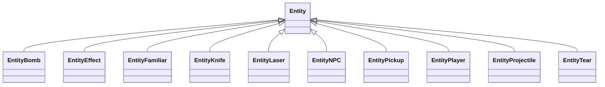
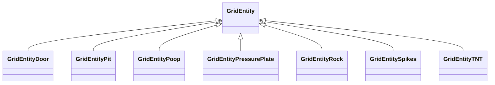

This document contains the complete source code of the repository consolidated into a single file for streamlined AI analysis.
The repository contents have been processed and combined with security validation bypassed.

# Repository Overview

## About This Document
This consolidated file represents the complete codebase from the repository, 
merged into a unified document optimized for AI consumption and automated 
analysis workflows.

## Repository Information
- **Repository:** wofsauge/IsaacDocs
- **Branch:** main
- **Total Files:** 384
- **Generated:** 2026-10-02T02:11:07.063Z

## Document Structure
The content is organized in the following sequence:
1. This overview section
2. Repository metadata and information  
3. File system hierarchy
4. Repository files (when included)
5. Individual source files, each containing:
   a. File path header (## File: path/to/file)
   b. Complete file contents within code blocks

## Best Practices
- Treat this document as read-only - make changes in the original repository
- Use file path headers to navigate between different source files
- Handle with appropriate security measures as this may contain sensitive data
- This consolidated view is generated from the live repository state

## Important Notes
- Files excluded by .gitignore and configuration rules are omitted
- Binary assets are not included - refer to the file structure for complete file listings
- Default ignore patterns have been applied to filter content
- Security validation is disabled - review content for sensitive information carefully

# Repository Structure

```
wofsauge/IsaacDocs/
└── docs
    ├── entities
    │   ├── bosses
    │   │   ├── Chapter1-5.md
    │   │   ├── Chapter1.md
    │   │   ├── Chapter2-5.md
    │   │   ├── Chapter2.md
    │   │   ├── Chapter3-5.md
    │   │   ├── Chapter3.md
    │   │   ├── Chapter4-5.md
    │   │   ├── Chapter4.md
    │   │   └── FinalBosses.md
    │   ├── EntityData.md
    │   ├── FissureSpawner.md
    │   ├── Overview.md
    │   └── SpikeBallChain.md
    ├── enums
    │   ├── ActionTriggers.md
    │   ├── ActiveSlot.md
    │   ├── BabySubType.md
    │   ├── BackdropType.md
    │   ├── BatterySubType.md
    │   ├── BedSubType.md
    │   ├── BombSubType.md
    │   ├── BombVariant.md
    │   ├── ButtonAction.md
    │   ├── CacheFlag.md
    │   ├── CallbackPriority.md
    │   ├── Card.md
    │   ├── Challenge.md
    │   ├── ChampionColor.md
    │   ├── ChestSubType.md
    │   ├── CoinSubType.md
    │   ├── CollectibleType.md
    │   ├── DamageFlag.md
    │   ├── Difficulty.md
    │   ├── Direction.md
    │   ├── DoorSlot.md
    │   ├── DoorState.md
    │   ├── DoorVariant.md
    │   ├── DrawStringAlignment.md
    │   ├── EffectVariant.md
    │   ├── EntityCollisionClass.md
    │   ├── EntityFlag.md
    │   ├── EntityGridCollisionClass.md
    │   ├── EntityPartition.md
    │   ├── EntityType.md
    │   ├── FamiliarVariant.md
    │   ├── GameStateFlag.md
    │   ├── GridCollisionClass.md
    │   ├── GridEntityType.md
    │   ├── GridRooms.md
    │   ├── HeartSubType.md
    │   ├── InputHook.md
    │   ├── ItemConfig.md
    │   ├── ItemPoolType.md
    │   ├── ItemType.md
    │   ├── Keyboard.md
    │   ├── KeySubType.md
    │   ├── LaserOffset.md
    │   ├── LaserSubType.md
    │   ├── LaserVariant.md
    │   ├── LevelCurse.md
    │   ├── LevelStage.md
    │   ├── LevelStateFlag.md
    │   ├── LocustSubtypes.md
    │   ├── ModCallbacks.md
    │   ├── Mouse.md
    │   ├── Music.md
    │   ├── NpcState.md
    │   ├── NullItemID.md
    │   ├── PickupPrice.md
    │   ├── PickupVariant.md
    │   ├── PillColor.md
    │   ├── PillEffect.md
    │   ├── PlayerForm.md
    │   ├── PlayerSpriteLayer.md
    │   ├── PlayerType.md
    │   ├── PoopPickupSubType.md
    │   ├── PoopSpellType.md
    │   ├── ProjectileFlags.md
    │   ├── ProjectileVariant.md
    │   ├── RenderMode.md
    │   ├── RoomDescriptor.md
    │   ├── RoomShape.md
    │   ├── RoomTransitionAnim.md
    │   ├── RoomType.md
    │   ├── SackSubType.md
    │   ├── SeedEffect.md
    │   ├── SkinColor.md
    │   ├── SortingLayer.md
    │   ├── SoundEffect.md
    │   ├── StageType.md
    │   ├── TearFlags.md
    │   ├── TearVariant.md
    │   ├── TrinketType.md
    │   ├── UseFlag.md
    │   └── WeaponType.md
    ├── faq
    │   ├── BasicInformation.md
    │   ├── Coding.md
    │   ├── FaqHome.md
    │   ├── GettingStarted.md
    │   ├── interactive_FAQ.md
    │   ├── LaunchOptions.md
    │   ├── Lua.md
    │   └── Troubleshoot.md
    ├── snippets
    │   ├── AddCollectibleEffect.txt
    │   ├── EntityClassDiagram.md
    │   └── GridEntityClassDiagram.md
    ├── tutorials
    │   ├── AddingCostumesWithoutLUA.md
    │   ├── CustomCallbacks.md
    │   ├── DebugConsole.md
    │   ├── directories-and-save-files.md
    │   ├── ExampleProject.md
    │   ├── FunctionsInLua.md
    │   ├── GettingHelp.md
    │   ├── GoodPractices.md
    │   ├── MathAndLuaTips.md
    │   ├── mod-organization.md
    │   ├── Standard-Library.md
    │   ├── storing-data.md
    │   ├── Tool_AnimationEditor.md
    │   ├── Tool_ItemPoolEditor.md
    │   ├── Tool_XMLValidator.md
    │   ├── Tools.md
    │   ├── Tutorial-Rendertext.md
    │   ├── Using-Additional-Lua-Files.md
    │   ├── Writingscreenshaders.md
    │   └── ZeroBraneStudio.md
    ├── xml
    │   ├── achievements.md
    │   ├── ambush.md
    │   ├── Anm2_files.md
    │   ├── babies.md
    │   ├── backdrops.md
    │   ├── bombcostumes.md
    │   ├── bosscolors.md
    │   ├── bossoverlays.md
    │   ├── bosspools.md
    │   ├── bossportraits.md
    │   ├── challenges.md
    │   ├── costumes2.md
    │   ├── curses.md
    │   ├── cutscenes.md
    │   ├── entities2.md
    │   ├── fortunes.md
    │   ├── fxlayers.md
    │   ├── giantbook.md
    │   ├── itempools.md
    │   ├── items_metadata.md
    │   ├── items.md
    │   ├── locusts.md
    │   ├── minibosses.md
    │   ├── music.md
    │   ├── nightmares.md
    │   ├── playerforms.md
    │   ├── players.md
    │   ├── pocketitems.md
    │   ├── preload.md
    │   ├── recipes.md
    │   ├── rules.md
    │   ├── seedmenu.md
    │   ├── seeds.md
    │   ├── sounds.md
    │   ├── stages.md
    │   ├── translations.md
    │   ├── wisps.md
    │   └── XMLFiledocumentation.md
    ├── BitSet128.md
    ├── Color.md
    ├── CppContainer_ArrayProxy_intValues.md
    ├── CppContainer_ArrayProxy_RoomConfigEntries.md
    ├── CppContainer_ArrayProxy_RoomConfigSpawns.md
    ├── CppContainer_ArrayProxy_RoomDescriptor.md
    ├── CppContainer_EntityList.md
    ├── CppContainer_Vector_CardConfigList.md
    ├── CppContainer_Vector_CostumeConfigList.md
    ├── CppContainer_Vector_EffectList.md
    ├── CppContainer_Vector_ItemConfigList.md
    ├── CppContainer_Vector_PillConfigList.md
    ├── CppContainer_Vector_VectorList.md
    ├── Entity.md
    ├── EntityBomb.md
    ├── EntityEffect.md
    ├── EntityFamiliar.md
    ├── EntityKnife.md
    ├── EntityLaser.md
    ├── EntityNPC.md
    ├── EntityPickup.md
    ├── EntityPlayer.md
    ├── EntityProjectile.md
    ├── EntityPtr.md
    ├── EntityRef.md
    ├── EntityTear.md
    ├── Font.md
    ├── FontRenderSettings.md
    ├── Game.md
    ├── GlobalFunctions.md
    ├── Globals.md
    ├── GridEntity.md
    ├── GridEntityDesc.md
    ├── GridEntityDoor.md
    ├── GridEntityPit.md
    ├── GridEntityPoop.md
    ├── GridEntityPressurePlate.md
    ├── GridEntityRock.md
    ├── GridEntitySpikes.md
    ├── GridEntityTNT.md
    ├── HUD.md
    ├── index.md
    ├── Input.md
    ├── Isaac.md
    ├── ItemConfig_Card.md
    ├── ItemConfig_Costume.md
    ├── ItemConfig_Item.md
    ├── ItemConfig_PillEffect.md
    ├── ItemConfig.md
    ├── ItemPool.md
    ├── KColor.md
    ├── Level.md
    ├── ModReference.md
    ├── MusicManager.md
    ├── Options.md
    ├── PathFinder.md
    ├── PLACEHOLDER.md
    ├── PlayerTypes_ActiveItemDesc.md
    ├── PlayerTypes_PosVel.md
    ├── ProjectileParams.md
    ├── QueueItemData.md
    ├── RNG.md
    ├── Room.md
    ├── RoomConfig_Entry.md
    ├── RoomConfig_Room.md
    ├── RoomConfig_Spawn.md
    ├── RoomDescriptor.md
    ├── Seeds.md
    ├── SFXManager.md
    ├── Sprite.md
    ├── tags.md
    ├── TearParams.md
    ├── TemporaryEffect.md
    ├── TemporaryEffects.md
    └── Vector.md
```

================================================================================
// File: docs/BitSet128.md
================================================================================
---
tags:
  - Globals
  - Class
---
# Class "BitSet128"

???+ info
    This class can be accessed by using its constructor or usind the [TearFlags](enums/TearFlags.md) enum:

    ???+ example "Example Code"
        ```lua
        local myBitSet = TearFlags.TEAR_WIGGLE
        ```

## Constructors
### BitSet128 () {: aria-label='Constructors' }
[ ](#){: .reporplus .tooltip .badge }
#### [BitSet128](BitSet128.md) BitSet128 ( int Low = 0, int High = 0 ) {: .copyable aria-label='Constructors' }

Constructor for the "BitSet128" class.

[BitSet128](BitSet128.md) is used as a storage system for flags and other bit-wise evaluated values that exceed the numeric limits of the default 64-bit integers which only allow for up to 64 flags to be defined. [BitSet128](BitSet128.md) allows for up to 128 Flags by spliting the bitset into a "lower" and "higher" part. Those parts are represented by a simple 64bit integer number.
___
## Operators
### __bnot () {: aria-label='Operators' }
[ ](#){: .reporplus .tooltip .badge }
#### [BitSet128](BitSet128.md) __bnot ( ) {: .copyable aria-label='Operators' }
Defines the negation of a [BitSet128](BitSet128.md) object using the `~` operator.
___

### __bor () {: aria-label='Operators' }
[ ](#){: .reporplus .tooltip .badge }
#### [BitSet128](BitSet128.md) __bor ( [BitSet128](BitSet128.md) Right ) {: .copyable aria-label='Operators' }
Defines the binary OR operation of two [BitSet128](BitSet128.md) objects using the `|` operator.
___

### __band () {: aria-label='Operators' }
[ ](#){: .reporplus .tooltip .badge }
#### [BitSet128](BitSet128.md) __band ( [BitSet128](BitSet128.md) Right ) {: .copyable aria-label='Operators' }
Defines the binary AND operation of two [BitSet128](BitSet128.md) objects using the `&` operator.
___

### __bxor () {: aria-label='Operators' }
[ ](#){: .reporplus .tooltip .badge }
#### [BitSet128](BitSet128.md) __bxor ( [BitSet128](BitSet128.md) Right ) {: .copyable aria-label='Operators' }
Defines the binary XOR operation of two [BitSet128](BitSet128.md) objects using the `~` operator.
___

### __shl () {: aria-label='Operators' }
[ ](#){: .reporplus .tooltip .badge }
#### [BitSet128](BitSet128.md) __shl ( int Shift ) {: .copyable aria-label='Operators' }
Defines the left bit-shift operator of a [BitSet128](BitSet128.md) object using the `<<` operator.
___

### __shr () {: aria-label='Operators' }
[ ](#){: .reporplus .tooltip .badge }
#### [BitSet128](BitSet128.md) __shr ( int Shift ) {: .copyable aria-label='Operators' }
Defines the right bit-shift operator of a [BitSet128](BitSet128.md) object using the `>>` operator.
___

### __eq () {: aria-label='Operators' }
[ ](#){: .reporplus .tooltip .badge }
#### boolean __eq ( [BitSet128](BitSet128.md) right ) {: .copyable aria-label='Operators' }
Defines the equality operation of two [BitSet128](BitSet128.md) objects using the `==` operator.
___

### __lt () {: aria-label='Operators' }
[ ](#){: .reporplus .tooltip .badge }
#### boolean __lt ( [BitSet128](BitSet128.md) right ) {: .copyable aria-label='Operators' }
Defines the "smaller than"-Operation of two [BitSet128](BitSet128.md) objects using the `<` operator.

The `>` operator is implicitly defined with this as well.
___

### __le () {: aria-label='Operators' }
[ ](#){: .reporplus .tooltip .badge }
#### boolean __le ( [BitSet128](BitSet128.md) right ) {: .copyable aria-label='Operators' }
Defines the "smaller of equal" operation of two [BitSet128](BitSet128.md) objects using the `<=` operator.

The `>=` operator is implicitly defined with this as well.
___
## Functions
### Get () {: aria-label='Functions' }
[ ](#){: .tooltip .badge } [ ](#){: .reporplus .tooltip .badge }
#### boolean Get ( int BitPosition ) {: .copyable aria-label='Functions' }
Gets the flags' value at the provided position.
___

### Set () {: aria-label='Functions' }
[ ](#){: .tooltip .badge } [ ](#){: .reporplus .tooltip .badge }
#### void Set ( int BitPosition, boolean State ) {: .copyable aria-label='Functions' }
Sets the bit at the given position to the given value.

___

### __tostring () {: aria-label='Functions' }
[ ](#){: .tooltip .badge } [ ](#){: .reporplus .tooltip .badge }
#### void __tostring ( ) {: .copyable aria-label='Functions' }
[BitSet128](BitSet128.md) objects can be cast to a string object, which returns information about this object in the following format:

```
BitSet128: [[High+Low values converted into Hexadecimal]]
```

___
## Variables

### h {: aria-label='Variables' }
[ ](#){: .reporplus .tooltip .badge }
#### int h  {: .copyable aria-label='Variables' }
Returns the number representing the "High" or "upper" 64-bit number of the 128bit [BitSet128](BitSet128.md) object.
___
### l {: aria-label='Variables' }
[ ](#){: .reporplus .tooltip .badge }
#### int l  {: .copyable aria-label='Variables' }
Returns the number representing the "Low" or "lower" 64-bit number of the 128bit [BitSet128](BitSet128.md) object.
___

================================================================================
// File: docs/Color.md
================================================================================
---
tags:
  - Globals
  - Class
---
# Class "Color"

???+ info
    This class can be accessed by using its constructor or the following function:

    * [Entity.Color](Entity.md#color)
    * [Entity.SplatColor](Entity.md#splatcolor)
    * [EntityPlayer.LaserColor](EntityPlayer.md#lasercolor)
    * [EntityPlayer.TearColor](EntityPlayer.md#tearcolor)
    * [ProjectileParams.Color](ProjectileParams.md#color)
    * [Sprite.Color](Sprite.md#color)
    * [TearParams.TearColor](TearParams.md#tearcolor)

    ???+ example "Example Code"
        ```lua
        local myRedColor = Color(1,0,0,1)
        ```

## Constructors
### Color () {: aria-label='Constructors' }
[ ](#){: .reporplus .tooltip .badge }
#### [Color](Color.md) Color ( float R, float G, float B, float A = 1, float RO = 0, float GO = 0, float BO = 0 ) {: .copyable aria-label='Constructors' }

Constructor for the "Color" class.

When using the [Font](Font.md) class, use [KColor()](KColor.md) instead.

Colors are made of three separate components, tint, colorize and offset. Tint acts like a color multiplicator. Offset is a color which is added after the tint is applied. Colorize is complicated. See the `:::lua SetColorize()` function for a detailed description.

R, G, B, A, RO, GO and BO accept numbers between 0 and 1.
___
## Operators
### __mul () {: aria-label='Operators' }
[ ](#){: .alldlc .tooltip .badge }
#### [Color](Color.md) __mul ( [Color](Color.md) right ) {: .copyable aria-label='Operators' }

Defines the multiplication of two [Color](Color.md) objects using the `*` operator.
___
## Constants
### Color.Default {: aria-label='Constants' }
[ ](#){: .reporplus .tooltip .badge }

Equivalent to `:::lua Color(1, 1, 1, 1)`, the color white.
___
## Functions
### Lerp () {: aria-label='Functions' }
[ ](#){: .static .tooltip .badge } [ ](#){: .alldlc .tooltip .badge }
#### static [Color](Color.md) Lerp ( [Color](Color.md) m1, [Color](Color.md) m2, float t ) {: .copyable aria-label='Functions' }

Linear Interpolation between two colors. `:::lua t` is the "progress" of the interpolation. Setting `:::lua t = 0.5` means that the color in the middle of m1 and m2 will be returned.
___
### Reset () {: aria-label='Functions' }
[ ](#){: .alldlc .tooltip .badge }
#### void Reset ( ) {: .copyable aria-label='Functions' }

___
### Set·Colorize () {: aria-label='Functions' }
[ ](#){: .alldlc .tooltip .badge }
#### void SetColorize ( float Red, float Green, float Blue, float Amount ) {: .copyable aria-label='Functions' }

The colorize function can be used to change the color of sprites. Its the best for that purpose, since it does not affect existing coloranimations like the flashing of creep.

The values can be between 0 and 1 for normal coloration. if you use higher numbers the color gets more vibrant.

???- note "Notes"
    The alpha component determines how much colorization must be applied. The function takes the original color, converts it to grayscale, multiplies it by the RGB components and then blends it back with the original color. The alpha value determines the blending factor.
    Colorization is applied after the tint and before the offset function.

???- example "Example Code"
    - `:::lua SetColorize(1, 1, 1, 1)` will turn the sprite into grayscale.
    - `:::lua SetColorize(1, 0, 0, 1)` will turn it red but not as a red tint but as shades of red.
    - `:::lua SetColorize(1, 1, 1, 2)` will invert the sprite without touching its luminosity.

    This code changes the color of red Creep to be purple
    ```lua
    mod:AddCallback(ModCallbacks.MC_POST_EFFECT_INIT, function(_, effect)
      if effect.Variant == EffectVariant.CREEP_RED then
        local color = Color(1, 1, 1, 1, 0, 0, 0)
        color:SetColorize(4, 0, 4, 1)
        local sprite = effect:GetSprite()
        sprite.Color = color
      end
    end)
    ```

___
### Set·Offset () {: aria-label='Functions' }
[ ](#){: .alldlc .tooltip .badge }
#### void SetOffset ( float RedOffset, float GreenOffset, float BlueOffset ) {: .copyable aria-label='Functions' }

Offset is a color that gets added to the sprite after the Tint was applied.
___
### Set·Tint () {: aria-label='Functions' }
[ ](#){: .alldlc .tooltip .badge }
#### void SetTint ( float RedTint, float GreenTint, float BlueTint, float AlphaTint ) {: .copyable aria-label='Functions' }

Tint acts like a color multiplicator.
___
## Variables
### A {: aria-label='Variables' }
[ ](#){: .alldlc .tooltip .badge }
#### float A  {: .copyable aria-label='Variables' }
Alpha value of the color, where 0 is fully transparent, 1 is fully opaque.
___
### B {: aria-label='Variables' }
[ ](#){: .alldlc .tooltip .badge }
#### float B  {: .copyable aria-label='Variables' }
Blue value of the color. Number between 0 and 1.
___
### BO {: aria-label='Variables' }
[ ](#){: .alldlc .tooltip .badge }
#### float BO  {: .copyable aria-label='Variables' }
Blue-Offset value of the color. Number can be positive or negative.

___
### G {: aria-label='Variables' }
[ ](#){: .alldlc .tooltip .badge }
#### float G  {: .copyable aria-label='Variables' }
Green value of the color. Number between 0 and 1.

___
### GO {: aria-label='Variables' }
[ ](#){: .alldlc .tooltip .badge }
#### float GO  {: .copyable aria-label='Variables' }
Green-Offset value of the color. Number can be positive or negative.

___
### R {: aria-label='Variables' }
[ ](#){: .alldlc .tooltip .badge }
#### float R  {: .copyable aria-label='Variables' }
Red value of the color. Number between 0 and 1.

___
### RO {: aria-label='Variables' }
[ ](#){: .alldlc .tooltip .badge }
#### float RO  {: .copyable aria-label='Variables' }
Red-Offset value of the color. Number can be positive or negative.

================================================================================
// File: docs/CppContainer_ArrayProxy_RoomConfigEntries.md
================================================================================
---
tags:
  - Class
search:
  boost: 0.25
---
# Class "RoomConfigEntries"

???+ info
    You can get this class by using the following function:

    * [RoomConfigSpawn.Entries](RoomConfig_Spawn.md#entries)

    ???+ example "Example Code"
        ```lua
        local level = Game():GetLevel()
        local roomDescriptor = level:GetCurrentRoomDesc()
        local roomConfigRoom = roomDescriptor.Data
        local spawnList = roomConfigRoom.Spawns
        local roomConfigSpawn = spawnList:Get(0)
        local entries = roomConfigSpawn.Entries
        ```

## Operators
### __len () {: aria-label='Operators' }
[ ](#){: .alldlc .tooltip .badge }
#### int __len ( ) {: .copyable aria-label='Operators' }

The length (#) operation. Returns the size of this list.

___
## Functions
### Get () {: aria-label='Functions' }
[ ](#){: .alldlc .tooltip .badge }
#### [RoomConfig Entry](RoomConfig_Entry.md) Get ( int idx ) {: .copyable aria-label='Functions' }

___
## Variables
### Size {: aria-label='Variables' }
[ ](#){: .const .tooltip .badge } [ ](#){: .alldlc .tooltip .badge }
#### const int Size  {: .copyable aria-label='Variables' }

___

================================================================================
// File: docs/CppContainer_ArrayProxy_RoomConfigSpawns.md
================================================================================
---
tags:
  - Class
search:
  boost: 0.25
---
# Class "RoomConfigSpawns"

???+ info
    You can get this class by using the following function:

    * [RoomConfigRoom.Spawns](RoomConfig_Room.md#spawns)

    ???+ example "Example Code"
        ```lua
        local level = Game():GetLevel()
        local roomDescriptor = level:GetCurrentRoomDesc()
        local roomConfigRoom = roomDescriptor.Data
        local spawnList = roomConfigRoom.Spawns
        ```

## Operators
### __len () {: aria-label='Operators' }
[ ](#){: .alldlc .tooltip .badge }
#### int __len ( ) {: .copyable aria-label='Operators' }

The length (#) operation. Returns the amount of spawnables in this list.

___
## Functions
### Get () {: aria-label='Functions' }
[ ](#){: .alldlc .tooltip .badge }
#### [RoomConfig Spawn](RoomConfig_Spawn.md) Get ( int idx ) {: .copyable aria-label='Functions' }

Returns a [RoomConfig Spawn](RoomConfig_Spawn.md) at the index of the list provided.

___
## Variables
### Size {: aria-label='Variables' }
[ ](#){: .const .tooltip .badge } [ ](#){: .alldlc .tooltip .badge }
#### const int Size  {: .copyable aria-label='Variables' }

The amount of spawnables in the list.

___

================================================================================
// File: docs/CppContainer_ArrayProxy_RoomDescriptor.md
================================================================================
---
tags:
  - Class
search:
  boost: 0.25
---
# Class "RoomDescriptor"

???+ info
    You can get this class by using the following function:

    * [Level.GetCurrentRoomDesc](Level.md#getcurrentroomdesc)
    * [Level.GetLastRoomDesc](Level.md#getlastroomdesc)
    * [Level.GetRoomByIdx](Level.md#getroombyidx)

    ???+ example "Example Code"
        ```lua
        local level = Game():GetLevel()
        local roomDescriptor = level:GetCurrentRoomDesc()
        ```

## Operators
### __len () {: aria-label='Operators' }
[ ](#){: .alldlc .tooltip .badge }
#### int __len ( ) {: .copyable aria-label='Operators' }

The length (#) operation. Returns the amount of rooms in the list.

___
## Functions
### Get () {: aria-label='Functions' }
[ ](#){: .alldlc .tooltip .badge }
#### [RoomDescriptor](RoomDescriptor.md) Get ( int idx ) {: .copyable aria-label='Functions' }

Returns a [RoomDescriptor](RoomDescriptor.md) at the index of the list provided.

___
## Variables
### Size {: aria-label='Variables' }
[ ](#){: .const .tooltip .badge } [ ](#){: .alldlc .tooltip .badge }
#### const int Size  {: .copyable aria-label='Variables' }

The amount of rooms in the list.

___

================================================================================
// File: docs/CppContainer_ArrayProxy_intValues.md
================================================================================
---
tags:
  - Class
search:
  boost: 0.25
---
# Class "intValues"

???+ warning
    There is currently no method to get access to this class.

## Operators
### __len () {: aria-label='Operators' }
[ ](#){: .alldlc .tooltip .badge }
#### int __len ( ) {: .copyable aria-label='Operators' }

The length (#) operation. Returns the size of this list.

___
## Functions
### Get () {: aria-label='Functions' }
[ ](#){: .alldlc .tooltip .badge }
#### userdata Get ( int idx ) {: .copyable aria-label='Functions' }

___
## Variables
### Size {: aria-label='Variables' }
[ ](#){: .const .tooltip .badge } [ ](#){: .alldlc .tooltip .badge }
#### const int Size  {: .copyable aria-label='Variables' }

___

================================================================================
// File: docs/CppContainer_EntityList.md
================================================================================
---
tags:
  - Class
search:
  boost: 0.25
---
# Class "EntityList"

???+ info
    You can get this class by using the following function:

    * [EntityNPC.QueryNPCsGroup()](EntityNPC.md#querynpcsgroup)
    * [EntityNPC.QueryNPCsSpawnerType()](EntityNPC.md#querynpcsspawnertype)
    * [EntityNPC.QueryNPCsType()](EntityNPC.md#querynpcstype)
    * [Isaac.GetRoomEntities()](Isaac.md#getroomentities)
    * [Room.GetEntities()](Room.md#getentities)

    ???+ example "Example Code"
        `local entities = Isaac.GetRoomEntities()`

## Operators
### __len () {: aria-label='Operators' }
[ ](#){: .alldlc .tooltip .badge }
#### int __len ( ) {: .copyable aria-label='Operators' }

The length (#) operation. Returns the amount of entities in the list.

___
## Functions
### Get () {: aria-label='Functions' }
[ ](#){: .alldlc .tooltip .badge }
#### [Entity](Entity.md) Get ( int idx ) {: .copyable aria-label='Functions' }

Returns an [Entity](Entity.md) at the index of the list provided.

___
## Variables
### Size {: aria-label='Variables' }
[ ](#){: .const .tooltip .badge } [ ](#){: .alldlc .tooltip .badge }
#### const int Size  {: .copyable aria-label='Variables' }

The amount of entities in the list.

___

================================================================================
// File: docs/CppContainer_Vector_CardConfigList.md
================================================================================
---
tags:
  - Class
search:
  boost: 0.25
---
# Class "CardConfigList"

???+ info
    You can get this class by using the following function:

    * [ItemConfig.GetCards()](ItemConfig.md#getcards)

    ???+ example "Example Code"
        `local cardConfigs = Isaac.GetItemConfig():GetCards()`

## Operators
### __len () {: aria-label='Operators' }
[ ](#){: .alldlc .tooltip .badge }
#### int __len ( ) {: .copyable aria-label='Operators' }

The length (#) operation. Returns the amount of cards in the list.

___
## Functions
### Get () {: aria-label='Functions' }
[ ](#){: .alldlc .tooltip .badge }
#### userdata Get ( int idx ) {: .copyable aria-label='Functions' }

Returns userdata at the index of the list provided.

???+ bug "Bugs"
    This function does not return usable userdata, rendering it useless.

___
## Variables
### Size {: aria-label='Variables' }
[ ](#){: .const .tooltip .badge } [ ](#){: .alldlc .tooltip .badge }
#### const int Size  {: .copyable aria-label='Variables' }

The amount of cards in the list.

___

================================================================================
// File: docs/CppContainer_Vector_CostumeConfigList.md
================================================================================
---
tags:
  - Class
search:
  boost: 0.25
---
# Class "CostumeConfigList"

???+ warning
    There is currently no method to get access to this class.

## Operators
### __len () {: aria-label='Operators' }
[ ](#){: .alldlc .tooltip .badge }
#### int __len ( ) {: .copyable aria-label='Operators' }

The length (#) operation. Returns the amount of costumes in the list.

___
## Functions
### Get () {: aria-label='Functions' }
[ ](#){: .alldlc .tooltip .badge }
#### userdata Get ( int idx ) {: .copyable aria-label='Functions' }

Returns userdata at the index of the list provided.

???+ bug "Bugs"
    This function does not return usable userdata, rendering it useless.

___
## Variables
### Size {: aria-label='Variables' }
[ ](#){: .const .tooltip .badge } [ ](#){: .alldlc .tooltip .badge }
#### const int Size  {: .copyable aria-label='Variables' }

The amount of costumes in the list.

___

================================================================================
// File: docs/CppContainer_Vector_EffectList.md
================================================================================
---
tags:
  - Class
search:
  boost: 0.25
---
# Class "EffectList"

???+ info
    You can get this class by using the following function:

    * [TemporaryEffects.GetEffectsList()](TemporaryEffects.md#geteffectslist)

    ???+ example "Example Code"
        ```lua
        local player = Isaac.GetPlayer()
        local tempEffects = player:GetEffects()
        local effectlist = tempEffects:GetEffectsList()
        ```

## Operators
### __len () {: aria-label='Operators' }
[ ](#){: .alldlc .tooltip .badge }
#### int __len ( ) {: .copyable aria-label='Operators' }

The length (#) operation. Returns the amount of [TemporaryEffects](TemporaryEffects.md) in the list.

___
## Functions
### Get () {: aria-label='Functions' }
[ ](#){: .alldlc .tooltip .badge }
#### [TemporaryEffect](TemporaryEffect.md) Get ( int idx ) {: .copyable aria-label='Functions' }

Returns the [TemporaryEffect](TemporaryEffect.md) at the index of the list provided.

___
## Variables
### Size {: aria-label='Variables' }
[ ](#){: .const .tooltip .badge } [ ](#){: .alldlc .tooltip .badge }
#### const int Size  {: .copyable aria-label='Variables' }

The amount of [TemporaryEffects](TemporaryEffects.md) in the list.

___

================================================================================
// File: docs/CppContainer_Vector_ItemConfigList.md
================================================================================
---
tags:
  - Class
search:
  boost: 0.25
---
# Class "ItemConfigList"

???+ info
    You can get this class by using the following function:

    * [ItemConfig.GetNullItems()](ItemConfig.md#getnullitems)
    * [ItemConfig.GetTrinkets()](ItemConfig.md#gettrinkets)

    ???+ example "Example Code"
        `local effects = Isaac.GetItemConfig():GetTrinkets()`

## Operators
### __len () {: aria-label='Operators' }
[ ](#){: .alldlc .tooltip .badge }
#### int __len ( ) {: .copyable aria-label='Operators' }

The length (#) operation. Returns the amount of items in the list.

___
## Functions
### Get () {: aria-label='Functions' }
[ ](#){: .alldlc .tooltip .badge }
#### userdata Get ( int idx ) {: .copyable aria-label='Functions' }

Returns userdata at the index of the list provided.

???+ bug "Bugs"
    This function does not return usable userdata, rendering it useless.

___
## Variables
### Size {: aria-label='Variables' }
[ ](#){: .const .tooltip .badge } [ ](#){: .alldlc .tooltip .badge }
#### const int Size  {: .copyable aria-label='Variables' }

The amount of items in the list.

___

================================================================================
// File: docs/CppContainer_Vector_PillConfigList.md
================================================================================
---
tags:
  - Class
search:
  boost: 0.25
---
# Class "PillConfigList"

???+ info
    You can get this class by using the following function:

    * [ItemConfig.GetPillEffects()](ItemConfig.md#getpilleffects)

    ???+ example "Example Code"
        `local effects = Isaac.GetItemConfig():GetPillEffects()`

## Operators
### __len () {: aria-label='Operators' }
[ ](#){: .alldlc .tooltip .badge }
#### int __len ( ) {: .copyable aria-label='Operators' }

The length (#) operation. Returns the amount of pill effects in the list.

___
## Functions
### Get () {: aria-label='Functions' }
[ ](#){: .alldlc .tooltip .badge }
#### userdata Get ( int idx ) {: .copyable aria-label='Functions' }

Returns userdata at the index of the list provided.

???+ bug "Bugs"
    This function does not return usable userdata, rendering it useless.

___
## Variables
### Size {: aria-label='Variables' }
[ ](#){: .const .tooltip .badge } [ ](#){: .alldlc .tooltip .badge }
#### const int Size  {: .copyable aria-label='Variables' }

The amount of pill effects in the list.

___

================================================================================
// File: docs/CppContainer_Vector_VectorList.md
================================================================================
---
tags:
  - Class
search:
  boost: 0.25
---
# Class "VectorList"

???+ info
    You can get this class by using the following function:

    * [EntityLaser.GetNonOptimizedSamples()](EntityLaser.md#getnonoptimizedsamples)
    * [EntityLaser.GetSamples()](EntityLaser.md#getsamples)

    ???+ example "Example Code"
        `local brimstoneEntity = Isaac.GetPlayer():FireBrimstone(Vector(1, 0)):GetSamples()`

## Operators
### __len () {: aria-label='Operators' }
[ ](#){: .alldlc .tooltip .badge }
#### int __len ( ) {: .copyable aria-label='Operators' }

The length (#) operation. Returns the size of this list.

___
## Functions
### Get () {: aria-label='Functions' }
[ ](#){: .alldlc .tooltip .badge }
#### [Vector](Vector.md) Get ( int idx ) {: .copyable aria-label='Functions' }

___
## Variables
### Size {: aria-label='Variables' }
[ ](#){: .const .tooltip .badge } [ ](#){: .alldlc .tooltip .badge }
#### const int Size  {: .copyable aria-label='Variables' }

___

================================================================================
// File: docs/Entity.md
================================================================================
---
tags:
  - Class
---
# Class "Entity"

???+ info
    First, see [the tutorial on entities](entities/Overview.md).

    You can get this class by using the following function:

    ???- info "List of all functions that return 'Entity' objects"
        * [EntityList.Get()](CppContainer_EntityList.md#get)
        * [Entity.GetLastChild()](Entity.md#getlastchild)
        * [Entity.GetLastParent()](Entity.md#getlastparent)
        * [Entity.Child](Entity.md#child)
        * [Entity.Parent](Entity.md#parent)
        * [Entity.SpawnerEntity](Entity.md#spawnerentity)
        * [Entity.Target](Entity.md#target)
        * [EntityLaser.BounceLaser()](EntityLaser.md#bouncelaser)
        * [EntityNPC.GetPlayerTarget()](EntityNPC.md#getplayertarget)
        * [EntityNPC.EntityRef](EntityNPC.md#entityref)
        * [EntityPlayer.AddBlueFlies](EntityPlayer.md#addblueflies)
        * [EntityPlayer.AddBlueSpider](EntityPlayer.md#addbluespider)
        * [EntityPlayer.GetActiveWeaponEntity](EntityPlayer.md#getactiveweaponentity)
        * [EntityPlayer.GetNPCTarget](EntityPlayer.md#getnpctarget)
        * [EntityPlayer.GetTractorBeam](EntityPlayer.md#gettractorbeam)
        * [EntityPlayer.ThrowBlueSpider](EntityPlayer.md#throwbluespider)
        * [EntityPlayer.ThrowHeldEntity](EntityPlayer.md#throwheldentity)
        * [EntityPtr](EntityPtr.md#ref)
        * [EntityRef.Entity](EntityRef.md#entity)
        * [EntityTear.StickTarget](EntityTear.md#sticktarget)
        * [Game.Spawn()](Game.md#spawn)
        * [Isaac.Spawn()](Game.md#spawn)

    ???+ example "Example Code"
        `local entity = Isaac.Spawn(EntityType.ENTITY_PICKUP, PickupVariant.PICKUP_COLLECTIBLE, 0, Vector(320,280), Vector(0,0), nil)`

## Class Diagram
--8<-- "docs/snippets/EntityClassDiagram.md"

## Functions
### Add·Burn () {: aria-label='Functions' }
[ ](#){: .abrep .tooltip .badge }
#### void AddBurn ( [EntityRef](EntityRef.md) Source, int Duration, float Damage ) {: .copyable aria-label='Functions' }
[ ](#){: .repplus .tooltip .badge }
#### void AddBurn ( [EntityRef](EntityRef.md) Source, int Duration, float Damage, boolean IgnoreBosses ) {: .copyable aria-label='Functions' }

Adds a burn effect to an enemy. `Duration` is in number of frames. `Damage` is the damage taken per frame.

???- info "Duration Information"
    `Duration` must be a minimum of 3 frames to deal damage. Every consecutive damage tick is 20 frames apart.

    - 2 damage ticks = 23 frames
    - 3 damage ticks = 43 frames
    - 4 damage ticks = 63 frames

    `Duration` has an upper limit. For an EntityPlayer, its maximum is one interval. For a normal entity, the maximum is 6 intervals.

???- example "Example Code"
    This code damages every entity in the room for 1 second with the damage source set to the player. The total damage dealt is 1.

    ```lua
    local player = Isaac.GetPlayer()
    local entities = Isaac.GetRoomEntities()
    for i, entity in ipairs(entities) do
    	entity:AddBurn(EntityRef(player), 30, 1)
    end
    ```

___
### Add·Charmed () {: aria-label='Functions' }
[ ](#){: .abrep .tooltip .badge }
#### void AddCharmed ( [EntityRef](EntityRef.md) sourceEntity, int Duration ) {: .copyable aria-label='Functions' }
[ ](#){: .repplus .tooltip .badge }
#### void AddCharmed ( [EntityRef](EntityRef.md) sourceEntity, int Duration, boolean IgnoreBosses ) {: .copyable aria-label='Functions' }

Adds a charmed-effect to an enemy. Duration is in Number of Frames. Charmed enemies are friendly towards Isaac and attack other enemies.

`:::lua Duration = -1` makes the effect permanent and the enemy will follow you even to different rooms.

???- example "Example Code"
    This code charms every entity in the room for 1 second.

    ```lua
    local player = Isaac.GetPlayer()
    local entities = Isaac.GetRoomEntities()
    for i, entity in ipairs() do
    	entity:AddCharmed(EntityRef(player), 30)
    end
    ```

___
### Add·Confusion () {: aria-label='Functions' }
[ ](#){: .alldlc .tooltip .badge }
#### void AddConfusion ( [EntityRef](EntityRef.md) Source, int Duration, boolean IgnoreBosses ) {: .copyable aria-label='Functions' }

Adds a confusion effect to an entity.

???- info "Duration infos"
    The Duration has a maximum of 5 seconds

???- example "Example Code"
    This code confuses every entity in the room for 1 second while ignoring bosses.

    ```lua
    local player = Isaac.GetPlayer()
    local entities = Isaac.GetRoomEntities()
    for i, entity in ipairs(entities) do
    	entity:AddConfusion(EntityRef(player), 30, true)
    end
    ```

___
### Add·Entity·Flags () {: aria-label='Functions' }
[ ](#){: .alldlc .tooltip .badge }
#### void AddEntityFlags ( int Flags ) {: .copyable aria-label='Functions' }

Add [EntityFlags](enums/EntityFlag.md) to the entity. Flags are used to add specific effects like being friendly or being immune from spike damage. You can add multiple flags at the same time by bitwise-concatenating them.

???- example "Example Code"
    This code adds slowing and confusion to the entity.

    ```lua
    local player = Isaac.GetPlayer()
    local entities = Isaac.GetRoomEntities()
    for i, entity in ipairs(entities) do
    	entity:AddEntityFlags(EntityFlag.FLAG_SLOW | EntityFlag.FLAG_CONFUSION)
    end
    ```
___
### Add·Fear () {: aria-label='Functions' }
[ ](#){: .abrep .tooltip .badge }
#### void AddFear ( [EntityRef](EntityRef.md) Source, int Duration ) {: .copyable aria-label='Functions' }
[ ](#){: .repplus .tooltip .badge }
#### void AddFear ( [EntityRef](EntityRef.md) Source, int Duration, boolean IgnoreBosses ) {: .copyable aria-label='Functions' }

Adds a fear-effect to an entity.

???- info "Duration infos"
    The Duration has a maximum of 5 seconds

???- example "Example Code"
    This code frightens every entity in the room for 1 second.

    ```lua
    local player = Isaac.GetPlayer()
    local entities = Isaac.GetRoomEntities()
    for i, entity in ipairs(entities) do
    	entity:AddFear(EntityRef(player), 30)
    end
    ```

___
### Add·Freeze () {: aria-label='Functions' }
[ ](#){: .abrep .tooltip .badge }
#### void AddFreeze ( [EntityRef](EntityRef.md) Source, int Duration ) {: .copyable aria-label='Functions' }
[ ](#){: .repplus .tooltip .badge }
#### void AddFreeze ( [EntityRef](EntityRef.md) Source, int Duration, boolean IgnoreBosses ) {: .copyable aria-label='Functions' }

Freezes an entity, making it unable to move and attack.

???- info "Duration infos"
    The Duration has a maximum of 5 seconds

???- example "Example Code"
    This code freezes every entity in the room for 1 second.

    ```lua
    local player = Isaac.GetPlayer()
    local entities = Isaac.GetRoomEntities()
    for i, entity in ipairs(entities) do
    	entity:AddFreeze(EntityRef(player), 30)
    end
    ```

___
### Add·Health () {: aria-label='Functions' }
[ ](#){: .alldlc .tooltip .badge }
#### void AddHealth ( float HitPoints ) {: .copyable aria-label='Functions' }
Heals an entity.
___
### Add·Midas·Freeze () {: aria-label='Functions' }
[ ](#){: .abrep .tooltip .badge }
#### void AddMidasFreeze ( [EntityRef](EntityRef.md) Source, int Duration ) {: .copyable aria-label='Functions' }
[ ](#){: .repplus .tooltip .badge }
#### void AddMidasFreeze ( [EntityRef](EntityRef.md) Source, int Duration, boolean IgnoreBosses ) {: .copyable aria-label='Functions' }
Turns the entity into a gold statue (can't move, can't attack, drops coins when killed)

???- info "Duration infos"
    The Duration has a maximum of 5 seconds

???+ bug
    The golden color applied to the entity will stay for the full duration passed into the function, despite the freeze effect only lasting for a maximum of 5 seconds.

???- example "Example Code"
    This code turns every entity in the room into gold for 1 second.

    ```lua
    local player = Isaac.GetPlayer()
    local entities = Isaac.GetRoomEntities()
    for i, entity in ipairs(entities) do
    	entity:AddMidasFreeze(EntityRef(player), 30)
    end
    ```
___
### Add·Poison () {: aria-label='Functions' }
[ ](#){: .abrep .tooltip .badge }
#### void AddPoison ( [EntityRef](EntityRef.md) Source, int Duration, float Damage ) {: .copyable aria-label='Functions' }
[ ](#){: .repplus .tooltip .badge }
#### void AddPoison ( [EntityRef](EntityRef.md) Source, int Duration, float Damage, boolean IgnoreBosses ) {: .copyable aria-label='Functions' }

Adds a poison effect to the entity.

???- info "Duration infos"
    The Duration must be a minimum of 3 frames to deal damage. Every consecutive damage tick is 20 frames apart.

    ```
    2 Damage-ticks = 23 frames
    3 = 43
    4 = 63
    ...
    ```

???+ bug
    The Duration value seems to have an upper limit. For a PlayerEntity, it's only lasting for the duration of one damage interval. For Entities it's up to 6 damage-intervals.

???- example "Example Code"
    This code applies a poison effect to every entity in the room for 1 second.

    ```lua
    local player = Isaac.GetPlayer()
    local entities = Isaac.GetRoomEntities()
    for i, entity in ipairs(entities) do
    	entity:AddPoison(EntityRef(player), 30, 1)
    end
    ```
___
### Add·Shrink () {: aria-label='Functions' }
[ ](#){: .abrep .tooltip .badge }
#### void AddShrink ( [EntityRef](EntityRef.md) Source, int Duration ) {: .copyable aria-label='Functions' }
[ ](#){: .repplus .tooltip .badge }
#### void AddShrink ( [EntityRef](EntityRef.md) Source, int Duration, boolean IgnoreBosses ) {: .copyable aria-label='Functions' }

Adds a shrink effect to the entity.

???- info "Duration infos"
    The Duration has a maximum of 5 seconds

???- example "Example Code"
    This code shrinks every entity in the room for 1 second.

    ```lua
    local player = Isaac.GetPlayer()
    local entities = Isaac.GetRoomEntities()
    for i, entity in ipairs(entities) do
    	entity:AddShrink(EntityRef(player), 30)
    end
    ```
___
### Add·Slowing () {: aria-label='Functions' }
[ ](#){: .abrep .tooltip .badge }
#### void AddSlowing ( [EntityRef](EntityRef.md) Source, int Duration, float SlowValue, [Color](Color.md) SlowColor ) {: .copyable aria-label='Functions' }
[ ](#){: .repplus .tooltip .badge }
#### void AddSlowing ( [EntityRef](EntityRef.md) Source, int Duration, float SlowValue, [Color](Color.md) SlowColor, boolean IgnoreBosses ) {: .copyable aria-label='Functions' }
Makes the friction higher, effectively slowing down the entity.

???- example "Example Code"
    This code slows every entity in the room for 1 second with 0.5 original speed and applies a red color to it.

    ```lua
    local player = Isaac.GetPlayer()
    local slowColor = Color(1, 0, 0, 1, 0, 0, 0)
    local entities = Isaac.GetRoomEntities()
    for i, entity in ipairs(entities) do
    	entity:AddSlowing(EntityRef(player), 30, 0.5, slowColor)
    end
    ```
___
### Add·Velocity () {: aria-label='Functions' }
[ ](#){: .abp .tooltip .badge }
#### void AddVelocity ( [Vector](Vector.md) Velocity ) {: .copyable aria-label='Functions' }
[ ](#){: .reporplus .tooltip .badge }
#### void AddVelocity ( [Vector](Vector.md) Velocity, boolean IgnoreTimeScale = false ) {: .copyable aria-label='Functions' }

Adds velocity to the entity. This can be used to move him in a certain direction (for example as a result of collision)

- **IgnoreTimeScale** - if true, TimeScale is treated as if it were 1.0, ignoring effects that would otherwise slow down or speed up the entity (e.g. Stopwatch)
___
### Blood·Explode () {: aria-label='Functions' }
[ ](#){: .alldlc .tooltip .badge }
#### void BloodExplode ( ) {: .copyable aria-label='Functions' }
Explodes with gibs and blood.
___
### Can·Shut·Doors () {: aria-label='Functions' }
[ ](#){: .alldlc .tooltip .badge }
#### boolean CanShutDoors ( ) {: .copyable aria-label='Functions' }
Enemies keep the doors shut.
___
### Clear·Entity·Flags () {: aria-label='Functions' }
[ ](#){: .alldlc .tooltip .badge }
#### void ClearEntityFlags ( int Flags ) {: .copyable aria-label='Functions' }

Removes all of the provided [EntityFlags](enums/EntityFlag.md) from the entity.
___
### Collides·With·Grid () {: aria-label='Functions' }
[ ](#){: .alldlc .tooltip .badge }
#### boolean CollidesWithGrid ( ) {: .copyable aria-label='Functions' }

Returns true if the entity is currently colliding with a valid GridEntity, as dictated by its `Entity.GridCollisionClass`.
___
### Die () {: aria-label='Functions' }
[ ](#){: .alldlc .tooltip .badge }
#### void Die ( ) {: .copyable aria-label='Functions' }

Kills the entity and triggers its death animation.
___
### Exists () {: aria-label='Functions' }
[ ](#){: .alldlc .tooltip .badge }
#### boolean Exists ( ) {: .copyable aria-label='Functions' }

Checks whether the entity is still spawned in the current room.

This is mostly useful in situations where you are unwrapping an `EntityPtr` and the corresponding entity may or may not have been killed in the interim period.

___
### Get·Boss·ID () {: aria-label='Functions' }
[ ](#){: .alldlc .tooltip .badge }
#### int GetBossID ( ) {: .copyable aria-label='Functions' }
If the entity is a boss, it returns its specific boss id. If it isn't a boss it will return 0.

A boss ID is **NOT** equal to the entity Type, but is defined as a separate value in the entities2.xml file inside the "bossID" attribute.

For Delirium, this function returns the boss id Delirium is currently transformed into.
___
### Get·Color () {: aria-label='Functions' }
[ ](#){: .const .tooltip .badge } [ ](#){: .alldlc .tooltip .badge }
#### const [Color](Color.md) GetColor ( ) {: .copyable aria-label='Functions' }

Returns the Color object associated with this entity.
___
### Get·Data () {: aria-label='Functions' }
[ ](#){: .alldlc .tooltip .badge }
#### table GetData ( ) {: .copyable aria-label='Functions' }

Returns a Lua table that contains mod-related data associated with the entity. Initially, this will always be an empty table. Any values stored in the table by mods will persist until the entity is despawned.

GetData is typically used by smaller mods as a quick way to store information about an entity without having to create a dedicated data structure.

???- example "Example Code"
    This code adds custom data to an entity or prints it in the console if it exists.

    ```lua
    function checkAndSetData(entity)
      local data = entity:GetData()
      if data.foo == nil then -- Keys of data should be strings
        data.foo = "bar" -- Values of data can be any data type
        print("Assigned an initial key of: foo --> bar")
      else
        print("Key foo already exists: " .. tostring(data.foo))
      end
    end
    ```

There are three main problems with `GetData`:

1. Data is not unique per mod, which means that using `GetData` is essentially the same thing as using a global variable. Using global variables is bad for two main reasons. First, other mods can overwrite or mess with your data, so it isn't safe to use them. Second, the scope of global variables makes it difficult to determine where the variable is used when reading the code, and makes it harder to track down bugs, especially in larger programs.

2. Most entities will despawn when leaving the room. For example, even though heart pickups are persisted by the game, they will be despawned and respawned each time the room is left and reentered, respectively. Thus, most entities will have their data deleted upon leaving the room. The exceptions to this are players, familiars, and entities with [`EntityFlag.FLAG_PERSISTENT`](./enums/EntityFlag.md).

3. Even for entities that don't despawn when you leave a room, `GetData` is still not a suitable storage mechanism because it will be deleted when exiting to the menu or restarting/finishing a run. Well-programmed mods should never lose state when end-users save and quit the game, so instead of programming a `GetData` conversion + serialization routine, it's much simpler to just avoid using it to begin with.

Modders should consider using data structures that are local to their own mod in order to avoid conflicts and any of the other issues previously presented. The index for such data structures is usually the pointer hash, which can be retrieved for any entity by using the [`GetPtrHash`](./GlobalFunctions.md#getptrhash) function.
___
### Get·Drop·RNG () {: aria-label='Functions' }
[ ](#){: .alldlc .tooltip .badge }
#### [RNG](RNG.md) GetDropRNG ( ) {: .copyable aria-label='Functions' }

Returns the assigned RNG object for the entity. This RNG is used to determine the items that are dropped on the entity's death.
___
### Get·Entity·Flags () {: aria-label='Functions' }
[ ](#){: .alldlc .tooltip .badge }
#### int GetEntityFlags ( ) {: .copyable aria-label='Functions' }

Get the [EntityFlags](enums/EntityFlag.md)of the entity. This will be a number which acts like a bitmask.

???- example "Example Code"
    This code prints something in the console, if the entity has a specific [EntityFlags](enums/EntityFlag.md).

    ```lua
    if entity:GetEntityFlags() & EntityFlag.FLAG_CONFUSION == EntityFlag.FLAG_CONFUSION then
        print("This entity is confused!")
    end
    ```
___
### Get·Last·Child () {: aria-label='Functions' }
[ ](#){: .alldlc .tooltip .badge }
#### [Entity](Entity.md) GetLastChild ( ) {: .copyable aria-label='Functions' data-altreturn='nil' }

Returns the last child of this entity. This is useful for certain segmented enemies so you can go all the way to the bottom "tail" entity in one method call.

???+ note "Return behavior"
    If no child is found, this function returns `nil`.
___
### Get·Last·Parent () {: aria-label='Functions' }
[ ](#){: .alldlc .tooltip .badge }
#### [Entity](Entity.md) GetLastParent ( ) {: .copyable aria-label='Functions' data-altreturn='nil' }

Returns the last parent of this entity. This is useful for certain segmented enemies so you can go all the way to the top "head" entity in one method call.

???+ note "Return behavior"
    If no parent is found, this function returns `nil`.
___
### Get·Sprite () {: aria-label='Functions' }
[ ](#){: .alldlc .tooltip .badge }
#### [Sprite](Sprite.md) GetSprite ( ) {: .copyable aria-label='Functions' }

Return the sprite object of the entity.
___
### Has·Common·Parent·With·Entity () {: aria-label='Functions' }
[ ](#){: .alldlc .tooltip .badge }
#### boolean HasCommonParentWithEntity ( [Entity](Entity.md) Other ) {: .copyable aria-label='Functions' }

___
### Has·Entity·Flags () {: aria-label='Functions' }
[ ](#){: .alldlc .tooltip .badge }
#### boolean HasEntityFlags ( int Flags ) {: .copyable aria-label='Functions' }

Returns true if the entity has all named [EntityFlags](enums/EntityFlag.md) set.

???- example "Example Code"
    This code prints something in the console, if the entity has a specific [EntityFlags](enums/EntityFlag.md).

    ```lua
    if entity:HasEntityFlags(EntityFlag.FLAG_CONFUSION) then
        print("This entity is confused!")
    end
    ```
___
### Has·Full·Health () {: aria-label='Functions' }
[ ](#){: .alldlc .tooltip .badge }
#### boolean HasFullHealth ( ) {: .copyable aria-label='Functions' }

___
### Has·Mortal·Damage () {: aria-label='Functions' }
[ ](#){: .alldlc .tooltip .badge }
#### boolean HasMortalDamage ( ) {: .copyable aria-label='Functions' }


???- note "Notes"
    The game adds taken damage to a damage buffer, which gets applied in the next frame. HasMortalDamage() returns true if the buffered damage is enough to kill the entity.
    HasMortalDamage() will be updated additionally after TakeDamage() is called.
___
### Is·Active·Enemy () {: aria-label='Functions' }
[ ](#){: .alldlc .tooltip .badge }
#### boolean IsActiveEnemy ( boolean includeDead ) {: .copyable aria-label='Functions' }
return true for non background NPCs (ex: every enemy except fire and shopkeepers)
___
### Is·Boss () {: aria-label='Functions' }
[ ](#){: .alldlc .tooltip .badge }
#### boolean IsBoss ( ) {: .copyable aria-label='Functions' }
bosses display health bar
___
### Is·Dead () {: aria-label='Functions' }
[ ](#){: .alldlc .tooltip .badge }
#### boolean IsDead ( ) {: .copyable aria-label='Functions' }

___
### Is·Enemy () {: aria-label='Functions' }
[ ](#){: .alldlc .tooltip .badge }
#### boolean IsEnemy ( ) {: .copyable aria-label='Functions' }
return true for NPCs that are not controlled by the player
___
### Is·Flying () {: aria-label='Functions' }
[ ](#){: .alldlc .tooltip .badge }
#### boolean IsFlying ( ) {: .copyable aria-label='Functions' }

___
### Is·Frame () {: aria-label='Functions' }
[ ](#){: .alldlc .tooltip .badge }
#### boolean IsFrame ( int Frame, int Offset ) {: .copyable aria-label='Functions' }
true every X frames
___
### Is·Invincible () {: aria-label='Functions' }
[ ](#){: .alldlc .tooltip .badge }
#### boolean IsInvincible ( ) {: .copyable aria-label='Functions' }

___
### Is·Visible () {: aria-label='Functions' }
[ ](#){: .alldlc .tooltip .badge }
#### boolean IsVisible ( ) {: .copyable aria-label='Functions' }

___
### Is·Vulnerable·Enemy () {: aria-label='Functions' }
[ ](#){: .alldlc .tooltip .badge }
#### boolean IsVulnerableEnemy ( ) {: .copyable aria-label='Functions' }
return true for enemies that can be damaged
___
### Kill () {: aria-label='Functions' }
[ ](#){: .alldlc .tooltip .badge }
#### void Kill ( ) {: .copyable aria-label='Functions' }
Kills the entity and makes a blood splat or gibs.
___
### Kill·With·Source () {: aria-label='Functions' }
[ ](#){: .repplus .tooltip .badge }
#### void KillWithSource ( [EntityRef](EntityRef.md) Source ) {: .copyable aria-label='Functions' }
___
### Multiply·Friction () {: aria-label='Functions' }
[ ](#){: .alldlc .tooltip .badge }
#### void MultiplyFriction ( float Value ) {: .copyable aria-label='Functions' }

___
### Post·Render () {: aria-label='Functions' }
[ ](#){: .alldlc .tooltip .badge }
#### void PostRender ( ) {: .copyable aria-label='Functions' }

___
### Remove () {: aria-label='Functions' }
[ ](#){: .alldlc .tooltip .badge }
#### void Remove ( ) {: .copyable aria-label='Functions' }
Remove the entity from the game instantly, without doing any additional effects/animations.
___
### Remove·Status·Effects () {: aria-label='Functions' }
[ ](#){: .alldlc .tooltip .badge }
#### void RemoveStatusEffects ( ) {: .copyable aria-label='Functions' }

Removes all Status Effects from the entity.
___
### Render () {: aria-label='Functions' }
[ ](#){: .alldlc .tooltip .badge }
#### void Render ( [Vector](Vector.md) Offset ) {: .copyable aria-label='Functions' }
Render the current sprite of the Entity at the current entity position + offset.
___
### Render·Shadow·Layer () {: aria-label='Functions' }
[ ](#){: .alldlc .tooltip .badge }
#### boolean RenderShadowLayer ( [Vector](Vector.md) Offset ) {: .copyable aria-label='Functions' }

Render the shadow / shadow layer again.
___
### Set·Color () {: aria-label='Functions' }
[ ](#){: .alldlc .tooltip .badge }
#### void SetColor ( [Color](Color.md) Color, int Duration, int Priority, boolean Fadeout, boolean Share ) {: .copyable aria-label='Functions' }

Set the colormask for the entity. This can be used to tint the sprites in different colors.

``Share`` boolean will apply color to child entitiy.

???- example "Example Code"
    This code changes the color of the sprite to a fully white sprite for 15 frames.

    ```lua
    entity:SetColor(Color(1, 1, 1, 1, 255, 255, 255), 15, 1, false, false)
    ```

___
### Set·Size () {: aria-label='Functions' }
[ ](#){: .alldlc .tooltip .badge }
#### void SetSize ( float Size, [Vector](Vector.md) SizeMulti, int NumGridCollisionPoints ) {: .copyable aria-label='Functions' }

Set the size of the entity.
___
### Set·Sprite·Frame () {: aria-label='Functions' }
[ ](#){: .alldlc .tooltip .badge }
#### void SetSpriteFrame ( string AnimationName, int FrameNum ) {: .copyable aria-label='Functions' }

___
### Set·Sprite·Overlay·Frame () {: aria-label='Functions' }
[ ](#){: .alldlc .tooltip .badge }
#### void SetSpriteOverlayFrame ( string AnimationName, int FrameNum ) {: .copyable aria-label='Functions' }

___
### Take·Damage () {: aria-label='Functions' }
[ ](#){: .alldlc .tooltip .badge }
#### boolean TakeDamage ( float Damage, [DamageFlag](enums/DamageFlag.md) Flags, [EntityRef](EntityRef.md) Source, int DamageCountdown ) {: .copyable aria-label='Functions' }


???- note "Notes"
    The game adds taken damage to a damage buffer, which gets applied in the next frame. Therefore, TakeDamage() will not decrement the entities HP immediately upon calling the function. Rather, it is only updated on the frame afterwards.
___
### To·Bomb () {: aria-label='Functions' }
[ ](#){: .alldlc .tooltip .badge }
#### [EntityBomb](EntityBomb.md) ToBomb ( ) {: .copyable aria-label='Functions' data-altreturn='nil' }
Used to cast an [Entity](Entity.md) object to an [EntityBomb](EntityBomb.md) object.

???+ note "Return behavior"
    If the conversion is not successful, this function returns `nil`.
___
### To·Effect () {: aria-label='Functions' }
[ ](#){: .alldlc .tooltip .badge }
#### [EntityEffect](EntityEffect.md) ToEffect ( ) {: .copyable aria-label='Functions' data-altreturn='nil' }
Used to cast an [Entity](Entity.md) object to an [EntityEffect](EntityEffect.md) object.

???+ note "Return behavior"
    If the conversion is not successful, this function returns `nil`.

___
### To·Familiar () {: aria-label='Functions' }
[ ](#){: .alldlc .tooltip .badge }
#### [EntityFamiliar](EntityFamiliar.md) ToFamiliar ( ) {: .copyable aria-label='Functions' data-altreturn='nil' }
Used to cast an [Entity](Entity.md) object to an [EntityFamiliar](EntityFamiliar.md) object.

???+ note "Return behavior"
    If the conversion is not successful, this function returns `nil`.

___
### To·Knife () {: aria-label='Functions' }
[ ](#){: .alldlc .tooltip .badge }
#### [EntityKnife](EntityKnife.md) ToKnife ( ) {: .copyable aria-label='Functions' data-altreturn='nil' }
Used to cast an [Entity](Entity.md) object to an [EntityKnife](EntityKnife.md) object.

???+ note "Return behavior"
    If the conversion is not successful, this function returns `nil`.

___
### To·Laser () {: aria-label='Functions' }
[ ](#){: .alldlc .tooltip .badge }
#### [EntityLaser](EntityLaser.md) ToLaser ( ) {: .copyable aria-label='Functions' data-altreturn='nil' }
Used to cast an [Entity](Entity.md) object to an [EntityLaser](EntityLaser.md) object.

???+ note "Return behavior"
    If the conversion is not successful, this function returns `nil`.

___
### To·NPC () {: aria-label='Functions' }
[ ](#){: .alldlc .tooltip .badge }
#### [EntityNPC](EntityNPC.md) ToNPC ( ) {: .copyable aria-label='Functions' data-altreturn='nil' }
Used to cast an [Entity](Entity.md) object to an [EntityNPC](EntityNPC.md) object.

???+ note "Return behavior"
    If the conversion is not successful, this function returns `nil`.

___
### To·Pickup () {: aria-label='Functions' }
[ ](#){: .alldlc .tooltip .badge }
#### [EntityPickup](EntityPickup.md) ToPickup ( ) {: .copyable aria-label='Functions' data-altreturn='nil' }
Used to cast an [Entity](Entity.md) object to an [EntityPickup](EntityPickup.md) object.

???+ note "Return behavior"
    If the conversion is not successful, this function returns `nil`.

___
### To·Player () {: aria-label='Functions' }
[ ](#){: .alldlc .tooltip .badge }
#### [EntityPlayer](EntityPlayer.md) ToPlayer ( ) {: .copyable aria-label='Functions' data-altreturn='nil' }
Used to cast an [Entity](Entity.md) object to an [EntityPlayer](EntityPlayer.md) object.

???+ note "Return behavior"
    If the conversion is not successful, this function returns `nil`.

___
### To·Projectile () {: aria-label='Functions' }
[ ](#){: .alldlc .tooltip .badge }
#### [EntityProjectile](EntityProjectile.md) ToProjectile ( ) {: .copyable aria-label='Functions' data-altreturn='nil' }
Used to cast an [Entity](Entity.md) object to an [EntityProjectile](EntityProjectile.md) object.

???+ note "Return behavior"
    If the conversion is not successful, this function returns `nil`.

___
### To·Tear () {: aria-label='Functions' data-altreturn='nil' }
[ ](#){: .alldlc .tooltip .badge }
#### [EntityTear](EntityTear.md) ToTear ( ) {: .copyable aria-label='Functions' }
Used to cast an [Entity](Entity.md) object to an [EntityTear](EntityTear.md) object.

???+ note "Return behavior"
    If the conversion is not successful, this function returns `nil`.

___
### Update () {: aria-label='Functions' }
[ ](#){: .alldlc .tooltip .badge }
#### void Update ( ) {: .copyable aria-label='Functions' }

Runs the post-update logic for the entity for a single frame, which will cause the associated callback to fire. Mods usually never need to call this function, as it can cause bugs when post-update logic is run more than once a frame.

___
## Variables
### Child {: aria-label='Variables' }
[ ](#){: .alldlc .tooltip .badge }
#### [Entity](Entity.md) Child {: .copyable aria-label='Variables' }

???- warning "Warning"
    Sisters Vis bosses do have their counterpart entity as their Child. But none of them have a Parent entity set.
___
### Collision·Damage {: aria-label='Variables' }
[ ](#){: .alldlc .tooltip .badge }
#### float CollisionDamage  {: .copyable aria-label='Variables' }

___
### Color {: aria-label='Variables' }
[ ](#){: .alldlc .tooltip .badge }
#### [Color](Color.md) Color  {: .copyable aria-label='Variables' }

___
### Depth·Offset {: aria-label='Variables' }
[ ](#){: .alldlc .tooltip .badge }
#### float DepthOffset  {: .copyable aria-label='Variables' }

Get/Set the depth-offset of the entity. This value is added to the Y Position of the entity, which is then used to determine the rendering order of each entity. Default is 0 for all entities.

???- example "Example Code"
    This code explains how this variable works.

    ```lua
    entity1.Position.Y -- => 50
    entity2.Position.Y -- => 45
    -- Entity1 is rendered in front of Entity2

    entity1.DepthOffset = -10
    -- new Entity1 renderYPosition => 40
    -- Entity2 is rendered in front of Entity1
    ```

___
### Drop·Seed {: aria-label='Variables' }
[ ](#){: .const .tooltip .badge } [ ](#){: .alldlc .tooltip .badge }
#### const int DropSeed  {: .copyable aria-label='Variables' }

Get the Seed of the Drop RNG.
___
### Entity·Collision·Class {: aria-label='Variables' }
[ ](#){: .alldlc .tooltip .badge }
#### [EntityCollisionClass](enums/EntityCollisionClass.md) EntityCollisionClass {: .copyable aria-label='Variables' }

___
### FlipX {: aria-label='Variables' }
[ ](#){: .alldlc .tooltip .badge }
#### boolean FlipX  {: .copyable aria-label='Variables' }

___
### Frame·Count {: aria-label='Variables' }
[ ](#){: .const .tooltip .badge } [ ](#){: .alldlc .tooltip .badge }
#### const int FrameCount  {: .copyable aria-label='Variables' }

___
### Friction {: aria-label='Variables' }
[ ](#){: .alldlc .tooltip .badge }
#### float Friction  {: .copyable aria-label='Variables' }
loaded from entity config
___
### Grid·Collision·Class {: aria-label='Variables' }
[ ](#){: .alldlc .tooltip .badge }
#### [EntityGridCollisionClass](enums/EntityGridCollisionClass.md) GridCollisionClass {: .copyable aria-label='Variables' }


???- note "Notes"
    EntityPlayers can only use GRIDCOLL_NONE, GRIDCOLL_WALLS, and GRIDCOLL_GROUND. All other enums will behave like GRIDCOLL_WALLS.
___
### Hit·Points {: aria-label='Variables' }
[ ](#){: .alldlc .tooltip .badge }
#### float HitPoints  {: .copyable aria-label='Variables' }


???- note "Notes"
    The HitPoints value is not decremented immediately upon taking damage like you would expect. Rather, it is only updated on the frame after the entity takes damage.
___
### Index {: aria-label='Variables' }
[ ](#){: .const .tooltip .badge } [ ](#){: .alldlc .tooltip .badge }
#### const int Index  {: .copyable aria-label='Variables' }

___
### Init·Seed {: aria-label='Variables' }
[ ](#){: .const .tooltip .badge } [ ](#){: .alldlc .tooltip .badge }
#### const int InitSeed  {: .copyable aria-label='Variables' }

___
### Mass {: aria-label='Variables' }
[ ](#){: .alldlc .tooltip .badge }
#### float Mass  {: .copyable aria-label='Variables' }
???+ note "Notes"
    Stationary enemies have a Mass of 100. This does not apply to some stationary non-enemies, like slots.
___
### Max·Hit·Points {: aria-label='Variables' }
[ ](#){: .alldlc .tooltip .badge }
#### float MaxHitPoints  {: .copyable aria-label='Variables' }

___
### Parent {: aria-label='Variables' }
[ ](#){: .alldlc .tooltip .badge }
#### [Entity](Entity.md) Parent  {: .copyable aria-label='Variables' data-altreturn='nil' }

This is a reference to the "parent" entity. For most entities, this field will be nil. This field is used in multi-segment entities to refer back to which segment is the "main" entity, like the head.

___
### Position {: aria-label='Variables' }
[ ](#){: .alldlc .tooltip .badge }
#### [Vector](Vector.md) Position  {: .copyable aria-label='Variables' }

___
### Position·Offset {: aria-label='Variables' }
[ ](#){: .const .tooltip .badge } [ ](#){: .alldlc .tooltip .badge }
#### const [Vector](Vector.md) PositionOffset  {: .copyable aria-label='Variables' }

___
### Render·ZOffset {: aria-label='Variables' }
[ ](#){: .alldlc .tooltip .badge }
#### int RenderZOffset  {: .copyable aria-label='Variables' }


???+ bug "Bugs"
    This variable doesn't seem to do anything useful. Use DepthOffset instead.
___
### Size {: aria-label='Variables' }
[ ](#){: .alldlc .tooltip .badge }
#### float Size  {: .copyable aria-label='Variables' }
Returns the size of the hitbox of an entity.

___
### Size·Multi {: aria-label='Variables' }
[ ](#){: .alldlc .tooltip .badge }
#### [Vector](Vector.md) SizeMulti  {: .copyable aria-label='Variables' }

"Hitboxes" in Isaac aren't boxes at all, but are actually capsules (circles). This determines the shape of the circle, with a higher X value making the circle wider, a higher Y value making the circle taller, and vice versa.

___
### Sorting·Layer {: aria-label='Variables' }
[ ](#){: .reporplus .tooltip .badge }
#### [SortingLayer](enums/SortingLayer.md) SortingLayer  {: .copyable aria-label='Variables' }

Determines when the entity should render over other entities.

___
### Spawner·Entity {: aria-label='Variables' }
[ ](#){: .alldlc .tooltip .badge }
#### [Entity](Entity.md) SpawnerEntity  {: .copyable aria-label='Variables' data-altreturn='nil' }

___
### Spawner·Type {: aria-label='Variables' }
[ ](#){: .alldlc .tooltip .badge }
#### [EntityType](enums/EntityType.md) SpawnerType  {: .copyable aria-label='Variables' }

___
### Spawner·Variant {: aria-label='Variables' }
[ ](#){: .alldlc .tooltip .badge }
#### int SpawnerVariant  {: .copyable aria-label='Variables' }

___
### Spawn·Grid·Index {: aria-label='Variables' }
[ ](#){: .const .tooltip .badge } [ ](#){: .alldlc .tooltip .badge }
#### const int SpawnGridIndex  {: .copyable aria-label='Variables' }

This is the grid index with which the entity spawned upon room generation.

Rerolled item pedestals, or entities spawned after the initial room generation will have a value of -1

___
### Splat·Color {: aria-label='Variables' }
[ ](#){: .alldlc .tooltip .badge }
#### [Color](Color.md) SplatColor  {: .copyable aria-label='Variables' }

The color of the gibs when an entity dies.

The Color of this property is read only, so if you want to change it, you have to replace the entire thing with a new Color object.

___
### Sprite·Offset {: aria-label='Variables' }
[ ](#){: .alldlc .tooltip .badge }
#### [Vector](Vector.md) SpriteOffset  {: .copyable aria-label='Variables' }

___
### Sprite·Rotation {: aria-label='Variables' }
[ ](#){: .alldlc .tooltip .badge }
#### float SpriteRotation  {: .copyable aria-label='Variables' }

___
### Sprite·Scale {: aria-label='Variables' }
[ ](#){: .alldlc .tooltip .badge }
#### [Vector](Vector.md) SpriteScale  {: .copyable aria-label='Variables' }
Get/set the scale of the enemy sprite. This can be used to also scale the shadow of the entity.

Also used as a Player stat - Change this in a callback to MC_EVALUATE_CACHE using the CacheFlag.CACHE_SIZE flag.  **This is equal to the Size stat.**

Most items that apply a Size Up (Magic Mushroom, Pill Larger...) do so by multiplying the SpriteScale by 1.2500623464584 (this is speculated to be 1.25 with a floating number error, you may choose to use 1.25 for future proofing instead).

Most items that apply a Size Down (Mini Mushroom, Binky, Pill Smaller...) do so by multiplying the SpriteScale by 0.79996013641357 (this is speculated to be 0.8 with a floating number error, you may choose to use 0.8 for future proofing instead).

Pluto uses its own multiplier of 0.5.

___
### Sub·Type {: aria-label='Variables' }
[ ](#){: .alldlc .tooltip .badge }
#### int SubType  {: .copyable aria-label='Variables' }

___
### Target {: aria-label='Variables' }
[ ](#){: .alldlc .tooltip .badge }
#### [Entity](Entity.md) Target  {: .copyable aria-label='Variables' }

___
### Target·Position {: aria-label='Variables' }
[ ](#){: .alldlc .tooltip .badge }
#### [Vector](Vector.md) TargetPosition  {: .copyable aria-label='Variables' }

___
### Type {: aria-label='Variables' }
[ ](#){: .const .tooltip .badge } [ ](#){: .alldlc .tooltip .badge }
#### const [EntityType](enums/EntityType.md) Type  {: .copyable aria-label='Variables' }

___
### Variant {: aria-label='Variables' }
[ ](#){: .alldlc .tooltip .badge }
#### int Variant  {: .copyable aria-label='Variables' }

___
### Velocity {: aria-label='Variables' }
[ ](#){: .alldlc .tooltip .badge }
#### [Vector](Vector.md) Velocity  {: .copyable aria-label='Variables' }

___
### Visible {: aria-label='Variables' }
[ ](#){: .alldlc .tooltip .badge }
#### boolean Visible  {: .copyable aria-label='Variables' }

___

================================================================================
// File: docs/EntityBomb.md
================================================================================
---
tags:
  - Class
---
# Class "EntityBomb"

???+ info
    You can get this class by using the following function:

    * [Entity.ToBomb()](Entity.md#tobomb)
    * [EntityPlayer.FireBomb()](EntityPlayer.md#firebomb)

    ???+ example "Example Code"
        `local entity = Isaac.GetPlayer():FireBomb(Vector(0,0), Vector(1,1))`

## Class Diagram
--8<-- "docs/snippets/EntityClassDiagram.md"

## Functions
### Add·Tear·Flags () {: aria-label='Functions' }
[ ](#){: .reporplus .tooltip .badge }
#### void AddTearFlags ( [TearFlags](enums/TearFlags.md) Flags ) {: .copyable aria-label='Functions' }

___
### Clear·Tear·Flags () {: aria-label='Functions' }
[ ](#){: .reporplus .tooltip .badge }
#### void ClearTearFlags ( [TearFlags](enums/TearFlags.md) Flags ) {: .copyable aria-label='Functions' }

___
### Has·Tear·Flags () {: aria-label='Functions' }
[ ](#){: .reporplus .tooltip .badge }
#### boolean HasTearFlags ( [TearFlags](enums/TearFlags.md) Flags ) {: .copyable aria-label='Functions' }

___
### Set·Explosion·Countdown () {: aria-label='Functions' }
[ ](#){: .alldlc .tooltip .badge }
#### void SetExplosionCountdown ( int Countdown ) {: .copyable aria-label='Functions' }

___
## Variables
### Explosion·Damage {: aria-label='Variables' }
[ ](#){: .alldlc .tooltip .badge }
#### float ExplosionDamage  {: .copyable aria-label='Variables' }

___
### Flags {: aria-label='Variables' }
[ ](#){: .alldlc .tooltip .badge }
#### [TearFlags](enums/TearFlags.md) Flags  {: .copyable aria-label='Variables' }

Uses [TearFlags](enums/TearFlags.md) to alter the behavior of the bomb.
___
### Is·Fetus {: aria-label='Variables' }
[ ](#){: .alldlc .tooltip .badge }
#### boolean IsFetus  {: .copyable aria-label='Variables' }

___
### Radius·Multiplier {: aria-label='Variables' }
[ ](#){: .alldlc .tooltip .badge }
#### float RadiusMultiplier  {: .copyable aria-label='Variables' }

___

================================================================================
// File: docs/EntityEffect.md
================================================================================
---
tags:
  - Class
---
# Class "EntityEffect"

???+ info
    You can get this class by using the following function:

    * [Entity.ToEffect()](Entity.md#toeffect)
    * [EntityNPC.MakeSplat()](EntityNPC.md#makesplat)

    ???+ example "Example Code"
        `local entity = Isaac.GetRoomEntities()[1]:ToEffect()`

## Class Diagram
--8<-- "docs/snippets/EntityClassDiagram.md"
## Functions
### Follow·Parent () {: aria-label='Functions' }
[ ](#){: .alldlc .tooltip .badge }
#### void FollowParent ( [Entity](Entity.md) Parent ) {: .copyable aria-label='Functions' }

___
### Is·Player·Creep () {: aria-label='Functions' }
[ ](#){: .static .tooltip .badge } [ ](#){: .alldlc .tooltip .badge }
#### static boolean IsPlayerCreep ( [EffectVariant](enums/EffectVariant.md) Variant ) {: .copyable aria-label='Functions' }

___
### Set·Damage·Source () {: aria-label='Functions' }
[ ](#){: .alldlc .tooltip .badge }
#### void SetDamageSource ( [EntityType](enums/EntityType.md) DamageSource ) {: .copyable aria-label='Functions' }

___
### Set·Radii () {: aria-label='Functions' }
[ ](#){: .alldlc .tooltip .badge }
#### void SetRadii ( float min, float max ) {: .copyable aria-label='Functions' }
For shockwaves.
___
### Set·Timeout () {: aria-label='Functions' }
[ ](#){: .alldlc .tooltip .badge }
#### void SetTimeout ( int Timeout ) {: .copyable aria-label='Functions' }

___
## Variables
### Damage·Source {: aria-label='Variables' }
[ ](#){: .alldlc .tooltip .badge }
#### int DamageSource  {: .copyable aria-label='Variables' }

___
### Falling·Acceleration {: aria-label='Variables' }
[ ](#){: .alldlc .tooltip .badge }
#### float FallingAcceleration  {: .copyable aria-label='Variables' }

___
### Falling·Speed {: aria-label='Variables' }
[ ](#){: .alldlc .tooltip .badge }
#### float FallingSpeed  {: .copyable aria-label='Variables' }

___
### Is·Following {: aria-label='Variables' }
[ ](#){: .alldlc .tooltip .badge }
#### boolean IsFollowing  {: .copyable aria-label='Variables' }

___
### Life·Span {: aria-label='Variables' }
[ ](#){: .alldlc .tooltip .badge }
#### int LifeSpan  {: .copyable aria-label='Variables' }

___
### m_Height {: aria-label='Variables' }
[ ](#){: .alldlc .tooltip .badge }
#### float m_Height  {: .copyable aria-label='Variables' }
for particles .dy
___
### Max·Radius {: aria-label='Variables' }
[ ](#){: .alldlc .tooltip .badge }
#### float MaxRadius  {: .copyable aria-label='Variables' }

___
### Min·Radius {: aria-label='Variables' }
[ ](#){: .alldlc .tooltip .badge }
#### float MinRadius  {: .copyable aria-label='Variables' }
For shockwaves.
___
### Parent·Offset {: aria-label='Variables' }
[ ](#){: .alldlc .tooltip .badge }
#### [Vector](Vector.md) ParentOffset  {: .copyable aria-label='Variables' }
probably obsolete soon, in favor of m_SpriteOffset
___
### Rotation {: aria-label='Variables' }
[ ](#){: .alldlc .tooltip .badge }
#### float Rotation  {: .copyable aria-label='Variables' }

___
### Scale {: aria-label='Variables' }
[ ](#){: .alldlc .tooltip .badge }
#### float Scale  {: .copyable aria-label='Variables' }

___
### State {: aria-label='Variables' }
[ ](#){: .alldlc .tooltip .badge }
#### int State  {: .copyable aria-label='Variables' }
state var, may be used ad lib initialized to 0 in Init()
___
### Timeout {: aria-label='Variables' }
[ ](#){: .alldlc .tooltip .badge }
#### int Timeout  {: .copyable aria-label='Variables' }

This is decremented on every frame, even for custom effects. Custom effects have this value initialized to -1.
___

================================================================================
// File: docs/EntityFamiliar.md
================================================================================
---
tags:
  - Class
---
# Class "EntityFamiliar"

???+ info
    You can get this class by using the following function:

    * [Entity.ToFamiliar()](Entity.md#tofamiliar)
    * [EntityPlayer.AddItemWisp()](EntityPlayer.md#additemwisp)
    * [EntityPlayer.AddMinisaac()](EntityPlayer.md#addminisaac)
    * [EntityPlayer.AddSwarmFlyOrbital()](EntityPlayer.md#addswarmflyorbital)
    * [EntityPlayer.AddWisp()](EntityPlayer.md#addwisp)
    * [EntityPlayer.ThrowFriendlyDip()](EntityPlayer.md#throwfriendlydip)

    ???+ example "Example Code"
        `local familiarEntity = Isaac.GetPlayer():AddMinisaac(Vector(0,0))`

## Class Diagram
--8<-- "docs/snippets/EntityClassDiagram.md"
## Functions
### Add·Coins () {: aria-label='Functions' }
[ ](#){: .alldlc .tooltip .badge }
#### void AddCoins ( int Value ) {: .copyable aria-label='Functions' }

___
### Add·Hearts () {: aria-label='Functions' }
[ ](#){: .alldlc .tooltip .badge }
#### void AddHearts ( int Hearts ) {: .copyable aria-label='Functions' }

___
### Add·Keys () {: aria-label='Functions' }
[ ](#){: .alldlc .tooltip .badge }
#### void AddKeys ( int Keys ) {: .copyable aria-label='Functions' }

___
### Add·To·Delayed () {: aria-label='Functions' }
[ ](#){: .alldlc .tooltip .badge }
#### void AddToDelayed ( ) {: .copyable aria-label='Functions' }
Adds to delayed. This doesn't remove other flags!
___
### Add·To·Followers () {: aria-label='Functions' }
[ ](#){: .alldlc .tooltip .badge }
#### void AddToFollowers ( ) {: .copyable aria-label='Functions' }
Adds to followers. This doesn't remove other flags!
___
### Add·To·Orbit () {: aria-label='Functions' }
[ ](#){: .alldlc .tooltip .badge }
#### void AddToOrbit ( int Layer ) {: .copyable aria-label='Functions' }
Adds to orbitals. This doesn't remove other flags!
___
### Fire·Projectile () {: aria-label='Functions' }
[ ](#){: .alldlc .tooltip .badge }
#### [EntityTear](EntityTear.md) FireProjectile ( [Vector](Vector.md) Dir ) {: .copyable aria-label='Functions' }

Shoots a projectile from the center of the familiar in the direction you defined.
If used on a familiar that shoots multiple projectiles (example: harlequin baby), this function will only return the left most projectile based on the direction. If used on familiars with special tears (example: Lil Brimstone,...), this will just shoot a regular tear.
This function will not play the shoot animation of the familiar.
___
### Follow·Parent () {: aria-label='Functions' }
[ ](#){: .alldlc .tooltip .badge }
#### void FollowParent ( ) {: .copyable aria-label='Functions' }

___
### Follow·Position () {: aria-label='Functions' }
[ ](#){: .alldlc .tooltip .badge }
#### void FollowPosition ( [Vector](Vector.md) Pos ) {: .copyable aria-label='Functions' }

___
### Get·Orbit·Distance () {: aria-label='Functions' }
[ ](#){: .static .tooltip .badge } [ ](#){: .alldlc .tooltip .badge }
#### static [Vector](Vector.md) GetOrbitDistance ( int Layer ) {: .copyable aria-label='Functions' }

___
### Get·Orbit·Position () {: aria-label='Functions' }
[ ](#){: .alldlc .tooltip .badge }
#### [Vector](Vector.md) GetOrbitPosition ( [Vector](Vector.md) Pos ) {: .copyable aria-label='Functions' }

Returns the position of an orbiting familiar relative to the player's position. Returns `:::lua Vector(0,0) if its a normal familiar.`
The "pos" argument is used as an offset.
___
### Move·Delayed () {: aria-label='Functions' }
[ ](#){: .alldlc .tooltip .badge }
#### void MoveDelayed ( int NumFrames ) {: .copyable aria-label='Functions' }

___
### Move·Diagonally () {: aria-label='Functions' }
[ ](#){: .alldlc .tooltip .badge }
#### void MoveDiagonally ( float Speed ) {: .copyable aria-label='Functions' }

___
### Pick·Enemy·Target () {: aria-label='Functions' }
[ ](#){: .reporplus .tooltip .badge }
#### void PickEnemyTarget ( float MaxDistance, int FrameInterval = 13, int Flags = 0, [Vector](Vector.md) ConeDir = Vector.Zero, float ConeAngle = 15 ) {: .copyable aria-label='Functions' }
**Flags**: A combination of the following flags (none of these are set by default)

    * 1: Allow switching to a better target even if we already have one
    * 2: Don't prioritize enemies that are close to our owner
    * 4: Prioritize enemies with higher HP
    * 8: Prioritize enemies with lower HP
    * 16: Give lower priority to our current target (this makes us more likely to switch between targets)

**ConeDir**: If ~= Vector.Zero, searches for targets in a cone pointing in this direction

**ConeAngle**: If ConeDir ~= Vector.Zero, sets the half angle of the search cone in degrees (45 results in a search angle of 90 degrees)
___
### Play·Charge·Anim () {: aria-label='Functions' }
[ ](#){: .alldlc .tooltip .badge }
#### void PlayChargeAnim ( [Direction](enums/Direction.md) Dir ) {: .copyable aria-label='Functions' }

___
### Play·Float·Anim () {: aria-label='Functions' }
[ ](#){: .alldlc .tooltip .badge }
#### void PlayFloatAnim ( [Direction](enums/Direction.md) Dir ) {: .copyable aria-label='Functions' }

___
### Play·Shoot·Anim () {: aria-label='Functions' }
[ ](#){: .alldlc .tooltip .badge }
#### void PlayShootAnim ( [Direction](enums/Direction.md) Dir ) {: .copyable aria-label='Functions' }

___
### Recalculate·Orbit·Offset () {: aria-label='Functions' }
[ ](#){: .alldlc .tooltip .badge }
#### int RecalculateOrbitOffset ( int Layer, boolean Add ) {: .copyable aria-label='Functions' }
Returns the number of familiars in that layer.
___
### Remove·From·Delayed () {: aria-label='Functions' }
[ ](#){: .alldlc .tooltip .badge }
#### void RemoveFromDelayed ( ) {: .copyable aria-label='Functions' }

___
### Remove·From·Followers () {: aria-label='Functions' }
[ ](#){: .alldlc .tooltip .badge }
#### void RemoveFromFollowers ( ) {: .copyable aria-label='Functions' }

___
### Remove·From·Orbit () {: aria-label='Functions' }
[ ](#){: .alldlc .tooltip .badge }
#### void RemoveFromOrbit ( ) {: .copyable aria-label='Functions' }

___
### Shoot () {: aria-label='Functions' }
[ ](#){: .alldlc .tooltip .badge }
#### void Shoot ( ) {: .copyable aria-label='Functions' }
When called in POST_FAMILIAR_UPDATE on a custom familiar, appears to handle everything for a basic shooting familiar. This includes handling animations, firing tears, and synergies.

## Variables
### Coins {: aria-label='Variables' }
[ ](#){: .alldlc .tooltip .badge }
#### int Coins  {: .copyable aria-label='Variables' }

___
### Fire·Cooldown {: aria-label='Variables' }
[ ](#){: .alldlc .tooltip .badge }
#### int FireCooldown  {: .copyable aria-label='Variables' }

___
### Head·Frame·Delay {: aria-label='Variables' }
[ ](#){: .alldlc .tooltip .badge }
#### int HeadFrameDelay  {: .copyable aria-label='Variables' }

___
### Hearts {: aria-label='Variables' }
[ ](#){: .alldlc .tooltip .badge }
#### int Hearts  {: .copyable aria-label='Variables' }

___
### Is·Delayed {: aria-label='Variables' }
[ ](#){: .alldlc .tooltip .badge }
#### boolean IsDelayed {: .copyable aria-label='Variables' }

___
### Is·Follower {: aria-label='Variables' }
[ ](#){: .alldlc .tooltip .badge }
#### boolean IsFollower {: .copyable aria-label='Variables' }

___
### Keys {: aria-label='Variables' }
[ ](#){: .alldlc .tooltip .badge }
#### int Keys  {: .copyable aria-label='Variables' }

___
### Last·Direction {: aria-label='Variables' }
[ ](#){: .alldlc .tooltip .badge }
#### [Direction](enums/Direction.md) LastDirection  {: .copyable aria-label='Variables' }

___
### Move·Direction {: aria-label='Variables' }
[ ](#){: .alldlc .tooltip .badge }
#### [Direction](enums/Direction.md) MoveDirection  {: .copyable aria-label='Variables' }

___
### Orbit·Angle·Offset {: aria-label='Variables' }
[ ](#){: .alldlc .tooltip .badge }
#### float OrbitAngleOffset  {: .copyable aria-label='Variables' }

Can be used to override the angular position of the familiar on its orbit based on the initial starting position of the orbit.

???- example "Example Code"
    This code will make all of your orbitals move as a tight wall around you.

    ```lua
    for i,v in ipairs(Isaac.GetRoomEntities()) do
        if v.Type==3 then
            v:ToFamiliar().OrbitAngleOffset = 0.25*i
        end
    end
    ```

    Result: 
___
### Orbit·Distance {: aria-label='Variables' }
[ ](#){: .alldlc .tooltip .badge }
#### [Vector](Vector.md) OrbitDistance  {: .copyable aria-label='Variables' }

Defines the orbit of the familiar, if its an orbital. The Vector is interpreted as the dimensions of the circle/oval orbit. Example: `:::lua Vector(110,90)` is the orbital of "Forever alone".
___
### Orbit·Layer {: aria-label='Variables' }
[ ](#){: .alldlc .tooltip .badge }
#### int OrbitLayer  {: .copyable aria-label='Variables' }

This value is `-1` by default, and changes to whichever value is defined by `EntityFamiliar:AddToOrbit()`.
___
### Orbit·Speed {: aria-label='Variables' }
[ ](#){: .alldlc .tooltip .badge }
#### float OrbitSpeed  {: .copyable aria-label='Variables' }

___
### Player {: aria-label='Variables' }
[ ](#){: .alldlc .tooltip .badge }
#### [EntityPlayer](EntityPlayer.md) Player  {: .copyable aria-label='Variables' }

___
### Room·Clear·Count {: aria-label='Variables' }
[ ](#){: .alldlc .tooltip .badge }
#### int RoomClearCount  {: .copyable aria-label='Variables' }

___
### Shoot·Direction {: aria-label='Variables' }
[ ](#){: .alldlc .tooltip .badge }
#### [Direction](enums/Direction.md) ShootDirection  {: .copyable aria-label='Variables' }

___
### State {: aria-label='Variables' }
[ ](#){: .alldlc .tooltip .badge }
#### int State  {: .copyable aria-label='Variables' }

___

================================================================================
// File: docs/EntityKnife.md
================================================================================
---
tags:
  - Class
---
# Class "EntityKnife"

???+ info
    You can get this class by using the following function:

    * [Entity.ToKnife()](Entity.md#toknife)
    * [EntityPlayer.FireKnife()](EntityPlayer.md#fireknife)

    ???+ example "Example Code"
        `local knifeEntity = Isaac.GetPlayer():FireKnife(Isaac.GetPlayer())`

## Class Diagram
--8<-- "docs/snippets/EntityClassDiagram.md"
## Functions
### Add·Tear·Flags () {: aria-label='Functions' }
[ ](#){: .reporplus .tooltip .badge }
#### void AddTearFlags ( [TearFlags](enums/TearFlags.md) Flags ) {: .copyable aria-label='Functions' }

___
### Clear·Tear·Flags () {: aria-label='Functions' }
[ ](#){: .reporplus .tooltip .badge }
#### void ClearTearFlags ( [TearFlags](enums/TearFlags.md) Flags ) {: .copyable aria-label='Functions' }

___
### Get·Knife·Distance () {: aria-label='Functions' }
[ ](#){: .alldlc .tooltip .badge }
#### float GetKnifeDistance ( ) {: .copyable aria-label='Functions' }

___
### Get·Knife·Velocity () {: aria-label='Functions' }
[ ](#){: .alldlc .tooltip .badge }
#### float GetKnifeVelocity ( ) {: .copyable aria-label='Functions' }

___
### Get·Render·Z () {: aria-label='Functions' }
[ ](#){: .alldlc .tooltip .badge }
#### int GetRenderZ ( ) {: .copyable aria-label='Functions' }

___
### Has·Tear·Flags () {: aria-label='Functions' }
[ ](#){: .reporplus .tooltip .badge }
#### boolean HasTearFlags ( [TearFlags](enums/TearFlags.md) Flags ) {: .copyable aria-label='Functions' }

___
### Is·Flying () {: aria-label='Functions' }
[ ](#){: .alldlc .tooltip .badge }
#### boolean IsFlying ( ) {: .copyable aria-label='Functions' }

___
### Reset () {: aria-label='Functions' }
[ ](#){: .alldlc .tooltip .badge }
#### void Reset ( ) {: .copyable aria-label='Functions' }
Used for master knifes, to get back to player.
___
### Set·Path·Follow·Speed () {: aria-label='Functions' }
[ ](#){: .alldlc .tooltip .badge }
#### void SetPathFollowSpeed ( float Speed ) {: .copyable aria-label='Functions' }

___
### Shoot () {: aria-label='Functions' }
[ ](#){: .alldlc .tooltip .badge }
#### void Shoot ( float Charge, float Range ) {: .copyable aria-label='Functions' }

___
## Variables
### Charge {: aria-label='Variables' }
[ ](#){: .alldlc .tooltip .badge }
#### float Charge  {: .copyable aria-label='Variables' }

___
### Max·Distance {: aria-label='Variables' }
[ ](#){: .alldlc .tooltip .badge }
#### float MaxDistance  {: .copyable aria-label='Variables' }

___
### Path·Follow·Speed {: aria-label='Variables' }
[ ](#){: .alldlc .tooltip .badge }
#### float PathFollowSpeed  {: .copyable aria-label='Variables' }
Unit speed of path moving knifes.
___
### Path·Offset {: aria-label='Variables' }
[ ](#){: .alldlc .tooltip .badge }
#### float PathOffset  {: .copyable aria-label='Variables' }

___
### Rotation {: aria-label='Variables' }
[ ](#){: .alldlc .tooltip .badge }
#### float Rotation  {: .copyable aria-label='Variables' }

___
### Rotation·Offset {: aria-label='Variables' }
[ ](#){: .alldlc .tooltip .badge }
#### float RotationOffset  {: .copyable aria-label='Variables' }

___
### Scale {: aria-label='Variables' }
[ ](#){: .alldlc .tooltip .badge }
#### float Scale  {: .copyable aria-label='Variables' }

___
### Tear·Flags {: aria-label='Variables' }
[ ](#){: .alldlc .tooltip .badge }
#### [TearFlags](enums/TearFlags.md) TearFlags  {: .copyable aria-label='Variables' }

___

================================================================================
// File: docs/EntityLaser.md
================================================================================
---
tags:
  - Class
---
# Class "EntityLaser"

???+ info
    You can get this class by using the following function:

    * [Entity.ToLaser()](Entity.md#tolaser)
    * [EntityPlayer.FireBrimstone()](EntityPlayer.md#firebrimstone)
    * [EntityPlayer.FireDelayedBrimstone()](EntityPlayer.md#firedelayedbrimstone)
    * [EntityPlayer.FireTechLaser()](EntityPlayer.md#firetechlaser)
    * [EntityPlayer.FireTechXLaser()](EntityPlayer.md#firetechxlaser)

    ???+ example "Example Code"
        `local brimstoneEntity = Isaac.GetPlayer():FireBrimstone(Vector(1, 0))`

## Class Diagram
--8<-- "docs/snippets/EntityClassDiagram.md"
## Functions
### Add·Tear·Flags () {: aria-label='Functions' }
[ ](#){: .reporplus .tooltip .badge }
#### void AddTearFlags ( [TearFlags](enums/TearFlags.md) Flags ) {: .copyable aria-label='Functions' }

___
### Calculate·End·Point () {: aria-label='Functions' }
[ ](#){: .static .tooltip .badge } [ ](#){: .alldlc .tooltip .badge }
#### static [Vector](Vector.md) CalculateEndPoint ( [Vector](Vector.md) Start, [Vector](Vector.md) Dir, [Vector](Vector.md) PositionOffset, [Entity](Entity.md) Parent, float Margin ) {: .copyable aria-label='Functions' }

___
### Clear·Tear·Flags () {: aria-label='Functions' }
[ ](#){: .reporplus .tooltip .badge }
#### void ClearTearFlags ( [TearFlags](enums/TearFlags.md) Flags ) {: .copyable aria-label='Functions' }

___
### Get·End·Point () {: aria-label='Functions' }
[ ](#){: .const .tooltip .badge } [ ](#){: .alldlc .tooltip .badge }
#### const [Vector](Vector.md) GetEndPoint ( ) {: .copyable aria-label='Functions' }

___
### Get·Non·Optimized·Samples () {: aria-label='Functions' }
[ ](#){: .const .tooltip .badge } [ ](#){: .alldlc .tooltip .badge }
#### const [VectorList](CppContainer_Vector_VectorList.md) GetNonOptimizedSamples ( ) {: .copyable aria-label='Functions' }

Returns a VectorList representing the path of the laser. Seems to typically return 51 evenly-spaced points along the laser's path, as opposed to [`GetSamples()`](#getsamples) which only returns the minimum needed points to represent the path of the laser.

???+ example "Example Usage"
    ```lua
    local samplePoints = laser:GetNonOptimizedSamples()

    for i=0, #samplePoints-1 do
        local pos = samplePoints:Get(i)
        ...
    end
    ```

___
### Get·Render·Z () {: aria-label='Functions' }
[ ](#){: .alldlc .tooltip .badge }
#### int GetRenderZ ( ) {: .copyable aria-label='Functions' }

___
### Get·Samples () {: aria-label='Functions' }
[ ](#){: .const .tooltip .badge } [ ](#){: .alldlc .tooltip .badge }
#### const [VectorList](CppContainer_Vector_VectorList.md) GetSamples ( ) {: .copyable aria-label='Functions' }

Returns a VectorList representing the path of the laser. Unlike [`GetNonOptimizedSamples()`](#getnonoptimizedsamples), this function returns as few points as possible, while still correctly representing the path of the laser.

For example, for a completely straight laser, [`GetNonOptimizedSamples()`](#getnonoptimizedsamples) will still return 51 points as always, but this function only only return 2.

???+ example "Example Usage"
    ```lua
    local samplePoints = laser:GetSamples()

    for i=0, #samplePoints-1 do
        local pos = samplePoints:Get(i)
        ...
    end
    ```

___
### Has·Tear·Flags () {: aria-label='Functions' }
[ ](#){: .reporplus .tooltip .badge }
#### boolean HasTearFlags ( [TearFlags](enums/TearFlags.md) Flags ) {: .copyable aria-label='Functions' }

___
### Is·Circle·Laser () {: aria-label='Functions' }
[ ](#){: .alldlc .tooltip .badge }
#### boolean IsCircleLaser ( ) {: .copyable aria-label='Functions' }

???- note "Note"
    This function cannot differentiate between different types of Circle Laser, however these may be identified by their SubType:

    * 0 - Linear Laser (Typical laser with a start and end point)
    * 1 - Ring Ludovico (Controlled laser ring for Ludo synergies)
    * 2 - Ring Projectile (Tech X)
    * 3 - Ring Follow Parent (Maw of the Void)
    * 4 - No Impact (No impact splash, e.g. Tech Zero)

___
### Is·Sample·Laser () {: aria-label='Functions' }
[ ](#){: .alldlc .tooltip .badge }
#### boolean IsSampleLaser ( ) {: .copyable aria-label='Functions' }

___
### Set·Active·Rotation () {: aria-label='Functions' }
[ ](#){: .alldlc .tooltip .badge }
#### void SetActiveRotation ( int Delay, float AngleDegrees, float RotationSpd, boolean TimeoutComplete ) {: .copyable aria-label='Functions' }

___
### Set·Black·Hp·Drop·Chance () {: aria-label='Functions' }
[ ](#){: .alldlc .tooltip .badge }
#### void SetBlackHpDropChance ( float Chance ) {: .copyable aria-label='Functions' }

___
### Set·Homing·Type () {: aria-label='Functions' }
[ ](#){: .alldlc .tooltip .badge }
#### void SetHomingType ( LaserHomingType Type ) {: .copyable aria-label='Functions' }

___
### Set·Max·Distance () {: aria-label='Functions' }
[ ](#){: .alldlc .tooltip .badge }
#### void SetMaxDistance ( float Distance ) {: .copyable aria-label='Functions' }

___
### Set·Multidimensional·Touched () {: aria-label='Functions' }
[ ](#){: .alldlc .tooltip .badge }
#### void SetMultidimensionalTouched ( boolean Value ) {: .copyable aria-label='Functions' }

___
### Set·One·Hit () {: aria-label='Functions' }
[ ](#){: .alldlc .tooltip .badge }
#### void SetOneHit ( boolean Value ) {: .copyable aria-label='Functions' }

___
### Set·Timeout () {: aria-label='Functions' }
[ ](#){: .alldlc .tooltip .badge }
#### void SetTimeout ( int Value ) {: .copyable aria-label='Functions' }

___
### Shoot·Angle () {: aria-label='Functions' }
[ ](#){: .static .tooltip .badge } [ ](#){: .alldlc .tooltip .badge }
#### static [EntityLaser](EntityLaser.md) ShootAngle ( int Variant, [Vector](Vector.md) SourcePos, float AngleDegrees, int Timeout, [Vector](Vector.md) PosOffset, [Entity](Entity.md) Source ) {: .copyable aria-label='Functions' }
static helper to simplify spawning lasers
___
## Variables
### Angle {: aria-label='Variables' }
[ ](#){: .alldlc .tooltip .badge }
#### float Angle  {: .copyable aria-label='Variables' }

___
### Angle·Degrees {: aria-label='Variables' }
[ ](#){: .alldlc .tooltip .badge }
#### float AngleDegrees  {: .copyable aria-label='Variables' }

___
### Black·Hp·Drop·Chance {: aria-label='Variables' }
[ ](#){: .alldlc .tooltip .badge }
#### float BlackHpDropChance  {: .copyable aria-label='Variables' }
For maw of void.
___
### Bounce·Laser {: aria-label='Variables' }
[ ](#){: .alldlc .tooltip .badge }
#### [Entity](Entity.md) BounceLaser  {: .copyable aria-label='Variables' data-altreturn='nil' }

___
### Curve·Strength {: aria-label='Variables' }
[ ](#){: .alldlc .tooltip .badge }
#### float CurveStrength  {: .copyable aria-label='Variables' }
My Reflection.
___
### Disable·Follow·Parent {: aria-label='Variables' }
[ ](#){: .alldlc .tooltip .badge }
#### boolean DisableFollowParent  {: .copyable aria-label='Variables' }
Set on children of other lasers, for instance Rubber Cement reflections. Disables m_ParentOffset.
___
### End·Point {: aria-label='Variables' }
[ ](#){: .alldlc .tooltip .badge }
#### [Vector](Vector.md) EndPoint  {: .copyable aria-label='Variables' }
Will hold the endpoint so it will not need to be recalculated when accessed from extern.
___
### First·Update {: aria-label='Variables' }
[ ](#){: .alldlc .tooltip .badge }
#### boolean FirstUpdate  {: .copyable aria-label='Variables' }

___
### Grid·Hit {: aria-label='Variables' }
[ ](#){: .alldlc .tooltip .badge }
#### boolean GridHit  {: .copyable aria-label='Variables' }
`true` if laser can be clipped by grid entities and it was clipped at that frame.
___
### Homing·Laser {: aria-label='Variables' }
[ ](#){: .alldlc .tooltip .badge }
#### HomingLaser HomingLaser  {: .copyable aria-label='Variables' }

___
### Homing·Type {: aria-label='Variables' }
[ ](#){: .alldlc .tooltip .badge }
#### LaserHomingType HomingType  {: .copyable aria-label='Variables' }

___
### Is·Active·Rotating {: aria-label='Variables' }
[ ](#){: .alldlc .tooltip .badge }
#### boolean IsActiveRotating  {: .copyable aria-label='Variables' }

___
### Laser·Length {: aria-label='Variables' }
[ ](#){: .alldlc .tooltip .badge }
#### float LaserLength  {: .copyable aria-label='Variables' }

___
### Last·Angle·Degrees {: aria-label='Variables' }
[ ](#){: .alldlc .tooltip .badge }
#### float LastAngleDegrees  {: .copyable aria-label='Variables' }

___
### Max·Distance {: aria-label='Variables' }
[ ](#){: .alldlc .tooltip .badge }
#### float MaxDistance  {: .copyable aria-label='Variables' }
Used to trim brimstone for Azazel (0 - off)
___
### One·Hit {: aria-label='Variables' }
[ ](#){: .alldlc .tooltip .badge }
#### boolean OneHit  {: .copyable aria-label='Variables' }
Laser hits only once.
___
### Parent·Offset {: aria-label='Variables' }
[ ](#){: .alldlc .tooltip .badge }
#### [Vector](Vector.md) ParentOffset  {: .copyable aria-label='Variables' }

___
### Radius {: aria-label='Variables' }
[ ](#){: .alldlc .tooltip .badge }
#### float Radius  {: .copyable aria-label='Variables' }

___
### Rotation·Degrees {: aria-label='Variables' }
[ ](#){: .alldlc .tooltip .badge }
#### float RotationDegrees  {: .copyable aria-label='Variables' }

___
### Rotation·Delay {: aria-label='Variables' }
[ ](#){: .alldlc .tooltip .badge }
#### int RotationDelay  {: .copyable aria-label='Variables' }

___
### Rotation·Spd {: aria-label='Variables' }
[ ](#){: .alldlc .tooltip .badge }
#### float RotationSpd  {: .copyable aria-label='Variables' }

___
### Sample·Laser {: aria-label='Variables' }
[ ](#){: .alldlc .tooltip .badge }
#### boolean SampleLaser  {: .copyable aria-label='Variables' }

___
### Shrink {: aria-label='Variables' }
[ ](#){: .alldlc .tooltip .badge }
#### boolean Shrink  {: .copyable aria-label='Variables' }

___
### Start·Angle·Degrees {: aria-label='Variables' }
[ ](#){: .alldlc .tooltip .badge }
#### float StartAngleDegrees  {: .copyable aria-label='Variables' }
Some lasers have a bit of random variation in rotation so they need to remember their starting point.
___
### Tear·Flags {: aria-label='Variables' }
[ ](#){: .alldlc .tooltip .badge }
#### [TearFlags](enums/TearFlags.md) TearFlags  {: .copyable aria-label='Variables' }
___
### Timeout {: aria-label='Variables' }
[ ](#){: .alldlc .tooltip .badge }
#### int Timeout  {: .copyable aria-label='Variables' }

___

================================================================================
// File: docs/EntityNPC.md
================================================================================
---
tags:
  - Class
---
# Class "EntityNPC"

???+ info
    You can get this class by using the following function:

    * [Entity.ToNPC()](Entity.md#tonpc)
    * [Game.SpawnEntityDesc()](Game.md#spawnentitydesc)

    ???+ example "Example Code"
        `local entity = Isaac.GetRoomEntities()[1]:ToNPC()`

## Class Diagram
--8<-- "docs/snippets/EntityClassDiagram.md"
## Functions
### Anim·Walk·Frame () {: aria-label='Functions' }
[ ](#){: .alldlc .tooltip .badge }
#### void AnimWalkFrame ( string HorizontalAnim, string VerticalAnim, float SpeedThreshold ) {: .copyable aria-label='Functions' }

___
### Calc·Target·Position () {: aria-label='Functions' }
[ ](#){: .alldlc .tooltip .badge }
#### [Vector](Vector.md) CalcTargetPosition ( float DistanceLimit ) {: .copyable aria-label='Functions' }

___
### Can·Be·Damaged·From·Velocity () {: aria-label='Functions' }
[ ](#){: .alldlc .tooltip .badge }
#### boolean CanBeDamagedFromVelocity ( [Vector](Vector.md) Velocity ) {: .copyable aria-label='Functions' }

___
### Can·Reroll () {: aria-label='Functions' }
[ ](#){: .alldlc .tooltip .badge }
#### boolean CanReroll ( ) {: .copyable aria-label='Functions' }

___
### Fire·Boss·Projectiles () {: aria-label='Functions' }
[ ](#){: .alldlc .tooltip .badge }
#### [EntityProjectile](EntityProjectile.md) FireBossProjectiles ( int NumProjectiles, [Vector](Vector.md) TargetPos, float TrajectoryModifier, [ProjectileParams](ProjectileParams.md) Params ) {: .copyable aria-label='Functions' }
fire a number of projectiles, optionally targeting the player direction is randomized, or slightly randomized when targeting the player FallingAccelModifier can be used to make projectiles fall faster to the ground returns a pointer to the projectile spawned last (useful e.g. when NumProjectiles=1)
___
### Fire·Projectiles () {: aria-label='Functions' }
[ ](#){: .alldlc .tooltip .badge }
#### void FireProjectiles ( [Vector](Vector.md) Pos, [Vector](Vector.md) Velocity, ProjectilesMode Mode, [ProjectileParams](ProjectileParams.md) Params ) {: .copyable aria-label='Functions' }

???- info "ProjectilesMode"
    * 0 : single projectile
    * 1 : two projectiles (uses params.Spread)
    * 2 : three projectiles (uses params.Spread)
    * 3 : three projectiles (uses params.Spread, more spread out?)
    * 4 : four projectiles (uses params.Spread)
    * 5 : five projectiles (uses params.Spread)
    * 6 : four projectiles in a + pattern (uses velocity.x as speed)
    * 7 : four projectiles in a x pattern (uses velocity.x as speed)
    * 8 : eight projectiles in a star pattern (uses velocity.x as speed)
    * 9 : N projectiles in a circle (velocity.x = speed, velocity.y = N, params.FireDirectionLimit and params.DotProductLimit to fire in an arc only)
___
### Get·Alive·Enemy·Count () {: aria-label='Functions' }
[ ](#){: .alldlc .tooltip .badge }
#### int GetAliveEnemyCount ( ) {: .copyable aria-label='Functions' }
Used to redirect close door enemies to any enemies for friendly npcs.
___
### Get·Boss·Color·Idx () {: aria-label='Functions' }
[ ](#){: .alldlc .tooltip .badge }
#### int GetBossColorIdx ( ) {: .copyable aria-label='Functions' }


???- note "Notes"
    This will return the boss color idx reduced by 1. To get the actual color as set in bosscolors.xml, add +1 to the result.
___
### Get·Champion·Color·Idx () {: aria-label='Functions' }
[ ](#){: .alldlc .tooltip .badge }
#### [ChampionColorIdx](enums/ChampionColor.md) GetChampionColorIdx ( ) {: .copyable aria-label='Functions' }

Returns the NPC's champion color index. Returns -1 if the NPC is not a champion.
___
### Get·Player·Target () {: aria-label='Functions' }
[ ](#){: .alldlc .tooltip .badge }
#### [Entity](Entity.md) GetPlayerTarget ( ) {: .copyable aria-label='Functions' }
if there are no modifiers (best friend) this will return the player
___
### Is·Boss () {: aria-label='Functions' }
[ ](#){: .alldlc .tooltip .badge }
#### boolean IsBoss ( ) {: .copyable aria-label='Functions' }

___
### Is·Champion () {: aria-label='Functions' }
[ ](#){: .alldlc .tooltip .badge }
#### boolean IsChampion ( ) {: .copyable aria-label='Functions' }

___
### Kill·Unique () {: aria-label='Functions' }
[ ](#){: .alldlc .tooltip .badge }
#### void KillUnique ( ) {: .copyable aria-label='Functions' }
For entities with unique death animation, like Flush! vs poop enemies.
___
### Make·Champion () {: aria-label='Functions' }
[ ](#){: .reporplus .tooltip .badge }
#### void MakeChampion ( int Seed, ChampionColor ChampionColorIdx = -1, boolean Init = false ) {: .copyable aria-label='Functions' }
Forces a non champion to become a champion, resets hp to max hp.

**ChampionColorIdx**: The type of champion to turn this enemy into (-1 results in a random champion type)

**Init**: Set to true when called while initializing the enemy, false otherwise
___
### Make·Splat () {: aria-label='Functions' }
[ ](#){: .alldlc .tooltip .badge }
#### [EntityEffect](EntityEffect.md) MakeSplat ( float Size ) {: .copyable aria-label='Functions' }

___
### Morph () {: aria-label='Functions' }
[ ](#){: .alldlc .tooltip .badge }
#### boolean Morph ( [EntityType](enums/EntityType.md) type, int Variant, int SubType, int ChampionColorIdx ) {: .copyable aria-label='Functions' }

Morph the current entity into another one. [ChampionColorIdx](https://bindingofisaacrebirth.wiki.gg/wiki/Champions) can be used to turn the entity into a champion. Use `:::lua -1` in order to not add a champion color.
A list of Champion colors can be found here : [ChampionColorIdx](https://bindingofisaacrebirth.wiki.gg/wiki/Champions)

???+ bug
    This function can not turn a champion NPC into a regular NPC! for that, use the following code:
    ```lua
    local previousNPC = entity:ToNPC()
    -- spawn the same entity at the same location as the old one
    Isaac.Spawn(previousNPC.Type, previousNPC.Variant, previousNPC.SubType, previousNPC.Position, previousNPC.Velocity, previousNPC.Parent)
    -- remove old entity
    previousNPC:Remove()
    ```

???- example "Example Code"
    This code turns an entity into a gaper.
    ```lua
    entity:ToNPC():Morph(EntityType.ENTITY_GAPER, 0, 0, -1)
    ```
___
### Play·Sound () {: aria-label='Functions' }
[ ](#){: .alldlc .tooltip .badge }
#### void PlaySound ( [SoundEffect](enums/SoundEffect.md) ID, float Volume, int FrameDelay, boolean Loop, float Pitch ) {: .copyable aria-label='Functions' }

___
### Query·NPCs·Group () {: aria-label='Functions' }
[ ](#){: .alldlc .tooltip .badge }
#### [EntityList](CppContainer_EntityList.md) QueryNPCsGroup ( int GroupIdx ) {: .copyable aria-label='Functions' }

___
### Query·NPCs·Spawner·Type () {: aria-label='Functions' }
[ ](#){: .alldlc .tooltip .badge }
#### [EntityList](CppContainer_EntityList.md) QueryNPCsSpawnerType ( [EntityType](enums/EntityType.md) SpawnerType, [EntityType](enums/EntityType.md) Type, boolean OnlyEnemies ) {: .copyable aria-label='Functions' }

___
### Query·NPCs·Type () {: aria-label='Functions' }
[ ](#){: .alldlc .tooltip .badge }
#### [EntityList](CppContainer_EntityList.md) QueryNPCsType ( [EntityType](enums/EntityType.md) Type, int Variant ) {: .copyable aria-label='Functions' }

___
### Reset·Path·Finder·Target () {: aria-label='Functions' }
[ ](#){: .alldlc .tooltip .badge }
#### void ResetPathFinderTarget ( ) {: .copyable aria-label='Functions' }

___
### Throw·Spider () {: aria-label='Functions' }
[ ](#){: .static .tooltip .badge } [ ](#){: .alldlc .tooltip .badge }
#### static const [EntityNPC](EntityNPC.md) ThrowSpider ( [Vector](Vector.md) Position, [Entity](Entity.md) Spawner, [Vector](Vector.md) TargetPos, boolean Big, float YOffset ) {: .copyable aria-label='Functions' }

___
## Variables
### Can·Shut·Doors {: aria-label='Variables' }
[ ](#){: .alldlc .tooltip .badge }
#### boolean CanShutDoors  {: .copyable aria-label='Variables' }

___
### Child·NPC {: aria-label='Variables' }
[ ](#){: .const .tooltip .badge } [ ](#){: .alldlc .tooltip .badge }
#### const [EntityNPC](EntityNPC.md) ChildNPC  {: .copyable aria-label='Variables' data-altreturn='nil' }

___
### Entity·Ref {: aria-label='Variables' }
[ ](#){: .alldlc .tooltip .badge }
#### [Entity](Entity.md) EntityRef {: .copyable aria-label='Variables' }

___
### Group·Idx {: aria-label='Variables' }
[ ](#){: .alldlc .tooltip .badge }
#### int GroupIdx  {: .copyable aria-label='Variables' }
Used to identify multichunks groups.
___
### I1 {: aria-label='Variables' }
[ ](#){: .alldlc .tooltip .badge }
#### int I1  {: .copyable aria-label='Variables' }
General usage int for AI specific actions. The effect and usage is manually defined for each entity. It can also not be used at all for some.

**Example**: The Frail sets I2 to 1 when entering the second phase.
___
### I2 {: aria-label='Variables' }
[ ](#){: .alldlc .tooltip .badge }
#### int I2  {: .copyable aria-label='Variables' }
General usage int for AI specific actions. The effect and usage is manually defined for each entity. It can also not be used at all for some.

**Example**: The Frail sets I2 to 1 when entering the second phase.
___
### Parent·NPC {: aria-label='Variables' }
[ ](#){: .const .tooltip .badge } [ ](#){: .alldlc .tooltip .badge }
#### const [EntityNPC](EntityNPC.md) ParentNPC  {: .copyable aria-label='Variables' data-altreturn='nil' }
parent entity, for multi-entity NPCs like Larry Jr.
___
### Pathfinder {: aria-label='Variables' }
[ ](#){: .alldlc .tooltip .badge }
#### [PathFinder](PathFinder.md) Pathfinder  {: .copyable aria-label='Variables' }

___
### Projectile·Cooldown {: aria-label='Variables' }
[ ](#){: .alldlc .tooltip .badge }
#### int ProjectileCooldown  {: .copyable aria-label='Variables' }
projectiles can fire again when it reaches 0
___
### Projectile·Delay {: aria-label='Variables' }
[ ](#){: .alldlc .tooltip .badge }
#### int ProjectileDelay  {: .copyable aria-label='Variables' }
&gt;0: projectile will be fired in n frames
___
### Scale {: aria-label='Variables' }
[ ](#){: .alldlc .tooltip .badge }
#### float Scale  {: .copyable aria-label='Variables' }

___
### State {: aria-label='Variables' }
[ ](#){: .alldlc .tooltip .badge }
#### [NpcState](enums/NpcState.md) State  {: .copyable aria-label='Variables' }

___
### State·Frame {: aria-label='Variables' }
[ ](#){: .alldlc .tooltip .badge }
#### int StateFrame  {: .copyable aria-label='Variables' }

___
### V1 {: aria-label='Variables' }
[ ](#){: .alldlc .tooltip .badge }
#### [Vector](Vector.md) V1  {: .copyable aria-label='Variables' }
General usage Vector for AI specific actions. Initialized to be Vector(0,0). The effect and usage is manually defined for each entity. It can also not be used at all for some.
___
### V2 {: aria-label='Variables' }
[ ](#){: .alldlc .tooltip .badge }
#### [Vector](Vector.md) V2  {: .copyable aria-label='Variables' }
General usage Vector for AI specific actions. Initialized to be Vector(0,0). The effect and usage is manually defined for each entity. It can also not be used at all for some.
___

================================================================================
// File: docs/EntityPickup.md
================================================================================
---
tags:
  - Class
---
# Class "EntityPickup"

???+ info
    You can get this class by using the following function:

    * [Entity.ToPickup()](Entity.md#topickup)

    ???+ example "Example Code"
        `local entity = Isaac.GetRoomEntities()[1]:ToPickup()`

## Class Diagram
--8<-- "docs/snippets/EntityClassDiagram.md"
## Functions
### Appear·Fast () {: aria-label='Functions' }
[ ](#){: .alldlc .tooltip .badge }
#### void AppearFast ( ) {: .copyable aria-label='Functions' }

___
### Can·Reroll () {: aria-label='Functions' }
[ ](#){: .alldlc .tooltip .badge }
#### boolean CanReroll ( ) {: .copyable aria-label='Functions' }

___
### Get·Coin·Value () {: aria-label='Functions' }
[ ](#){: .alldlc .tooltip .badge }
#### int GetCoinValue ( ) {: .copyable aria-label='Functions' }
If this is a coin, return its face value, else zero.
___
### Is·Shop·Item () {: aria-label='Functions' }
[ ](#){: .alldlc .tooltip .badge }
#### boolean IsShopItem ( ) {: .copyable aria-label='Functions' }

___
### Morph () {: aria-label='Functions' }
[ ](#){: .reporplus .tooltip .badge }
#### void Morph ( [EntityType](enums/EntityType.md) Type, int Variant, int SubType, boolean KeepPrice = false, boolean KeepSeed = false, boolean IgnoreModifiers = false ) {: .copyable aria-label='Functions' }
**KeepSeed**: If set to true, keeps the initial RNG seed of the pickup instead of rerolling it

**IgnoreModifiers**: If set to true, ignores item effects that might turn this pickup into something other than the specificed variant and sub-type. Specifically, this can be used to prevent a collectible from being affected by Tainted Isaac's rotation mechanic. (For example, if you manually spawn a quest collectible such as a Polaroid, it will be affected by Tainted Isaac's rotation mechanic, which is normally undesired. To fix this, you can immediately morph it into the same entity type / variant /sub-type after spawning with this argument set to true.)
___
### Play·Drop·Sound () {: aria-label='Functions' }
[ ](#){: .alldlc .tooltip .badge }
#### void PlayDropSound ( ) {: .copyable aria-label='Functions' }

___
### Play·Pickup·Sound () {: aria-label='Functions' }
[ ](#){: .alldlc .tooltip .badge }
#### void PlayPickupSound ( ) {: .copyable aria-label='Functions' }

___
### Try·Open·Chest () {: aria-label='Functions' }
[ ](#){: .reporplus .tooltip .badge }
#### boolean TryOpenChest ( [EntityPlayer](EntityPlayer.md) Player = nil ) {: .copyable aria-label='Functions' }
**Player**: The player that opened this chest
___
## Variables
### Auto·Update·Price {: aria-label='Variables' }
[ ](#){: .alldlc .tooltip .badge }
#### boolean AutoUpdatePrice  {: .copyable aria-label='Variables' }

___
### Charge {: aria-label='Variables' }
[ ](#){: .alldlc .tooltip .badge }
#### int Charge  {: .copyable aria-label='Variables' }

___
### OptionsPickupIndex {: aria-label='Variables' }
[ ](#){: .reporplus .tooltip .badge }
#### int OptionsPickupIndex  {: .copyable aria-label='Variables' }
Any non-zero value causes the item to form an option group with any other item with the same OptionsPickupIndex value.

When an item belonging to an option group is picked up, all other items belonging to the same group disappear.

0 is the default value and means the item doesn't belong to any group.
___
### Price {: aria-label='Variables' }
[ ](#){: .alldlc .tooltip .badge }
#### int Price  {: .copyable aria-label='Variables' }
Price of the pickup in shops.

???- info "Tainted Keeper Info"
    On Tainted Keeper, all items are supposed to have a price. But any items spawned with Lua does not comply with this rule, so you have to manually set a price. On the next frame after assigning a price (for example `1`), it will snap to the correct price it would have for Tainted Keeper (e.g. 15). This is because of the AutoUpdatePrice feature.

    This method works most of the time. However, it breaks in special rooms (e.g. Angel Rooms) such that sometimes, the price will snap to wrong values, such as 24, 99, and so on. The fix for this, set ShopItemId to an arbitrary negative value (e.g. -1).

___
### Shop·Item·Id {: aria-label='Variables' }
[ ](#){: .alldlc .tooltip .badge }
#### int ShopItemId  {: .copyable aria-label='Variables' }

If in a shop, this value describes which slot the item is for sale in. For example, if the shop has 6 things for sale, the pickups in the room will have shop item IDs of 0, 1, 2, 3, 4, and 5.

When spawning a new collectible item, the ShopItemId will be 0 by default. This has a side effect of making the D6 roll the collectible into a red heart. By setting shop item id to -1, it will fix this behavior such that the collectible will properly roll into another collectible. However, non-collectible pickups may reroll into collectibles through a D20 or similar.

By setting shop item id to -2, automatic prices will be devil deal prices. Otherwise this is identical to -1.

Other negative values act identically to -1.

___
### State {: aria-label='Variables' }
[ ](#){: .alldlc .tooltip .badge }
#### int State  {: .copyable aria-label='Variables' }

___
### Timeout {: aria-label='Variables' }
[ ](#){: .alldlc .tooltip .badge }
#### int Timeout  {: .copyable aria-label='Variables' }

Causes the pickup to blink and then disappear after a certain amount of time like the temporary health dropped from tainted maggy. The value decreases by 1 every game frame and after hitting 0 the pickup disappears. If the Timeout is set to -1(the default value for normal pickups) the pickup will act normally and not disappear.

___
### Touched {: aria-label='Variables' }
[ ](#){: .alldlc .tooltip .badge }
#### boolean Touched  {: .copyable aria-label='Variables' }

Used to identify whether a collectible has been raised once, affecting Transformation Progress.

Since using Morph() alone does not initialize Touched, you must manually set Touched if you want to advance the transformation progress after rerolling a collectible and then acquiring it.

???+ example "Example Code"
    ```lua
        pickup:Morph(EntityType.ENTITY_PICKUP, PickupVariant.PICKUP_COLLECTIBLE, newItemId, true)
        pickup.Touched = false
    ```

___
### Wait {: aria-label='Variables' }
[ ](#){: .alldlc .tooltip .badge }
#### int Wait  {: .copyable aria-label='Variables' }

Used with collectibles to enforce a period of time where the player will not automatically pick up the collectible. New collectibles spawn with a `Wait` value of 20 (which corresponds to 20 game frames). The value will automatically decrement as game frames pass.

It is unknown whether or not this value is used for pickups other than collectibles.

___

================================================================================
// File: docs/EntityPlayer.md
================================================================================
---
tags:
  - Class
  - Player
---
# Class "EntityPlayer"

???+ info
    You can get this class by using the following function:

    * [Entity.ToPlayer()](Entity.md#toplayer)
    * [EntityFamiliar.Player](EntityFamiliar.md#player)
    * [EntityPlayer.GetMainTwin()](EntityPlayer.md#getmaintwin)
    * [EntityPlayer.GetOtherTwin()](EntityPlayer.md#getothertwin)
    * [EntityPlayer.GetSubPlayer()](EntityPlayer.md#getsubplayer)
    * [Game.GetNearestPlayer()](Game.md#getnearestplayer)
    * [Game.GetPlayer()](Game.md#getplayer)
    * [Game.GetRandomPlayer()](Game.md#getrandomplayer)
    * [Isaac.GetPlayer()](Isaac.md#getplayer)

    ???+ example "Example Code"
        `local player = Isaac.GetPlayer()`

## Class Diagram
--8<-- "docs/snippets/EntityClassDiagram.md"
## Functions
### Add·Black·Hearts () {: aria-label='Functions' }
[ ](#){: .alldlc .tooltip .badge }
#### void AddBlackHearts ( int BlackHearts ) {: .copyable aria-label='Functions' }

Adds Black hearts to the player. 1 unit is half a heart. Remove them with negative numbers.

???- example "Example Code"
    This code adds 1 full black heart to the player.
    ```lua
    Isaac.GetPlayer():AddBlackHearts(2)
    ```

___
### Add·Blood·Charge () {: aria-label='Functions' }
[ ](#){: .reporplus .tooltip .badge }
#### void AddBloodCharge ( int Amount ) {: .copyable aria-label='Functions' }

Adds to the amount of Blood Charge the player has. Blood Charge does not do anything on characters besides Tainted Bethany.

___
### Add·Blue·Flies () {: aria-label='Functions' }
[ ](#){: .alldlc .tooltip .badge }
#### [Entity](Entity.md) AddBlueFlies ( int Amount, [Vector](Vector.md) Position, [Entity](Entity.md) Target ) {: .copyable aria-label='Functions' }
???- info "Amount"
    The trinket **Fish Tail** will always double the `amount` of flies added by this function.

___
### Add·Blue·Spider () {: aria-label='Functions' }
[ ](#){: .alldlc .tooltip .badge }
#### [Entity](Entity.md) AddBlueSpider ( [Vector](Vector.md) Position ) {: .copyable aria-label='Functions' }

???- example "Example Code"
    This code spawns 3 blue spiders at the player's position.
    ```lua
    local player = Isaac.GetPlayer()
    for _ = 1, 3 do
	player:AddBlueSpider(player.Position)
    end
    ```

___
### Add·Bombs () {: aria-label='Functions' }
[ ](#){: .alldlc .tooltip .badge }
#### void AddBombs ( int Amount ) {: .copyable aria-label='Functions' }

Adds bombs to the player. Remove them with negative numbers.

???- example "Example Code"
    This code removes 1 bomb from the player.
    ```lua
    Isaac.GetPlayer():AddBombs(-1)
    ```

___
### Add·Bone·Hearts () {: aria-label='Functions' }
[ ](#){: .alldlc .tooltip .badge }
#### void AddBoneHearts ( int Hearts ) {: .copyable aria-label='Functions' }

Adds bone hearts to the player. 1 unit is a single bone heart. Remove them with negative numbers.

???- example "Example Code"
    This code adds 1 bone heart to the player.
    ```lua
    Isaac.GetPlayer():AddBoneHearts(1)
    ```

___
### Add·Broken·Hearts () {: aria-label='Functions' }
[ ](#){: .reporplus .tooltip .badge }
#### void AddBrokenHearts ( int BrokenHearts ) {: .copyable aria-label='Functions' }

Adds broken hearts to the player. 1 unit is one broken heart. Broken hearts can be removed with negative numbers.
???- example "Example Code"
	This code adds 1 broken heart to the player, then takes it away.
	```lua
	Isaac.GetPlayer():AddBrokenHearts(1)
	Isaac.GetPlayer():AddBrokenHearts(-1)
	```
___
### Add·Cache·Flags () {: aria-label='Functions' }
[ ](#){: .alldlc .tooltip .badge }
#### void AddCacheFlags ( [CacheFlag](enums/CacheFlag.md) CacheFlag ) {: .copyable aria-label='Functions' }
Will reevaluate the cache flags provided in the next cache reevaluation.

???- example "Example Code"
    This code will add several cacheflags.
    ```lua
    Isaac.GetPlayer():AddCacheFlags(CacheFlag.CACHE_DAMAGE | CacheFlag.CACHE_FIREDELAY | CacheFlag.CACHE_LUCK)
    ```
___
### Add·Card () {: aria-label='Functions' }
[ ](#){: .alldlc .tooltip .badge }
#### void AddCard ( [Card](enums/Card.md) ID ) {: .copyable aria-label='Functions' }

___
### Add·Coins () {: aria-label='Functions' }
[ ](#){: .alldlc .tooltip .badge }
#### void AddCoins ( int Amount ) {: .copyable aria-label='Functions' }

Adds coins to the player. Remove them with negative numbers.

???- example "Example Code"
    This code adds 1 coin to the player.
    ```lua
    Isaac.GetPlayer():AddCoins(1)
    ```

___
### Add·Collectible () {: aria-label='Functions' }
[ ](#){: .rep .tooltip .badge }
#### void AddCollectible ( [CollectibleType](enums/CollectibleType.md) Type, int Charge = 0, boolean FirstTimePickingUp = true, [ActiveSlot](enums/ActiveSlot.md) Slot = ActiveSlot.SLOT_PRIMARY, int VarData = 0) {: .copyable aria-label='Functions' }
[ ](#){: .repplus .tooltip .badge }
#### void AddCollectible ( [CollectibleType](enums/CollectibleType.md) Type, int Charge = 0, boolean FirstTimePickingUp = true, [ActiveSlot](enums/ActiveSlot.md) Slot = ActiveSlot.SLOT_PRIMARY, int VarData = 0, [ItemPoolType](enums/ItemPoolType.md) PoolType ) {: .copyable aria-label='Functions' }

Setting **FirstTimePickingUp** to false will not add the consumables (keys, bombs,...) of the item and will cause it to not count towards transformations.

- Slot 0 is default (normal active item)
- Slot 1 is used by Schoolbag
- Slot 2 is used for pocket active items

???- note "Notes"
	Slot 2 cannot be used if character did not start with a pocket active

VarData is used for the storage of a persistent context-sensitive value

???- note "Notes"
	This is a list of all items that make use of VarData:

    - Jar of Wisps: Wisps spawned on next use (Max 12)
	- D Infinity, Blank Card, Clear Rune, Placebo: Current maximum charge (Any value above 0)
	- Hold: Stored poop
	    - Poop Types:
	    - [0] None
	    - [1] Normal
	    - [2] Flies
	    - [3] Fire
	    - [4] Petrified
	    - [5] Toxic
	    - [6] Black
	    - [7] Holy
	    - [8] X-Lax
	    - [9] Fart
	    - [10] Bomb
	    - [11] Explosive Diarrhea
	    - [12+] Empty

___
### Add·Controls·Cooldown () {: aria-label='Functions' }
[ ](#){: .alldlc .tooltip .badge }
#### void AddControlsCooldown ( int Cooldown ) {: .copyable aria-label='Functions' }

___
### Add·Costume () {: aria-label='Functions' }
[ ](#){: .alldlc .tooltip .badge }
#### void AddCostume ( [ItemConfigItem](ItemConfig_Item.md) Item, boolean ItemStateOnly ) {: .copyable aria-label='Functions' }

___
### Add·Curse·Mist·Effect () {: aria-label='Functions' }
[ ](#){: .reporplus .tooltip .badge }
#### void AddCurseMistEffect ( ) {: .copyable aria-label='Functions' }

___
### Add·Dead·Eye·Charge () {: aria-label='Functions' }
[ ](#){: .alldlc .tooltip .badge }
#### void AddDeadEyeCharge ( ) {: .copyable aria-label='Functions' }

___
### Add·Dollar·Bill·Effect () {: aria-label='Functions' }
[ ](#){: .alldlc .tooltip .badge }
#### void AddDollarBillEffect ( ) {: .copyable aria-label='Functions' }

___
### Add·Eternal·Hearts () {: aria-label='Functions' }
[ ](#){: .alldlc .tooltip .badge }
#### void AddEternalHearts ( int EternalHearts ) {: .copyable aria-label='Functions' }

Adds eternal hearts to the player. 1 unit is half a heart. Remove them with negative numbers.

(Note that eternal hearts automatically turn to full hearts, when you have more than one.)

???- example "Example Code"
    This code adds 1 eternal heart to the player.
    ```lua
    Isaac.GetPlayer():AddEternalHearts(1)
    ```

___
### Add·Friendly·Dip () {: aria-label='Functions' }
[ ](#){: .reporplus .tooltip .badge }
#### [EntityFamiliar](EntityFamiliar.md) AddFriendlyDip ( int Subtype, [Vector](Vector.md) Position ) {: .copyable aria-label='Functions' }

???- note "Dip Subtypes"
    ```lua
    0: normal
    1: red
    2: corny
    3: golden
    4: rainbow
    5: black
    6: holy
    12: stone
    13: flaming
    14: poison
    20: brownie
    ```
___
### Add·Giga·Bombs () {: aria-label='Functions' }
[ ](#){: .reporplus .tooltip .badge }
#### void AddGigaBombs ( int GigaBombs ) {: .copyable aria-label='Functions' }

???- note "Notes"
	Giga bombs do not add to the bomb counter, make sure to increase the bomb count beforehand!
	You can't add more giga bombs than player's current bomb count.

___
### Add·Golden·Bomb () {: aria-label='Functions' }
[ ](#){: .alldlc .tooltip .badge }
#### void AddGoldenBomb ( ) {: .copyable aria-label='Functions' }

___
### Add·Golden·Hearts () {: aria-label='Functions' }
[ ](#){: .alldlc .tooltip .badge }
#### void AddGoldenHearts ( int Hearts ) {: .copyable aria-label='Functions' }

Adds golden hearts to the player. 1 unit is a single gold heart. Remove them with negative numbers.

???- example "Example Code"
    This code adds 1 golden heart to the player.
    ```lua
    Isaac.GetPlayer():AddGoldenHearts(1)
    ```

___
### Add·Golden·Key () {: aria-label='Functions' }
[ ](#){: .alldlc .tooltip .badge }
#### void AddGoldenKey ( ) {: .copyable aria-label='Functions' }

___
### Add·Hearts () {: aria-label='Functions' }
[ ](#){: .alldlc .tooltip .badge }
#### void AddHearts ( int Hearts ) {: .copyable aria-label='Functions' }

Adds red hearts to the player if there are any empty heart containers. 1 unit is half a heart. Remove health with negative numbers.

???- example "Example Code"
    This code adds 1 full red heart to the player.
    ```lua
    Isaac.GetPlayer():AddHearts(2)
    ```

___
### Add·Item·Wisp () {: aria-label='Functions' }
[ ](#){: .reporplus .tooltip .badge }
#### [EntityFamiliar](EntityFamiliar.md) AddItemWisp ( [CollectibleType](enums/CollectibleType.md) Collectible, [Vector](Vector.md) Position, boolean AdjustOrbitLayer = false ) {: .copyable aria-label='Functions' }

___
### Add·Jar·Flies () {: aria-label='Functions' }
[ ](#){: .alldlc .tooltip .badge }
#### void AddJarFlies ( int Flies ) {: .copyable aria-label='Functions' }

___
### Add·Jar·Hearts () {: aria-label='Functions' }
[ ](#){: .alldlc .tooltip .badge }
#### void AddJarHearts ( int Hearts ) {: .copyable aria-label='Functions' }

___
### Add·Keys () {: aria-label='Functions' }
[ ](#){: .alldlc .tooltip .badge }
#### void AddKeys ( int Amount ) {: .copyable aria-label='Functions' }

Adds keys to the player. Remove them with negative numbers.

???- example "Example Code"
    This code adds 1 key to the player.
    ```lua
    Isaac.GetPlayer():AddKeys(1)
    ```

___
### Add·Max·Hearts () {: aria-label='Functions' }
[ ](#){: .alldlc .tooltip .badge }
#### void AddMaxHearts ( int MaxHearts, boolean IgnoreKeeper ) {: .copyable aria-label='Functions' }

Adds heart containers to the player. 2 units is a full heart container. Remove them with negative numbers.

???- note "Notes"
    It is possible to add a half heart container to the player. This will appear as a regular heart container but can only be filled half-way.

???- example "Example Code"
    This code adds 1 heart container to the player.
    ```lua
    Isaac.GetPlayer():AddMaxHearts(2, true)
    ```


???+ bug "Bugs"
    IgnoreKeeper does not appear to work as intended.

    Max hearts can be added or removed from Keeper regardless of what this boolean is.
    If Keeper has Greed's Gullet and this boolean is set to false, max hearts cannot be added to Keeper, but can be removed normally.
    If Keeper has Greed's Gullet and this boolean is set to true, Max hearts can be added or removed from Keeper normally.

___
### Add·Minisaac () {: aria-label='Functions' }
[ ](#){: .reporplus .tooltip .badge }
#### [EntityFamiliar](EntityFamiliar.md) AddMinisaac ( [Vector](Vector.md) Position, boolean PlayAnim = true ) {: .copyable aria-label='Functions' }

___
### Add·Null·Costume () {: aria-label='Functions' }
[ ](#){: .alldlc .tooltip .badge }
#### void AddNullCostume ( [NullItemID](enums/NullItemID.md) NullId ) {: .copyable aria-label='Functions' }

___
### Add·Pill () {: aria-label='Functions' }
[ ](#){: .alldlc .tooltip .badge }
#### void AddPill ( [PillColor](enums/PillColor.md) Pill ) {: .copyable aria-label='Functions' }

___
### Add·Player·Form·Costume () {: aria-label='Functions' }
[ ](#){: .alldlc .tooltip .badge }
#### void AddPlayerFormCostume ( [PlayerForm](enums/PlayerForm.md) Form ) {: .copyable aria-label='Functions' }
Adds the costume of the given transformation.

___
### Add·Poop·Mana () {: aria-label='Functions' }
[ ](#){: .reporplus .tooltip .badge }
#### void AddPoopMana ( int Num ) {: .copyable aria-label='Functions' }
Adds (or remove) poop consumables from the player.

___
### Add·Pretty·Fly () {: aria-label='Functions' }
[ ](#){: .alldlc .tooltip .badge }
#### void AddPrettyFly ( ) {: .copyable aria-label='Functions' }

___
### Add·Rotten·Hearts () {: aria-label='Functions' }
[ ](#){: .reporplus .tooltip .badge }
#### void AddRottenHearts ( int RottenHearts ) {: .copyable aria-label='Functions' }
Adds rotten hearts to the player. 1 unit is half a heart. Remove rotten hearts with negative numbers.

???- example "Example Code"
    This code adds 1 full rotten heart to the player.
    ```lua
    Isaac.GetPlayer():AddRottenHearts(2)
    ```

___
### Add·Soul·Charge () {: aria-label='Functions' }
[ ](#){: .reporplus .tooltip .badge }
#### void AddSoulCharge ( int Amount ) {: .copyable aria-label='Functions' }

Adds Soul Charge to the player. Soul Charge does not do anything on characters besides Bethany.

___
### Add·Soul·Hearts () {: aria-label='Functions' }
[ ](#){: .alldlc .tooltip .badge }
#### void AddSoulHearts ( int SoulHearts ) {: .copyable aria-label='Functions' }

Adds soul hearts to the player. 1 unit is half a heart. Remove them with negative numbers.

???- example "Example Code"
    This code adds 1 full soul heart to the player.
    ```lua
    Isaac.GetPlayer():AddSoulHearts(2)
    ```

___
### Add·Swarm·Fly·Orbital () {: aria-label='Functions' }
[ ](#){: .reporplus .tooltip .badge }
#### [EntityFamiliar](EntityFamiliar.md) AddSwarmFlyOrbital ( [Vector](Vector.md) Position ) {: .copyable aria-label='Functions' }

___
### Add·Trinket () {: aria-label='Functions' }
[ ](#){: .reporplus .tooltip .badge }
#### void AddTrinket ( [TrinketType](enums/TrinketType.md) Type, boolean FirstTimePickingUp = true ) {: .copyable aria-label='Functions' }

- If the player does not have any open trinket slots, this function will do nothing.
- If the player has an open trinket slot but already has a trinket, the new trinket will go to the first slot and the existing trinket will get pushed back to the second slot.
- If you provide an argument of 0 or an otherwise invalid trinket ID, the game will crash.
- Setting **FirstTimePickingUp** to false will not spawn or add pickups for the item and will not cause it to count towards transformations.

???- example "Example Code"
    This code adds the golden variant of the Swallowed Penny trinket to the player.
    ```lua
    Isaac.GetPlayer():AddTrinket(TrinketType.TRINKET_SWALLOWED_PENNY | TrinketType.TRINKET_GOLDEN_FLAG)
    ```

___
### Add·Wisp () {: aria-label='Functions' }
[ ](#){: .reporplus .tooltip .badge }
#### [EntityFamiliar](EntityFamiliar.md) AddWisp ( [CollectibleType](enums/CollectibleType.md) Collectible, [Vector](Vector.md) Position, boolean AdjustOrbitLayer = false, boolean DontUpdate = false ) {: .copyable aria-label='Functions' }
The type of Wisp can be defined with the Collectible. If the ID is not corresponding to an active item with a special wisp, it will default to the regular blue wisp.

To access special wisp variant like Delirious forms, you need to add `65536` (1 << 16) to the id. Example: Delirious Monstro has `id = s14`, so the wisps id is `65550`.

___
### Animate·Appear () {: aria-label='Functions' }
[ ](#){: .alldlc .tooltip .badge }
#### void AnimateAppear ( ) {: .copyable aria-label='Functions' }
Play the animation that is normally played at the beginning of a stage.
___
### Animate·Card () {: aria-label='Functions' }
[ ](#){: .reporplus .tooltip .badge }
#### void AnimateCard ( [Card](enums/Card.md) ID, string AnimName = "Pickup" ) {: .copyable aria-label='Functions' }

___
### Animate·Collectible () {: aria-label='Functions' }
[ ](#){: .reporplus .tooltip .badge }
#### void AnimateCollectible ( [CollectibleType](enums/CollectibleType.md) Collectible, string AnimName = "Pickup", string SpriteAnimName = "PlayerPickupSparkle" ) {: .copyable aria-label='Functions' }
`AnimName` refers to an animation name in `001.000_player.anm2` (e.g. `Pickup` or `UseItem`). `SpriteAnimName` refers to an animation name in `005.100_collectible.anm2` (e.g. `PlayerPickup` or `PlayerPickupSparkle`).

___
### Animate·Happy () {: aria-label='Functions' }
[ ](#){: .alldlc .tooltip .badge }
#### void AnimateHappy ( ) {: .copyable aria-label='Functions' }
Plays the happy animation, played when taking a positive pill.

???- example "Example Code"
    This code plays the happy animation.
    ```lua
    Isaac.GetPlayer():AnimateHappy()
    ```

### Animate·Light·Travel () {: aria-label='Functions' }
[ ](#){: .alldlc .tooltip .badge }
#### void AnimateLightTravel ( ) {: .copyable aria-label='Functions' }
Plays the animation that is played when entering the light in the ascent, or entering the cathedral.

???- example "Example Code"
	Plays the animation.
	```lua
	Isaac.GetPlayer():AnimateLightTravel()
	```

___
### Animate·Pickup () {: aria-label='Functions' }
[ ](#){: .reporplus .tooltip .badge }
#### void AnimatePickup ( [Sprite](Sprite.md) sprite, boolean HideShadow = false, string AnimName = "Pickup" ) {: .copyable aria-label='Functions' }
Plays a pickup animation using any supplied Sprite object
HideShadow should be usually set to true when rendering a sprite with a custom shadow layer

___
### Animate·Pill () {: aria-label='Functions' }
[ ](#){: .reporplus .tooltip .badge }
#### void AnimatePill ( [PillColor](enums/PillColor.md) Pill, string AnimName = "Pickup" ) {: .copyable aria-label='Functions' }

___
### Animate·Pitfall·In () {: aria-label='Functions' }
[ ](#){: .alldlc .tooltip .badge }
#### void AnimatePitfallIn ( ) {: .copyable aria-label='Functions' }
Does 1/2 heart of damage and plays the animation of falling into a pitfall.
___
### Animate·Pitfall·Out () {: aria-label='Functions' }
[ ](#){: .alldlc .tooltip .badge }
#### void AnimatePitfallOut ( ) {: .copyable aria-label='Functions' }
The animation of jumping back out of a pitfall.
___
### Animate·Sad () {: aria-label='Functions' }
[ ](#){: .alldlc .tooltip .badge }
#### void AnimateSad ( ) {: .copyable aria-label='Functions' }
Plays the sad animation, played when taking a negative pill.

???- example "Example Code"
	Plays the sad animation.
	```lua
	Isaac.GetPlayer():AnimateSad()
	```
___
### Animate·Teleport () {: aria-label='Functions' }
[ ](#){: .alldlc .tooltip .badge }
#### void AnimateTeleport ( boolean Up ) {: .copyable aria-label='Functions' }
The animation played when teleporting into another room.

___
### Animate·Trapdoor () {: aria-label='Functions' }
[ ](#){: .alldlc .tooltip .badge }
#### void AnimateTrapdoor ( ) {: .copyable aria-label='Functions' }
Plays the animation of the player jumping down a trapdoor.

???- example "Example Code"
	Plays the animation of jumping down a trapdoor.
	```lua
	Isaac.GetPlayer():AnimateTrapdoor()
	```

___
### Animate·Trinket () {: aria-label='Functions' }
[ ](#){: .reporplus .tooltip .badge }
#### void AnimateTrinket ( [TrinketType](enums/TrinketType.md) Trinket, string AnimName = "Pickup", string SpriteAnimName = "PlayerPickupSparkle" ) {: .copyable aria-label='Functions' }

___
### Are·Controls·Enabled () {: aria-label='Functions' }
[ ](#){: .alldlc .tooltip .badge }
#### boolean AreControlsEnabled ( ) {: .copyable aria-label='Functions' }

___
### Are·Opposing·Shoot·Directions·Pressed () {: aria-label='Functions' }
[ ](#){: .alldlc .tooltip .badge }
#### boolean AreOpposingShootDirectionsPressed ( ) {: .copyable aria-label='Functions' }
Returns the non-zero joystick direction from the most recent movement input, but goes to zero after the player comes to a stop.
___
### Can·Add·Collectible () {: aria-label='Functions' }
[ ](#){: .reporplus .tooltip .badge }
#### boolean CanAddCollectible ( [CollectibleType](enums/CollectibleType.md) Type = CollectibleType.COLLECTIBLE_NULL ) {: .copyable aria-label='Functions' }

___
### Can·Pick·Black·Hearts () {: aria-label='Functions' }
[ ](#){: .alldlc .tooltip .badge }
#### boolean CanPickBlackHearts ( ) {: .copyable aria-label='Functions' }
returns true if player has room for more black hearts
___
### Can·Pick·Bone·Hearts () {: aria-label='Functions' }
[ ](#){: .alldlc .tooltip .badge }
#### boolean CanPickBoneHearts ( ) {: .copyable aria-label='Functions' }
returns true if player has room for more bone hearts
___
### Can·Pick·Golden·Hearts () {: aria-label='Functions' }
[ ](#){: .alldlc .tooltip .badge }
#### boolean CanPickGoldenHearts ( ) {: .copyable aria-label='Functions' }
returns true if player has room for more golden hearts
___
### Can·Pick·Red·Hearts () {: aria-label='Functions' }
[ ](#){: .alldlc .tooltip .badge }
#### boolean CanPickRedHearts ( ) {: .copyable aria-label='Functions' }

___
### Can·Pick·Rotten·Hearts () {: aria-label='Functions' }
[ ](#){: .reporplus .tooltip .badge }
#### boolean CanPickRottenHearts ( ) {: .copyable aria-label='Functions' }
Returns true if player has room for more rotten hearts

___
### Can·Pick·Soul·Hearts () {: aria-label='Functions' }
[ ](#){: .alldlc .tooltip .badge }
#### boolean CanPickSoulHearts ( ) {: .copyable aria-label='Functions' }
Returns true if player has room for more soul hearts
___
### Can·Pickup·Item () {: aria-label='Functions' }
[ ](#){: .alldlc .tooltip .badge }
#### boolean CanPickupItem ( ) {: .copyable aria-label='Functions' }
Can Player pick up an item right now?
___
### Can·Shoot () {: aria-label='Functions' }
[ ](#){: .alldlc .tooltip .badge }
#### boolean CanShoot ( ) {: .copyable aria-label='Functions' }

___
### Can·Turn·Head () {: aria-label='Functions' }
[ ](#){: .alldlc .tooltip .badge }
#### boolean CanTurnHead ( ) {: .copyable aria-label='Functions' }
Returns true if head should react to keys or false otherwise
___
### Change·Player·Type () {: aria-label='Functions' }
[ ](#){: .reporplus .tooltip .badge }
#### void ChangePlayerType ( [PlayerType](enums/PlayerType.md) PlayerType ) {: .copyable aria-label='Functions' }
Used to change one player into another player type. For example turning Cain into Maggy.

Changing the player type within MC_POST_PLAYER_INIT will result in the player getting the default items for that character. E.g. Maggy will get her Yum Heart without you having to explicitly add it. Exceptions here include unlockable items (e.g. Isaac's D6) and default numbers of hearts/keys/bombs/coins. You can change the player type after init, but then you're generally responsible for adding any items you might associate with that character.

Changing the player Type into Jacob will also spawn Esau.

___
### Check·Familiar () {: aria-label='Functions' }
[ ](#){: .reporplus .tooltip .badge }
#### void CheckFamiliar ( [FamiliarVariant](enums/FamiliarVariant.md) FamiliarVariant, int TargetCount, [RNG](RNG.md) rng, [ItemConfigItem](ItemConfig_Item.md) SourceItemConfigItem = nil, int FamiliarSubType = -1 ) {: .copyable aria-label='Functions' }

Call this method to spawn the appropriate amount of familiars associated with a custom collectible.

- If the target count specified is less than the current amount of familiars, it will spawn more until the target count is met.
- If the target count specified is than the current amount of familiars, it will despawn familiars until the target count is met.

This is meant to be called in the EvaluateCache callback (when the cache flag is equal to `CacheFlag.CACHE_FAMILIARS`).

In most cases, [:material-language-typescript:IsaacScript](https://isaacscript.github.io/) users should use the [`checkFamiliarFromCollectibles`](https://isaacscript.github.io/isaacscript-common/modules/functions_familiars.html#checkFamiliarFromCollectibles) helper function instead of using this method directly, as it automatically calculates the appropriate target count.

**FamiliarVariant**: In most cases, use the familiar variant for your custom familiar.

**TargetCount**: The expected amount of this FamiliarVariant that this EntityPlayer should have. This argument can simply be how many of an item that the current EntityPlayer owns. However, if you want your familiar to synergize with Monster Manual and Box of Friends, then this argument should be  `EntityPlayer:GetCollectibleNum(collectibleType) + EntityPlayer:GetEffects():GetCollectibleEffectNum(collectibleType)`.

**rng**: Can just be the RNG object from `EntityPlayer.GetCollectibleRNG` of the collectible that spawns the familiar.

**SourceItemConfigItem**: The `ItemConfigItem` that this familiar was created by. This is nil by default, but it should always be specified so that Sacrificial Altar will work properly. (It informs the game which collectible should be removed if the familiar is tagged with the "cansacrifice" entity tag.) This can be obtained with: `Isaac.GetItemConfig():GetCollectible(collectibleType)`

**FamiliarSubType**: The subtype of the familiar to check. -1 matches any subtype.

???- example "Example Code"
    This code spawns 3 "Sister Maggy" familiars.
    ```lua
    local player = Isaac.GetPlayer()
    local sourceCollectibleID = CollectibleType.COLLECTIBLE_SAD_ONION
    local collectibleRNG = player:GetCollectibleRNG(sourceCollectibleID)
    local itemConfig = Isaac.GetItemConfig():GetCollectible(sourceCollectibleID)

    player:CheckFamiliar(FamiliarVariant.SISTER_MAGGY, 3, collectibleRNG, itemConfig)
    ```

___
### Clear·Costumes () {: aria-label='Functions' }
[ ](#){: .alldlc .tooltip .badge }
#### void ClearCostumes ( ) {: .copyable aria-label='Functions' }
Removes all costumes.
___
### Clear·Dead·Eye·Charge () {: aria-label='Functions' }
[ ](#){: .alldlc .tooltip .badge }
#### void ClearDeadEyeCharge ( ) {: .copyable aria-label='Functions' }

___
### Clear·Temporary·Effects () {: aria-label='Functions' }
[ ](#){: .alldlc .tooltip .badge }
#### void ClearTemporaryEffects ( ) {: .copyable aria-label='Functions' }
Will be called when player exits the room.

___
### Discharge·Active·Item () {: aria-label='Functions' }
[ ](#){: .reporplus .tooltip .badge }
#### void DischargeActiveItem ( [ActiveSlot](enums/ActiveSlot.md) ActiveSlot = ActiveSlot.SLOT_PRIMARY ) {: .copyable aria-label='Functions' }
Sets the charge of your active item to 0 without triggering the active item effect.

___
### Donate·Luck () {: aria-label='Functions' }
[ ](#){: .alldlc .tooltip .badge }
#### void DonateLuck ( int Luck ) {: .copyable aria-label='Functions' }
Unlike the Luck property which should be set in MC_EVALUATE_CACHE, this method can be used anywhere and will automatically remember any additional luck added.

___
### Do·Zit·Effect () {: aria-label='Functions' }
[ ](#){: .alldlc .tooltip .badge }
#### void DoZitEffect ( [Vector](Vector.md) Direction ) {: .copyable aria-label='Functions' }
Fires a creep shot, same as the one fired by the item "Large Zit".

___
### Drop·Pocket·Item () {: aria-label='Functions' }
[ ](#){: .reporplus .tooltip .badge }
#### void DropPocketItem ( int PocketNum, [Vector](Vector.md) Pos ) {: .copyable aria-label='Functions' }
Drops a held pocketitem (Card, Pill, Rune... from the given itemslot at the given position. Possible pocketnumbers are [0, 1, 2, 3].  Dropping pocket active items or dice bag dices does not work.

___
### Drop·Trinket () {: aria-label='Functions' }
[ ](#){: .alldlc .tooltip .badge }
#### void DropTrinket ( [Vector](Vector.md) DropPos, boolean ReplaceTick ) {: .copyable aria-label='Functions' }

___
### Evaluate·Items () {: aria-label='Functions' }
[ ](#){: .alldlc .tooltip .badge }
#### void EvaluateItems ( ) {: .copyable aria-label='Functions' }
Triggers a cache reevaluation. Will trigger the MC_EVALUATE_CACHE callback.

Before you use this function, you need to set the appropriate cache flags first. See the example below.

???- example "Example Code"
    This code re-evaluates all of the stats for the player.
    ```lua
    local player = Isaac.GetPlayer()
    player:AddCacheFlags(CacheFlag.CACHE_ALL)
    player:EvaluateItems()
    ```

___
### Fire·Bomb () {: aria-label='Functions' }
[ ](#){: .reporplus .tooltip .badge }
#### [EntityBomb](EntityBomb.md) FireBomb ( [Vector](Vector.md) Position, [Vector](Vector.md) Velocity, Entity Source = nil ) {: .copyable aria-label='Functions' }

___
### Fire·Brimstone () {: aria-label='Functions' }
[ ](#){: .reporplus .tooltip .badge }
#### [EntityLaser](EntityLaser.md) FireBrimstone ( [Vector](Vector.md) Direction, Entity Source = nil, float DamageMultiplier = 1 ) {: .copyable aria-label='Functions' }

___
### Fire·Delayed·Brimstone () {: aria-label='Functions' }
[ ](#){: .alldlc .tooltip .badge }
#### [EntityLaser](EntityLaser.md) FireDelayedBrimstone ( float Angle, [Entity](Entity.md) Parent ) {: .copyable aria-label='Functions' }

___
### Fire·Knife () {: aria-label='Functions' }
[ ](#){: .reporplus .tooltip .badge }
#### [EntityKnife](EntityKnife.md) FireKnife ( [Entity](Entity.md) Parent, float RotationOffset = 0, boolean CantOverwrite = false, int SubType = 0, int Variant = 0 ) {: .copyable aria-label='Functions' }

???- note "Knife Variants"
    ```lua
    0: Mom's Knife
    1: Bone Club
    2: Bone Scythe
    3: Berserk Club
    4: Bag of Crafting
    5: Sumptorium
    9: Notched Axe
    10: Spirit Sword
    11: Tech Sword
    ```

___
### Fire·Tear () {: aria-label='Functions' }
[ ](#){: .reporplus .tooltip .badge }
#### [EntityTear](EntityTear.md) FireTear ( [Vector](Vector.md) Position, [Vector](Vector.md) Velocity, boolean CanBeEye = true, boolean NoTractorBeam = false, boolean CanTriggerStreakEnd = true, Entity Source = nil, float DamageMultiplier = 1 ) {: .copyable aria-label='Functions' }
- `CanBeEye`: If the player has the Evil Eye item, passing true allows the tear to have a chance of being an eye.
- `NoTractorBeam`: If the player has the Tractor Beam item, passing true means that the tear will be exempt from the beam.
- `CanTriggerStreakEnd`: If the player has the Dead Eye item, passing false means that the tear will be exempt from ending the streak.

___
### Fire·Tech·Laser () {: aria-label='Functions' }
[ ](#){: .reporplus .tooltip .badge }
#### [EntityLaser](EntityLaser.md) FireTechLaser ( [Vector](Vector.md) Position, [LaserOffset](enums/LaserOffset.md) OffsetID, [Vector](Vector.md) Direction, boolean LeftEye, boolean OneHit = false, Entity Source = nil, float DamageMultiplier = 1 ) {: .copyable aria-label='Functions' }

???+ bug "Bugs"
    The `DamageMultiplier` parameter doesn't do anything when supplying [LASER_TECH2_OFFSET](enums/LaserOffset.md) as the offset.

___
### Fire·Tech·XLaser () {: aria-label='Functions' }
[ ](#){: .reporplus .tooltip .badge }
#### [EntityLaser](EntityLaser.md) FireTechXLaser ( [Vector](Vector.md) Position, [Vector](Vector.md) Direction, float Radius, Entity Source = nil, float DamageMultiplier = 1 ) {: .copyable aria-label='Functions' }

___
### Flush·Queue·Item () {: aria-label='Functions' }
[ ](#){: .alldlc .tooltip .badge }
#### boolean FlushQueueItem ( ) {: .copyable aria-label='Functions' }
called after animation is finished, or on special occasions to prevent bugs
___
### Full·Charge () {: aria-label='Functions' }
[ ](#){: .reporplus .tooltip .badge }
#### boolean FullCharge ( [ActiveSlot](enums/ActiveSlot.md) ActiveSlot = ActiveSlot.SLOT_PRIMARY, int Force = false ) {: .copyable aria-label='Functions' }
Fully charges the active item. Returns true if the item was fully charged, false otherwise. If player has battery it will first try to fill first charge slot, then the battery slot.

**Force**: If set, items will always be charged even if they normally cannot be recharged by batteries

???- info "ActiveSlot"
    Setting the ActiveSlot argument to `-1` will recharge items in all slots.

___
### Get·Active·Charge () {: aria-label='Functions' }
[ ](#){: .reporplus .tooltip .badge }
#### int GetActiveCharge ( [ActiveSlot](enums/ActiveSlot.md) ActiveSlot = ActiveSlot.SLOT_PRIMARY ) {: .copyable aria-label='Functions' }

Get the current charge of your active item.
___
### Get·Active·Item () {: aria-label='Functions' }
[ ](#){: .reporplus .tooltip .badge }
#### [CollectibleType](enums/CollectibleType.md) GetActiveItem ( [ActiveSlot](enums/ActiveSlot.md) ActiveSlot = ActiveSlot.SLOT_PRIMARY ) {: .copyable aria-label='Functions' data-altreturn='0' }
Returns the currently held item. Returns `0` when no item is held.

___
### Get·Active·Sub·Charge () {: aria-label='Functions' }
[ ](#){: .reporplus .tooltip .badge }
#### int GetActiveSubCharge ( [ActiveSlot](enums/ActiveSlot.md) ActiveSlot = ActiveSlot.SLOT_PRIMARY ) {: .copyable aria-label='Functions' }

Get the current items subcharge.

???+ bug "Bug"
    This function seems to always return 0. Use EntityPlayer:GetActiveCharge() to get any type of charges instead. Use EntityPlayer:GetBatteryCharge() to get the charge of the second charge bar.

___
### Get·Active·Weapon·Entity () {: aria-label='Functions' }
[ ](#){: .alldlc .tooltip .badge }
#### [Entity](Entity.md) GetActiveWeaponEntity ( ) {: .copyable aria-label='Functions' data-altreturn='nil' }

___
### Get·Aim·Direction () {: aria-label='Functions' }
[ ](#){: .const .tooltip .badge } [ ](#){: .alldlc .tooltip .badge }
#### const [Vector](Vector.md) GetAimDirection ( ) {: .copyable aria-label='Functions' }

___
### Get·Baby·Skin () {: aria-label='Functions' }
[ ](#){: .alldlc .tooltip .badge }
#### [BabySubType](enums/BabySubType.md) GetBabySkin ( ) {: .copyable aria-label='Functions' }

___
### Get·Battery·Charge () {: aria-label='Functions' }
[ ](#){: .reporplus .tooltip .badge }
#### int GetBatteryCharge ( [ActiveSlot](enums/ActiveSlot.md) ActiveSlot = ActiveSlot.SLOT_PRIMARY ) {: .copyable aria-label='Functions' }

Get the current charge progress of the second charge of your current active item. This bar is only active, when you have the Collectible "The Battery"
___
### Get·Black·Hearts () {: aria-label='Functions' }
[ ](#){: .alldlc .tooltip .badge }
#### int GetBlackHearts ( ) {: .copyable aria-label='Functions' }
This does not return the number of black hearts; it returns the bit mask for which soul hearts are black hearts.

???- example "Example"
    Imagine we have the following setup of hearts, where S is a soul heart and B is a black heart:

    ```
    B S S B B S S B B
    ```

    Calling the function will return:

    ```lua
    Isaac.GetPlayer():GetBlackHearts() -- returns 409, which is 0001 1001 1001 in binary. Therefore, the read order is right to left.
    ```

    Quick code example to parse soul hearts vs black hearts:

    ```lua
    -- if you setup your hearts as described above then you'll get the following values
    -- GetSoulHearts = 18
    -- GetBlackHearts = 409
    local tbl = {}
    local player = Isaac.GetPlayer()
    -- loop over all the soul hearts
    -- divide by 2 because we need to go from half to whole hearts
    -- math.ceil to make sure we account for a possible half heart at the end
    for i = 0, math.ceil(player:GetSoulHearts() / 2) - 1 do
      -- you can also use BitSet128 here if you want: BitSet128(player:GetBlackHearts(),0):Get(i)
      table.insert(tbl, (player:GetBlackHearts() & (1 << i)) > 0 and 'B' or 'S')
    end
    if player:GetSoulHearts() % 2 ~= 0 then
      tbl[#tbl] = string.lower(tbl[#tbl]) -- lowercase to indicate half heart at end
    end
    print(table.concat(tbl, ' ')) -- prints: B S S B B S S B B
    ```

___
### Get·Blood·Charge () {: aria-label='Functions' }
[ ](#){: .reporplus .tooltip .badge }
#### int GetBloodCharge ( ) {: .copyable aria-label='Functions' }

Returns the amount of Blood Charge the player has.

___
### Get·Body·Color () {: aria-label='Functions' }
[ ](#){: .reporplus .tooltip .badge }
#### [SkinColor](enums/SkinColor.md) GetBodyColor ( ) {: .copyable aria-label='Functions' }

___
### Get·Bomb·Flags () {: aria-label='Functions' }
[ ](#){: .abp .tooltip .badge }
#### int GetBombFlags ( ) {: .copyable aria-label='Functions' }
[ ](#){: .reporplus .tooltip .badge }
#### int GetBombFlags ( boolean IsFetus = false ) {: .copyable aria-label='Functions' }

**IsFetus**: If set to true, can set flags from bomb collectibles at random chance.
___
### Get·Bomb·Variant () {: aria-label='Functions' }
[ ](#){: .alldlc .tooltip .badge }
#### [BombVariant](enums/BombVariant.md) GetBombVariant ( [TearFlags](enums/TearFlags.md) TearFlags, boolean ForceSmallBomb ) {: .copyable aria-label='Functions' }
Pass tear flags to add extra effects to the bomb visual like burn -> hot bombs, even if player doesn't have Hot Bombs collectible. ForceSmallBomb will override large bomb variants for TEAR_PERSISTENT.

___
### Get·Bone·Hearts () {: aria-label='Functions' }
[ ](#){: .alldlc .tooltip .badge }
#### int GetBoneHearts ( ) {: .copyable aria-label='Functions' }

Returns the amount of bone hearts that the player has. This is not doubled like the `EntityPlayer.GetMaxHearts` method is, so if e.g. the player has 3 bone hearts, this will return 3.

Also see the `EntityPlayer.GetEffectiveMaxHearts` method, which accounts for bone hearts.

___
### Get·Broken·Hearts () {: aria-label='Functions' }
[ ](#){: .reporplus .tooltip .badge }
#### int GetBrokenHearts ( ) {: .copyable aria-label='Functions' }

Returns the amount of broken hearts that the player has. This is not doubled like the `EntityPlayer.GetMaxHearts` method is, so if e.g. the player has 3 broken hearts, this will return 3.

___
### Get·Card () {: aria-label='Functions' }
[ ](#){: .alldlc .tooltip .badge }
#### [Card](enums/Card.md) GetCard ( int SlotId ) {: .copyable aria-label='Functions' data-altreturn='0' }

Gets the ID of the card the player is holding in the given itemslot (0 = Main slot, 1 = secondary slot, 2 or 3). Returns `0` when no card is held in the slot.
___
### Get·Card·RNG () {: aria-label='Functions' }
[ ](#){: .alldlc .tooltip .badge }
#### [RNG](RNG.md) GetCardRNG ( [Card](enums/Card.md) ID ) {: .copyable aria-label='Functions' }

___
### Get·Collectible·Count () {: aria-label='Functions' }
[ ](#){: .alldlc .tooltip .badge }
#### int GetCollectibleCount ( ) {: .copyable aria-label='Functions' }

___
### Get·Collectible·Num () {: aria-label='Functions' }
[ ](#){: .reporplus .tooltip .badge }
#### int GetCollectibleNum ( [CollectibleType](enums/CollectibleType.md) Type, boolean OnlyCountTrueItems = false ) {: .copyable aria-label='Functions' }
**OnlyCountTrueItems**: If set to true, the function only counts collectibles that the player actually owns and ignores things like Lilith's Incubus, items granted by 3 Dollar Bill, and so forth.
___
### Get·Collectible·RNG () {: aria-label='Functions' }
[ ](#){: .alldlc .tooltip .badge }
#### [RNG](RNG.md) GetCollectibleRNG ( [CollectibleType](enums/CollectibleType.md) ID ) {: .copyable aria-label='Functions' }
Gets the [RNG](RNG.md) object of a collectible.
???- example "Example Code"
    this code gives you the RNG object of the "Sad Onion" collectible.
    ```lua
    local player = Isaac.GetPlayer()
    local collectibleRNG = player:GetCollectibleRNG(CollectibleType.COLLECTIBLE_SAD_ONION)
    ```

___
### Get·Costume·Null·Pos () {: aria-label='Functions' }
[ ](#){: .alldlc .tooltip .badge }
#### [Vector](Vector.md) GetCostumeNullPos ( string NullFrameName, boolean HeadScale, [Vector](Vector.md) Direction ) {: .copyable aria-label='Functions' }

___
### Get·Damage·Cooldown () {: aria-label='Functions' }
[ ](#){: .alldlc .tooltip .badge }
#### int GetDamageCooldown ( ) {: .copyable aria-label='Functions' }

When the player is hit, they will flash a different color and receive invulnerability frames. This method returns the amount of invulnerability frames. Normally, the player will receive 60 invulnerability frames when dealt a half-heart of damage or 120 invulnerability frames when dealt a full heart of damage. Additionally, the Blind Rage trinket can affect how invulnerability frames are granted.

Note that the frames returned by this function are render frames, not game frames.

___
### Get·Effective·Blood·Charge () {: aria-label='Functions' }
[ ](#){: .reporplus .tooltip .badge }
#### int GetEffectiveBloodCharge ( ) {: .copyable aria-label='Functions' }

Returns the amount of Blood Charge the player has. If playing as any other character besides Tainted Bethany, this will return `0`.

___
### Get·Effective·Max·Hearts () {: aria-label='Functions' }
[ ](#){: .alldlc .tooltip .badge }
#### int GetEffectiveMaxHearts ( ) {: .copyable aria-label='Functions' }

Returns the amount of Red Hearts the player can contain in their Heart Containers and Bone Hearts. 1 unit is half a red heart.
**Example:** you have 3 red heart container and one bone heart. 6(red) + 2(bone) = 8

___
### Get·Effective·Soul·Charge () {: aria-label='Functions' }
[ ](#){: .reporplus .tooltip .badge }
#### int GetEffectiveSoulCharge ( ) {: .copyable aria-label='Functions' }

Returns the amount of Soul Charge the player has. If playing as any other character besides Bethany, this will return `0`.

___
### Get·Effects () {: aria-label='Functions' }
[ ](#){: .alldlc .tooltip .badge }
#### [TemporaryEffects](TemporaryEffects.md) GetEffects ( ) {: .copyable aria-label='Functions' }

___
### Get·Eternal·Hearts () {: aria-label='Functions' }
[ ](#){: .alldlc .tooltip .badge }
#### int GetEternalHearts ( ) {: .copyable aria-label='Functions' }

Returns the amount of eternal hearts the player has.
___
### Get·Extra·Lives () {: aria-label='Functions' }
[ ](#){: .alldlc .tooltip .badge }
#### int GetExtraLives ( ) {: .copyable aria-label='Functions' }
Returns the number of extra lives the player currently has.

___
### Get·Fire·Direction () {: aria-label='Functions' }
[ ](#){: .alldlc .tooltip .badge }
#### [Direction](enums/Direction.md) GetFireDirection ( ) {: .copyable aria-label='Functions' }

___
### Get·Flying·Offset () {: aria-label='Functions' }
[ ](#){: .alldlc .tooltip .badge }
#### [Vector](Vector.md) GetFlyingOffset ( ) {: .copyable aria-label='Functions' }

___
### Get·Golden·Hearts () {: aria-label='Functions' }
[ ](#){: .alldlc .tooltip .badge }
#### int GetGoldenHearts ( ) {: .copyable aria-label='Functions' }

Returns the amount of golden hearts the player has.
___
### Get·Greed·Donation·Break·Chance () {: aria-label='Functions' }
[ ](#){: .alldlc .tooltip .badge }
#### float GetGreedDonationBreakChance ( ) {: .copyable aria-label='Functions' }

___
### Get·Head·Color () {: aria-label='Functions' }
[ ](#){: .reporplus .tooltip .badge }
#### [SkinColor](enums/SkinColor.md) GetHeadColor ( ) {: .copyable aria-label='Functions' }

___
### Get·Head·Direction () {: aria-label='Functions' }
[ ](#){: .alldlc .tooltip .badge }
#### [Direction](enums/Direction.md) GetHeadDirection ( ) {: .copyable aria-label='Functions' }

___
### Get·Heart·Limit () {: aria-label='Functions' }
[ ](#){: .alldlc .tooltip .badge }
#### int GetHeartLimit ( ) {: .copyable aria-label='Functions' }

___
### Get·Hearts () {: aria-label='Functions' }
[ ](#){: .alldlc .tooltip .badge }
#### int GetHearts ( ) {: .copyable aria-label='Functions' }

Returns the amount of red hearts the player has inside their heart containers and bone hearts. 1 unit is half a heart.
___
### Get·Item·State () {: aria-label='Functions' }
[ ](#){: .alldlc .tooltip .badge }
#### [CollectibleType](enums/CollectibleType.md) GetItemState ( ) {: .copyable aria-label='Functions' }

___
### Get·Jar·Flies () {: aria-label='Functions' }
[ ](#){: .alldlc .tooltip .badge }
#### int GetJarFlies ( ) {: .copyable aria-label='Functions' }

___
### Get·Jar·Hearts () {: aria-label='Functions' }
[ ](#){: .alldlc .tooltip .badge }
#### int GetJarHearts ( ) {: .copyable aria-label='Functions' }

___
### Get·Laser·Offset () {: aria-label='Functions' }
[ ](#){: .alldlc .tooltip .badge }
#### [Vector](Vector.md) GetLaserOffset ( [LaserOffset](enums/LaserOffset.md) ID, [Vector](Vector.md) Direction ) {: .copyable aria-label='Functions' }

___
### Get·Last·Action·Triggers () {: aria-label='Functions' }
[ ](#){: .alldlc .tooltip .badge }
#### int GetLastActionTriggers ( ) {: .copyable aria-label='Functions' }

___
### Get·Last·Damage·Flags () {: aria-label='Functions' }
[ ](#){: .alldlc .tooltip .badge }
#### int GetLastDamageFlags ( ) {: .copyable aria-label='Functions' }

___
### Get·Last·Damage·Source () {: aria-label='Functions' }
[ ](#){: .const .tooltip .badge } [ ](#){: .alldlc .tooltip .badge }
#### const [EntityRef](EntityRef.md) GetLastDamageSource ( ) {: .copyable aria-label='Functions' }

___
### Get·Last·Direction () {: aria-label='Functions' }
[ ](#){: .const .tooltip .badge } [ ](#){: .alldlc .tooltip .badge }
#### const [Vector](Vector.md) GetLastDirection ( ) {: .copyable aria-label='Functions' }

___
### Get·Main·Twin () {: aria-label='Functions' }
[ ](#){: .reporplus .tooltip .badge }
#### [EntityPlayer](EntityPlayer.md) GetMainTwin ( ) {: .copyable aria-label='Functions' }

Returns the main player of pair characters or the main form of characters with multiple forms.

- When called on Jacob or Esau, returns Jacob.
- When called on Tainted Forgotten or Tainted Forgotten's Soul, returns Tainted Forgotten.
- When called on Tainted Lazarus or Dead Tainted Lazarus, returns themself. If the player has Birthright, then it will return Tainted Lazarus.
- When called on any other character, returns that character.

___
### Get·Max·Hearts () {: aria-label='Functions' }
[ ](#){: .alldlc .tooltip .badge }
#### int GetMaxHearts ( ) {: .copyable aria-label='Functions' }

Returns the amount of Heart Containers the player has. 1 unit is half a heart container.
___
### Get·Max·Pocket·Items () {: aria-label='Functions' }
[ ](#){: .reporplus .tooltip .badge }
#### int GetMaxPocketItems ( ) {: .copyable aria-label='Functions' }

Get the number of Pickup items you can carry. (1 on default. 2 with polydactyly or similar)

If you have a pocket active, it also increments the number by one.

___
### Get·Max·Poop·Mana () {: aria-label='Functions' }
[ ](#){: .reporplus .tooltip .badge }
#### int GetMaxPoopMana ( ) {: .copyable aria-label='Functions' }

Returns the max amount of poop consumables that can be held by the player

___
### Get·Max·Trinkets () {: aria-label='Functions' }
[ ](#){: .alldlc .tooltip .badge }
#### int GetMaxTrinkets ( ) {: .copyable aria-label='Functions' }

Get the number of trinkets you can carry. (1 on default. 2 with moms purse or similar)

___
### Get·Modeling·Clay·Effect () {: aria-label='Functions' }
[ ](#){: .reporplus .tooltip .badge }
#### [CollectibleType](enums/CollectibleType.md) GetModelingClayEffect ( ) {: .copyable aria-label='Functions' }

___
### Get·Movement·Direction () {: aria-label='Functions' }
[ ](#){: .alldlc .tooltip .badge }
#### [Direction](enums/Direction.md) GetMovementDirection ( ) {: .copyable aria-label='Functions' }

___
### Get·Movement·Input () {: aria-label='Functions' }
[ ](#){: .const .tooltip .badge } [ ](#){: .alldlc .tooltip .badge }
#### const [Vector](Vector.md) GetMovementInput ( ) {: .copyable aria-label='Functions' }

___
### Get·Movement·Joystick () {: aria-label='Functions' }
[ ](#){: .alldlc .tooltip .badge }
#### [Vector](Vector.md) GetMovementJoystick ( ) {: .copyable aria-label='Functions' }

___
### Get·Movement·Vector () {: aria-label='Functions' }
[ ](#){: .alldlc .tooltip .badge }
#### [Vector](Vector.md) GetMovementVector ( ) {: .copyable aria-label='Functions' }

___
### Get·Multi·Shot·Params () {: aria-label='Functions' }
[ ](#){: .rep .tooltip .badge }
#### MultiShotParams GetMultiShotParams ( [WeaponType](enums/WeaponType.md) WeaponType = WeaponType.WEAPON_TEARS ) {: .copyable aria-label='Functions' }
???+ bug "Bug"
    Since it returns UserData which cant be edited directly, the return value of this function can only be used in combination with the [GetMultiShotPositionVelocity()](#getmultishotpositionvelocity) function.
___
### Get·Multi·Shot·Position·Velocity () {: aria-label='Functions' }
[ ](#){: .abrep .tooltip .badge }
#### [PosVel](PlayerTypes_PosVel.md) GetMultiShotPositionVelocity ( int LoopIndex, [WeaponType](enums/WeaponType.md) Weapon, [Vector](Vector.md) ShotDirection, float ShotSpeed, MultiShotParams params ) {: .copyable aria-label='Functions' }
Call this function in a loop, where the LoopIndex is a number between 0 and the amount of tears the current MultiShotParams contains. Since MultiShotParams is currently not accessable via the modding api, you need to find other ways to get the amount.

???+ bug "Removed Function"
    This function no longer exists since Repentance version `v1.7.9b.J835`!

___
### Get·Name () {: aria-label='Functions' }
[ ](#){: .alldlc .tooltip .badge }
#### string GetName ( ) {: .copyable aria-label='Functions' }

Returns the name of the player. (Isaac, Cain, Azazel,...)
___
### Get·NPCTarget () {: aria-label='Functions' }
[ ](#){: .alldlc .tooltip .badge }
#### [Entity](Entity.md) GetNPCTarget ( ) {: .copyable aria-label='Functions' }
Normally, this function returns the player. However, in some cases, NPCs can be redirected to attack another target, in which case this function will return the alternate target (e.g. after using Best Friend).
___
### Get·Num·Blue·Flies () {: aria-label='Functions' }
[ ](#){: .alldlc .tooltip .badge }
#### int GetNumBlueFlies ( ) {: .copyable aria-label='Functions' }

___
### Get·Num·Blue·Spiders () {: aria-label='Functions' }
[ ](#){: .alldlc .tooltip .badge }
#### int GetNumBlueSpiders ( ) {: .copyable aria-label='Functions' }

___
### Get·Num·Bombs () {: aria-label='Functions' }
[ ](#){: .alldlc .tooltip .badge }
#### int GetNumBombs ( ) {: .copyable aria-label='Functions' }

___
### Get·Num·Coins () {: aria-label='Functions' }
[ ](#){: .alldlc .tooltip .badge }
#### int GetNumCoins ( ) {: .copyable aria-label='Functions' }

___
### Get·Num·Giga·Bombs () {: aria-label='Functions' }
[ ](#){: .reporplus .tooltip .badge }
#### int GetNumGigaBombs ( ) {: .copyable aria-label='Functions' }

___
### Get·Num·Keys () {: aria-label='Functions' }
[ ](#){: .alldlc .tooltip .badge }
#### int GetNumKeys ( ) {: .copyable aria-label='Functions' }

___
### Get·Other·Twin () {: aria-label='Functions' }
[ ](#){: .reporplus .tooltip .badge }
#### [EntityPlayer](EntityPlayer.md) GetOtherTwin ( ) {: .copyable aria-label='Functions' }

Returns the other player of pair characters or the other form of characters with multiple forms.

- When called on Jacob, returns Esau.
- When called on Esau, returns Jacob.
- When called on Tainted Forgotten, returns Tainted Forgotten's Soul.
- When called on Tainted Forgotten's Soul, returns Tainted Forgotten.
- When called on Tainted Lazarus, it will only return the Flip Lazarus, if the player has the Birthright item. Otherwise it returns nil.
- When called on any other character, returns nil.
___
### Get·Pill () {: aria-label='Functions' }
[ ](#){: .alldlc .tooltip .badge }
#### [PillColor](enums/PillColor.md) GetPill ( int SlotId ) {: .copyable aria-label='Functions' data-altreturn='0' }

Gets the ID of the pill the player is holding in the given itemslot (0 = Main slot, 1 = secondary slot, 2 or 3) Returns `0` when no pill is held in the given slot.
___
### Get·Pill·RNG () {: aria-label='Functions' }
[ ](#){: .alldlc .tooltip .badge }
#### [RNG](RNG.md) GetPillRNG ( [PillEffect](enums/PillEffect.md) ID ) {: .copyable aria-label='Functions' }

___
### Get·Player·Type () {: aria-label='Functions' }
[ ](#){: .alldlc .tooltip .badge }
#### [PlayerType](enums/PlayerType.md) GetPlayerType ( ) {: .copyable aria-label='Functions' }

___
### Get·Pocket·Item () {: aria-label='Functions' }
[ ](#){: .const .tooltip .badge } [ ](#){: .alldlc .tooltip .badge }
#### const PlayerPocketItem GetPocketItem ( int SlotId ) {: .copyable aria-label='Functions' }

Get the userdata of the pocketitem (Card, Pill, Rune) in a said slot.

???+ bug "Bugs"
    This function returns userdata, which can't be processed. It is therefore broken and should not be used!
___
### Get·Poop·Mana () {: aria-label='Functions' }
[ ](#){: .reporplus .tooltip .badge }
#### int GetPoopMana ( ) {: .copyable aria-label='Functions' }

Returns how many poop consumables the player is currently holding

___
### Get·Poop·Spell () {: aria-label='Functions' }
[ ](#){: .reporplus .tooltip .badge }
#### [PoopSpellType](enums/PoopSpellType.md) GetPoopSpell ( int Position ) {: .copyable aria-label='Functions' }

Returns the poop spell at the given position in the player's spell queue

___
### Get·Recent·Movement·Vector () {: aria-label='Functions' }
[ ](#){: .const .tooltip .badge } [ ](#){: .alldlc .tooltip .badge }
#### const [Vector](Vector.md) GetRecentMovementVector ( ) {: .copyable aria-label='Functions' }
Returns the joystick direction that drives player movement, taking into account certain modifiers like disabled controls and seed effects.

___
### Get·Rotten·Hearts () {: aria-label='Functions' }
[ ](#){: .reporplus .tooltip .badge }
#### int GetRottenHearts ( ) {: .copyable aria-label='Functions' }

___
### Get·Shooting·Input () {: aria-label='Functions' }
[ ](#){: .alldlc .tooltip .badge }
#### [Vector](Vector.md) GetShootingInput ( ) {: .copyable aria-label='Functions' }

Returns a vector that corresponds to the shooting inputs that this player is pressing.

???- info "Shooting Angle diagram"
    {: width='250' }

___
### Get·Shooting·Joystick () {: aria-label='Functions' }
[ ](#){: .alldlc .tooltip .badge }
#### [Vector](Vector.md) GetShootingJoystick ( ) {: .copyable aria-label='Functions' }

Returns a vector that corresponds to the shooting inputs that this player is holding.

See the image for the [GetShootingInput](#getshootinginput) method.

___
### Get·Smooth·Body·Rotation () {: aria-label='Functions' }
[ ](#){: .alldlc .tooltip .badge }
#### float GetSmoothBodyRotation ( ) {: .copyable aria-label='Functions' }

___
### Get·Soul·Charge () {: aria-label='Functions' }
[ ](#){: .reporplus .tooltip .badge }
#### int GetSoulCharge ( ) {: .copyable aria-label='Functions' }

Returns the amount of Soul Charge the player has.

___
### Get·Soul·Hearts () {: aria-label='Functions' }
[ ](#){: .alldlc .tooltip .badge }
#### int GetSoulHearts ( ) {: .copyable aria-label='Functions' }

Returns the amount of Soul Hearts the player has. 1 unit is half a heart.

???- note "Notes"
    Black Hearts count toward this total, as the game sees them as soul hearts.

___
### Get·Sub·Player () {: aria-label='Functions' }
[ ](#){: .alldlc .tooltip .badge }
#### [EntityPlayer](EntityPlayer.md) GetSubPlayer ( ) {: .copyable aria-label='Functions' data-altreturn='nil' }

Returns the other form of The Forgotten.

___
### Get·Tear·Hit·Params () {: aria-label='Functions' }
[ ](#){: .reporplus .tooltip .badge }
#### [TearParams](TearParams.md) GetTearHitParams ( [WeaponType](enums/WeaponType.md) WeaponType, float DamageScale = 1, int TearDisplacement = 1, Entity Source = nil ) {: .copyable aria-label='Functions' }
Used for tear parameters that are calculated on hit (ex: Tough love, Common cold), DamageScale is used for scale calculation based on damage

___
### Get·Tear·Movement·Inheritance () {: aria-label='Functions' }
[ ](#){: .alldlc .tooltip .badge }
#### [Vector](Vector.md) GetTearMovementInheritance ( [Vector](Vector.md) ShotDirection ) {: .copyable aria-label='Functions' }

___
### Get·Tear·Poison·Damage () {: aria-label='Functions' }
[ ](#){: .alldlc .tooltip .badge }
#### float GetTearPoisonDamage ( ) {: .copyable aria-label='Functions' }

___
### Get·Tear·Range·Modifier () {: aria-label='Functions' }
[ ](#){: .alldlc .tooltip .badge }
#### int GetTearRangeModifier ( ) {: .copyable aria-label='Functions' }
For Experimental Treatement, returns `-1`, `0` or `1` depending on the range rolled.

___
### Get·Total·Damage·Taken () {: aria-label='Functions' }
[ ](#){: .alldlc .tooltip .badge }
#### int GetTotalDamageTaken ( ) {: .copyable aria-label='Functions' }

___
### Get·Tractor·Beam () {: aria-label='Functions' }
[ ](#){: .alldlc .tooltip .badge }
#### [Entity](Entity.md) GetTractorBeam ( ) {: .copyable aria-label='Functions' data-altreturn='nil' }

___
### Get·Trinket () {: aria-label='Functions' }
[ ](#){: .alldlc .tooltip .badge }
#### [TrinketType](enums/TrinketType.md) GetTrinket ( int TrinketIndex ) {: .copyable aria-label='Functions' data-altreturn='0' }

Gets the ID of the trinket the player is holding in the given trinketslot (0 or 1). Returns `0` when no trinket is held in the given slot.
___
### Get·Trinket·Multiplier () {: aria-label='Functions' }
[ ](#){: .alldlc .tooltip .badge }
#### int GetTrinketMultiplier ( [TrinketType](enums/TrinketType.md) TrinketID ) {: .copyable aria-label='Functions' }
Gets the multiplier of a given Trinket effect. This is analog to the number of times the trinket effect is applied.

???- info "Multiplier Breakdown"
    * Per normal trinket of this type equipped / gulped : +1
    * Per golden trinket of this type equipped / gulped : +2
    * Mom's Box equipped : +1 (does not stack)
___
### Get·Trinket·RNG () {: aria-label='Functions' }
[ ](#){: .alldlc .tooltip .badge }
#### [RNG](RNG.md) GetTrinketRNG ( [TrinketType](enums/TrinketType.md) TrinketID ) {: .copyable aria-label='Functions' }

___
### Get·Velocity·Before·Update () {: aria-label='Functions' }
[ ](#){: .const .tooltip .badge } [ ](#){: .alldlc .tooltip .badge }
#### const [Vector](Vector.md) GetVelocityBeforeUpdate ( ) {: .copyable aria-label='Functions' }

___
### Get·Zodiac·Effect () {: aria-label='Functions' }
[ ](#){: .alldlc .tooltip .badge }
#### [CollectibleType](enums/CollectibleType.md) GetZodiacEffect ( ) {: .copyable aria-label='Functions' }

___
### Has·Collectible () {: aria-label='Functions' }
[ ](#){: .reporplus .tooltip .badge }
#### boolean HasCollectible ( [CollectibleType](enums/CollectibleType.md) Type, boolean IgnoreModifiers = false ) {: .copyable aria-label='Functions' }
**IgnoreModifiers**: If set to true, only counts collectibles the player actually owns and ignores effects granted by items like Zodiac, 3 Dollar Bill and Lemegeton

___
### Has·Curse·Mist·Effect () {: aria-label='Functions' }
[ ](#){: .reporplus .tooltip .badge }
#### boolean HasCurseMistEffect ( ) {: .copyable aria-label='Functions' }

___
### Has·Full·Hearts () {: aria-label='Functions' }
[ ](#){: .alldlc .tooltip .badge }
#### boolean HasFullHearts ( ) {: .copyable aria-label='Functions' }

___
### Has·Full·Hearts·And·Soul·Hearts () {: aria-label='Functions' }
[ ](#){: .alldlc .tooltip .badge }
#### boolean HasFullHeartsAndSoulHearts ( ) {: .copyable aria-label='Functions' }

___
### Has·Golden·Bomb () {: aria-label='Functions' }
[ ](#){: .alldlc .tooltip .badge }
#### boolean HasGoldenBomb ( ) {: .copyable aria-label='Functions' }

___
### Has·Golden·Key () {: aria-label='Functions' }
[ ](#){: .alldlc .tooltip .badge }
#### boolean HasGoldenKey ( ) {: .copyable aria-label='Functions' }

___
### Has·Invincibility () {: aria-label='Functions' }
[ ](#){: .reporplus .tooltip .badge }
#### boolean HasInvincibility ( [DamageFlag](enums/DamageFlag.md) Flags = 0 ) {: .copyable aria-label='Functions' }
returns true when player is in an invincibility state
___
### Has·Player·Form () {: aria-label='Functions' }
[ ](#){: .alldlc .tooltip .badge }
#### boolean HasPlayerForm ( [PlayerForm](enums/PlayerForm.md) Form ) {: .copyable aria-label='Functions' }

___
### Has·Timed·Item () {: aria-label='Functions' }
[ ](#){: .alldlc .tooltip .badge }
#### boolean HasTimedItem ( ) {: .copyable aria-label='Functions' }
Returns true if you have a timed active item *(such as Brown Nugget)* in the first active slot

___
### Has·Trinket () {: aria-label='Functions' }
[ ](#){: .reporplus .tooltip .badge }
#### boolean HasTrinket ( [TrinketType](enums/TrinketType.md) Type, boolean IgnoreModifiers = false ) {: .copyable aria-label='Functions' }
**IgnoreModifiers**: If set to true, only counts trinkets the player actually holds and ignores effects granted by other items

___
### Has·Weapon·Type () {: aria-label='Functions' }
[ ](#){: .alldlc .tooltip .badge }
#### boolean HasWeaponType ( [WeaponType](enums/WeaponType.md) WeaponType ) {: .copyable aria-label='Functions' }

___
### Init·Baby·Skin () {: aria-label='Functions' }
[ ](#){: .alldlc .tooltip .badge }
#### void InitBabySkin ( ) {: .copyable aria-label='Functions' }

___
### Is·Black·Heart () {: aria-label='Functions' }
[ ](#){: .alldlc .tooltip .badge }
#### boolean IsBlackHeart ( int Heart ) {: .copyable aria-label='Functions' }
This can be used instead of GetBlackHearts to figure out which soul hearts are black hearts.

???- example "Example"
    Imagine we have the following setup of hearts, where S is a soul heart and B is a black heart:

    ```
    B S S B B S S B B
    ```

    Each soul heart is composed of two halves. Only the odd numbers seem to trigger this function. Even numbers always return false. The following assumes that the indexing starts at 1 rather than 0, but regardless, it's the odd numbers that work here. The indexing here only applies to your soul/black hearts. It doesn't matter if you have other red/bone/etc hearts.

    ```
    B(1,2) S(3,4) S(5,6) B(7,8) B(9,10) S(11,12) S(13,14) B(15,16) B(17,18)
    ```

    ```lua
    Isaac.GetPlayer():IsBlackHeart(1) -- returns true (black heart)
    Isaac.GetPlayer():IsBlackHeart(2) -- returns false (not useful)
    Isaac.GetPlayer():IsBlackHeart(3) -- returns false (soul heart)
    -- 1,7,9,15,17 all return true (black hearts)
    ```

    Quick code example to parse soul hearts vs black hearts:

    ```lua
    -- if you setup your hearts as described above then you'll get the following value
    -- GetSoulHearts = 18
    local tbl = {}
    local player = Isaac.GetPlayer()
    -- loop over all the soul heart odd indexes
    for i = 1, player:GetSoulHearts(), 2 do
      table.insert(tbl, player:IsBlackHeart(i) and 'B' or 'S')
    end
    if player:GetSoulHearts() % 2 ~= 0 then
      tbl[#tbl] = string.lower(tbl[#tbl]) -- lowercase to indicate half heart at end
    end
    print(table.concat(tbl, ' ')) -- prints: B S S B B S S B B
    ```

___
### Is·Bone·Heart () {: aria-label='Functions' }
[ ](#){: .alldlc .tooltip .badge }
#### boolean IsBoneHeart ( int heart ) {: .copyable aria-label='Functions' }
This can be used to figure out the ordering of bone hearts amongst soul/black hearts.

???- example "Example"
    Imagine we have the following setup of hearts:

    ```
    BONE SOUL BONE BLACK BONE
    ```

    The indexing here is for whole hearts, and the index starts at 0. The indexing takes into account bone/soul/black hearts. It doesn't matter if you have other heart types (e.g. red hearts).

    ```lua
    Isaac.GetPlayer():IsBoneHeart(0) -- returns true (bone heart)
    Isaac.GetPlayer():IsBoneHeart(1) -- returns false (soul heart)
    Isaac.GetPlayer():IsBoneHeart(3) -- returns false (black heart)
    -- 0,2,4 all return true (bone hearts)
    ```

    Quick code example to parse soul hearts vs black hearts vs bone hearts:

    ```lua
    -- if you setup your hearts as described above then you'll get the following values
    -- GetSoulHearts = 4
    -- GetBoneHearts = 3
    local tbl = {}
    local player = Isaac.GetPlayer()
    -- first, figure out the soul/black heart order
    for i = 1, player:GetSoulHearts(), 2 do
      table.insert(tbl, player:IsBlackHeart(i) and 'BLACK' or 'SOUL')
    end
    if player:GetSoulHearts() % 2 ~= 0 then
      tbl[#tbl] = string.lower(tbl[#tbl]) -- lowercase to indicate half heart at end
    end
    -- second, figure out where bone hearts fit into the soul/black/bone heart order
    -- divide soul hearts by 2 to get whole hearts, bone hearts are already in whole heart increments
    for i = 0, math.ceil(player:GetSoulHearts() / 2) + player:GetBoneHearts() - 1 do
      if player:IsBoneHeart(i) then
        table.insert(tbl, i + 1, 'BONE')
      end
    end
    print(table.concat(tbl, ' ')) -- prints: BONE SOUL BONE BLACK BONE
    ```

___
### Is·Coop·Ghost () {: aria-label='Functions' }
[ ](#){: .reporplus .tooltip .badge }
#### boolean IsCoopGhost ( ) {: .copyable aria-label='Functions' }
In a multiplayer game, if a player dies, they will return as a tiny ghost. This method returns true if the player is a co-op ghost.

___
### Is·Extra·Animation·Finished () {: aria-label='Functions' }
[ ](#){: .alldlc .tooltip .badge }
#### boolean IsExtraAnimationFinished ( ) {: .copyable aria-label='Functions' }

___
### Is·Full·Sprite·Rendering () {: aria-label='Functions' }
[ ](#){: .alldlc .tooltip .badge }
#### boolean IsFullSpriteRendering ( ) {: .copyable aria-label='Functions' }

___
### Is·Held·Item·Visible () {: aria-label='Functions' }
[ ](#){: .alldlc .tooltip .badge }
#### boolean IsHeldItemVisible ( ) {: .copyable aria-label='Functions' }

___
### Is·Holding·Item () {: aria-label='Functions' }
[ ](#){: .alldlc .tooltip .badge }
#### boolean IsHoldingItem ( ) {: .copyable aria-label='Functions' }
Is Player holding up an item (card/collectible/etc)
___
### Is·Item·Queue·Empty () {: aria-label='Functions' }
[ ](#){: .alldlc .tooltip .badge }
#### boolean IsItemQueueEmpty ( ) {: .copyable aria-label='Functions' }

___
### Is·P2Appearing () {: aria-label='Functions' }
[ ](#){: .alldlc .tooltip .badge }
#### boolean IsP2Appearing ( ) {: .copyable aria-label='Functions' }

___
### Is·Pos·In·Spot·Light () {: aria-label='Functions' }
[ ](#){: .alldlc .tooltip .badge }
#### boolean IsPosInSpotLight ( [Vector](Vector.md) Position ) {: .copyable aria-label='Functions' }
Returns true if the `position` is in the AOE of the **Night Light** item.

___
### Is·Sub·Player () {: aria-label='Functions' }
[ ](#){: .alldlc .tooltip .badge }
#### boolean IsSubPlayer ( ) {: .copyable aria-label='Functions' }
Returns true if the player object was returned from the `EntityPlayer.GetSubPlayer` method. (This method is not related to multiplayer.)

Additionally, this also returns true for the player object representing Dead Tainted Lazarus that fires at the beginning of the run in the PostPlayerInit callback. (The PostPlayerInit callback fires first for Dead Tainted Lazarus before firing for the normal Tainted Lazarus.)

___
### Needs·Charge () {: aria-label='Functions' }
[ ](#){: .reporplus .tooltip .badge }
#### boolean NeedsCharge ( [ActiveSlot](enums/ActiveSlot.md) ActiveSlot = ActiveSlot.SLOT_PRIMARY ) {: .copyable aria-label='Functions' }

This will always return false for active items that have `chargetype="special"` set in the `items.xml` file, even if they are not fully charged.

___
### Play·Extra·Animation () {: aria-label='Functions' }
[ ](#){: .alldlc .tooltip .badge }
#### void PlayExtraAnimation ( string Animation ) {: .copyable aria-label='Functions' }

___
### Queue·Extra·Animation () {: aria-label='Functions' }
[ ](#){: .alldlc .tooltip .badge }
#### void QueueExtraAnimation ( string Animation ) {: .copyable aria-label='Functions' }

___
### Queue·Item () {: aria-label='Functions' }
[ ](#){: .reporplus .tooltip .badge }
#### void QueueItem ( [ItemConfigItem](ItemConfig_Item.md) Item, int Charge = 0, boolean Touched = false, boolean Golden = false, int VarData = 0 ) {: .copyable aria-label='Functions' }
When the player touches a collectible or trinket, they are not granted it immediately. Instead, the item is queued for the duration of the animation where the player holds the item above their head. When the animation is finished, the item in the queue will be granted. This method adds a new item to the item queue. If the player is not currently playing an animation, then the queued item will simply be awarded instantly.

Also see `FlushQueueItem()`, `IsItemQueueEmpty()`, and `QueuedItem`.
___
### Remove·Black·Heart () {: aria-label='Functions' }
[ ](#){: .alldlc .tooltip .badge }
#### void RemoveBlackHeart ( int BlackHeart ) {: .copyable aria-label='Functions' }

___
### Remove·Blue·Fly () {: aria-label='Functions' }
[ ](#){: .alldlc .tooltip .badge }
#### void RemoveBlueFly ( ) {: .copyable aria-label='Functions' }

___
### Remove·Blue·Spider () {: aria-label='Functions' }
[ ](#){: .alldlc .tooltip .badge }
#### void RemoveBlueSpider ( ) {: .copyable aria-label='Functions' }

___
### Remove·Collectible () {: aria-label='Functions' }
[ ](#){: .reporplus .tooltip .badge }
#### void RemoveCollectible ( [CollectibleType](enums/CollectibleType.md) Type, boolean IgnoreModifiers = false, [ActiveSlot](enums/ActiveSlot.md) ActiveSlot = ActiveSlot.SLOT_PRIMARY, boolean RemoveFromPlayerForm = true ) {: .copyable aria-label='Functions' }
**IgnoreModifiers**: Ignores collectible effects granted by other items (i.e. Void)

**Slot**: Sets the active slot this collectible should be removed from

**RemoveFromPlayerForm**: If successfully removed and part of a transformation, decrease that transformation's counter by 1
___
### Remove·Costume () {: aria-label='Functions' }
[ ](#){: .alldlc .tooltip .badge }
#### void RemoveCostume ( [ItemConfigItem](ItemConfig_Item.md) Item ) {: .copyable aria-label='Functions' }
Removes a given costume based on its item config entry.

???- example "Example code"
    This code removes the costume of the Spoon Bender collectible.
    ```lua
    local player = Isaac.GetPlayer()
    local itemConfig = Isaac.GetItemConfig()
    local itemConfigItem = itemConfig:GetCollectible(CollectibleType.COLLECTIBLE_SPOON_BENDER)
    player:RemoveCostume(itemConfigItem)
    ```

___
### Remove·Curse·Mist·Effect () {: aria-label='Functions' }
[ ](#){: .reporplus .tooltip .badge }
#### void RemoveCurseMistEffect ( ) {: .copyable aria-label='Functions' }

___
### Remove·Golden·Bomb () {: aria-label='Functions' }
[ ](#){: .alldlc .tooltip .badge }
#### void RemoveGoldenBomb ( ) {: .copyable aria-label='Functions' }

___
### Remove·Golden·Key () {: aria-label='Functions' }
[ ](#){: .alldlc .tooltip .badge }
#### void RemoveGoldenKey ( ) {: .copyable aria-label='Functions' }

___
### Remove·Skin·Costume () {: aria-label='Functions' }
[ ](#){: .alldlc .tooltip .badge }
#### void RemoveSkinCostume ( ) {: .copyable aria-label='Functions' }
Removes player-specific costumes like Magdalene's hair or Cain's eyepatch.

___
### Render·Body () {: aria-label='Functions' }
[ ](#){: .alldlc .tooltip .badge }
#### void RenderBody ( [Vector](Vector.md) position ) {: .copyable aria-label='Functions' }

___
### Render·Glow () {: aria-label='Functions' }
[ ](#){: .alldlc .tooltip .badge }
#### void RenderGlow ( [Vector](Vector.md) position ) {: .copyable aria-label='Functions' }

___
### Render·Head () {: aria-label='Functions' }
[ ](#){: .alldlc .tooltip .badge }
#### void RenderHead ( [Vector](Vector.md) position ) {: .copyable aria-label='Functions' }

___
### Render·Top () {: aria-label='Functions' }
[ ](#){: .alldlc .tooltip .badge }
#### void RenderTop ( [Vector](Vector.md) position ) {: .copyable aria-label='Functions' }

___
### Replace·Costume·Sprite () {: aria-label='Functions' }
[ ](#){: .alldlc .tooltip .badge }
#### void ReplaceCostumeSprite ( [ItemConfigItem](ItemConfig_Item.md) Item, string SpritePath, int SpriteId ) {: .copyable aria-label='Functions' }
???+ bug "Bugs"
	The `SpriteId` parameter is ignored and will replace all layers of the item's costume. Usage of this function should be limited to costumes with only one spritesheet to avoid issues.
___
### Reset·Damage·Cooldown () {: aria-label='Functions' }
[ ](#){: .alldlc .tooltip .badge }
#### void ResetDamageCooldown ( ) {: .copyable aria-label='Functions' }

___
### Reset·Item·State () {: aria-label='Functions' }
[ ](#){: .alldlc .tooltip .badge }
#### void ResetItemState ( ) {: .copyable aria-label='Functions' }
[Room](Room.md) transitions call this to prevent lock ups.
___
### Respawn·Familiars () {: aria-label='Functions' }
[ ](#){: .alldlc .tooltip .badge }
#### void RespawnFamiliars ( ) {: .copyable aria-label='Functions' }
Respawns all familiars associated to the player.

___
### Revive () {: aria-label='Functions' }
[ ](#){: .alldlc .tooltip .badge }
#### void Revive ( ) {: .copyable aria-label='Functions' }
Revives the player.

???+ bug "Bugs"
    Exiting the run at any point after this function is called will make it so that the run can't be continued.
___
### Set·Active·Charge () {: aria-label='Functions' }
[ ](#){: .reporplus .tooltip .badge }
#### void SetActiveCharge ( int Charge, [ActiveSlot](enums/ActiveSlot.md) ActiveSlot = ActiveSlot.SLOT_PRIMARY ) {: .copyable aria-label='Functions' }

___
### Set·Blood·Charge () {: aria-label='Functions' }
[ ](#){: .reporplus .tooltip .badge }
#### void SetBloodCharge ( int Amount ) {: .copyable aria-label='Functions' }

Sets the amount of Blood Charge the player has. Blood Charge does not do anything on characters besides Tainted Bethany.

___
### Set·Card () {: aria-label='Functions' }
[ ](#){: .alldlc .tooltip .badge }
#### void SetCard ( int SlotId, [Card](enums/Card.md) ID ) {: .copyable aria-label='Functions' }

Change the card/rune the player is holding in the given itemslot (0 or 1).
___
### Set·Full·Hearts () {: aria-label='Functions' }
[ ](#){: .alldlc .tooltip .badge }
#### void SetFullHearts ( ) {: .copyable aria-label='Functions' }

___
### Set·Min·Damage·Cooldown () {: aria-label='Functions' }
[ ](#){: .alldlc .tooltip .badge }
#### void SetMinDamageCooldown ( int DamageCooldown ) {: .copyable aria-label='Functions' }

___
### Set·Pill () {: aria-label='Functions' }
[ ](#){: .alldlc .tooltip .badge }
#### void SetPill ( int SlotId, [PillColor](enums/PillColor.md) Pill ) {: .copyable aria-label='Functions' }

Change the pill the player is holding in the given itemslot (0 or 1).

___
### Set·Pocket·Active·Item() {: aria-label='Functions' }
[ ](#){: .reporplus .tooltip .badge }
#### void SetPocketActiveItem ( [CollectibleType](enums/CollectibleType.md) Type, [ActiveSlot](enums/ActiveSlot.md) Slot, boolean KeepInPools ) {: .copyable aria-label='Functions' }

Sets the player's pocket active item to the given active item.
Slot can be either SLOT_POCKET or SLOT_POCKET2.
Items added to SLOT_POCKET2 will always be removed upon being used.
If KeepInPools is set to true, the item will not be removed from the item pools.
Use this to let the player start with a custom active item in their pocket active slot right away.

???+ bug "Bugs"
    Calling this function inside PostPlayerInit callback causes a crash when continuing a saved run after closing and reopening the game, unless KeepInPools argument is set to true.
___
### Set·Shooting·Cooldown () {: aria-label='Functions' }
[ ](#){: .alldlc .tooltip .badge }
#### void SetShootingCooldown ( int Cooldown ) {: .copyable aria-label='Functions' }

___
### Set·Soul·Charge () {: aria-label='Functions' }
[ ](#){: .reporplus .tooltip .badge }
#### void SetSoulCharge ( int Amount ) {: .copyable aria-label='Functions' }

Sets the amount of Soul Charge the player has. Soul Charge does not do anything on characters besides Bethany.

___
### Set·Target·Trap·Door () {: aria-label='Functions' }
[ ](#){: .abp .tooltip .badge }
#### void SetTargetTrapDoor ( [GridEntity](GridEntity.md) TrapDoor ) {: .copyable aria-label='Functions' }

This function got removed with Repentance.

___
### Shoot·Red·Candle () {: aria-label='Functions' }
[ ](#){: .alldlc .tooltip .badge }
#### void ShootRedCandle ( [Vector](Vector.md) Direction ) {: .copyable aria-label='Functions' }
for ghost pepper item + poop and farts
___
### Spawn·Maw·Of·Void () {: aria-label='Functions' }
[ ](#){: .alldlc .tooltip .badge }
#### [EntityLaser](EntityLaser.md) SpawnMawOfVoid ( int Timeout ) {: .copyable aria-label='Functions' }

___
### Stop·Extra·Animation () {: aria-label='Functions' }
[ ](#){: .alldlc .tooltip .badge }
#### void StopExtraAnimation ( ) {: .copyable aria-label='Functions' }

___
### Swap·Active·Items () {: aria-label='Functions' }
[ ](#){: .alldlc .tooltip .badge }
#### void SwapActiveItems ( ) {: .copyable aria-label='Functions' }
Swaps active items in the **Schoolbag** activeslot

___
### Throw·Blue·Spider () {: aria-label='Functions' }
[ ](#){: .alldlc .tooltip .badge }
#### [Entity](Entity.md) ThrowBlueSpider ( [Vector](Vector.md) Position, [Vector](Vector.md) Target ) {: .copyable aria-label='Functions' }

___
### Throw·Friendly·Dip () {: aria-label='Functions' }
[ ](#){: .reporplus .tooltip .badge }
#### [EntityFamiliar](EntityFamiliar.md) ThrowFriendlyDip ( int Subtype, [Vector](Vector.md) Position, [Vector](Vector.md) Target ) {: .copyable aria-label='Functions' }

???- note "Dip Subtypes"
    ```lua
    0: normal
    1: red
    2: corny
    3: golden
    4: rainbow
    5: black
    6: holy
    12: stone
    13: flaming
    14: poison
    20: brownie
    ```
___
### Throw·Held·Entity () {: aria-label='Functions' }
[ ](#){: .reporplus .tooltip .badge }
#### [Entity](Entity.md) ThrowHeldEntity ( [Vector](Vector.md) Velocity ) {: .copyable aria-label='Functions' }

___
### Trigger·Book·Of·Virtues () {: aria-label='Functions' }
[ ](#){: .reporplus .tooltip .badge }
#### void TriggerBookOfVirtues ( [CollectibleType](enums/CollectibleType.md) Type = CollectibleType.COLLECTIBLE_NULL, int Charge = 0 ) {: .copyable aria-label='Functions' }
Works only if the player has the **Book of Virtues** item, otherwise does nothing

___
### Try·Hold·Entity () {: aria-label='Functions' }
[ ](#){: .reporplus .tooltip .badge }
#### boolean TryHoldEntity ( [Entity](Entity.md) Entity ) {: .copyable aria-label='Functions' }

___
### Try·Hold·Trinket () {: aria-label='Functions' }
[ ](#){: .alldlc .tooltip .badge }
#### boolean TryHoldTrinket ( [TrinketType](enums/TrinketType.md) Type ) {: .copyable aria-label='Functions' }
Returns true if an active item pickup cooldown is over. returns true if trinket can be added, else false
___
### Try·Remove·Collectible·Costume () {: aria-label='Functions' }
[ ](#){: .alldlc .tooltip .badge }
#### void TryRemoveCollectibleCostume ( [CollectibleType](enums/CollectibleType.md) Collectible, boolean KeepPersistent ) {: .copyable aria-label='Functions' }
Tries to remove a costume of the given collectible. `KeepPersistent` is used to define if persistent costumes should be removed. If its set to `false`, it will only remove temporary costumes.

???- example "Example code"
    This code removes the costume of the Spoon Bender collectible.
    ```lua
    local player = Isaac.GetPlayer()
    player:TryRemoveCollectibleCostume(CollectibleType.COLLECTIBLE_SPOON_BENDER, false)
    ```
___
### Try·Remove·Null·Costume () {: aria-label='Functions' }
[ ](#){: .alldlc .tooltip .badge }
#### void TryRemoveNullCostume ( [NullItemID](enums/NullItemID.md) NullId ) {: .copyable aria-label='Functions' }

___
### Try·Remove·Trinket () {: aria-label='Functions' }
[ ](#){: .alldlc .tooltip .badge }
#### boolean TryRemoveTrinket ( [TrinketType](enums/TrinketType.md) Type ) {: .copyable aria-label='Functions' }

___
### Try·Remove·Trinket·Costume () {: aria-label='Functions' }
[ ](#){: .alldlc .tooltip .badge }
#### void TryRemoveTrinketCostume ( [TrinketType](enums/TrinketType.md) Trinket ) {: .copyable aria-label='Functions' }
Tries to remove a trinket costume
___
### Try·Use·Key () {: aria-label='Functions' }
[ ](#){: .alldlc .tooltip .badge }
#### boolean TryUseKey ( ) {: .copyable aria-label='Functions' }

___
### Update·Can·Shoot () {: aria-label='Functions' }
[ ](#){: .alldlc .tooltip .badge }
#### void UpdateCanShoot ( ) {: .copyable aria-label='Functions' }

___
### Use·Active·Item () {: aria-label='Functions' }
[ ](#){: .reporplus .tooltip .badge }
#### void UseActiveItem ( [CollectibleType](enums/CollectibleType.md) Item, [UseFlags](enums/UseFlag.md) UseFlags = 0, [ActiveSlot](enums/ActiveSlot.md) Slot = -1, int CustomVarData = 0 ) {: .copyable aria-label='Functions' }

#### void UseActiveItem ( [CollectibleType](enums/CollectibleType.md) Item, boolean ShowAnim = false, boolean KeepActiveItem = false, boolean AllowNonMainPlayer = true, boolean ToAddCostume = false, [ActiveSlot](enums/ActiveSlot.md) Slot = -1, int CustomVarData = 0 ) {: .copyable .secondH4 aria-label='Functions' }
**Slot**: The active slot this item was used from (set to -1 if this item wasn't triggered by any active slot)

**CustomVarData**: `UseFlag.USE_CUSTOMVARDATA` needs to be provided in `UseFlags` otherwise this field is ignored

???- note "Notes"
	This method will increment the number of CollectibleEffects (see [Temporary Effects](TemporaryEffects.md)) of the passed item by 1 for the current room, and will trigger any associated MC_USE_ITEM callbacks. As of Repentance, this method can also be used on Passive and Familiar ItemTypes.
___
### Use·Card () {: aria-label='Functions' }
[ ](#){: .reporplus .tooltip .badge }
#### void UseCard ( [Card](enums/Card.md) ID, [UseFlags](enums/UseFlag.md) UseFlags = 0 ) {: .copyable aria-label='Functions' }

___
### Use·Pill () {: aria-label='Functions' }
[ ](#){: .reporplus .tooltip .badge }
#### void UsePill ( [PillEffect](enums/PillEffect.md) ID, [PillColor](enums/PillColor.md) PillColor, [UseFlags](enums/UseFlag.md) UseFlags = 0  ) {: .copyable aria-label='Functions' }

___
### Use·Poop·Spell () {: aria-label='Functions' }
[ ](#){: .reporplus .tooltip .badge }
#### void UsePoopSpell ( [PoopSpellType](enums/PoopSpellType.md) type ) {: .copyable aria-label='Functions' }
Triggers one of Tainted ???'s poop spells (see [PoopSpellType](enums/PoopSpellType.md) enum)

___
### Will·Player·Revive () {: aria-label='Functions' }
[ ](#){: .alldlc .tooltip .badge }
#### boolean WillPlayerRevive ( ) {: .copyable aria-label='Functions' }
This function will return true if the player has one or more extra lives or if a conditional revival item will work on the next death.

Right now, there are 3 items that grant conditional extra lives:

* Guppy's Collar - This function will successfully predict whether or not the next revive from Guppy's Collar will work or not. (50% chance)
* Broken Ankh - This function will successfully predict whether or not the next revive from Broken Ankh will work or not. (22.22% chance)
* Mysterious Paper - This function will only successfully predict the revive from Missing Poster every 4 frames, because it evaluates only one of its 4 possible item effects each frame.

___
## Variables
### Baby·Skin {: aria-label='Variables' }
[ ](#){: .alldlc .tooltip .badge }
#### [BabySubType](enums/BabySubType.md) BabySkin  {: .copyable aria-label='Variables' }
P2 Skin section Used to hold the selected skin (in case of glitched baby it will pick a random one)

???+ bug "Bugs"
    This variable actually contains userdata and is not usable within API. Attempt to change it will results in a crash.

___
### Can·Fly {: aria-label='Variables' }
[ ](#){: .alldlc .tooltip .badge }
#### boolean CanFly  {: .copyable aria-label='Variables' }
Player stat - Only change this in a callback to MC_EVALUATE_CACHE. Can the player fly over rocks and pits?
___
### Controller·Index {: aria-label='Variables' }
[ ](#){: .const .tooltip .badge } [ ](#){: .alldlc .tooltip .badge }
#### const int ControllerIndex  {: .copyable aria-label='Variables' }

___
### Controls·Cooldown {: aria-label='Variables' }
[ ](#){: .alldlc .tooltip .badge }
#### int ControlsCooldown  {: .copyable aria-label='Variables' }
Specifies the number of frames the player's controls should be disabled. Decrements by 1 every frame, until it reaches 0. Used by the paralysis pill effect.

At 0 or less, does not block player control.
___
### Controls·Enabled {: aria-label='Variables' }
[ ](#){: .alldlc .tooltip .badge }
#### boolean ControlsEnabled  {: .copyable aria-label='Variables' }

___
### Damage {: aria-label='Variables' }
[ ](#){: .alldlc .tooltip .badge }
#### float Damage  {: .copyable aria-label='Variables' }
Player stat - Only change this in a callback to MC_EVALUATE_CACHE.  **This is equal to the Damage Stat.**  How much damage do the players tears or other main weapons do?
___
### Fire·Delay {: aria-label='Variables' }
[ ](#){: .alldlc .tooltip .badge }
#### float FireDelay  {: .copyable aria-label='Variables' }
How long until the player can spawn their next tear?

???- note "Version Difference"
	In the Afterbirth+ version of the modding api, this variable is an integer

___
### Friend·Ball·Enemy {: aria-label='Variables' }
[ ](#){: .const .tooltip .badge } [ ](#){: .alldlc .tooltip .badge }
#### const EntityDesc FriendBallEnemy  {: .copyable aria-label='Variables' }

???+ bug "Bugs"
    This function returns userdata that cant be edited or accessed.
___
### Head·Frame·Delay {: aria-label='Variables' }
[ ](#){: .alldlc .tooltip .badge }
#### int HeadFrameDelay  {: .copyable aria-label='Variables' }
Specifies the number of frames the player's head should be playing the shooting animation. Decrements by 1 every frame, until it reaches -1.

At negative values, the player's head does not play the shooting animation.
___
### IBS·Charge {: aria-label='Variables' }
[ ](#){: .reporplus .tooltip .badge }
#### float IBSCharge  {: .copyable aria-label='Variables' }
Internally used by IBS, increases based on damage dealt, range is 0-1
___
### Item·Hold·Cooldown {: aria-label='Variables' }
[ ](#){: .alldlc .tooltip .badge }
#### int ItemHoldCooldown  {: .copyable aria-label='Variables' }
Used for avoiding player get stucked between rocks when switching a flying item with other active item.
___
### Laser·Color {: aria-label='Variables' }
[ ](#){: .alldlc .tooltip .badge }
#### [Color](Color.md) LaserColor  {: .copyable aria-label='Variables' }

___
### Luck {: aria-label='Variables' }
[ ](#){: .alldlc .tooltip .badge }
#### float Luck  {: .copyable aria-label='Variables' }
Player stat - Only change this in a callback to MC_EVALUATE_CACHE.  **This is equal to the Luck Stat.**  Better luck generally means better random events.
___
### Max·Fire·Delay {: aria-label='Variables' }
[ ](#){: .abp .tooltip .badge }
#### int MaxFireDelay  {: .copyable aria-label='Variables' }
[ ](#){: .reporplus .tooltip .badge }
#### float MaxFireDelay  {: .copyable aria-label='Variables' }
Player stat - Only change this in a callback to MC_EVALUATE_CACHE. How long must the player wait between each firing each tear?

???+ info "Info"
    This stat is equal to `30 / tears stat - 1`.

???- example "Example Code"
    This code converts between max fire delay and tears stat and increases fire rate by 1. Note that this applies after the soft tear cap and tear multipliers such as the ones from Polyphemus and Soy Milk.

    ```lua
    FIRE_RATE_CAP = 120

    function get_fire_rate(player)
	    return 30 / (player.MaxFireDelay + 1)
    end

    function set_fire_rate(player, fire_rate)
        local fire_rate = math.min(fire_rate, FIRE_RATE_CAP) -- Apply fire rate cap.
        player.MaxFireDelay = 30 / fire_rate - 1
    end

    function mod:OnEvaluateFireRate(player, flag)
        local old_fire_rate = get_fire_rate(player)
        set_fire_rate(player, old_fire_rate + 1)
    end

    mod:AddCallback(ModCallbacks.MC_EVALUATE_CACHE, mod.OnEvaluateFireRate, CacheFlag.CACHE_FIREDELAY)
    ```

___
### Move·Speed {: aria-label='Variables' }
[ ](#){: .alldlc .tooltip .badge }
#### float MoveSpeed  {: .copyable aria-label='Variables' }
Player stat - Only change this in a callback to MC_EVALUATE_CACHE.  **This is equal to the Speed Stat.**  How fast can the player move?
___
### Queued·Item {: aria-label='Variables' }
[ ](#){: .alldlc .tooltip .badge }
#### [QueueItemData](QueueItemData.md) QueuedItem  {: .copyable aria-label='Variables' }

- When Isaac picks up a collectible or a trinket, he holds it above his head for a while. At this point, the collectible/trinket is not actually put into his inventory yet.
- In other words, the item is queued for insertion until the animation completes, at which point the queue is processed and the item is inserted.
- `QueuedItem` holds a object of type `QueueItemData` that describes the item that a player is currently holding above their head.
- `QueuedItem` is never nil, even if the player is not currently holding up any item. (However, `player.QueuedItem.Item` will be nil if they are not currently holding up any item.)
- This only stores data for collectibles and trinkets. It does not store any data for pocket items (even though Isaac plays a similar "holding above head" animation for pocket items).
- Also see `FlushQueueItem()`, `IsItemQueueEmpty()`, and `QueueItem()`.
___
### Samson·Berserk·Charge {: aria-label='Variables' }
[ ](#){: .reporplus .tooltip .badge }
#### int SamsonBerserkCharge  {: .copyable aria-label='Variables' }
Internally used by Tainted Samson, increases based on damage dealt, range is 0-100000
___
### Secondary·Active·Item {: aria-label='Variables' }
[ ](#){: .abp .tooltip .badge }
#### [ActiveItemDesc](PlayerTypes_ActiveItemDesc.md) SecondaryActiveItem  {: .copyable aria-label='Variables' data-altreturn='nil' }

???+ bug "Bug"
    This function does not exist anymore in Repentance. As of right now, there is no other function to get the [ActiveItemDesc](PlayerTypes_ActiveItemDesc.md) of any active item the player holds. Until this is fixed, this info will stay here.
___
### Shot·Speed {: aria-label='Variables' }
[ ](#){: .alldlc .tooltip .badge }
#### float ShotSpeed  {: .copyable aria-label='Variables' }
Player stat - Only change this in a callback to MC_EVALUATE_CACHE.  **This is equal to the ShotSpeed Stat.**

Defines how fast the tear travel when spawned.

The default velocity of a tear shot is 10 times the players ShotSpeed.

___
### Tear·Color {: aria-label='Variables' }
[ ](#){: .alldlc .tooltip .badge }
#### [Color](Color.md) TearColor  {: .copyable aria-label='Variables' }

___
### Tear·Falling·Acceleration {: aria-label='Variables' }
[ ](#){: .alldlc .tooltip .badge }
#### float TearFallingAcceleration  {: .copyable aria-label='Variables' }

___
### Tear·Falling·Speed {: aria-label='Variables' }
[ ](#){: .alldlc .tooltip .badge }
#### float TearFallingSpeed  {: .copyable aria-label='Variables' }
Player stat - Only change this in a callback to MC_EVALUATE_CACHE. How fast is the tear moving up or down when it spawns? Affects range.
___
### Tear·Flags {: aria-label='Variables' }
[ ](#){: .alldlc .tooltip .badge }
#### [TearFlags](enums/TearFlags.md) TearFlags {: .copyable aria-label='Variables' }
Player stat - Only change this in a callback to MC_EVALUATE_CACHE. Various [TearFlags](enums/TearFlags.md).

???- example "Example Code"
    This code makes Isaac's tears spectral.
    ```lua

    function mod:OnEvaluateTearFlags(player, flag)
        player.TearFlags = player.TearFlags | TearFlags.TEAR_SPECTRAL
    end
    mod:AddCallback(ModCallbacks.MC_EVALUATE_CACHE, mod.OnEvaluateTearFlags, CacheFlag.CACHE_TEARFLAG)
    ```

___
### Tear·Height {: aria-label='Variables' }
[ ](#){: .alldlc .tooltip .badge }
#### float TearHeight  {: .copyable aria-label='Variables' }
Player stat - Only change this in a callback to MC_EVALUATE_CACHE. How high above the ground is the tear when it spawns?

???- example "Example Code"
    This code gives Isaac a +5 range up.

    ```lua
    function mod:OnEvaluateRange(player, flag)
        -- we give -5 because the TearHeight stat is always negative; the lower the number - the further the tear travels
        player.TearHeight = player.TearHeight - 5
    end
    mod:AddCallback(ModCallbacks.MC_EVALUATE_CACHE, mod.OnEvaluateRange, CacheFlag.CACHE_RANGE)
    ```

___
### Tear·Range {: aria-label='Variables' }
[ ](#){: .reporplus .tooltip .badge }
#### float TearRange  {: .copyable aria-label='Variables' }
Player stat - Only change this in a callback to MC_EVALUATE_CACHE. How far should a tear go when it spawns?

???+ info "Info"
    This stat needs to be multiplied by 40, because it calculates the range based on tile length.

???- example "Example Code"
    This code gives Isaac a +2 range up.

    ```lua
    function mod:OnEvaluateRange(player, flag)
        player.TearRange = player.TearRange + (2 * 40)
    end
    mod:AddCallback(ModCallbacks.MC_EVALUATE_CACHE, mod.OnEvaluateRange, CacheFlag.CACHE_RANGE)
    ```

___
### Tears·Offset {: aria-label='Variables' }
[ ](#){: .alldlc .tooltip .badge }
#### [Vector](Vector.md) TearsOffset  {: .copyable aria-label='Variables' }

================================================================================
// File: docs/EntityProjectile.md
================================================================================
---
tags:
  - Class
---
# Class "EntityProjectile"

???+ info
    You can get this class by using the following function:

    * [Entity.ToProjectile()](Entity.md#toprojectile)
    * [EntityNPC.FireBossProjectiles()](EntityNPC.md#firebossprojectiles)

    ???+ example "Example Code"
        `local entity = Isaac.GetRoomEntities()[1]:ToProjectile()`

## Class Diagram
--8<-- "docs/snippets/EntityClassDiagram.md"
## Functions
### Add·Change·Flags () {: aria-label='Functions' }
[ ](#){: .alldlc .tooltip .badge }
#### void AddChangeFlags ( [ProjectileFlags](enums/ProjectileFlags.md) Flags ) {: .copyable aria-label='Functions' }

See [ChangeFlags](#changeflags).
___
### Add·Falling·Accel () {: aria-label='Functions' }
[ ](#){: .alldlc .tooltip .badge }
#### void AddFallingAccel ( float Value ) {: .copyable aria-label='Functions' }

___
### Add·Falling·Speed () {: aria-label='Functions' }
[ ](#){: .alldlc .tooltip .badge }
#### void AddFallingSpeed ( float Value ) {: .copyable aria-label='Functions' }

___
### Add·Height () {: aria-label='Functions' }
[ ](#){: .alldlc .tooltip .badge }
#### void AddHeight ( float Value ) {: .copyable aria-label='Functions' }

___
### Add·Projectile·Flags () {: aria-label='Functions' }
[ ](#){: .alldlc .tooltip .badge }
#### void AddProjectileFlags ( [ProjectileFlags](enums/ProjectileFlags.md) Flags ) {: .copyable aria-label='Functions' }

You can change the attributes of the projectile by adding one or more [`ProjectileFlag`](enums/ProjectileFlags.md).

___
### Add·Scale () {: aria-label='Functions' }
[ ](#){: .alldlc .tooltip .badge }
#### void AddScale ( float Value ) {: .copyable aria-label='Functions' }

___
### Clear·Projectile·Flags () {: aria-label='Functions' }
[ ](#){: .reporplus .tooltip .badge }
#### void ClearProjectileFlags ( [ProjectileFlags](enums/ProjectileFlags.md) Flags ) {: .copyable aria-label='Functions' }

___
### Has·Projectile·Flags () {: aria-label='Functions' }
[ ](#){: .reporplus .tooltip .badge }
#### boolean HasProjectileFlags ( [ProjectileFlags](enums/ProjectileFlags.md) Flags ) {: .copyable aria-label='Functions' }

___
## Variables
### Acceleration {: aria-label='Variables' }
[ ](#){: .alldlc .tooltip .badge }
#### float Acceleration  {: .copyable aria-label='Variables' }

___
### Change·Flags {: aria-label='Variables' }
[ ](#){: .alldlc .tooltip .badge }
#### [ProjectileFlags](enums/ProjectileFlags.md) ChangeFlags  {: .copyable aria-label='Variables' }

Uses [ProjectileFlags](enums/ProjectileFlags.md) to define the projectile attributes after the "Changed" state was activated.
The [ProjectileFlag](enums/ProjectileFlags.md).CHANGE_FLAGS_AFTER_TIMEOUT needs to be set to allow for this change to apply!
____
**Informations about "Changed" State:**

Projectiles can have two states: normal (default) and changed.


Changed state activates when projectile's frame count reaches the value set in [ChangeTimeout](#changetimeout). After that its flags get changed to what was set in [ChangeFlags](#changeflags) and velocity will be resized to length set in [ChangeVelocity](#changevelocity).
____
Also used in: [ProjectileParams()](ProjectileParams.md)
___
### Change·Timeout {: aria-label='Variables' }
[ ](#){: .alldlc .tooltip .badge }
#### int ChangeTimeout  {: .copyable aria-label='Variables' }

Number of frames that need to elapse after spawn till the "Changed" state is activated.
The [ProjectileFlags](enums/ProjectileFlags.md).CHANGE_FLAGS_AFTER_TIMEOUT or CHANGE_VELOCITY_AFTER_TIMEOUT need to be set to allow for this change to apply!
____
**Informations about "Changed" State:**

Projectiles can have two states: normal (default) and changed.


Changed state activates when projectile's frame count reaches the value set in [ChangeTimeout](#changetimeout). After that its flags get changed to what was set in [ChangeFlags](#changeflags) and velocity will be resized to length set in [ChangeVelocity](#changevelocity).
____
Also used in: [ProjectileParams()](ProjectileParams.md)
___
### Change·Velocity {: aria-label='Variables' }
[ ](#){: .alldlc .tooltip .badge }
#### float ChangeVelocity  {: .copyable aria-label='Variables' }

Velocity value that gets applied when the "Changed" state is activated.
The [ProjectileFlag](enums/ProjectileFlags.md).CHANGE_VELOCITY_AFTER_TIMEOUT need to be set to allow for this change to apply!
____
**Informations about "Changed" State:**

Projectiles can have two states: normal (default) and changed.


Changed state activates when projectile's frame count reaches the value set in [ChangeTimeout](#changetimeout). After that its flags get changed to what was set in [ChangeFlags](#changeflags) and velocity will be resized to length set in [ChangeVelocity](#changevelocity).
____
Also used in: [ProjectileParams()](ProjectileParams.md)
___
### Curving·Strength {: aria-label='Variables' }
[ ](#){: .alldlc .tooltip .badge }
#### float CurvingStrength  {: .copyable aria-label='Variables' }

___
### Damage {: aria-label='Variables' }
[ ](#){: .alldlc .tooltip .badge }
#### float Damage  {: .copyable aria-label='Variables' }

___
### Depth·Offset {: aria-label='Variables' }
[ ](#){: .alldlc .tooltip .badge }
#### float DepthOffset  {: .copyable aria-label='Variables' }

___
### Falling·Accel {: aria-label='Variables' }
[ ](#){: .alldlc .tooltip .badge }
#### float FallingAccel  {: .copyable aria-label='Variables' }

___
### Falling·Speed {: aria-label='Variables' }
[ ](#){: .alldlc .tooltip .badge }
#### float FallingSpeed  {: .copyable aria-label='Variables' }

___
### Height {: aria-label='Variables' }
[ ](#){: .alldlc .tooltip .badge }
#### float Height  {: .copyable aria-label='Variables' }

Defines the height of a projectile. Height should be a negative value. Default is `:::lua -23`.
To make projectiles that remain at a perfectly stationary Height until collision, set FallingSpeed to `:::lua 0` and FallingAccel to `:::lua -0.1`.
___
### Homing·Strength {: aria-label='Variables' }
[ ](#){: .alldlc .tooltip .badge }
#### float HomingStrength  {: .copyable aria-label='Variables' }

___
### Projectile·Flags {: aria-label='Variables' }
[ ](#){: .alldlc .tooltip .badge }
#### [ProjectileFlags](enums/ProjectileFlags.md) ProjectileFlags {: .copyable aria-label='Variables' }

Uses [ProjectileFlags](enums/ProjectileFlags.md) to define the projectile attributes.
___
### Scale {: aria-label='Variables' }
[ ](#){: .alldlc .tooltip .badge }
#### float Scale  {: .copyable aria-label='Variables' }

___
### Wiggle·Frame·Offset {: aria-label='Variables' }
[ ](#){: .alldlc .tooltip .badge }
#### int WiggleFrameOffset  {: .copyable aria-label='Variables' }

___

================================================================================
// File: docs/EntityPtr.md
================================================================================
---
tags:
  - Globals
  - Class
search:
  boost: 0.25
---
# Class "EntityPtr"

???+ info
    This class can be accessed by using its constructor:

    ???+ example "Example Code"
        ```lua
        local myPointer = EntityPtr(Isaac.GetPlayer())
        ```

## Constructors
### Entity·Ptr () {: aria-label='Constructors' }
[ ](#){: .const .tooltip .badge } [ ](#){: .alldlc .tooltip .badge }
#### const [EntityPtr](EntityPtr.md) EntityPtr ( [Entity](Entity.md) ) {: .copyable aria-label='Constructors' }

The constructor is a global function. For example

```lua
local playerPtr = nil

local function postPlayerInit(player)
  playerPtr = EntityPtr(player)
end

local function postGameStarted()
  local player = getPlayerFromPtr(playerPtr)
end

local function getPlayerFromPtr()
  if playerPtr == nil then
    return nil
  end

  if playerPtr.Ref == nil then
    return nil
  end

  return playerPtr.Ref:ToPlayer()
end
```

___
## Functions
### Set·Reference () {: aria-label='Functions' }
[ ](#){: .alldlc .tooltip .badge }
#### void SetReference ( [Entity](Entity.md) ref ) {: .copyable aria-label='Functions' }

___
## Variables
### Ref {: aria-label='Variables' }
[ ](#){: .alldlc .tooltip .badge }
#### [Entity](Entity.md) Ref {: .copyable aria-label='Variables' }

This is set to `nil` automatically if the Entity this was previously referring to no longer exists. This is useful to safely store a reference to an Entity in something like a table, as otherwise there can be unexpected behavior if the Entity is stored directly (e.g. crashes, variable can start referring to a different entity).

___

================================================================================
// File: docs/EntityRef.md
================================================================================
---
tags:
  - Globals
  - Class
search:
  boost: 0.25
---
# Class "EntityRef"

???+ info
    This class can be accessed by using its constructor or the following function:

    * [EntityPlayer.GetLastDamageSource()](EntityPlayer.md#getlastdamagesource)

    ???+ example "Example Code"
        ```lua
        local myReference = EntityRef(Isaac.GetPlayer())
        ```

## Constructors
### Entity·Ref () {: aria-label='Constructors' }
[ ](#){: .alldlc .tooltip .badge }
#### [EntityRef](EntityRef.md) EntityRef ( [Entity](Entity.md) ) {: .copyable aria-label='Constructors' }

___
## Variables
### Entity {: aria-label='Variables' }
[ ](#){: .alldlc .tooltip .badge }
#### [Entity](Entity.md) Entity {: .copyable aria-label='Variables' }
optional

___
### Is·Charmed {: aria-label='Variables' }
[ ](#){: .alldlc .tooltip .badge }
#### boolean IsCharmed  {: .copyable aria-label='Variables' }

___
### Is·Friendly {: aria-label='Variables' }
[ ](#){: .alldlc .tooltip .badge }
#### boolean IsFriendly  {: .copyable aria-label='Variables' }

___
### Position {: aria-label='Variables' }
[ ](#){: .alldlc .tooltip .badge }
#### [Vector](Vector.md) Position  {: .copyable aria-label='Variables' }

___
### Spawner·Type {: aria-label='Variables' }
[ ](#){: .alldlc .tooltip .badge }
#### [EntityType](enums/EntityType.md) SpawnerType  {: .copyable aria-label='Variables' }

___
### Spawner·Variant {: aria-label='Variables' }
[ ](#){: .alldlc .tooltip .badge }
#### int SpawnerVariant  {: .copyable aria-label='Variables' }

___
### Type {: aria-label='Variables' }
[ ](#){: .alldlc .tooltip .badge }
#### [EntityType](enums/EntityType.md) Type  {: .copyable aria-label='Variables' }

___
### Variant {: aria-label='Variables' }
[ ](#){: .alldlc .tooltip .badge }
#### int Variant  {: .copyable aria-label='Variables' }

___

================================================================================
// File: docs/EntityTear.md
================================================================================
---
tags:
  - Class
---
# Class "EntityTear"

???+ info
    You can get this class by using the following function:

    * [Entity.ToTear()](Entity.md#totear)
    * [EntityFamiliar.FireProjectile()](EntityFamiliar.md#fireprojectile)
    * [EntityPlayer.FireTear()](EntityPlayer.md#firetear)

    ???+ example "Example Code"
        `local tearEntity = Isaac.GetPlayer():FireTear( Vector(0,0), Vector(1, 1) )`

## Class Diagram
--8<-- "docs/snippets/EntityClassDiagram.md"
## Functions
### Add·Tear·Flags () {: aria-label='Functions' }
[ ](#){: .reporplus .tooltip .badge }
#### void AddTearFlags ( [TearFlags](enums/TearFlags.md) Flags ) {: .copyable aria-label='Functions' }

___
### Change·Variant () {: aria-label='Functions' }
[ ](#){: .alldlc .tooltip .badge }
#### void ChangeVariant ( [TearVariant](enums/TearVariant.md) NewVariant ) {: .copyable aria-label='Functions' }

___
### Clear·Tear·Flags () {: aria-label='Functions' }
[ ](#){: .reporplus .tooltip .badge }
#### void ClearTearFlags ( [TearFlags](enums/TearFlags.md) Flags ) {: .copyable aria-label='Functions' }

___
### Has·Tear·Flags () {: aria-label='Functions' }
[ ](#){: .reporplus .tooltip .badge }
#### boolean HasTearFlags ( [TearFlags](enums/TearFlags.md) Flags ) {: .copyable aria-label='Functions' }

___
### Reset·Sprite·Scale () {: aria-label='Functions' }
[ ](#){: .alldlc .tooltip .badge }
#### void ResetSpriteScale ( ) {: .copyable aria-label='Functions' }
Resets the tear sprite animation depending on scale.
___
### Set·Dead·Eye·Intensity () {: aria-label='Functions' }
[ ](#){: .alldlc .tooltip .badge }
#### void SetDeadEyeIntensity ( float Intensity ) {: .copyable aria-label='Functions' }

___
### Set·Knockback·Multiplier () {: aria-label='Functions' }
[ ](#){: .alldlc .tooltip .badge }
#### void SetKnockbackMultiplier ( float Multiplier ) {: .copyable aria-label='Functions' }

___
### Set·Parent·Offset () {: aria-label='Functions' }
[ ](#){: .alldlc .tooltip .badge }
#### void SetParentOffset ( [Vector](Vector.md) Offset ) {: .copyable aria-label='Functions' }

___
### Set·Wait·Frames () {: aria-label='Functions' }
[ ](#){: .alldlc .tooltip .badge }
#### void SetWaitFrames ( int Value ) {: .copyable aria-label='Functions' }

___
## Variables
### Base·Damage {: aria-label='Variables' }
[ ](#){: .const .tooltip .badge } [ ](#){: .alldlc .tooltip .badge }
#### const float BaseDamage  {: .copyable aria-label='Variables' }

___
### Base·Scale {: aria-label='Variables' }
[ ](#){: .const .tooltip .badge } [ ](#){: .alldlc .tooltip .badge }
#### const float BaseScale  {: .copyable aria-label='Variables' }

___
### Bounced {: aria-label='Variables' }
[ ](#){: .abp .tooltip .badge }
#### boolean Bounced  {: .copyable aria-label='Variables' }
true if tear bounced off something.

This attribute got removed with Repentance.
___
### Can·Trigger·Streak·End {: aria-label='Variables' }
[ ](#){: .alldlc .tooltip .badge }
#### boolean CanTriggerStreakEnd  {: .copyable aria-label='Variables' }
For Onan's strak and Dead Eye.
___
### Continue·Velocity {: aria-label='Variables' }
[ ](#){: .alldlc .tooltip .badge }
#### [Vector](Vector.md) ContinueVelocity  {: .copyable aria-label='Variables' }

___
### Falling·Acceleration {: aria-label='Variables' }
[ ](#){: .alldlc .tooltip .badge }
#### float FallingAcceleration  {: .copyable aria-label='Variables' }

___
### Falling·Speed {: aria-label='Variables' }
[ ](#){: .alldlc .tooltip .badge }
#### float FallingSpeed  {: .copyable aria-label='Variables' }

___
### Height {: aria-label='Variables' }
[ ](#){: .alldlc .tooltip .badge }
#### float Height  {: .copyable aria-label='Variables' }

___
### Homing·Friction {: aria-label='Variables' }
[ ](#){: .alldlc .tooltip .badge }
#### float HomingFriction  {: .copyable aria-label='Variables' }

___
### Knockback·Multiplier {: aria-label='Variables' }
[ ](#){: .alldlc .tooltip .badge }
#### float KnockbackMultiplier  {: .copyable aria-label='Variables' }

___
### Parent·Offset {: aria-label='Variables' }
[ ](#){: .alldlc .tooltip .badge }
#### [Vector](Vector.md) ParentOffset  {: .copyable aria-label='Variables' }
Used for Position adjustment (vs PositionOffset which is a render offset)
___
### Pos·Displacement {: aria-label='Variables' }
[ ](#){: .const .tooltip .badge } [ ](#){: .alldlc .tooltip .badge }
#### const [Vector](Vector.md) PosDisplacement  {: .copyable aria-label='Variables' }

___
### Rotation {: aria-label='Variables' }
[ ](#){: .alldlc .tooltip .badge }
#### float Rotation  {: .copyable aria-label='Variables' }

___
### Scale {: aria-label='Variables' }
[ ](#){: .alldlc .tooltip .badge }
#### float Scale  {: .copyable aria-label='Variables' }

___
### Stick·Diff {: aria-label='Variables' }
[ ](#){: .alldlc .tooltip .badge }
#### [Vector](Vector.md) StickDiff  {: .copyable aria-label='Variables' }

___
### Stick·Target {: aria-label='Variables' }
[ ](#){: .alldlc .tooltip .badge }
#### [Entity](Entity.md) StickTarget  {: .copyable aria-label='Variables' data-altreturn='nil' }

___
### Stick·Timer {: aria-label='Variables' }
[ ](#){: .alldlc .tooltip .badge }
#### int StickTimer  {: .copyable aria-label='Variables' }

___
### Tear·Flags {: aria-label='Variables' }
[ ](#){: .alldlc .tooltip .badge }
#### [TearFlags](enums/TearFlags.md) TearFlags {: .copyable aria-label='Variables' }

___
### Tear·Index {: aria-label='Variables' }
[ ](#){: .const .tooltip .badge } [ ](#){: .alldlc .tooltip .badge }
#### const int TearIndex  {: .copyable aria-label='Variables' }
- In each run, the game keeps track of how many tears have been fired by the player in total.
- `TearIndex` represents this tear counter.
- It is 0-indexed, meaning that the first tear fired by the player on a run will have a `TearIndex` of 0, the second tear fired by the player on a run will have a `TearIndex` of 1, and so on.
___
### Wait·Frames {: aria-label='Variables' }
[ ](#){: .alldlc .tooltip .badge }
#### int WaitFrames  {: .copyable aria-label='Variables' }

___

================================================================================
// File: docs/Font.md
================================================================================
---
tags:
  - Globals
  - Class
---
# Class "Font"

???+ info
    This class can be accessed by using its constructor or this function:

    * [Game.GetFont()](Game.md#getfont)

    ???+ example "Example Code"
        ```lua
        local myFont = Font()
        ```

## Constructors
### Font () {: aria-label='Constructors' }
[ ](#){: .alldlc .tooltip .badge }
#### [Font](Font.md) Font ( ) {: .copyable aria-label='Constructors' }

Constructor for the "Font" class.

???- example "Example Code"
    Example usage.
    ```lua
    local f = Font() -- init font object
    f:Load("font/terminus.fnt") -- load a font into the font object
    f:DrawString("Hello World!",60,50,KColor(1,1,1,1),0,true) -- render string with loaded font on position 60x50y
    ```

___
## Functions
### Draw·String () {: aria-label='Functions' }
[ ](#){: .rep .tooltip .badge }
#### void DrawString ( string String, float PositionX, float PositionY, [KColor](KColor.md) RenderColor, int BoxWidth = 0, boolean Center = false ) {: .copyable aria-label='Functions' }
[ ](#){: .repplus .tooltip .badge }
#### void DrawString ( string String, float PositionX, float PositionY, float sizeX, float sizeY, [KColor](KColor.md) RenderColor, [FontRenderSettings](FontRenderSettings.md) settings ) {: .copyable aria-label='Functions' }
Converts UTF8 to UTF16, then draws the string on screen.

The `BoxWidth` and `Center` parameters can be used for aligning the text. Some things to note about this:

* If `BoxWidth` is zero, the text will be left-aligned and the `Center` parameter will be ignored.
* If `BoxWidth` is **NOT** zero, and the `Center` parameter is `:::lua false`, then the text will be right-aligned inside the `BoxWidth` size.
* If `BoxWidth` is **NOT** zero, and the `Center` parameter is `:::lua true`, then the text will be centered inside the `BoxWidth` size.

???- bug "Bug"
    Calling this function with `nil` as either the `String` or `RenderColor` parameters will crash the game.

???- example "Example Code"
    Example usage.
    ```lua
    -- In an initialization function:
    local f = Font() -- init font object
    f:Load("font/terminus.fnt") -- load a font into the font object

    -- In a render function on every frame:
    f:DrawString("Hello World!",60,50,KColor(1,1,1,1),0,true) -- render string with loaded font on position (60, 50)
    ```

___
### Draw·String·Scaled () {: aria-label='Functions' }
[ ](#){: .reporplus .tooltip .badge }
#### void DrawStringScaled ( string String, float PositionX, float PositionY, float ScaleX, float ScaleY, [KColor](KColor.md) RenderColor, int BoxWidth = 0, boolean Center = false ) {: .copyable aria-label='Functions' }
Converts UTF8 to UTF16, then draws the scaled string on the screen.

???- bug "Bug"
    Calling this function with `nil` as either the `String` or `RenderColor` parameters will crash the game.

???- example "Example Code"
    Example usage.
    ```lua
    local f = Font() -- init font object
    f:Load("font/terminus.fnt") -- load a font into the font object
    f:DrawStringScaled("Hello World!",60,50,0.5,0.5,KColor(1,1,1,1),0,true) -- render string with loaded font on position 60x50y
    ```

___
### Draw·String·Scaled·UTF8 () {: aria-label='Functions' }
[ ](#){: .reporplus .tooltip .badge }
#### void DrawStringScaledUTF8 ( string String, float PositionX, float PositionY, float ScaleX, float ScaleY, [KColor](KColor.md) RenderColor, int BoxWidth = 0, boolean Center = false ) {: .copyable aria-label='Functions' }
Draws a scaled string of Unicode text on the screen.

???- bug "Bug"
    Calling this function with `nil` as either the `String` or `RenderColor` parameters will crash the game.

???- example "Example Code"
    Example usage.
    ```lua
    local f = Font() -- init font object
    f:Load("font/terminus.fnt") -- load a font into the font object
    f:DrawStringScaledUTF8("Hello World!",60,50,0.5,0.5,KColor(1,1,1,1),0,true) -- render string with loaded font on position 60x50y
    ```

___
### Draw·String·UTF8 () {: aria-label='Functions' }
[ ](#){: .reporplus .tooltip .badge }
#### void DrawStringUTF8 ( string String, float PositionX, float PositionY, [KColor](KColor.md) RenderColor, int BoxWidth = 0, boolean Center = false ) {: .copyable aria-label='Functions' }
Draws a string of Unicode text on the screen.

The `BoxWidth` and `Center` parameters can be used for aligning the text. Some things to note about this:

* If `BoxWidth` is zero, the text will be left-aligned and the `Center` parameter will be ignored.
* If `BoxWidth` is **NOT** zero, and the `Center` parameter is `:::lua false`, then the text will be right-aligned inside the `BoxWidth` size.
* If `BoxWidth` is **NOT** zero, and the `Center` parameter is `:::lua true`, then the text will be centered inside the `BoxWidth` size.

???- bug "Bug"
    Calling this function with `nil` as either the `String` or `RenderColor` parameters will crash the game.

???- example "Example Code"
    Example usage.
    ```lua
    local f = Font() -- init font object
    f:Load("font/terminus.fnt") -- load a font into the font object
    f:DrawStringUTF8("Hello World!",60,50,KColor(1,1,1,1),0,true) -- render string with loaded font on position 60x50y
    ```

___
### Get·Baseline·Height () {: aria-label='Functions' }
[ ](#){: .alldlc .tooltip .badge }
#### int GetBaselineHeight ( ) {: .copyable aria-label='Functions' }
Returns the number of pixels from the absolute top of the line to the base of the characters.
___
### Get·Character·Width () {: aria-label='Functions' }
[ ](#){: .alldlc .tooltip .badge }
#### int GetCharacterWidth ( char Character ) {: .copyable aria-label='Functions' }
Returns the width of a specific character in pixels.
___
### Get·Line·Height () {: aria-label='Functions' }
[ ](#){: .alldlc .tooltip .badge }
#### int GetLineHeight ( ) {: .copyable aria-label='Functions' }
Returns the distance in pixels between each line of text.
___
### Get·String·Width () {: aria-label='Functions' }
[ ](#){: .alldlc .tooltip .badge }
#### int GetStringWidth ( string String ) {: .copyable aria-label='Functions' }
Converts a string from UTF8 to UTF16, and returns the string's width in pixels.

???- bug "Bug"
    Calling this function with `nil` as the parameter will crash the game.
___
### Get·String·Width·UTF8 () {: aria-label='Functions' }
[ ](#){: .alldlc .tooltip .badge }
#### int GetStringWidthUTF8 ( string String ) {: .copyable aria-label='Functions' }
Returns the string width of a Unicode text in pixels.
___
### Is·Loaded () {: aria-label='Functions' }
[ ](#){: .alldlc .tooltip .badge }
#### boolean IsLoaded ( ) {: .copyable aria-label='Functions' }
Returns whether a font is loaded or not.
___
### Load () {: aria-label='Functions' }
[ ](#){: .alldlc .tooltip .badge }
#### void Load ( string FilePath ) {: .copyable aria-label='Functions' }
Loads a font. To check that the font actually got loaded, call the [IsLoaded()](#isloaded) method afterwards.

???- bug "Bug"
    When loading a custom font, the path provided to this function is actually relative to the game's `resources` folder instead of your mod's `resources` folder, which is inconsistent with things such as [`Sprite:Load()`](./Sprite.md#load). You can load a custom font with the following code:

    ```lua
    local MOD_FOLDER_NAME = "mymod" -- change to your mod's directory. note that this can be different depending on how the mod was downloaded: if downloaded from the steam workshop, it will have an underscore with the mod's steam id at the end (e.g. "mymod_12345")
    local CUSTOM_FONT_FILE_PATH = "font/mycoolfont.fnt" -- relative to your "resources" folder

    local customFont = Font()
    customFont:Load("mods/" .. MOD_FOLDER_NAME .. "/resources/" .. CUSTOM_FONT_FILE_PATH)
    ```

???- example "Example Code"
    Example usage.
    ```lua
    local f = Font() -- init font object
    f:Load("font/terminus.fnt") -- load a font into the font object
    f:DrawString("Hello World!", 60, 50, KColor.White, 0, true) -- render string with loaded font on position 60x50y
    ```

___
### Set·Missing·Character () {: aria-label='Functions' }
[ ](#){: .alldlc .tooltip .badge }
#### void SetMissingCharacter ( char MissingCharacter ) {: .copyable aria-label='Functions' }
Sets the character that will be used when a missing character is encountered by the font.
___
### Unload () {: aria-label='Functions' }
[ ](#){: .alldlc .tooltip .badge }
#### void Unload ( ) {: .copyable aria-label='Functions' }
Unloads the font from memory.
___

================================================================================
// File: docs/FontRenderSettings.md
================================================================================
---
tags:
  - Globals
  - Class
---
# Class "FontRenderSettings"

???+ info
    This class was added with Repentance+ and is used in the [Font:DrawString()](Font.md#drawstring) function to define special behavior when rendering a text.

    This class can be accessed by using its constructor:

    ???+ example "Example Code"
        ```lua
        local settings = FontRenderSettings()
        ```

## Constructors
### FontRenderSettings () {: aria-label='Constructors' }
[ ](#){: .repplus .tooltip .badge }
#### [FontRenderSettings](FontRenderSettings.md) FontRenderSettings ( ) {: .copyable aria-label='Constructors' }

Returns a Game object.

???- example "Example Code"
    Example usage:
    ```lua
    local settings = FontRenderSettings()
    settings:EnableAutoWrap()
    --returns true if the font settings have autowrap enabled

    ```
___
## Functions
### Enable·Auto·Wrap () {: aria-label='Functions' }
[ ](#){: .repplus .tooltip .badge }
#### void EnableAutoWrap ( boolean enabled ) {: .copyable aria-label='Functions' }

___
### Enable·Truncation () {: aria-label='Functions' }
[ ](#){: .repplus .tooltip .badge }
#### void EnableTruncation ( boolean enabled ) {: .copyable aria-label='Functions' }

___
### Get·Alignment () {: aria-label='Functions' }
[ ](#){: .repplus .tooltip .badge }
#### [DrawStringAlignment](enums/DrawStringAlignment.md) GetAlignment ( ) {: .copyable aria-label='Functions' }

___
### Get·Line·Height·Modifier () {: aria-label='Functions' }
[ ](#){: .repplus .tooltip .badge }
#### float GetLineHeightModifier ( ) {: .copyable aria-label='Functions' }

___
### Get·Max·Characters () {: aria-label='Functions' }
[ ](#){: .repplus .tooltip .badge }
#### int GetMaxCharacters ( ) {: .copyable aria-label='Functions' }

___
### Get·Missing·Character·Override () {: aria-label='Functions' }
[ ](#){: .repplus .tooltip .badge }
#### int GetMissingCharacterOverride ( ) {: .copyable aria-label='Functions' }

___
### Is·Auto·Wrap·Enabled () {: aria-label='Functions' }
[ ](#){: .repplus .tooltip .badge }
#### boolean IsAutoWrapEnabled ( ) {: .copyable aria-label='Functions' }

___
### Is·Truncation·Enabled () {: aria-label='Functions' }
[ ](#){: .repplus .tooltip .badge }
#### boolean IsTruncationEnabled ( ) {: .copyable aria-label='Functions' }

___
### Set·Alignment () {: aria-label='Functions' }
[ ](#){: .repplus .tooltip .badge }
#### void SetAlignment ( [DrawStringAlignment](enums/DrawStringAlignment.md) alignment ) {: .copyable aria-label='Functions' }

___
### Set·Line·Height·Modifier () {: aria-label='Functions' }
[ ](#){: .repplus .tooltip .badge }
#### void SetLineHeightModifier ( float value ) {: .copyable aria-label='Functions' }

___
### Set·Max·Characters () {: aria-label='Functions' }
[ ](#){: .repplus .tooltip .badge }
#### void SetMaxCharacters ( int maxChars ) {: .copyable aria-label='Functions' }

___
### Set·Missing·Character·Override () {: aria-label='Functions' }
[ ](#){: .repplus .tooltip .badge }
#### void SetMissingCharacterOverride ( int character ) {: .copyable aria-label='Functions' }
Sets the default character used when a character that needs to be rendered is missing. This overrides previous [Font:SetMissingCharacter()](Font.md#setmissingcharacter) settings.

___

================================================================================
// File: docs/Game.md
================================================================================
---
tags:
  - Globals
  - Class
---
# Class "Game"

???+ info
    This class can be accessed by using its constructor:

    ???+ example "Example Code"
        ```lua
        local game = Game()
        ```

## Constructors
### Game () {: aria-label='Constructors' }
[ ](#){: .alldlc .tooltip .badge }
#### [Game](Game.md) Game ( ) {: .copyable aria-label='Constructors' }

Returns a Game object.

???- example "Example Code"
    Example usage:
    ```lua
    Game():IsPaused()
    --returns true if the game is paused

    ```
___
## Functions
### Add·Devil·Room·Deal () {: aria-label='Functions' }
[ ](#){: .alldlc .tooltip .badge }
#### void AddDevilRoomDeal ( ) {: .copyable aria-label='Functions' }

Increments taken devil deals by 1. (This will impact Angel room chance)
___
### Add·Encountered·Boss () {: aria-label='Functions' }
[ ](#){: .alldlc .tooltip .badge }
#### void AddEncounteredBoss ( [EntityType](enums/EntityType.md) Boss, int Variant ) {: .copyable aria-label='Functions' }

___
### Add·Pixelation () {: aria-label='Functions' }
[ ](#){: .alldlc .tooltip .badge }
#### void AddPixelation ( int Duration ) {: .copyable aria-label='Functions' }

Triggers the effect of the "retro vision" pill.
___
### Add·Stage·Without·Damage () {: aria-label='Functions' }
[ ](#){: .alldlc .tooltip .badge }
#### void AddStageWithoutDamage ( ) {: .copyable aria-label='Functions' }

Increases the ingame counter, that keeps track of the stages you cleared without taking damage. (useful for Devil deal manipulations)
___
### Add·Stage·Without·Hearts·Picked () {: aria-label='Functions' }
[ ](#){: .alldlc .tooltip .badge }
#### void AddStageWithoutHeartsPicked ( ) {: .copyable aria-label='Functions' }

Increases the ingame counter, that keeps track of stages you cleared without picking up hearts.
___
### Add·Treasure·Rooms·Visited () {: aria-label='Functions' }
[ ](#){: .alldlc .tooltip .badge }
#### void AddTreasureRoomsVisited ( ) {: .copyable aria-label='Functions' }

___
### Bomb·Damage () {: aria-label='Functions' }
[ ](#){: .reporplus .tooltip .badge }
#### void BombDamage ( [Vector](Vector.md) Position, float Damage, float Radius, boolean LineCheck = true, [Entity](Entity.md) Source = nil, [TearFlags](enums/TearFlags.md) TearFlags = [TearFlags](enums/TearFlags.md).TEAR_NORMAL, int DamageFlags = [DamageFlags](enums/DamageFlag.md).DAMAGE_EXPLOSION, boolean DamageSource = false ) {: .copyable aria-label='Functions' }

___
### Bomb·Explosion·Effects () {: aria-label='Functions' }
[ ](#){: .reporplus .tooltip .badge }
#### void BombExplosionEffects ( [Vector](Vector.md) Position, float Damage, [TearFlags](enums/TearFlags.md) TearFlags = [TearFlags](enums/TearFlags.md).TEAR_NORMAL, [Color](Color.md) Color = Color.Default, [Entity](Entity.md) Source = nil, float RadiusMult = 1, boolean LineCheck = true, boolean DamageSource = false, int DamageFlags = [DamageFlags](enums/DamageFlag.md).DAMAGE_EXPLOSION ) {: .copyable aria-label='Functions' }
The complete bomb explosion package: Do damage, spawn boomgraphics, and apply tearflag-based effects.
___
### Bomb·Tearflag·Effects () {: aria-label='Functions' }
[ ](#){: .reporplus .tooltip .badge }
#### void BombTearflagEffects ( [Vector](Vector.md) Position, float Radius, [TearFlags](enums/TearFlags.md) TearFlags, [Entity](Entity.md) Source = nil, float RadiusMult = 1) {: .copyable aria-label='Functions' }
Does bomb-exclusive special effects.
___
### Butter·Bean·Fart () {: aria-label='Functions' }
[ ](#){: .reporplus .tooltip .badge }
#### void ButterBeanFart ( [Vector](Vector.md) Position, float Radius, [Entity](Entity.md) Source, boolean ShowEffect, boolean DoSuperKnockback ) {: .copyable aria-label='Functions' }

___
### Change·Room () {: aria-label='Functions' }
[ ](#){: .reporplus .tooltip .badge }
#### void ChangeRoom ( int RoomIndex, int Dimension = -1 ) {: .copyable aria-label='Functions' }

This function should be used over `Level.ChangeRoom` because that function will not update the fxlayers properly.

???- info "Dimension Info"
    Dimension: ID of the dimension to get the room from

		* -1: Current dimension
		* 0: Main dimension
		* 1: Secondary dimension, used by Downpour mirror dimension and Mines escape sequence
		* 2: Death Certificate dimension
___
### Charm·Fart () {: aria-label='Functions' }
[ ](#){: .alldlc .tooltip .badge }
#### void CharmFart ( [Vector](Vector.md) Position, float Radius, [Entity](Entity.md) Source ) {: .copyable aria-label='Functions' }

___
### Clear·Donation·Mod·Angel () {: aria-label='Functions' }
[ ](#){: .alldlc .tooltip .badge }
#### void ClearDonationModAngel ( ) {: .copyable aria-label='Functions' }

___
### Clear·Donation·Mod·Greed () {: aria-label='Functions' }
[ ](#){: .alldlc .tooltip .badge }
#### void ClearDonationModGreed ( ) {: .copyable aria-label='Functions' }

___
### Clear·Stages·Without·Damage () {: aria-label='Functions' }
[ ](#){: .alldlc .tooltip .badge }
#### void ClearStagesWithoutDamage ( ) {: .copyable aria-label='Functions' }

Sets the counter for stages cleared without damage to 0.
___
### Clear·Stages·Without·Hearts·Picked () {: aria-label='Functions' }
[ ](#){: .alldlc .tooltip .badge }
#### void ClearStagesWithoutHeartsPicked ( ) {: .copyable aria-label='Functions' }

Sets the counter for stages cleared without picking up hearts to 0.
___
### Darken () {: aria-label='Functions' }
[ ](#){: .alldlc .tooltip .badge }
#### void Darken ( float Darkness, int Timeout ) {: .copyable aria-label='Functions' }

Darkens the room. This is the function that is called internally during The Lamb fight or when Dice Rooms are activated.
___
### Donate·Angel () {: aria-label='Functions' }
[ ](#){: .alldlc .tooltip .badge }
#### void DonateAngel ( int Donate ) {: .copyable aria-label='Functions' }

Donating 10 coins to a donation machine will increase the odds of an Angel Room if you haven't taken a devil deal. This simulates that behavior without actually adding coins to the donation machine.
___
### Donate·Greed () {: aria-label='Functions' }
[ ](#){: .alldlc .tooltip .badge }
#### void DonateGreed ( int Donate ) {: .copyable aria-label='Functions' }

___
### End () {: aria-label='Functions' }
[ ](#){: .alldlc .tooltip .badge }
#### void End ( Ending Ending ) {: .copyable aria-label='Functions' }
???+ note "Ending notes"
    1: Game over "Dear Diary" (exit/restart)

    2: Mom / Epilogue (movie)

    3: Mom's Heart / End 1/2/3/4/5/6/7/8/9/10/11 (movie) or just Credits depending on context

    4: Satan / End 12 (movie)

    5: Isaac / End 13 (movie)

    6: The Lamb / End 15 (movie)

    7: ??? / End 14 (movie)

    8: Mega Satan / End 16 (movie)

    9: Greed / End 18 (movie)

    10: Hush / End 17 (movie)

    11: Delirium / End 20 (movie)

    12: Greedier / End 19 (movie)

    13: Mother / End 21 (movie)

    14: The Beast / Final (movie)

    Successful endings increment your win streak. If you pass a bad number like 0 then you can artificially increase your win streak as much as you want.

___
### Fadein () {: aria-label='Functions' }
[ ](#){: .abrep .tooltip .badge }
#### void Fadein ( float Speed ) {: .copyable aria-label='Functions' }
[ ](#){: .repplus .tooltip .badge }
#### void Fadein ( float Speed, boolean ShowIcon = true, [KColor](KColor.md) Color = KColor.Black ) {: .copyable aria-label='Functions' }

___
### Fadeout () {: aria-label='Functions' }
[ ](#){: .abrep .tooltip .badge }
#### void Fadeout ( float Speed, FadeoutTarget Target ) {: .copyable aria-label='Functions' }
[ ](#){: .repplus .tooltip .badge }
#### void Fadeout ( float Speed, FadeoutTarget Target, [KColor](KColor.md) Color = KColor.Black ) {: .copyable aria-label='Functions' }
???+ note "Notes"
	FadeoutTarget types:

	0: File Select Menu

	1: File Selected Menu (New run, Start game, etc.)

	2: Title

	3: New Game (Starts a new run)

	4: Victory lap

___
### Fart () {: aria-label='Functions' }
[ ](#){: .reporplus .tooltip .badge }
#### void Fart ( [Vector](Vector.md) Position, float Radius = 85, [Entity](Entity.md) Source = nil, float FartScale = 1, int FartSubType = 0, [Color](Color.md) FartColor = Color.Default ) {: .copyable aria-label='Functions' }

___
### Finish·Challenge () {: aria-label='Functions' }
[ ](#){: .alldlc .tooltip .badge }
#### void FinishChallenge ( ) {: .copyable aria-label='Functions' }

___
### Get·Ambush () {: aria-label='Functions' }
[ ](#){: .alldlc .tooltip .badge }
#### Ambush GetAmbush ( ) {: .copyable aria-label='Functions' }
???+ bug "Bug"
    Since it returns UserData, this function is unusable and therefore broken.

___
### Get·Darkness·Modifier () {: aria-label='Functions' }
[ ](#){: .alldlc .tooltip .badge }
#### float GetDarknessModifier ( ) {: .copyable aria-label='Functions' }

___
### Get·Devil·Room·Deals () {: aria-label='Functions' }
[ ](#){: .alldlc .tooltip .badge }
#### int GetDevilRoomDeals ( ) {: .copyable aria-label='Functions' }

___
### Get·Donation·Mod·Angel () {: aria-label='Functions' }
[ ](#){: .alldlc .tooltip .badge }
#### int GetDonationModAngel ( ) {: .copyable aria-label='Functions' }

Get the value that indicates the angel-counter of a shop-donation maschine. This Stat increases everytime you donate to a shop. A higher number grants a few advantages.
___
### Get·Donation·Mod·Greed () {: aria-label='Functions' }
[ ](#){: .alldlc .tooltip .badge }
#### int GetDonationModGreed ( ) {: .copyable aria-label='Functions' }

___
### Get·Font () {: aria-label='Functions' }
[ ](#){: .alldlc .tooltip .badge }
#### [Font](Font.md) GetFont ( ) {: .copyable aria-label='Functions' }

___
### Get·Frame·Count () {: aria-label='Functions' }
[ ](#){: .alldlc .tooltip .badge }
#### int GetFrameCount ( ) {: .copyable aria-label='Functions' }

Returns the number of frames the gameplay is actively running. Pauses are therefore not included!
1 second equals 30 frames.
This function therefore works drastically different than [`:::lua Isaac.GetFrameCount()`](Isaac.md#getframecount)

???- example "Example Code"
    This code returns hours, minutes, seconds, and milliseconds of the game running actively:
    ```lua
    local curTime = Game():GetFrameCount()
    local msecs= curTime%30 * (10/3) -- turns the millisecond value range from [0 to 30] to [0 to 100]
    local secs= math.floor(curTime/30)%60
    local mins= math.floor(curTime/30/60)%60
    local hours= math.floor(curTime/30/60/60)%60

    ```
___
### Get·Greed·Boss·Wave·Num () {: aria-label='Functions' }
[ ](#){: .alldlc .tooltip .badge }
#### int GetGreedBossWaveNum ( ) {: .copyable aria-label='Functions' }

___
### Get·Greed·Waves·Num () {: aria-label='Functions' }
[ ](#){: .alldlc .tooltip .badge }
#### int GetGreedWavesNum ( ) {: .copyable aria-label='Functions' }

___
### Get·HUD () {: aria-label='Functions' }
[ ](#){: .reporplus .tooltip .badge }
#### [HUD](HUD.md) GetHUD ( ) {: .copyable aria-label='Functions' }

___
### Get·Item·Overlay () {: aria-label='Functions' }
[ ](#){: .alldlc .tooltip .badge }
#### ItemOverlay GetItemOverlay ( ) {: .copyable aria-label='Functions' }
???+ bug "Bug"
    Since it returns UserData, this function is unusable and therefore broken.

___
### Get·Item·Pool () {: aria-label='Functions' }
[ ](#){: .alldlc .tooltip .badge }
#### [ItemPool](ItemPool.md) GetItemPool ( ) {: .copyable aria-label='Functions' }

___
### Get·Last·Devil·Room·Stage () {: aria-label='Functions' }
[ ](#){: .alldlc .tooltip .badge }
#### [LevelStage](enums/LevelStage.md) GetLastDevilRoomStage ( ) {: .copyable aria-label='Functions' }

???+ bug "Bug"
    Since it returns UserData, this function is unusable and therefore broken.
___
### Get·Last·Level·With·Damage () {: aria-label='Functions' }
[ ](#){: .alldlc .tooltip .badge }
#### [LevelStage](enums/LevelStage.md) GetLastLevelWithDamage ( ) {: .copyable aria-label='Functions' }

???+ bug "Bug"
    Since it returns UserData, this function is unusable and therefore broken.
___
### Get·Last·Level·Without·Half·Hp () {: aria-label='Functions' }
[ ](#){: .alldlc .tooltip .badge }
#### [LevelStage](enums/LevelStage.md) GetLastLevelWithoutHalfHp ( ) {: .copyable aria-label='Functions' }

???+ bug "Bug"
    Since it returns UserData, this function is unusable and therefore broken.
___
### Get·Level () {: aria-label='Functions' }
[ ](#){: .alldlc .tooltip .badge }
#### [Level](Level.md) GetLevel ( ) {: .copyable aria-label='Functions' }

___
### Get·Nearest·Player () {: aria-label='Functions' }
[ ](#){: .alldlc .tooltip .badge }
#### [EntityPlayer](EntityPlayer.md) GetNearestPlayer ( [Vector](Vector.md) Pos ) {: .copyable aria-label='Functions' }

___
### Get·Num·Encountered·Bosses () {: aria-label='Functions' }
[ ](#){: .alldlc .tooltip .badge }
#### int GetNumEncounteredBosses ( ) {: .copyable aria-label='Functions' }

___
### Get·Num·Players () {: aria-label='Functions' }
[ ](#){: .alldlc .tooltip .badge }
#### int GetNumPlayers ( ) {: .copyable aria-label='Functions' }

___
### Get·Player () {: aria-label='Functions' }
[ ](#){: .alldlc .tooltip .badge }
#### [EntityPlayer](EntityPlayer.md) GetPlayer ( int Index ) {: .copyable aria-label='Functions' data-altreturn='nil' }
Returns the [EntityPlayer](EntityPlayer.md) with the given index. This function can return `nil` if the function is called before any player is initialized. If an index is given, that is not used, it will return the last player in the list.

This function is the same as [`Isaac.GetPlayer()`](Isaac.md#getplayer).
___
### Get·Random·Player () {: aria-label='Functions' }
[ ](#){: .alldlc .tooltip .badge }
#### [EntityPlayer](EntityPlayer.md) GetRandomPlayer ( [Vector](Vector.md) Pos, float Radius ) {: .copyable aria-label='Functions' }

___
### Get·Room () {: aria-label='Functions' }
[ ](#){: .alldlc .tooltip .badge }
#### [Room](Room.md) GetRoom ( ) {: .copyable aria-label='Functions' }

___
### Get·Screen·Shake·Countdown () {: aria-label='Functions' }
[ ](#){: .alldlc .tooltip .badge }
#### int GetScreenShakeCountdown ( ) {: .copyable aria-label='Functions' }

___
### Get·Seeds () {: aria-label='Functions' }
[ ](#){: .alldlc .tooltip .badge }
#### [Seeds](Seeds.md) GetSeeds ( ) {: .copyable aria-label='Functions' }

___
### Get·Stages·Without·Damage () {: aria-label='Functions' }
[ ](#){: .alldlc .tooltip .badge }
#### int GetStagesWithoutDamage ( ) {: .copyable aria-label='Functions' }

___
### Get·Stages·Without·Hearts·Picked () {: aria-label='Functions' }
[ ](#){: .alldlc .tooltip .badge }
#### int GetStagesWithoutHeartsPicked ( ) {: .copyable aria-label='Functions' }

___
### Get·State·Flag () {: aria-label='Functions' }
[ ](#){: .alldlc .tooltip .badge }
#### boolean GetStateFlag ( [GameStateFlag](enums/GameStateFlag.md) GameStateFlag ) {: .copyable aria-label='Functions' }

___
### Get·Target·Darkness () {: aria-label='Functions' }
[ ](#){: .alldlc .tooltip .badge }
#### float GetTargetDarkness ( ) {: .copyable aria-label='Functions' }

___
### Get·Treasure·Room·Visit·Count () {: aria-label='Functions' }
[ ](#){: .alldlc .tooltip .badge }
#### int GetTreasureRoomVisitCount ( ) {: .copyable aria-label='Functions' }

___
### Get·Victory·Lap () {: aria-label='Functions' }
[ ](#){: .alldlc .tooltip .badge }
#### int GetVictoryLap ( ) {: .copyable aria-label='Functions' }

___
### Has·Encountered·Boss () {: aria-label='Functions' }
[ ](#){: .alldlc .tooltip .badge }
#### boolean HasEncounteredBoss ( [EntityType](enums/EntityType.md) Boss, int Variant ) {: .copyable aria-label='Functions' }

___
### Has·Hallucination () {: aria-label='Functions' }
[ ](#){: .alldlc .tooltip .badge }
#### boolean HasHallucination ( ) {: .copyable aria-label='Functions' }
Returns true if the Delirium animation (Static noise intersected with past gameplay fotage) is playing right now.
___
### Is·Greed·Mode () {: aria-label='Functions' }
[ ](#){: .alldlc .tooltip .badge }
#### boolean IsGreedMode ( ) {: .copyable aria-label='Functions' }
Returns true if the current gamemode is set to Greed or Greedier mode.

To differentiate between Greed and Greedier mode, you need to use the [`Game().Difficulty`](#difficulty) attribute.
___
### Is·Paused () {: aria-label='Functions' }
[ ](#){: .alldlc .tooltip .badge }
#### boolean IsPaused ( ) {: .copyable aria-label='Functions' }

Returns true, if the game is in a state, where the player is unable to input any thing or the game logic is paused. This includes having the pause menu opened, being in room transitions/cutscenes or while displaying a "big book" animation.
___
### Make·Shockwave () {: aria-label='Functions' }
[ ](#){: .reporplus .tooltip .badge }
#### void MakeShockwave ( [Vector](Vector.md) Position, float Amplitude, float Speed, int Duration ) {: .copyable aria-label='Functions' }
???- info "Reference"
    Monstro's stomp: Amplitude = 0.035 | Speed = 0.025 | Duration = 10

___
### Move·To·Random·Room () {: aria-label='Functions' }
[ ](#){: .reporplus .tooltip .badge }
#### void MoveToRandomRoom ( boolean IAmErrorRoom, int Seed, [EntityPlayer](EntityPlayer.md) Player ) {: .copyable aria-label='Functions' }

___
### Next·Victory·Lap () {: aria-label='Functions' }
[ ](#){: .alldlc .tooltip .badge }
#### void NextVictoryLap ( ) {: .copyable aria-label='Functions' }

___
### Render () {: aria-label='Functions' }
[ ](#){: .alldlc .tooltip .badge }
#### void Render ( ) {: .copyable aria-label='Functions' }

___
### Reroll·Enemy () {: aria-label='Functions' }
[ ](#){: .alldlc .tooltip .badge }
#### boolean RerollEnemy ( [Entity](Entity.md) e ) {: .copyable aria-label='Functions' }

___
### Reroll·Level·Collectibles () {: aria-label='Functions' }
[ ](#){: .alldlc .tooltip .badge }
#### void RerollLevelCollectibles ( ) {: .copyable aria-label='Functions' }

___
### Reroll·Level·Pickups () {: aria-label='Functions' }
[ ](#){: .alldlc .tooltip .badge }
#### void RerollLevelPickups ( int Seed ) {: .copyable aria-label='Functions' }

___
### Set·Last·Devil·Room·Stage () {: aria-label='Functions' }
[ ](#){: .alldlc .tooltip .badge }
#### void SetLastDevilRoomStage ( [LevelStage](enums/LevelStage.md) Stage ) {: .copyable aria-label='Functions' }

___
### Set·Last·Level·With·Damage () {: aria-label='Functions' }
[ ](#){: .alldlc .tooltip .badge }
#### void SetLastLevelWithDamage ( [LevelStage](enums/LevelStage.md) Stage ) {: .copyable aria-label='Functions' }

___
### Set·Last·Level·Without·Half·Hp () {: aria-label='Functions' }
[ ](#){: .alldlc .tooltip .badge }
#### void SetLastLevelWithoutHalfHp ( [LevelStage](enums/LevelStage.md) Stage ) {: .copyable aria-label='Functions' }

___
### Set·State·Flag () {: aria-label='Functions' }
[ ](#){: .alldlc .tooltip .badge }
#### void SetStateFlag ( [GameStateFlag](enums/GameStateFlag.md) GameStateFlag, boolean Val ) {: .copyable aria-label='Functions' }

___
### Shake·Screen () {: aria-label='Functions' }
[ ](#){: .alldlc .tooltip .badge }
#### void ShakeScreen ( int Timeout ) {: .copyable aria-label='Functions' }

___
### Show·Fortune () {: aria-label='Functions' }
[ ](#){: .alldlc .tooltip .badge }
#### void ShowFortune ( ) {: .copyable aria-label='Functions' }

___
### Show·Hallucination () {: aria-label='Functions' }
[ ](#){: .reporplus .tooltip .badge }
#### void ShowHallucination ( int FrameCount, [BackdropType](enums/BackdropType.md) Backdrop = BackdropType.NUM_BACKDROPS ) {: .copyable aria-label='Functions' }
Plays the Delirium animation (Static noise intersected with past gameplay fotage), which will also change the background of the current room.

???- example "Workaround Code for AB+ mods"
    This function was broken in AB+, so there was this implementation in order to recreate the effect.

    This code emulated the effect of this function by hijacking the Delirious item effect

    ```lua
    local usagetime = -1 -- stores the last time the effect was called.

    -- call this function to play the Hallucination effect
    function playHallucination()
        local player = Isaac.GetPlayer()
        usagetime = Game().TimeCounter
        player:UseActiveItem(510, false, false, false, false) -- use the delirious item without applying the costume
        player:GetEffects():RemoveCollectibleEffect(510) -- remove any unwanted side effects of the item usage
    end

    -- Removes all spawned NPC entities when activating the function
    function mod:onFriendlyInit(npc)
    	if Game().TimeCounter-usagetime == 0 then -- only remove enemies that spawned when the effect was called!
    		npc:Remove()
    	end
    end
    mod:AddCallback(ModCallbacks.MC_POST_NPC_INIT, mod.onFriendlyInit)

    ```
___
### Show·Rule () {: aria-label='Functions' }
[ ](#){: .alldlc .tooltip .badge }
#### void ShowRule ( ) {: .copyable aria-label='Functions' }

___
### Spawn () {: aria-label='Functions' }
[ ](#){: .alldlc .tooltip .badge }
#### [Entity](Entity.md) Spawn ( [EntityType](enums/EntityType.md) Type, int Variant, [Vector](Vector.md) Position, [Vector](Vector.md) Velocity, [Entity](Entity.md) Spawner, int SubType, int Seed ) {: .copyable aria-label='Functions' }

There are two spawn functions. [Isaac.Spawn()](Isaac.md#spawn), which spawns an entity with a random seed, and [Game():Spawn()](Game.md#spawn) (this one), which spawns an entity with a specific seed. However due to a bug, [Isaac.Spawn()](Isaac.md#spawn) has a chance to generate a seed of 0, which crashes the game. If you need to spawn an entity with a random seed, you should always use [Game():Spawn()](Game.md#spawn) with a helper function that calls [Random()](GlobalFunctions.md#random) and arbitrarily sets the seed to 1 when the seed is 0.

???- example "Example Code"
    This code spawns a Leech with specific seed.
    ```lua
    Game():Spawn(
      EntityType.ENTITY_LEECH, -- Type
      0, -- Variant
      Game():GetRoom():GetCenterPos(), -- Position
      Vector(0, 0), -- Velocity
      nil, -- Parent
      0, -- SubType
      Game():GetRoom():GetSpawnSeed() -- Seed (the "GetSpawnSeed()" function gets a reproducible seed based on the room, e.g. "2496979501")
    )

    ```
___
### Spawn·Entity·Desc () {: aria-label='Functions' }
[ ](#){: .alldlc .tooltip .badge }
#### [EntityNPC](EntityNPC.md) SpawnEntityDesc ( EntityDesc desc, [Vector](Vector.md) Position, [Entity](Entity.md) Spawner ) {: .copyable aria-label='Functions' }

___
### Spawn·Particles () {: aria-label='Functions' }
[ ](#){: .reporplus .tooltip .badge }
#### void SpawnParticles ( [Vector](Vector.md) Pos, [EffectVariant](enums/EffectVariant.md) ParticleType, int NumParticles, float Speed, [Color](Color.md) Color = Color.Default, float Height = 100000, int SubType = 0 ) {: .copyable aria-label='Functions' }

___
### Start·Room·Transition () {: aria-label='Functions' }
[ ](#){: .reporplus .tooltip .badge }
#### void StartRoomTransition ( int RoomIndex, [Direction](enums/Direction.md) Direction, [RoomTransitionAnim](enums/RoomTransitionAnim.md) Animation = RoomTransitionAnim.WALK, [EntityPlayer](EntityPlayer.md) Player = nil, int Dimension = -1 ) {: .copyable aria-label='Functions' }

Note that if you use `RoomTransitionAnim.PIXELATION` (2), you must not interrupt the effect (e.g. with another room transition or room change) once it starts playing. Otherwise, after around 11 interuptions, the "log.txt" will start to become spammed with "[ASSERT] - PushRenderTarget: stack overflow!". This is because internally, the game uses a finite buffer to store information about the effect, and if it is interrupted, the buffer will never be cleared.

???- info "Dimension Info"
    Dimension: ID of the dimension to get the room from

		* -1: Current dimension
		* 0: Main dimension
		* 1: Secondary dimension, used by Downpour mirror dimension and Mines escape sequence
		* 2: Death Certificate dimension

???- note "Notes"

	The boss vs screen overrides all of these transitions, however, using RoomTransitionAnim.DEATH_CERTIFICATE will make it so the player appears lying down after the vs screen and the game will be paused while they get up.

???+ bug "Bugs"
    The Direction variable is completely ignored at all times, with the game instead calculating the direction between the two rooms itself for the animation. The two rooms are the current room and the room of the RoomIndex. It has no impact on the doors either.
___
### Start·Stage·Transition () {: aria-label='Functions' }
[ ](#){: .alldlc .tooltip .badge }
#### void StartStageTransition ( boolean SameStage, int TransitionOverride, [EntityPlayer](EntityPlayer.md) Player ) {: .copyable aria-label='Functions' }

Starts a transition animation, like the ones used when entering a trapdoor or light beam to reach the next stage.

`SameStage` will cause the stage to be reseeded if set to true. Otherwise, the game will progress to the next stage. The next stage is selected based on the rules of transition internally defined.

* If [GameStateFlag.STATE_SECRET_PATH](enums/GameStateFlag.md) is set, the transition will move towards the alternate path.
* If [GameStateFlag.STATE_HEAVEN_PATH](enums/GameStateFlag.md) is set, and the current stage is Womb II / XL or ???, the transition will move towards Cathedral, otherwise it will move toward Sheol.
* If [GameStateFlag.STATE_BACKWARDS_PATH](enums/GameStateFlag.md) is set, this will progress towards the next stage in the Ascent.
* If the current stage is Corpse II / XL, the transition will progress towards ???.


`TransitionOverride` can be used to trigger special stage transitions that will progress to a stage that is not necessarily the next one available.

* 2: Sacrifice Room teleportation. Progress towards Dark Room regardless of current floor.
* 3: Void trapdoor. Progress towards The Void regardless of current floor.
* 4: unknown. Freeze all logic updates, but the console can still be opened.
* 5: Ascent transition. If `SameStage` is set to true, progress towards the Ascent version of the current floor (softlocks the game if the current floor doesn't have an Ascent version). If `SameStage` is set to false, move to the next stage (in the non Ascent path), and then enter the Ascent version of this new stage.
* 6: Home Glowing Hourglass. Progress towards Home, regardless of the current floor.

???+ bug "Bug"
	Contrary to previous beliefs, this function will crash when **not** provided with an EntityPlayer. It is worth noting however, that the function, even when used correctly, is inconsistent and seems to sometimes crash for no reason.
        Reverse engineering the game shows that the Lua binder associated with this function improperly calls Game::StartStageTransition which results in a C++ stack corruption. As a result, correct calls to this function may or may not crash the game.
___
### Update () {: aria-label='Functions' }
[ ](#){: .alldlc .tooltip .badge }
#### void Update ( ) {: .copyable aria-label='Functions' }

___
### Update·Strange·Attractor () {: aria-label='Functions' }
[ ](#){: .reporplus .tooltip .badge }
#### void UpdateStrangeAttractor ( [Vector](Vector.md) Position, float Force = 10, float Radius = 250 ) {: .copyable aria-label='Functions' }

___
## Variables
### Blue·Womb·Par·Time {: aria-label='Variables' }
[ ](#){: .alldlc .tooltip .badge }
#### int BlueWombParTime  {: .copyable aria-label='Variables' }

___
### Boss·Rush·Par·Time {: aria-label='Variables' }
[ ](#){: .alldlc .tooltip .badge }
#### int BossRushParTime  {: .copyable aria-label='Variables' }
Number of frames of game time.
___
### Challenge {: aria-label='Variables' }
[ ](#){: .alldlc .tooltip .badge }
#### [Challenge](enums/Challenge.md) Challenge {: .copyable aria-label='Variables' }

___
### Difficulty {: aria-label='Variables' }
[ ](#){: .const .tooltip .badge } [ ](#){: .alldlc .tooltip .badge }
#### const [Difficulty](enums/Difficulty.md) Difficulty {: .copyable aria-label='Variables' }

___
### Screen·Shake·Offset {: aria-label='Variables' }
[ ](#){: .const .tooltip .badge } [ ](#){: .alldlc .tooltip .badge }
#### const [Vector](Vector.md) ScreenShakeOffset  {: .copyable aria-label='Variables' }

___
### Time·Counter {: aria-label='Variables' }
[ ](#){: .alldlc .tooltip .badge }
#### int TimeCounter  {: .copyable aria-label='Variables' }
same as FrameCounter but can be modified, mostly used for timed events (bossrush, daily, ...) and not for timestepping
___

================================================================================
// File: docs/GlobalFunctions.md
================================================================================
---
tags:
  - Globals
search:
  boost: 2
---
# Global Functions
## Constructors
### BitSet128 () {: aria-label='Constructors' }
[ ](#){: .reporplus .tooltip .badge }
#### [BitSet128](BitSet128.md) BitSet128 ( int Low = 0, int High = 0 ) {: .copyable aria-label='Constructors' }

Constructor for the "BitSet128" class.

[BitSet128](BitSet128.md) is used as a storage system for flags and other bit-wise evaluated values that exceed the numeric limits of the default 64-bit integers which only allow for up to 64 flags to be defined. [BitSet128](BitSet128.md) allows for up to 128 Flags by spliting the bitset into a "lower" and "higher" part. Those parts are represented by a simple 64bit integer number.
___
### Color () {: aria-label='Constructors' }
[ ](#){: .reporplus .tooltip .badge }
#### [Color](Color.md) Color ( float R, float G, float B, float A = 1, float RO = 0, float GO = 0, float BO = 0 ) {: .copyable aria-label='Constructors' }

Constructor for the "[Color](Color.md)" class.

When using the [Font](Font.md) class, use [KColor()](KColor.md) instead.

Colors are made of three separate components, tint, colorize and offset. Tint acts like a color multiplicator. Offset is a color which is added after the tint is applied. Colorize is complicated. See the `:::lua SetColorize()` function for a detailed description.

R, G, B, A, RO, GO and BO accept numbers between 0 and 1.
___
### Entity·Ptr () {: aria-label='Constructors' }
[ ](#){: .alldlc .tooltip .badge }
#### [EntityPtr](EntityPtr.md) EntityPtr ( [Entity](Entity.md) entity ) {: .copyable aria-label='Constructors' }

___
### Entity·Ref () {: aria-label='Constructors' }
[ ](#){: .alldlc .tooltip .badge }
#### [EntityRef](EntityRef.md) EntityRef ( [Entity](Entity.md) entity ) {: .copyable aria-label='Constructors' }

___
### Font () {: aria-label='Constructors' }
[ ](#){: .alldlc .tooltip .badge }
#### [Font](Font.md) Font ( ) {: .copyable aria-label='Constructors' }

Constructor for the "[Font](Font.md)" class.

???- example "Example Code"
    Example usage.
    ```lua
    local f = Font() -- init font object
    f:Load("font/terminus.fnt") -- load a font into the font object
    f:DrawString("Hello World!",60,50,KColor(1,1,1,1),0,true) -- render string with loaded font on position 60x50y

    ```

___
### Game () {: aria-label='Constructors' }
[ ](#){: .alldlc .tooltip .badge }
#### [Game](Game.md) Game ( ) {: .copyable aria-label='Constructors' }

Returns a [Game](Game.md) object.

???- example "Example Code"
    Example usage:
    ```lua
    Game():IsPaused()
    --returns true if the game is paused

    ```
___
### KColor () {: aria-label='Constructors' }
[ ](#){: .alldlc .tooltip .badge }
#### [KColor](KColor.md) KColor ( float red, float green, float blue, float alpha ) {: .copyable aria-label='Constructors' }

Constructor for the "[KColor](KColor.md)" class.

???+ note "Notes"
	"KColor" is only used in the [Font](Font.md) class. For most other situations you will need to use the [Color()](Color.md) constructor.

___
### Music·Manager () {: aria-label='Constructors' }
[ ](#){: .alldlc .tooltip .badge }
#### [MusicManager](MusicManager.md) MusicManager ( ) {: .copyable aria-label='Constructors' }

Returns a [MusicManager](MusicManager.md) object.

???- example "Example Code"
    Example usage:
    ```lua
    MusicManager():Disable()

    ```
___
### Projectile·Params () {: aria-label='Constructors' }
[ ](#){: .alldlc .tooltip .badge }
#### [ProjectileParams](ProjectileParams.md) ProjectileParams ( ) {: .copyable aria-label='Constructors' }

___
### Register·Mod () {: aria-label='Constructors' }
[ ](#){: .alldlc .tooltip .badge }
#### [Mod Reference](ModReference.md) RegisterMod ( string modName, int apiVersion ) {: .copyable aria-label='Constructors' }

Method to define a mod in the game. This needs to be defined to handle callbacks and save data in your mod.

Returns a table which acts as the [Mod Reference](ModReference.md).

???- example "Example Code"
    ```lua
    local yourMod = RegisterMod("someMod", 1)

    ```

___
### RNG () {: aria-label='Constructors' }
[ ](#){: .alldlc .tooltip .badge }
#### [RNG](RNG.md) RNG ( ) {: .copyable aria-label='Constructors' }

___
### SFXManager () {: aria-label='Constructors' }
[ ](#){: .alldlc .tooltip .badge }
#### [SFXManager](SFXManager.md) SFXManager ( ) {: .copyable aria-label='Constructors' }

Returns a [SFXManager](SFXManager.md) object.

???- example "Example Code"
    Example usage:
    ```lua
    SFXManager():Stop(SoundEffect.SOUND_1UP)

    ```
___
### Sprite () {: aria-label='Constructors' }
[ ](#){: .alldlc .tooltip .badge }
#### [Sprite](Sprite.md) Sprite ( ) {: .copyable aria-label='Constructors' }

___
### Vector () {: aria-label='Constructors' }
[ ](#){: .alldlc .tooltip .badge }
#### [Vector](Vector.md) Vector ( float x, float y) {: .copyable aria-label='Constructors' }

___
## Functions
### Get·Ptr·Hash () {: aria-label='Functions' }
[ ](#){: .alldlc .tooltip .badge }
#### int GetPtrHash ( Object object ) {: .copyable aria-label='Functions' }
Returns a hash-value of the pointer given as an input value. Valid inputs are any Isaac object, including `:::lua Entity`, `:::lua Room`, `:::lua RNG`, `:::lua Sprite`, `:::lua Game` etc.

It can be used to easily compare two entities, making equality checks very easy.

**Example:**

If you spawn a certain entity, save it in a variable and then compare it to the `:::lua entity` parameter in `:::lua MC_ENTITY_TAKE_DMG`, this comparison will never be true even if both variables refer to the exact same entity in the game. `:::lua GetPtrHash()` turns pointer into a fixed number, which makes comparisons easier.

???- example "Example Code"
    Example on check if two entities saved in different variables are the same.
    ```lua
    -- don't do it like this
    if entity1 == entity2 then
        -- this will always be false, because two different references on a pointer are not equal
    end
    -- use GetPtrHash() to compare them
    if GetPtrHash(entity1) == GetPtrHash(entity2) then
        -- this will be true, when the pointer of both variables point to the same object.
    end

    ```

___
### Random () {: aria-label='Functions' }
[ ](#){: .alldlc .tooltip .badge }
#### int Random ( ) {: .copyable aria-label='Functions' }
Returns a random integer between 0 and 2^32. It is tested to be inclusive on the lower end and exclusive on the higher end.

Since this function can return 0, you cannot safely use it as the seed for an RNG object, since RNG objects with a seed of 0 crash the game. It is recommended to abstract away this failure case by using a helper function that arbitrarily sets the seed to 1 when the seed is 0.

___
### Random·Vector () {: aria-label='Functions' }
[ ](#){: .alldlc .tooltip .badge }
#### [Vector](Vector.md) RandomVector ( ) {: .copyable aria-label='Functions' }
Returns a random vector with length 1. Multiply this vector by a number for larger random vectors.
___

================================================================================
// File: docs/Globals.md
================================================================================
---
tags:
  - Globals
search:
  boost: 2
---
# Globals

Global variables are variables that every mod has access to. In Isaac modding, the global environment is a mix of things provided by the Lua standard library and things provided by the Isaac API.

### Getting the Global Variables

You can print out the current global variables with the following Lua code:

```lua
local function getSortedTableKeys(t)
  local tableKeys = {}
  for key, _ in pairs(t) do
    table.insert(tableKeys, key)
  end
  table.sort(tableKeys)

  return tableKeys
end

local function printSortedTableKeys(t)
  local sortedTableKeys = getSortedTableKeys(t)
  for _, key in ipairs(sortedTableKeys) do
    Isaac.DebugString(tostring(key))
  end
end

local function printAllGlobals()
  Isaac.DebugString("All globals:")
  Isaac.DebugString("------------")
  printSortedTableKeys(_G)
end

printAllGlobals()
```

Another option is to use Taz's [Global Variable Menu](https://steamcommunity.com/sharedfiles/filedetails/?id=1800338130) mod.

### Vanilla

This is a list of every global variable that is available in the Lua environment, by default:

- ActionTriggers
- ActiveSlot
- BabySubType
- BackdropType
- BatterySubType
- BedSubType
- BitSet128
- BombSubType
- BombVariant
- ButtonAction
- CacheFlag
- Card
- Challenge
- ChampionColor
- ChestSubType
- CoinSubType
- CollectibleType
- Color
- CppContainer
- DamageFlag
- Difficulty
- Direction
- DoorSlot
- DoorState
- DoorVariant
- EffectVariant
- Entity
- EntityBomb
- EntityCollisionClass
- EntityEffect
- EntityFamiliar
- EntityFlag
- EntityGridCollisionClass
- EntityKnife
- EntityLaser
- EntityNPC
- EntityPartition
- EntityPickup
- EntityPlayer
- EntityProjectile
- EntityPtr
- EntityRef
- EntityTear
- EntityType
- FamiliarVariant
- Font
- Game
- GameStateFlag
- GetPtrHash
- GridCollisionClass
- GridEntity
- GridEntityDesc
- GridEntityDoor
- GridEntityPit
- GridEntityPoop
- GridEntityPressurePlate
- GridEntityRock
- GridEntitySpikes
- GridEntityTNT
- GridEntityType
- GridRooms
- HUD
- HeartSubType
- Input
- InputHook
- Isaac
- ItemConfig
- ItemPool
- ItemPoolType
- ItemType
- KColor
- KeySubType
- Keyboard
- LaserOffset
- LaserSubType
- Level
- LevelCurse
- LevelStage
- LevelStateFlag
- LocustSubtypes
- ModCallbacks
- Mouse
- Music
- MusicManager
- NpcState
- NullItemID
- Options
- PathFinder
- PickupPrice
- PickupVariant
- PillColor
- PillEffect
- PlayerForm
- PlayerSpriteLayer
- PlayerType
- PlayerTypes
- PoopPickupSubType
- PoopSpellType
- ProjectileFlags
- ProjectileParams
- ProjectileVariant
- QueueItemData
- REPENTANCE
- RNG
- Random
- RandomVector
- RegisterMod
- RenderMode
- Room
- RoomConfig
- RoomDescriptor
- RoomShape
- RoomTransitionAnim
- RoomType
- SFXManager
- SackSubType
- SeedEffect
- Seeds
- SkinColor
- SortingLayer
- SoundEffect
- Sprite
- StageType
- StartDebug
- TearFlags
- TearParams
- TearVariant
- TemporaryEffect
- TemporaryEffects
- TrinketType
- UseFlag
- Vector
- WeaponType
- _G
- _VERSION
- assert
- collectgarbage
- coroutine
- dofile
- error
- getmetatable
- include
- ipairs
- load
- math
- next
- pairs
- pcall
- print
- rawequal
- rawget
- rawlen
- rawset
- require
- select
- setmetatable
- string
- table
- tonumber
- tostring
- type
- utf8
- xpcall

### With the "--luadebug" flag

Having the "--luadebug" flag turned on changes the default global variables slightly.

The following global variables are added:

- debug
- io
- loadfile
- os
- package

### Mods

Mods can also add extra global variables to the environment. You can find out which variables are provided by mods by cross-referencing the current global variables to the previous list.

================================================================================
// File: docs/GridEntity.md
================================================================================
---
tags:
  - Class
---
# Class "GridEntity"

???+ info
    You can get this class by using the following function:

    * [Isaac.GridSpawn()](Isaac.md#gridspawn)
    * [Room.GetGridEntity()](Room.md#getgridentity)
    * [Room.GetGridEntityFromPos()](Room.md#getgridentityfrompos)

    ???+ example "Example Code"
        `Game():GetRoom():GetGridEntity(25)`

## Class Diagram
--8<-- "docs/snippets/GridEntityClassDiagram.md"

## Functions
### Destroy () {: aria-label='Functions' }
[ ](#){: .alldlc .tooltip .badge }
#### boolean Destroy ( boolean Immediate ) {: .copyable aria-label='Functions' }

___
### Destroy·With·Source () {: aria-label='Functions' }
[ ](#){: .repplus .tooltip .badge }
#### boolean DestroyWithSource ( boolean Immediate, [EntityRef](EntityRef.md) Source ) {: .copyable aria-label='Functions' }

___
### Get·Grid·Index () {: aria-label='Functions' }
[ ](#){: .alldlc .tooltip .badge }
#### int GetGridIndex ( ) {: .copyable aria-label='Functions' }

___
### Get·RNG () {: aria-label='Functions' }
[ ](#){: .reporplus .tooltip .badge }
#### [RNG](RNG.md) GetRNG ( ) {: .copyable aria-label='Functions' }

???- warning "Warning"
    This RNG is initialized with the same seed for all grid entities in the whole run. Instead, it's advised to create a custom data structure or use either the [SpawnSeed](GridEntityDesc.md#spawnseed) or [VariableSeed](GridEntityDesc.md#variableseed) fields from the [GridEntityDesc](GridEntityDesc.md) object.

___
### Get·Save·State () {: aria-label='Functions' }
[ ](#){: .alldlc .tooltip .badge }
#### [GridEntityDesc](GridEntityDesc.md) GetSaveState ( ) {: .copyable aria-label='Functions' }

???+ info "Info"
    Both the [Desc](#desc) property and the [GetSaveState()](#getsavestate) method return the exact same [GridEntityDesc](GridEntityDesc.md) object. The game devs advise to use [GetSaveState()](#getsavestate) instead of [Desc](#desc).
___
### Get·Sprite () {: aria-label='Functions' }
[ ](#){: .reporplus .tooltip .badge }
#### [Sprite](Sprite.md) GetSprite ( ) {: .copyable aria-label='Functions' }

___
### Get·Type () {: aria-label='Functions' }
[ ](#){: .alldlc .tooltip .badge }
#### [GridEntityType](enums/GridEntityType.md) GetType ( ) {: .copyable aria-label='Functions' }

___
### Get·Variant () {: aria-label='Functions' }
[ ](#){: .alldlc .tooltip .badge }
#### int GetVariant ( ) {: .copyable aria-label='Functions' }

___
### Hurt () {: aria-label='Functions' }
[ ](#){: .alldlc .tooltip .badge }
#### boolean Hurt ( int Damage ) {: .copyable aria-label='Functions' }

___
### Hurt·With·Source () {: aria-label='Functions' }
[ ](#){: .repplus .tooltip .badge }
#### boolean HurtWithSource ( int Damage, [EntityRef](EntityRef.md) Source ) {: .copyable aria-label='Functions' }

___
### Init () {: aria-label='Functions' }
[ ](#){: .alldlc .tooltip .badge }
#### void Init ( int Seed ) {: .copyable aria-label='Functions' }

___
### Post·Init () {: aria-label='Functions' }
[ ](#){: .alldlc .tooltip .badge }
#### void PostInit ( ) {: .copyable aria-label='Functions' }

___
### Render () {: aria-label='Functions' }
[ ](#){: .alldlc .tooltip .badge }
#### void Render ( [Vector](Vector.md) Offset ) {: .copyable aria-label='Functions' }

___
### Set·Type () {: aria-label='Functions' }
[ ](#){: .alldlc .tooltip .badge }
#### void SetType ( [GridEntityType](enums/GridEntityType.md) Type ) {: .copyable aria-label='Functions' }

___
### Set·Variant () {: aria-label='Functions' }
[ ](#){: .alldlc .tooltip .badge }
#### void SetVariant ( int Variant ) {: .copyable aria-label='Functions' }

___
### To·Door () {: aria-label='Functions' }
[ ](#){: .alldlc .tooltip .badge }
#### [GridEntityDoor](GridEntityDoor.md) ToDoor ( ) {: .copyable aria-label='Functions' data-altreturn='nil' }

???+ note "Return behavior"
    If the conversion is not successful, this function returns `nil`.
___
### To·Pit () {: aria-label='Functions' }
[ ](#){: .alldlc .tooltip .badge }
#### [GridEntityPit](GridEntityPit.md) ToPit ( ) {: .copyable aria-label='Functions' data-altreturn='nil' }

???+ note "Return behavior"
    If the conversion is not successful, this function returns `nil`.
___
### To·Poop () {: aria-label='Functions' }
[ ](#){: .alldlc .tooltip .badge }
#### [GridEntityPoop](GridEntityPoop.md) ToPoop ( ) {: .copyable aria-label='Functions' data-altreturn='nil' }

???+ note "Return behavior"
    If the conversion is not successful, this function returns `nil`.
___
### To·Pressure·Plate () {: aria-label='Functions' }
[ ](#){: .alldlc .tooltip .badge }
#### [GridEntityPressurePlate](GridEntityPressurePlate.md) ToPressurePlate ( ) {: .copyable aria-label='Functions' data-altreturn='nil' }

???+ note "Return behavior"
    If the conversion is not successful, this function returns `nil`.
___
### To·Rock () {: aria-label='Functions' }
[ ](#){: .alldlc .tooltip .badge }
#### [GridEntityRock](GridEntityRock.md) ToRock ( ) {: .copyable aria-label='Functions' data-altreturn='nil' }

???+ note "Return behavior"
    If the conversion is not successful, this function returns `nil`.
___
### To·Spikes () {: aria-label='Functions' }
[ ](#){: .alldlc .tooltip .badge }
#### [GridEntitySpikes](GridEntitySpikes.md) ToSpikes ( ) {: .copyable aria-label='Functions' data-altreturn='nil' }

???+ note "Return behavior"
    If the conversion is not successful, this function returns `nil`.
___
### To·TNT () {: aria-label='Functions' }
[ ](#){: .alldlc .tooltip .badge }
#### [GridEntityTNT](GridEntityTNT.md) ToTNT ( ) {: .copyable aria-label='Functions' data-altreturn='nil' }

???+ note "Return behavior"
    If the conversion is not successful, this function returns `nil`.
___
### Update () {: aria-label='Functions' }
[ ](#){: .alldlc .tooltip .badge }
#### void Update ( ) {: .copyable aria-label='Functions' }

___
## Variables
### Collision·Class {: aria-label='Variables' }
[ ](#){: .alldlc .tooltip .badge }
#### [GridCollisionClass](enums/GridCollisionClass.md) CollisionClass  {: .copyable aria-label='Variables' }

___
### Desc {: aria-label='Variables' }
[ ](#){: .alldlc .tooltip .badge }
#### [GridEntityDesc](GridEntityDesc.md) Desc  {: .copyable aria-label='Variables' }

???+ info "Info"
    Both the [Desc](#desc) property and the [GetSaveState()](#getsavestate) method return the exact same [GridEntityDesc](GridEntityDesc.md) object. The game devs advise to use [GetSaveState()](#getsavestate) instead of [Desc](#desc).

___
### Position {: aria-label='Variables' }
[ ](#){: .const .tooltip .badge } [ ](#){: .alldlc .tooltip .badge }
#### const [Vector](Vector.md) Position  {: .copyable aria-label='Variables' }
Returns the position of the grid cell's center point
___
### State {: aria-label='Variables' }
[ ](#){: .alldlc .tooltip .badge }
#### int State  {: .copyable aria-label='Variables' }
Used for various different usecases.

???- example "Example States"
    ```
    Rocks with state = 2 are destroyed rocks (The rubble is the rock basically)
    ```
___
### Var·Data {: aria-label='Variables' }
[ ](#){: .alldlc .tooltip .badge }
#### int VarData  {: .copyable aria-label='Variables' }
A Variable that stores some entity-specific data. The content can have completely different effects for different GridEntities.

???- example "Example Code"
    This code spawns a functioning Void Portal into the center of the room. This will teleport you to the floor "The Void" and will have the same appearance as the vanilla portal:
    ```lua
    -- From: https://github.com/IsaacScript/isaac-typescript-definitions/blob/main/typings/unofficial/enumsGridEntityVariants.d.ts
    local TrapdoorVariant = {
      NORMAL = 0,
      VOID_PORTAL = 1,
    }

    local game = Game();
    local room = game:GetRoom()
    local centerPos = room:GetCenterPos()

    -- By default, this will spawn a normal trapdoor, even though we specify the Void Portal variant
    local voidPortal = Isaac.GridSpawn(GridEntityType.GRID_TRAPDOOR, TrapdoorVariant.VOID_PORTAL, centerPos, true)

    -- Set the destination to The Void and apply the pulse effect shader
    voidPortal.VarData = 1

    -- Replace the spritesheet to make it look like a Void Portal
    local sprite = portalEntity:GetSprite()
    sprite:Load("gfx/grid/voidtrapdoor.anm2", true)
    ```

___

================================================================================
// File: docs/GridEntityDesc.md
================================================================================
---
tags:
  - Class
search:
  boost: 0.25
---
# Class "GridEntityDesc"

???+ info
    You can get this class by using the following function:

    * [GridEntity.GetSaveState()](GridEntity.md#getsavestate)
    * [GridEntity.Desc](GridEntity.md#desc)

    ???+ example "Example Code"
        `Game():GetRoom():GetGridEntity(25):GetSaveState()`

## Variables
### Initialized {: aria-label='Variables' }
[ ](#){: .alldlc .tooltip .badge }
#### boolean Initialized  {: .copyable aria-label='Variables' }
this is will be false when its first created
___
### Spawn·Count {: aria-label='Variables' }
[ ](#){: .alldlc .tooltip .badge }
#### int SpawnCount  {: .copyable aria-label='Variables' }
how often this entity has been spawned
___
### Spawn·Seed {: aria-label='Variables' }
[ ](#){: .alldlc .tooltip .badge }
#### int SpawnSeed  {: .copyable aria-label='Variables' }

___
### State {: aria-label='Variables' }
[ ](#){: .alldlc .tooltip .badge }
#### int State  {: .copyable aria-label='Variables' }

___
### Type {: aria-label='Variables' }
[ ](#){: .alldlc .tooltip .badge }
#### [GridEntityType](enums/GridEntityType.md) Type  {: .copyable aria-label='Variables' }

___
### Var·Data {: aria-label='Variables' }
[ ](#){: .alldlc .tooltip .badge }
#### int VarData  {: .copyable aria-label='Variables' }
Additional data to be stored, when State is not enought.
___
### Variable·Seed {: aria-label='Variables' }
[ ](#){: .alldlc .tooltip .badge }
#### int VariableSeed  {: .copyable aria-label='Variables' }
this seed is will be changed based on some events
___
### Variant {: aria-label='Variables' }
[ ](#){: .alldlc .tooltip .badge }
#### int Variant  {: .copyable aria-label='Variables' }

___

================================================================================
// File: docs/GridEntityDoor.md
================================================================================
---
tags:
  - Class
---
# Class "GridEntityDoor"

???+ info
    You can get this class by using the following function:

    * [GridEntity.ToDoor()](GridEntity.md#todoor)
    * [Room.GetDoor()](Room.md#getdoor)

    ???+ example "Example Code"
        `Game():GetRoom():GetGridEntity(25):ToDoor()`

## Class Diagram
--8<-- "docs/snippets/GridEntityClassDiagram.md"
## Functions
### Bar () {: aria-label='Functions' }
[ ](#){: .alldlc .tooltip .badge }
#### void Bar ( ) {: .copyable aria-label='Functions' }

___
### Can·Blow·Open () {: aria-label='Functions' }
[ ](#){: .alldlc .tooltip .badge }
#### boolean CanBlowOpen ( ) {: .copyable aria-label='Functions' }

___
### Close () {: aria-label='Functions' }
[ ](#){: .alldlc .tooltip .badge }
#### void Close ( boolean Force ) {: .copyable aria-label='Functions' }

___
### Get·Sprite·Offset () {: aria-label='Functions' }
[ ](#){: .const .tooltip .badge } [ ](#){: .alldlc .tooltip .badge }
#### const [Vector](Vector.md) GetSpriteOffset ( ) {: .copyable aria-label='Functions' }

___
### Is·Busted () {: aria-label='Functions' }
[ ](#){: .alldlc .tooltip .badge }
#### boolean IsBusted ( ) {: .copyable aria-label='Functions' }

___
### Is·Key·Familiar·Target () {: aria-label='Functions' }
[ ](#){: .alldlc .tooltip .badge }
#### boolean IsKeyFamiliarTarget ( ) {: .copyable aria-label='Functions' }

___
### Is·Locked () {: aria-label='Functions' }
[ ](#){: .alldlc .tooltip .badge }
#### boolean IsLocked ( ) {: .copyable aria-label='Functions' }

___
### Is·Open () {: aria-label='Functions' }
[ ](#){: .alldlc .tooltip .badge }
#### boolean IsOpen ( ) {: .copyable aria-label='Functions' }

___
### Is·Room·Type () {: aria-label='Functions' }
[ ](#){: .alldlc .tooltip .badge }
#### boolean IsRoomType ( [RoomType](enums/RoomType.md) Type ) {: .copyable aria-label='Functions' }

___
### Is·Target·Room·Arcade () {: aria-label='Functions' }
[ ](#){: .alldlc .tooltip .badge }
#### boolean IsTargetRoomArcade ( ) {: .copyable aria-label='Functions' }

___
### Open () {: aria-label='Functions' }
[ ](#){: .alldlc .tooltip .badge }
#### void Open ( ) {: .copyable aria-label='Functions' }

___
### Set·Locked () {: aria-label='Functions' }
[ ](#){: .alldlc .tooltip .badge }
#### void SetLocked ( boolean Locked ) {: .copyable aria-label='Functions' }

___
### Set·Room·Types () {: aria-label='Functions' }
[ ](#){: .alldlc .tooltip .badge }
#### void SetRoomTypes ( [RoomType](enums/RoomType.md) CurrentRoomType, [RoomType](enums/RoomType.md) TargetRoomType ) {: .copyable aria-label='Functions' }

___
### Spawn·Dust () {: aria-label='Functions' }
[ ](#){: .alldlc .tooltip .badge }
#### void SpawnDust ( ) {: .copyable aria-label='Functions' }

___
### Try·Blow·Open () {: aria-label='Functions' }
[ ](#){: .alldlc .tooltip .badge }
#### boolean TryBlowOpen ( boolean FromExplosion, [Entity](Entity.md) source ) {: .copyable aria-label='Functions' }
try to open the door by explosive force, true for success
___
### Try·Unlock () {: aria-label='Functions' }
[ ](#){: .alldlc .tooltip .badge }
#### boolean TryUnlock ([EntityPlayer](EntityPlayer.md) player, boolean Force ) {: .copyable aria-label='Functions' }
try to unlock the door using a key, true for success
___
## Variables
### Busted {: aria-label='Variables' }
[ ](#){: .alldlc .tooltip .badge }
#### boolean Busted  {: .copyable aria-label='Variables' }

___
### Close·Animation {: aria-label='Variables' }
[ ](#){: .alldlc .tooltip .badge }
#### string CloseAnimation  {: .copyable aria-label='Variables' }

___
### Current·Room·Type {: aria-label='Variables' }
[ ](#){: .alldlc .tooltip .badge }
#### [RoomType](enums/RoomType.md) CurrentRoomType  {: .copyable aria-label='Variables' }

___
### Direction {: aria-label='Variables' }
[ ](#){: .alldlc .tooltip .badge }
#### [Direction](enums/Direction.md) Direction {: .copyable aria-label='Variables' }

___
### Extra·Sprite {: aria-label='Variables' }
[ ](#){: .alldlc .tooltip .badge }
#### [Sprite](Sprite.md) ExtraSprite  {: .copyable aria-label='Variables' }
Additional sprite used for the door. Examples for extra sprites are: bars, chains, wooden boards, etc.
___
### Extra·Visible {: aria-label='Variables' }
[ ](#){: .alldlc .tooltip .badge }
#### boolean ExtraVisible  {: .copyable aria-label='Variables' }
Toggles the visibility of the extra sprite. Examples for extra sprites are: bars, chains, wooden boards, etc.
___
### Locked·Animation {: aria-label='Variables' }
[ ](#){: .alldlc .tooltip .badge }
#### string LockedAnimation  {: .copyable aria-label='Variables' }

___
### Open·Animation {: aria-label='Variables' }
[ ](#){: .alldlc .tooltip .badge }
#### string OpenAnimation  {: .copyable aria-label='Variables' }

___
### Open·Locked·Animation {: aria-label='Variables' }
[ ](#){: .alldlc .tooltip .badge }
#### string OpenLockedAnimation  {: .copyable aria-label='Variables' }

___
### Previous·State {: aria-label='Variables' }
[ ](#){: .alldlc .tooltip .badge }
#### int PreviousState  {: .copyable aria-label='Variables' }
???+ bug "Bug"
    This variable is broken and returns userdata.

___
### Previous·Variant {: aria-label='Variables' }
[ ](#){: .alldlc .tooltip .badge }
#### int PreviousVariant  {: .copyable aria-label='Variables' }
???+ bug "Bug"
    This variable is broken and returns userdata.

___
### Slot {: aria-label='Variables' }
[ ](#){: .alldlc .tooltip .badge }
#### [DoorSlot](enums/DoorSlot.md) Slot  {: .copyable aria-label='Variables' }

___
### Target·Room·Index {: aria-label='Variables' }
[ ](#){: .alldlc .tooltip .badge }
#### int TargetRoomIndex  {: .copyable aria-label='Variables' }
Note: this value only affects the room transition animation and does not actually change the target room.

___
### Target·Room·Type {: aria-label='Variables' }
[ ](#){: .alldlc .tooltip .badge }
#### [RoomType](enums/RoomType.md) TargetRoomType  {: .copyable aria-label='Variables' }

___

================================================================================
// File: docs/GridEntityPit.md
================================================================================
---
tags:
  - Class
---
# Class "GridEntityPit"

???+ info
    You can get this class by using the following function:

    * [GridEntity.ToPit()](GridEntity.md#topit)

    ???+ example "Example Code"
        `Game():GetRoom():GetGridEntity(25):ToPit()`

## Class Diagram
--8<-- "docs/snippets/GridEntityClassDiagram.md"
## Functions
### Make·Bridge () {: aria-label='Functions' }
[ ](#){: .reporplus .tooltip .badge }
#### void MakeBridge ( [GridEntity](GridEntity.md) parentEntity) {: .copyable aria-label='Functions' }
parentEntity can be `nil` to use the default texture as the bridge
___
### Set·Ladder () {: aria-label='Functions' }
[ ](#){: .alldlc .tooltip .badge }
#### void SetLadder ( boolean Value ) {: .copyable aria-label='Functions' }

___
### Update·Collision () {: aria-label='Functions' }
[ ](#){: .alldlc .tooltip .badge }
#### void UpdateCollision ( ) {: .copyable aria-label='Functions' }

___
## Variables
### Has·Ladder {: aria-label='Variables' }
[ ](#){: .alldlc .tooltip .badge }
#### boolean HasLadder  {: .copyable aria-label='Variables' }

___

================================================================================
// File: docs/GridEntityPoop.md
================================================================================
---
tags:
  - Class
---
# Class "GridEntityPoop"

???+ info
    You can get this class by using the following function:

    * [GridEntity.ToPoop()](GridEntity.md#topoop)

    ???+ example "Example Code"
        `Game():GetRoom():GetGridEntity(25):ToPoop()`

## Class Diagram
--8<-- "docs/snippets/GridEntityClassDiagram.md"
## Functions
### Reduce·Spawn·Rate () {: aria-label='Functions' }
[ ](#){: .alldlc .tooltip .badge }
#### void ReduceSpawnRate ( ) {: .copyable aria-label='Functions' }

___
### Respawn·Red·Poop () {: aria-label='Functions' }
[ ](#){: .alldlc .tooltip .badge }
#### void RespawnRedPoop ( ) {: .copyable aria-label='Functions' }

___
## Variables
### Reduced·Spawn·Rate {: aria-label='Variables' }
[ ](#){: .abp .tooltip .badge }
#### boolean ReducedSpawnRate  {: .copyable aria-label='Variables' }
This attribute got removed with Repentance.
___
### Revive·Timer {: aria-label='Variables' }
[ ](#){: .alldlc .tooltip .badge }
#### int ReviveTimer  {: .copyable aria-label='Variables' }

___
### State·Animation {: aria-label='Variables' }
[ ](#){: .alldlc .tooltip .badge }
#### string StateAnimation  {: .copyable aria-label='Variables' }

___
### Under·Player {: aria-label='Variables' }
[ ](#){: .alldlc .tooltip .badge }
#### boolean UnderPlayer  {: .copyable aria-label='Variables' }
Used to determine when player moves away from the poop.
___

================================================================================
// File: docs/GridEntityPressurePlate.md
================================================================================
---
tags:
  - Class
---
# Class "GridEntityPressurePlate"

???+ info
    You can get this class by using the following function:

    * [GridEntity.ToPressurePlate()](GridEntity.md#topressureplate)

    ???+ example "Example Code"
        `Game():GetRoom():GetGridEntity(25):ToPressurePlate()`

## Class Diagram
--8<-- "docs/snippets/GridEntityClassDiagram.md"
## Functions
### Reward () {: aria-label='Functions' }
[ ](#){: .alldlc .tooltip .badge }
#### void Reward ( ) {: .copyable aria-label='Functions' }
Triggers the spawning of the reward as if the plate would be pressed, without actually pressing it.

???- info "Greed mode behavior"
    When in greedmode and used on the Greedmode-pressureplate, it has multiple effects:

    When no wave is active, it will spawn a random reward analog to the normal pressure plate pool.

    When a wave is active, it will spawn a wave, wihtout increasing the wave counter.

___
## Variables
### Greed·Mode·RNG {: aria-label='Variables' }
[ ](#){: .alldlc .tooltip .badge }
#### [RNG](RNG.md) GreedModeRNG {: .copyable aria-label='Variables' }
RNG object that determines the RNG of anything GreedMode related.

___
### Next·Greed·Animation {: aria-label='Variables' }
[ ](#){: .alldlc .tooltip .badge }
#### string NextGreedAnimation  {: .copyable aria-label='Variables' }
Defines the animation that the greed-mode pressureplate should play. This effect is only visual!

Every Animation defined in the "grid_pressureplate.anm2" file can be used as an input. Any other input will crash the game!

___
### Timer·Plate {: aria-label='Variables' }
[ ](#){: .alldlc .tooltip .badge }
#### [Sprite](Sprite.md) TimerPlate  {: .copyable aria-label='Variables' data-altreturn='nil' }
Reference to the Sprite of the Timerplate beneath the pressureplate in Greed mode.

___

================================================================================
// File: docs/GridEntityRock.md
================================================================================
---
tags:
  - Class
---
# Class "GridEntityRock"

???+ info
    You can get this class by using the following function:

    * [GridEntity.ToRock()](GridEntity.md#torock)

    ???+ example "Example Code"
        `Game():GetRoom():GetGridEntity(25):ToRock()`

## Class Diagram
--8<-- "docs/snippets/GridEntityClassDiagram.md"
## Functions
### Get·Big·Rock·Frame () {: aria-label='Functions' }
[ ](#){: .alldlc .tooltip .badge }
#### int GetBigRockFrame ( ) {: .copyable aria-label='Functions' }

___
### Get·Rubble·Anim () {: aria-label='Functions' }
[ ](#){: .alldlc .tooltip .badge }
#### string GetRubbleAnim ( ) {: .copyable aria-label='Functions' }

___
### Get·Sprite () {: aria-label='Functions' }
[ ](#){: .const .tooltip .badge } [ ](#){: .alldlc .tooltip .badge }
#### const [Sprite](Sprite.md) GetSprite ( ) {: .copyable aria-label='Functions' }
Same as the Repentance exclusive function [GetSprite()](GridEntity.md#getsprite).

___
### Set·Big·Rock·Frame () {: aria-label='Functions' }
[ ](#){: .alldlc .tooltip .badge }
#### void SetBigRockFrame ( int Frame ) {: .copyable aria-label='Functions' }

___
### Update·Anim·Frame () {: aria-label='Functions' }
[ ](#){: .alldlc .tooltip .badge }
#### void UpdateAnimFrame ( ) {: .copyable aria-label='Functions' }

___
## Variables
### Anim {: aria-label='Variables' }
[ ](#){: .alldlc .tooltip .badge }
#### string Anim  {: .copyable aria-label='Variables' }

___
### Frame·Cnt {: aria-label='Variables' }
[ ](#){: .alldlc .tooltip .badge }
#### int FrameCnt  {: .copyable aria-label='Variables' }

___
### Rubble·Anim {: aria-label='Variables' }
[ ](#){: .alldlc .tooltip .badge }
#### string RubbleAnim  {: .copyable aria-label='Variables' }

___

================================================================================
// File: docs/GridEntitySpikes.md
================================================================================
---
tags:
  - Class
---
# Class "GridEntitySpikes"

???+ info
    You can get this class by using the following function:

    * [GridEntity.ToSpikes()](GridEntity.md#tospikes)

    ???+ example "Example Code"
        `Game():GetRoom():GetGridEntity(25):ToSpikes()`

## Class Diagram
--8<-- "docs/snippets/GridEntityClassDiagram.md"
## Variables
### Timeout {: aria-label='Variables' }
[ ](#){: .alldlc .tooltip .badge }
#### int Timeout  {: .copyable aria-label='Variables' }

___

================================================================================
// File: docs/GridEntityTNT.md
================================================================================
---
tags:
  - Class
---
# Class "GridEntityTNT"

???+ info
    You can get this class by using the following function:

    * [GridEntity.ToTNT()](GridEntity.md#totnt)

    ???+ example "Example Code"
        `Game():GetRoom():GetGridEntity(25):ToTNT()`

## Class Diagram
--8<-- "docs/snippets/GridEntityClassDiagram.md"
## Variables
### Frame·Cnt {: aria-label='Variables' }
[ ](#){: .alldlc .tooltip .badge }
#### int FrameCnt  {: .copyable aria-label='Variables' }

___

================================================================================
// File: docs/HUD.md
================================================================================
---
tags:
  - Class
---
# Class "HUD"

???+ info
    You can get this class by using the following function:

    * [Game.GetHUD()](Game.md#gethud)

    ???+ example "Example Code"
        `Game():GetHUD()`

## Functions
### Assign·Player·HUDs () {: aria-label='Functions' }
[ ](#){: .reporplus .tooltip .badge }
#### void AssignPlayerHUDs ( ) {: .copyable aria-label='Functions' }
Refreshes the HUD (e.g. Characters that have Parent specified no longer show their health in the main HUD).
___
### Flash·Charge·Bar () {: aria-label='Functions' }
[ ](#){: .reporplus .tooltip .badge }
#### void FlashChargeBar ( [EntityPlayer](EntityPlayer.md) Player, [ActiveSlot](enums/ActiveSlot.md) ActiveSlot ) {: .copyable aria-label='Functions' }
Causes the charge bar of the active item in the specified slot to blink as if it had gained charges

___
### Invalidate·Active·Item () {: aria-label='Functions' }
[ ](#){: .reporplus .tooltip .badge }
#### void InvalidateActiveItem ( [EntityPlayer](EntityPlayer.md) Player, [ActiveSlot](enums/ActiveSlot.md) ActiveSlot ) {: .copyable aria-label='Functions' }
Forces the specified active item slot to update, this might be useful for functions that modify an active item slot without directly giving or removing items

___
### Invalidate·Crafting·Item () {: aria-label='Functions' }
[ ](#){: .reporplus .tooltip .badge }
#### void InvalidateCraftingItem ( [EntityPlayer](EntityPlayer.md) Player ) {: .copyable aria-label='Functions' }
Forces the crafting output from Bag of Crafting to update (this might become useful in the future)

___
### Is·Visible () {: aria-label='Functions' }
[ ](#){: .reporplus .tooltip .badge }
#### boolean IsVisible ( ) {: .copyable aria-label='Functions' }
Returns false if HUD is invisible and true otherwise.
___
### Post·Update () {: aria-label='Functions' }
[ ](#){: .reporplus .tooltip .badge }
#### void PostUpdate ( ) {: .copyable aria-label='Functions' }
___
### Render () {: aria-label='Functions' }
[ ](#){: .reporplus .tooltip .badge }
#### void Render ( ) {: .copyable aria-label='Functions' }
___
### Set·Visible () {: aria-label='Functions' }
[ ](#){: .reporplus .tooltip .badge }
#### void SetVisible ( boolean Visible = false ) {: .copyable aria-label='Functions' }
Turns the HUD on or off.
___
### Show·Fortune·Text () {: aria-label='Functions' }
[ ](#){: .reporplus .tooltip .badge }
#### void ShowFortuneText ( string MainString, string SecondaryString, ... ) {: .copyable aria-label='Functions' }
Allows to display fortune streak with text. Accepts unlimited amount of arguments.
___
### Show·Item·Text () {: aria-label='Functions' }
[ ](#){: .rep .tooltip .badge }
#### void ShowItemText ( string MainString, string SecondaryString, boolean IsCurseDisplay = false ) {: .copyable aria-label='Functions' }
[ ](#){: .repplus .tooltip .badge }
#### void ShowItemText ( string MainString, string SecondaryString, boolean IsCurseDisplay = false, boolean StackUpText ) {: .copyable aria-label='Functions' }

Displays "streak text". You can use this to simulate the player picking up an item without them actually picking anything up. The name of the method is misleading, as you can generate any arbitrary text - it does not necessarily have to do with an item.

This method is overloaded, meaning that you can use two different sets of parameters, depending on your needs. (See the subsequent section.)

For example:

```lua
local function showHelpText()
  local game = Game()
  local hud = game:GetHUD()

  hud:ShowItemText("Don't touch the spikes!", "It will drain your mana.")
end
```

___
### Show·Item·Text () {: aria-label='Functions' }
[ ](#){: .rep .tooltip .badge }
#### void ShowItemText ( [EntityPlayer](EntityPlayer.md) Player, [ItemConfigItem](ItemConfig_Item.md) Item) {: .copyable aria-label='Functions' }
### Show·Item·Text () {: aria-label='Functions' }
[ ](#){: .repplus .tooltip .badge }
#### void ShowItemText ( [EntityPlayer](EntityPlayer.md) Player, [ItemConfigItem](ItemConfig_Item.md) Item, boolean StackUpText ) {: .copyable aria-label='Functions' }

Displays "streak text". You can use this to simulate the player picking up an item without them actually picking anything up.

This method is overloaded, meaning that you can use two different sets of parameters, depending on your needs. (See the previous section.)

For example:

```lua
local function showSadOnionText()
  local game = Game()
  local hud = game:GetHUD()
  local itemConfig = Isaac.GetItemConfig()

  local player = Isaac.GetPlayer()
  local itemConfigItem = itemConfig:GetCollectible(CollectibleType.COLLECTIBLE_SAD_ONION)
  hud:ShowItemText(player, itemConfigItem)
end
```

___
### Update () {: aria-label='Functions' }
[ ](#){: .reporplus .tooltip .badge }
#### void Update ( ) {: .copyable aria-label='Functions' }

================================================================================
// File: docs/Input.md
================================================================================
---
tags:
  - Globals
  - Class
---
# Global Class "Input"

???+ info
    You can get this class by using the `Input` global table.

    **Note that to call these functions, you must use a `.` (period) instead of a `:` (colon)!**

    ???+ example "Example Code"
        ```lua
        local mousePos = Input.GetMousePosition(true)
        ```

## Functions
### Get·Action·Value () {: aria-label='Functions' }
[ ](#){: .alldlc .tooltip .badge }
#### float GetActionValue ( [ButtonAction](enums/ButtonAction.md) action, int controllerId ) {: .copyable aria-label='Functions' }

Returns the current strength in which a button was pressed. This is 0 OR 1 with a keyboard. With a controller, this can be used to get the strength in which you have moved the analog stick in a direction.

???- example "Example Code"
    This code prints the current "strength" in which the analog stick was moved to the left.
    ```lua
    print(Input.GetActionValue(ButtonAction.ACTION_LEFT, 1))
    ```

___
### Get·Button·Value () {: aria-label='Functions' }
[ ](#){: .alldlc .tooltip .badge }
#### float GetButtonValue ( [Keyboard](enums/Keyboard.md) button, int controllerId ) {: .copyable aria-label='Functions' }

Use "GetActionValue" instead of this function.
___
### Get·Mouse·Position () {: aria-label='Functions' }
[ ](#){: .alldlc .tooltip .badge }
#### [Vector](Vector.md) GetMousePosition ( boolean gameCoords ) {: .copyable aria-label='Functions' }

Returns the current mouse position in game coordinates (true) or render coordinates.

???- example "Example Code"
    This code renders "Hello World!" at the current mouse position.
    ```lua
    local mousePos = Input.GetMousePosition(true) -- get mouse position in world coordinates
    local screenPos = Isaac.WorldToScreen(mousePos) -- transfer game- to screen coordinates
    Isaac.RenderText("Hello World!", screenPos.X, screenPos.Y, 1 ,1 ,1 ,1 )

    ```

___
### Is·Action·Pressed () {: aria-label='Functions' }
[ ](#){: .alldlc .tooltip .badge }
#### boolean IsActionPressed ( [ButtonAction](enums/ButtonAction.md) action, int controllerId ) {: .copyable aria-label='Functions' }

Returns, if an action-button is pressed or not. An Action-button is any button that got a default function assigned to it. This function will return true, as long the button is held down.

[List of all Action enums](enums/ButtonAction.md)

???- example "Example Code"
    This code prints "bomb Button pressed", when any button was pressed that is assigned to the "place bomb" function.
    ```lua
    if Input.IsActionPressed(ButtonAction.ACTION_BOMB, 0)  then
        print("bomb Button pressed")
    end

    ```
___
### Is·Action·Triggered () {: aria-label='Functions' }
[ ](#){: .alldlc .tooltip .badge }
#### boolean IsActionTriggered ( [ButtonAction](enums/ButtonAction.md) action, int controllerId ) {: .copyable aria-label='Functions' }

Returns, if an action-button was pressed some time before or not. An Action-button is any button that got a default function assigned to it. This functions will only return true, if the button was pressed down. It will no longer return true, after you called this function and try to call it in the next update cycle (for example in the next render cycle).

[List of all Action enums](enums/ButtonAction.md)

???- example "Example Code"
    This code prints "bomb Button pressed", when any button was pressed that is assigned to the "place bomb" function.
    ```lua
    if Input.IsActionTriggered(ButtonAction.ACTION_BOMB, 0)  then
        print("bomb Button pressed")
    end
    ```
___
### Is·Button·Pressed () {: aria-label='Functions' }
[ ](#){: .alldlc .tooltip .badge }
#### boolean IsButtonPressed ( [Keyboard](enums/Keyboard.md) button, int controllerId ) {: .copyable aria-label='Functions' }

Returns, if a button is pressed or not. This function will return true, as long the button is held down.

[List of all Keyboard enums](enums/Keyboard.md)

???- example "Example Code"
    This code prints "Enter Button pressed", when the "Enter"-Button was pressed.
    ```lua
    if Input.IsButtonPressed(Keyboard.KEY_ENTER, 0)  then
        print("Enter Button pressed.")
    end
    ```
___
### Is·Button·Triggered () {: aria-label='Functions' }
[ ](#){: .alldlc .tooltip .badge }
#### boolean IsButtonTriggered ( [Keyboard](enums/Keyboard.md) button, int controllerId ) {: .copyable aria-label='Functions' }

Returns, if a button was pressed some time before or not. This functions will only return true, if the button was pressed down. It will no longer return true, after you called this function and try to call it in the next update cycle (for example in the next render cycle).

[List of all Keyboard enums](enums/Keyboard.md)

???- example "Example Code"
    This code prints "Enter Button was pressed", when the "Enter"-Button was pressed.
    ```lua
    if Input.IsButtonTriggered(Keyboard.KEY_ENTER, 0)  then
        print("Enter Button was pressed.")
    end
    ```
___
### Is·Mouse·Btn·Pressed () {: aria-label='Functions' }
[ ](#){: .alldlc .tooltip .badge }
#### boolean IsMouseBtnPressed ( [Mouse](enums/Mouse.md) button ) {: .copyable aria-label='Functions' }

Returns, if a mousebutton is pressed or not.
Left: 0, Right: 1, mousewheel: 2, back button: 3, forward button: 4

???- example "Example Code"
    This code prints "Right Click", when the "right"-mousebutton was pressed.
    ```lua
    if Input.IsMouseBtnPressed(Mouse.MOUSE_BUTTON_2)  then
        print("Right Click")
    end

    ```

___

================================================================================
// File: docs/Isaac.md
================================================================================
---
tags:
  - Globals
  - Class
  - Isaac
---
# Global Class "Isaac"

???+ info
    You can get this class by using the `Isaac` global table.

    **Note that to call these functions, you must use a `.` (period) instead of a `:` (colon)!**

    ???+ example "Example Code"
        ```lua
        local player = Isaac.GetPlayer()
        ```

## Functions
### Add·Callback () {: aria-label='Functions' }
[ ](#){: .alldlc .tooltip .badge }
#### void AddCallback ( table modRef, [ModCallback](enums/ModCallbacks.md)|string callbackId, table callbackFn, int entityId ) {: .copyable aria-label='Functions' }

It is recommended to use the [AddCallback](ModReference.md#addcallback) function on a [Mod Reference](ModReference.md) instead.

___
### Add·Pill·Effect·To·Pool () {: aria-label='Functions' }
[ ](#){: .alldlc .tooltip .badge }
#### [PillColor](enums/PillColor.md) AddPillEffectToPool ( [PillEffect](enums/PillEffect.md) pillEffect ) {: .copyable aria-label='Functions' }
Returns the [PillColor](enums/PillColor.md) of the added pill.

___
### Add·Priority·Callback () {: aria-label='Functions' }
[ ](#){: .reporplus .tooltip .badge }
#### void AddPriorityCallback ( table modRef, [ModCallback](enums/ModCallbacks.md)|string callbackId, [CallbackPriority](enums/CallbackPriority.md) priority, table callbackFn, int entityId ) {: .copyable aria-label='Functions' }

It is recommended to use the [AddPriorityCallback](ModReference.md#addprioritycallback) function on a [Mod Reference](ModReference.md) instead.

___
### Console·Output () {: aria-label='Functions' }
[ ](#){: .alldlc .tooltip .badge }
#### void ConsoleOutput ( string text ) {: .copyable aria-label='Functions' }

Prints a string into the Debug Console.

???- example "Example Code"
    You can use this example as an alternative.
    ```lua
    Isaac.ConsoleOutput("This is a Test.")
    -- Output: This is a Test.

    -- Alternatively:
    print("This is a Test.")
    -- Output: This is a Test.
    ```

___
### Count·Bosses () {: aria-label='Functions' }
[ ](#){: .alldlc .tooltip .badge }
#### int CountBosses ( ) {: .copyable aria-label='Functions' }

Returns the number of bosses in the current room.
___
### Count·Enemies () {: aria-label='Functions' }
[ ](#){: .alldlc .tooltip .badge }
#### int CountEnemies ( ) {: .copyable aria-label='Functions' }

Returns the number of enemies in the current room.
___
### Count·Entities () {: aria-label='Functions' }
[ ](#){: .reporplus .tooltip .badge }
#### int CountEntities ( [Entity](Entity.md) Spawner, [EntityType](enums/EntityType.md) Type = EntityType.ENTITY_NULL, int Variant = -1, int SubType = -1 ) {: .copyable aria-label='Functions' }

Returns the number of entities in the current room that fulfill the specified requirements.

- `Spawner` refers to an Entity object (can be `:::lua nil`).
- `Type` refers to the found entity's type (can be `:::lua EntityType.ENTITY_NULL`).
- `Variant` and `Subtype` refer to the found entity's `Variant` and `Subtype` (can be `:::lua -1`).

___
### Debug·String () {: aria-label='Functions' }
[ ](#){: .alldlc .tooltip .badge }
#### void DebugString ( string str ) {: .copyable aria-label='Functions' }

Prints a string into the log file. You can find this file here: `:::lua %systemdrive%\Users\%username%\Documents\My Games\Binding of Isaac Repentance\log.txt`

???- example "Example Code"
    This code prints `:::lua "This is a Test."` in the log.txt file.
    ```lua
    Isaac.DebugString("This is a Test.")
    -- Output: [INFO] - Lua Debug: This is a Test.
    ```

???+ warning "Warning"
    The max string size you can log is 10,219 bytes. If you go over this limit then the string will be truncated, but the newline character won't be appended to the end of your line and the next log line won't start on its own line.

    If you're logging english (or ascii) characters then each character is equal to 1 byte.

    If you're logging multi-byte characters (e.g. chinese characters that use 3 bytes in utf-8 encoding) then perform some simple math: 10219 / 3 = 3406 characters (rounded down)

    You can use `string.len` to get the number of bytes and `utf8.len` to get the number of characters in your string.

___
### Execute·Command () {: aria-label='Functions' }
[ ](#){: .alldlc .tooltip .badge }
#### string ExecuteCommand ( string command ) {: .copyable aria-label='Functions' }

This function executes a debug console command. See the [Debug Console Tutorial](tutorials/DebugConsole.md) for informations on how to use commands.
___
### Explode () {: aria-label='Functions' }
[ ](#){: .alldlc .tooltip .badge }
#### void Explode ( [Vector](Vector.md) pos, [Entity](Entity.md) source, float damage ) {: .copyable aria-label='Functions' }

Spawn an explosion on a specified location.
___
### Find·By·Type () {: aria-label='Functions' }
[ ](#){: .reporplus .tooltip .badge }
#### [Entity](Entity.md)[] FindByType ( [EntityType](enums/EntityType.md) Type, int Variant = -1, int SubType = -1, boolean Cache = false, boolean IgnoreFriendly = false ) {: .copyable aria-label='Functions' }
Returns entities based on Type, Variant, Subtype. If Variant and/or Subtype is -1 then everything is included. Use Cache flag for multiple calls per frame.

If an entity has `EntityFlag.FLAG_NO_QUERY` then it will be excluded from the results. If you need to get an entity with that flag then you should use `GetRoomEntities` instead.
___
### Find·In·Radius () {: aria-label='Functions' }
[ ](#){: .reporplus .tooltip .badge }
#### [Entity](Entity.md)[] FindInRadius ( [Vector](Vector.md) Position, float Radius, [EntityPartition](enums/EntityPartition.md) Partitions = 0xFFFFFFFF  ) {: .copyable aria-label='Functions' }
Returns an array of all entities inside the range of Radius from Position filtered by Partitions mask. (include all = 0xffffffff)

This function does not return the entities sorted by nearest first, but based on the order they were loaded.
___
### Get·Built·In·Callback·State () {: aria-label='Functions' }
[ ](#){: .reporplus .tooltip .badge }
#### boolean GetBuiltInCallbackState ( [ModCallbacks](enums/ModCallbacks.md) callbackId ) {: .copyable aria-label='Functions' }
Returns `true` if callbacks under `callbackId` will be ran by the game. This is normally only `false` if there are no callbacks added under `callbackId`.

___
### Get·Callbacks () {: aria-label='Functions' }
[ ](#){: .reporplus .tooltip .badge }
#### table GetCallbacks ( [ModCallback](enums/ModCallbacks.md)|string callbackId, boolean createIfMissing = nil ) {: .copyable aria-label='Functions' }
Returns a list of callbacks added under `callbackId`. Callbacks are represented as a table, for more information [see the custom callback tutorial.](tutorials/CustomCallbacks.md#run-behavior)

The game holds all callbacks added to `callbackId` in a table, where the `callbackId` is the index, and the value is a table containing all callbacks added using said `callbackId`. If `createIfMissing` is `true`, and there are no added callbacks under `callbackId`, then the game will create an empty table for the `callbackId` for new callbacks to be added to. This empty table contains a metatable with a default `__matchParams` metamethod, which is called when checking if the extra parameter specified when adding the callback is valid. This function is also used with `createIfMissing` set to `true` by the game whenever any callback is added.

If `createIfMissing` is `false` or `nil` and there are no callbacks added under `callbackId`, this function will return an empty table.

___
### Get·Card·Id·By·Name () {: aria-label='Functions' }
[ ](#){: .alldlc .tooltip .badge }
#### [Card](enums/Card.md) GetCardIdByName ( string cardHudName ) {: .copyable aria-label='Functions' }
Returns the [CardID](enums/Card.md) based on the "hud"-attribute defined in the "pocketitems.xml" file. Returns `-1` if no card with that "hud" attribute value could be found.

???+ warning "Warning"
    The name of this function is misleading, this function will only work with the "hud"-attribute value of a card and not the name of a card.

???+ bug "Bug"
    This function does not work for vanilla cards/runes, because they don't have the "hud" attribute defined in their entry in the pocketitems.xml file. You need to use the [Card](enums/Card.md) enum to get those vanilla IDs instead.

???- example "Example Code"
    This code gets the CardID of a modded card.
    ```xml
    <pocketitems>
        <card type="tarot" pickup="1" description="some description"  name="My new card" hud="my_modded_card" />
    </pocketitems>
    ```
    ```lua
    Isaac.GetCardIdByName("my_modded_card")
    ```

___
### Get·Challenge () {: aria-label='Functions' }
[ ](#){: .alldlc .tooltip .badge }
#### [Challenge](enums/Challenge.md) GetChallenge ( ) {: .copyable aria-label='Functions' }
Returns the ID of a challenge the player is currently in. Returns 0 if the player is not playing any challenge.
___
### Get·Challenge·Id·By·Name () {: aria-label='Functions' }
[ ](#){: .alldlc .tooltip .badge }
#### [Challenge](enums/Challenge.md) GetChallengeIdByName ( string challengeName ) {: .copyable aria-label='Functions' }

Returns the ChallengeID of a challenge based on its name. (File: challenges.xml) Returns `-1` if no challenge with that name could be found (Case sensitive).

???- example "Example Code"
    This code gets the ChallengeID of Aprils fool.
    ```lua
    Isaac.GetChallengeIdByName("Aprils fool")
    --Returns: 32
    ```

___
### Get·Costume·Id·By·Path () {: aria-label='Functions' }
[ ](#){: .alldlc .tooltip .badge }
#### int GetCostumeIdByPath ( string path ) {: .copyable aria-label='Functions' }

Returns the CostumeID of a costume based on its file path. (File: costumes2.xml) Returns `-1` if no costume with that path could be found.

???- example "Example Code"
    This code gets the CostumeID of the Poop transformation costume.
    ```lua
    Isaac.GetCostumeIdByPath("gfx/characters/n027_Transformation_Poop.anm2")
    --Returns: 27
    ```

___
### Get·Curse·Id·By·Name () {: aria-label='Functions' }
[ ](#){: .alldlc .tooltip .badge }
#### [LevelCurse](enums/LevelCurse.md) GetCurseIdByName ( string curseName ) {: .copyable aria-label='Functions' }

Returns the CurseID of a curse based on its name. (File: curses.xml) Returns `-1` if no curse with that name could be found.

???- example "Example Code"
    This code gets the CurseID of Curse of the Unknown.
    ```lua
    Isaac.GetCurseIdByName("Curse of the Unknown")
    --Returns: 4
    ```

___
### Get·Entity·Type·By·Name () {: aria-label='Functions' }
[ ](#){: .alldlc .tooltip .badge }
#### [EntityType](enums/EntityType.md) GetEntityTypeByName ( string entityName ) {: .copyable aria-label='Functions' }

Returns the EntityType of an entity based on its name. (File: entities2.xml) Returns `0` if no entity with that name could be found.

???- note "Notes"
    There is no SubType version of this function.

???- example "Example Code"
    This code gets the EntityType of Flaming Gaper.
    ```lua
    Isaac.GetEntityTypeByName("Flaming Gaper")
    --Returns: 10
    ```

___
### Get·Entity·Variant·By·Name () {: aria-label='Functions' }
[ ](#){: .alldlc .tooltip .badge }
#### int GetEntityVariantByName ( string entityName ) {: .copyable aria-label='Functions' }

Returns the variant of an entity based on its name. (File: entities2.xml) Returns `-1` if no entity with that name could be found.

???- note "Notes"
    There is no SubType version of this function.

???- example "Example Code"
    This code gets the variant of Flaming Gaper.

    ```lua
    Isaac.GetEntityVariantByName("Flaming Gaper")
    --Returns: 2

    ```

___
### Get·Frame·Count () {: aria-label='Functions' }
[ ](#){: .alldlc .tooltip .badge }
#### int GetFrameCount ( ) {: .copyable aria-label='Functions' }

Returns the amount of frames the game as a whole is running. The counter increases even when the game is paused or when you are in the main menu!
1 second equals roughtly 60 frames.
This function therefore works drastically different than [`:::lua Game():GetFrameCount()`](Game.md#getframecount)

___
### Get·Free·Near·Position () {: aria-label='Functions' }
[ ](#){: .alldlc .tooltip .badge }
#### [Vector](Vector.md) GetFreeNearPosition ( [Vector](Vector.md) pos, float step ) {: .copyable aria-label='Functions' }

___
### Get·Item·Config () {: aria-label='Functions' }
[ ](#){: .alldlc .tooltip .badge }
#### [ItemConfig](ItemConfig.md) GetItemConfig ( ) {: .copyable aria-label='Functions' }

This is the only way to access the `ItemConfig` object.
___
### Get·Item·Id·By·Name () {: aria-label='Functions' }
[ ](#){: .alldlc .tooltip .badge }
#### [CollectibleType](enums/CollectibleType.md) GetItemIdByName ( string itemName ) {: .copyable aria-label='Functions' }

Returns the ItemID of a Collectible. (File: items.xml) Returns `-1` if no item with that name could be found.

???- example "Example Code"
    This code gets the ItemID of Brimstone.

    ```lua
    Isaac.GetItemIdByName("Brimstone")
    --Returns: 118

    ```

___
### Get·Music·Id·By·Name () {: aria-label='Functions' }
[ ](#){: .alldlc .tooltip .badge }
#### [Music](enums/Music.md) GetMusicIdByName ( string musicName ) {: .copyable aria-label='Functions' }

Returns the MusicID of a music track. (File: music.xml) Returns `-1` if no music with that name could be found.

???- example "Example Code"
    This code gets the MusicID of the Title Screen.

    ```lua
    Isaac.GetMusicIdByName("Title Screen")
    --Returns: 61

    ```

___
### Get·Pill·Effect·By·Name () {: aria-label='Functions' }
[ ](#){: .alldlc .tooltip .badge }
#### [PillEffect](enums/PillEffect.md) GetPillEffectByName ( string pillEffect ) {: .copyable aria-label='Functions' }

Returns the PillEffectID based on its name. (File: pocketitems.xml) Returns `-1` if no pill with that name could be found.

???- example "Example Code"
    This code gets the PillEffectID of I can see forever!.

    ```lua
    Isaac.GetPillEffectByName("I can see forever!")
    --Returns: 23

    ```

___
### Get·Player () {: aria-label='Functions' }
[ ](#){: .reporplus .tooltip .badge }
#### [EntityPlayer](EntityPlayer.md) GetPlayer ( int playerID = 0 ) {: .copyable aria-label='Functions' data-altreturn='nil' }

Returns the EntityPlayer that matches the provided player ID. Player IDs start at 0 and increment upwards. For example, when playing as Jacob & Esau, Jacob will have a player ID of 0 and Esau will have a player ID of 1.

If an invalid player ID is passed (such as -20 or 20), the function will instead assume a player index of 0.

This function can return `nil` if it is called before any player is initialized (i.e. if you call it in the main menu).

This function is the same as [`Game():GetPlayer()`](Game.md#getplayer).

???- example "Example Code"

    ```lua
    local function getPlayers()
      local game = Game()
      local numPlayers = game:GetNumPlayers()

      local players = {}
      for i = 0, numPlayers - 1 do
        local player = Isaac.GetPlayer(i)
        table.insert(players, player)
      end

      return players
    end
    ```

___
### Get·Player·Type·By·Name () {: aria-label='Functions' }
[ ](#){: .reporplus .tooltip .badge }
#### [PlayerType](enums/PlayerType.md) GetPlayerTypeByName ( string playerName , boolean Tainted = false ) {: .copyable aria-label='Functions' }

Returns the PlayerType (ID) of a character based on its name. (File: players.xml) Returns `-1` if no player with that name could be found.

???+ warning "Warning"
    In Repentance, character names where made translateable and therefore use the translation placeholder as their "base name". For example, to get the [PlayerType](enums/PlayerType.md) of Cain, you need to use this function with the character name `#AZAZEL_NAME` instead of `Azazel`.
    It is therefore recommended to use this function for modded characters, and use the [PlayerType](enums/PlayerType.md) enum directly, if you want to have the PlayerType of a vanilla character.

???- example "Example Code"
    This code gets the PlayerType of Azazel.

    ```lua
    -- REPENTANCE:
    Isaac.GetPlayerTypeByName("#AZAZEL_NAME") --Returns: 7

    -- AFTERBIRTH+:
    Isaac.GetPlayerTypeByName("Azazel") --Returns: 7

    ```

___
### Get·Random·Position () {: aria-label='Functions' }
[ ](#){: .alldlc .tooltip .badge }
#### [Vector](Vector.md) GetRandomPosition ( ) {: .copyable aria-label='Functions' }

Returns a random position inside the current room. The Return value is a Vector containing the position in world coordinates.
___
### Get·Room·Entities () {: aria-label='Functions' }
[ ](#){: .alldlc .tooltip .badge }
#### [Entity](Entity.md)[] GetRoomEntities ( ) {: .copyable aria-label='Functions' }
Returns an iterable table containing all entities in the room at the time the function was called.

This behavior is different to [`Room::GetEntities()`](Room.md#getentities), which returns a raw pointer to the array that stores all entities of the room at any given time. **For most usecases, its advised to use [`Isaac.GetRoomEntities()`](Isaac.md#getroomentities)**!

???- example "Example Code"
    This code prints the Type, Variant and SubType of each entity in the room.

    ```lua
    for i, entity in ipairs(Isaac.GetRoomEntities()) do
        print(entity.Type, entity.Variant, entity.SubType)
    end

    ```

___
### Get·Screen·Height () {: aria-label='Functions' }
[ ](#){: .reporplus .tooltip .badge }
#### float GetScreenHeight ( ) {: .copyable aria-label='Functions' }

___
### Get·Screen·Point·Scale () {: aria-label='Functions' }
[ ](#){: .reporplus .tooltip .badge }
#### float GetScreenPointScale ( ) {: .copyable aria-label='Functions' }

Returns a number denoting how "zoomed in" the screen is. This can be `1.0` or `2.0`, depending on the resolution of the game window.

???- example "Video Demonstration"
    <figure class="video_container">
        <video controls="true" allowfullscreen="true" muted="true" style="width:25rem">
            <source src="./customData/screen-point-scale.mp4" type="video/mp4">
        </video>
        <figcaption>Demonstration of how the size of the game window changes the value this function returns.</figcaption>
    </figure>

___
### Get·Screen·Width () {: aria-label='Functions' }
[ ](#){: .reporplus .tooltip .badge }
#### float GetScreenWidth ( ) {: .copyable aria-label='Functions' }

___
### Get·Sound·Id·By·Name () {: aria-label='Functions' }
[ ](#){: .alldlc .tooltip .badge }
#### [SoundEffect](enums/SoundEffect.md) GetSoundIdByName ( string soundName ) {: .copyable aria-label='Functions' }

Returns the [SoundEffect](enums/SoundEffect.md) of a sound based on its name. (File: sounds.xml) Returns `-1` if no sound with that name could be found.

???- example "Example Code"
    This code gets the SoundEffectID of a sound named "Custom Sound Effect"

    ```lua
    Isaac.GetSoundIdByName("Custom Sound Effect")

    ```

___
### Get·Text·Width () {: aria-label='Functions' }
[ ](#){: .alldlc .tooltip .badge }
#### int GetTextWidth ( string str ) {: .copyable aria-label='Functions' }

Returns the width of the given string in pixels based on the "terminus8" font (same font as used in Isaac.RenderText())

___
### Get·Time () {: aria-label='Functions' }
[ ](#){: .alldlc .tooltip .badge }
#### int GetTime ( ) {: .copyable aria-label='Functions' }

Returns the current time in milliseconds since the computer's operating system was started.

This is useful for measuring how much real time has passed independent of how many frames have passed. (Frames are not a very good indicator of how much time has passed, because the game locks up to load new data on every level transition and room transition.)

For example, you could use this to implement an on-screen speedrunning timer based on real-time, or to benchmark the performance impact of one function over another.

___
### Get·Trinket·Id·By·Name () {: aria-label='Functions' }
[ ](#){: .alldlc .tooltip .badge }
#### [TrinketType](enums/TrinketType.md) GetTrinketIdByName ( string trinketName ) {: .copyable aria-label='Functions' }

Returns the TrinketType of a trinket based on its name. (File: items.xml) Returns `-1` if no trinket with that name could be found.

???- example "Example Code"
    This code gets the TrinketType of Lucky Toe.

    ```lua
    Isaac.GetTrinketIdByName("Lucky Toe")
    --Returns: 42
    ```

___
### Grid·Spawn () {: aria-label='Functions' }
[ ](#){: .alldlc .tooltip .badge }
#### [GridEntity](GridEntity.md) GridSpawn ( [GridEntityType](enums/GridEntityType.md) gridEntityType, int variant, [Vector](Vector.md) position, boolean forced ) {: .copyable aria-label='Functions' }

Spawn a [GridEntity](GridEntity.md) at the given position (world coordinates).

???+ bug "Bugs"
    The "forced" argument can override the grid entity at the given location in certain cases. For example: it won't work with a rock, but will work with a rock that's been blown up. You can check the location with `Isaac.GetFreeNearPosition` to see if the game considers that location free. Check the returned grid entity's type to make sure the replacement happened. Otherwise, you may need to remove the grid entity at the given location before spawning something else in its place.

For example, to spawn a super secret rock in the center of the room:

```lua
local game = Game()
local room = game:GetRoom()
local centerPos = room:GetCenterPos()
Isaac.GridSpawn(GridEntityType.GRID_ROCK_SS, 0, centerPos, true)
```

___
### Has·Mod·Data () {: aria-label='Functions' }
[ ](#){: .alldlc .tooltip .badge }
#### boolean HasModData ( table modRef ) {: .copyable aria-label='Functions' }

Returns "true" if your mod has Data stored using the "SaveModData()" function. Aka. if there is a "saveX.dat" file in your mod folder.

There are 3 "saveX.dat" files, one per Savegame. The number indicates the savegame it corresponds to. The number will be determined automatically by the game.

For AB+, they are stored inside their mod's folder next to the "main.lua" file.

For Repentance, They are stored in the "data" folder next to the "mods" folder inside the game files.

It is recommended to use the [HasData](ModReference.md#hasdata) function on a [Mod Reference](ModReference.md) instead.
___
### Load·Mod·Data () {: aria-label='Functions' }
[ ](#){: .alldlc .tooltip .badge }
#### string LoadModData ( table modRef ) {: .copyable aria-label='Functions' }

Returns a string that was stored in a "saveX.dat" file using the "SaveModData()" function. If there is no "saveX.dat" file in your mod, this function will return an empty string.
There are 3 "saveX.dat" files, one per Savegame. The number indicates the savegame it corresponds to. The number will be determined automatically by the game.

If you call this function in the main menu, it will return the save data for save slot 1 by default.

For AB+, they are stored inside their mod's folder next to the "main.lua" file.

For Repentance, They are stored in the "data" folder next to the "mods" folder inside the game files.

It is recommended to use the [LoadData](ModReference.md#loaddata) function on a [Mod Reference](ModReference.md) instead.
___
### Register·Mod () {: aria-label='Functions' }
[ ](#){: .alldlc .tooltip .badge }
#### void RegisterMod ( table modRef, string modName, int apiVersion ) {: .copyable aria-label='Functions' }

Registers a table with the game to use as a [Mod Reference](ModReference.md).

It is recommended to use the global [RegisterMod](GlobalFunctions.md#registermod) function instead.

___
### Remove·Callback () {: aria-label='Functions' }
[ ](#){: .alldlc .tooltip .badge }
#### void RemoveCallback ( table modRef, [ModCallback](enums/ModCallbacks.md)|string callbackId, table callbackFn ) {: .copyable aria-label='Functions' }

It is recommended to use the [RemoveCallback](ModReference.md#removecallback) function on a [Mod Reference](ModReference.md) instead.

___
### Remove·Mod·Data () {: aria-label='Functions' }
[ ](#){: .alldlc .tooltip .badge }
#### void RemoveModData ( table modRef ) {: .copyable aria-label='Functions' }

Deletes the stored "saveX.dat" file if it exists.
There are 3 "saveX.dat" files, one per Savegame. They are stored in the mod's folder next to the "main.lua" file. The number indicates the savegame it corresponds to. The number will be determined automatically by the game.

It is recommended to use the [RemoveData](ModReference.md#removedata) function on a [Mod Reference](ModReference.md) instead.
___
### Render·Scaled·Text () {: aria-label='Functions' }
[ ](#){: .alldlc .tooltip .badge }
#### void RenderScaledText ( string str, float X, float Y, float ScaleX, float ScaleY, float R, float G, float B, float A ) {: .copyable aria-label='Functions' }

Renders a scaled text on the Screen. X and Y coordinates need to be in screen coordinates ( x[0,~500) y [0,~350) ). ScaleX, ScaleY, R ,G ,B and A need to be between [0,1]. Some scale values can cause the font to display deformed and pixelated.

???- example "Example Code"
    This code renders the player position on the screen.

    ```lua
    local player = Isaac.GetPlayer()
    local text = "X: " .. player.Position.X .. ", Y: " .. player.Position.Y
    Isaac.RenderScaledText(text, 50, 50, 0.5, 0.5, 1, 1, 1, 1)
    ```

___
### Render·Text () {: aria-label='Functions' }
[ ](#){: .alldlc .tooltip .badge }
#### void RenderText ( string str, float X, float Y, float R, float G, float B, float A ) {: .copyable aria-label='Functions' }

Renders a text with the default size on the Screen. X and Y coordinates need to be in screen coordinates ( x[0,~500) y [0,~350) ). R,G,B and A need to be between [0,1].

???- example "Example Code"
    This code renders the player position on the screen.

    ```lua
    local player = Isaac.GetPlayer()
    local pos = player.Position
    Isaac.RenderText("X: "..pos.X.." Y: "..pos.Y, 50, 50, 1 ,1 ,1 ,1 )

    ```

___
### Run·Callback () {: aria-label='Functions' }
[ ](#){: .reporplus .tooltip .badge }
#### void RunCallback ( [ModCallback](enums/ModCallbacks.md)|string callbackId ) {: .copyable aria-label='Functions' }
Runs all callbacks added under `callbackId`, breaking on the first return and returning that value.

___
### Run·Callback·With·Param () {: aria-label='Functions' }
[ ](#){: .reporplus .tooltip .badge }
#### void RunCallbackWithParam ( [ModCallback](enums/ModCallbacks.md)|string callbackId ) {: .copyable aria-label='Functions' }
Runs all callbacks added under `callbackId`, breaking on the first return and returning that value.

___
### Save·Mod·Data () {: aria-label='Functions' }
[ ](#){: .alldlc .tooltip .badge }
#### void SaveModData ( table modRef, string data ) {: .copyable aria-label='Functions' }

Stores a string in a "saveX.dat" file. The stored Data persists thruout resets and game restart, so its perfect to store persistent data.

There are 3 "saveX.dat" files, one per Savegame. The number indicates the savegame it corresponds to. The number will be determined automatically by the game.

For AB+, they are stored inside their mod's folder next to the "main.lua" file.

For Repentance, They are stored in the "data" folder next to the "mods" folder inside the game files.

It is recommended to use the [SaveData](ModReference.md#savedata) function on a [Mod Reference](ModReference.md) instead.
___
### Screen·To·World () {: aria-label='Functions' }
[ ](#){: .alldlc .tooltip .badge }
#### [Vector](Vector.md) ScreenToWorld ( [Vector](Vector.md) pos ) {: .copyable aria-label='Functions' }

Transfers Screen (aka. Window coordinates) into Worldcoordinates. This can be used to get a specific location in the room in World coordnates The World coordinate system is x[0,inf) y[0,inf).
___
### Screen·To·World·Distance () {: aria-label='Functions' }
[ ](#){: .alldlc .tooltip .badge }
#### [Vector](Vector.md) ScreenToWorldDistance ( [Vector](Vector.md) pos ) {: .copyable aria-label='Functions' }
___
### Set·Built·In·Callback·State () {: aria-label='Functions' }
[ ](#){: .reporplus .tooltip .badge }
#### void SetBuiltInCallbackState ( [ModCallbacks](enums/ModCallbacks.md) callbackId, boolean state ) {: .copyable aria-label='Functions' }
Sets whether callbacks under `callbackId` will be ran by the game. The game uses this to activate a [ModCallbacks](enums/ModCallbacks.md) once a callback is added under one, or deactivate them when those callbacks have been removed.

___

### Spawn () {: aria-label='Functions' }
[ ](#){: .alldlc .tooltip .badge }
#### [Entity](Entity.md) Spawn ( [EntityType](enums/EntityType.md) entityType, int entityVariant, int entitySubtype, [Vector](Vector.md) position, [Vector](Vector.md) velocity, [Entity](Entity.md) Spawner ) {: .copyable aria-label='Functions' }

Spawns the defined entity at the given location. If the position is not free, it spawns it in the nearest free position.

There are two spawn functions. [Isaac.Spawn()](Isaac.md#spawn) (this one), which spawns an entity with a random seed, and [Game():Spawn()](Game.md#spawn), which spawns an entity with a specific seed. However due to a bug, [Isaac.Spawn()](Isaac.md#spawn) has a chance to generate a seed of 0, which crashes the game. If you need to spawn an entity with a random seed, you should always use [Game():Spawn()](Game.md#spawn) with a helper function that calls [Random()](GlobalFunctions.md#random) and arbitrarily sets the seed to 1 when the seed is 0. ([IsaacScript](https://isaacscript.github.io/) users can just use the `spawn` helper function, which uses `Game.Spawn` under the hood.)

???- example "Example Code"
    This code spawns a random collectible at in center of the current room.
    ```lua
    Isaac.Spawn(EntityType.ENTITY_PICKUP, PickupVariant.PICKUP_COLLECTIBLE, 0, Vector(320,280), Vector(0,0), nil)
    ```

???+ bug "Bug"
    Because the random seed is generated using the [Random()](GlobalFunctions.md#random) function, there is a chance that the entity's InitSeed is set to 0, which causes a crash if the entity needs to use RNG.
___
### World·To·Render·Position () {: aria-label='Functions' }
[ ](#){: .alldlc .tooltip .badge }
#### [Vector](Vector.md) WorldToRenderPosition ( [Vector](Vector.md) pos ) {: .copyable aria-label='Functions' }

Transfers world (aka. game coordinates) into Rendercoordinates. This can be used to render things at fixed positions in a room. The Render coordinate system is x[0,inf) y[0,inf). It defines the Position on the rendering-plane in the current room.

???- example "Example Code"
    This code render "test" at the position of the mouse cursor independend on if the game is in full screen or not.
    ```lua
    local mousePos = Input.GetMousePosition(true)
    local renderpos = Isaac.WorldToRenderPosition(mousePos) * 2
    Isaac.RenderText("test", renderpos.X, renderpos.Y, 1 ,1 ,1 ,1 )
    ```

___
### World·To·Screen () {: aria-label='Functions' }
[ ](#){: .alldlc .tooltip .badge }
#### [Vector](Vector.md) WorldToScreen ( [Vector](Vector.md) pos ) {: .copyable aria-label='Functions' }

Transfers world (aka. game coordinates) into Screen (aka. Window) coordinates. This can be used to render things next to an entity. The Screen coordinate system is x[0,inf) y[0,inf). Normally, it goes till ~500x ~300y. The return vector contains integer values or numbers ending with .5

???- example "Example Code"
    This code render "test" at the position of the player. The text will move with isaac.
    ```lua
    local player = Isaac.GetPlayer()
    local screenpos = Isaac.WorldToScreen(player.Position)
    Isaac.RenderText("test", screenpos.X, screenpos.Y, 1 ,1 ,1 ,1 )
    ```

___
### World·To·Screen·Distance () {: aria-label='Functions' }
[ ](#){: .alldlc .tooltip .badge }
#### [Vector](Vector.md) WorldToScreenDistance ( [Vector](Vector.md) pos ) {: .copyable aria-label='Functions' }

___

================================================================================
// File: docs/ItemConfig.md
================================================================================
---
tags:
  - Class
---
# Class "ItemConfig"

???+ info
    ItemConfig does have a special Enum.  you can find it here [ItemConfigEnums](enums/ItemConfig.md)

    You can get this class by using the following function:

    * [Isaac.GetItemConfig()](Isaac.md#getitemconfig)

    ???+ example "Example Code"
        `Isaac.GetItemConfig()`

## Functions
### Get·Card () {: aria-label='Functions' }
[ ](#){: .const .tooltip .badge } [ ](#){: .alldlc .tooltip .badge }
#### const [ItemConfig Card](ItemConfig_Card.md) GetCard ( [Card](enums/Card.md) ID ) {: .copyable aria-label='Functions' }
Returns `nil` if no itemconfig to the given ID can be found.

___
### Get·Cards () {: aria-label='Functions' }
[ ](#){: .const .tooltip .badge } [ ](#){: .alldlc .tooltip .badge }
#### const [CardList](CppContainer_Vector_CardConfigList.md) GetCards ( ) {: .copyable aria-label='Functions' }

???+ bug "Bugs"
    Calling Get() in this list does not return usable userdata, rendering it useless for that purpose.

___
### Get·Collectible () {: aria-label='Functions' }
[ ](#){: .const .tooltip .badge } [ ](#){: .alldlc .tooltip .badge }
#### const [ItemConfig Item](ItemConfig_Item.md) GetCollectible ( [CollectibleType](enums/CollectibleType.md) ID ) {: .copyable aria-label='Functions' }

Returns the Itemobject of a given CollectibleID. Returns nil of nothing was found.

???- example "Example Code"
    This function gets the item config of sad onion.

    ```lua
        Isaac.GetItemConfig():GetCollectible(1)
    ```
___
### Get·Collectibles () {: aria-label='Functions' }
[ ](#){: .const .tooltip .badge } [ ](#){: .alldlc .tooltip .badge }
#### const userdata GetCollectibles ( ) {: .copyable aria-label='Functions' }

Returns the List of all Collectibles.

???+ bug "Bug"
    This function is broken and returns userdata.

???- example "Example Code"
    This Code gets the highest possible collectible id including modded items.

    ```lua
    function GetMaxCollectibleID()
        return Isaac.GetItemConfig():GetCollectibles().Size -1
    end

    ```


???+ bug "Bugs"
    Calling Get() in this list does not return usable userdata, rendering it useless for that purpose.
___
### Get·Null·Item () {: aria-label='Functions' }
[ ](#){: .const .tooltip .badge } [ ](#){: .alldlc .tooltip .badge }
#### const [ItemConfig Item](ItemConfig_Item.md) GetNullItem ( [NullItemID](enums/NullItemID.md) ID ) {: .copyable aria-label='Functions' }
Returns `nil` if no itemconfig to the given ID can be found.

___
### Get·Null·Items () {: aria-label='Functions' }
[ ](#){: .const .tooltip .badge } [ ](#){: .alldlc .tooltip .badge }
#### const [ItemList](CppContainer_Vector_ItemConfigList.md) GetNullItems ( ) {: .copyable aria-label='Functions' }

???+ bug "Bugs"
    Calling Get() in this list does not return usable userdata, rendering it useless for that purpose.

___
### Get·Pill·Effect () {: aria-label='Functions' }
[ ](#){: .const .tooltip .badge } [ ](#){: .alldlc .tooltip .badge }
#### const [ItemConfig PillEffect](ItemConfig_PillEffect.md) GetPillEffect ( [PillEffect](enums/PillEffect.md) ID ) {: .copyable aria-label='Functions' }
Returns `nil` if no itemconfig to the given ID can be found.

___
### Get·Pill·Effects () {: aria-label='Functions' }
[ ](#){: .const .tooltip .badge } [ ](#){: .alldlc .tooltip .badge }
#### const [PillList](CppContainer_Vector_PillConfigList.md) GetPillEffects ( ) {: .copyable aria-label='Functions' }

???+ bug "Bugs"
    Calling Get() in this list does not return usable userdata, rendering it useless for that purpose.

___
### Get·Trinket () {: aria-label='Functions' }
[ ](#){: .const .tooltip .badge } [ ](#){: .alldlc .tooltip .badge }
#### const [ItemConfig Item](ItemConfig_Item.md) GetTrinket ( [TrinketType](enums/TrinketType.md) ID ) {: .copyable aria-label='Functions' }
Returns `nil` if no itemconfig to the given ID can be found.

___
### Get·Trinkets () {: aria-label='Functions' }
[ ](#){: .const .tooltip .badge } [ ](#){: .alldlc .tooltip .badge }
#### const [ItemList](CppContainer_Vector_ItemConfigList.md) GetTrinkets ( ) {: .copyable aria-label='Functions' }

???+ bug "Bugs"
    Calling Get() in this list does not return usable userdata, rendering it useless for that purpose.

___
### Is·Valid·Collectible () {: aria-label='Functions' }
[ ](#){: .static .tooltip .badge } [ ](#){: .alldlc .tooltip .badge }
#### static boolean IsValidCollectible ( [CollectibleType](enums/CollectibleType.md) ID ) {: .copyable aria-label='Functions' }

Function to check if a given item id is a valid collectible id (aka. this item exists). Returns **True** when it exists and **False** when it doesn't.

Since this function is a static function, the usage is a bit different. Take a look at the example code for the correct usage

???- example "Example Code"
    This Code checks, if the item "Sad Onion" (ID: 1) exists.
    ```lua
    ItemConfig.Config.IsValidCollectible(1)

    ```
___
### Should·Add·Costume·On·Pickup () {: aria-label='Functions' }
[ ](#){: .static .tooltip .badge } [ ](#){: .alldlc .tooltip .badge }
#### static boolean ShouldAddCostumeOnPickup ( [ItemConfig Item](ItemConfig_Item.md) Config ) {: .copyable aria-label='Functions' }
Returns weather a given item config object should add a costume when picking up the associated item.

Since this function is a static function, the usage is a bit different. Take a look at the example code for the correct usage


???- example "Example Code"
    This Code checks, if the item "Sad Onion" (ID: 1) should add a costume on Pickup.
    ```lua
    local sadOnionItemConfig = Isaac.GetItemConfig():GetCollectible(1)
    ItemConfig.Config.ShouldAddCostumeOnPickup(sadOnionItemConfig) -- returns true

    ```
___

================================================================================
// File: docs/ItemConfig_Card.md
================================================================================
---
tags:
  - Class
---
# Class "ItemConfigCard"

???+ info
    You can get this class by using the following function:

    * [ItemConfig.GetCard()](ItemConfig.md#getcard)

    ???+ example "Example Code"
        `Isaac.GetItemConfig():GetCard(Card.CARD_FOOL)`

## Functions
___
### Is·Available () {: aria-label='Functions' }
[ ](#){: .reporplus .tooltip .badge }
#### boolean IsAvailable ( ) {: .copyable aria-label='Functions' }

___
### Is·Card () {: aria-label='Functions' }
[ ](#){: .reporplus .tooltip .badge }
#### boolean IsCard ( ) {: .copyable aria-label='Functions' }

___
### Is·Rune () {: aria-label='Functions' }
[ ](#){: .reporplus .tooltip .badge }
#### boolean IsRune ( ) {: .copyable aria-label='Functions' }

___
## Variables
### Achievement·ID {: aria-label='Variables' }
[ ](#){: .alldlc .tooltip .badge }
#### int AchievementID  {: .copyable aria-label='Variables' }
Returns the ID of the achievement that unlocks the card. Returns ``:::lua -1`` if the card is unlocked by default.

___
### Announcer·Delay {: aria-label='Variables' }
[ ](#){: .reporplus .tooltip .badge }
#### int AnnouncerDelay  {: .copyable aria-label='Variables' }

___
### Announcer·Voice {: aria-label='Variables' }
[ ](#){: .reporplus .tooltip .badge }
#### int AnnouncerVoice  {: .copyable aria-label='Variables' }

___
### Card·Type {: aria-label='Variables' }
[ ](#){: .reporplus .tooltip .badge }
#### int CardType {: .copyable aria-label='Variables' }

___
### Description {: aria-label='Variables' }
[ ](#){: .alldlc .tooltip .badge }
#### string Description  {: .copyable aria-label='Variables' }

Returns the description of the card.

???- warning "Warning"
    In Repentance, this function now returns ``#[CARD_NAME]_DESCRIPTION``
___
### Greed·Mode·Allowed {: aria-label='Variables' }
[ ](#){: .alldlc .tooltip .badge }
#### boolean GreedModeAllowed  {: .copyable aria-label='Variables' }

Returns whether or not the item can appear in Greed or Greedier mode.
___
### Hud·Anim {: aria-label='Variables' }
[ ](#){: .alldlc .tooltip .badge }
#### string HudAnim  {: .copyable aria-label='Variables' }

Returns the name of the animation in `ui_cardfronts.anm2`.

???- bug "Bugs"
    This will return a blank string unless used on a modded card. Standard cards will return nothing.
___
### ID {: aria-label='Variables' }
[ ](#){: .alldlc .tooltip .badge }
#### int ID  {: .copyable aria-label='Variables' }

Returns the ID of the given card.
___
### Mimic·Charge {: aria-label='Variables' }
[ ](#){: .reporplus .tooltip .badge }
#### int MimicCharge {: .copyable aria-label='Variables' }

___
### Name {: aria-label='Variables' }
[ ](#){: .alldlc .tooltip .badge }
#### string Name  {: .copyable aria-label='Variables' }

Returns the name of the given card.
???- warning "Warning"
    In Repentance, this function now returns ``#[CARD_NAME]_NAME``

___
### Pickup·Subtype {: aria-label='Variables' }
[ ](#){: .reporplus .tooltip .badge }
#### int PickupSubtype {: .copyable aria-label='Variables' }

___

================================================================================
// File: docs/ItemConfig_Costume.md
================================================================================
---
tags:
  - Class
---
# Class "ItemConfigCostume"

???+ info
    You can get this class by using the following function:

    * [ItemConfigItem.Costume](ItemConfig_Item.md#costume)

    ???+ example "Example Code"
        `Isaac.GetItemConfig():GetCollectible(CollectibleType.COLLECTIBLE_SAD_ONION).Costume`

## Variables
### Anm2Path {: aria-label='Variables' }
[ ](#){: .alldlc .tooltip .badge }
#### string Anm2Path  {: .copyable aria-label='Variables' }

___
### Has·Overlay {: aria-label='Variables' }
[ ](#){: .alldlc .tooltip .badge }
#### boolean HasOverlay  {: .copyable aria-label='Variables' }

___
### Has·Skin·Alt {: aria-label='Variables' }
[ ](#){: .alldlc .tooltip .badge }
#### boolean HasSkinAlt  {: .copyable aria-label='Variables' }

___
### ID {: aria-label='Variables' }
[ ](#){: .alldlc .tooltip .badge }
#### int ID  {: .copyable aria-label='Variables' }

___
### Is·Flying {: aria-label='Variables' }
[ ](#){: .alldlc .tooltip .badge }
#### boolean IsFlying  {: .copyable aria-label='Variables' }

___
### Overwrite·Color {: aria-label='Variables' }
[ ](#){: .alldlc .tooltip .badge }
#### boolean OverwriteColor  {: .copyable aria-label='Variables' }

___
### Priority {: aria-label='Variables' }
[ ](#){: .alldlc .tooltip .badge }
#### int Priority  {: .copyable aria-label='Variables' }

___
### Skin·Color {: aria-label='Variables' }
[ ](#){: .alldlc .tooltip .badge }
#### SkinColor SkinColor  {: .copyable aria-label='Variables' }
???+ bug "Bug"
    Since it returns UserData, this function is unusable and therefore broken.

___

================================================================================
// File: docs/ItemConfig_Item.md
================================================================================
---
tags:
  - Class
---
# Class "ItemConfigItem"

???+ info
    You can get this class by using the following function:

    * [ItemConfig.GetCollectible()](ItemConfig.md#getcollectible)
    * [ItemConfig.GetNullItem()](ItemConfig.md#getnullitem)
    * [ItemConfig.GetTrinket()](ItemConfig.md#gettrinket)
    * [QueueItemData.Item](QueueItemData.md#item)
    * [TemporaryEffect.Item](TemporaryEffect.md#item)

    ???+ example "Example Code"
        `Isaac.GetItemConfig():GetCollectible(CollectibleType.COLLECTIBLE_SAD_ONION)`

## Functions
___
### Has·Tags () {: aria-label='Functions' }
[ ](#){: .reporplus .tooltip .badge }
#### boolean HasTags ( int Tags ) {: .copyable aria-label='Functions' }

Returns true or false, depending on whether or not the item has the given [tag](enums/ItemConfig.md).

???- example "Example Code"
    Returns if The Sad Onion has the tag "Bob" (for the Bob transformation)
    ```lua
    Isaac.GetItemConfig():GetCollectible(1):HasTags(ItemConfig.TAG_BOB)
    ```
___
### Is·Available () {: aria-label='Functions' }
[ ](#){: .reporplus .tooltip .badge }
#### boolean IsAvailable ( ) {: .copyable aria-label='Functions' }

Returns true if the item has been unlocked.
Returns false if item has not been unlocked or if the item has been blocked from the run by item [tags](enums/ItemConfig.md).
___
### Is·Collectible () {: aria-label='Functions' }
[ ](#){: .alldlc .tooltip .badge }
#### boolean IsCollectible ( ) {: .copyable aria-label='Functions' }

Returns if the item is a collectible.
___
### Is·Null () {: aria-label='Functions' }
[ ](#){: .alldlc .tooltip .badge }
#### boolean IsNull ( ) {: .copyable aria-label='Functions' }

Returns if the item is null.
___
### Is·Trinket () {: aria-label='Functions' }
[ ](#){: .alldlc .tooltip .badge }
#### boolean IsTrinket ( ) {: .copyable aria-label='Functions' }

Returns if the item is a trinket.
___
## Variables
### Achievement·ID {: aria-label='Variables' }
[ ](#){: .alldlc .tooltip .badge }
#### int AchievementID  {: .copyable aria-label='Variables' }

Returns the ID of the achievement that unlocks the item. Returns ``:::lua -1`` if the item is unlocked by default.
___
### Add·Black·Hearts {: aria-label='Variables' }
[ ](#){: .alldlc .tooltip .badge }
#### int AddBlackHearts  {: .copyable aria-label='Variables' }

Returns the number of black hearts the item adds to the player. 1 unit is one half black heart.
___
### Add·Bombs {: aria-label='Variables' }
[ ](#){: .alldlc .tooltip .badge }
#### int AddBombs  {: .copyable aria-label='Variables' }

Returns the number of bombs the item adds to the player.
___
### Add·Coins {: aria-label='Variables' }
[ ](#){: .alldlc .tooltip .badge }
#### int AddCoins  {: .copyable aria-label='Variables' }

Returns the number of coins the item adds to the player.
___
### Add·Costume·On·Pickup {: aria-label='Variables' }
[ ](#){: .reporplus .tooltip .badge }
#### boolean AddCostumeOnPickup  {: .copyable aria-label='Variables' }

Returns whether or not the item adds its costume on pickup.
___
### Add·Hearts {: aria-label='Variables' }
[ ](#){: .alldlc .tooltip .badge }
#### int AddHearts  {: .copyable aria-label='Variables' }

Returns the number of red hearts the item heals the player by. 1 unit is one half red heart.
___
### Add·Keys {: aria-label='Variables' }
[ ](#){: .alldlc .tooltip .badge }
#### int AddKeys  {: .copyable aria-label='Variables' }

Returns the number of keys the item adds to the player.
___
### Add·Max·Hearts {: aria-label='Variables' }
[ ](#){: .alldlc .tooltip .badge }
#### int AddMaxHearts  {: .copyable aria-label='Variables' }

Returns the number of empty heart containters the item adds to the player. 1 unit is one half red heart.
___
### Add·Soul·Hearts {: aria-label='Variables' }
[ ](#){: .alldlc .tooltip .badge }
#### int AddSoulHearts  {: .copyable aria-label='Variables' }

Returns the number of soul hearts the item adds to the player. 1 unit is one half soul heart.
___
### Cache·Flags {: aria-label='Variables' }
[ ](#){: .alldlc .tooltip .badge }
#### int CacheFlags  {: .copyable aria-label='Variables' }

Returns the [CacheFlags](enums/CacheFlag.md) set by the item.
___
### Charge·Type {: aria-label='Variables' }
[ ](#){: .reporplus .tooltip .badge }
#### int ChargeType  {: .copyable aria-label='Variables' }

The ChargeType of the item, shown in [items.xml](xml/items.md). If the item has no defined ChargeType, it will return ``:::lua 0``

???- note "Charge Types"
    ```lua
    0: Normal
    1: Timed
    2: Special
    ```
___
### Clear·Effects·On·Remove {: aria-label='Variables' }
[ ](#){: .reporplus .tooltip .badge }
#### boolean ClearEffectsOnRemove  {: .copyable aria-label='Variables' }

Returns whether or not the item's effects should be removed when the item is removed.
___
### Costume {: aria-label='Variables' }
[ ](#){: .const .tooltip .badge } [ ](#){: .alldlc .tooltip .badge }
#### const [Costume](ItemConfig_Costume.md) Costume {: .copyable aria-label='Variables' }

Returns the costume given to the player by the item.
___
### CraftingQuality {: aria-label='Variables' }
[ ](#){: .reporplus .tooltip .badge }
#### int CraftingQuality  {: .copyable aria-label='Variables' }

The item's quality for the Bag of Crafting algorithm. Possible values are -1, 0, 1, 2, 3, and 4. A value of -1 indicates that the item is disabled from being craftable.
___
### Description {: aria-label='Variables' }
[ ](#){: .alldlc .tooltip .badge }
#### string Description  {: .copyable aria-label='Variables' }

Returns the item's description.

???- warning "Warning"
    In Repentance, returns "#[ITEM_DESCRIPTION]" rather than the item's ingame description. (i.e. The Sad Onion will return #THE_SAD_ONION_DESCRIPTION)
___
### Devil·Price {: aria-label='Variables' }
[ ](#){: .alldlc .tooltip .badge }
#### int DevilPrice  {: .copyable aria-label='Variables' }

Returns the amount of hearts an item would cost at a devil deal. 1 unit is a full red heart.
Any item that is not marked with a devil price will return ``:::lua 1``

???- example "Example Code"
    Returns the number of hearts brimstone would cost at a devil deal.
    ```lua
    Isaac.GetItemConfig():GetCollectible(118).DevilPrice
    ```
___
### Discharged {: aria-label='Variables' }
[ ](#){: .abp .tooltip .badge }
#### boolean Discharged  {: .copyable aria-label='Variables' }
This attribute got removed with Repentance.
___
### Gfx·File·Name {: aria-label='Variables' }
[ ](#){: .alldlc .tooltip .badge }
#### string GfxFileName  {: .copyable aria-label='Variables' }

Returns the path to the item's GFX.
___
### Hidden {: aria-label='Variables' }
[ ](#){: .reporplus .tooltip .badge }
#### boolean Hidden  {: .copyable aria-label='Variables' }

Returns if the item can appear in Death Certificate area. If ``:::lua true`` the item will not appear.
___
### ID {: aria-label='Variables' }
[ ](#){: .alldlc .tooltip .badge }
#### int ID  {: .copyable aria-label='Variables' }

Returns the item's ID.
___
### Init·Charge {: aria-label='Variables' }
[ ](#){: .reporplus .tooltip .badge }
#### int InitCharge  {: .copyable aria-label='Variables' }

Returns how much charge the item should have when picked up. ``:::lua -1`` indicates the item is fully charged when collected.

___
### Max·Charges {: aria-label='Variables' }
[ ](#){: .alldlc .tooltip .badge }
#### int MaxCharges  {: .copyable aria-label='Variables' }

The maximum number of charges an active item could have.
___
### Max·Cooldown {: aria-label='Variables' }
[ ](#){: .alldlc .tooltip .badge }
#### int MaxCooldown  {: .copyable aria-label='Variables' }

Returns how many frames an active item's CollectibleEffect should last.
___
### Name {: aria-label='Variables' }
[ ](#){: .alldlc .tooltip .badge }
#### string Name  {: .copyable aria-label='Variables' }

Returns the item's name.

???- warning "Warning"
    In Repentance, returns "#[ITEM_NAME]" rather than the item's ingame name. (i.e. The Sad Onion will return #THE_SAD_ONION_NAME)
___
### Passive·Cache {: aria-label='Variables' }
[ ](#){: .reporplus .tooltip .badge }
#### boolean PassiveCache  {: .copyable aria-label='Variables' }

Whether or not a cache evaluation is called when the item is picked up. (used in item's like "Mom's Box")
___
### Persistent·Effect {: aria-label='Variables' }
[ ](#){: .reporplus .tooltip .badge }
#### boolean PersistentEffect  {: .copyable aria-label='Variables' }

Returns whether or not an active item's CollectibleEffect should persist between rooms. Any item without this set will return ``:::lua false``.
___
### Quality {: aria-label='Variables' }
[ ](#){: .reporplus .tooltip .badge }
#### int Quality  {: .copyable aria-label='Variables' }

Returns the item's quality. Possible values are 0, 1, 2, 3, 4.
___
### Shop·Price {: aria-label='Variables' }
[ ](#){: .reporplus .tooltip .badge }
#### int ShopPrice  {: .copyable aria-label='Variables' }

Returns the cost of the item at a shop. Returns ``:::lua 15`` if the item has no defined price in [items.xml](xml/items.md).
___
### Special {: aria-label='Variables' }
[ ](#){: .alldlc .tooltip .badge }
#### boolean Special  {: .copyable aria-label='Variables' }

For the special collectible reroll system. (not applicable in Repentance)
___
### Tags {: aria-label='Variables' }
[ ](#){: .reporplus .tooltip .badge }
#### int Tags  {: .copyable aria-label='Variables' }

Returns the tags of the item.
___
### Type {: aria-label='Variables' }
[ ](#){: .alldlc .tooltip .badge }
#### [ItemType](enums/ItemType.md) Type  {: .copyable aria-label='Variables' }

The item's [ItemType](enums/ItemType.md).
___

================================================================================
// File: docs/ItemConfig_PillEffect.md
================================================================================
---
tags:
  - Class
---
# Class "ItemConfigPillEffect"

???+ info
    You can get this class by using the following function:

    * [ItemConfig.GetPillEffect()](ItemConfig.md#getpilleffect)

    ???+ example "Example Code"
        `Isaac.GetItemConfig():GetPillEffect(PillEffect.PILLEFFECT_BAD_GAS)`

## Functions
___
### Is·Available () {: aria-label='Functions' }
[ ](#){: .reporplus .tooltip .badge }
#### boolean IsAvailable ( ) {: .copyable aria-label='Functions' }

___
## Variables
### Achievement·ID {: aria-label='Variables' }
[ ](#){: .alldlc .tooltip .badge }
#### int AchievementID  {: .copyable aria-label='Variables' }

The ID of the achievement that unlocks the pill effect. Returns ``:::lua -1`` by default.
___
### Announcer·Delay {: aria-label='Variables' }
[ ](#){: .reporplus .tooltip .badge }
#### int AnnouncerDelay  {: .copyable aria-label='Variables' }

___
### Announcer·Voice {: aria-label='Variables' }
[ ](#){: .reporplus .tooltip .badge }
#### int AnnouncerVoice  {: .copyable aria-label='Variables' }

___
### Announcer·Voice·Super {: aria-label='Variables' }
[ ](#){: .reporplus .tooltip .badge }
#### int AnnouncerVoiceSuper  {: .copyable aria-label='Variables' }

___
### Effect·Class {: aria-label='Variables' }
[ ](#){: .reporplus .tooltip .badge }
#### int EffectClass  {: .copyable aria-label='Variables' }
???+ bug "Bug"
    This variable is broken and returns userdata.

___
### Effect·Sub·Class {: aria-label='Variables' }
[ ](#){: .reporplus .tooltip .badge }
#### int EffectSubClass  {: .copyable aria-label='Variables' }
???+ bug "Bug"
    This variable is broken and returns userdata.

___
### Greed·Mode·Allowed {: aria-label='Variables' }
[ ](#){: .alldlc .tooltip .badge }
#### boolean GreedModeAllowed  {: .copyable aria-label='Variables' }

Returns if the pill effect is allowed in Greed mode. Returns ``:::lua true`` by default.
___
### ID {: aria-label='Variables' }
[ ](#){: .alldlc .tooltip .badge }
#### int ID  {: .copyable aria-label='Variables' }

Returns the pill effect's ID.
___
### Mimic·Charge {: aria-label='Variables' }
[ ](#){: .reporplus .tooltip .badge }
#### int MimicCharge  {: .copyable aria-label='Variables' }

___
### Name {: aria-label='Variables' }
[ ](#){: .alldlc .tooltip .badge }
#### string Name  {: .copyable aria-label='Variables' }

Returns the name of the pill effect.

???- warning "Warning"
    In Repentance, returns "#[PILL_NAME]" rather than the pill effect's ingame name. (i.e. Balls of Steel will return #BALLS_OF_STEEL_NAME)
___

================================================================================
// File: docs/ItemPool.md
================================================================================
---
tags:
  - Class
---
# Class "ItemPool"

???+ info
    You can get this class by using the following function:

    * [Game:GetItemPool()](Game.md#getitempool)

    ???+ example "Example Code"
        `Game():GetItemPool()`

## Functions
### Add·Bible·Upgrade () {: aria-label='Functions' }
[ ](#){: .alldlc .tooltip .badge }
#### void AddBibleUpgrade ( int Add, [ItemPoolType](enums/ItemPoolType.md) PoolType ) {: .copyable aria-label='Functions' }

___
### Add·Room·Blacklist () {: aria-label='Functions' }
[ ](#){: .alldlc .tooltip .badge }
#### void AddRoomBlacklist ( [CollectibleType](enums/CollectibleType.md) Item ) {: .copyable aria-label='Functions' }
Adds a given item to the blacklist. This item can no longer be chosen from itempools while the player is inside the current room. This effectively prevents the item from appearing.

When the player changes the room, the Blacklist gets reset.

___
### Force·Add·Pill·Effect () {: aria-label='Functions' }
[ ](#){: .alldlc .tooltip .badge }
#### [PillColor](enums/PillColor.md) ForceAddPillEffect ( [PillEffect](enums/PillEffect.md) ID ) {: .copyable aria-label='Functions' }
Forces a pill effect to be in the pool, usually for challenges, returns PillColor for that effect.
___
### Get·Card () {: aria-label='Functions' }
[ ](#){: .alldlc .tooltip .badge }
#### [Card](enums/Card.md) GetCard ( int Seed, boolean Playing, boolean Rune, boolean OnlyRunes ) {: .copyable aria-label='Functions' }

___
### Get·Collectible () {: aria-label='Functions' }
[ ](#){: .rep .tooltip .badge }
#### [CollectibleType](enums/CollectibleType.md) GetCollectible ( [ItemPoolType](enums/ItemPoolType.md) PoolType, boolean Decrease = false, int Seed = Random(), [CollectibleType](enums/CollectibleType.md) DefaultItem = CollectibleType.COLLECTIBLE_NULL ) {: .copyable aria-label='Functions' }
[ ](#){: .repplus .tooltip .badge }
#### [CollectibleType](enums/CollectibleType.md) GetCollectible ( [ItemPoolType](enums/ItemPoolType.md) PoolType, boolean Decrease = false, int Seed = Random(), [CollectibleType](enums/CollectibleType.md) DefaultItem = CollectibleType.COLLECTIBLE_NULL, [ItemPoolType](enums/ItemPoolType.md) BackupPoolType = ItemPoolType.POOL_NULL ) {: .copyable aria-label='Functions' }

???- note "Notes"
    Already accounts for effects such as NO!, Chaos, Sacred Orb, T.Lost's Better Items, Magic Skin and Rosary Beads, alongside all of the specific character and challenge restrictions.

    If **DefaultItem** is set to CollectibleType.COLLECTIBLE_NULL and the item pool has run out of repicks, then the game will first try to get a collectible from the Treasure Pool (in Repentance+ can specified with **BackupPoolType**, unless **ItemPoolType** is already the Treasure Pool). If that fails then Breakfast is returned (assuming it doesn't get modified into Magic Skin or Rosary later on).

    If **DefaultItem** is set to anything other than CollectibleType.COLLECTIBLE_NULL, this entire process (excluding the potential Magic Skin or Rosary modification) is skipped, and the specified collectible is returned instead.

___
### Get·Last·Pool () {: aria-label='Functions' }
[ ](#){: .alldlc .tooltip .badge }
#### [ItemPoolType](enums/ItemPoolType.md) GetLastPool ( ) {: .copyable aria-label='Functions' }

___
### Get·Pill () {: aria-label='Functions' }
[ ](#){: .alldlc .tooltip .badge }
#### [PillColor](enums/PillColor.md) GetPill ( int Seed ) {: .copyable aria-label='Functions' }

___
### Get·Pill·Effect () {: aria-label='Functions' }
[ ](#){: .reporplus .tooltip .badge }
#### [PillEffect](enums/PillEffect.md) GetPillEffect ( [PillColor](enums/PillColor.md) PillColor, [EntityPlayer](EntityPlayer.md) Player = nil ) {: .copyable aria-label='Functions' }

Will return the pill effect that corresponds to the passed pill color. This will work properly even if the player has not yet identified the pill color (by using one or more pills of that color). It is recommended to always pass the corresponding player because if a player has Lucky Foot, PHD, Virgo, or False PHD, the resolved pill effect will change from what was assigned by default at the beginning of the run.

Returns -1 if passed `PillColor.NULL` (0) or a value of 2048. Returns `PillEffect.BAD_GAS` (0) if passed an invalid pill color (e.g. 15 through 2047 or 2063+).

___
### Get·Pool·For·Room () {: aria-label='Functions' }
[ ](#){: .alldlc .tooltip .badge }
#### [ItemPoolType](enums/ItemPoolType.md) GetPoolForRoom ( [RoomType](enums/RoomType.md) RoomType, int Seed ) {: .copyable aria-label='Functions' }

___
### Get·Trinket () {: aria-label='Functions' }
[ ](#){: .reporplus .tooltip .badge }
#### [TrinketType](enums/TrinketType.md) GetTrinket ( boolean DontAdvanceRNG = false ) {: .copyable aria-label='Functions' }

___
### Identify·Pill () {: aria-label='Functions' }
[ ](#){: .alldlc .tooltip .badge }
#### void IdentifyPill ( [PillColor](enums/PillColor.md) PillColor ) {: .copyable aria-label='Functions' }

___
### Is·Pill·Identified () {: aria-label='Functions' }
[ ](#){: .alldlc .tooltip .badge }
#### boolean IsPillIdentified ( [PillColor](enums/PillColor.md) PillColor ) {: .copyable aria-label='Functions' }

Once the player takes PHD, Virgo, or False PHD, this method will always return true, even if the player has not already seen or used the pill on the run thus far. (This is because this method dictates when the "???" text should be shown as the pill description, and these collectibles will always show the "revealed" text.)

___
### Remove·Collectible () {: aria-label='Functions' }
[ ](#){: .reporplus .tooltip .badge }
#### boolean RemoveCollectible ( [CollectibleType](enums/CollectibleType.md) Collectible ) {: .copyable aria-label='Functions' }
Removes a collectible from the itempool. Returns true if given item did exist in the pool before.

___
### Remove·Trinket () {: aria-label='Functions' }
[ ](#){: .alldlc .tooltip .badge }
#### boolean RemoveTrinket ( [TrinketType](enums/TrinketType.md) Trinket ) {: .copyable aria-label='Functions' }

___
### Reset·Room·Blacklist () {: aria-label='Functions' }
[ ](#){: .alldlc .tooltip .badge }
#### void ResetRoomBlacklist ( ) {: .copyable aria-label='Functions' }
Clears the current item black list.

When the player changes the room, this function gets called automatically.

___
### Reset·Trinkets () {: aria-label='Functions' }
[ ](#){: .alldlc .tooltip .badge }
#### void ResetTrinkets ( ) {: .copyable aria-label='Functions' }

___

================================================================================
// File: docs/KColor.md
================================================================================
---
tags:
  - Globals
  - Class
---
# Class "KColor"

???+ info
    This class can be accessed by using its constructor or the following function:

    * [Sprite.GetTexel()](Sprite.md#gettexel)

    ???+ example "Example Code"
        ```lua
        local myKColor = KColor(1,0,0,1)
        ```

## Constructors
### KColor () {: aria-label='Constructors' }
[ ](#){: .alldlc .tooltip .badge }
#### [KColor](KColor.md) KColor ( float red, float green, float blue, float alpha ) {: .copyable aria-label='Constructors' }

Constructor for the "KColor" class.

???+ note "Notes"
	"KColor" is only used in the [Font](Font.md) class. For most other situations you will need to use the [Color()](Color.md) constructor.

___
## Constants
### KColor.Black {: aria-label='Constants' }
[ ](#){: .reporplus .tooltip .badge }

Equivalent to `:::lua KColor(0, 0, 0, 1)`.
___
### KColor.Red {: aria-label='Constants' }
[ ](#){: .reporplus .tooltip .badge }

Equivalent to `:::lua KColor(1, 0, 0, 1)`.
___
### KColor.Green {: aria-label='Constants' }
[ ](#){: .reporplus .tooltip .badge }

Equivalent to `:::lua KColor(0, 1, 0, 1)`.
___
### KColor.Blue {: aria-label='Constants' }
[ ](#){: .reporplus .tooltip .badge }

Equivalent to `:::lua KColor(0, 0, 1, 1)`.
___
### KColor.Yellow {: aria-label='Constants' }
[ ](#){: .reporplus .tooltip .badge }

Equivalent to `:::lua KColor(1, 1, 0, 1)`.
___
### KColor.Cyan {: aria-label='Constants' }
[ ](#){: .reporplus .tooltip .badge }

Equivalent to `:::lua KColor(0, 1, 1, 1)`.
___
### KColor.Magenta {: aria-label='Constants' }
[ ](#){: .reporplus .tooltip .badge }

Equivalent to `:::lua KColor(1, 0, 1, 1)`.
___
### KColor.White {: aria-label='Constants' }
[ ](#){: .reporplus .tooltip .badge }

Equivalent to `:::lua KColor(1, 1, 1, 1)`.
___
### KColor.Transparent {: aria-label='Constants' }
[ ](#){: .reporplus .tooltip .badge }

Equivalent to `:::lua KColor(0, 0, 0, 0)`.
___

## Variables
### Alpha {: aria-label='Variables' }
[ ](#){: .alldlc .tooltip .badge }
#### float Alpha  {: .copyable aria-label='Variables' }

___
### Blue {: aria-label='Variables' }
[ ](#){: .alldlc .tooltip .badge }
#### float Blue  {: .copyable aria-label='Variables' }

___
### Green {: aria-label='Variables' }
[ ](#){: .alldlc .tooltip .badge }
#### float Green  {: .copyable aria-label='Variables' }

___
### Red {: aria-label='Variables' }
[ ](#){: .alldlc .tooltip .badge }
#### float Red  {: .copyable aria-label='Variables' }

___

================================================================================
// File: docs/Level.md
================================================================================
---
tags:
  - Class
---
# Class "Level"

???+ info
    You can get this class by using the following functions:

    * [Game:GetLevel()](Game.md#getlevel)

    ???+ example "Example Code"
        ```lua
        local level = Game():GetLevel()
        ```

## Functions
### Add·Angel·Room·Chance () {: aria-label='Functions' }
[ ](#){: .alldlc .tooltip .badge }
#### void AddAngelRoomChance ( float Chance ) {: .copyable aria-label='Functions' }
Adds `Chance` to the Angel deal modifier. See [GetAngelRoomChance](Level.md#getangelroomchance) for more information.
___
### Add·Curse () {: aria-label='Functions' }
[ ](#){: .alldlc .tooltip .badge }
#### void AddCurse ( [LevelCurse](enums/LevelCurse.md) Curse, boolean ShowName ) {: .copyable aria-label='Functions' }

???+ info
    As entries in curses.xml enumerate from 1 instead of 0, the LevelCurse bitmask value for a new curse must be acquired by doing 1 << (Isaac.GetCurseIdByName("...") - 1). This bitmask value is what's accepted by Level:AddCurse and the return value of MC_POST_CURSE_EVAL.
___
### Apply·Blue·Map·Effect () {: aria-label='Functions' }
[ ](#){: .alldlc .tooltip .badge }
#### void ApplyBlueMapEffect ( ) {: .copyable aria-label='Functions' }

___
### Apply·Compass·Effect () {: aria-label='Functions' }
[ ](#){: .alldlc .tooltip .badge }
#### void ApplyCompassEffect ( boolean Persistent ) {: .copyable aria-label='Functions' }

___
### Apply·Map·Effect () {: aria-label='Functions' }
[ ](#){: .alldlc .tooltip .badge }
#### void ApplyMapEffect ( ) {: .copyable aria-label='Functions' }

___
### Can·Open·Challenge·Room () {: aria-label='Functions' }
[ ](#){: .alldlc .tooltip .badge }
#### boolean CanOpenChallengeRoom ( int RoomIndex ) {: .copyable aria-label='Functions' }
Returns whether or not a Challenge Room door will be open. You must pass this method a valid grid index on the floor. It does not matter if the grid index is actually attached to the Challenge Room or not. This method will always return `false` if an invalid or a negative grid index is passed.

___
### Can·Spawn·Devil·Room () {: aria-label='Functions' }
[ ](#){: .alldlc .tooltip .badge }
#### boolean CanSpawnDevilRoom ( ) {: .copyable aria-label='Functions' }

___
### Can·Stage·Have·Curse·Of·Labyrinth () {: aria-label='Functions' }
[ ](#){: .alldlc .tooltip .badge }
#### boolean CanStageHaveCurseOfLabyrinth ( [LevelStage](enums/LevelStage.md) Stage ) {: .copyable aria-label='Functions' }

___
### Change·Room () {: aria-label='Functions' }
[ ](#){: .reporplus .tooltip .badge }
#### void ChangeRoom ( int RoomIndex, int Dimension = -1 ) {: .copyable aria-label='Functions' }

???+ bug "Bugs"
    This method does not update the fxlayers properly. Do not use this method and use `Game.ChangeRoom` instead.

___
### Disable·Devil·Room () {: aria-label='Functions' }
[ ](#){: .alldlc .tooltip .badge }
#### void DisableDevilRoom ( ) {: .copyable aria-label='Functions' }

___
### Force·Horseman·Boss () {: aria-label='Functions' }
[ ](#){: .alldlc .tooltip .badge }
#### boolean ForceHorsemanBoss ( int Seed ) {: .copyable aria-label='Functions' }
Returns `true` on success.
___
### Get·Absolute·Stage () {: aria-label='Functions' }
[ ](#){: .alldlc .tooltip .badge }
#### [LevelStage](enums/LevelStage.md) GetAbsoluteStage ( ) {: .copyable aria-label='Functions' }
In non-Greed Mode, returns the same thing as the `GetStage()` method. In Greed Mode, returns the adjusted stage similar to what it would be in non-Greed Mode.

For example:

- On Greed Mode Basement, `GetStage()` returns 1, and `GetAbsoluteStage()` returns 1.
- On Greed Mode Caves, `GetStage()` returns 2, and `GetAbsoluteStage()` returns 3.
- On Greed mode Depths, `GetStage()` returns 3, and `GetAbsoluteStage()` returns 5.

___
### Get·Angel·Room·Chance () {: aria-label='Functions' }
[ ](#){: .alldlc .tooltip .badge }
#### float GetAngelRoomChance ( ) {: .copyable aria-label='Functions' }
Gets the modifier value of the chance for this floor's deal to be an Angel room. Specifically, the actual effective chance for a deal to be an Angel room is 50% plus this value.

???+ info
    If this value is above `0.0`, deals can become Angel rooms even if a player has already taken a Devil deal item. If the chance is positive and a deal room has not spawned yet, the deal is guaranteed to be an Angel room.

    Under normal circumstances, setting this value to below `0.0` will _not_ reduce the chance for an Angel room, as values below `0.0` are usually ignored. A negative value will only affect Angel room chance if the player has an item that enables visiting Angel rooms even if a Devil deal has already been taken, such as Book of Virtues or Act of Contrition.

___
### Get·Can·See·Everything () {: aria-label='Functions' }
[ ](#){: .alldlc .tooltip .badge }
#### boolean GetCanSeeEverything ( ) {: .copyable aria-label='Functions' }

___
### Get·Current·Room () {: aria-label='Functions' }
[ ](#){: .alldlc .tooltip .badge }
#### [Room](Room.md) GetCurrentRoom ( ) {: .copyable aria-label='Functions' }

___
### Get·Current·Room·Desc () {: aria-label='Functions' }
[ ](#){: .const .tooltip .badge } [ ](#){: .alldlc .tooltip .badge }
#### const [RoomDescriptor](RoomDescriptor.md) GetCurrentRoomDesc ( ) {: .copyable aria-label='Functions' }
This functions returns a read only version of the [RoomDescriptor](RoomDescriptor.md) of the current room. If you want to edit the [RoomDescriptor](RoomDescriptor.md), use `GetRoomByIdx()` with `GetCurrentRoomIndex()` instead.

???- example "Example Code"
    This gets the current rooms [RoomDescriptor](RoomDescriptor.md) class in read only and writeable versions.
    ```lua
    local level = Game():GetLevel()
    local readOnlyRoomDesc = level:GetCurrentRoomDesc()
    local writeableRoomDesc = level:GetRoomByIdx(level:GetCurrentRoomIndex())
    ```
___
### Get·Current·Room·Index () {: aria-label='Functions' }
[ ](#){: .alldlc .tooltip .badge }
#### int GetCurrentRoomIndex ( ) {: .copyable aria-label='Functions' }


???- note "Notes"
    This will always return the roomindex on the levelgrid, on which you entered the current room from. (see black entries in graphic below)

    
___
### Get·Curse·Name () {: aria-label='Functions' }
[ ](#){: .alldlc .tooltip .badge }
#### string GetCurseName ( ) {: .copyable aria-label='Functions' }

___
### Get·Curses () {: aria-label='Functions' }
[ ](#){: .alldlc .tooltip .badge }
#### [LevelCurse](enums/LevelCurse.md) GetCurses ( ) {: .copyable aria-label='Functions' }

___
### Get·Devil·Angel·Room·RNG () {: aria-label='Functions' }
[ ](#){: .alldlc .tooltip .badge }
#### [RNG](RNG.md) GetDevilAngelRoomRNG ( ) {: .copyable aria-label='Functions' }

___
### Get·Dungeon·Placement·Seed () {: aria-label='Functions' }
[ ](#){: .alldlc .tooltip .badge }
#### int GetDungeonPlacementSeed ( ) {: .copyable aria-label='Functions' }

___
### Get·Enter·Position () {: aria-label='Functions' }
[ ](#){: .alldlc .tooltip .badge }
#### [Vector](Vector.md) GetEnterPosition ( ) {: .copyable aria-label='Functions' }

___
### Get·Heart·Picked () {: aria-label='Functions' }
[ ](#){: .alldlc .tooltip .badge }
#### boolean GetHeartPicked ( ) {: .copyable aria-label='Functions' }

___
### Get·Last·Boss·Room·List·Index () {: aria-label='Functions' }
[ ](#){: .alldlc .tooltip .badge }
#### int GetLastBossRoomListIndex ( ) {: .copyable aria-label='Functions' }

___
### Get·Last·Room·Desc () {: aria-label='Functions' }
[ ](#){: .const .tooltip .badge } [ ](#){: .alldlc .tooltip .badge }
#### const [RoomDescriptor](RoomDescriptor.md) GetLastRoomDesc ( ) {: .copyable aria-label='Functions' }

___
### Get·Name () {: aria-label='Functions' }
[ ](#){: .reporplus .tooltip .badge }
#### string GetName ( ) {: .copyable aria-label='Functions' }

___
### Get·Non·Complete·Room·Index () {: aria-label='Functions' }
[ ](#){: .alldlc .tooltip .badge }
#### int GetNonCompleteRoomIndex ( ) {: .copyable aria-label='Functions' }

___
### Get·Planetarium·Chance () {: aria-label='Functions' }
[ ](#){: .reporplus .tooltip .badge }
#### float GetPlanetariumChance ( ) {: .copyable aria-label='Functions' }
Returns the probability of getting a Planetarium (in the 0-1 range)

___
### Get·Previous·Room·Index () {: aria-label='Functions' }
[ ](#){: .alldlc .tooltip .badge }
#### int GetPreviousRoomIndex ( ) {: .copyable aria-label='Functions' }

___
### Get·Random·Room·Index () {: aria-label='Functions' }
[ ](#){: .alldlc .tooltip .badge }
#### int GetRandomRoomIndex ( boolean IAmErrorRoom, int Seed ) {: .copyable aria-label='Functions' }

___
### Get·Room·By·Idx () {: aria-label='Functions' }
[ ](#){: .reporplus .tooltip .badge }
#### [RoomDescriptor](RoomDescriptor.md) GetRoomByIdx ( int RoomIdx, int Dimension = -1 ) {: .copyable aria-label='Functions' }

???- example "Example Code"
    This gets the current rooms [RoomDescriptor](RoomDescriptor.md) class.
    ```lua
    local level = Game():GetLevel()
    local curRoomDesc = level:GetRoomByIdx(level:GetCurrentRoomIndex())
    ```

???- info "Dimension Info"
    Dimension: ID of the dimension to get the room from

		* -1: Current dimension
		* 0: Main dimension
		* 1: Secondary dimension, used by Downpour mirror dimension and Mines escape sequence
		* 2: Death Certificate dimension

???- warn "Warning"
    This function always returns a valid RoomDescriptor object, so error checking is recommended. The `Data` property of an invalid RoomDescriptor object is `nil`.

___
### Get·Room·Count () {: aria-label='Functions' }
[ ](#){: .alldlc .tooltip .badge }
#### int GetRoomCount ( ) {: .copyable aria-label='Functions' }

___
### Get·Rooms () {: aria-label='Functions' }
[ ](#){: .alldlc .tooltip .badge }
#### [RoomDescriptor List](CppContainer_ArrayProxy_RoomDescriptor.md) GetRooms ( ) {: .copyable aria-label='Functions' }

???- example "Example Code"
    This code itterates over every room descriptor and prints the clear status of the room.
    ```lua
    local rooms = Game():GetLevel():GetRooms()
    for i = 0, rooms.Size-1 do
        local room = rooms:Get(i)
	print(room.Clear)
    end
    ```

___
### Get·Stage () {: aria-label='Functions' }
[ ](#){: .alldlc .tooltip .badge }
#### [LevelStage](enums/LevelStage.md) GetStage ( ) {: .copyable aria-label='Functions' }

___
### Get·Stage·Type () {: aria-label='Functions' }
[ ](#){: .alldlc .tooltip .badge }
#### [StageType](enums/StageType.md) GetStageType ( ) {: .copyable aria-label='Functions' }
The [StageType](enums/StageType.md) describes the variant of the current stage.

For example, the available stage variants of Stage 1 and 2 are: Basement (StageType=0), Cellar (StageType=1), Burning Basement (StageType=2), Downpour (StageType=4), Dross (StageType=5)

Using this function in a stage without a variant (for example: The Void) will always return 0.
___
### Get·Starting·Room·Index () {: aria-label='Functions' }
[ ](#){: .alldlc .tooltip .badge }
#### int GetStartingRoomIndex ( ) {: .copyable aria-label='Functions' }
Returns the gridindex of the starting room of the current level.

___
### Get·State·Flag () {: aria-label='Functions' }
[ ](#){: .alldlc .tooltip .badge }
#### boolean GetStateFlag ( [LevelStateFlag](enums/LevelStateFlag.md) LevelStateFlag) {: .copyable aria-label='Functions' }

___
### Has·Boss·Challenge () {: aria-label='Functions' }
[ ](#){: .alldlc .tooltip .badge }
#### boolean HasBossChallenge ( ) {: .copyable aria-label='Functions' }

___
### Initialize·Devil·Angel·Room () {: aria-label='Functions' }
[ ](#){: .alldlc .tooltip .badge }
#### void InitializeDevilAngelRoom ( boolean ForceAngel, boolean ForceDevil ) {: .copyable aria-label='Functions' }
By calling this function, it "locks in" the choice between a Devil Room and an Angel Room for the current floor.

Once the room is initialized, the appropriate door will spawn after killing the boss.

This function still works to grant a Devil Room even if the player has the Eucharist.

Calling this function twice will have no effect, because the room will already have been initialized. For example, this means that if you force an Angel Room, you can't change it back to a Devil Room later on.

However, you can get around this restriction by calling `level:GetRoomByIdx(GridRooms.ROOM_DEVIL_IDX).Data = nil`, which will uninitialize the room.
___
### Is·Alt·Stage () {: aria-label='Functions' }
[ ](#){: .alldlc .tooltip .badge }
#### boolean IsAltStage ( ) {: .copyable aria-label='Functions' }
Returns `true` if the level's [StageType](enums/StageType.md) is not `StageType.STAGE_ORIGINAL`.

___
### Is·Ascent () {: aria-label='Functions' }
[ ](#){: .reporplus .tooltip .badge }
#### boolean IsAscent ( ) {: .copyable aria-label='Functions' }
Returns `true` if the player is in the Ascent.

___
### Is·Devil·Room·Disabled () {: aria-label='Functions' }
[ ](#){: .alldlc .tooltip .badge }
#### boolean IsDevilRoomDisabled ( ) {: .copyable aria-label='Functions' }

___
### Is·Next·Stage·Available () {: aria-label='Functions' }
[ ](#){: .alldlc .tooltip .badge }
#### boolean IsNextStageAvailable ( ) {: .copyable aria-label='Functions' }
Returns `false` if on a final floor (Chest/Dark Room, The Void, Home). Returns `true` otherwise, including cases where the next stage is technically not available such as not having the Polaroid or Negative when entering its respective Big Chest or beating Hush for the first time.

___
### Is·Pre·Ascent () {: aria-label='Functions' }
[ ](#){: .reporplus .tooltip .badge }
#### boolean IsPreAscent ( ) {: .copyable aria-label='Functions' }
Returns `true` if the player is in the version of Mausoleum/Gehenna II leading to the Ascent.

___
### Make·Red·Room·Door () {: aria-label='Functions' }
[ ](#){: .reporplus .tooltip .badge }
#### boolean MakeRedRoomDoor ( int CurrentRoomIdx, DoorSlot Slot ) {: .copyable aria-label='Functions' }
Attempts to create a red room door in the given room at the given door slot. Returns `true` on success.

???- note "Notes"
	This function can be used to create rooms not connected to any other room. For example, calling `MakeRedRoomDoor(2, DoorSlot.DOOR_LEFT0)` will create a room where `Slot` of `CurrentRoomIdx` would connect to, in this case grid index 1.

	Rooms can also be forced to be created by setting [Challenge](Game.md#challenge) to Red Redemption (`Challenge.CHALLENGE_RED_REDEMPTION`). Note that creating a room connected to an otherwise invalid slot will cause the door to lead to an Error room!
___
### Query·Room·Type·Index () {: aria-label='Functions' }
[ ](#){: .reporplus .tooltip .badge }
#### int QueryRoomTypeIndex ( [RoomType](enums/RoomType.md) RoomType, boolean Visited, [RNG](RNG.md) rng, boolean IgnoreGroup = false ) {: .copyable aria-label='Functions' }
IgnoreGroup: If set to `true`, includes rooms that do not have the same group ID as the current room (currently unused)
___
### Remove·Compass·Effect () {: aria-label='Functions' }
[ ](#){: .alldlc .tooltip .badge }
#### void RemoveCompassEffect ( ) {: .copyable aria-label='Functions' }

___
### Remove·Curses () {: aria-label='Functions' }
[ ](#){: .reporplus .tooltip .badge }
#### void RemoveCurses ( [LevelCurse](enums/LevelCurse.md) Curses ) {: .copyable aria-label='Functions' }
Curses: A bitmask of LevelCurse that indicates which curses will be removed

???- example "Example Code"
    This example removes curse of darkness and curse of the blind
    ```lua
    Game():GetLevel():RemoveCurses(LevelCurse.CURSE_OF_DARKNESS | LevelCurse.CURSE_OF_BLIND)
    ```
___
### Set·Can·See·Everything () {: aria-label='Functions' }
[ ](#){: .alldlc .tooltip .badge }
#### void SetCanSeeEverything ( boolean Value ) {: .copyable aria-label='Functions' }

___
### Set·Heart·Picked () {: aria-label='Functions' }
[ ](#){: .alldlc .tooltip .badge }
#### void SetHeartPicked ( ) {: .copyable aria-label='Functions' }

___
### Set·Next·Stage () {: aria-label='Functions' }
[ ](#){: .alldlc .tooltip .badge }
#### void SetNextStage ( ) {: .copyable aria-label='Functions' }
This function puts you in the next stage without applying any of the floor changes. For the changes to fully apply, either use the `reseed` [console command](tutorials/DebugConsole.md#reseed), or [Game.StartStageTransition](Game.md#startstagetransition).
___
### Set·Red·Heart·Damage () {: aria-label='Functions' }
[ ](#){: .alldlc .tooltip .badge }
#### void SetRedHeartDamage ( ) {: .copyable aria-label='Functions' }

___
### Set·Stage () {: aria-label='Functions' }
[ ](#){: .alldlc .tooltip .badge }
#### void SetStage ( int StageOffset, int StageTypeOffset ) {: .copyable aria-label='Functions' }
This function changes the current floor, and it's stage. For the changes to fully apply, either use the `reseed` [console command](tutorials/DebugConsole.md#reseed), or [Game.StartStageTransition](Game.md#startstagetransition).

StageOffset acts as the new "floor":

* 1 would be equally difficult to Basement I,
* 2 would be equally difficult to Basement II,
* 3 would be equally difficult to Caves I

StageTypeOffset tells the game what "stage" to use, based on the listed IDs in [stages.xml](xml/stages.md), however, the default stage of the floor's ID will be added on top of this

* StageOffset = 1 uses the stage at ID: StageTypeOffset + 1(Basement's stage ID),
* StageOffset = 2 uses the stage at ID: StageTypeOffset + 1(Same as StageOffset 1),
* StageOffset = 3 uses the stage at ID: StageTypeOffset + 4(Caves' stage ID)

If you wish to directly use a stage ID, you can subtract the default stage for any given floor using a function like:
```lua
local function defaultStageOfFloor(StageOffset)
	if (StageOffset == 0) then
		print("Attempting to get default stage of floor 0. This is not recommended")
		Isaac.DebugString("Attempting to get default stage of floor 0. This is not recommended")
		return 0
	elseif (StageOffset <= 8) then
		return math.ceil(StageOffset/2) * 3 -2
	else
		return 10 + (StageOffset-8) * 2
	end
end
```
???- note "Notes"
	If you pass StageOffset = 0, the function acts (seemingly) arbitrarily, though it is still possible to use

	StageOffset = -1 has an unusually small floor

	StageOffsets 9, 12, and 13 are all seemingly hardcoded in some ways. Blue Womb seems to have it's backdrop and layout forced, while The Void and Home seems to force their name and backdrop

___
### Set·State·Flag () {: aria-label='Functions' }
[ ](#){: .alldlc .tooltip .badge }
#### void SetStateFlag ( [LevelStateFlag](enums/LevelStateFlag.md) LevelStateFlag, boolean Val ) {: .copyable aria-label='Functions' }

___
### Show·Map () {: aria-label='Functions' }
[ ](#){: .alldlc .tooltip .badge }
#### void ShowMap ( ) {: .copyable aria-label='Functions' }
Show's all map (world/sun card effect) except the top secret room.
___
### Show·Name () {: aria-label='Functions' }
[ ](#){: .alldlc .tooltip .badge }
#### void ShowName ( boolean Sticky ) {: .copyable aria-label='Functions' }

___
### Uncover·Hidden·Door () {: aria-label='Functions' }
[ ](#){: .alldlc .tooltip .badge }
#### void UncoverHiddenDoor ( int CurrentRoomIdx, [DoorSlot](enums/DoorSlot.md) Slot ) {: .copyable aria-label='Functions' }
Uncovers the door on both sides by modifying the saved grid entities for neighboring room.
___
### Update () {: aria-label='Functions' }
[ ](#){: .alldlc .tooltip .badge }
#### void Update ( ) {: .copyable aria-label='Functions' }

___
### Update·Visibility () {: aria-label='Functions' }
[ ](#){: .alldlc .tooltip .badge }
#### void UpdateVisibility ( ) {: .copyable aria-label='Functions' }

???- note "Notes"
    Whenever you update the visibility of a room on the minimap, it won't update the map automatically, since it is cached. You have to explicitly call  UpdateVisibility() afterwards to apply any changes.

???- example "Example Code"
    This code
    ```lua
    -- Local variables
    local game = Game()
    local level = game:GetLevel()

    -- Give the player the Compass effect, which will display all of the floor's special rooms on the mini-map
    level:ApplyCompassEffect()

    -- Remove the icon for the Treasure Room specifically
    local treasureIndex = level:QueryRoomTypeIndex(RoomType.ROOM_TREASURE, false, RNG())
    local treasureRoom = level:GetRoomByIdx(treasureIndex)
    treasureRoom.DisplayFlags = 0

    -- Since the mini-map is cached, changing display flags won't update it unless we explicitly call this function
    level:UpdateVisibility()

    ```

___
## Variables
### Dungeon·Return·Position {: aria-label='Variables' }
[ ](#){: .alldlc .tooltip .badge }
#### [Vector](Vector.md) DungeonReturnPosition {: .copyable aria-label='Variables' }

___
### Dungeon·Return·Room·Index {: aria-label='Variables' }
[ ](#){: .alldlc .tooltip .badge }
#### int DungeonReturnRoomIndex  {: .copyable aria-label='Variables' }

___
### Enter·Door {: aria-label='Variables' }
[ ](#){: .alldlc .tooltip .badge }
#### int EnterDoor  {: .copyable aria-label='Variables' }

This value defines on which doorslot you entered the room.

???+ bug "Bugs"
    Changing this value has no impact on anything. the EnterDoor value is always determined by the LeaveDoor Value and the game itself.
___
### Greed·Mode·Wave {: aria-label='Variables' }
[ ](#){: .alldlc .tooltip .badge }
#### int GreedModeWave  {: .copyable aria-label='Variables' }

___
### Leave·Door {: aria-label='Variables' }
[ ](#){: .alldlc .tooltip .badge }
#### int LeaveDoor  {: .copyable aria-label='Variables' }

This value defines on which doorslot you are positioned after the transition. You will always end up at the oposite side of the door specified. Example: LeaveDoor=1 (Up0) will position you at Doorslot Down0 (Logic: Doorslot+2)

???- note "Notes"
    if level.LeaveDoor is set to anything other than -1, the function will transition based on the room you are currently in.
___

================================================================================
// File: docs/ModReference.md
================================================================================
---
tags:
  - Class
search:
  boost: 0.5
---
# Class "Mod Reference"

???+ info
    You can get this class by using the following functions:

    * [RegisterMod()](GlobalFunctions.md#registermod)

## Functions
### Add·Callback () {: aria-label='Functions' }
[ ](#){: .alldlc .tooltip .badge }
#### void AddCallback ( [ModCallbacks](enums/ModCallbacks.md) callbackId, function callbackFn, int entityId ) {: .copyable aria-label='Functions' }
___
### Add·Priority·Callback () {: aria-label='Functions' }
[ ](#){: .alldlc .tooltip .badge }
#### void AddPriorityCallback ( [ModCallbacks](enums/ModCallbacks.md) callbackId, [CallbackPriority](enums/CallbackPriority.md) priority, function callbackFn, int entityId ) {: .copyable aria-label='Functions' }

Allows modders to specify that a callback function should run earlier or later than normal relative to other functions added to that callback.
___
### Has·Data () {: aria-label='Functions' }
[ ](#){: .alldlc .tooltip .badge }
#### boolean HasData ( ) {: .copyable aria-label='Functions' }

Returns "true" if your mod has Data stored using the "SaveData()" function. Aka. if there is a "saveX.dat" file in your mod folder. There are 3 "saveX.dat" files, one per Savegame. They are stored in the mod's folder next to the "main.lua" file. The number indicates the savegame it corresponds to. The number will be determined automatically by the game.
___
### Load·Data () {: aria-label='Functions' }
[ ](#){: .alldlc .tooltip .badge }
#### string LoadData ( ) {: .copyable aria-label='Functions' }

Returns a string that was stored in a "saveX.dat" file using the "SaveData()" function. If there is no "saveX.dat" file in your mod, this function will return an empty string.
There are 3 "saveX.dat" files, one per Savegame. They are stored in the mod's folder next to the "main.lua" file. The number indicates the savegame it corresponds to. The number will be determined automatically by the game.

???- example "Example Code"
    This code loads a string that was stored in the "saveX.dat" file, if it exists, and converts it into a table using JSON.

    ```lua
    local yourMod = RegisterMod("someMod", 1)
    local json = require("json")
    -- ...
    function yourMod:OnGameStart(isSave)
    	--Loading Moddata--
    	if yourMod:HasData() then
    		local myTable = json.decode(yourMod:LoadData())
    	end
    end
    yourMod:AddCallback(ModCallbacks.MC_POST_GAME_STARTED, yourMod.OnGameStart)

    ```

___
### Remove·Callback () {: aria-label='Functions' }
[ ](#){: .alldlc .tooltip .badge }
#### void RemoveCallback ( int callbackId, function callbackFn ) {: .copyable aria-label='Functions' }

___
### Remove·Data () {: aria-label='Functions' }
[ ](#){: .alldlc .tooltip .badge }
#### void RemoveData ( ) {: .copyable aria-label='Functions' }

Deletes the stored "saveX.dat" file if it exists.
There are 3 "saveX.dat" files, one per Savegame. They are stored in the mod's folder next to the "main.lua" file. The number indicates the savegame it corresponds to. The number will be determined automatically by the game.
___
### Save·Data () {: aria-label='Functions' }
[ ](#){: .alldlc .tooltip .badge }
#### void SaveData ( string data ) {: .copyable aria-label='Functions' }

- Stores a string in a "saveX.dat" file. The stored data persists between runs and between game launches.
- The filename will be either "save1.dat", "save2.dat", or "save3.dat", depending on which save file slot the user is playing on.
- The file will be located in the "data" directory. For example: `C:\Program Files (x86)\Steam\steamapps\common\The Binding of Isaac Rebirth\data\foo\save1.dat`
- Since mods will often have to store more than a single variable, it is recommended to store all persistent variables for your mod in a Lua table, and then convert the table to a JSON string before using this function.

???- example "Example Code"
    This code uses JSON to convert a table into a string, and saves it in the "saveX.dat" file.
    ```lua
    local json = require("json")

    local mod = RegisterMod("myMod", 1)

    local persistentData = {
      foo = 1,
      bar = 2,
    }

    function mod:preGameExit()
      local jsonString = json.encode(persistentData)
      mod:SaveData(jsonString)
    end

    mod:AddCallback(ModCallbacks.MC_PRE_GAME_EXIT, yourMod.preGameExit)
    ```

- Note that for security reasons, the game only allows you to write data to these three files. If you want to write data to arbitrary files, you have to use the `--luadebug` flag, which will enable the Lua standard library.
___
## Variables
### Name {: aria-label='Variables' }
[ ](#){: .alldlc .tooltip .badge }
#### string Name  {: .copyable aria-label='Variables' }

___

================================================================================
// File: docs/MusicManager.md
================================================================================
---
tags:
  - Globals
  - Class
---
# Class "MusicManager"

???+ info
    This class can be accessed by using its constructor:

    ???+ example "Example Code"
        ```lua
        local musicManager = MusicManager()
        ```

## Constructors
### Music·Manager () {: aria-label='Constructors' }
[ ](#){: .alldlc .tooltip .badge }
#### [MusicManager](MusicManager.md) MusicManager ( ) {: .copyable aria-label='Constructors' }

Returns a [MusicManager](MusicManager.md) object.

???- example "Example Code"
    Example usage:
    ```lua
    MusicManager():Disable()

    ```
___
## Functions
### Crossfade () {: aria-label='Functions' }
[ ](#){: .reporplus .tooltip .badge }
#### void Crossfade ( [Music](enums/Music.md) ID, float FadeRate = 0.08 ) {: .copyable aria-label='Functions' }
???+ bug "Bug"
    If the ID parameter is negative or falls out of the allowed range of music IDs, this function will crash the game.

___
### Disable () {: aria-label='Functions' }
[ ](#){: .alldlc .tooltip .badge }
#### void Disable ( ) {: .copyable aria-label='Functions' }

___
### Disable·Layer () {: aria-label='Functions' }
[ ](#){: .reporplus .tooltip .badge }
#### void DisableLayer ( int LayerId = 0 ) {: .copyable aria-label='Functions' }

___
### Enable () {: aria-label='Functions' }
[ ](#){: .alldlc .tooltip .badge }
#### void Enable ( ) {: .copyable aria-label='Functions' }

___
### Enable·Layer () {: aria-label='Functions' }
[ ](#){: .reporplus .tooltip .badge }
#### void EnableLayer ( int LayerId = 0, boolean Instant = false ) {: .copyable aria-label='Functions' }

___
### Fadein () {: aria-label='Functions' }
[ ](#){: .reporplus .tooltip .badge }
#### void Fadein ( [Music](enums/Music.md) ID, float Volume = 1, float FadeRate = 0.08 ) {: .copyable aria-label='Functions' }

___
### Fadeout () {: aria-label='Functions' }
[ ](#){: .reporplus .tooltip .badge }
#### void Fadeout ( float FadeRate = 0.08 ) {: .copyable aria-label='Functions' }

___
### Get·Current·Music·ID () {: aria-label='Functions' }
[ ](#){: .alldlc .tooltip .badge }
#### [Music](enums/Music.md) GetCurrentMusicID ( ) {: .copyable aria-label='Functions' }

___
### Get·Queued·Music·ID () {: aria-label='Functions' }
[ ](#){: .alldlc .tooltip .badge }
#### [Music](enums/Music.md) GetQueuedMusicID ( ) {: .copyable aria-label='Functions' }
if nothing is queued, return the current music id
___
### Is·Enabled () {: aria-label='Functions' }
[ ](#){: .alldlc .tooltip .badge }
#### boolean IsEnabled ( ) {: .copyable aria-label='Functions' }

___
### Is·Layer·Enabled () {: aria-label='Functions' }
[ ](#){: .reporplus .tooltip .badge }
#### boolean IsLayerEnabled ( int LayerId = 0 ) {: .copyable aria-label='Functions' }

___
### Pause () {: aria-label='Functions' }
[ ](#){: .alldlc .tooltip .badge }
#### void Pause ( ) {: .copyable aria-label='Functions' }

___
### Pitch·Slide () {: aria-label='Functions' }
[ ](#){: .alldlc .tooltip .badge }
#### void PitchSlide ( float TargetPitch ) {: .copyable aria-label='Functions' }

___
### Play () {: aria-label='Functions' }
[ ](#){: .alldlc .tooltip .badge }
#### void Play ( [Music](enums/Music.md) ID, float Volume = 1 ) {: .copyable aria-label='Functions' }
???+ bug "Bug"
    If the ID parameter is negative or falls out of the allowed range of music IDs, this function will crash the game.

___
### Queue () {: aria-label='Functions' }
[ ](#){: .alldlc .tooltip .badge }
#### void Queue ( [Music](enums/Music.md) ID ) {: .copyable aria-label='Functions' }

___
### Reset·Pitch () {: aria-label='Functions' }
[ ](#){: .alldlc .tooltip .badge }
#### void ResetPitch ( ) {: .copyable aria-label='Functions' }

___
### Resume () {: aria-label='Functions' }
[ ](#){: .alldlc .tooltip .badge }
#### void Resume ( ) {: .copyable aria-label='Functions' }

___
### Update·Volume () {: aria-label='Functions' }
[ ](#){: .alldlc .tooltip .badge }
#### void UpdateVolume ( ) {: .copyable aria-label='Functions' }

This function sets the music volume to the volume defined in the options menu.
___
### Volume·Slide () {: aria-label='Functions' }
[ ](#){: .reporplus .tooltip .badge }
#### void VolumeSlide ( float TargetVolume, float FadeRate = 0.08 ) {: .copyable aria-label='Functions' }

___

================================================================================
// File: docs/Options.md
================================================================================
---
tags:
  - Globals
  - Class
---
# Global Class "Options"

???+ info
    You can get this class by using the `Options` global table.

    The `Options` class represents the values contained within the user's `options.ini` file. For example, this is useful so that mods that add things to the HUD can properly account for the `HUDOffset`.

    Note that mods have free reign to modify these values, so it is possible for a mod to e.g. change the volume to max and play sound effects. Please use this class responsibly.

    The `Options` class is a singleton that is exposed as a global variable. Thus, you can directly get and set values in the class without having to do anything first:

    ???+ example "Example Code"
        ```lua
        local bulletVisibility = Options.BulletVisibility -- "bulletVisibility" is now set to true or false
        Options.ChargeBars = true -- Force charge bars to be on for the player
        ```

## Variables
### Announcer·Voice·Mode {: aria-label='Variables' }
[ ](#){: .reporplus .tooltip .badge }
#### int AnnouncerVoiceMode  {: .copyable aria-label='Variables' }
0: random, 1: off, 2: always on

___
### Bullet·Visibility {: aria-label='Variables' }
[ ](#){: .reporplus .tooltip .badge }
#### boolean BulletVisibility  {: .copyable aria-label='Variables' }

___
### Camera·Style {: aria-label='Variables' }
[ ](#){: .reporplus .tooltip .badge }
#### int CameraStyle  {: .copyable aria-label='Variables' }
active cam 1: on, 2: off

___
### Charge·Bars {: aria-label='Variables' }
[ ](#){: .reporplus .tooltip .badge }
#### boolean ChargeBars  {: .copyable aria-label='Variables' }

___
### Console·Font {: aria-label='Variables' }
[ ](#){: .reporplus .tooltip .badge }
#### int ConsoleFont  {: .copyable aria-label='Variables' }
0: default, 1: small, 2: tiny

___
### Debug·Console·Enabled {: aria-label='Variables' }
[ ](#){: .reporplus .tooltip .badge }
#### boolean DebugConsoleEnabled  {: .copyable aria-label='Variables' }

___
### Display·Popups {: aria-label='Variables' }
[ ](#){: .reporplus .tooltip .badge }
#### boolean DisplayPopups  {: .copyable aria-label='Variables' }

___
### Extra·HUD·Style {: aria-label='Variables' }
[ ](#){: .reporplus .tooltip .badge }
#### int ExtraHUDStyle  {: .copyable aria-label='Variables' }
0: off, 1: on, 2: mini

___
### Faded·Console·Display {: aria-label='Variables' }
[ ](#){: .reporplus .tooltip .badge }
#### boolean FadedConsoleDisplay  {: .copyable aria-label='Variables' }

___
### Filter {: aria-label='Variables' }
[ ](#){: .reporplus .tooltip .badge }
#### boolean Filter  {: .copyable aria-label='Variables' }

___
### Found·HUD {: aria-label='Variables' }
[ ](#){: .reporplus .tooltip .badge }
#### boolean FoundHUD  {: .copyable aria-label='Variables' }

___
### Fullscreen {: aria-label='Variables' }
[ ](#){: .reporplus .tooltip .badge }
#### boolean Fullscreen  {: .copyable aria-label='Variables' }

___
### Gamma {: aria-label='Variables' }
[ ](#){: .reporplus .tooltip .badge }
#### float Gamma  {: .copyable aria-label='Variables' }
0.5-1.5

___
### HUD·Offset {: aria-label='Variables' }
[ ](#){: .reporplus .tooltip .badge }
#### float HUDOffset  {: .copyable aria-label='Variables' }
0-1

Each notch in the options menu increments or decrements this by 0.1.

___
### JacobEsauControls {: aria-label='Variables' }
[ ](#){: .repplus .tooltip .badge }
#### string JacobEsauControls  {: .copyable aria-label='Variables' }
Added with Repentance+.

___
### Language {: aria-label='Variables' }
[ ](#){: .reporplus .tooltip .badge }
#### string Language  {: .copyable aria-label='Variables' }
Read only

___
### Map·Opacity {: aria-label='Variables' }
[ ](#){: .reporplus .tooltip .badge }
#### float MapOpacity  {: .copyable aria-label='Variables' }
0-1

___
### Max·Render·Scale {: aria-label='Variables' }
[ ](#){: .reporplus .tooltip .badge }
#### int MaxRenderScale  {: .copyable aria-label='Variables' }
1-99

___
### Max·Scale {: aria-label='Variables' }
[ ](#){: .reporplus .tooltip .badge }
#### int MaxScale  {: .copyable aria-label='Variables' }
1-99

___
### Mouse·Control {: aria-label='Variables' }
[ ](#){: .reporplus .tooltip .badge }
#### boolean MouseControl  {: .copyable aria-label='Variables' }

___
### Music·Volume {: aria-label='Variables' }
[ ](#){: .reporplus .tooltip .badge }
#### float MusicVolume  {: .copyable aria-label='Variables' }
0-1

Attempting to set this to anything other than 0 or 1 will result in a bugged value. Thus, mods should never set this, lest they permanently blow away the end-user's previous setting.

___
### Pause·On·Focus·Lost {: aria-label='Variables' }
[ ](#){: .reporplus .tooltip .badge }
#### boolean PauseOnFocusLost  {: .copyable aria-label='Variables' }

___
### Rumble·Enabled {: aria-label='Variables' }
[ ](#){: .reporplus .tooltip .badge }
#### boolean RumbleEnabled  {: .copyable aria-label='Variables' }

___
### Save·Command·History {: aria-label='Variables' }
[ ](#){: .reporplus .tooltip .badge }
#### boolean SaveCommandHistory  {: .copyable aria-label='Variables' }

___
### SFX·Volume {: aria-label='Variables' }
[ ](#){: .reporplus .tooltip .badge }
#### float SFXVolume  {: .copyable aria-label='Variables' }
0-1

Attempting to set this to anything other than 0 or 1 will result in a bugged value. Thus, mods should never set this, lest they permanently blow away the end-user's previous setting.

___
### Use·Borderless·Fullscreen {: aria-label='Variables' }
[ ](#){: .reporplus .tooltip .badge }
#### boolean UseBorderlessFullscreen  {: .copyable aria-label='Variables' }
Only takes effect if Fullscreen is also true.

___
### VSync {: aria-label='Variables' }
[ ](#){: .reporplus .tooltip .badge }
#### boolean VSync  {: .copyable aria-label='Variables' }

___

================================================================================
// File: docs/PLACEHOLDER.md
================================================================================
---
search:
  boost: -999
---

================================================================================
// File: docs/PathFinder.md
================================================================================
---
tags:
  - Class
---
# Class "PathFinder"

???+ info
    You can get this class by using the following function:

    * [EntityNPC.Pathfinder](EntityNPC.md#pathfinder)

## Functions
### Evade·Target () {: aria-label='Functions' }
[ ](#){: .alldlc .tooltip .badge }
#### void EvadeTarget ( [Vector](Vector.md) TargetPos ) {: .copyable aria-label='Functions' }

Moves this Entity away from `TargetPos` if it is too close, like a Mulligoon.

___
### Find·Grid·Path () {: aria-label='Functions' }
[ ](#){: .alldlc .tooltip .badge }
#### void FindGridPath ( [Vector](Vector.md) Pos, float Speed, int PathMarker, boolean UseDirectPath ) {: .copyable aria-label='Functions' }

Moves this Entity towards `Pos` at a speed of `Speed`. `PathMarker` sets the GridPath value for the tile the Entity is walking over.

???+ note "PathMarker notes"
    GridPath values pseudo-enumeration:

    **900**  : Set by some enemies when they pass through a tile. De-prioritises the tile for pathfinders. Degrades over time in steps of 100.

    **950**  : Set by fire places. De-prioritises the tile for pathfinders. Does not degrade.

    **1000** : Set by grid entities. Invalidates the tile for pathfinders. Impedes grounded player movement. Does not degrade.

    **3000** : Set by pits. Invalidates the tile for pathfinders. Impedes grounded player movement. Does not degrade.

    **3999** : Set by grimaces. Invalidates the tile for pathfinders. Impedes grounded player movement. Drops to 900 and then degrades over time in steps of 100 (Grimaces reset value every frame).

???- bug "Bug"
    `UseDirectPath` does not seem to work, as the Entity will always move along the cardinal axes.

___
### Get·Evade·Movement·Countdown () {: aria-label='Functions' }
[ ](#){: .alldlc .tooltip .badge }
#### int GetEvadeMovementCountdown ( ) {: .copyable aria-label='Functions' }

___
### Get·Grid·Index () {: aria-label='Functions' }
[ ](#){: .alldlc .tooltip .badge }
#### int GetGridIndex ( ) {: .copyable aria-label='Functions' }

Returns the index of the tile the Entity is currently over.
___
### Has·Direct·Path () {: aria-label='Functions' }
[ ](#){: .alldlc .tooltip .badge }
#### boolean HasDirectPath ( ) {: .copyable aria-label='Functions' }

Returns `true` if the Entity has a direct path to its target, and only if the Pathfinder is set to use a direct path to its target. The target can be set with functions such as [`FindGridPath()`](#findgridpath).

___
### Has·Path·To·Pos () {: aria-label='Functions' }
[ ](#){: .alldlc .tooltip .badge }
#### boolean HasPathToPos ( [Vector](Vector.md) Pos, boolean IgnorePoop ) {: .copyable aria-label='Functions' }
Used for safe check if any NPC is behind rocks/pits, doesn't disturb class members.
___
### Move·Randomly () {: aria-label='Functions' }
[ ](#){: .alldlc .tooltip .badge }
#### boolean MoveRandomly ( boolean IgnoreStatusEffects ) {: .copyable aria-label='Functions' }

Moves around randomly in all directions, like a Gusher.

___
### Move·Randomly·Axis·Aligned () {: aria-label='Functions' }
[ ](#){: .alldlc .tooltip .badge }
#### void MoveRandomlyAxisAligned ( float Speed, boolean IgnoreStatusEffects ) {: .copyable aria-label='Functions' }

???+ bug "Bug"
    Doesn't seem to do anything.

___
### Move·Randomly·Boss () {: aria-label='Functions' }
[ ](#){: .alldlc .tooltip .badge }
#### void MoveRandomlyBoss ( boolean IgnoreStatusEffects ) {: .copyable aria-label='Functions' }

Moves around randomly in all directions while generally moving towards the player.

___
### Reset () {: aria-label='Functions' }
[ ](#){: .alldlc .tooltip .badge }
#### void Reset ( ) {: .copyable aria-label='Functions' }

___
### Reset·Movement·Target () {: aria-label='Functions' }
[ ](#){: .alldlc .tooltip .badge }
#### void ResetMovementTarget ( ) {: .copyable aria-label='Functions' }

___
### Set·Can·Crush·Rocks () {: aria-label='Functions' }
[ ](#){: .alldlc .tooltip .badge }
#### void SetCanCrushRocks ( boolean value ) {: .copyable aria-label='Functions' }

???+ note "Notes"
    Does not allow the Entity to crush rocks, and does not make [FindGridPath()](#findgridpath) behave as though the Entity can.

___
### Update·Grid·Index () {: aria-label='Functions' }
[ ](#){: .alldlc .tooltip .badge }
#### void UpdateGridIndex ( ) {: .copyable aria-label='Functions' }

___

================================================================================
// File: docs/PlayerTypes_ActiveItemDesc.md
================================================================================
---
tags:
  - Class
search:
  boost: 0.25
---
# Class "PlayerTypesActiveItemDesc"

???+ info
    You can get this class by using the following function:

    * [EntityPlayer.SecondaryActiveItem](EntityPlayer.md#secondaryactiveitem)

    ???+ example "Example Code"
        ```lua
        local player = Isaac.GetPlayer()
        local activeItemDesc = player.SecondaryActiveItem
        ```

## Variables
### Battery·Charge {: aria-label='Variables' }
[ ](#){: .alldlc .tooltip .badge }
#### int BatteryCharge  {: .copyable aria-label='Variables' }

___
### Charge {: aria-label='Variables' }
[ ](#){: .alldlc .tooltip .badge }
#### int Charge  {: .copyable aria-label='Variables' }
For items like Jars this holds the number of flies/hearts.
___
### Item {: aria-label='Variables' }
[ ](#){: .alldlc .tooltip .badge }
#### [CollectibleType](enums/CollectibleType.md) Item {: .copyable aria-label='Variables' }

___
### PartialCharge {: aria-label='Variables' }
[ ](#){: .rep .tooltip .badge }
#### float PartialCharge {: .copyable aria-label='Variables' }
How close the item is to gaining another charge (0-1 range, used by 4.5 Volt)

___
### SubCharge {: aria-label='Variables' }
[ ](#){: .rep .tooltip .badge }
#### int SubCharge {: .copyable aria-label='Variables' }

___
### TimedRechargeCooldown {: aria-label='Variables' }
[ ](#){: .rep .tooltip .badge }
#### int TimedRechargeCooldown {: .copyable aria-label='Variables' }
Number of frames before an item with a timed cooldown can recharge again (used by Spin To Win to pause its recharge after fully discharging it)
___
### VarData {: aria-label='Variables' }
[ ](#){: .rep .tooltip .badge }
#### int VarData {: .copyable aria-label='Variables' }
Holds extra information for some active items (such as the number of uses for Jar of Wisps)
___

================================================================================
// File: docs/PlayerTypes_PosVel.md
================================================================================
---
tags:
  - Class
search:
  boost: 0.25
---
# Class "PlayerTypesPosVel"

???+ info
    You can get this class by using the following function:

    * [EntityPlayer:GetMultiShotPositionVelocity()](EntityPlayer.md#getmultishotpositionvelocity)

## Variables
### Position {: aria-label='Variables' }
[ ](#){: .alldlc .tooltip .badge }
#### [Vector](Vector.md) Position {: .copyable aria-label='Variables' }

___
### Velocity {: aria-label='Variables' }
[ ](#){: .alldlc .tooltip .badge }
#### [Vector](Vector.md) Velocity {: .copyable aria-label='Variables' }

___

================================================================================
// File: docs/ProjectileParams.md
================================================================================
---
tags:
  - Globals
  - Class
search:
  boost: 0.25
---
# Class "ProjectileParams"

???+ info
    This class can be accessed by using its constructor:

    ???+ example "Example Code"
        ```lua
        local myProjectileParams = ProjectileParams()
        ```

## Constructors
### Projectile·Params () {: aria-label='Constructors' }
[ ](#){: .alldlc .tooltip .badge }
#### [ProjectileParams](ProjectileParams.md) ProjectileParams ( ) {: .copyable aria-label='Constructors' }

___
## Variables
### Acceleration {: aria-label='Variables' }
[ ](#){: .alldlc .tooltip .badge }
#### float Acceleration  {: .copyable aria-label='Variables' }

___
### Bullet·Flags {: aria-label='Variables' }
[ ](#){: .alldlc .tooltip .badge }
#### int BulletFlags  {: .copyable aria-label='Variables' }

___
### Change·Flags {: aria-label='Variables' }
[ ](#){: .alldlc .tooltip .badge }
#### [ProjectileFlags](enums/ProjectileFlags.md) ChangeFlags  {: .copyable aria-label='Variables' }

Uses [ProjectileFlags](enums/ProjectileFlags.md) to define the projectile attributes after the "Changed" state was activated.
The [ProjectileFlag](enums/ProjectileFlags.md).CHANGE_FLAGS_AFTER_TIMEOUT needs to be set to allow for this change to apply!
____
**Informations about "Changed" State:**

Projectiles can have two states: normal (default) and changed.


Changed state activates when projectile's frame count reaches the value set in [ChangeTimeout](#changetimeout). After that its flags get changed to what was set in [ChangeFlags](#changeflags) and velocity will be resized to length set in [ChangeVelocity](#changevelocity).
____
Also used in: [EntityProjectile](EntityProjectile.md)
___
### Change·Timeout {: aria-label='Variables' }
[ ](#){: .alldlc .tooltip .badge }
#### int ChangeTimeout  {: .copyable aria-label='Variables' }

Number of frames that need to elapse after spawn till the "Changed" state is activated.
The [ProjectileFlag](enums/ProjectileFlags.md).CHANGE_FLAGS_AFTER_TIMEOUT or CHANGE_VELOCITY_AFTER_TIMEOUT need to be set to allow for this change to apply!
____
**Informations about "Changed" State:**

Projectiles can have two states: normal (default) and changed.


Changed state activates when projectile's frame count reaches the value set in [ChangeTimeout](#changetimeout). After that its flags get changed to what was set in [ChangeFlags](#changeflags) and velocity will be resized to length set in [ChangeVelocity](#changevelocity).
____
Also used in: [EntityProjectile](EntityProjectile.md)
___
### Change·Velocity {: aria-label='Variables' }
[ ](#){: .alldlc .tooltip .badge }
#### float ChangeVelocity  {: .copyable aria-label='Variables' }

Velocity value that gets applied when the "Changed" state is activated.
The [ProjectileFlag](enums/ProjectileFlags.md).CHANGE_VELOCITY_AFTER_TIMEOUT need to be set to allow for this change to apply!
____
**Informations about "Changed" State:**

Projectiles can have two states: normal (default) and changed.


Changed state activates when projectile's frame count reaches the value set in [ChangeTimeout](#changetimeout). After that its flags get changed to what was set in [ChangeFlags](#changeflags) and velocity will be resized to length set in [ChangeVelocity](#changevelocity).
____
Also used in: [EntityProjectile](EntityProjectile.md)
___
### Circle·Angle {: aria-label='Variables' }
[ ](#){: .alldlc .tooltip .badge }
#### float CircleAngle  {: .copyable aria-label='Variables' }
Angle offset used by fire_projectiles PROJECTILES_CIRCLE type emitter. Random by default.
___
### Color {: aria-label='Variables' }
[ ](#){: .alldlc .tooltip .badge }
#### [Color](Color.md) Color  {: .copyable aria-label='Variables' }

___
### Curving·Strength {: aria-label='Variables' }
[ ](#){: .alldlc .tooltip .badge }
#### float CurvingStrength  {: .copyable aria-label='Variables' }
Use very small values for curving like 0.005.
___
### Depth·Offset {: aria-label='Variables' }
[ ](#){: .alldlc .tooltip .badge }
#### float DepthOffset  {: .copyable aria-label='Variables' }

___
### Dot·Product·Limit {: aria-label='Variables' }
[ ](#){: .alldlc .tooltip .badge }
#### float DotProductLimit  {: .copyable aria-label='Variables' }
Direction bullets are being fired in Dot product of FireDirectionLimit, bullet direction must be &gt;= this value
___
### Falling·Accel·Modifier {: aria-label='Variables' }
[ ](#){: .alldlc .tooltip .badge }
#### float FallingAccelModifier  {: .copyable aria-label='Variables' }

___
### Falling·Speed·Modifier {: aria-label='Variables' }
[ ](#){: .alldlc .tooltip .badge }
#### float FallingSpeedModifier  {: .copyable aria-label='Variables' }

___
### Fire·Direction·Limit {: aria-label='Variables' }
[ ](#){: .alldlc .tooltip .badge }
#### [Vector](Vector.md) FireDirectionLimit  {: .copyable aria-label='Variables' }

___
### Grid·Collision {: aria-label='Variables' }
[ ](#){: .alldlc .tooltip .badge }
#### boolean GridCollision  {: .copyable aria-label='Variables' }

___
### Height·Modifier {: aria-label='Variables' }
[ ](#){: .alldlc .tooltip .badge }
#### float HeightModifier  {: .copyable aria-label='Variables' }

___
### Homing·Strength {: aria-label='Variables' }
[ ](#){: .alldlc .tooltip .badge }
#### float HomingStrength  {: .copyable aria-label='Variables' }
Multiplier on normal homing strength. Unused if SMART bullet flag is not set.
___
### Position·Offset {: aria-label='Variables' }
[ ](#){: .alldlc .tooltip .badge }
#### [Vector](Vector.md) PositionOffset  {: .copyable aria-label='Variables' }

___
### Scale {: aria-label='Variables' }
[ ](#){: .alldlc .tooltip .badge }
#### float Scale  {: .copyable aria-label='Variables' }

___
### Spread {: aria-label='Variables' }
[ ](#){: .alldlc .tooltip .badge }
#### float Spread  {: .copyable aria-label='Variables' }
For quad/quint/etc spread shots.
___
### Target·Position {: aria-label='Variables' }
[ ](#){: .alldlc .tooltip .badge }
#### [Vector](Vector.md) TargetPosition  {: .copyable aria-label='Variables' }

___
### Variant {: aria-label='Variables' }
[ ](#){: .alldlc .tooltip .badge }
#### int Variant  {: .copyable aria-label='Variables' }

___
### Velocity·Multi {: aria-label='Variables' }
[ ](#){: .alldlc .tooltip .badge }
#### float VelocityMulti  {: .copyable aria-label='Variables' }

___
### Wiggle·Frame·Offset {: aria-label='Variables' }
[ ](#){: .alldlc .tooltip .badge }
#### int WiggleFrameOffset  {: .copyable aria-label='Variables' }
Used to offset the wiggle wave.
___

================================================================================
// File: docs/QueueItemData.md
================================================================================
---
tags:
  - Class
search:
  boost: 0.25
---
# Class "QueueItemData"

???+ info
    You can get this class by using the following function:

    * [EntityPlayer.QueuedItem](EntityPlayer.md#queueditem)

    ???+ example "Example Code"
        ```lua
        local player = Isaac.GetPlayer()
        local queueItemData = player.QueuedItem
        ```

## Variables
### Charge {: aria-label='Variables' }
[ ](#){: .alldlc .tooltip .badge }
#### int Charge {: .copyable aria-label='Variables' }

___
### Item {: aria-label='Variables' }
[ ](#){: .alldlc .tooltip .badge }
#### [ItemConfig Item](ItemConfig_Item.md) Item {: .copyable aria-label='Variables' }

___
### Touched {: aria-label='Variables' }
[ ](#){: .alldlc .tooltip .badge }
#### boolean Touched {: .copyable aria-label='Variables' }

Used to identify whether a collectible has been raised once, affecting Transformation Progress.
___

================================================================================
// File: docs/RNG.md
================================================================================
---
tags:
  - Globals
  - Class
---
# Class "RNG"

???+ info
    The RNG class provides a mechanism to produce seeded random numbers. This is used heavily by both the game and mods.

    This class can be accessed by using its constructor or the following function:

    * [Entity.GetDropRNG()](Entity.md#getdroprng)
    * [EntityPlayer.GetCardRNG()](EntityPlayer.md#getcardrng)
    * [EntityPlayer.GetCollectibleRNG()](EntityPlayer.md#getcollectiblerng)
    * [EntityPlayer.GetPillRNG()](EntityPlayer.md#getpillrng)
    * [EntityPlayer.GetTrinketRNG()](EntityPlayer.md#gettrinketrng)
    * [GridEntity.GetRNG()](GridEntity.md#getrng)
    * [GridEntityPreasurePlate.GreedModeRNG](GridEntityPressurePlate.md#greedmoderng)
    * [Level.GetDevilAngelRoomRNG()](Level.md#getdevilangelroomrng)

    ???+ example "Example Code"
        ```lua
        local myRNG = RNG()
        ```

## Constructors
### RNG () {: aria-label='Constructors' }
[ ](#){: .alldlc .tooltip .badge }
#### [RNG](RNG.md) RNG ( ) {: .copyable aria-label='Constructors' }

New RNG objects are always initialized with a seed of 2853650767. Thus, after invoking the constructor, you must set the seed of the new RNG object to the initial seed that you want. In some cases, this can just be a new random number between 1 and 4294967295. Use the `Random` global function to get a starting seed for these cases, (but check to make sure that values of 0 are not allowed, since that will crash the game). However, in most cases, seeding with a completely random number would be a bug in your mod, because all behavior in Isaac should be deterministic based on the starting seed of the run, or the seed of the level, or the seed of the room, and so on.

When setting the seed, it is recommended to use a shift index of 35, which is what most of the game's internal functions use. Document this number as a constant using SHOUTING_SNAKE_CASE so that you avoid using [magic numbers](https://en.wikipedia.org/wiki/Magic_number_(programming)) in your program.

???+ example "Example code"
    ```lua
    -- This is the ShiftIdx that Blade recommended after having reviewing the game's internal functions.
    -- Any value between 0 and 80 (inclusive) should work equally well.
    -- https://www.jstatsoft.org/article/view/v008i14/xorshift.pdf
    local RECOMMENDED_SHIFT_IDX = 35

    local game = Game()
    local seeds = game:GetSeeds()
    local startSeed = seeds:GetStartSeed()
    local rng = RNG()
    rng:SetSeed(startSeed, RECOMMENDED_SHIFT_IDX)
    local myRandomNumber = rng:RandomInt(4) -- Will be either 0, 1, 2, or 3.
    ```

___
## Functions

### Get·Seed () {: aria-label='Functions' }
[ ](#){: .alldlc .tooltip .badge }
#### int GetSeed ( ) {: .copyable aria-label='Functions' }

Returns the current seed of the RNG object.

???- example "Get shift index example code"
    Isaac's API doesn't provide a way to get the shift index. Repentogon does, but if you don't have access to that then you can use the following function to find the game's default rng shift index values.

    ```lua
    local function getShiftIdx(rng)
      local seed = rng:GetSeed()
      local nexts = {}
      -- 18 seems to be the magic number here so you don't get false positives
      -- at 17, rng with seed=1,shiftIdx=53 returns a false positive of 52
      for i = 1, 18 do
        table.insert(nexts, rng:Next())
      end
      for i = 0, 80 do
        local rng2 = RNG()
        rng2:SetSeed(seed, i)
        for j, v in ipairs(nexts) do
          if v ~= rng2:Next() then
            break
          end
          if j == #nexts then
            -- reset the rng since it was modified with Next
            rng:SetSeed(seed, i)
            return i
          end
        end
      end
    end

    print(getShiftIdx(Game():GetLevel():GetDevilAngelRoomRNG())) -- prints: 2
    ```

___
### Next () {: aria-label='Functions' }
[ ](#){: .alldlc .tooltip .badge }
#### int Next ( ) {: .copyable aria-label='Functions' }

"Iterates" the RNG's seed to the next random number in the psuedo-random sequence. (The internal PRNG algorithm used is [Xorshift](https://en.wikipedia.org/wiki/Xorshift).)

___
### Random·Float () {: aria-label='Functions' }
[ ](#){: .alldlc .tooltip .badge }
#### float RandomFloat ( ) {: .copyable aria-label='Functions' }
Returns a number between 0 and 1. This is inclusive on the lower end and exclusive on the higher end.

Note that this will automatically call the `RNG.Next` method before retrieving the random number. Since this mutates the RNG object, you should use this method with care.

???+ example "Example code"
    ```lua
    -- This is the ShiftIdx that Blade recommended after having reviewing the game's internal functions.
    -- Any value between 0 and 80 (inclusive) should work equally well.
    -- https://www.jstatsoft.org/article/view/v008i14/xorshift.pdf
    local RECOMMENDED_SHIFT_IDX = 35
    local MY_ENTITY_CHANCE = 0.3 -- 30%

    function shouldEntityDoThing(entity)
      local rng = RNG()
      rng:SetSeed(entity.InitSeed, RECOMMENDED_SHIFT_IDX)
      local randomChance = myRNG:RandomFloat()
      return randomChance < MY_ENTITY_CHANCE
    end
    ```
___
### Random·Int () {: aria-label='Functions' }
[ ](#){: .alldlc .tooltip .badge }
#### int RandomInt ( int Max ) {: .copyable aria-label='Functions' }
Returns a number between 0 and the max value. It is inclusive on the lower end and exclusive on the higher end.

Note that this will automatically call the `RNG.Next` method before retrieving the random number. Since this mutates the RNG object, you should use this method with care.

???+ example "Example code"
    ```lua
    local RECOMMENDED_SHIFT_IDX = 35

    function getZeroOneTwoOrThree(seed)
      local rng = RNG()
      rng:SetSeed(seed, RECOMMENDED_SHIFT_IDX)
      return rng:RandomInt(4) -- Will generate 0, 1, 2, or 3.
    end
    ```
___
### Set·Seed () {: aria-label='Functions' }
[ ](#){: .alldlc .tooltip .badge }
#### void SetSeed ( int Seed, int ShiftIdx ) {: .copyable aria-label='Functions' }
Set the seed of a given RNG object. Seed needs to be a positive integer number that is **not** 0. Otherwise it can cause crashes. ShiftIdx must be between 0 and 80 (inclusive) or it can cause crashes.

Shift index table can be found here: https://gist.github.com/bladecoding/17b341ed08ff94d2deb704ebda8ffc5f

???+ bug "Bug"
    If the seed of an RNG object is set to 0, the game will crash after invoking a method like `Next()`, `RandomInt()`, etc.


???+ example "Example code"
    ```lua
    local myRNG = RNG()
    myRNG:SetSeed(Random(), 1)
    ```

___

================================================================================
// File: docs/Room.md
================================================================================
---
tags:
  - Class
---
# Class "Room"

???+ info
    You can get this class by using the following functions:

    * [Game:GetRoom()](Game.md#getroom)
    * [Level:GetCurrentRoom()](Level.md#getcurrentroom)

    ???+ example "Example Code"
        ```lua
        local room = Game():GetRoom()
        ```

## Functions
### Check·Line () {: aria-label='Functions' }
[ ](#){: .reporplus .tooltip .badge }
#### (boolean, [Vector](Vector.md)) CheckLine ( [Vector](Vector.md) Pos1, [Vector](Vector.md) Pos2, LinecheckMode Mode, int GridPathThreshold = 0, boolean IgnoreWalls = false, boolean IgnoreCrushable = false ) {: .copyable aria-label='Functions' }
Returns 2 values:

- boolean: `true` if there are no obstructions between `Pos1` and `Pos2`, `false` otherwise.

- [Vector](Vector.md): first hit position from `Pos1` to `Pos2` (returns `Pos2` if the line didn't hit anything).

???+ note "LinecheckMode notes"
    LinecheckMode pseudo-enumeration:

    **0** : Makes the line check collide with anything that impedes ground movement.

    **1** : A cheaper version of 0, but is not as reliable (for example, can return `true` if line of sight can be gained between diagonally adjacent rocks).

    **2** : Used for explosions, only collides with walls and indestructible blocks.

    **3** : Only collides with obstacles that can block projectiles.

???+ note "GridPathThreshold notes"
    GridPath values pseudo-enumeration:

    **900**  : Set by some enemies when they pass through a tile. De-prioritises the tile for pathfinders. Degrades over time in steps of 100.

    **950**  : Set by fire places. De-prioritises the tile for pathfinders. Does not degrade.

    **1000** : Set by grid entities. Invalidates the tile for pathfinders. Impedes grounded player movement. Does not degrade.

    **3000** : Set by pits. Invalidates the tile for pathfinders. Impedes grounded player movement. Does not degrade.

    **3999** : Set by grimaces. Invalidates the tile for pathfinders. Impedes grounded player movement. Drops to 900 and then degrades over time in steps of 100 (Grimaces reset value every frame).
___
### Damage·Grid () {: aria-label='Functions' }
[ ](#){: .alldlc .tooltip .badge }
#### boolean DamageGrid ( int Index, int Damage ) {: .copyable aria-label='Functions' }
Damage Grid Entities currently this concerns [GridEntityPoop](GridEntityPoop.md) and GridEntity_Fire returns true if damageable entity was found (and possibly damaged) return false if not used by tears, bombs, some NPCs, etc
___
### Damage·Grid·With·Source () {: aria-label='Functions' }
[ ](#){: .repplus .tooltip .badge }
#### boolean DamageGridWithSource ( int Index, int Damage, [EntityRef](EntityRef.md) Source ) {: .copyable aria-label='Functions' }
___
### Destroy·Grid () {: aria-label='Functions' }
[ ](#){: .alldlc .tooltip .badge }
#### boolean DestroyGrid ( int Index, boolean Immediate ) {: .copyable aria-label='Functions' }
Calls DamageGrid internally to damage Poop/Fire removes rocks and opens secret doors.
Returns `true` if something was destroyed.
___
### Destroy·Grid·With·Source () {: aria-label='Functions' }
[ ](#){: .repplus .tooltip .badge }
#### boolean DestroyGridWithSource ( int Index, boolean Immediate, [EntityRef](EntityRef.md) Source ) {: .copyable aria-label='Functions' }
___
### Emit·Blood·From·Walls () {: aria-label='Functions' }
[ ](#){: .alldlc .tooltip .badge }
#### void EmitBloodFromWalls ( int Duration, int Count ) {: .copyable aria-label='Functions' }

___
### Find·Free·Pickup·Spawn·Position () {: aria-label='Functions' }
[ ](#){: .reporplus .tooltip .badge }
#### [Vector](Vector.md) FindFreePickupSpawnPosition ( [Vector](Vector.md) Pos, float InitialStep = 0, boolean AvoidActiveEntities = false, boolean AllowPits = false ) {: .copyable aria-label='Functions' }
Starting from `Pos`, will try to find a free spawn position where a newly spawned pickup item will not collide with already spawned pickup items, or solid grid elements such as rocks, or pits The returned position will be aligned to the grid. If no free position is found, the original position (aligned to the grid) is returned.
___
### Find·Free·Tile·Position () {: aria-label='Functions' }
[ ](#){: .alldlc .tooltip .badge }
#### [Vector](Vector.md) FindFreeTilePosition ( [Vector](Vector.md) Pos, float DistanceThreshold ) {: .copyable aria-label='Functions' }
Finds the nearest free tile based on position Stops immediately if the tile sampled has a squared distance less than `DistanceThresholdSQ`.
___
### Get·Alive·Bosses·Count () {: aria-label='Functions' }
[ ](#){: .alldlc .tooltip .badge }
#### int GetAliveBossesCount ( ) {: .copyable aria-label='Functions' }

___
### Get·Alive·Enemies·Count () {: aria-label='Functions' }
[ ](#){: .alldlc .tooltip .badge }
#### int GetAliveEnemiesCount ( ) {: .copyable aria-label='Functions' }

___
### Get·Award·Seed () {: aria-label='Functions' }
[ ](#){: .alldlc .tooltip .badge }
#### int GetAwardSeed ( ) {: .copyable aria-label='Functions' }

___
### Get·Backdrop·Type () {: aria-label='Functions' }
[ ](#){: .alldlc .tooltip .badge }
#### [BackdropType](enums/BackdropType.md) GetBackdropType ( ) {: .copyable aria-label='Functions' }
Returns the BackdropType of the current room.

___
### Get·Boss·ID () {: aria-label='Functions' }
[ ](#){: .alldlc .tooltip .badge }
#### int GetBossID ( ) {: .copyable aria-label='Functions' }
Returns the boss ID of the first boss in the room. Returns 0 otherwise.

This will return the sub-type of the current room, since this value is used to determine the boss portrait to display when entering.

A boss ID is not equal to the entity type of the boss; it is a separate value in the entities2.xml file inside the "bossID" attribute.

___
### Get·Bottom·Right·Pos () {: aria-label='Functions' }
[ ](#){: .alldlc .tooltip .badge }
#### [Vector](Vector.md) GetBottomRightPos ( ) {: .copyable aria-label='Functions' }
Returns bottom right position of the room, inside of the wall border.

___
### Get·Broken·Watch·State () {: aria-label='Functions' }
[ ](#){: .alldlc .tooltip .badge }
#### int GetBrokenWatchState ( ) {: .copyable aria-label='Functions' }
Returns whether the room is slowed down, sped up or neither.

???+ note Notes
    Return values:

    **0**: Room is neither slowed down nor sped up

    **1**: Room is slowed down, either because of the Broken Watch or because of the I'm Drowsy pill

    **2**: Room is sped up, either because of the Broken Watch or because of the I'm Excited!!! pill

___
### Get·Center·Pos () {: aria-label='Functions' }
[ ](#){: .alldlc .tooltip .badge }
#### [Vector](Vector.md) GetCenterPos ( ) {: .copyable aria-label='Functions' }
Returns the room center position.

___
### Get·Clamped·Grid·Index () {: aria-label='Functions' }
[ ](#){: .alldlc .tooltip .badge }
#### int GetClampedGridIndex ( [Vector](Vector.md) Position ) {: .copyable aria-label='Functions' }
Returns the grid index located at `Position`. Clamps to the nearest grid index if `Position` is out of bounds.

___
### Get·Clamped·Position () {: aria-label='Functions' }
[ ](#){: .alldlc .tooltip .badge }
#### [Vector](Vector.md) GetClampedPosition ( [Vector](Vector.md) Pos, float Margin ) {: .copyable aria-label='Functions' }
Returns `Pos` clamped to within the room's walls with a radius of `Margin` units away from out of bounds.

___
### Get·Decoration·Seed () {: aria-label='Functions' }
[ ](#){: .alldlc .tooltip .badge }
#### int GetDecorationSeed ( ) {: .copyable aria-label='Functions' }

___
### Get·Delirium·Distance () {: aria-label='Functions' }
[ ](#){: .alldlc .tooltip .badge }
#### int GetDeliriumDistance ( ) {: .copyable aria-label='Functions' }

___
### Get·Devil·Room·Chance () {: aria-label='Functions' }
[ ](#){: .alldlc .tooltip .badge }
#### float GetDevilRoomChance ( ) {: .copyable aria-label='Functions' }

This gives the total devil deal percentage for the floor. It doesn't split it into devil and angel percentages as seen in the found hud. It's effectively the Duality percentage. This will return a value for illegal floors (e.g. Basement I) so be careful. The value can be greater than 100%.

???- example "Example Code"
    ```lua
    -- this code shows how to convert room:GetDevilRoomChance into the separate devil and angel percentages shown in the found hud
    -- this code is current for Repentance as of Jan 2024, other versions might have different values
    local game = Game()

    -- tainted lazarus is an interesting edge case where you flip between an active and inactive player
    -- the inactive player is not available in repentance's api
    -- if the inactive player picked up certain items (e.g. key pieces with lazarusshared tag) then calling HasCollectible w/ "false" on the active player will still return true
    -- unfortunately, this doesn't work for all items that we care about (eucharist, book of virtues, act of contrition)
    -- repentogon's PlayerManager is able to check against the inactive player's items (via lazarussharedglobal tag)
    -- repentogon is recommended here if you're playing as tainted lazarus and want to make your numbers match what the game is calculating
    local function anyPlayerHasCollectible(collectible)
      if REPENTOGON then
        return PlayerManager.AnyoneHasCollectible(collectible)
      else
        for i = 0, game:GetNumPlayers() - 1 do
          local player = game:GetPlayer(i)

          if player:HasCollectible(collectible, false) then
            return true
          end
        end

        return false
      end
    end

    -- the same tainted lazarus + repentogon logic applies to trinkets (rosary bead)
    local function anyPlayerHasTrinket(trinket)
      if REPENTOGON then
        return PlayerManager.AnyoneHasTrinket(trinket)
      else
        for i = 0, game:GetNumPlayers() - 1 do
          local player = game:GetPlayer(i)

          if player:HasTrinket(trinket, false) then
            return true
          end
        end

        return false
      end
    end

    local function getDevilAngelRoomChance()
      local level = game:GetLevel()
      local room = level:GetCurrentRoom()
      local totalChance = math.min(room:GetDevilRoomChance(), 1.0)

      local angelRoomSpawned = game:GetStateFlag(GameStateFlag.STATE_FAMINE_SPAWNED) -- repurposed
      local devilRoomSpawned = game:GetStateFlag(GameStateFlag.STATE_DEVILROOM_SPAWNED)
      local devilRoomVisited = game:GetStateFlag(GameStateFlag.STATE_DEVILROOM_VISITED)

      local devilRoomChance = 1.0
      if anyPlayerHasCollectible(CollectibleType.COLLECTIBLE_EUCHARIST) then
        devilRoomChance = 0.0
      elseif devilRoomSpawned and devilRoomVisited and game:GetDevilRoomDeals() > 0 then -- devil deals locked in
        if anyPlayerHasCollectible(CollectibleType.COLLECTIBLE_BOOK_OF_VIRTUES) or
           anyPlayerHasCollectible(CollectibleType.COLLECTIBLE_ACT_OF_CONTRITION) or
           level:GetAngelRoomChance() > 0.0 -- confessional, sac room
        then
          devilRoomChance = 0.5
        end
      elseif devilRoomSpawned or anyPlayerHasCollectible(CollectibleType.COLLECTIBLE_BOOK_OF_VIRTUES) or level:GetAngelRoomChance() > 0.0 then
        if not (devilRoomVisited or angelRoomSpawned) then
          devilRoomChance = 0.0
        else
          devilRoomChance = 0.5
        end
      end

      -- https://bindingofisaacrebirth.wiki.gg/wiki/Angel_Room#Angel_Room_Generation_Chance
      if devilRoomChance == 0.5 then
        if anyPlayerHasTrinket(TrinketType.TRINKET_ROSARY_BEAD) then
          devilRoomChance = devilRoomChance * (1.0 - 0.5)
        end
        if game:GetDonationModAngel() >= 10 then -- donate 10 coins
          devilRoomChance = devilRoomChance * (1.0 - 0.5)
        end
        if anyPlayerHasCollectible(CollectibleType.COLLECTIBLE_KEY_PIECE_1) then
          devilRoomChance = devilRoomChance * (1.0 - 0.25)
        end
        if anyPlayerHasCollectible(CollectibleType.COLLECTIBLE_KEY_PIECE_2) then
          devilRoomChance = devilRoomChance * (1.0 - 0.25)
        end
        if level:GetStateFlag(LevelStateFlag.STATE_EVIL_BUM_KILLED) then
          devilRoomChance = devilRoomChance * (1.0 - 0.25)
        end
        if level:GetStateFlag(LevelStateFlag.STATE_BUM_LEFT) and not level:GetStateFlag(LevelStateFlag.STATE_EVIL_BUM_LEFT) then
          devilRoomChance = devilRoomChance * (1.0 - 0.1)
        end
        if level:GetStateFlag(LevelStateFlag.STATE_EVIL_BUM_LEFT) and not level:GetStateFlag(LevelStateFlag.STATE_BUM_LEFT) then
          devilRoomChance = devilRoomChance * (1.0 + 0.1)
        end
        if level:GetAngelRoomChance() > 0.0 or
           (level:GetAngelRoomChance() < 0.0 and (anyPlayerHasCollectible(CollectibleType.COLLECTIBLE_BOOK_OF_VIRTUES) or anyPlayerHasCollectible(CollectibleType.COLLECTIBLE_ACT_OF_CONTRITION)))
        then
          devilRoomChance = devilRoomChance * (1.0 - level:GetAngelRoomChance())
        end
        if anyPlayerHasCollectible(CollectibleType.COLLECTIBLE_BOOK_OF_VIRTUES) then
          devilRoomChance = devilRoomChance * (1.0 - 0.25)
        end
        devilRoomChance = math.max(0.0, math.min(devilRoomChance, 1.0))
      end

      local angelRoomChance = 1.0 - devilRoomChance
      return totalChance * devilRoomChance, totalChance * angelRoomChance
    end
    ```
___
### Get·Door () {: aria-label='Functions' }
[ ](#){: .alldlc .tooltip .badge }
#### [GridEntityDoor](GridEntityDoor.md) GetDoor ( [DoorSlot](enums/DoorSlot.md) Slot ) {: .copyable aria-label='Functions' data-altreturn='nil' }
Returns the [GridEntityDoor](GridEntityDoor.md) at the given [DoorSlot](enums/DoorSlot.md) position. Returns `nil` if no Door is located there.

___
### Get·Door·Slot·Position () {: aria-label='Functions' }
[ ](#){: .alldlc .tooltip .badge }
#### [Vector](Vector.md) GetDoorSlotPosition ( [DoorSlot](enums/DoorSlot.md) Slot ) {: .copyable aria-label='Functions' }

___
### Get·Dungeon·Rock·Idx () {: aria-label='Functions' }
[ ](#){: .alldlc .tooltip .badge }
#### int GetDungeonRockIdx ( ) {: .copyable aria-label='Functions' }

___
### Get·Enemy·Damage·Inflicted () {: aria-label='Functions' }
[ ](#){: .reporplus .tooltip .badge }
#### float GetEnemyDamageInflicted ( ) {: .copyable aria-label='Functions' }
Returns the total amount of HP lost by all enemies in the room within the current frame.

This is used by items that charge on damage inflicted, such as Berserk.

___
### Get·Entities () {: aria-label='Functions' }
[ ](#){: .alldlc .tooltip .badge }
#### [EntityList](CppContainer_EntityList.md) GetEntities ( ) {: .copyable aria-label='Functions' }
Returns a raw pointer to the array that stores all entities in the current room. Therefore, iterating over the return value will always iterate over the entities present in the room during the current logic frame, regardless of when GetEntities was initially called.

This behavior is different to [`Isaac.GetRoomEntities()`](Isaac.md#getroomentities), which returns an iterable table of the entities in the room at the time the function was called. **For most usecases, its advised to use [`Isaac.GetRoomEntities()`](Isaac.md#getroomentities)**!

???- example "Example Code"
    This code prints the Type, Variant and SubType of each entity in the room.

    ```lua
    local room = Game():GetRoom()
    local roomEntities = room:GetEntities()
    for i = 0, #roomEntities - 1 do
        local entity = roomEntities:Get(i)
        print(entity.Type, entity.Variant, entity.SubType)
    end

    ```
___
### Get·Frame·Count () {: aria-label='Functions' }
[ ](#){: .alldlc .tooltip .badge }
#### int GetFrameCount ( ) {: .copyable aria-label='Functions' }
Returns the amount of frames the room has been active for. Resets to `0` when the player leaves the room or the run is exited.

___
### Get·Grid·Collision () {: aria-label='Functions' }
[ ](#){: .alldlc .tooltip .badge }
#### [GridCollisionClass](enums/GridCollisionClass.md) GetGridCollision ( int GridIndex ) {: .copyable aria-label='Functions' }

Returns the [GridCollisionClass](enums/GridCollisionClass.md) of the grid entity at this grid index.

___
### Get·Grid·Collision·At·Pos () {: aria-label='Functions' }
[ ](#){: .alldlc .tooltip .badge }
#### [GridCollisionClass](enums/GridCollisionClass.md) GetGridCollisionAtPos ( [Vector](Vector.md) Pos ) {: .copyable aria-label='Functions' }
Returns the [GridCollisionClass](enums/GridCollisionClass.md) of the grid entity at this position in the room.

___
### Get·Grid·Entity () {: aria-label='Functions' }
[ ](#){: .alldlc .tooltip .badge }
#### [GridEntity](GridEntity.md) GetGridEntity ( int Index ) {: .copyable aria-label='Functions' data-altreturn='nil' }
Returns the [GridEntity](GridEntity.md) at this grid index. Returns `nil` when no [GridEntity](GridEntity.md) is found.

___
### Get·Grid·Entity·From·Pos () {: aria-label='Functions' }
[ ](#){: .alldlc .tooltip .badge }
#### [GridEntity](GridEntity.md) GetGridEntityFromPos ( [Vector](Vector.md) Position ) {: .copyable aria-label='Functions' data-altreturn='nil' }
Returns the [GridEntity](GridEntity.md) at this position in the room. Returns `nil` when no [GridEntity](GridEntity.md) is found.

___
### Get·Grid·Height () {: aria-label='Functions' }
[ ](#){: .alldlc .tooltip .badge }
#### int GetGridHeight ( ) {: .copyable aria-label='Functions' }

___
### Get·Grid·Index () {: aria-label='Functions' }
[ ](#){: .alldlc .tooltip .badge }
#### int GetGridIndex ( [Vector](Vector.md) Position ) {: .copyable aria-label='Functions' }
Returns the grid index located at `Position`. Returns `-1` for invalid index.
___
### Get·Grid·Path () {: aria-label='Functions' }
[ ](#){: .alldlc .tooltip .badge }
#### int GetGridPath ( int Index ) {: .copyable aria-label='Functions' }
Grid path is a property of a grid square that represents the "cost" of traveling over this grid cell. Its used for the path finding algorithms which search the cheapest path to a given location. If a grid cell has a value higher than 0, it can prevent grid entities from being spawned on that square. Thus, you can get around it by resetting the grid path to 0, and then spawning the grid entity.

???+ note "notes"
    GridPath values pseudo-enumeration:

    **900**  : Set by some enemies when they pass through a tile. De-prioritises the tile for pathfinders. Degrades over time in steps of 100.

    **950**  : Set by fire places. De-prioritises the tile for pathfinders. Does not degrade.

    **1000** : Set by grid entities. Invalidates the tile for pathfinders. Impedes grounded player movement. Does not degrade.

    **3000** : Set by pits. Invalidates the tile for pathfinders. Impedes grounded player movement. Does not degrade.

    **3999** : Set by grimaces. Invalidates the tile for pathfinders. Impedes grounded player movement. Drops to 900 and then degrades over time in steps of 100 (Grimaces reset value every frame).
___
### Get·Grid·Path·From·Pos () {: aria-label='Functions' }
[ ](#){: .alldlc .tooltip .badge }
#### int GetGridPathFromPos ( [Vector](Vector.md) Position ) {: .copyable aria-label='Functions' }

???+ note "notes"
    GridPath values pseudo-enumeration:

    **900**  : Set by some enemies when they pass through a tile. De-prioritises the tile for pathfinders. Degrades over time in steps of 100.

    **950**  : Set by fire places. De-prioritises the tile for pathfinders. Does not degrade.

    **1000** : Set by grid entities. Invalidates the tile for pathfinders. Impedes grounded player movement. Does not degrade.

    **3000** : Set by pits. Invalidates the tile for pathfinders. Impedes grounded player movement. Does not degrade.

    **3999** : Set by grimaces. Invalidates the tile for pathfinders. Impedes grounded player movement. Drops to 900 and then degrades over time in steps of 100 (Grimaces reset value every frame).
___
### Get·Grid·Position () {: aria-label='Functions' }
[ ](#){: .alldlc .tooltip .badge }
#### [Vector](Vector.md) GetGridPosition ( int GridIndex ) {: .copyable aria-label='Functions' }
Returns the world position of `GridIndex`, even if `GridIndex` is invalid.
___
### Get·Grid·Size () {: aria-label='Functions' }
[ ](#){: .alldlc .tooltip .badge }
#### int GetGridSize ( ) {: .copyable aria-label='Functions' }

___
### Get·Grid·Width () {: aria-label='Functions' }
[ ](#){: .alldlc .tooltip .badge }
#### int GetGridWidth ( ) {: .copyable aria-label='Functions' }

___
### Get·Laser·Target () {: aria-label='Functions' }
[ ](#){: .alldlc .tooltip .badge }
#### [Vector](Vector.md) GetLaserTarget ( [Vector](Vector.md) Pos, [Vector](Vector.md) Dir ) {: .copyable aria-label='Functions' }
Returns the hit position for a laser beam (Technology, Robo-Baby). Usually this is the first poop, fire, rock, TNT, or wall encountered in a straight line.

___
### Get·Lava·Intensity () {: aria-label='Functions' }
[ ](#){: .reporplus .tooltip .badge }
#### float GetLavaIntensity ( ) {: .copyable aria-label='Functions' }
Usually returns 1, unless the lava is in the process of being cooled down by Flush! or other room flooding effects, in which case this will gradually decrease down to 0.

___
### Get·Lighting·Alpha () {: aria-label='Functions' }
[ ](#){: .alldlc .tooltip .badge }
#### float GetLightingAlpha ( ) {: .copyable aria-label='Functions' }

___
### Get·LRoom·Area·Desc () {: aria-label='Functions' }
[ ](#){: .alldlc .tooltip .badge }
#### LRoomAreaDesc GetLRoomAreaDesc ( ) {: .copyable aria-label='Functions' }

???+ bug "Bug"
    Since it returns UserData, this function is unusable and therefore broken.
___
### Get·LRoom·Tile·Desc () {: aria-label='Functions' }
[ ](#){: .alldlc .tooltip .badge }
#### LRoomTileDesc GetLRoomTileDesc ( ) {: .copyable aria-label='Functions' }

???+ bug "Bug"
    Since it returns UserData, this function is unusable and therefore broken.
___
### Get·Random·Position () {: aria-label='Functions' }
[ ](#){: .alldlc .tooltip .badge }
#### [Vector](Vector.md) GetRandomPosition ( float Margin ) {: .copyable aria-label='Functions' }
Returns a random position in the room with a radius of `Margin` units away from any obstacles. This position is not alligned with the grid.

___
### Get·Random·Tile·Index () {: aria-label='Functions' }
[ ](#){: .alldlc .tooltip .badge }
#### int GetRandomTileIndex ( int Seed ) {: .copyable aria-label='Functions' }

___
### Get·Red·Heart·Damage () {: aria-label='Functions' }
[ ](#){: .alldlc .tooltip .badge }
#### boolean GetRedHeartDamage ( ) {: .copyable aria-label='Functions' }
Returns `true` if the player took non-self inflicted damage to a red heart container while in the room. Resets to `false` if the player leaves the room or exits the run.

___
### Get·Render·Mode () {: aria-label='Functions' }
[ ](#){: .reporplus .tooltip .badge }
#### [RenderMode](enums/RenderMode.md) GetRenderMode ( ) {: .copyable aria-label='Functions' }
Returns a RenderMode enum which can be used to render entities differently depending on context (i.e. custom water reflections).
___
### Get·Render·Scroll·Offset () {: aria-label='Functions' }
[ ](#){: .const .tooltip .badge } [ ](#){: .alldlc .tooltip .badge }
#### const [Vector](Vector.md) GetRenderScrollOffset ( ) {: .copyable aria-label='Functions' }
The camera scroll offset and screen shake offsets are both represented here.
___
### Get·Render·Surface·Top·Left () {: aria-label='Functions' }
[ ](#){: .const .tooltip .badge } [ ](#){: .alldlc .tooltip .badge }
#### const [Vector](Vector.md) GetRenderSurfaceTopLeft ( ) {: .copyable aria-label='Functions' }
The position the floor and wall textures will be rendered at.
___
### Get·Room·Config·Stage () {: aria-label='Functions' }
[ ](#){: .alldlc .tooltip .badge }
#### int GetRoomConfigStage ( ) {: .copyable aria-label='Functions' }
Returns the ID of the stage the room was designed for.

???- note "Stage IDs (corresponds to IDs in stages.xml)"

	|DLC|ID|Stage|Comment|
	|:--|:--|:--|:--|
	|[ ](#){: .alldlc .tooltip .badge }|0 |Special Rooms |  |
	|[ ](#){: .alldlc .tooltip .badge }|1 |Basement |  |
	|[ ](#){: .alldlc .tooltip .badge }|2 |Cellar |  |
	|[ ](#){: .alldlc .tooltip .badge }|3 |Burning Basement |  |
	|[ ](#){: .alldlc .tooltip .badge }|4 |Caves |  |
	|[ ](#){: .alldlc .tooltip .badge }|5 |Catacombs |  |
	|[ ](#){: .alldlc .tooltip .badge }|6 |Flooded Caves |  |
	|[ ](#){: .alldlc .tooltip .badge }|7 |Depths |  |
	|[ ](#){: .alldlc .tooltip .badge }|8 |Necropolis |  |
	|[ ](#){: .alldlc .tooltip .badge }|9 |Dank Depths |  |
	|[ ](#){: .alldlc .tooltip .badge }|10 |Womb |  |
	|[ ](#){: .alldlc .tooltip .badge }|11 |Utero |  |
	|[ ](#){: .alldlc .tooltip .badge }|12 |Scarred Womb |  |
	|[ ](#){: .alldlc .tooltip .badge }|13 |Blue Womb |  |
	|[ ](#){: .alldlc .tooltip .badge }|14 |Sheol |  |
	|[ ](#){: .alldlc .tooltip .badge }|15 |Cathedral |  |
	|[ ](#){: .alldlc .tooltip .badge }|16 |Dark Room |  |
	|[ ](#){: .alldlc .tooltip .badge }|17 |Chest |  |
	|[ ](#){: .abp .tooltip .badge }|18 |Greed Special Rooms |  |
	|[ ](#){: .abp .tooltip .badge }|19 |Greed Basement |  |
	|[ ](#){: .abp .tooltip .badge }|20 |Greed Caves |  |
	|[ ](#){: .abp .tooltip .badge }|21 |Greed Depths |  |
	|[ ](#){: .abp .tooltip .badge }|22 |Greed Womb |  |
	|[ ](#){: .abp .tooltip .badge }|23 |Greed Sheol |  |
	|[ ](#){: .alldlc .tooltip .badge }|24 |The Shop |  |
	|[ ](#){: .alldlc .tooltip .badge }|25 |Ultra Greed |  |
	|[ ](#){: .alldlc .tooltip .badge }|26 |The Void |  |
	|[ ](#){: .reporplus .tooltip .badge }|27 |Downpour |  |
	|[ ](#){: .reporplus .tooltip .badge }|28 |Dross |  |
	|[ ](#){: .reporplus .tooltip .badge }|29 |Mines |  |
	|[ ](#){: .reporplus .tooltip .badge }|30 |Ashpit |  |
	|[ ](#){: .reporplus .tooltip .badge }|31 |Mausoleum |  |
	|[ ](#){: .reporplus .tooltip .badge }|32 |Gehenna |  |
	|[ ](#){: .reporplus .tooltip .badge }|33 |Corpse |  |
	|[ ](#){: .reporplus .tooltip .badge }|35 |Home |The Stage ID of 34 does not exist. |
	|[ ](#){: .reporplus .tooltip .badge }|36 |Backwards |These rooms are used during the Ascent. |

___
### Get·Room·Shape () {: aria-label='Functions' }
[ ](#){: .alldlc .tooltip .badge }
#### [RoomShape](enums/RoomShape.md) GetRoomShape ( ) {: .copyable aria-label='Functions' }

___
### Get·Second·Boss·ID () {: aria-label='Functions' }
[ ](#){: .alldlc .tooltip .badge }
#### int GetSecondBossID ( ) {: .copyable aria-label='Functions' }
Returns the boss ID of the second boss in a double trouble room. Returns 0 otherwise.

A boss ID is not equal to the entity type of the boss; it is a separate value in the entities2.xml file inside the "bossID" attribute.

Checking for this value is not sufficient to detect a Double Trouble room because a Double Trouble room can contain two of the same boss. If this is the case, then the value of the second boss ID will be equal to 0.

___
### Get·Seeded·Collectible () {: aria-label='Functions' }
[ ](#){: .alldlc .tooltip .badge }
#### [CollectibleType](enums/CollectibleType.md) GetSeededCollectible ( int Seed, bool NoDecrease = false ) {: .copyable aria-label='Functions' }
When `NoDecrease` is true, returned collectibles will not be removed from the pools they came from.

___
### Get·Shop·Level () {: aria-label='Functions' }
[ ](#){: .alldlc .tooltip .badge }
#### int GetShopLevel ( ) {: .copyable aria-label='Functions' }

___
### Get·Spawn·Seed () {: aria-label='Functions' }
[ ](#){: .alldlc .tooltip .badge }
#### int GetSpawnSeed ( ) {: .copyable aria-label='Functions' }

___
### Get·Tinted·Rock·Idx () {: aria-label='Functions' }
[ ](#){: .alldlc .tooltip .badge }
#### int GetTintedRockIdx ( ) {: .copyable aria-label='Functions' }

___
### Get·Top·Left·Pos () {: aria-label='Functions' }
[ ](#){: .alldlc .tooltip .badge }
#### [Vector](Vector.md) GetTopLeftPos ( ) {: .copyable aria-label='Functions' }
Returns the top-left position inside of the walls.
___
### Get·Type () {: aria-label='Functions' }
[ ](#){: .alldlc .tooltip .badge }
#### [RoomType](enums/RoomType.md) GetType ( ) {: .copyable aria-label='Functions' }

___
### Get·Water·Current () {: aria-label='Functions' }
[ ](#){: .reporplus .tooltip .badge }
#### [Vector](Vector.md) GetWaterCurrent ( ) {: .copyable aria-label='Functions' }
Returns a vector corresponding to any water current in the room.

___
### Has·Curse·Mist () {: aria-label='Functions' }
[ ](#){: .reporplus .tooltip .badge }
#### boolean HasCurseMist ( ) {: .copyable aria-label='Functions' }
Returns `true` if the player is inside the abandoned mineshaft.

___
### Has·Lava () {: aria-label='Functions' }
[ ](#){: .reporplus .tooltip .badge }
#### boolean HasLava ( ) {: .copyable aria-label='Functions' }
Returns `true` if the room contains lava.

???- warning "Warning"
    This function will return `true` if the room contains lava even if there are no pits to make the lava visible.

___
### Has·Slow·Down () {: aria-label='Functions' }
[ ](#){: .alldlc .tooltip .badge }
#### boolean HasSlowDown ( ) {: .copyable aria-label='Functions' }

Returns whether the room is currently under the effect of the I'm Drowsy pill or not. The function will also return `true` if a call to [SetSlowDown](#setslowdown) was performed earlier and the specified `Duration` has not yet expired.

Note that this function will return `false` if the effect of the I'm Drowsy pill was triggered through the Broken Watch. To check for that scenario, use the [GetBrokenWatchState](#getbrokenwatchstate) function.

This function will also return `false` if the player is under the effect of the Stop Watch. To check for that scenario, check whether or not the player has the Stop Watch in their posession.

___
### Has·Trigger·Pressure·Plates () {: aria-label='Functions' }
[ ](#){: .alldlc .tooltip .badge }
#### boolean HasTriggerPressurePlates ( ) {: .copyable aria-label='Functions' }
Returns `true` if there are one or more pressure plates in the room.

???- warning "Warning"
    In order to see if the pressure plates are pressed or not, you will have to iterate over the grid entities in the room.

___
### Has·Water () {: aria-label='Functions' }
[ ](#){: .alldlc .tooltip .badge }
#### boolean HasWater ( ) {: .copyable aria-label='Functions' }

___
### Has·Water·Pits () {: aria-label='Functions' }
[ ](#){: .alldlc .tooltip .badge }
#### boolean HasWaterPits ( ) {: .copyable aria-label='Functions' }
Returns `true` if the room contains pits that have liquid in them (e.g. lava in Mines, tar in Dank Depths, etc.).

___
### Invalidate·Pickup·Vision () {: aria-label='Functions' }
[ ](#){: .reporplus .tooltip .badge }
#### void InvalidatePickupVision ( ) {: .copyable aria-label='Functions' }
Causes chest previews from Guppy's Eye to be updated on the next frame.

___
### Is·Ambush·Active () {: aria-label='Functions' }
[ ](#){: .alldlc .tooltip .badge }
#### boolean IsAmbushActive ( ) {: .copyable aria-label='Functions' }

___
### Is·Ambush·Done () {: aria-label='Functions' }
[ ](#){: .alldlc .tooltip .badge }
#### boolean IsAmbushDone ( ) {: .copyable aria-label='Functions' }

___
### Is·Clear () {: aria-label='Functions' }
[ ](#){: .alldlc .tooltip .badge }
#### boolean IsClear ( ) {: .copyable aria-label='Functions' }

___
### Is·Current·Room·Last·Boss () {: aria-label='Functions' }
[ ](#){: .alldlc .tooltip .badge }
#### boolean IsCurrentRoomLastBoss ( ) {: .copyable aria-label='Functions' }
Returns `true` if the current room is the second boss room when on an XL floor. Returns `false` otherwise.

___
### Is·Door·Slot·Allowed () {: aria-label='Functions' }
[ ](#){: .alldlc .tooltip .badge }
#### boolean IsDoorSlotAllowed ( [DoorSlot](enums/DoorSlot.md) Slot ) {: .copyable aria-label='Functions' }
Returns whether or not the supplied door slot is valid for the current room. This is contingent on the room definition in the STB/XML file. (Basement Renovator displays valid doors as brown and invalid doors as white.) The value returned by this method is independent of whether or not a door currently exists at the given slot.

For example, in the starting room of a floor, this method would return true for `DoorSlot.LEFT0`, `DoorSlot.UP0`, `Doorslot.RIGHT0`, and `DoorSlot.DOWN0`, and false for all other values (regardless of what doors happen to exist or not).

For example, there is a relatively common 1x1 room in the Caves with 4 Boom Flies and a narrow bridge from the top door to the bottom door. In this room, the doors on the left side and the right side are disabled. In this room, this method would return true for `DoorSlot.UP0` and `DoorSlot.DOWN0`, and false for all other values (regardless of what doors happen to exist or not).

___
### Is·First·Enemy·Dead () {: aria-label='Functions' }
[ ](#){: .alldlc .tooltip .badge }
#### boolean IsFirstEnemyDead ( ) {: .copyable aria-label='Functions' }

___
### Is·First·Visit () {: aria-label='Functions' }
[ ](#){: .alldlc .tooltip .badge }
#### boolean IsFirstVisit ( ) {: .copyable aria-label='Functions' }

___
### Is·Initialized () {: aria-label='Functions' }
[ ](#){: .alldlc .tooltip .badge }
#### boolean IsInitialized ( ) {: .copyable aria-label='Functions' }

___
### Is·LShaped·Room () {: aria-label='Functions' }
[ ](#){: .alldlc .tooltip .badge }
#### boolean IsLShapedRoom ( ) {: .copyable aria-label='Functions' }

___
### Is·Mirror·World () {: aria-label='Functions' }
[ ](#){: .reporplus .tooltip .badge }
#### boolean IsMirrorWorld ( ) {: .copyable aria-label='Functions' }
Returns true if the player is inside the mirror dimension.

___
### Is·Position·In·Room () {: aria-label='Functions' }
[ ](#){: .alldlc .tooltip .badge }
#### boolean IsPositionInRoom ( [Vector](Vector.md) Pos, float Margin ) {: .copyable aria-label='Functions' }
Returns `true` if the given position is inside the room. `Margin` is used as a radius around the position that also needs to be inside the room boundaries. The Room boundary is the position between the walkable area and the walls. Therefore, positions inside walls and the black void do count as "outside" the room.

___
### Is·Sacrifice·Done () {: aria-label='Functions' }
[ ](#){: .alldlc .tooltip .badge }
#### boolean IsSacrificeDone ( ) {: .copyable aria-label='Functions' }

___
### Keep·Doors·Closed () {: aria-label='Functions' }
[ ](#){: .alldlc .tooltip .badge }
#### void KeepDoorsClosed ( ) {: .copyable aria-label='Functions' }

___
### Mama·Mega·Explosion () {: aria-label='Functions' }
[ ](#){: .alldlc .tooltip .badge }
#### void MamaMegaExplosion ( [Vector](Vector.md) Position ) {: .copyable aria-label='Functions' }
[ ](#){: .repplus .tooltip .badge }
#### void MamaMegaExplosion ( [Vector](Vector.md) Position = Vector.Zero, [EntityPlayer](EntityPlayer.md) Player = nil ) {: .copyable aria-label='Functions' }

___
### Play·Music () {: aria-label='Functions' }
[ ](#){: .alldlc .tooltip .badge }
#### void PlayMusic ( ) {: .copyable aria-label='Functions' }
Plays the music track used by this room. Useful for resetting music after playing a different track.

___
### Remove·Door () {: aria-label='Functions' }
[ ](#){: .alldlc .tooltip .badge }
#### void RemoveDoor ( [DoorSlot](enums/DoorSlot.md) Slot ) {: .copyable aria-label='Functions' }

___
### Remove·Grid·Entity () {: aria-label='Functions' }
[ ](#){: .alldlc .tooltip .badge }
#### void RemoveGridEntity ( int GridIndex, int PathTrail, boolean KeepDecoration ) {: .copyable aria-label='Functions' }

* `GridIndex` is the location of the grid as shown with the `debug 11` console command.
* `PathTrail` is the "cost" to leave behind on the square. In most cases, you would want to pass 0 for this argument.

Note that after removing a grid entity, you cannot spawn another grid entity on the same tile until a frame has passed. If doing this is absolutely required, you can get around the restriction in two different ways:

1. By calling the [`Room:Update()`](#update) method between removing the old grid entity and spawning the new one, you can simulate a frame passing. However, this can have other unwanted side effects, so it is only recommended to do this as a last resort. Specifically, `Room:Update` will update every entity in the room, including the player, causing them to continue to move in the direction that they are already moving. Furthermore, if `Room:Update` is called in the PostNewRoom callback, it will still cause the player to drift, even though they are standing still. (This is because their velocity has not been zeroed out at time that the callback fires.)
2. By calling [`GridEntity:Update()`](GridEntity.md#update) on the removed grid entity after it is removed, you will be able to immediately spawn another grid entity on the same tile. However, the new grid entity will be automatically removed at the end of the frame, so you must spawn it again on the next frame. This method can also lead to unwanted side effects, such as an explosion not destroying a rock properly (because it would be erronenously respawned on the subsequent frame).

___
### Render () {: aria-label='Functions' }
[ ](#){: .alldlc .tooltip .badge }
#### void Render ( ) {: .copyable aria-label='Functions' }

___
### Respawn·Enemies () {: aria-label='Functions' }
[ ](#){: .alldlc .tooltip .badge }
#### void RespawnEnemies ( ) {: .copyable aria-label='Functions' }
Used by the D7 collectible.
___
### Screen·Wrap·Position () {: aria-label='Functions' }
[ ](#){: .alldlc .tooltip .badge }
#### [Vector](Vector.md) ScreenWrapPosition ( [Vector](Vector.md) Pos, float Margin ) {: .copyable aria-label='Functions' }
Returns `Pos`, screen-wrapped (if it is just outside the room on the right it will be moved to the left side of the room, etc)

???- note "Notes"
     This only wraps the point once, so if it has crossed multiple wrapping planes it will only wrap on the one it's closest to. For wrapping a position that has crossed two planes (outside a room in the top left for instance) call this function iteratively.
___
### Set·Ambush·Done () {: aria-label='Functions' }
[ ](#){: .alldlc .tooltip .badge }
#### void SetAmbushDone ( boolean Value ) {: .copyable aria-label='Functions' }

___
### Set·Broken·Watch·State () {: aria-label='Functions' }
[ ](#){: .alldlc .tooltip .badge }
#### void SetBrokenWatchState ( int State ) {: .copyable aria-label='Functions' }
Speed up, slow down or remove either of these states from the current room. See the notes section in [GetBrokenWatchState](#getbrokenwatchstate) for the different values of `State`.

___
### Set·Card·Against·Humanity () {: aria-label='Functions' }
[ ](#){: .alldlc .tooltip .badge }
#### void SetCardAgainstHumanity ( ) {: .copyable aria-label='Functions' }

___
### Set·Clear () {: aria-label='Functions' }
[ ](#){: .alldlc .tooltip .badge }
#### void SetClear ( boolean Clear ) {: .copyable aria-label='Functions' }
Needed for Angel rooms so that the clear flag can be set to false when an Angel spawns.

___
### Set·First·Enemy·Dead () {: aria-label='Functions' }
[ ](#){: .alldlc .tooltip .badge }
#### void SetFirstEnemyDead ( boolean Value ) {: .copyable aria-label='Functions' }

___
### Set·Floor·Color () {: aria-label='Functions' }
[ ](#){: .alldlc .tooltip .badge }
#### void SetFloorColor ( [Color](Color.md) FloorColor ) {: .copyable aria-label='Functions' }
Allows you to apply a color modifier to the floor texture of the current room.

???- example "Example Code"
    This code changes the floor color to red.
    ```lua
    Game():GetRoom():SetFloorColor(Color(1,1,1,1,255,0,0))
    ```

___
### Set·Grid·Path () {: aria-label='Functions' }
[ ](#){: .alldlc .tooltip .badge }
#### boolean SetGridPath ( int Index, int Value ) {: .copyable aria-label='Functions' }
Grid path is a property of a grid square that represents the "cost" of traveling over this grid cell. Its used for the path finding algorithms which search the cheapest path to a given location. If a grid cell has a value higher than `0`, it can prevent grid entities from being spawned on that square. Thus, you can get around it by resetting the grid path to 0, and then spawning the grid entity.

???+ note "notes"
    GridPath values pseudo-enumeration:

    **900**  : Set by some enemies when they pass through a tile. De-prioritises the tile for pathfinders. Degrades over time in steps of 100.

    **950**  : Set by fire places. De-prioritises the tile for pathfinders. Does not degrade.

    **1000** : Set by grid entities. Invalidates the tile for pathfinders. Impedes grounded player movement. Does not degrade.

    **3000** : Set by pits. Invalidates the tile for pathfinders. Impedes grounded player movement. Does not degrade.

    **3999** : Set by grimaces. Invalidates the tile for pathfinders. Impedes grounded player movement. Drops to 900 and then degrades over time in steps of 100 (Grimaces reset value every frame).
___
### Set·Red·Heart·Damage () {: aria-label='Functions' }
[ ](#){: .alldlc .tooltip .badge }
#### void SetRedHeartDamage ( ) {: .copyable aria-label='Functions' }

___
### Set·Sacrifice·Done () {: aria-label='Functions' }
[ ](#){: .alldlc .tooltip .badge }
#### void SetSacrificeDone ( boolean Done ) {: .copyable aria-label='Functions' }

___
### Set·Slow·Down () {: aria-label='Functions' }
[ ](#){: .alldlc .tooltip .badge }
#### void SetSlowDown ( int Duration ) {: .copyable aria-label='Functions' }
Apply a slow down effect for `Duration` logic frames (there are 30 logic frames per second).

Using a negative `Duration` will not do anything at all, instead of making the slow down permanent as one might expect.

???+ bug Bugs
    This function will only apply a slow down effect on the player and not on all entities of the room. If you want to apply a slow down effect on all entities in the room, consider using [SetBrokenWatchState](#setbrokenwatchstate) with a `State` of `1` and add a timer to your script in order to count the elapsed frames.

___
### Set·Wall·Color () {: aria-label='Functions' }
[ ](#){: .alldlc .tooltip .badge }
#### void SetWallColor ( [Color](Color.md) WallColor ) {: .copyable aria-label='Functions' }
Allows you to apply a color modifier to the wall texture of the current room.

???- example "Example Code"
    This code changes the wall color to red.
    ```lua
    Game():GetRoom():SetWallColor(Color(1,1,1,1,255,0,0))
    ```

___
### Shop·Reshuffle () {: aria-label='Functions' }
[ ](#){: .alldlc .tooltip .badge }
#### void ShopReshuffle ( boolean KeepCollectibleIdx, boolean ReselectSaleItem ) {: .copyable aria-label='Functions' }

___
### Shop·Restock·Full () {: aria-label='Functions' }
[ ](#){: .alldlc .tooltip .badge }
#### void ShopRestockFull ( ) {: .copyable aria-label='Functions' }
Effectively acts like a use of a Reroll Machine, restocking shops and rerolling items.

___
### Shop·Restock·Partial () {: aria-label='Functions' }
[ ](#){: .alldlc .tooltip .badge }
#### void ShopRestockPartial ( ) {: .copyable aria-label='Functions' }

___
### Spawn·Clear·Award () {: aria-label='Functions' }
[ ](#){: .alldlc .tooltip .badge }
#### void SpawnClearAward ( ) {: .copyable aria-label='Functions' }

___
### Spawn·Grid·Entity () {: aria-label='Functions' }
[ ](#){: .alldlc .tooltip .badge }
#### boolean SpawnGridEntity ( int GridIndex, [GridEntityType](enums/GridEntityType.md) Type, int Variant, int Seed, int VarData ) {: .copyable aria-label='Functions' }

___
### Stop·Rain () {: aria-label='Functions' }
[ ](#){: .reporplus .tooltip .badge }
#### void StopRain ( ) {: .copyable aria-label='Functions' }
Stops any rain effects in the room.

___
### Trigger·Clear () {: aria-label='Functions' }
[ ](#){: .reporplus .tooltip .badge }
#### void TriggerClear ( boolean Silent = false ) {: .copyable aria-label='Functions' }
Triggers all room clear effects (does not actually clear the room).
Door opening sounds can be muted by setting Silent to `true`.

___
### Try·Make·Bridge () {: aria-label='Functions' }
[ ](#){: .alldlc .tooltip .badge }
#### boolean TryMakeBridge ( [GridEntity](GridEntity.md) pit, [GridEntity](GridEntity.md) rock ) {: .copyable aria-label='Functions' }
Tries to create a bridge over a given pit. Returns `true` if the creation was successful. Returns `false` otherwise.

___
### Try·Place·Ladder () {: aria-label='Functions' }
[ ](#){: .abp .tooltip .badge }
#### void TryPlaceLadder ( [Vector](Vector.md) PlayerPos, [Vector](Vector.md) PlayerVelocity, [Entity](Entity.md) Ladder ) {: .copyable aria-label='Functions' }
This function was removed with Repentance.

___
### Try·Spawn·Blue·Womb·Door () {: aria-label='Functions' }
[ ](#){: .alldlc .tooltip .badge }
#### boolean TrySpawnBlueWombDoor ( boolean FirstTime = true, boolean IgnoreTime = false, boolean Force = false ) {: .copyable aria-label='Functions' }
Attempts to spawn a door to the Blue Womb.
This usually does nothing outside of Mom's Heart's boss room unless `Force` is set to `true`.

___
### Try·Spawn·Boss·Rush·Door () {: aria-label='Functions' }
[ ](#){: .alldlc .tooltip .badge }
#### boolean TrySpawnBossRushDoor ( boolean IgnoreTime = false, boolean Force = false ) {: .copyable aria-label='Functions' }
Attempts to spawn a door to the Boss Rush.
This usually does nothing outside of Mom's boss room unless `Force` is set to `true`.

___
### Try·Spawn·Devil·Room·Door () {: aria-label='Functions' }
[ ](#){: .alldlc .tooltip .badge }
#### boolean TrySpawnDevilRoomDoor ( boolean Animate = false, boolean Force = false ) {: .copyable aria-label='Functions' }
Attempts to spawn a door to the Devil or Angel room.
This usually does nothing inside of non-boss rooms unless `Force` is set to `true`.

___
### Try·Spawn·Mega·Satan·Room·Door () {: aria-label='Functions' }
[ ](#){: .alldlc .tooltip .badge }
#### boolean TrySpawnMegaSatanRoomDoor ( boolean Force = false ) {: .copyable aria-label='Functions' }
Attempts to spawn a door to Mega Satan.
This usually does nothing outside of the starting room of the Chest/Dark Room unless `Force` is set to `true`

___
### Try·Spawn·Secret·Exit () {: aria-label='Functions' }
[ ](#){: .reporplus .tooltip .badge }
#### boolean TrySpawnSecretExit ( boolean Animate = false, boolean Force = false ) {: .copyable aria-label='Functions' }
Attempts to spawn a door to the Downpour, Mines, Mausoleum or to the Mausoleum Mom's Heart boss room depending on the current floor.
This usually does nothing outside of boss rooms unless `Force` is set to `true`.

___
### Try·Spawn·Secret·Shop () {: aria-label='Functions' }
[ ](#){: .reporplus .tooltip .badge }
#### boolean TrySpawnSecretShop ( boolean Force = false ) {: .copyable aria-label='Functions' }
Attempts to spawn a trapdoor to the Member Card shop within the current room.
This usually does nothing outside of shops or if the player doesn't hold a Member Card unless `Force` is set to `true`.

___
### Try·Spawn·Special·Quest·Door () {: aria-label='Functions' }
[ ](#){: .reporplus .tooltip .badge }
#### boolean TrySpawnSpecialQuestDoor ( ) {: .copyable aria-label='Functions' }
Attempts to spawn either a door to the Mirror Dimension in Downpour, or the abandoned mineshaft in the Mines.

___
### Try·Spawn·The·Void·Door () {: aria-label='Functions' }
[ ](#){: .alldlc .tooltip .badge }
#### boolean TrySpawnTheVoidDoor ( boolean Force = false ) {: .copyable aria-label='Functions' }
Attempts to spawn a door to a room containing a Void portal
This usually does nothing outside of Hush's boss room unless `Force` is set to `true`.

___
### Turn·Gold () {: aria-label='Functions' }
[ ](#){: .alldlc .tooltip .badge }
#### void TurnGold ( ) {: .copyable aria-label='Functions' }
Applies a gold tint to all grid entities in the room. This is the same effect that the game does after defeating Ultra Greedier.

___
### Update () {: aria-label='Functions' }
[ ](#){: .alldlc .tooltip .badge }
#### void Update ( ) {: .copyable aria-label='Functions' }
Updates the current room.

**It is recommended to call this function after calling [Room:RemoveGridEntity()](#removegridentity) in order to correctly apply the changes.**

???- note "Notes"
    Calling this function is needed to apply some changes like spawning a trapdoor where a pit already exists.

    To do this, remove the pit, call the Update() function and then spawn the trapdoor.

???+ bug "Bug"
    As mentioned in the Repentance API Issue Tracker, [calling room:Update() as a part of card functionality forces an instant use of pocket active items](https://github.com/Meowlala/RepentanceAPIIssueTracker/issues/211).

___
### World·To·Screen·Position () {: aria-label='Functions' }
[ ](#){: .alldlc .tooltip .badge }
#### [Vector](Vector.md) WorldToScreenPosition ( [Vector](Vector.md) WorldPos ) {: .copyable aria-label='Functions' }
Converts an entity position to one that can be used to render to the screen.
___

================================================================================
// File: docs/RoomConfig_Entry.md
================================================================================
---
tags:
  - Class
search:
  boost: 0.25
---
# Class "RoomConfigEntry"
???+ info
    You can get this class by using the following function:

    * [RoomConfig_Spawn.PickEntry](RoomConfig_Spawn.md#pickentry)

    ???+ example "Example Code"
        ```lua
        local level = Game():GetLevel()
        local roomDescriptor = level:GetCurrentRoomDesc()
        local roomConfigRoom = roomDescriptor.Data
        local spawnList = roomConfigRoom.Spawns
        local roomConfigSpawn = spawnList:Get(0)
        local roomConfigEntry = roomConfigSpawn:PickEntry(0)
        ```

## Variables
### Subtype {: aria-label='Variables' }
[ ](#){: .alldlc .tooltip .badge }
#### int Subtype  {: .copyable aria-label='Variables' }

___
### Type {: aria-label='Variables' }
[ ](#){: .alldlc .tooltip .badge }
#### [EntityType](enums/EntityType.md) Type  {: .copyable aria-label='Variables' }

___
### Variant {: aria-label='Variables' }
[ ](#){: .alldlc .tooltip .badge }
#### int Variant  {: .copyable aria-label='Variables' }

___
### Weight {: aria-label='Variables' }
[ ](#){: .alldlc .tooltip .badge }
#### float Weight  {: .copyable aria-label='Variables' }

___

================================================================================
// File: docs/RoomConfig_Room.md
================================================================================
---
tags:
  - Class
search:
  boost: 0.25
---
# Class "RoomConfigRoom"
???+ info
    You can get this class by using the following functions:

    * [RoomDescriptor.Data](RoomDescriptor.md#data)
    * [RoomDescriptor.OverrideData](RoomDescriptor.md#overridedata)

    ???+ example "Example Code"
        ```lua
        local game = Game()
        local level = game:GetLevel()
        local roomDescriptor = level:GetCurrentRoomDesc()
        local roomConfigRoom = roomDescriptor.Data
        ```

## Variables
### Difficulty {: aria-label='Variables' }
[ ](#){: .const .tooltip .badge } [ ](#){: .alldlc .tooltip .badge }
#### const int Difficulty {: .copyable aria-label='Variables' }
The difficulty of the room, as defined in the room editor. Typically either 5, 10, 15, or 20 for Void rooms, although mods can add rooms with any difficulty. Difficulty 0 means this room cannot show up naturally.

___
### Doors {: aria-label='Variables' }
[ ](#){: .const .tooltip .badge } [ ](#){: .alldlc .tooltip .badge }
#### const int Doors  {: .copyable aria-label='Variables' }
Returns a bit mask of the positions of valid door positions in this room. It is  a combination of bit flags of the DoorSlotFlag enum, which is defined as follows:

```lua
enum DoorSlotFlag {
  LEFT0 = 1 << DoorSlot.LEFT0,
  UP0 = 1 << DoorSlot.UP0,
  RIGHT0 = 1 << DoorSlot.RIGHT0,
  DOWN0 = 1 << DoorSlot.DOWN0,
  LEFT1 = 1 << DoorSlot.LEFT1,
  UP1 = 1 << DoorSlot.UP1,
  RIGHT1 = 1 << DoorSlot.RIGHT1,
  DOWN1 = 1 << DoorSlot.DOWN1,
}
```
___
### Height {: aria-label='Variables' }
[ ](#){: .const .tooltip .badge } [ ](#){: .alldlc .tooltip .badge }
#### const int Height  {: .copyable aria-label='Variables' }

___
### Initial·Weight {: aria-label='Variables' }
[ ](#){: .const .tooltip .badge } [ ](#){: .alldlc .tooltip .badge }
#### const float InitialWeight  {: .copyable aria-label='Variables' }

___
### Mode {: aria-label='Variables' }
[ ](#){: .const .tooltip .badge } [ ](#){: .reporplus .tooltip .badge }
#### const userdata Mode  {: .copyable aria-label='Variables' }
???+ bug "Bug"
    This variable is broken and returns userdata.

___
### Name {: aria-label='Variables' }
[ ](#){: .const .tooltip .badge } [ ](#){: .alldlc .tooltip .badge }
#### const string Name  {: .copyable aria-label='Variables' }

___
### Original·Variant {: aria-label='Variables' }
[ ](#){: .const .tooltip .badge } [ ](#){: .alldlc .tooltip .badge }
#### const int OriginalVariant  {: .copyable aria-label='Variables' }

___
### Shape {: aria-label='Variables' }
[ ](#){: .const .tooltip .badge } [ ](#){: .alldlc .tooltip .badge }
#### const [RoomShape](enums/RoomShape.md) Shape  {: .copyable aria-label='Variables' }

___
### Spawn·Count {: aria-label='Variables' }
[ ](#){: .const .tooltip .badge } [ ](#){: .alldlc .tooltip .badge }
#### const int SpawnCount  {: .copyable aria-label='Variables' }

___
### Spawns {: aria-label='Variables' }
[ ](#){: .const .tooltip .badge } [ ](#){: .alldlc .tooltip .badge }
#### const [RoomConfigSpawns](CppContainer_ArrayProxy_RoomConfigSpawns.md) Spawns  {: .copyable aria-label='Variables' }

___
### Stage·ID {: aria-label='Variables' }
[ ](#){: .const .tooltip .badge } [ ](#){: .alldlc .tooltip .badge }
#### const int StageID  {: .copyable aria-label='Variables' }
The ID of the stage the room was designed for.

???- note "Stage IDs (corresponds to IDs in stages.xml)"

	|DLC|ID|Stage|Comment|
	|:--|:--|:--|:--|
	|[ ](#){: .alldlc .tooltip .badge }|0 |Special Rooms |  |
	|[ ](#){: .alldlc .tooltip .badge }|1 |Basement |  |
	|[ ](#){: .alldlc .tooltip .badge }|2 |Cellar |  |
	|[ ](#){: .alldlc .tooltip .badge }|3 |Burning Basement |  |
	|[ ](#){: .alldlc .tooltip .badge }|4 |Caves |  |
	|[ ](#){: .alldlc .tooltip .badge }|5 |Catacombs |  |
	|[ ](#){: .alldlc .tooltip .badge }|6 |Flooded Caves |  |
	|[ ](#){: .alldlc .tooltip .badge }|7 |Depths |  |
	|[ ](#){: .alldlc .tooltip .badge }|8 |Necropolis |  |
	|[ ](#){: .alldlc .tooltip .badge }|9 |Dank Depths |  |
	|[ ](#){: .alldlc .tooltip .badge }|10 |Womb |  |
	|[ ](#){: .alldlc .tooltip .badge }|11 |Utero |  |
	|[ ](#){: .alldlc .tooltip .badge }|12 |Scarred Womb |  |
	|[ ](#){: .alldlc .tooltip .badge }|13 |Blue Womb |  |
	|[ ](#){: .alldlc .tooltip .badge }|14 |Sheol |  |
	|[ ](#){: .alldlc .tooltip .badge }|15 |Cathedral |  |
	|[ ](#){: .alldlc .tooltip .badge }|16 |Dark Room |  |
	|[ ](#){: .alldlc .tooltip .badge }|17 |Chest |  |
	|[ ](#){: .abp .tooltip .badge }|18 |Greed Special Rooms |  |
	|[ ](#){: .abp .tooltip .badge }|19 |Greed Basement |  |
	|[ ](#){: .abp .tooltip .badge }|20 |Greed Caves |  |
	|[ ](#){: .abp .tooltip .badge }|21 |Greed Depths |  |
	|[ ](#){: .abp .tooltip .badge }|22 |Greed Womb |  |
	|[ ](#){: .abp .tooltip .badge }|23 |Greed Sheol |  |
	|[ ](#){: .alldlc .tooltip .badge }|24 |The Shop |  |
	|[ ](#){: .alldlc .tooltip .badge }|25 |Ultra Greed |  |
	|[ ](#){: .alldlc .tooltip .badge }|26 |The Void |  |
	|[ ](#){: .reporplus .tooltip .badge }|27 |Downpour |  |
	|[ ](#){: .reporplus .tooltip .badge }|28 |Dross |  |
	|[ ](#){: .reporplus .tooltip .badge }|29 |Mines |  |
	|[ ](#){: .reporplus .tooltip .badge }|30 |Ashpit |  |
	|[ ](#){: .reporplus .tooltip .badge }|31 |Mausoleum |  |
	|[ ](#){: .reporplus .tooltip .badge }|32 |Gehenna |  |
	|[ ](#){: .reporplus .tooltip .badge }|33 |Corpse |  |
	|[ ](#){: .reporplus .tooltip .badge }|35 |Home |The Stage ID of 34 does not exist. |
	|[ ](#){: .reporplus .tooltip .badge }|36 |Backwards |These rooms are used during the Ascent. |

___
### Subtype {: aria-label='Variables' }
[ ](#){: .const .tooltip .badge } [ ](#){: .alldlc .tooltip .badge }
#### const int Subtype  {: .copyable aria-label='Variables' }

___
### Type {: aria-label='Variables' }
[ ](#){: .const .tooltip .badge } [ ](#){: .alldlc .tooltip .badge }
#### const [RoomType](enums/RoomType.md) Type  {: .copyable aria-label='Variables' }

___
### Variant {: aria-label='Variables' }
[ ](#){: .const .tooltip .badge } [ ](#){: .alldlc .tooltip .badge }
#### const int Variant  {: .copyable aria-label='Variables' }

___
### Weight {: aria-label='Variables' }
[ ](#){: .const .tooltip .badge } [ ](#){: .alldlc .tooltip .badge }
#### const float Weight  {: .copyable aria-label='Variables' }

___
### Width {: aria-label='Variables' }
[ ](#){: .const .tooltip .badge } [ ](#){: .alldlc .tooltip .badge }
#### const int Width  {: .copyable aria-label='Variables' }

___

================================================================================
// File: docs/RoomConfig_Spawn.md
================================================================================
---
tags:
  - Class
search:
  boost: 0.25
---
# Class "RoomConfigSpawn"

???+ info
    You can get this class by using the following function:

    * [RoomConfigSpawns.Get](CppContainer_ArrayProxy_RoomConfigSpawns.md#get)

    ???+ example "Example Code"
        ```lua
        local level = Game():GetLevel()
        local roomDescriptor = level:GetCurrentRoomDesc()
        local roomConfigRoom = roomDescriptor.Data
        local spawnList = roomConfigRoom.Spawns
        local roomConfigSpawn = spawnList:Get(0)
        ```

## Functions
### Pick·Entry () {: aria-label='Functions' }
[ ](#){: .const .tooltip .badge } [ ](#){: .alldlc .tooltip .badge }
#### const [RoomConfig Entry](RoomConfig_Entry.md) PickEntry ( float r ) {: .copyable aria-label='Functions' }
r is a value between 0 and 1
___
## Variables
### Entries {: aria-label='Variables' }
[ ](#){: .alldlc .tooltip .badge }
#### [RoomConfigEntries](CppContainer_ArrayProxy_RoomConfigEntries.md) Entries  {: .copyable aria-label='Variables' }

___

### Entry·Count {: aria-label='Variables' }
[ ](#){: .alldlc .tooltip .badge }
#### int EntryCount  {: .copyable aria-label='Variables' }

___
### Sum·Weights {: aria-label='Variables' }
[ ](#){: .alldlc .tooltip .badge }
#### float SumWeights  {: .copyable aria-label='Variables' }

___
### X {: aria-label='Variables' }
[ ](#){: .alldlc .tooltip .badge }
#### int X  {: .copyable aria-label='Variables' }

___
### Y {: aria-label='Variables' }
[ ](#){: .alldlc .tooltip .badge }
#### int Y  {: .copyable aria-label='Variables' }

___

================================================================================
// File: docs/RoomDescriptor.md
================================================================================
---
tags:
  - Class
---
# Class "RoomDescriptor"

???+ info
    You can get this class by using the following functions:

    * [Level:GetCurrentRoomDesc()](Level.md#getcurrentroomdesc)
    * [Level:GetLastRoomDesc()](Level.md#getlastroomdesc)
    * [Level:GetRoomByIdx()](Level.md#getroombyidx)

    ???+ example "Example Code"
        ```lua
        local level = Game():GetLevel()
        local roomDescriptor = level:GetCurrentRoomDesc()
        ```

## Variables
### Allowed·Doors {: aria-label='Variables' }
[ ](#){: .alldlc .tooltip .badge }
#### DoorSet AllowedDoors  {: .copyable aria-label='Variables' }
Contains data swapped just on load (in cases like minibosses, or other such events)

???+ bug "Bug"
    This variable contains userdata and is therefore not useable.
___
### Award·Seed {: aria-label='Variables' }
[ ](#){: .alldlc .tooltip .badge }
#### int AwardSeed  {: .copyable aria-label='Variables' }
used to spawn clear awards (normal, miniboss, boss rooms) and initialize shop items (shop, devil rooms)
___
### Challenge·Done {: aria-label='Variables' }
[ ](#){: .alldlc .tooltip .badge }
#### boolean ChallengeDone  {: .copyable aria-label='Variables' }

___
### Clear {: aria-label='Variables' }
[ ](#){: .alldlc .tooltip .badge }
#### boolean Clear  {: .copyable aria-label='Variables' }

___
### Clear·Count {: aria-label='Variables' }
[ ](#){: .alldlc .tooltip .badge }
#### int ClearCount  {: .copyable aria-label='Variables' }
room is clear, don't spawn enemies when visiting
___
### Data {: aria-label='Variables' }
[ ](#){: .alldlc .tooltip .badge }
#### [RoomConfigRoom](RoomConfig_Room.md) Data  {: .copyable aria-label='Variables' }

___
### Decoration·Seed {: aria-label='Variables' }
[ ](#){: .alldlc .tooltip .badge }
#### int DecorationSeed  {: .copyable aria-label='Variables' }
used for cosmetic stuff like backdrops, room decorations, shopkeeper skins
___
### Delirium·Distance {: aria-label='Variables' }
[ ](#){: .alldlc .tooltip .badge }
#### int DeliriumDistance  {: .copyable aria-label='Variables' }
Helper for The Void stage, holds the distance to the Delirium boss in room nr.
___
### Display·Flags {: aria-label='Variables' }
[ ](#){: .alldlc .tooltip .badge }
#### int DisplayFlags  {: .copyable aria-label='Variables' }

Indicates what is visible on the minimap.
**Display Flags (bitwise):**
```lua
1 << -1 -- No change (room is not "forced" to display)
1 << 0 -- Visible
1 << 1 -- Room Shadow
1 << 2 -- Show Icon
```

Note that to lock these changes into effect you must use `Game():GetLevel():UpdateVisibility()`.

???- example "Examples"
    The flags are hard to interpret, but here are some examples:

    **000** = invisible, this is how most rooms start

    **101** = standard room visibility, this includes rooms that are adjacent and you haven't actively visited. This will usually show icons.

    **011** = secret room, locked rooms, sac rooms pre-entry*

    **111** = 011 rooms after entry, but also the rooms directly adjacent to them* (applied after entry)

    \* If you have Spelunker Hat, bit 1 is completely unused. All special rooms will have the normal behavior of either 000 or 101. This is unique to Spelunker Hat; mapping items follow the normal rules.

???+ quote "Quote from User 'Budj'"
    From this my best guess is that bits 1 and 2 are special rendering (display) flags that may have more meaning down below.

    The important bit for using them is minding that they're used differently mostly for special rooms.

    As far as I've seen, 001 is completely unused.
    010, 100, and 110 may be used for compass or blue map, I don't remember. I think they use 100.

___
### Flags {: aria-label='Variables' }
[ ](#){: .alldlc .tooltip .badge }
#### [RoomDescriptor](enums/RoomDescriptor.md) Flags  {: .copyable aria-label='Variables' }
The RoomDescriptor flags for the room.
___
### Grid·Index {: aria-label='Variables' }
[ ](#){: .alldlc .tooltip .badge }
#### int GridIndex  {: .copyable aria-label='Variables' }

Describes the index of the room on the level grid (13 by 13 cells). The index is the cell number on the grid, when counting them row by row from left to right.

- For a 1x1 room, this is equal to the 1x1 grid index of the room.
- For a room bigger than a 1x1 room, this is equal to the top left 1x1 quadrant.
- For `RoomType.ROOMSHAPE_LTL` rooms (i.e. rooms that look like a "J"), this is equal to the 1x1 quadrant where the gap in the room is. In other words, it is a 1x1 quadrant that is not actually contained within the room.
- Note that **this value is different** than the value returned by `Level:GetCurrentRoomIndex()`. (That function returns the 1x1 quadrant that the room was entered in.)
- Data structures that store data per room should use `ListIndex` as a key instead of `GridIndex`, since the former is unique across different dimensions.

???- note "Notes"
    

???- example "Get dimension example code"
    A level can have multiple dimensions, which act as separate and independent level grids. Because of this, a room in dimension 1 can share the same grid index as a different room in dimension 2. Repentogon provides a GetDimension method, but if you don’t have access to it, you can use the following function to determine the dimension of a given room descriptor.

    ```lua
    -- requirements: a room that actually exists on the map, or one of the game's special rooms that exist outside the map
    local function getDimension(roomDesc)
      -- 0: main dimension
      -- 1: secondary dimension, used by downpour mirror dimension and mines escape sequence
      -- 2: death certificate dimension
      for i = 0, 2 do
        if GetPtrHash(roomDesc) == GetPtrHash(Game():GetLevel():GetRoomByIdx(roomDesc.SafeGridIndex, i)) then
          return i
        end
      end
      return -1
    end

    getDimension(Game():GetLevel():GetCurrentRoomDesc()) -- returns 0, 1, or 2 depending on where you're at
    getDimension(Game():GetLevel():GetRoomByIdx(GridRooms.ROOM_DEVIL_IDX)) -- special rooms outside the map return 0
    ```
___
### Has·Water {: aria-label='Variables' }
[ ](#){: .alldlc .tooltip .badge }
#### boolean HasWater  {: .copyable aria-label='Variables' }

___
### List·Index {: aria-label='Variables' }
[ ](#){: .alldlc .tooltip .badge }
#### int ListIndex  {: .copyable aria-label='Variables' }

The index for this room corresponding to the `Level.GetRooms().Get()` method. In other words, this is equal to the order that the room was created by the floor generation algorithm.

Use this as an index for data structures that store data per room, since it is unique across different dimensions.

___
### No·Reward {: aria-label='Variables' }
[ ](#){: .alldlc .tooltip .badge }
#### boolean NoReward  {: .copyable aria-label='Variables' }

___
### Override·Data {: aria-label='Variables' }
[ ](#){: .alldlc .tooltip .badge }
#### [RoomConfigRoom](RoomConfig_Room.md) OverrideData  {: .copyable aria-label='Variables' }
The room variant is in Data. Because Room::Init uses a mix of data, one from level layout and one from replacement data like minibosses, we need to hold the new room data somewhere.
___
### Pits·Count {: aria-label='Variables' }
[ ](#){: .alldlc .tooltip .badge }
#### int PitsCount  {: .copyable aria-label='Variables' }

___
### Poop·Count {: aria-label='Variables' }
[ ](#){: .alldlc .tooltip .badge }
#### int PoopCount  {: .copyable aria-label='Variables' }

___
### Pressure·Plates·Triggered {: aria-label='Variables' }
[ ](#){: .alldlc .tooltip .badge }
#### boolean PressurePlatesTriggered  {: .copyable aria-label='Variables' }

___
### Sacrifice·Done {: aria-label='Variables' }
[ ](#){: .alldlc .tooltip .badge }
#### boolean SacrificeDone  {: .copyable aria-label='Variables' }

___
### Safe·Grid·Index {: aria-label='Variables' }
[ ](#){: .alldlc .tooltip .badge }
#### int SafeGridIndex  {: .copyable aria-label='Variables' }

- For a 1x1 room, this is equal to the 1x1 grid index of the room.
- For a room bigger than a 1x1 room, this is equal to the top left 1x1 quadrant.
- For `RoomType.ROOMSHAPE_LTL` rooms (i.e. rooms that look like a "J"), this is equal to the top right 1x1 quadrant.
- Note that **this value is different** than the value returned by `Level:GetCurrentRoomIndex()`. (That function returns the 1x1 quadrant that the room was entered in.)
- Data structures that store data per room should use `ListIndex` as a key instead of `SafeGridIndex`, since the former is unique across different dimensions.

???- note "Notes"
    
___
### Shop·Item·Discount·Idx {: aria-label='Variables' }
[ ](#){: .alldlc .tooltip .badge }
#### int ShopItemDiscountIdx  {: .copyable aria-label='Variables' }
- The index that denotes which shop item(s) will be discounted.
- Can be a value from -1 to 7.
- All items in the room with this ShopItemId will be affected by the discount.
    - This is noticeable when there are more than 8 shop items in a room.
- A value of -1 means there is no discounted item.
- This value is unaffected by Steam Sale.
- Defaults to -1 in non-shop rooms.
- Can be modified by accessing the writable version of the RoomDescriptor like this:

```lua
local level = Game():GetLevel()
local room = level:GetCurrentRoom()

-- this returns a writable RoomDescriptor for the current Room.
local writableRoomDesc = level:GetRoomByIdx(level:GetCurrentRoomIndex())

-- Sets the current Room's ShopItemDiscountIdx to 0.
-- All items with ShopItemId 0 will be discounted.
writableRoomDesc.ShopItemDiscountIdx = 0

-- update the Room using Update() to have the change take effect.
room:Update()
```

___
### Shop·Item·Idx {: aria-label='Variables' }
[ ](#){: .alldlc .tooltip .badge }
#### int ShopItemIdx  {: .copyable aria-label='Variables' }
- The ShopItemId value of the next shop item to add to the room.
    - If this is set to 1 in a Room and another shop item is created, the new item will have a ShopItemId of 1, and the Room's ShopItemIdx will then be 2.
- Can be used as the total number of items in the shop, up to 7 items.
- Can be a value between 0 and 7.
- For every 8 items in a shop, this value resets itself to 0.
    - For example, if a custom shop has 9 items, the 1st and 9th items will share the same ShopItemId of 0, and the RoomDescriptor ShopItemIdx value will be 1.
- Defaults to -1 in non-shop rooms.
- Can be modified by accessing the writable version of the RoomDescriptor like this:

```lua
local level = Game():GetLevel()
local room = level:GetCurrentRoom()

-- this returns a writable RoomDescriptor for the current Room.
local writableRoomDesc = level:GetRoomByIdx(level:GetCurrentRoomIndex())

-- Sets the current Room's ShopItemIdx to 0.
writableRoomDesc.ShopItemIdx = 0

-- update the Room using Update() to have the change take effect.
room:Update()
```

???- note "Notes"
    - In the image below, each item's ShopItemId is written underneath it.
    - Notice how all items that share a ShopItemId have the same PickupVariant, but aren't identical.
    - ShopItemDiscountIdx is 2, so all shop items with a ShopItemId of 2 are on sale.
    - After all items are created, the ShopItemIdx for this room is 0.
    
___
### Spawn·Seed {: aria-label='Variables' }
[ ](#){: .alldlc .tooltip .badge }
#### int SpawnSeed  {: .copyable aria-label='Variables' }
used to spawn entities at room load and initialize enemy drop seeds
___
### Surprise·Miniboss {: aria-label='Variables' }
[ ](#){: .alldlc .tooltip .badge }
#### boolean SurpriseMiniboss  {: .copyable aria-label='Variables' }
___
### Visited·Count {: aria-label='Variables' }
[ ](#){: .alldlc .tooltip .badge }
#### int VisitedCount  {: .copyable aria-label='Variables' }
how often the room has been visited
___

================================================================================
// File: docs/SFXManager.md
================================================================================
---
tags:
  - Globals
  - Class
---
# Class "SFXManager"

???+ info
    This class can be accessed by using its constructor:

    ???+ example "Example Code"
        ```lua
        local sfxManager = SFXManager()
        ```

## Constructors
### SFXManager () {: aria-label='Constructors' }
[ ](#){: .alldlc .tooltip .badge }
#### [SFXManager](SFXManager.md) SFXManager ( ) {: .copyable aria-label='Constructors' }

Returns a [SFXManager](SFXManager.md) object.

???- example "Example Code"
    Example usage:
    ```lua
    SFXManager():Stop(SoundEffect.SOUND_1UP)

    ```
___
## Functions
### Adjust·Pitch () {: aria-label='Functions' }
[ ](#){: .alldlc .tooltip .badge }
#### void AdjustPitch ( [SoundEffect](enums/SoundEffect.md) ID, float Pitch ) {: .copyable aria-label='Functions' }
mostly useful for repeating sounds
___
### Adjust·Volume () {: aria-label='Functions' }
[ ](#){: .alldlc .tooltip .badge }
#### void AdjustVolume ( [SoundEffect](enums/SoundEffect.md) ID, float Volume ) {: .copyable aria-label='Functions' }
mostly useful for repeating sounds
___
### Get·Ambient·Sound·Volume () {: aria-label='Functions' }
[ ](#){: .alldlc .tooltip .badge }
#### float GetAmbientSoundVolume ( [SoundEffect](enums/SoundEffect.md) ID ) {: .copyable aria-label='Functions' }

___
### Is·Playing () {: aria-label='Functions' }
[ ](#){: .alldlc .tooltip .badge }
#### boolean IsPlaying ( [SoundEffect](enums/SoundEffect.md) ID ) {: .copyable aria-label='Functions' }

___
### Play () {: aria-label='Functions' }
[ ](#){: .reporplus .tooltip .badge }
#### void Play ( [SoundEffect](enums/SoundEffect.md) ID, float Volume = 1, int FrameDelay = 2, boolean Loop = false, float Pitch = 1, float Pan = 0 ) {: .copyable aria-label='Functions' }
Despite its name, **FrameDelay** does NOT add a delay before the sound plays. Rather, it determines how many frames must pass before the sound can be played again.
___
### Preload () {: aria-label='Functions' }
[ ](#){: .alldlc .tooltip .badge }
#### void Preload ( [SoundEffect](enums/SoundEffect.md) ID ) {: .copyable aria-label='Functions' }

___
### Set·Ambient·Sound () {: aria-label='Functions' }
[ ](#){: .alldlc .tooltip .badge }
#### void SetAmbientSound ( [SoundEffect](enums/SoundEffect.md) ID, float Volume, float Pitch ) {: .copyable aria-label='Functions' }

___
### Stop () {: aria-label='Functions' }
[ ](#){: .alldlc .tooltip .badge }
#### void Stop ( [SoundEffect](enums/SoundEffect.md) ID ) {: .copyable aria-label='Functions' }

___
### Stop·Looping·Sounds () {: aria-label='Functions' }
[ ](#){: .alldlc .tooltip .badge }
#### void StopLoopingSounds ( ) {: .copyable aria-label='Functions' }

___

================================================================================
// File: docs/Seeds.md
================================================================================
---
tags:
  - Class
---
# Class "Seeds"

???+ info
    You can get this class by using the following function:

    * [Game:GetSeeds()](Game.md#getseeds)

    ???+ example "Example Code"
        ```lua
        local game = Game()
        local seeds = game:GetSeeds()
        ```

## Functions
### Add·Seed·Effect () {: aria-label='Functions' }
[ ](#){: .alldlc .tooltip .badge }
#### void AddSeedEffect ( [SeedEffect](enums/SeedEffect.md) Value ) {: .copyable aria-label='Functions' }

A "seed effect" is equivalent to an [easter egg](https://bindingofisaacrebirth.wiki.gg/wiki/Seeds#Special_Seeds).

___
### Can·Add·Seed·Effect () {: aria-label='Functions' }
[ ](#){: .alldlc .tooltip .badge }
#### boolean CanAddSeedEffect ( [SeedEffect](enums/SeedEffect.md) Value ) {: .copyable aria-label='Functions' }

___
### Clear·Seed·Effects () {: aria-label='Functions' }
[ ](#){: .alldlc .tooltip .badge }
#### void ClearSeedEffects ( ) {: .copyable aria-label='Functions' }

___
### Clear·Start·Seed () {: aria-label='Functions' }
[ ](#){: .alldlc .tooltip .badge }
#### void ClearStartSeed ( ) {: .copyable aria-label='Functions' }

___
### Count·Seed·Effects () {: aria-label='Functions' }
[ ](#){: .alldlc .tooltip .badge }
#### int CountSeedEffects ( ) {: .copyable aria-label='Functions' }

___
### Count·Unlocked·Seed·Effects () {: aria-label='Functions' }
[ ](#){: .static .tooltip .badge } [ ](#){: .alldlc .tooltip .badge }
#### static int CountUnlockedSeedEffects ( ) {: .copyable aria-label='Functions' }

___
### Forget·Stage·Seed () {: aria-label='Functions' }
[ ](#){: .alldlc .tooltip .badge }
#### void ForgetStageSeed ( [LevelStage](enums/LevelStage.md) Stage ) {: .copyable aria-label='Functions' }

___
### Get·Next·Seed () {: aria-label='Functions' }
[ ](#){: .alldlc .tooltip .badge }
#### int GetNextSeed ( ) {: .copyable aria-label='Functions' }

___
### Get·Player·Init·Seed () {: aria-label='Functions' }
[ ](#){: .alldlc .tooltip .badge }
#### int GetPlayerInitSeed ( ) {: .copyable aria-label='Functions' }

___
### Get·Seed·Effect () {: aria-label='Functions' }
[ ](#){: .static .tooltip .badge } [ ](#){: .alldlc .tooltip .badge }
#### static [SeedEffect](enums/SeedEffect.md) GetSeedEffect ( string str ) {: .copyable aria-label='Functions' }

___
### Get·Stage·Seed () {: aria-label='Functions' }
[ ](#){: .alldlc .tooltip .badge }
#### int GetStageSeed ( [LevelStage](enums/LevelStage.md) Stage ) {: .copyable aria-label='Functions' }

___
### Get·Start·Seed () {: aria-label='Functions' }
[ ](#){: .alldlc .tooltip .badge }
#### int GetStartSeed ( ) {: .copyable aria-label='Functions' }
The "start seed" is a number between 1 and (2^32 - 1) that is used to generate the random elements for the current run. The seed displayed in the pause menu is this number represented in string form.

This method will return 0 if it is invoked in the main menu.

???- example "Example Code"
  This code turns the current run seed into its string representation.
  ```lua
  local seed = Game():GetSeeds():GetStartSeed()
  local seedString = Seeds.Seed2String(seed) -- Returns a string in the form of "ABCD DEFG"
  ```
___
### Get·Start·Seed·String () {: aria-label='Functions' }
[ ](#){: .alldlc .tooltip .badge }
#### string GetStartSeedString ( ) {: .copyable aria-label='Functions' }

The "start seed" is a number between 1 and (2^32 - 1) that is used to generate the random elements for the current run. When converted to a string, it looks like "ABCD EFGH". (This is the form that is displayed on the pause menu.)

This method will return "B911 99JA" if it is invoked in the main menu.

___
### Has·Seed·Effect () {: aria-label='Functions' }
[ ](#){: .alldlc .tooltip .badge }
#### boolean HasSeedEffect ( [SeedEffect](enums/SeedEffect.md) Value ) {: .copyable aria-label='Functions' }

___
### Init·Seed·Info () {: aria-label='Functions' }
[ ](#){: .static .tooltip .badge } [ ](#){: .alldlc .tooltip .badge }
#### static void InitSeedInfo ( ) {: .copyable aria-label='Functions' }

___
### Is·Custom·Run () {: aria-label='Functions' }
[ ](#){: .alldlc .tooltip .badge }
#### boolean IsCustomRun ( ) {: .copyable aria-label='Functions' }
Returns true if the player is in a challenge run or a seeded run.
___
### Is·Initialized () {: aria-label='Functions' }
[ ](#){: .alldlc .tooltip .badge }
#### boolean IsInitialized ( ) {: .copyable aria-label='Functions' }

___
### Is·Seed·Combo·Banned () {: aria-label='Functions' }
[ ](#){: .alldlc .tooltip .badge }
#### boolean IsSeedComboBanned ( [SeedEffect](enums/SeedEffect.md) Seed1, [SeedEffect](enums/SeedEffect.md) Seed2 ) {: .copyable aria-label='Functions' }

___
### Is·Special·Seed () {: aria-label='Functions' }
[ ](#){: .static .tooltip .badge } [ ](#){: .alldlc .tooltip .badge }
#### static boolean IsSpecialSeed ( string str ) {: .copyable aria-label='Functions' }

___
### Is·String·Valid·Seed () {: aria-label='Functions' }
[ ](#){: .static .tooltip .badge } [ ](#){: .alldlc .tooltip .badge }
#### static boolean IsStringValidSeed ( string str ) {: .copyable aria-label='Functions' }

___
### Remove·Blocking·Seed·Effects () {: aria-label='Functions' }
[ ](#){: .alldlc .tooltip .badge }
#### void RemoveBlockingSeedEffects ( [SeedEffect](enums/SeedEffect.md) Value ) {: .copyable aria-label='Functions' }
Removes seeds that are banned in conjunction with the given seed.
___
### Remove·Seed·Effect () {: aria-label='Functions' }
[ ](#){: .alldlc .tooltip .badge }
#### void RemoveSeedEffect ( [SeedEffect](enums/SeedEffect.md) Value ) {: .copyable aria-label='Functions' }

___
### Reset () {: aria-label='Functions' }
[ ](#){: .alldlc .tooltip .badge }
#### void Reset ( ) {: .copyable aria-label='Functions' }
Removes all seed effects. Only takes effect when the run is restarted.
___
### Restart () {: aria-label='Functions' }
[ ](#){: .alldlc .tooltip .badge }
#### void Restart ( [Challenge](enums/Challenge.md) CurrentChallenge ) {: .copyable aria-label='Functions' }
Re-selects a random start seed, but only if the start seed was not custom.
___
### Seed·2·String () {: aria-label='Functions' }
[ ](#){: .static .tooltip .badge } [ ](#){: .alldlc .tooltip .badge }
#### static string Seed2String ( int seed ) {: .copyable aria-label='Functions' }
Turns a seed into its String representation as used for any in-game seed display.

???- example "Example Code"
    This code turns the current run seed into its string representation.

    ```lua
    local seed = Game():GetSeeds():GetStartSeed()
    local seedString = Seeds.Seed2String(seed) -- Returns a string in the form of "ABCD DEFG"
    ```

___
### Set·Start·Seed () {: aria-label='Functions' }
[ ](#){: .alldlc .tooltip .badge }
#### void SetStartSeed ( string StartSeed ) {: .copyable aria-label='Functions' }
Empty string means we will pick a new random seed.
___
### String·2·Seed () {: aria-label='Functions' }
[ ](#){: .static .tooltip .badge } [ ](#){: .alldlc .tooltip .badge }
#### static int String2Seed ( string str ) {: .copyable aria-label='Functions' }
___

================================================================================
// File: docs/Sprite.md
================================================================================
---
tags:
  - Globals
  - Class
---
# Class "Sprite"

???+ info
    This class can be accessed by using its constructor or the following function:

    * [Entity.GetSprite()](Entity.md#getsprite)
    * [GridEntity.GetSprite()](GridEntity.md#getsprite)
    * [GridEntityDoor.ExtraSprite](GridEntityDoor.md#extrasprite)
    * [GridEntityPressurePlate.TimerPlate](GridEntityPressurePlate.md#timerplate)

    ???+ example "Example Code"
        ```lua
        local mySprite = Sprite()
        ```

## Constructors
### Sprite () {: aria-label='Constructors' }
[ ](#){: .alldlc .tooltip .badge }
#### [Sprite](Sprite.md) Sprite ( ) {: .copyable aria-label='Constructors' }

___
## Functions
### Get·Animation () {: aria-label='Functions' }
[ ](#){: .reporplus .tooltip .badge }
#### string GetAnimation ( ) {: .copyable aria-label='Functions' }
Return the name of the currently playing animation.

___
### Get·Default·Animation () {: aria-label='Functions' }
[ ](#){: .alldlc .tooltip .badge }
#### string GetDefaultAnimation ( ) {: .copyable aria-label='Functions' }
Returns the `DefaultAnimation` value from the currently loaded anm2 file.

This function seems to be the same as `GetDefaultAnimationName()`.

???- example "Example Code"
    This code print the default animation name "WalkDown" of the player sprite.

    ```lua
    local player = Isaac.GetPlayer()
    local sprite = player:GetSprite()
    print(sprite:GetDefaultAnimation()) -- this prints "WalkDown"
    ```

___
### Get·Default·Animation·Name () {: aria-label='Functions' }
[ ](#){: .alldlc .tooltip .badge }
#### string GetDefaultAnimationName ( ) {: .copyable aria-label='Functions' }
Returns the `DefaultAnimation` value from the currently loaded anm2 file.

This function seems to be the same as `GetDefaultAnimation()`.

???- example "Example Code"
    This code print the default animation name "WalkDown" of the player sprite.

    ```lua
    local player = Isaac.GetPlayer()
    local sprite = player:GetSprite()
    print(sprite:GetDefaultAnimationName()) -- this prints "WalkDown"
    ```

___
### Get·Filename () {: aria-label='Functions' }
[ ](#){: .alldlc .tooltip .badge }
#### string GetFilename ( ) {: .copyable aria-label='Functions' }
Returns the path to the anm2 file that is loaded on the sprite.

???- example "Example Code"
    This code print the .anm2 path of the player sprite.

    ```lua
    local player = Isaac.GetPlayer()
    local sprite = player:GetSprite()
    print(sprite:GetFilename()) -- this prints "gfx/001.000_Player.anm2"
    ```

___
### Get·Frame () {: aria-label='Functions' }
[ ](#){: .alldlc .tooltip .badge }
#### int GetFrame ( ) {: .copyable aria-label='Functions' }
Returns the frame number of the animation that is currently being rendered.

___
### Get·Layer·Count () {: aria-label='Functions' }
[ ](#){: .alldlc .tooltip .badge }
#### int GetLayerCount ( ) {: .copyable aria-label='Functions' }
Returns the number of layers in the anm2 file that is loaded on the sprite. All animations use the same amount of layers.

___
### Get·Overlay·Animation () {: aria-label='Functions' }
[ ](#){: .reporplus .tooltip .badge }
#### string GetOverlayAnimation ( ) {: .copyable aria-label='Functions' }
Returns the name of the currently playing overlay animation. (The overlay animation is an independent secondary animation that can be played at the same time as the normal animation.)

___
### Get·Overlay·Frame () {: aria-label='Functions' }
[ ](#){: .alldlc .tooltip .badge }
#### int GetOverlayFrame ( ) {: .copyable aria-label='Functions' }
Returns the frame number of the overlay animation that is currently being rendered. (The overlay animation is an independent secondary animation that can be played at the same time as the normal animation.)

___
### Get·Texel () {: aria-label='Functions' }
[ ](#){: .alldlc .tooltip .badge }
#### [KColor](KColor.md) GetTexel ( [Vector](Vector.md) SamplePos, [Vector](Vector.md) RenderPos, float AlphaThreshold, int LayerID = 0 ) {: .copyable aria-label='Functions' }
Returns the color of the pixel of the sprite at the given sample position. RenderPos can be neglected and set to a null vector

___
### Is·Event·Triggered () {: aria-label='Functions' }
[ ](#){: .alldlc .tooltip .badge }
#### boolean IsEventTriggered ( string EventName ) {: .copyable aria-label='Functions' }
Returns true if the specified event in the animation is currently being triggered.

___
### Is·Finished () {: aria-label='Functions' }
[ ](#){: .alldlc .tooltip .badge }
#### boolean IsFinished ( string AnimationName ) {: .copyable aria-label='Functions' }

#### boolean IsFinished ( ) {: .copyable aria-label='Functions' }

___
### Is·Loaded () {: aria-label='Functions' }
[ ](#){: .alldlc .tooltip .badge }
#### boolean IsLoaded ( ) {: .copyable aria-label='Functions' }

___
### Is·Overlay·Finished () {: aria-label='Functions' }
[ ](#){: .alldlc .tooltip .badge }
#### boolean IsOverlayFinished ( string AnimationName ) {: .copyable aria-label='Functions' }

#### boolean IsOverlayFinished ( ) {: .copyable aria-label='Functions' }

___
### Is·Overlay·Playing () {: aria-label='Functions' }
[ ](#){: .alldlc .tooltip .badge }
#### boolean IsOverlayPlaying ( string AnimationName ) {: .copyable aria-label='Functions' }

#### boolean IsOverlayPlaying ( ) {: .copyable aria-label='Functions' }

___
### Is·Playing () {: aria-label='Functions' }
[ ](#){: .alldlc .tooltip .badge }
#### boolean IsPlaying ( string AnimationName ) {: .copyable aria-label='Functions' }

#### boolean IsPlaying ( ) {: .copyable aria-label='Functions' }
Returns true/false depending on if the sprite is playing the provided animation name. Names are set in a given sprite's anm2 file.

???- example "Example Code"
    This code checks the name of the current animation ("Appear" and "Idle" are used by cards), then replaces its animations with ones loaded from a custom anm2 file called "Custom_Animations.anm2", which has the same animation names.

    ```lua
	if mySprite:IsPlaying("Appear") then
		mySprite:Load("gfx/Custom_Animations.anm2", true)
		mySprite:LoadGraphics()
		mySprite:Play("Appear",true)
		mySprite:Update()
	elseif mySprite:IsPlaying("Idle") then
		mySprite:Load("gfx/Custom_Animations.anm2", true)
		mySprite:LoadGraphics()
		mySprite:Play("Idle",true)
		mySprite:Update()
	end
    ```

___
### Load () {: aria-label='Functions' }
[ ](#){: .alldlc .tooltip .badge }
#### void Load ( string ANM2Path, boolean LoadGraphics ) {: .copyable aria-label='Functions' }
Loads a given anm2 file. Each sprite must have an anm2 file loaded in order for it to display anything.

- ANM2Path - The path to the anm2 file that contains all of the animations for this sprite. This should be relative to the "resources" folder.
- LoadGraphics - Whether or not the `Sprite.LoadGraphics` method is automatically called after the anm2 file is loaded.

???- example "Example Code"
    This code creates a new sprite object, loads an .anm2 file and renders it on the screen.

    ```lua
	local mySprite = Sprite()
	mySprite:Load("gfx/myCoolAnimation.anm2", true)
    mySprite:Render(Vector(75,75), Vector(0,0), Vector(0,0))
    ```

___
### Load·Graphics () {: aria-label='Functions' }
[ ](#){: .alldlc .tooltip .badge }
#### void LoadGraphics ( ) {: .copyable aria-label='Functions' }
Used to load the PNG files that are specified in the sprite's anm2. Typically, you would only call this method if you have previously passed false to the `loadGraphics` argument of the `Sprite.Load` method or you have called the `Sprite.ReplaceSpritesheet` method.

???- example "Example Code"
    This code creates a new sprite object and replaces the spritesheet of layer 0 of a sprite object with a different spritesheet.

    ```lua
	local mySprite = Sprite()
	mySprite:Load("gfx/myCoolAnimation.anm2", true)
	mySprite:ReplaceSpritesheet(0, "gfx/my_new_spritesheet.png")
	mySprite:LoadGraphics()
    ```

___
### Play () {: aria-label='Functions' }
[ ](#){: .alldlc .tooltip .badge }
#### void Play ( string AnimationName, boolean Force ) {: .copyable aria-label='Functions' }
Starts executing the given animation, starting at frame 0. After calling this method, you must call the `Sprite.Update` method on every update frame (if you want to update the animation in a render callback, make sure to only run it on even frames) in order to advance the animation to the next frame. (Typically, you would also check to see if the animation is finished by using the `Sprite.IsFinished` method.)

Calling this method again will reset the current frame back to 0.

- **Force** - If true, the currently playing animation will be stopped, if any. If false, and there is already a currently playing animation, this method will do nothing and the current animation will continue to play.

???- example "Example Code"
    This code plays and renders a sprite.

    ```lua
    	-- Sprite objects only need to be created and loaded once.
	local mySprite = Sprite()
	mySprite:Load("gfx/myCoolAnimation.anm2", true)

	-- Execute this function only once! for example when an event is triggered
	function myPlaySpriteFunction()
		mySprite:Play("MyAnimation", true)
	end

	-- Execute this function every POST_RENDER. For example in the MC_POST_RENDER callback.
	function myRenderSpriteFunction()
		mySprite:Update()
		mySprite:Render(Vector(50,50), Vector(0,0), Vector(0,0))
	end
    ```

___
### Play·Overlay () {: aria-label='Functions' }
[ ](#){: .alldlc .tooltip .badge }
#### void PlayOverlay ( string AnimationName, boolean Force ) {: .copyable aria-label='Functions' }
Starts executing the given overlay animation, starting at frame 0. (The overlay animation is an independent secondary animation that can be played at the same time as the normal animation.) After calling this method, you must call the `Sprite.Update` method on every update frame (if you want to update the animation in a render callback, make sure to only run it on even frames) in order to advance the animation to the next frame. (Typically, you would also check to see if the animation is finished by using the `Sprite.IsOverlayFinished` method.)

Calling this function again will always reset the current overlay frame back to 0.

- **Force** - If true, the currently playing animation will be stopped, if any. If false, and there is already a currently playing animation, this method will do nothing and the current animation will continue to play.

???- example "Example Code"
    This code plays and renders an overlay sprite.

    ```lua
    	-- Sprite objects only need to be created and loaded once.
	local mySprite = Sprite()
	mySprite:Load("gfx/myCoolAnimation.anm2", true)

	-- Execute this function only once! for example when an event is triggered
	function myPlaySpriteFunction()
		mySprite:PlayOverlay("MyOverlayAnimation", true)
	end

	-- Execute this function every POST_RENDER. For example in the MC_POST_RENDER callback.
	function myRenderSpriteFunction()
		mySprite:Render(Vector(50,50), Vector(0,0), Vector(0,0))
	end
    ```

___
### Play·Random () {: aria-label='Functions' }
[ ](#){: .alldlc .tooltip .badge }
#### void PlayRandom ( int Seed ) {: .copyable aria-label='Functions' }
Plays a random animation from the currently loaded anm2 file.

___
### Reload () {: aria-label='Functions' }
[ ](#){: .alldlc .tooltip .badge }
#### void Reload ( ) {: .copyable aria-label='Functions' }

___
### Remove·Overlay () {: aria-label='Functions' }
[ ](#){: .alldlc .tooltip .badge }
#### void RemoveOverlay ( ) {: .copyable aria-label='Functions' }

___
### Render () {: aria-label='Functions' }
[ ](#){: .alldlc .tooltip .badge }
#### void Render ( [Vector](Vector.md) Position, [Vector](Vector.md) [Vector](Vector.md) TopLeftClamp = Vector.Zero, [Vector](Vector.md) BottomRightClamp = Vector.Zero ) {: .copyable aria-label='Functions' }
Renders the sprite object at a given screen position, where (0, 0) is the top left corner of the screen.

In order for the sprite to be drawn, this function needs to be called on every render frame. (For example in the `MC_POST_RENDER` callback.)

TopLeftClamp and BottomRightClamp can be used to crop the sprite.

???- example "Example Code"
    This code renders a sprite.

    ```lua
    	-- Sprite objects only need to be created and loaded once.
	local mySprite = Sprite()
	mySprite:Load("gfx/myCoolAnimation.anm2", true)

	-- Execute this function every POST_RENDER. For example in the MC_POST_RENDER callback.
	function myRenderSpriteFunction()
		mySprite:Render(Vector(50,50))
	end
    ```

___
### Render·Layer () {: aria-label='Functions' }
[ ](#){: .reporplus .tooltip .badge }
#### void RenderLayer ( int LayerId, [Vector](Vector.md) Position, [Vector](Vector.md) TopLeftClamp = Vector.Zero, [Vector](Vector.md) BottomRightClamp = Vector.Zero ) {: .copyable aria-label='Functions' }
Renders a specific layer of the sprite at a given screen position, where (0,0) is the top left corner of the screen.

This is similar to the `Sprite.Render` method, but it will only render a specific layer of the sprite instead of all of the layers at once.

TopLeftClamp and BottomRightClamp can be used to crop the sprite.

???- example "Example Code"
    This code renders layer 3 of a sprite. Layer IDs in most cases start at index 0!

    ```lua
    	-- Sprite objects only need to be created and loaded once.
	local mySprite = Sprite()
	mySprite:Load("gfx/myCoolAnimation.anm2", true)

	-- Execute this function every POST_RENDER. For example in the MC_POST_RENDER callback.
	function myRenderSpriteFunction()
		mySprite:RenderLayer(2, Vector(50,50))
	end
    ```
___
### Replace·Spritesheet () {: aria-label='Functions' }
[ ](#){: .abrep .tooltip .badge }
#### void ReplaceSpritesheet ( int LayerId, string PngFilename ) {: .copyable aria-label='Functions' }
[ ](#){: .repplus .tooltip .badge }
#### boolean ReplaceSpritesheet ( int LayerId, string PngFilename ) {: .copyable aria-label='Functions' }
Changes the ".png" file associated with a specific layer of a sprite. This does not change other layers using the ".png" file that is being replaced.

After replacing a spritesheet, you must call the `Sprite.LoadGraphics` method afterwards.

In Repentance+, this returns `true` if the spritesheet at the given layer id was successfully replaced *and* if the new spritesheet is not the same as the old one, otherwise returns `false`.

???- example "Example Code"
    This code creates a new sprite object and replaces the spritesheet of layer 0 of a sprite object with a different spritesheet.

    ```lua
	local mySprite = Sprite()
	mySprite:Load("gfx/myCoolAnimation.anm2", true)
	mySprite:ReplaceSpritesheet(0, "gfx/my_new_spritesheet.png")
	mySprite:LoadGraphics()
    ```

___
### Reset () {: aria-label='Functions' }
[ ](#){: .alldlc .tooltip .badge }
#### void Reset ( ) {: .copyable aria-label='Functions' }

___
### Set·Animation () {: aria-label='Functions' }
[ ](#){: .alldlc .tooltip .badge }
#### boolean SetAnimation ( string AnimationName, boolean Reset = true ) {: .copyable aria-label='Functions' }

Similar to the `Sprite.Play` method, but does not start the animation.

- **Reset** - as false will continue the animation from the current frame. This is a really good tool for familiars that alternate between different FloatDirection animations dynamically and other entities that follow similar behaviors.

___
### Set·Frame () {: aria-label='Functions' }
[ ](#){: .reporplus .tooltip .badge }
#### void SetFrame ( int FrameNum ) {: .copyable aria-label='Functions' }
#### void SetFrame ( string AnimationName, int FrameNum ) {: .copyable .secondH4 aria-label='Functions' }

Changes the current animation to a specific frame.

Note that normally, you would use the `Sprite.Update` method to automatically iterate the sprite's animation frame. Thus, this method is typically used for sprites that don't play animations.

The `Sprite.SetFrame` method has two overloads: one which supports setting an animation at the same time, and one that uses the currently playing animation.

___
### Set·Last·Frame () {: aria-label='Functions' }
[ ](#){: .alldlc .tooltip .badge }
#### void SetLastFrame ( ) {: .copyable aria-label='Functions' }

Sets the currently playing animation to be on its last frame.
___
### Set·Layer·Frame () {: aria-label='Functions' }
[ ](#){: .alldlc .tooltip .badge }
#### void SetLayerFrame ( int LayerId, int FrameNum ) {: .copyable aria-label='Functions' }

___
### Set·Overlay·Animation () {: aria-label='Functions' }
[ ](#){: .alldlc .tooltip .badge }
#### boolean SetOverlayAnimation ( string AnimationName, bool Reset = true ) {: .copyable aria-label='Functions' }

Similar to the `Sprite.PlayOverlay` method, but does not start the animation.

- **Reset** - as false will continue the animation from the current frame. This is a really good tool for familiars that alternate between different FloatDirection animations dynamically and other entities that follow similar behaviors.

___
### Set·Overlay·Frame () {: aria-label='Functions' }
[ ](#){: .alldlc .tooltip .badge }
#### void SetOverlayFrame ( string AnimationName, int FrameNum ) {: .copyable aria-label='Functions' }

___
### Set·Overlay·Render·Priority () {: aria-label='Functions' }
[ ](#){: .alldlc .tooltip .badge }
#### void SetOverlayRenderPriority ( boolean RenderFirst ) {: .copyable aria-label='Functions' }

___
### Stop () {: aria-label='Functions' }
[ ](#){: .alldlc .tooltip .badge }
#### void Stop ( ) {: .copyable aria-label='Functions' }

___
### Update () {: aria-label='Functions' }
[ ](#){: .alldlc .tooltip .badge }
#### void Update ( ) {: .copyable aria-label='Functions' }

Advances the currently playing animation by one frame.

___
### Was·Event·Triggered () {: aria-label='Functions' }
[ ](#){: .alldlc .tooltip .badge }
#### boolean WasEventTriggered ( string EventName ) {: .copyable aria-label='Functions' }
Returns true if the specified event in the animation was triggered at some point, and remains true until the animation stops playing.

___
## Variables
### Color {: aria-label='Variables' }
[ ](#){: .alldlc .tooltip .badge }
#### [Color](Color.md) Color  {: .copyable aria-label='Variables' }

___
### FlipX {: aria-label='Variables' }
[ ](#){: .alldlc .tooltip .badge }
#### boolean FlipX  {: .copyable aria-label='Variables' }

___
### FlipY {: aria-label='Variables' }
[ ](#){: .alldlc .tooltip .badge }
#### boolean FlipY  {: .copyable aria-label='Variables' }

___
### Offset {: aria-label='Variables' }
[ ](#){: .alldlc .tooltip .badge }
#### [Vector](Vector.md) Offset  {: .copyable aria-label='Variables' }

___
### Playback·Speed {: aria-label='Variables' }
[ ](#){: .alldlc .tooltip .badge }
#### float PlaybackSpeed  {: .copyable aria-label='Variables' }

___
### Rotation {: aria-label='Variables' }
[ ](#){: .alldlc .tooltip .badge }
#### float Rotation  {: .copyable aria-label='Variables' }

___
### Scale {: aria-label='Variables' }
[ ](#){: .alldlc .tooltip .badge }
#### [Vector](Vector.md) Scale  {: .copyable aria-label='Variables' }

___

================================================================================
// File: docs/TearParams.md
================================================================================
---
tags:
  - Class
search:
  boost: 0.25
---
# Class "TearParams"

???+ info
    You can get this class by using the following function:

    * [EntityPlayer:GetTearHitParams()](EntityPlayer.md#gettearhitparams)

    ???+ example "Example Code"
        ```lua
        local player = Isaac.GetPlayer()
        local tempEffects = player:GetTearHitParams(WeaponType.WEAPON_TEARS, 1, 1, nil)
        ```

## Variables
### Bomb·Variant {: aria-label='Variables' }
[ ](#){: .alldlc .tooltip .badge }
#### [int](enums/BombVariant.md) BombVariant {: .copyable aria-label='Variables' }

___
### Tear·Color {: aria-label='Variables' }
[ ](#){: .alldlc .tooltip .badge }
#### [Color](Color.md) TearColor  {: .copyable aria-label='Variables' }

___
### Tear·Damage {: aria-label='Variables' }
[ ](#){: .alldlc .tooltip .badge }
#### float TearDamage  {: .copyable aria-label='Variables' }

___
### Tear·Flags {: aria-label='Variables' }
[ ](#){: .alldlc .tooltip .badge }
#### [TearFlags](enums/TearFlags.md) TearFlags  {: .copyable aria-label='Variables' }

___
### Tear·Height {: aria-label='Variables' }
[ ](#){: .alldlc .tooltip .badge }
#### float TearHeight  {: .copyable aria-label='Variables' }

___
### Tear·Scale {: aria-label='Variables' }
[ ](#){: .alldlc .tooltip .badge }
#### float TearScale  {: .copyable aria-label='Variables' }

___
### Tear·Variant {: aria-label='Variables' }
[ ](#){: .alldlc .tooltip .badge }
#### [int](enums/TearVariant.md) TearVariant {: .copyable aria-label='Variables' }

___

================================================================================
// File: docs/TemporaryEffect.md
================================================================================
---
tags:
  - Class
search:
  boost: 0.25
---
# Class "TemporaryEffect"

???+ info
    You can get this class by using the following functions:

    * [TemporaryEffects:GetCollectibleEffect()](TemporaryEffects.md#getcollectibleeffect)
    * [TemporaryEffects:GetNullEffect()](TemporaryEffects.md#getnulleffect)
    * [TemporaryEffects:GetTrinketEffect()](TemporaryEffects.md#gettrinketeffect)

    ???+ example "Example Code"
        ```lua
        local player = Isaac.GetPlayer()
        local tempEffects = player:GetEffects()
        local tempEffect = tempEffects:GetCollectibleEffect(CollectibleType.COLLECTIBLE_SAD_ONION)
        ```

## Variables
### Cooldown {: aria-label='Variables' }
[ ](#){: .alldlc .tooltip .badge }
#### int Cooldown  {: .copyable aria-label='Variables' }

___
### Count {: aria-label='Variables' }
[ ](#){: .alldlc .tooltip .badge }
#### int Count  {: .copyable aria-label='Variables' }

___
### Item {: aria-label='Variables' }
[ ](#){: .alldlc .tooltip .badge }
#### [ItemConfig Item](ItemConfig_Item.md) Item {: .copyable aria-label='Variables' }

___

================================================================================
// File: docs/TemporaryEffects.md
================================================================================
---
tags:
  - Class
search:
  boost: 0.25
---
# Class "TemporaryEffects"

???+ info
    You can get this class by using the following function:

    * [EntityPlayer:GetEffects()](EntityPlayer.md#geteffects)

    ???+ example "Example Code"
        ```lua
        local player = Isaac.GetPlayer()
        local tempEffects = player:GetEffects()
        ```

## Functions
### Add·Collectible·Effect () {: aria-label='Functions' }
[ ](#){: .reporplus .tooltip .badge }
#### void AddCollectibleEffect ( [CollectibleType](enums/CollectibleType.md) CollectibleType, boolean AddCostume = true, int Count = 1 ) {: .copyable aria-label='Functions' }
Adds the CollectibleEffect associated with a given item. If the passed item's CollectibleEffect is marked to have a cooldown or be persistent in items.xml, this will be respected.

???+ info "Misinformation"
    TemporaryEffects, despite their names, are not and were never intended to be fake or temporary copies of items. Notably every single active item automatically grants its CollectibleEffect on use, and this is often closely tied to its effect; CollectibleEffects can therefore be visuallised more as an item's state. For example in passive items:

    * Holy Mantle utilises its CollectibleEffect to track how many shield charges the player currently has.
    * Most familiar items can have their familiar granted via their CollectibleEffect.
    * Whore of Babylon and Crown of Light grant their CollectibleEffects while activated.

    Some items can have their effects granted invisibly through the use of their CollectibleEffect, oftentimes this is because another item pre-repentance wished to invoke its effect (such as Monster Manual). Many post-repentance items use real fake copies of items for this purpose, but adding these is not supported by the API and some such as Hemoptysis and Berserk! still use CollectibleEffects for their cooldowns. You should not assume that any given item will work as a TemporaryEffect the same as it does when actually obtained.

    ???- info "Supported Items"
        Passive items with notable CollectibleEffects (excluding quest items).

        --8<-- "docs/snippets/AddCollectibleEffect.txt"

???- example "Example Code"
    This code applies the effect and costume of the item "Sad Onion" to the player.

    ```lua
    local player = Isaac.GetPlayer()
    player:GetEffects():AddCollectibleEffect(CollectibleType.COLLECTIBLE_SAD_ONION, true)
    ```
___
### Add·Null·Effect () {: aria-label='Functions' }
[ ](#){: .reporplus .tooltip .badge }
#### void AddNullEffect ( [NullItemID](enums/NullItemID.md) NullId, boolean AddCostume = true, int Count = 1 ) {: .copyable aria-label='Functions' }

___
### Add·Trinket·Effect () {: aria-label='Functions' }
[ ](#){: .reporplus .tooltip .badge }
#### void AddTrinketEffect ( [TrinketType](enums/TrinketType.md) TrinketType, boolean AddCostume = true, int Count = 1 ) {: .copyable aria-label='Functions' }

___
### Clear·Effects () {: aria-label='Functions' }
[ ](#){: .alldlc .tooltip .badge }
#### void ClearEffects ( ) {: .copyable aria-label='Functions' }

___
### Get·Collectible·Effect () {: aria-label='Functions' }
[ ](#){: .const .tooltip .badge } [ ](#){: .alldlc .tooltip .badge }
#### const [TemporaryEffect](TemporaryEffect.md) GetCollectibleEffect ( [CollectibleType](enums/CollectibleType.md) CollectibleType ) {: .copyable aria-label='Functions' }

___
### Get·Collectible·Effect·Num () {: aria-label='Functions' }
[ ](#){: .alldlc .tooltip .badge }
#### int GetCollectibleEffectNum ( [CollectibleType](enums/CollectibleType.md) CollectibleType ) {: .copyable aria-label='Functions' }

___
### Get·Effects·List () {: aria-label='Functions' }
[ ](#){: .const .tooltip .badge } [ ](#){: .alldlc .tooltip .badge }
#### const [EffectList](CppContainer_Vector_EffectList.md) GetEffectsList ( ) {: .copyable aria-label='Functions' }

___
### Get·Null·Effect () {: aria-label='Functions' }
[ ](#){: .const .tooltip .badge } [ ](#){: .alldlc .tooltip .badge }
#### const [TemporaryEffect](TemporaryEffect.md) GetNullEffect ( [NullItemID](enums/NullItemID.md) NullId ) {: .copyable aria-label='Functions' }

___
### Get·Null·Effect·Num () {: aria-label='Functions' }
[ ](#){: .alldlc .tooltip .badge }
#### int GetNullEffectNum ( [NullItemID](enums/NullItemID.md) NullId ) {: .copyable aria-label='Functions' }

___
### Get·Trinket·Effect () {: aria-label='Functions' }
[ ](#){: .const .tooltip .badge } [ ](#){: .alldlc .tooltip .badge }
#### const [TemporaryEffect](TemporaryEffect.md) GetTrinketEffect ( [TrinketType](enums/TrinketType.md) TrinketType ) {: .copyable aria-label='Functions' }

___
### Get·Trinket·Effect·Num () {: aria-label='Functions' }
[ ](#){: .alldlc .tooltip .badge }
#### int GetTrinketEffectNum ( [TrinketType](enums/TrinketType.md) TrinketType ) {: .copyable aria-label='Functions' }

___
### Has·Collectible·Effect () {: aria-label='Functions' }
[ ](#){: .alldlc .tooltip .badge }
#### boolean HasCollectibleEffect ( [CollectibleType](enums/CollectibleType.md) CollectibleType ) {: .copyable aria-label='Functions' }

___
### Has·Null·Effect () {: aria-label='Functions' }
[ ](#){: .alldlc .tooltip .badge }
#### boolean HasNullEffect ( [NullItemID](enums/NullItemID.md) NullId ) {: .copyable aria-label='Functions' }

___
### Has·Trinket·Effect () {: aria-label='Functions' }
[ ](#){: .alldlc .tooltip .badge }
#### boolean HasTrinketEffect ( [TrinketType](enums/TrinketType.md) TrinketType ) {: .copyable aria-label='Functions' }

___
### Remove·Collectible·Effect () {: aria-label='Functions' }
[ ](#){: .reporplus .tooltip .badge }
#### void RemoveCollectibleEffect ( [CollectibleType](enums/CollectibleType.md) CollectibleType, int Count = 1 ) {: .copyable aria-label='Functions' }
Count = -1 removes all instances of the effect
___
### Remove·Null·Effect () {: aria-label='Functions' }
[ ](#){: .reporplus .tooltip .badge }
#### void RemoveNullEffect ( [NullItemID](enums/NullItemID.md) NullId, int Count = 1 ) {: .copyable aria-label='Functions' }
Count = -1 removes all instances of the effect
___
### Remove·Trinket·Effect () {: aria-label='Functions' }
[ ](#){: .reporplus .tooltip .badge }
#### void RemoveTrinketEffect ( [TrinketType](enums/TrinketType.md) TrinketType, int Count = 1 ) {: .copyable aria-label='Functions' }
Count = -1 removes all instances of the effect
___

================================================================================
// File: docs/Vector.md
================================================================================
---
tags:
  - Globals
  - Class
---
# Class "Vector"

???+ info
    This class can be accessed by using its constructor or multiple functions:

    ???+ example "Example Code"
        ```lua
        local myVector = Vector(1, -1)
        ```

## Constructors
### Vector () {: aria-label='Constructors' }
[ ](#){: .alldlc .tooltip .badge }
#### [Vector](Vector.md) Vector ( float , float ) {: .copyable aria-label='Constructors' }

___
## Constants
### Vector.Zero {: aria-label='Constants' }
[ ](#){: .reporplus .tooltip .badge }

Equivalent to `:::lua Vector(0, 0)`.
___
### Vector.One {: aria-label='Constants' }
[ ](#){: .reporplus .tooltip .badge }

Equivalent to `:::lua Vector(1, 1)`.
___
## Operators
### __add () {: aria-label='Operators' }
[ ](#){: .alldlc .tooltip .badge }
#### [Vector](Vector.md) __add ( [Vector](Vector.md) Right ) {: .copyable aria-label='Operators' }
Defines the Addition of two Vector objects using the `+` operator.

???- example "Example Code"
    ```lua
    local vec1 = Vector(2,1)
    local vec2 = Vector(5,3)
    local result = vec1+vec2 -- result equals Vector(7,4) now
    ```
___
### __div () {: aria-label='Operators' }
[ ](#){: .alldlc .tooltip .badge }
#### [Vector](Vector.md) __div ( float Modifier ) {: .copyable aria-label='Operators' }
Defines the Division of a Vector object and a float divisor(Modifier) using the `/` operator.

???- example "Example Code"
    ```lua
    local vec = Vector(6,4)
    local divisor = 2
    local result = vec/divisor -- result equals Vector(3,2) now
    ```
___
### __mul () {: aria-label='Operators' }
[ ](#){: .alldlc .tooltip .badge }
#### [Vector](Vector.md) __mul ( float Modifier ) {: .copyable aria-label='Operators' }
[ ](#){: .alldlc .tooltip .badge }
#### [Vector](Vector.md) __mul ( [Vector](Vector.md) Modifier ) {: .copyable aria-label='Operators' }
Defines the Multiplication of a Vector object and a float / vector multiplier(Modifier) using the `*` operator.
The overloaded method that accepts a Vector object performs an **element-wise** multiplication.

???- example "Example Code"
    ```lua
    local vec1 = Vector(2,3)

    -- vector * float
    local multiplier1 = 5
    local result1 = vec1*multiplier1 -- result equals Vector(10,15) now

    -- vector * vector
    local multiplier2 = Vector(5,2)
    local result2 = vec1*multiplier2 -- result equals Vector(10,6) now
    ```
___
### __sub () {: aria-label='Operators' }
[ ](#){: .alldlc .tooltip .badge }
#### [Vector](Vector.md) __sub ( [Vector](Vector.md) Right ) {: .copyable aria-label='Operators' }
Defines the Subtraction of two Vector objects using the `-` operator.

???- example "Example Code"
    ```lua
    local vec1 = Vector(2,1)
    local vec2 = Vector(5,3)
    local result = vec1-vec2 -- result equals Vector(-3,-2) now
    ```
___
### __unm () {: aria-label='Operators' }
[ ](#){: .alldlc .tooltip .badge }
#### [Vector](Vector.md) __unm ( [Vector](Vector.md) Right ) {: .copyable aria-label='Operators' }
Defines the inversion of a Vector object using the `-` operator.

???- example "Example Code"
    ```lua
    local vec1 = Vector(2,1)
    local result = -vec1 -- result equals Vector(-2,-1) now
    ```

___
## Functions
### Clamp () {: aria-label='Functions' }
[ ](#){: .alldlc .tooltip .badge }
#### void Clamp ( float MinX, float MinY, float MaxX, float MaxY ) {: .copyable aria-label='Functions' }
Clamps the vector based on left, top, right, bottom boundings. Doesn't keep direction
___
### Clamped () {: aria-label='Functions' }
[ ](#){: .alldlc .tooltip .badge }
#### [Vector](Vector.md) Clamped ( float MinX, float MinY, float MaxX, float MaxY ) {: .copyable aria-label='Functions' }
Returns a clamped version of the vector.
___
### Cross () {: aria-label='Functions' }
[ ](#){: .alldlc .tooltip .badge }
#### float Cross ( [Vector](Vector.md) second ) {: .copyable aria-label='Functions' }
Cross product this is the 2x2 matrix determinant or the resulting z value for their 3D versions with z=0
___
### Distance () {: aria-label='Functions' }
[ ](#){: .alldlc .tooltip .badge }
#### float Distance ( [Vector](Vector.md) first, [Vector](Vector.md) second ) {: .copyable aria-label='Functions' }
Returns distance between two vectors

???- example "Example Code"
    ```lua
    local sqtDist = Vector(2,0):Distance(Vector(4,0)) --sqtDist = 2

    ```

___
### Distance·Squared () {: aria-label='Functions' }
[ ](#){: .alldlc .tooltip .badge }
#### float DistanceSquared ( [Vector](Vector.md) first, [Vector](Vector.md) second ) {: .copyable aria-label='Functions' }
Returns squared distance between two vectors

???- example "Example Code"
    ```lua
    local sqtDist = Vector(2,0):DistanceSquared(Vector(4,0)) --sqtDist = 4

    ```

___
### Dot () {: aria-label='Functions' }
[ ](#){: .alldlc .tooltip .badge }
#### float Dot ( [Vector](Vector.md) second ) {: .copyable aria-label='Functions' }
Dot product
___
### From·Angle () {: aria-label='Functions' }
[ ](#){: .static .tooltip .badge } [ ](#){: .alldlc .tooltip .badge }
#### static [Vector](Vector.md) FromAngle ( float AngleDegrees ) {: .copyable aria-label='Functions' }
Build a [Vector](Vector.md) from an angle, returns a normalized vector. Angle 0 will result in (1, 0). Angle 90 will result in (0, 1).

???- example "Example Code"
    This code returns a vector that has a 45 degree angle
    ```lua
    local vec = Vector.FromAngle(45) --vec is now Vector(0.70711,0.70711)

    ```
___
### Get·Angle·Degrees () {: aria-label='Functions' }
[ ](#){: .alldlc .tooltip .badge }
#### float GetAngleDegrees ( ) {: .copyable aria-label='Functions' }

Returns the angle the vector is facing. The vector (1, 0) will be at 0 degrees. The vector (0, 1) will be at 90 degrees.

Practically, this means:

- Right: 0
- Up: -90
- Left: 180
- Down: 90

???- example "Example Code"
    This code returns the angle between two positions.
    ```lua
    local v1 = Vector(1,0) -- has angle 0.0
    local v2 = Vector(0,1) -- has angle 90.0
    local v3 = v2-v1 -- subtraction of 2 points is a vector connecting the two points
    print(v3:GetAngleDegrees()) -- prints 45.0

    ```

___
### Length () {: aria-label='Functions' }
[ ](#){: .alldlc .tooltip .badge }
#### float Length ( ) {: .copyable aria-label='Functions' }
Returns the length of the vector
___
### Length·Squared () {: aria-label='Functions' }
[ ](#){: .alldlc .tooltip .badge }
#### float LengthSquared ( ) {: .copyable aria-label='Functions' }
Returns the length squared of the vector
___
### Lerp () {: aria-label='Functions' }
[ ](#){: .alldlc .tooltip .badge }
#### [Vector](Vector.md) Lerp ( [Vector](Vector.md) first, [Vector](Vector.md) second, float t ) {: .copyable aria-label='Functions' }

Linear interpolation between two vectors. For t = 0 it returns the first Vector, for t = 1 it returns the second.

???- example "Alternate Function example"
    This function does the same as Lerp, but will not alter the input vectors.
    ```lua
    function Lerp(vec1, vec2, percent)
        return vec1 * (1 - percent) + vec2 * percent
    end
    ```

???- example "Example Code"
    This code will make v1 the vector 50% in between v1 and v2
    ```lua
    local v1 = Vector(0,0)
    local v2 = Vector(1,1)
    v1:Lerp(v2,0.5) -- v1 equals  Vector(0.5,0.5)  now

    ```
___
### Normalize () {: aria-label='Functions' }
[ ](#){: .alldlc .tooltip .badge }
#### void Normalize ( ) {: .copyable aria-label='Functions' }
Normalizes this vector, effectively making its length equal 1.
___
### Normalized () {: aria-label='Functions' }
[ ](#){: .alldlc .tooltip .badge }
#### [Vector](Vector.md) Normalized ( ) {: .copyable aria-label='Functions' }
Returns a normalized version of this vector, effectively making its length equal 1.
___
### Resize () {: aria-label='Functions' }
[ ](#){: .alldlc .tooltip .badge }
#### void Resize ( float NewLength ) {: .copyable aria-label='Functions' }
Resizes the vector length.
___
### Resized () {: aria-label='Functions' }
[ ](#){: .alldlc .tooltip .badge }
#### [Vector](Vector.md) Resized ( float NewLength ) {: .copyable aria-label='Functions' }
Returns a resized version of the vector.
___
### Rotated () {: aria-label='Functions' }
[ ](#){: .alldlc .tooltip .badge }
#### [Vector](Vector.md) Rotated ( float AngleDegrees ) {: .copyable aria-label='Functions' }
Returns a rotated version of the vector by AngleDegrees
___
### __tostring () {: aria-label='Functions' }
[ ](#){: .tooltip .badge } [ ](#){: .reporplus .tooltip .badge }
#### void __tostring ( ) {: .copyable aria-label='Functions' }
[Vector](Vector.md) objects can be cast to a string object, which returns information about this object in the following format:

```
Vector(X,Y)
```
___
## Variables
### X {: aria-label='Variables' }
[ ](#){: .alldlc .tooltip .badge }
#### float X  {: .copyable aria-label='Variables' }
Components of vector.
___
### Y {: aria-label='Variables' }
[ ](#){: .alldlc .tooltip .badge }
#### float Y  {: .copyable aria-label='Variables' }

___

================================================================================
// File: docs/entities/EntityData.md
================================================================================
# Entity data documentation

### About

This chart documents the effects of the `V1`, `V2`, `I1`, `I2`, and `State` fields for many NPCs. This is useful for creating variants of existing entities or changing their behavior.

This page is currently a work in progress; Ethereal plans to add more NPCs to the list soon.

### Enemy List

<!-- Do not attempt to format this table manually; use Prettier to auto-format it. -->

| Id  | Entity           | States                                                                                                                                                                                                                                                        | I1                                                                      | I2                                                                                                                           | V1                                                                                                                                                                                                                                                                                               | V2     |
| --- | ---------------- | ------------------------------------------------------------------------------------------------------------------------------------------------------------------------------------------------------------------------------------------------------------- | ----------------------------------------------------------------------- | ---------------------------------------------------------------------------------------------------------------------------- | ------------------------------------------------------------------------------------------------------------------------------------------------------------------------------------------------------------------------------------------------------------------------------------------------ | ------ |
| 10  | ENTITY_GAPER     | MOVE - Used while the Gaper is moving                                                                                                                                                                                                                         | Unused                                                                  | Unused                                                                                                                       | Unused                                                                                                                                                                                                                                                                                           | Unused |
| 11  | ENTITY_GUSHER    | MOVE - Used while the Gusher is moving                                                                                                                                                                                                                        | Unused                                                                  | Unused                                                                                                                       | Unused                                                                                                                                                                                                                                                                                           | Unused |
| 12  | ENTITY_HORF      | Unused                                                                                                                                                                                                                                                        | Unused                                                                  | Unused                                                                                                                       | Unused                                                                                                                                                                                                                                                                                           | Unused |
| 13  | ENTITY_FLY       | IDLE - Used while the Fly is moving                                                                                                                                                                                                                           | Unused                                                                  | Unused                                                                                                                       | The fly's velocity                                                                                                                                                                                                                                                                               | Unused |
| 14  | ENTITY_POOTER    | IDLE - Used while the Pooter is moving                                                                                                                                                                                                                        | Unused                                                                  | Unused                                                                                                                       | The Pooter's velocity                                                                                                                                                                                                                                                                            | Unused |
| 15  | ENTITY_CLOTTY    | MOVE - Used while the Clotty is moving</br>ATTACK - Used while the Clotty is shooting                                                                                                                                                                         | Increments by 1 every time the Clotty attacks. Exact purpose is unknown | Unused                                                                                                                       | Unused                                                                                                                                                                                                                                                                                           | Unused |
| 16  | ENTITY_MULLIGAN  | MOVE - Used while the Mulligan is moving</br>SUICIDE - Used when the Mulligan explodes itself                                                                                                                                                                 | Unused                                                                  | Unused                                                                                                                       | Unused                                                                                                                                                                                                                                                                                           | Unused |
| 18  | ENTITY_ATTACKFLY | IDLE - Used while the Fly is moving                                                                                                                                                                                                                           | Unused                                                                  | Unused                                                                                                                       | The fly's velocity                                                                                                                                                                                                                                                                               | Unused |
| 19  | ENTITY_LARRYJR   | MOVE - Used while Larry is moving                                                                                                                                                                                                                             | Unused                                                                  | Unused                                                                                                                       | Only used by the Hollow. Represents its speed. The X value of the vector is Hollow's horizontal speed and the Y value of the vector is the Hollows vertical speed                                                                                                                                | Unused |
| 20  | ENTITY_MONSTRO   | MOVE - Used while Monstro is moving</br>ATTACK - Used when Monstro shoots tears</br>JUMP - Used when Monstro begins to jump</br>STOMP - Used while Monstro is moving midair from his leap attack.</br>DEATH - Used while Monstro's death animation is playing | Unused                                                                  | I1 is set to 1 while Monstro's state is ATTACK, 2 if it's JUMP or STOMP, otherwise it's 0. Exact purpose of this is unknown. | Unused                                                                                                                                                                                                                                                                                           | Unused |
| 21  | ENTITY_MAGGOT    | MOVE - Used while the Maggot is moving                                                                                                                                                                                                                        | Unused                                                                  | Unused                                                                                                                       | Unused                                                                                                                                                                                                                                                                                           | Unused |
| 22  | ENTITY_HIVE      | MOVE - Used while Hive is moving</br>ATTACK - Used when Hive spawns a fly.                                                                                                                                                                                    | Unused                                                                  | Unused                                                                                                                       | The X value decreases when the Hive runs away from the player. If it's less than or equal to 0 while the Hive is running away, its state will switch to ATTACK and the x value is set to 70.                                                                                                     | Unused |
| 23  | ENTITY_CHARGER   | MOVE - Used while the Charger is moving</br>ATTACK - Used while the Charger is charging                                                                                                                                                                       | Unused                                                                  | Unused                                                                                                                       | Used while the maggot's state is ATTACK. The X value is the Maggot's horizontal charging speed while the Y value is the Maggot's vertical charging speed. Keep in mind that you can only change one of the two coordinates. Otherwise, only the coordinate with the greatest value takes effect. | Unused |
| 24  | ENTITY_GLOBIN    | MOVE - Used while the Globin is moving</br>IDLE - Used while the Globin is a pile of goo                                                                                                                                                                      | Unused                                                                  | Unused                                                                                                                       | Unknown                                                                                                                                                                                                                                                                                          | Unused |
| 25  | ENTITY_BOOMFLY   | MOVE - Used while the Boom Fly is moving                                                                                                                                                                                                                      | Unused                                                                  | Unused                                                                                                                       | Unused                                                                                                                                                                                                                                                                                           | Unused |
| 26  | ENTITY_MAW       | MOVE - Used while Maw is moving</br>ATTACK - Used while Maw is shooting a projectile                                                                                                                                                                          | Unused                                                                  | Unused                                                                                                                       | Unused                                                                                                                                                                                                                                                                                           | Unused |
| 27  | ENTITY_HOST      | IDLE - Used while the Host is hiding</br>ATTACK - Used when the Host attacks                                                                                                                                                                                  | Unused                                                                  | Unused                                                                                                                       | Unused                                                                                                                                                                                                                                                                                           | Unused |
| 28  | ENTITY_CHUB      | MOVE - Used while Chub is moving</br>ATTACK - Used while Chub is charging</br>SUMMON - Used while Chub summons a Charger.</br>DEATH - Used while Chub's death animation is playing                                                                            | Unused                                                                  | Unused                                                                                                                       | Used while Chub's state is ATTACK. The X value is Chub's horizontal charging speed while the Y value is Chub's vertical charging speed. Keep in mind that you can only change the X or Y value. Otherwise, only the direction with the greatest value takes effect.                              | Unused |
| 29  | ENTITY_HOPPER    | IDLE - Used while the Hopper is holding still</br>MOVE - Used while the Hopper is jumping                                                                                                                                                                     | Unused                                                                  | Unused                                                                                                                       | Unused                                                                                                                                                                                                                                                                                           | Unused |
| 30  | ENTITY_BOIL      | IDLE - Used while the Boil is holding not attacking</br>MOVE - Used while the boil attacks                                                                                                                                                                    | Unused                                                                  | Unused                                                                                                                       | Exact purpose unknown. The X value seems to dictate how fast the boil grows.                                                                                                                                                                                                                     | Unused |

================================================================================
// File: docs/entities/FissureSpawner.md
================================================================================
# Information for "Fissure Spawner"

A Fissure Spawner (1000.192) is an entity included in the Repentance DLC. It spawns Fissure enemies over and over until the room is cleared.

These entities are special in that their behavior is contingent upon their sub-type. The sub-type is the composition of three separate properties. To get the individual values, the sub-type needs to be split into 3 blocks with 4 bits.

- The first block (blue) is used to define the spawning delay (in game frames).
- The second block (red) is used to define the speed. The value is measured in tiles and a +0.5 modifier is applied. In other words, a value of 0 will result in the fissure moving 0.5 tiles per jump.
- The third block (green) is used to define the angle at which the fissures will launch.

[](../images/infographics/FissureSubtype.png)

================================================================================
// File: docs/entities/Overview.md
================================================================================
# Entity Overview

## Introduction

Almost everything in the Binding of Isaac is considered to be an *entity*.

Mods for the game typically add new custom entities, arbitrarily spawn entities at special times, or modify existing entities.

<br>

## Entities and Grid Entities

There are two different forms of entities:

### 1) Entities

Most things in the game are "normal" entities. This includes players, enemies, tears, projectiles, and more.

Normal entities are represented by the `Entity` API class.

Vanilla entities are defined in the "resources/entities2.xml" file. Mods can create custom entities by creating the "content/entities2.xml" file and adding entries to it.

Mods can spawn entities with the `Isaac.Spawn` or `Game.Spawn` methods. The former should be used when the seed of the entity does not matter. Otherwise, use the latter and specify the seed.

???+ bug "Bug"
    Because the random seed to spawn an entity with `Isaac.Spawn` is generated using the `Random()` function, there is a chance that the entity's InitSeed is set to 0, which causes a crash if the entity needs to use RNG. If you need to spawn an entity with a random seed, you should always use `Game():Spawn()` with a helper function that calls `Random()` and arbitrarily sets the seed to 1 when the seed is 0.

Hint: Nearly everything that you spawn should use have a specified seed, so that the rerolls and other random effects are consistent when replaying through the same seed. (This is how the vanilla game works.)

### 2) Grid Entities

Grid entities are special entities that are aligned with a grid tile. This includes rocks, pots, and so on.

Grid entities are represented by the `GridEntity` API class.

Vanilla grid entities are not defined in an XML file. Mods cannot create custom grid entities.

Mods can spawn grid entities with the `Isaac.GridSpawn` or `Room.SpawnGridEntity` methods. The former should be used when the seed of the grid entity does not matter. Otherwise, use the latter and specify the seed.

<br>

## Type, Variant, and SubType

Three integers make up the identity of an entity: `EntityType`, `Variant`, and `SubType`. These three values are often represented as a string with a period as a separator.

- `EntityType` corresponds to the major entity type. For example, a Frowning Gaper (10.0.0) is different from a Pooter (14.0.0).
- `Variant` corresponds to different kinds of the same `EntityType`. For example, a Frowning Gaper (10.0.0) is different from a Flaming Gaper (10.2.0).
- `SubType` corresponds to different kinds of the same `EntityType` and `Variant` combination. For example, a Sad Onion (5.100.1) is different from an Inner Eye (5.100.2).

The `Entity` API class contains all three of these values as properties. The `GridEntity` API class offers a `GetType` and `GetVariant` method. (Grid entities do not use sub-types.)

You can make a helper function for getting the ID of an entity:

```lua
-- Helper function to get a string containing an entity's type, variant, and sub-type.
local function getEntityID(entity)
  return tostring(entity.Type) .. "." .. tostring(entity.Variant) .. "." .. tostring(entity.SubType)
end
```

```lua
-- Helper function to get a string containing a grid entity's type and variant.
local function getGridEntityID(gridEntity)
  local gridEntityType = gridEntity:GetType()
  local gridEntityVariant = gridEntity:GetVariant()
  return tostring(gridEntityType) .. "." .. tostring(gridEntityVariant)
end
```

If you are using [IsaacScript](https://isaacscript.github.io/), these two functions are already included in the standard library, so don't bother making them yourself.

<br>

================================================================================
// File: docs/entities/SpikeBallChain.md
================================================================================
# Informations for "Spike Ball and Chain"

Spikechains must be on either Top, Right, Bottom or Left side of a block in order to be attached and spin around it.

The Spikeball and Chain entity does have a special method of interpreting its SubType.

The SubType value of the entity needs to be split into 3 blocks with 4 bit each.

The first block (In Image: Blue) is used to define the spinning direction. 0000 = Clock wise. 0001 = counter clock wise. Any other value will crash the game.

The second block (Red) is used to define the Speed. 0000 will cause the ball to not move at all. 0001 moves it at ~ 24 seconds per round. 1111 at <2 seconds per round.

The last block (In Image: Green) is used to define the distance of the ball to the source block. The distance is measured in Blocks. 0010 = 2 in Decimal, therefore 2 blocks distance to the source.

[](../images/infographics/ballAndChain.png)

================================================================================
// File: docs/entities/bosses/Chapter1-5.md
================================================================================
# Boss data documentation

### About
This table displays important data values for each phase of a boss.

### Excel file
You can downlad the whole table as a handy excel file here: [bosses.xlsx](../../customData/bosses.xlsx)

### Chapter 1.5

|Boss|ID|Attack|State|StateFrame|I1|I2|V1|V2|Animation|Trigger|TriggerFrame|Comments|
|-|-|-|-|-|-|-|-|-|-|-|-|-|
|Rainmaker|902|Idle|3|0|0|0|0|0|Walk| | | |
| | |Ring|8|0|0|1|0|0|Attack1*|Shoot (Attack1End)|13|ProjectileCooldown needs to be reset !|
| | |Follow|9|0|0|0|0|0|Attack2*|Shoot/Clap (Attack2End)|27/32| |
| | |Bubble|10|0|Number|0|0|0|Attack3|Clap/Clap/Shoot|40/46/50| |
| | |Lines|8|0|0|0|0|0|Attack1*|Shoot (Attack1End)|13| |
|Lil Blub|901|Idle|3|0|0|0|0|0|Idle| | |Reset ProjectileCooldown and ProjectileDelay|
| | |Defensive Leech|8|0|0|0|0|0|Attack01|Shoot|18| |
| | |Offensive Leech|9|0|0|0|0|0|Attack02|Shoot|18| |
| | |Jump|11|0|0|0|0|Speed|Attack04|Jump/Land/Shoot|20/35/49| |
| | |Tears|10|0|0|0|X = Angle|0|Attack03|Shoot|16| |
|Wormwood|62.3|Underground|3|Time before emerge|0|0|0|0| | | |Wormwood will start pathfinding towards a near pit when StateFrame reaches 0|
| | |Move|4|Time before underground|0|0|0|0| | | |Same|
| | |Jump|6|Time spent|Number of animations 0: Jump out 1: Spit 2: Swim| |Speed|X = Number of consecutive jumps|Head*|Shoot (Head*Transition)|8| |
| | |Puke|8|0|0|0|0|0|Attack1| | | |
| | |Rage|9| | | | | |Head* + Attack2|Shoot (Attack2)|8| |
|Min-Min|913|Summon 1|13|0|0|0|0|0|Spit|Shoot|14| |
| | |Summon 4|14|0|0|0|0|0|Spit|Shoot|14| |
| | |Idle|3|0|0|0|0|0|Walk| | | |
| | |Transition|16|0|1|0|0|0|Transition| | | |
| | |Throw all|8|1 ?|0|0|0|0|(Reverse)Spin|(15) 19| | |
| | |Summon P2|13|0|1|0|0|0|Spit2|Shoot|10| |
| | |Throw all P2|8|1 ?|1|0|0|0|Spin2|Shoot|14| |
| | |Flies track|9|0|1|0|0|0|Throw|Shoot|14| |
| | |Summon many P2|14|0|1|0|0|0|Spit2|Shoot|10| |
| | |Dive|6|Time spent underground|1|Groups fired|0|0|Dive|Shoot|16|Summon 1000.157 Need to perform UndergroundDive on Willows (+ adapt their AI vars)|
|Min-Min Spawner|1000.157|Idle|0|N/A|N/A|N/A|N/A|N/A|Idle| | | |
| | |Attack|1|N/A|N/A|N/A|N/A|N/A|Spawn| | | |
|Clog|914|Idle|3|0|0|?|0|0|Idle| | | |
| | |Bullet Hell|10|Time spent|0|?|V1.X = Angle V1.Y = Pattern|0|BulletHell*| | |Patterns: 10/-10 = tight 25/-25 = fast, space Sign = (counter)clockwise|
| | |Spit|8|0|0|?|0|0|Spit|Shoot|9| |
| | |Fart|11|0|0|?|0|0|Fart|Shoot/Sound|33/51| |
| | |Spin|9|Time spent|Direction (0 = counter-clockwise, 1 = clockwise)|?|0|0|Spin*| | | |
|Colostomia|917|Dash|8|0|Direction (0 = Left, 1 = Up…) |0|Speed|Position|Charge*|Shoot|23 / 8 (Start / End)| |
| | |Throw bomb|9|0|0|0|0|0|Attack|Shoot / Land|25 / 28| |
| | |Transition|16|0|0|0|0|0|Pop|Shoot / Land|16 / 36| |
| | |Bombs V|10|0|0|0|0|0|Attack2|Shoot|38| |
| | |Jump|6|0|0|0|Target~|V2.X = Speed ?|Dive + Surface| | |Target is not precice Speed is weird|
| | |Idle|4|0|0|0|0|0|Idle2| | | |
| | |Fart|11|0|1|0|0|0|GoUnder + Attack2 + Surface|Shoot + Shoot|3 (GoUnder) 30 (Attack3)|I don't know why I1 is set to 1|
|Turdlet|918|Idle|4|0|0|0|0|V1.X = Rotation angle| | | |Not sure how to alter the AI|
| | |Dash|8 + 6|0|0|0|?|V2.X  = Time spent V2.Y = Time limit| | | | |

================================================================================
// File: docs/entities/bosses/Chapter1.md
================================================================================
# Boss data documentation

### About
This table displays important data values for each phase of a boss.

### Excel file
You can downlad the whole table as a handy excel file here: [bosses.xlsx](../../customData/bosses.xlsx)

### Chapter 1

|Boss|ID|Attack|State|StateFrame|I1|I2|V1|V2|Animation|Trigger|TriggerFrame|Comments|
|-|-|-|-|-|-|-|-|-|-|-|-|-|
|Monstro|20|Small Hop|4|0|0|0|0|0|Walk|Jump|6| |
| | | | | | | | | | |Land|22| |
| | |Bullet Spit|8|0|0|0|0|0|Taunt|Shoot|22| |
| | |Jump|6|0|0|0|0|0|JumpUp|Jump|10| |
| | | |7|0|0|0|0|0|JumpDown|Land|32| |
| | | | | | | | | | |Shoot|34| |
|Gemini (Contusion)|79|Walk|4|0|0|0|0|0|WalkVert/WalkHori| | |Steven uses the same values 79.1 / 79.11|
| | |Chase|8|Time spent (max 101)|0|0|0|0|RageBody| | | |
| | |Pant|3|Time spent (max 101)|0|0|0|0|Pant| | | |
|Gemini (Suture)|79.10|Walk|4|0|0|0|0|0|Walk01| | | |
| | |Attack|8|0|0|0|0|0|Attack01|Shoot|17| |
| | |Rage|4|0|0|0|0|0|Rage| | | |
| | |Chase|4|0|0|0|0|0|Walk02| | | |
|Dingle|261|Idle|3|Time spent|0|0|0|0|Idle| | |Dangle uses the same values 261.1|
| | |Whistle|9|0|0|0|0|0|Whistle| | | |
| | | |8|0|0|0|0|0|Spit|Shoot|3| |
| | |Spit|10|0|0|0|0|0|Dance| | | |
| | | |8|0|0|0|0|0|Spit|Shoot|3| |
| | |Slide|11|0|0|0|0|0|BeforeSlide| | | |
| | | |4|0|Number of dashes|0|0|0|Slide| | | |
| | | |16|Time spent|0|0|0|0|Tired| | | |
|Gurglings|237.1|Idle|4|0|0|0|0|0|Walk*| | |Turdlings use the same values 237.2|
| | |Charge|8|0|0|0|Original pos|0|Charge*| | | |
| | | |3|0|0|0|0|0|Stop|Shoot|7| |
|Larry Jr.|19|Idle|4|0|0|0|0|0| | | | |
| | |Poop|4|0|0|0|X = Cooldown|0| | | | |
|The Duke of Flies|67|Small Flies|13|Time spent|0|0|0|0|Attack01| | | |
| | |Big Fly|14|Time spent|0|0|0|0|Attack02| | | |
| | |Swarm|8|Time spent|0|0|0|0|Attack03| | | |
| | |Idle|4|0|0|0|0|0|Walk| | | |
|Widow|100|Jump|6|0|0|0|Speed ?|0|Jump|Jump|7| |
| | | | | | | | | | |Land|19| |
| | |Sack|8|0|1|0|0|0|Attack01|Shoot|18| |
| | | | | | | | | | |Jump|26| |
| | |Spider|9|Time spent|0|0|0|0|Attack02|Jump|3| |
| | | | | | | | | | |Shoot|6| |
|Blighted Ovum (Contusion)|79.2|Run|4|0|0|0|0|0| | | | |
| | |Chase|8|Time spent (max 101)|0|0|0|0| | | | |
|Blighted Ovum (Suture)|79.12|Idle|4|Time spent|0|0|0|0| | | | |
| | |Fire|8|Time spent|0|0|0|0|Attack01|Shoot|15| |
|The Haunt|260|Idle (P1)|4|0|Number of Lil'Haunts alive|0|0|0|IdleSkin| | | |
| | |FlyUp|4|0|0|0|0|0|AngrySkin| | | |
| | | |16|0|0|0|0|0|Peel| | | |
| | |Idle (P2)|3|Time spent|0|0|0|0|IdleNoSkin| | | |
| | |Spit|8|0|0|0|0|0|SpitNoSkin|Shoot|3| |
| | | | | | | | | | |Stop|19| |
| | |Laser|9|0|0|0|0|0|LaserNoSkin|Shoot|18| |
|Pin|62|Burry|4|1|0|0|0|0| | | | |
| | |Ipecac|8|Time spent|0|0|0|0|Attack1| | | |
|Famine|63|Dash|8|Number of dashes|0|0|0|0|DashAttackStart|Shoot|24| |
| | | | | | | | | |DashAttack| | | |
| | |Spawn|13|0|0|0|0|0|Attack1|Shoot|25| |
| | |Idle|4|0|0|0|0|0|FullFloat| | | |
|Famine (head)|63|Idle|9|0|0|0|0|0|HeadWalk| | | |
| | |Attack|9|0|0|0|0|0|HeadAttack|Shoot|16| |
|The Fallen|81|Idle|4|0|0|0|0|0|Walk| | | |
| | |Spit|8|0|0|0|0|0|Attack1|Shoot|20| |
| | | | | | | | | | |Shoot2|34| |
| | |Charge|9|0|0|0|0|0|ChargeStart| | | |
| | | | |0|0|0|X = Damage taken during attack|0|Charge| | |Damage taken starts only during "Charge" anim Transition into Brimstone depend on MaxHP|
| | | |10|0|0|0|0|0|Attack2|Shoot|20| |
| | |Split|13|0|0|0|0|0|Split| | |Fallen dies and spawns two smaller ones|
|Headless Horseman (Head)|83|Idle|4|0|0|0|0|0|Walk| | | |
| | |Dash|8|Remaining dashes|0|0|0|0|Charge + Shake| | | |
| | |Spit|9|Time spent|0|0|0|0|Attack| | | |
|Headless Horseman (Body)|82|Idle|4|0|0|0|0|0|Walk| | | |
| | |Spit|8|Time spent|0|0|0|0|Attack| | | |
|Rag Man|405|Walk|4|0|0 or timer to revive a spider|0|0|0|Walk*| | | |
| | |Shoot|8|0|0 or timer to revive a spider|0|0|0|Shooting1|Shoot|4| |
| | | | | | | | | |Shooting3|Shoot|4/10/16| |
| | | | | | | | | |Shooting5|Shoot|4/10/16/22/28| |
| | |Spawn|13|0|0 or timer to revive a spider|0|0|0|HeadThrow*|Spawn|17| |
| | |Idle|3|0|0|0|0|0|WalkNoHead*| | |No state for shoot (only on head: 405.1)|
|Little Horn|404|Ball|8|0|0|0|Unknown|0|Shoot|Shoot|25| |
| | |Perma Pit|13|0|0|0|Unknown|0|Summon|Summon|20| |
| | |Multi Pit|14|0|0|0|Unknown|0|Summon|Summon|20|Amount is not parameterized|
| | |Troll|9|0|0|0|Unknown|0|Bomb|Bomb|20| |
| | |Mega Troll|10|0|0|0|Unknown|0|MegaBomb|Bomb|20| |
| | |Teleport|6|0/1 : Down/Up|0|Remaining TP|Unknown|0|Teleport / Return|CollisionOn / Off|13/10|I2 always set to 1 during this attack|
| | |Multi TP|16|0/1 : Down/Up|0|Remaining TP|Unknown|0|Teleport / Return|CollisionOn / Off|13/10| |
| | |Idle|3|0|0|0|Unknown|0| | | | |
|Baby Plum|908|Idle|3|Time spent|0|0|0|0|Idle| | | |
| | |Spiral|8|0|0|0|0|0|Attack1|Shoot / Sound|7/30| |
| | |Rings|9|0|0|0|0|0|Attack2|Jump/Shoot/Sound|7/19/30| |
| | |Bullet hell|10|0|0|0|0|0|Attack3| | | |
| | | | | | | | | |Attack3(Back)Loop| | | |
| | | | | | | | | |Attack3End| | | |

================================================================================
// File: docs/entities/bosses/Chapter2-5.md
================================================================================
# Boss data documentation

### About
This table displays important data values for each phase of a boss.

### Excel file
You can downlad the whole table as a handy excel file here: [bosses.xlsx](../../customData/bosses.xlsx)

### Chapter 2.5

|Boss|ID|Attack|State|StateFrame|I1|I2|V1|V2|Animation|Trigger|TriggerFrame|Comments|
|-|-|-|-|-|-|-|-|-|-|-|-|-|
|Tuff Twins|19.2|Idle|4|0|Direction|Phase|V1.X = Armor destroyed|0|WalkHead*| | | |
| | |Spawn|8|0|Direction|Phase|V1.X = Armor destroyed|0|AttackHead*|Shoot|11| |
| | |Body Attack|4|0|Direction|Phase|V1.X = Armor destroyed|0|BodyAttack*|Shoot|9| |
|Hornfel|906|Idle|3| | | | | |Idle*| | | |
| | |1/2 Bomb|8|0|0|0|0|0|Attack1*|Sound/Shoot|6/17 (Left/Right) 6/17/27 (Double)|Bombs need to be spawned and added to summon list before switching to state 8|
| | |Brimstone |9|0|0|0|0|0|Attack2|Shoot|34|Once bombs are thrown, StateFrame indicates how much time Hornfel waits before entering back the room|
| | |Decoys|14|0|0|0|0|0|Idle* + Taunt| | |State will only trigger Taunt animation, summons are independant|
| | |Charge|10|0|0|0|0|0|Charge*| | |If State resets to 6, Hornfel stops the charge|
| | | |7|0|0|0|0|0|Charge*| | |Set for a few frames before Hornfel concludes|
| | | |11|0|0|0|0|0|ChargeFinish|Sound/Shoot|22/46|Entered when Hornfel concludes|
| | |Summons|N/A|N/A|N/A|N/A|N/A|N/A|N/A|N/A|N/A|Decided by the controller of the room (1000.152)|
|Great Gideon|907|Idle|3|Phase|If LSB = 1, summon If bit 8 == 1, spikes done|?|0|0|Idle| | | |
| | |Summons|13| | | |0|0|Summon|Sound|6| |
| | |Bullets|8| | | |0|0|Attack1|Shoot|32| |
| | |Flames|9| | | |0|0|Attack2*|Shoot|52 (Start) 8 (End)| |
| | |Aspiration|7| | | |0|0|Attack4*|Shoot|14 (Start) 11 (End)| |
| | |Spikes|10| | | |0|0|Attack3|Sound Shoot|8/13/18/23/28/33 (Sound) 51 (Shoot)| |
|The Shell|19.3|Idle|4|0|0 if body 2 if head|0 if intact 1 if broken|V1.X = 2.5 if no previous segment broken V1.Y = movement angle, 0 if broken|0|*Rotate / *Idle| | | |
| | |Attack|8|0| | | |0|*Attack|Shoot|14| |
|Singe|915|Idle|3|?|Number of Super Blasts|Fallback to force Super Blast if Singe it busy with another attack|V1.X < 0 triggers Run|0|Walk| | | |
| | |Run|4|Timer before explosion May explode earlier| | |0|0|Run*| | | |
| | |Fart|10|0| | |0|0|Fart|Shoot / Land|15 / 24| |
| | |Flames|11|Time before end| | |0|0|SuperFart*|Sound / Shoot|9 / 22| |
| | |Blast|8|0| | |V1.X defines the initial orientation of the falling rock|0|Blast|Shoot / Sound|13 / 21| |
| | |Jump Blast|9|0| | | |0|JumpBlast|Jump / Land / Shoot / Sound|4 / 13 / 24 / 31| |
| | |Super Blast|12|Time before land| | |0|0|SuperBlast*|Shoot Land / Sound|30 9 / 21| |
|Clickety Clack|889|Chase|4|0|0|ID in Clutch 0 = Possessed|0|0|Walk*|Footstep|9 / 20| |
| | |Wander|4|0|Remaining time| |0|0|Walk*|Footstep|9 / 20|No effect if no other Clickety Clack in room|
| | |Clutch Leave|14|0|0| |0|0|QuickRevert|Shoot|16| |
| | |Clutch Pre Arrive|7|0|0| |0|0|Stunned*| | | |
| | |Clutch Possess|5|0|0| |Movement vector|0|Transition + Burst|Shoot|36 (Transition) 8 (Burst)| |
| | |Throw Bone|3|0|0| |0|0|Head* (overlay)|Shoot|4| |
| | |Collapse|16|Remaining time until revival (locked if Clutch)|0| |0|0|Flame*|Shoot|15 (Collapse) 6 (Shoot)| |
| | |Revive|13|0|0| |0|0|Regen|Shoot|29| |
|Clutch|921|Possessing|6|0|Remaining clacks|0|0|0|Possess|Sound / Shoot|13 / 16| |
| | |Possess|8|Time spent| |0|0|0|Move*|Shoot|30 (MoveStart*)| |
| | |Stun|7|0| |0|V1.X = "Time" before revive|0|Stun*|Shoot|14 (StunEnd)| |
| | |Transition|16|0|0|0|0|0|Transition|Shoot|26| |
| | |Dash (P2)|9|Time spent|0|0|0|0|Move*2|Shoot|5 (MoveStart2)| |
| | |Fires (P2)|10|Number of fires|0|0|0|0|Attack*|Shoot|3 (Attack)| |
| | |Idle (P1)|3|Time spent|0|0|0|0|Idle| | | |
| | |Idle (P2)|4|Time spent|0|0|0|0|Idle2| | | |

================================================================================
// File: docs/entities/bosses/Chapter2.md
================================================================================
# Boss data documentation

### About
This table displays important data values for each phase of a boss.

### Excel file
You can downlad the whole table as a handy excel file here: [bosses.xlsx](../../customData/bosses.xlsx)

### Chapter 2

|Boss|ID|Attack|State|StateFrame|I1|I2|V1|V2|Animation|Trigger|TriggerFrame|Comments|
|-|-|-|-|-|-|-|-|-|-|-|-|-|
|Fistula|71 / 72 / 73|Idle|4|0|0|0|0|0|Biggest / Big / Small| | |Same for Teratoma (71+.1)|
|Chub|28|Idle|4|Time spent (head) 0 (body 1) 5 (body 2)|Segment ID|0|0|0|WalkNormal* / WalkBody*| | |Same for C.H.A.D 28.1|
| | |Charge|8|Same as Idle|Segment ID|0|X = left / right Y = up / down|0|WalkAttack01* / WalkAttackUp| | | |
| | |Summon|13|Same as Idle|Segment ID|0|0|0|WalkChubby* / WalkAttack02* Poop* (tail)| | | |
| | |Bomb|16|Same as Idle|Segment ID|0|0|0|WalkSad*| | | |
| | | |12|Same as Idle|Segment ID|0|0|0|Spit*|Shoot|12|Only on SubType 1000|
|Gurdy|36|Idle|3|0|0|0|0|0|Idle1/2/3| | | |
| | |Spit|8|0|2/4/5|0|0|0|Attack2/4/5|Shoot|16/17/17|2 Front, 4 Left, 5 Right|
| | |Red Flies|8|0|1|0|0|0|Attack1|Shoot|4| |
| | |Pooter|8|0|3|0|0|0|Attack3|Shoot|5| |
| | |Boils|8|0|6|0|0|0|Attack6|Shoot|19| |
|Mega Fatty|264|Fart|10|0|0|0|0|0|Fart|Fart|21|Hopper or shots is random|
| | |High Jump Low Jump|6/7|0|0 (up) / 2 (down) 1 (up) / 2 (down)|0|X = something|0|Jumping Landing|Jump/EarlyTransition Landed|6/15 3|TargetPosition needs to be set|
| | |Puke|16/8|0|0|0|0|0|Sucking / Puking|StartSucking EndSucking Shoot StopShooting|6 45 3 39| |
| | |Idle|3|0|0|0|0|0|Idle| | | |
|Mega Maw|262|Idle|3|0|0|0|0|0|Idle| | | |
| | |Spit|8|0|0|0|0|0|Spit|Shoot|27| |
| | |Summon|13|0|0|0|0|0|SummonTell Summon|- Shoot|- 42| |
| | |Fire|9|0|0|0|0|0|FireRing|Shoot|15|Attack kind is random|
|Gurdy Jr.|99|Idle|6|0|0|0|0|0|Idle| | | |
| | |Pooter|10|0|0|0|0|0|Attack01|Shoot|13| |
| | |Tears|9|0|0|0|0|0|Attack02|Sound/Shoot|7/18| |
| | |Slide|8|0|I2 = 0 => 0 I2 = 1 => Number of slides I2 = 2 => 0|0: Begin 1: Slide 2: End|0|0|Attack03Start Slide Attack03End| | | |
|Peep|68|Idle|4|0|Phase|0|0|0|Walk| | |Setting phase prevents Peep from spawning eyes accordingly|
| | |Pee|13|Time spent|Phase|0|0|0|Attack01|Shoot|38| |
| | |Tears|8|Time spent|Phase|0|0|0|Attack02|Jump/Shoot|30/31| |
| | |Jump|6/7|Time spent (sep)|Phase|0|0|0|JumpUp / JumpDown|Jump/Shoot|28/28| |
|The Husk|67.1|Idle|4|1|0|0|0|0|Walk| | |Lack of triggers indicates the game uses StateFrame to determine when to perform actions|
| | |Summons|13|Time spent|0|0|0|0|Attack01| | | |
| | |Spit cluster|14|Time spent|0|0|0|0|Attack02| | | |
| | |Tears|8|Time spent|0|0|0|0|Attack03| | | |
|The Hollow|19.1|Idle|4|0|0|0|Head segment has values Butt segment X = cooldown on spawn poop|0|Head: WalkHead* Body: WalkBody* Poop: Butt| | | |
|Carrion Queen|28.2|Idle|4|Head: Time Spent|All: Segment ID|0|0|0|Head: WalkNormal* Body: WalkBody*| | | |
| | |Poop|13|Head: Time spent|All: Segment ID|0|0|0|Poop*| | | |
| | |Bomb|16|Head: Time Spent|All: Segment ID|0|0|0|WalkSad*| | | |
| | |Charge|8|Head: Time Spent|All: Segment ID|0|Head.X = charge direction horizon Head.Y = charge direction vertical|0|Attack01*| | | |
|Dark One|267|Darkness|16|Time spent|0|0|0|0|Darkness| | | |
| | |Ring|8|Time spent|0|0|0|0|Attack1|Shoot|12| |
| | |Idle|4|Time spent|0|0|0|0|Walk| | | |
| | |Charge|10|Traversal number|0|0|0|0|Charge + ChargeShake (loop)|Charge (Charge)|21|Changing StateFrame can extend dash duration|
| | |Brimstone|9|Time spent|0|0|0|0|Attack2|Shoot|20| |
|Polycephalus|269|Idle|3|0|0|0|0|0|Idle| | |I1 is 0 while coming up I1 is 1 while performing an attack I1 is 2 while going underground State = 8: random pattern|
| | |Burrow|4|Time spent underground|Comment|SF|0|0|GoUnder + Dirt| | | |
| | |Tears|8|0|Comment|Time spent|0|0|Attack1| | | |
| | |Cluster|9|0|Comment|Time spent|0|0|Attack2| | | |
| | |Summon|10|0|Comment|Time spent|0|0|Attack3| | | |
|The Wretched|100.1|Jump|6|0|0|0|X = Horizontal speed, Y = Vertical speed|0|Jump|Jump/Land|7/19|Negative = left / up|
| | |Tears|8|Time spent (only from trigger)|0|0|0|0|Attack01|Shoot/Jump|18/27| |
| | |Summon|9|Time spent|0|0|0|0|Attack02|Jump/Shoot|3/6|Kind of spider is random|
| | |Idle|4|0|0|0|0|0|Idle| | |Only used to change state|
|Pestilence|64|Ipecac|8|Time spent|0|0|0|0|Attack1| | | |
| | |Summon|13|Time spent|0|0|0|0|Attack2| | | |
| | |Idle|4|0|0|0|0|0|Walk| | | |
| | |Ipecac (headless)|8|0|1|0|0|0|HeadlessAttack1| | | |
| | |Summon (headless)|13|0|1|0|0|0|HeadlessAttack2| | | |
| | |Idle (headless)|4|0|1|0|0|0|Last animation| | |No idle animation|
|The Stain|401|Idle|3|0|0|0|0|0|Idle| | | |
| | |Burrow|4|Time spent underground|Comment|SF|0|0|GoUnder + Dirt| | |I1 is 0 while coming up I1 is 1 while performing an attack I1 is 2 while going underground  (Except on State = 9)|
| | |Bullet hell|9|Time spent in each animation|I1 = Number of animations played - 1. 1 = core first wave, 4 = core second wave|SF|0|0|Attack2Start Attack2Shooting Attack2End  Repeat|Shoot (Shooting)|0| |
| | |Tendrils|8|0|Comment|Time spent|0|0|Attack1|Shoot|11| |
| | |Summons|13|0|Comment|Time spent|0|0|Summon|Summon|8| |
|The Frail|62.2|Walk|4|1|State|Phase|V1.Y = Vertical Acceleration|0|Head/Body/Tail*| | | |
| | |Ipecac|8|Time spent|State|Phase|0|0|Attack1| | | |
| | |Cum|9|Time spent|State|Phase|0|0|Attack2| | | |
| | |Brimstone (follow)|8|0 = Emerge 1 = Loading 2 = Shooting|State|Remaining time|0|V2.X|Attack3*| | |I2 decreases by interval of 65536 Brimstone is fired when I2 is in an interval|
| | |Brimstone (discrete)|10|0 = Emerge 1 = Loading 2 = Shooting|State|Remaning time|0|V2.X|Attack3*| | |I2 decreases by interval of 65536 Brimstone is fired when I2 is in some intervals|
|The Forsaken|403|Idle|3|Time spent|0|0|0|0|Idle| | | |
| | |Fade|16|Time spent|0 = Fading out 1 = Faded 2 = Moving to act 3 = Fading in|0 (default) 1 (crossed)|0|0|FadeOut / Faded / FadeIn| | |Setting I2 to 1 without moving I1 to 2 as well has no effect|
| | |Summon|13|Time spent|0|0|0|0|Summon| | | |
| | |Blast|8|Time spent on each animation|Number of animations|0 (default) 1 (enraged)|0|0|Blast*|Blast (BlastStart)|23|I2 needs to be set to 1 at the first frame of the attack for enraged version|
|Big Horn|411|Summon balls|13|Time spent|0|0|0|0|Charge / Charge2 / Charge3|Shoot / Shoot / Shoot|37/37/37|Animation determines amount|
| | |Attack|4|Time spent|0|0|0|0|PopDown + BigHoleClose| | |Remain in BigHoleClose until end|
| | |Dizzy|16|0|0|Remaining time|0|0|DizzyLoop| | | |
| |411.1.1/.2|Hands|8|0 (default), 1 (attack)|0|Timer / -1 (att)|0|0|SmallHoleOpen + HandSlam| | |Spawning holes seems really hard|
| |411.1.3/.4|1 Troll Bomb|9|0 (default), 1 (attack)|0|30|0|0|+ HandThrow| | |Mega / Burning bomb is random|
| |411.1.5/.6|3 Troll Bombs|10|0 (default), 1 (attack)|0|30|0|0|+ HandBombs| | |Same as above|
| |411.1.7|Little Horn|11|0 (default), 1 (attack)|0| |0|0|+ HandLittleHorn| | | |
| |411.1.0|Idle|3|0|0|0 / 30|0|0| | | | |
|Rag Mega|409|Idle|4|0|Remaining orbs|0|0|0|Walk| | | |
| | |Cover|8|Remaining time|Remaining orbs|0|0|0|Cover + Covered + Uncover| | | |
| | |Pillars|14|Time spent|Remaining orbs|0|0|0|Rebirth| | | |
| | |Summon|13|Time spent|Remaining orbs|0|0|0|Attack01| | | |
|Bumbino|916|Butt Bomb|11|0|0|Coins gathered|0|0|ButtBomb|Sound/Shoot|6/20| |
| | |Charge|10|0 on init, 1 on charge| |Coins gathered|V1.Y = Speed|0|*Charge|Sound/Shoot|3/12| |
| | | |5|0|Stun cooldown|Coins gathered| | |WallImpact + Dizzy + ShakeOff*| | |On wall impact|
| | |Swipe|8|-1 if clearing rocks 1 on first swipe, 0 on second|0|Coins gathered|Speed|0|Swipe|Shoot/Sound|15/31| |
| | | |9|0|0|Coins gathered|0|0|GroundSlam|Sound/Shoot|4/20|On slam after swipes|
| | |Idle|3|0|Time before Walk|Coins gathered|0|0|Idle| | | |
| | |Walk|4|0 or 1 ?|Time before Idle|Coins gathered|0|0|Walk|Step|9/21| |
| | |Spawn|16|0|0|0|0|0|ItemSpawn|Shoot|22| |

================================================================================
// File: docs/entities/bosses/Chapter3-5.md
================================================================================
# Boss data documentation

### About
This table displays important data values for each phase of a boss.

### Excel file
You can downlad the whole table as a handy excel file here: [bosses.xlsx](../../customData/bosses.xlsx)

### Chapter 3.5

|Boss|ID|Attack|State|StateFrame|I1|I2|V1|V2|Animation|Trigger|TriggerFrame|Comments|
|-|-|-|-|-|-|-|-|-|-|-|-|-|
|The Heretic|905|Idle (P1)|4| | | | | |IdleInvis| | | |
| | |Transition|5| | | | | |InvisEnd| | | |
| | |Idle (P2)|3| | | | | | | | | |
| | |Brimstone|7 (Light)| | | | | |Point*| | |Fires are added to the special list as they are lighten|
| | | |8 (Fire)| | | | | |Attack1| | |AI iterates through fires in order|
| | |Ipecac|14|0|0|0|0|0|Attack2| | |ProjectileCooldown increases by 256 with every shot Resetting ProjectileCooldown to 0 can extend the attack|
| | | |15|0|0|0|V1.X = Speed|Landing|Divebomb| | | |
| | |Shadows|9| | | | | |Exit*| | |Exit room|
| | | |10| | | | | |Charge*| | |True bite|
| | | |12| | | | | |ChargeEnd*| | |Bite|
| | | |13| | | | | |ChargeEnd*| | |Idle after bite|
| | | |11| | | | | |Charge*| | |Fake bite|
|The Siren|904|Idle|3|0|0|0|0|0|Idle| | | |
| | |Tears Rings|8|0|0|0|V1.X = Open Angle|0|Attack1*|Sound Shoot (Start)|6 33| |
| | |Teleport|6|0|0|0|0|0|Teleport|Sound Shoot|18 21| |
| | | |4|0|0|0|0|0| | | | |
| | | |7|0|0|0|0|0|TeleportEnd|Sound Shoot|7 12| |
| | |Summon|12|0|0|0|0|0|Recall|Sound|7| |
| | | |13|0|0|0|0|0|HoverStart HoverLoop| | | |
| | | |5|0|0|0|0|0|Slash*| | | |
| | |Slap|11|0|0|0|0|0|Slash*|Sound Shoot|6 17| |
| | |Charm|10|0|0|0|0|0|Attack2*|Sound Shoot|6 29 (A) / 31 (B)| |
|The Visage (P1)|903.0 + 903.1|Idle|100|0 (Heart) Time before dash allowed (Mask)|0 (Heart) Direction (Mask)|0|(Heart) V1.Y = 150|0|Idle1 (Heart) Move* (Mask)| | | |
| | |Mask Dash|101 (Heart)|0|0|0|V1.Y = 150 + 20 * frames in state|0|Unwind|Wind|13|Synchronized : throw mask Heart transitions into State 100 when V1.Y == 650 Mask transitions into State 102 once charge starts|
| | | |101 (Mask)|0 1 (after trigger)|0|0|0|0|ChargeBegin*|Charge|13| |
| | | |102 (Heart)|0|0|0|V1.Y = 650 - 20 * frames in state 150 once V1.Y == 35|0|Rewind|Rewind|9|Rewind the mask|
| | | |102 (Mask)|1|0|0|0|0|Charge*| | |Actually charging|
| | | |103 (Mask)|1 Cooldown for Idle (once Heart starts Rewind)|0|0|0|0|ChargeHit*| | |Waiting to be reeled back in|
| | |P1 Transition|103 (Mask)|0|0|0|0|0|Transition (0-16)|Break|16| |
| | | |104 (Heart)|0|0|0|0|0|Transition (0-16)|Break|16| |
| | | |104 (Mask)|0|0|0|0|0|Transition (17-End)| | | |
| | | |105 (Heart)|0|0|0|0|0|Transition (17-End)| | | |
|The Visage Heart P2|903.0|Idle|105|0|0|0|0|Position of the heart, updates every second|Idle2| | | |
| | |Throw Chain|106|0|0|0| |Last updated position|Unwind2|Wind|13| |
| | |Chain Attack|107|Time spent|0 = Spiral 1 = Brimstone 2 = Jump|0|V1.X = 0 (I1 = 1, I1 = 2) V1.X = 9 (CW) / -9 (CCW) (I1 = 0) V1 .Y = Something| |Rewind2|Wind|9|Brimstone, Spiral, Jump StateFrame is used to determine when to throw away the mask when spiraling|
| | |Brimstone|109|0|0|0| | |Idle2| | | |
| | |Jump|110|0|0|0| | |JumpUp|Shoot|3| |
| | | |111|0|0|0| |Landing position|JumpDown|Shoot|8| |
| | |Spiral|107|Time spent|0|0| |Last updated position|Rewind2|Wind|9| |
| | |Transition|112 113|0|0|0|0|0|Transition2 (0-17) Transition2 (17-End)|Break N/A|17 N/A| |
|The Visage Mask P2|903.1|Idle|106|0|Direction|?|0|0|MoveAngry*| | | |
| | |Brimstone|108|0| | |0|0|Attack*| | | |
| | |Spiral|107|0| | |0|0|MoveAngry*| | | |
| | |Chained|107|0| | |0|0|MoveAngry*| | | |
| | |Stunned|109|0| | |0|0|Stun*| | | |
|The Visage Heart P3|903.0|Idle|114|0|0|0|0|0|Idle3| | | |
| | |Plasma|115|0|If 1, Plasma will seek Mask|0|0|0|Attack|Shoot|14| |
| | |Tears|116|0|0|0|0|0|Attack3 AttacK3Loop|Shoot N/A|23 N/A| |
| | | |117|0|0|0|0|0|Attack3End| | | |
| | |Vortex|118|Number of plasmas absorbed|0|0|0|0|Attack4|Break Shoot|57 77|Spawns as many waves of fire as StateFrame|
|The Visage Mask P3|903.1|Stunned|109|0|0|0|0|0|Stun*| | | |
| | |Idle|106|0|0|0|0|0|MoveAngry*| | | |
| | |Brimstone|110|0|0|0|0|0|Charge2Loop*| | | |
| | | |111|0|0|0|0|0|Charge2Hit*| | | |
|The Horny Boys|920|Idle|3|Time spent|0|ID of next attack 0 = Fly 1 = Juggle 2 = Dance 3 = TP|0|0|Idle| | | |
| | |Spawn Fly|13|0|0| |0|0|SpawnFly|Shoot|20| |
| | |Dance|11|Number of patterns|0, then +1 for each animation| |0|0|LokiDance*|Shoot     Sound|26/46/66/86 0/17/34/48 0/12/23/33 0/8/16/24 0/10/22 64|LokiDance LokiDance2 LokiDance3 LokiDance4 LokiDance5 LokiDance5|
| | |Brimstone|6|0|Remaining bombs| |0|0|TeleportUp|Sound|27| |
| | | |8|0| | |0|0|TeleportDown|Sound Shoot|6 26| |
| | |Bombs|9|0| | |0|0|BombPoof|Sound Shoot|3 12| |
| | | |7|0| | |0|0|BombPoofBack|Shoot|3| |
| | |Juggle|10|0|0, then +1 for each bomb| |0|0|Juggle*|Shoot (Juggle0/1/2) Shoot (JungleThrow)|10 9 / 15 /21| |

================================================================================
// File: docs/entities/bosses/Chapter3.md
================================================================================
# Boss data documentation

### About
This table displays important data values for each phase of a boss.

### Excel file
You can downlad the whole table as a handy excel file here: [bosses.xlsx](../../customData/bosses.xlsx)

### Chapter 3

|Boss|ID|Attack|State|StateFrame|I1|I2|V1|V2|Animation|Trigger|TriggerFrame|Comments|
|-|-|-|-|-|-|-|-|-|-|-|-|-|
|Monstro II|43.0|Jump|6|0|0: tears 1: flies|2|0|0|JumpUp|Jump|10|Gish (43.1) uses the same values|
| | | |7| | | | | |JumpDown|Land/Shoot|31/34| |
| | |Brimstone|8|0|0|1|0|0|Taunt|Shoot|21| |
| | |Hop|4|0|0|0|0|0|Walk|Jump/Land|6/23| |
|The Cage|265|Idle|3|Time spent|0|0|0|0|Idle| | | |
| | |Puke|9|0|0|0|V1.X = Shoot Angle|0|Puking|Shoot StopShooting|10 32| |
| | |Summon|13|0|0|0|0|0|Attack1|Shoot|22| |
| | |Roll|8|Time spent|Number of animations|0|0|0|RollStart + RollLoop + Taunt| | | |
| | |Jump|6|0|0|0|V1.X ?|0|Jumping + JumpLood|Jump (Jumping)|13| |
| | | |7| | | |V1.X = FallSpeed| |Landing|Landed (Landing)|7| |
|The Gate|263|Summon|13|0 / 30|0|0|0|0|Spawn|Shoot|31| |
| | |Tears|9|0 / 30|0 = Charging 1 = Shooting|0|0|0|Charging + Shooting|Shoot (Shooting)|4|Kind is random|
| | |Brimstone|8|0 / 30|0 = Charging 1 = Shooting|0|0|0|Charging + Shooting|Shoot (Shooting)|4| |
| | |Idle|3|0|0|0|0|0|Idle| | | |
|Loki|69|Summon|8|0|0|0|0|0|Attack02|Shoot|21|I1 = 1 / 2 if Lokii (69.1) I1 identifies each individual Loki|
| | |Ring|9|0|0|0|0|0|Attack03|Shoot|24| |
| | |+ x|10|Number of patterns|0|0|0|0|Attack01|Shoot|25/50/75| |
| | |Teleport|6|0|0|0|0|0|TeleportUp|Jump|23| |
| | | |7|0|0|0|0|0|TeleportDown|Land|5| |
| | |Idle|3|0|0|0|0|0|Walk| | | |
|The Adversary|268|Idle|4|Time spent|0|0|0|0|Walk| | | |
| | |Darken|16|Time spent|0|0|0|0|Scream|Scream|21| |
| | |Spiders|13|0|0|0|0|0|Attack1|SkinPull / Shoot|24/26| |
| | |Fly|6|Time spent|0|0|0|0|FlyUp + FlyDown|Fly / Land|27/9| |
| | |Brimstone|8|Time spent|Direction (W = 0, S = 3)|Cooldown|0|0|Attack2*|Shoot|26| |
|The Bloat|68.1|Jump|6|Time spent|2|0|0|0|JumpUp|Jump|28| |
| | | |7|Time spent|2|0|0|0|JumpDown|Shoot|28| |
| | |Hop|8|Time spent|2|0|0|0|Attack01|Shoot|37| |
| | |Bleed|13|Time spent|2|0|0|0|Attack02|Jump / Shoot|30/31| |
| | |Idle|4|0|2|0|0|0|Walk| | | |
| | |H Brimstone|10|Time spent|2|0|0|0|AttackAlt02|Shoot|10| |
| | |V Brimstone|9|Time spent|2|0|0|0|AttackAlt01|Shoot|10| |
|Mask of Infamy|98 (Heart)|Idle|4|0|0|0|0|0|HeartBeat| | | |
| | |Attack|8|Time spent|0|0|0|0|HeartAttack|Shoot|18| |
| |97 (Mask)|Idle|4|0|0: Normal, 1: Chasing|0|Speed|V2.X = Remaining Heart Health|SadMask*| | | |
| | |Angry|9|0|0: Normal, 1: Chasing|0|Speed|0|AngryMask*| | | |
|War|65 (With horse)|Idle|4|0|0|0|0|0|Walk| | | |
| | |Dash|9|Remaining dashes|0 or 1|0 or 1 or 2|0|0|DashStart + Dash| | |I1 and I2 not clear|
| | |Bombs|6|Time spent|0|0|0|0|Attack2| | | |
| | |Tears|8|Time spent|0|0|0|0|Attack1| | | |
| |65.10 (Horseless)|Chase|4|Time spent|0|0|V1.X = Health when last sobbing|0|Walk*| | | |
| | |Sob|8|Time spent|0|0|V1.X = Health when last sobbing|0|Cry| | | |
|Brownie|402|Idle|3|Time spent|0|0|0|0|Idle_*| | | |
| | |LongSpin|4|Time spent|?|?|?|?|Spinning| | |V1 and V2 have values of unknown purpose: locking them does nothing. I1 and I2 work like the Cycle on Delirium|
| | |Fart|9|0|0|0|?|?|Fart| | | |
| | |Dashing|8|Time spent|?|?|?|?|Dashing| | | |
| | |SpinJump|10|0|?|?|?|?|SpinStart| | | |
| | |ShortSpin|11|Time spent|?|?|?|?|Spinning| | | |
|Sisters Vis|410|Roll|8|Time rolling, but  only if both are rolling|Number of animations|0|0|0|RollStart + RollLoop + Taunt| | |I2 = 119 if the Sister enrages before the death of the other|
| | |Brimstone|10|0|Number of animations|0|0|0|Laser*| | | |
| | |Spawn Vis|14|0|0|0|0|0|Attack1| | | |
| | |Rotating Brimstone|11|0|3-2-3-4 Depends on direction|0|0|0|Laser*| | | |
| | |Idle|3|Time spent| |0|0|0|Idle| | | |
| | |Jump|6|0|1 on Jump, 2 on Loop|0|V1.X = Fall speed|0|Jump + JumpLoop| | | |
| | | |7|0|1|0|V1.X = Fall speed|0|Landing| | | |
| | |Tears|12|Time spent|Number of animations|0|V1.X = Pattern|0|LaserStart*| | | |
| | |Shared Brimstone|9|0|Number of animations|0|0|0|LaserStart* + LaserLoop* + LaserEnd*| | | |
| | |Spawn Begotten|13|0|0|0|0|0|Attack1| | | |
|Reap Creep|900|Wall Creep|13|?|?|0|?|0|Summon1|Open / Shoot / Close|13/14/32|StateFrame seems to indicate whether Reap Creep is moving or not, going down when it moves. I1 seems to work a bit like Delirium's cycle, although it only seems to dictate the phase.|
| | |Bullet Line|8|?|?|0|?|0|Attack1*|Open (Start) Close (End)|7 15| |
| | |Idle|3|?|?|0|Only used in Phase 2 X = horizontal speed Y = 0|0|Idle*| | | |
| | |Puke|9|?|?|0: Lines 1: Puke|X = horizontal speed Y = Dictate angle of fire|0|Attack2*|Open + Shoot + End Shoot + Close|7 / 48 / 62 /82| |
| | |Spiders/Trite|14|?|?|0|0|0|Summon2|Open / Shoot / Close|13 / 14 / 32| |
| | |Charge|7|?|?|0|0|0|Dash*Start + Dash*Loop|Shoot (Start)|11| |
| | |Brimstones|10|?|?|0: 4 Brimstones 1: 1 Brimstone|0|0|Attack3*|Open + Close Open + Shoot Close + EndShoot|7 + 29 21 + 23 15 + 16| |
| | |Transition|16|0|0|0|0|0|Transition*|Close|11|Only on Alt transitions|
|The Pile|269.1|Summon|13|0|0|0|0|0|Attack3|Shoot|11| |
| | |Charge|9|0|0|0|0|0|ChargeBegin + ChargeLoop + ChargeEnd|StartCharge (Begin)|11| |
| | |Spikes|14|0|0|0|0|0|Summon| | | |
| | |Idle|3|Before next attack|0|0|0|0|Idle| | | |
| | |Burrow|6|0|0 on GoUnder 256 on DirtShrink|0|Starting position|0|GoUnder + DirtShrink + ComeUp| | | |
| | | |8|0|256|0|0|0|Attack1 (first two) / Attack3 (final)|Shoot|11| |

================================================================================
// File: docs/entities/bosses/Chapter4-5.md
================================================================================
# Boss data documentation

### About
This table displays important data values for each phase of a boss.

### Excel file
You can downlad the whole table as a handy excel file here: [bosses.xlsx](../../customData/bosses.xlsx)

### Chapter 4.5

|Boss|ID|Attack|State|StateFrame|I1|I2|V1|V2|Animation|Trigger|TriggerFrame|Comments|
|-|-|-|-|-|-|-|-|-|-|-|-|-|
|Rotgut|911|Idle|3|Time spent|0|0|0|0|Idle| | | |
| | |Attack 8|8|0|0 = Slow double ring 1 = Fast rotation 2 = lines in a fan, up then down|0|0|0|Attack1*|Sound1 (Begin) Shoot (Begin) Sound1 (End)|6 42 9| |
| | |Puke|9|0|0|0|0|0|Attack2*|Sound1 (Begin) Sound2 (Begin) Shoot (Begin) Sound1 (End)|8 15 47 14| |
| | |Munch|10|Number of munches|0 = Triple munch 1 = Munch|0|0|0|Munch|Shoot Sound1|6 14| |
|Scourge|909|Idle|3|0|0|0|?|Not used as floats visibly…|Idle IdleLeft IdleRight| | |0xAF2 is the time spent Idle|
| | |Slice Both Arms|10|0|0|0|?|Not used as floats visibly…|SliceLeft / SliceRight / SliceBoth SlicePullRight/Left SlicePullLoopRight/Left|Sound (4) / Shoot (14) Shoot (18) |4 / 14 18 |0xAF6 (16 bits) for attack. Do not switch in the middle of attack. 0 = slice both arms, 1 = slice single arm. If AF6 == 1, attack lasts 60 frames. If AF6 == 0, attack last 240 frames, and bullets are emitted every 30 frames. AF4 (16 bits) is initialy used to detect whether arms have hit walls or not (frame timer)|
| | |End Trap / Slice|9|0|0|0|?|Not used as floats visibly…|TrapEndDown| | |Transition into it once state 10 nears end |
| | |Spiral|6|0|0|0|?|Not used as floats visibly…|HoverStart HoverLoop|Shoot (11) |11 |The angle of the tear is determined by a summon entities like dyn array of floats located at 0xB54. Timer is indicated by 0xAF0 (16 bits), lasts for 240 frames. If the attack is triggered before the list has been initialized, angle will be 0 for the entire attack|
| | |Spiral End|7|0|0|0|?|Not used as floats visibly…|HoverEnd|Shoot (11)|11|Switch happens at the end of the spiral attack, once 0xAF0 reaches 240|
| | |Trap down|8|0|0|0|?|Not used as floats visibly…|TrapDown TrapDownLoop|Sound (4) / Shoot(9) |4 / 9|0xAF6 (16 bits) for attack. Switch can be done at any time and attack will transition. 0 = Lines with holes, 1 = shooting from tentacles. 0xAF0 (16 bits) is the timer |
| | |Brocolli|11|0|0|0|?|Not used as floats visibly…|BrocolliAttack|Sound (10 / 25 / 67) Shoot (46)|10 / 25 / 67 46|AF0 = 0 at beginning of attack, 1 when brocolli fired, 2 upon explosion. Whether it is three attacks depends on HP once attack is initiated, amount of tears in the brocolli depends on HP when brocolli is fired. Animation is looped to allow multiple shots|
|Chimera (Phase 1)|910|Walk / Maggots|3|0|0|0|0|0|WalkHori / WalkVert There is no distinct animation for spitting Magots as the game simply overlays an animation on the top layer of the sprite| | |Transitions after executing State 6.  Maggots can be identified by AF0 (32 bits) == -1 AF0 decreases during this time; transition to State 4 can only be performed when the timer is lower than 29 (because of a bug, if AF0 == -1 this will softlock the boss)|
| | |Run / Maggots|4|0|0|0|0|0|RunHori / RunVert No distinct animation for maggots for the same reason| | |Transitions after spending a certain time in State 3. Maggots can be identified by AF0 (32 bits) == -1 AF4 (32 bits) indicates how much time is spent in the state. Transitions automatically if health drops below 50%|
| | |Boom Fly|8|0|0|0|0|0|SpitFly|Shoot (spawn) Jump (throw)|21 41|Only performed if State = 3. The fly is part of the sprite, replacing the enemy is difficult|
| | |Jump|6|0|0|0|0|0|Leap|Jump Shoot|14, 39 28, 54|Only performed if State = 4. AF4 (32 bits) indicates how many jumps have been performed. If AF4 != 0, landing will trigger shockwaves, if AF4 == 0 landing will trigger bullets|
| | |Ipecac|9|0|0|0|0|0|FallBack|Jump Shoot|13 23|Only performed if State = 3. AF4 (32 bits) indicates how much time is spent in the state. Projectiles are fired every two frames once trigger emitted (can be checked using AF4). AF4 is used as a position offset for the projectiles as the tears are fired in an arc.|
| | |Transition|7|0|0|0|0|0|Trip*|Shoot|9|This replaces the transition to State 6 if Chimera has less than 50% HP|
|Chimera Body (Phase 2)|910.1|Walk|3|0|0|0|0|V2 is used as four integral bytes|WalkHoriHeadless / WalkVertHeadless| | |Transition back after State 11. 0xB0C (8 bits) decreases by 1 every 16 frames at which point there is a 1/60 % chance the body transitions into State 4|
| | |Brimstone|10|0|0|0|0|0|BrimstoneStart BrimstoneLoop BrimstoneEnd|Jump, Shoot  Jump|4, 14  8|AF4 seems to represent how many triggers have been fired (why ?)|
| | |Run|4|0|0|0|0|0|RunHoriHeadless / RunVertHeadless| | |AF4 (32 bits) indicates how much time spent. Transitions into 11 after 100 frames|
| | |Slide|11|0|0|0|0|0|RollBegin Roll RollEnd| | |AF4 (32 bits) indicates how much time spent. Once done, back to 3 and 0xB0C (8 bits) is set to 0xF|
| | |Throw Head|16|0|0|0|0|0|ThrowHead| | | |
|Chimera Head (Phase 2)|910,2|Idle|3|Time spent|0|0|0|0|Idle| | | |
| | |Hop|6|-1|0|Number of consecutive hops|A point in the general direction of the hop|0|Jump|Jump Shoot|7 19| |
| | |Bullets|8|Time spent|0|0|0|0|Shoot|Shoot|24| |
| | |Dash|9|0|0|0|0|0|ChargeAnnounce| | |Only on very first dash|
| | | |10|0|Set to 1 if Chimera targets the body|0|0|0|ChargeBegin ChargeLoop ChargeEndShort ChargeEnd| | |ChargeEndShort while performing the first two dashes, ChargeEnd on the last if not on the body|

================================================================================
// File: docs/entities/bosses/Chapter4.md
================================================================================
# Boss data documentation

### About
This table displays important data values for each phase of a boss.

### Excel file
You can downlad the whole table as a handy excel file here: [bosses.xlsx](../../customData/bosses.xlsx)

### Chapter 4

|Boss|ID|Attack|State|StateFrame|I1|I2|V1|V2|Animation|Trigger|TriggerFrame|Comments|
|-|-|-|-|-|-|-|-|-|-|-|-|-|
|Blastocyst|74|Idle|4|Time spent|0|0|Speed|0|Walk|Jump/Land|7/21| |
| | |In-Place Hop|8|Time spent|0|0|Speed|0|Attack|Jump/Land|7/18| |
| | |Offscreen Jump|6|Time spent|0|0|Speed|0|JumpUp|Jump|10| |
| | | |7|Time spent|0|0|Speed|0|JumpDown|Land|22| |
| |75|Idle|4|Time spent|0|0|Speed|0|Walk|Jump/Land|7/21| |
| | |Attack|8|Time spent|0|0|Speed|0|Attack|Jump/Land|7/18|Kind depends on position|
| |76|Idle|4|Time spent|0|0|0|0|Walk|Jump/Land|7/21| |
| | |Attack|8|Time spent|0|0|0|0|Attack|Land|20| |
|Mama Gurdy|266|Idle|3|Time before next|0|0|Spawn|0|Idle| | | |
| | |Orange puke|10|First phase: 0 -> 42 Second phase: 30 -> 0 Third phase: 0|0: Normal 1: Upwards 2: Waiting 3: Finishing|2|Spawn|0|Puke|Shoot|44|StateFrame is 0 if I1 is 0 StateFrame increases then decreases if I1 is 1 (then 2), then 0 when I1 = 3|
| | |Spikes|9|0|0|1|Spawn|0|Attack1| | | |
| | |Tears|8|0|Kind|0|Spawn|Distance|Shoot|Shoot|32| |
|Scolex|62.1|Idle|4|1|4|0|Y = Height modifier|0| | | | |
| | |Ipecac|8|Time spent|8|0|0|0|Attack1| | | |
| | |Puke|9|Time spent|9|0|0|0|Attack2| | | |
|Mr. Fred|270|Blood Balls|9|0|0|0|0|0|Squirt| | | |
| | |Idle|3|Time before next|0|0|0|0|Idle| | | |
| | |Burrow|8|Decreasing ; when 0: appear|0|0|0|0|Dissapear + Appear| | | |
| | |Call|16|0|0|0|0|0|Cord| | | |
| | |Fred|13|0|0|0|0|0|Barf| | | |
|Daddy Long Legs|101|4 Stomps|9|1|0|Appendice ID (0-4)|0|0|Attack2|Jump/Land|3/75|Triachnid (101.1) uses the same|
| | |Spiders|8|0|0|0|0|0|Attack1|Shoot|20| |
| | |Up|6|0|0|0|0|0|Up|Jump|20| |
| | | |7|0|0|Number of stomps|0|0|Stomp*|Land/Jump|10/32| |
| | | |4|Increases after landing|0|0|0|0|Down|Land|6| |
| | |Idle|3|0|0|0|0|0|Idle| | | |
|Death|66 Horse|Homing Scythes|13|Time spent|0|0|0|0|Attack01| | | |
| | |Normal Scythes|14|Time spent|0|0|0|0|Attack04| | | |
| | |Hourglass|8|Time spent|0|0|0|0|Attack02| | | |
| | |Idle|4|0|0|0|0|0|Walk| | | |
| |66.30 Horseless|Knights|13|Time spent|0|0|0|0|Attack| | | |
| | |Idle|4|0|0|0|0|0|Walk| | | |
|Conquest|65.1|Dash|9|3 on begin 2 when copies arrive 1 when Conquest arrives 0 upon end|1|Number of spawns|0|0|DashStart + Dash| | | |
| | |Idle|4|0|0|0|0|0|Walk| | | |
| | |Bullets|8|Time spent|0|0|0|0|Attack1| | | |
| | |Holy Light|6|Time spent|0|0|0|0|Attack2| | | |
| | | |9|0|0|0|0|0|Dash| | | |
|The Matriarch|413|Idle|3| | | | | |Idle| | |During all attacks, except Rage, I1 increases every time the Matriarch takes damage, a Fistuloid takes damage or dies, a Fistuloid / Fistula is spawned. Its purpose is unknown|
| | |Hop|6| | | | | |Jump/Jump2|Jump/Land|6/16| |
| | |Chubbers|9| | | | | |Attack2|Shoot|29| |
| | |Bleed Ball|10| | | | | |Attack3|Shoot|12| |
| | |Fistuloid|8| | | | | |Attack1|Shoot|15| |
| | |Eject Fistula|5| | | | | |Flinch| | | |
| | |Rage|13|Time spent|Time remaining| | | |RageBegin/Loop/End|Shoot (Begin)|19| |
| | |Death|16| | | | | |Death| | | |
| | |Air Fistula|7| | | | | |Air Flinch|Land|11| |

================================================================================
// File: docs/entities/bosses/FinalBosses.md
================================================================================
# Boss data documentation

### About
This table displays important data values for each phase of a boss.

### Excel file
You can downlad the whole table as a handy excel file here: [bosses.xlsx](../../customData/bosses.xlsx)

### Final Bosses
| | | | | | | | | | | | | |
|-|-|-|-|-|-|-|-|-|-|-|-|-|
|Boss|ID|Attack|State|StateFrame|I1|I2|V1|V2|Animation|Trigger|TriggerFrame|Comments|
|Mom (Foot)|45.10|Idle|3|0|0|0|0|0| | | | | |No animation. The game doesn't loop any of the other animations. Initial animation is an immediate Stomp|
| | |Quick Stomp|6|Time Spent|0|Number of stomps|0|0| | |QuickStompBegin (first) QuickStomp (subsequents) QuickStompEnd (final)|Shoot / Lift|27 / 37 7 / 17 7 / 41|Only Mausoleum Mom|
| | |Stomp|7|Time Spent|0|0|0|0| | |Stomp|Lift / Lift|27 / 61| |
|Mom (Door)|45|Idle|3|0|Identifier of the door, if 0 door moves when Mom moves. Should be > 0|0|0|0| | | | | |No animation, the game doesn't loop any of the other animations. Initial animation is Eye locked at frame 0 If the door is not spawned on a valid location (4 doors in a 1*1 room), it morphs into the foot|
| | |Eye|8|0|0|0|0|0| | |Eye|Appear / (Shoot) / Disappear|2 / (4) / 57| |
| | |Hand|9|0|0|0|0|0| | |ArmOpen|Appear / Disappear|7 / 45|Only classic path Mom|
| | |Flesh|10|0|0|0|0|0| | |Fat01 / Fat02|Appear / Shoot / Disappear|6 / 7 /57| |
| | |Eye Brimstone|11|0|0|0|0|0| | |EyeLaser|Appear / Shoot / Disappear|2 / 45 / 90|Only Mausoleum Mom|
|Mom's Heart It Lives|78 78.1|Summon|3|1|1|Phase|V1.X decreases. When 0, retreat upwards|V2.X increases with each summon, transitions into downwards when V2.X reaches 4 / 6 (depends on summon)|Only P4 : timer before next Brimstone|Determines type of summon|HeartbeatN|Heartbeat|1 : 6 2 : 6 3 : 3|Phase 1 : 0 = Eyes, 1 = Hosts, 2 = Globins Phase 2 : 0 = Lumps, 1 = Swingers, 2 = Globins Phase 3 : 0 = Boils,  2 = Tumor, 4 = Hearts Phase 4 : Nothing Works similar on both heart versions, but Mauso heart never transitions here again|
| | |Upward|3|Time spent|5|Phase|V1.Y = 8 Prevents attacks| |Timer before transition into attack, only used when I1 = 5| |HeartRetracted HeartHidingHearbeat|Heartbeat|7|Not in Phase 3 / 4 Works similar on both heart versions…|
| | |Downward|3|Time spent|4|Phase|V1.Y = 8 Prevents attacks|0|Decreases until 8, at which points transitions into attack|Increases by 1 modulo 3 (P1 + P2) Increases by 2 modulo 5 (P3)|HeartComedown|Heartbeat|7|Not in Phase 3 / 4 Works similar on both heart versions…|
| | |P1 10 Projectiles Expand, pause, expand|8|Time spent Transitions into summon when it reaches 180|Theoretical phase (i.e, how much health remains)|Active phase (i.e, what was the theoretical phase on the first frame on the active attack)|V1.Y = 3|0|0|0|HeartbeatN|Heartbeat|1 : 6 2 : 6 3 : 3|Classic path only Changed in P3|
| | |P1 2 Streams| | | | |V1.Y = 0| | | | | | |Classic path only|
| | |P1 2 Rings 10 projectiles Continuous move| | | | |V1.Y = 2| | | | | | |Classic path only Changed in P3|
| | |P1 8 Curved Lines| | | | |V1.Y = 1| | | | | | |Classic path only|
| | |P2 3 Pulsating Lines CW| | | | |V1.Y = 4| | | | | | |Classic path only|
| | |P2 3 Pulsating Lines CCW| | | | |V1.Y = 5| | | | | | |Classic path only|
| | |P2 Line| | | | |V1.Y = 6| | | | | | |Classic path only|
| | |P2 Star| | | | |V1.Y = 7| | | | | | |Classic path only|
| | |P3 2 Rings 4 Projectiles Continous move| | | | |V1.Y = 2| | | | | | |Classic path only|
| | |P2 4 Projectiles Expand, pause, expand| | | | |V1.Y = 3| | | | | | |Classic path only|
| | |Brimstone| |Time spent| | |V1.Y = 9| | | | | | |Classic path only|
| | |P1 Spiral| |Time spent Transitions into Mauso summon when reaching 180| | |V1.Y = 10| | | | | | |Mauso only|
| | |P1  16 Projectiles Continuous| | | | |V1.Y = 12| | | | | | |Mauso only Changed in P3 (never triggered ?)|
| | |P1 16 Projectiles Expand, pause, expand| | | | |V1.Y = 13| | | | | | |Mauso only Changed in P3|
| | |P2 Rings with tears rotating| | | | |V1.Y = 16| | | | | | |Mauso only|
| | |P2 Rings with small loops going inward| | | | |V1.Y = 17| | | | | | |Mauso only|
| | |P2 Curved lines rotating | | | | |V1.Y = 14| | | | | | |Mauso only|
| | |P2 Rings with small loops, going outward| | | | |V1.Y = 15| | | | | | |Mauso only|
| | |P3 Disorganised cluster| | | | |V1.Y = 13| | | | | | |Mauso only|
| | |P3 2 * Rings of 6 projectiles, 1 CW, 1 CCW| | | | |V1.Y = 11| | | | | | |Mauso only Wiki says it can happen in first phase, didn't see it|
| | |P3 Disorganised cluster (duplicate ?)| | | | |V1.Y = 12| | | | | | |Mauso only Never actually seen it, weird duplicate ?|
| | |Brimstone| |Time spent| | |V1.Y = 18| | | | | | |Mauso only|
|Isaac|102|P1 Idle|3|0|0|Timer before attack, decreases by 65536| |X = Health Y = Damage taken past seconds|0|0|1Idle|None|None|Shoots tears if V2.Y > 10, each tear decreases the value|
| | |2 rings of 10 tears CCW + 1 ring CW internal|8|0|0|Attack timer. Increases by 65536| | | | |1Attack (First phase) 3FBAttackStart (Second phase) 3FBAttack4Loop (Second phase) 3FBAttack4End (Second phase)| | |Setting I1 above 29 will keep increasing the amount of tears in the pattern. Al lare reused in third phase|
| | |2 rings or 10 tears CW + 1 ring CCW| | |1| |V1.X = angle (radians)| | | | | | | |
| | |2 rings of 10 tears in line| | |2| | | | | | | | | |
| | |2 rings of 8 tears| | |3| | | | | | | | | |
| | |2 rings of 8 tears CCW homing back on Isaac| | |4| | | | | | | | | |
| | |3 rings of 10 tears CCW + 1 ring CW internal| | |5| | | | | | | | | |
| | |3 rings of 10 tears CW + 1 ring CCW internal| | |6| | | | | | | | | |
| | |3 ring of 10 tears in line| | |7| | | | | | | | | |
| | |3 rings of 8 tears| | |8| | | | | | | | | |
| | |3 rings of 8 tears CCW homing back on Isaac| | |9| | | | | | | | | |
| | |4 rings of 10 tears CCW + 1 ring CW internal| | |10| | | | | | | | | |
| | |4 rings of 10 tears C W + 1 ring CCW internal| | |11| | | | | | | | | |
| | |4 rings of 10 tears in line| | |12| | | | | | | | | |
| | |4 rings of 8 tears| | |13| | | | | | | | | |
| | |4 rings of 8 tears CCW homing back on Isaac| | |14| | | | | | | | | |
| | |5 rings of 10 tears CCW + 1 ring CW internal| | |15| | | | | | | | | |
| | |5 rings of 10 tears C W + 1 ring CCW internal| | |16| | | | | | | | | |
| | |5 rings of 10 tears in line| | |17| | | | | | | | | |
| | |5 rings of 8 tears| | |18| | | | | | | | | |
| | |5 rings of 8 tears CCW homing back on Isaac| | |19| | | | | | | | | |
| | |6 rings of 10 tears CCW + 1 ring CW internal| | |20| | | | | | | | | |
| | |6 rings of 10 tears C W + 1 ring CCW internal| | |21| | | | | | | | | |
| | |6 rings of 10 tears in line| | |22| | | | | | | | | |
| | |6 rings of 8 tears| | |23| | | | | | | | | |
| | |6 rings of 8 tears CCW homing back on Isaac| | |24| | | | | | | | | |
| | |7 rings of 10 tears CCW + 1 ring CW internal| | |25| | | | | | | | | |
| | |7 rings of 10 tears C W + 1 ring CCW internal| | |26| | | | | | | | | |
| | |7 rings of 10 tears in line| | |27| | | | | | | | | |
| | |7 rings of 8 tears| | |28| | | | | | | | | |
| | |7 rings of 8 tears CCW homing back on Isaac| | |29| | | | | | | | | |
| | |P2 4 tears| |Time since last pillar|0|1| | |40 then decrease every frame| |2Attack| | |Resets ProjectileCooldown to 40|
| | |P2 8 tears| |Time since last pillar|1|1| | |40 then decrease every frame| |2Attack| | |Resets ProjectileCooldown to 40|
| | |P2 Idle|3|Time since last pillar|0|Timer before attack, decreases by 65536|0| |Decreases| |2Idle| | | |
| | |Holy Light|3|8 then decreases|Any|Any|Any| |-1| |2Idle| | |Resets ProjectileCooldown to 40 after spawning beams of light. Isaac keeps spawning beams until StateFrame becomes negative|
| | |Summon|3|Any|Any|Any|Any| |-1| |2Idle| | |Resets ProjectileCooldown to 40 after spawning babies.|
| | |Room wide Crack the Sky|9|Any|Any|Any|1000 (Left-Right) + Time Spent 2000 (Right-Left) + Time Spent| |Any|Random()|3FBAttack3 3Appear (end)| | |Triggered every 10% health lost after reaching 50% health, the game checks for the last bits of I2 to detect the different thresholds|
|Satan|84|Idle Fallen|3|Time spent, spawns Fallen at 130|0|0|0|0|0|0|SmallIdle| | | |
| | |Idle post Fallen|3|0|1|0|0|0|0|0|SmallIdle| | | |
| | |Move|4|0|2|Last attack|0|0|0|0|Walk| | | |
| | |5 + 4 tears in arc|8|0|2|8|0|0|0|0|Attack01| | | |
| | |Brimstone Mouth|9|0|2|9|0|0|0|0|Attack02| | | |
| | |Brimstone Hands|10|0|2|10|0|0|0|0|Attack03| | | |
| | |Tear Rings|11|0|2|11|0|0|0|0|Attack03| | | |
|Satan (Foot)|84.10|Idle|3| |4|0| | | | | | | | |
| | |Stomp|7|Time spent|4|0| | | | |Stomp| | | |
| | |Summon Leech|7| |4|0| | | | | | | |50% chance when transitionning|
|???|102.1|P1 Idle|3|0|0|Timer before attack, decreases by 65536|0|X = Health Y = Damage taken past seconds|0|0|1Idle|None| |Flies summons appear randomly|
| | |2 Rings of 7 tears|8|0|0-4|Duration, increases by 65536|X = Angle| | | |1Attack (First phase) 3FBAttackStart (Second phase) 3FBAttack4Loop (Second phase) 3FBAttack4End (Second phase)| | |Used in P1 and P3 Curve once health < 80%|
| | |3 Rings of 7 tears| | |5-9| | | | | | | | | |
| | |4 Rings of 7 tears| | |10-14| | | | | | | | | |
| | |5 Rings of 7 tears| | |15-19| | | | | | | | | |
| | |6 Rings of 7 tears| | |20-24| | | | | | | | | |
| | |7 Rings of 7 tears| | |25-29| | | | | | | | | |
| | |P2 4 tears| | |0|1| | | | |2Attack| | | |
| | |P2 8 tears| | |1|1| | | | | | | | |
| | |P2 Idle|3|0|0|Timer before attack, decreases by 65536|0| | | |2Idle| | | |
| | |P3 Idle|3|0|0|Timer before attack, decreases by 65536|0| | | |3Idle| | | |
| | |Teleportation|6|0|0|0|0| | | |3FBAttack3 3Appear (end)| | | |
|The Lamb|273|Idle|4|Time before next attack|0|0|0|X = Health Y = Damage taken past seconds|0|0|Idle| | | |
| | |3 Homing Wavy Lines|10|Time since attack started|Phase|7|0| |0|0|Charge / HeadCharge Swarm2Start / HeadShoot2Start Swarm2Loop/HeadShoot2Loop Swarm2End / HeadShoot2End| Shoot  Shoot| 3  3|Begins with Charge Once Charge is done, select I2 and start StateFrame timer|
| | |2 Homing Lines|10| | |4| | | | | | | | |
| | |Spiral CCW|10| | |1| | | | | | | | |
| | |Rings of tears|10| | |3| | | | | | | | |
| | |Split tears|10| | |2| | | | | | | | |
| | |3 rotating homing lines|10| | |9| | | | | | | | |
| | |4 Homing wavy lines|10| | |8| | | | | | | | |
| | |2 Homing lines in V shape|10| | |6| | | | | | | | |
| | |Spiral CW|10| | |0| | | | | | | | |
| | |Ipecac|8|0|Phase|0| | | | |Charge Swarm| Shoot| 3| |
|The Lamb (Head)|273|All of the above, except Ipecac| | | | | | | | | | | | |
| | |Homing puke|8|0|0|0|0|X = Health Y = Damage taken past seconds|0|0|HeadCharge HeadShoot| Shoot| 3| |
| | |Brimstone|11|Remaining time|0|0|0| |0|0|HeadCharge HeadShoot2Start HeadShoot2Loop HeadShoot2End| Shoot  Shoot| 3  3|Selection of rotation is purely internal For some reason the timer doesn't start decreasing as soon as the attack starts|
| | |Dash|9|Remaining time|0|0|Direction (???)| |0|0|HeadDash*| | |Sometimes bugged, IDK why|
|The Lamb (Body)|273.10|Idle|16|Increase every frame|0|0|0|0|0|0|Body| | | |
| | |Flies|8|Doesn't increase|0|0|0|0|0|0|BodyAttack|Shoot|5| |
|Mega Satan (First phase)|274|ALL| | |Bits 0 and 1 = subphase Bits 23 - 16 = Counter to respawn left hand Bits 31 - 24 = Counter to respawn right hand| | | | | | | | | |
| | |Idle|3|Time spent|Bits 15-2 are unset|0|0|V2.X is used as 4 uint8|0|0|Idle / NoseBlow| | | |
| | |Mega Blast|8|0|Bit 8 is set|8|0|V2.X is used as 4 uint8|0|0|Charge Shoot1| Shoot| 4| |
| | |3 slow lines|9|Time since attack started|Bits 9 and 10 are set|9|0|V2.X is used as 4 uint8|0|0|Charge Shoot2Start Shoot2Loop Shoot2End| ShootStart  ShootStop| 4  3| |
| | |4 slow lines| | |Bits 8, 9 and 10 are set| | | | | | | | | |
| | |5 slow lines| | |Bit 11 is set| | | | | | | | | |
| | |3 lines with angles| | |Bits 10 and 8 are set| | | | | | | | | |
| | |Waves of 3 rings| | |Bits 11 and 8 are set| | | | | | | | | |
| | |Double spiral| | |Bit 10 is set| | | | | | | | | |
| | |Spiral| | |Bit 9 is set| | | | | | | | | |
| | |Cricket's Head| | |Bits 11 and 9 are set| | | | | | | | | |
| | |Head Smash|7|0|Bit 8 is set Bits 8 and 9 are set (3x) Bits 8 and 10 are set (5x)|7|0|V2.X is used as 4 uint8|0|0|SmashHead*|Smash|27 / 37 / 47 / 57 / 67| |
| | |Summon|14|0|Bits 15-2 are unset|14|0|V2.X is used as 4 uint8|0|0|Summon|Summon|10|Summon is randomly selected|
| | |One hand smash|3|30 * N|Bits 15-2 are unset|4097|0|V2.X is used as 4 uint8|0|0|Idle / NoseBlow| | | |
| | |Two hand smash|3|30 * N|Bits 15-2 are unset|4096|0|V2.X is used as 4 uint8|0|0|Idle / NoseBlow| | | |
| | |Boss wave|13|0|Bit 8 is set during first wave Bits 8 and 9 in second Bit 10 in third|0|0|V2.X is used as 4 uint8|0|0|Hiding| | | |
|Mega Satan Hand|274.1 274.2|Idle|3|0|0|0|0|0|0|0|Idle| | | |
| | |Smash|8|Time spent|0|0|0|0|0|0|SmashHand| | | |
| | |Multi smash|9|Time spent|0|0|0|0|0|0|SmashQuake| | | |
|Mega Satan (Second phase)|275|Idle|3|Time spent|0|0|0|V2.X is used as 4 uint8|0|0|Idle*| | | |
| | |Red and black rings|9|Time spent|Biits 11, 9, 8|9|0|V2.X is used as 4 uint8|0|0|Shoot*Start Shoot*Loop Shoot*End|ShootStart  ShootStop|4  3|Can also use all attacks with State = 9 of first phase|
| | |Red and black rings (more space)| | |Bits 11, 10| | | | | | | | | |
| | |Red and black rings (tight)| | |Bits 11, 10, 8| | | | | | | | | |
| | |Red and black rings (wigly)| | |Bits 11, 10, 9| | | | | | | | | |
| | |Red and black curved lines| | |Bits 11, 10, 9, 8| | | | | | | | | |
| | |Disorganized red and black| | |Bit 12| | | | | | | | | |
| | |Two curving line of flames| | |Bits 12, 8| | | | | | | | | |
| | |Wavy rings of four white tears| | |Bits 12, 9| | | | | | | | | |
| | |Three wavy lines of white tears| | |Bits 12, 9, 8| | | | | | | | | |
| | |Four rings of eleven white tears| | |Bits 12, 10| | | | | | | | | |
| | |Two slow angular lines of white tears| | |Bits 12, 10, 8| | | | | | | | | |
| | |Two fast angular lines of white tears| | |Bits 12, 10, 9| | | | | | | | | |
| | |Angular moving white tears| | |Bits 12, 10, 9, 8| | | | | | | | | |
| | |Spray of fires| | |Bits 12, 11| | | | | | | | | |
| | |Expanding rings of black and red| | |Bits 12, 11, 8| | | | | | | | | |
| | |Expanding rings of black bullets| | |Bits 12, 11, 9| | | | | | | | | |
| | |Wiggly rings of black bullets| | |Bits 12, 11, 9, 8| | | | | | | | | |

================================================================================
// File: docs/enums/ActionTriggers.md
================================================================================
---
tags:
  - Enum
---
# Enum "ActionTriggers"

???+ tip "Bitset Calculator"
    [](#){: .bitsetCalculator }

|DLC|Value|Enumerator|Comment|
|:--|:--|:--|:--|
|[ ](#){: .alldlc .tooltip .badge }|1 << -1|ACTIONTRIGGER_NONE {: .copyable } |  |
|[ ](#){: .alldlc .tooltip .badge }|1 << 0 |ACTIONTRIGGER_BOMBPLACED {: .copyable } |  |
|[ ](#){: .alldlc .tooltip .badge }|1 << 1 |ACTIONTRIGGER_MOVED {: .copyable } |  |
|[ ](#){: .alldlc .tooltip .badge }|1 << 2 |ACTIONTRIGGER_SHOOTING {: .copyable } |  |
|[ ](#){: .alldlc .tooltip .badge }|1 << 3 |ACTIONTRIGGER_CARDPILLUSED {: .copyable } |  |
|[ ](#){: .alldlc .tooltip .badge }|1 << 4 |ACTIONTRIGGER_ITEMACTIVATED {: .copyable } |  |
|[ ](#){: .alldlc .tooltip .badge }|1 << 5 |ACTIONTRIGGER_ITEMSDROPPED {: .copyable } |  |

================================================================================
// File: docs/enums/ActiveSlot.md
================================================================================
---
tags:
  - Enum
---
# Enum "ActiveSlot"
|DLC|Value|Enumerator|Comment|
|:--|:--|:--|:--|
|[ ](#){: .reporplus .tooltip .badge }|0 |SLOT_PRIMARY {: .copyable } | main slot |
|[ ](#){: .reporplus .tooltip .badge }|1 |SLOT_SECONDARY {: .copyable } | schoolbag slot |
|[ ](#){: .reporplus .tooltip .badge }|2 |SLOT_POCKET {: .copyable } | permanent card/pill slot (tainted alts) |
|[ ](#){: .reporplus .tooltip .badge }|3 |SLOT_POCKET2 {: .copyable } | single use card/pill slot (Dice Bag) |

================================================================================
// File: docs/enums/BabySubType.md
================================================================================
---
tags:
  - Enum
---
# Enum "BabySubType"
|DLC|Value|Enumerator|Comment|
|:--|:--|:--|:--|
|[ ](#){: .alldlc .tooltip .badge }|-1 |BABY_UNASSIGNED {: .copyable } |  |
|[ ](#){: .alldlc .tooltip .badge }|0 |BABY_SPIDER {: .copyable } |  |
|[ ](#){: .alldlc .tooltip .badge }|1 |BABY_LOVE {: .copyable } |  |
|[ ](#){: .alldlc .tooltip .badge }|2 |BABY_BLOAT {: .copyable } |  |
|[ ](#){: .alldlc .tooltip .badge }|3 |BABY_WATER {: .copyable } |  |
|[ ](#){: .alldlc .tooltip .badge }|4 |BABY_PSY {: .copyable } |  |
|[ ](#){: .alldlc .tooltip .badge }|5 |BABY_CURSED {: .copyable } |  |
|[ ](#){: .alldlc .tooltip .badge }|6 |BABY_TROLL {: .copyable } |  |
|[ ](#){: .alldlc .tooltip .badge }|7 |BABY_YBAB {: .copyable } |  |
|[ ](#){: .alldlc .tooltip .badge }|8 |BABY_COCKEYED {: .copyable } |  |
|[ ](#){: .alldlc .tooltip .badge }|9 |BABY_HOST {: .copyable } |  |
|[ ](#){: .alldlc .tooltip .badge }|10 |BABY_LOST {: .copyable } |  |
|[ ](#){: .alldlc .tooltip .badge }|11 |BABY_CUTE {: .copyable } |  |
|[ ](#){: .alldlc .tooltip .badge }|12 |BABY_CROW {: .copyable } |  |
|[ ](#){: .alldlc .tooltip .badge }|13 |BABY_SHADOW {: .copyable } |  |
|[ ](#){: .alldlc .tooltip .badge }|14 |BABY_GLASS {: .copyable } |  |
|[ ](#){: .alldlc .tooltip .badge }|15 |BABY_GOLD {: .copyable } |  |
|[ ](#){: .alldlc .tooltip .badge }|16 |BABY_CY {: .copyable } |  |
|[ ](#){: .alldlc .tooltip .badge }|17 |BABY_BEAN {: .copyable } |  |
|[ ](#){: .alldlc .tooltip .badge }|18 |BABY_MAG {: .copyable } |  |
|[ ](#){: .alldlc .tooltip .badge }|19 |BABY_WRATH {: .copyable } |  |
|[ ](#){: .alldlc .tooltip .badge }|20 |BABY_WRAPPED {: .copyable } |  |
|[ ](#){: .alldlc .tooltip .badge }|21 |BABY_BEGOTTEN {: .copyable } |  |
|[ ](#){: .alldlc .tooltip .badge }|22 |BABY_DEAD {: .copyable } |  |
|[ ](#){: .alldlc .tooltip .badge }|23 |BABY_FIGHTING {: .copyable } |  |
|[ ](#){: .alldlc .tooltip .badge }|24 |BABY_0 {: .copyable } |  |
|[ ](#){: .alldlc .tooltip .badge }|25 |BABY_GLITCH {: .copyable } |  |
|[ ](#){: .alldlc .tooltip .badge }|26 |BABY_MAGNET {: .copyable } |  |
|[ ](#){: .alldlc .tooltip .badge }|27 |BABY_BLACK {: .copyable } |  |
|[ ](#){: .alldlc .tooltip .badge }|28 |BABY_RED {: .copyable } |  |
|[ ](#){: .alldlc .tooltip .badge }|29 |BABY_WHITE {: .copyable } |  |
|[ ](#){: .alldlc .tooltip .badge }|30 |BABY_BLUE {: .copyable } |  |
|[ ](#){: .alldlc .tooltip .badge }|31 |BABY_RAGE {: .copyable } |  |
|[ ](#){: .alldlc .tooltip .badge }|32 |BABY_CRY {: .copyable } |  |
|[ ](#){: .alldlc .tooltip .badge }|33 |BABY_YELLOW {: .copyable } |  |
|[ ](#){: .alldlc .tooltip .badge }|34 |BABY_LONG {: .copyable } |  |
|[ ](#){: .alldlc .tooltip .badge }|35 |BABY_GREEN {: .copyable } |  |
|[ ](#){: .alldlc .tooltip .badge }|36 |BABY_LIL {: .copyable } |  |
|[ ](#){: .alldlc .tooltip .badge }|37 |BABY_BIG {: .copyable } |  |
|[ ](#){: .alldlc .tooltip .badge }|38 |BABY_BROWN {: .copyable } |  |
|[ ](#){: .alldlc .tooltip .badge }|39 |BABY_NOOSE {: .copyable } |  |
|[ ](#){: .alldlc .tooltip .badge }|40 |BABY_HIVE {: .copyable } |  |
|[ ](#){: .alldlc .tooltip .badge }|41 |BABY_BUDDY {: .copyable } |  |
|[ ](#){: .alldlc .tooltip .badge }|42 |BABY_COLORFUL {: .copyable } |  |
|[ ](#){: .alldlc .tooltip .badge }|43 |BABY_WHORE {: .copyable } |  |
|[ ](#){: .alldlc .tooltip .badge }|44 |BABY_CRACKED {: .copyable } |  |
|[ ](#){: .alldlc .tooltip .badge }|45 |BABY_DRIPPING {: .copyable } |  |
|[ ](#){: .alldlc .tooltip .badge }|46 |BABY_BLINDING {: .copyable } |  |
|[ ](#){: .alldlc .tooltip .badge }|47 |BABY_SUCKY {: .copyable } |  |
|[ ](#){: .alldlc .tooltip .badge }|48 |BABY_DARK {: .copyable } |  |
|[ ](#){: .alldlc .tooltip .badge }|49 |BABY_PICKY {: .copyable } |  |
|[ ](#){: .alldlc .tooltip .badge }|50 |BABY_REVENGE {: .copyable } |  |
|[ ](#){: .alldlc .tooltip .badge }|51 |BABY_BELIAL {: .copyable } |  |
|[ ](#){: .alldlc .tooltip .badge }|52 |BABY_SALE {: .copyable } |  |
|[ ](#){: .alldlc .tooltip .badge }|53 |BABY_GOAT {: .copyable } |  |
|[ ](#){: .alldlc .tooltip .badge }|54 |BABY_SUPER_GREED {: .copyable } |  |
|[ ](#){: .alldlc .tooltip .badge }|55 |BABY_MORT {: .copyable } |  |
|[ ](#){: .alldlc .tooltip .badge }|56 |BABY_APOLLYON {: .copyable } |  |
|[ ](#){: .alldlc .tooltip .badge }|57 |BABY_BONE {: .copyable } |  |
|[ ](#){: .alldlc .tooltip .badge }|58 |BABY_BOUND {: .copyable } |  |
|[ ](#){: .reporplus .tooltip .badge }|59 |BABY_FOUND_SOUL {: .copyable } |  |
|[ ](#){: .reporplus .tooltip .badge }|60 |BABY_LOST_WHITE {: .copyable } |  |
|[ ](#){: .reporplus .tooltip .badge }|61 |BABY_LOST_BLACK {: .copyable } |  |
|[ ](#){: .reporplus .tooltip .badge }|62 |BABY_LOST_BLUE {: .copyable } |  |
|[ ](#){: .reporplus .tooltip .badge }|63 |BABY_LOST_GREY {: .copyable } |  |
|[ ](#){: .reporplus .tooltip .badge }|64 |BABY_WISP {: .copyable } |  |
|[ ](#){: .reporplus .tooltip .badge }|65 |BABY_DOUBLE {: .copyable } |  |
|[ ](#){: .reporplus .tooltip .badge }|66 |BABY_GLOWING {: .copyable } |  |
|[ ](#){: .reporplus .tooltip .badge }|67 |BABY_ILLUSION {: .copyable } |  |
|[ ](#){: .reporplus .tooltip .badge }|68 |BABY_HOPE {: .copyable } |  |
|[ ](#){: .reporplus .tooltip .badge }|69 |BABY_SOLOMON_A {: .copyable } |  |
|[ ](#){: .reporplus .tooltip .badge }|70 |BABY_SOLOMON_B {: .copyable } |  |
|[ ](#){: .reporplus .tooltip .badge }|71 |BABY_BASIC {: .copyable } |  |

================================================================================
// File: docs/enums/BackdropType.md
================================================================================
---
tags:
  - Enum
---
# Enum "BackdropType"
|DLC|Value|Enumerator|Comment|
|:--|:--|:--|:--|
|[ ](#){: .reporplus .tooltip .badge }|0 |BACKDROP_NULL {: .copyable } |  |
|[ ](#){: .reporplus .tooltip .badge }|1 |BASEMENT {: .copyable } |  |
|[ ](#){: .reporplus .tooltip .badge }|2 |CELLAR {: .copyable } |  |
|[ ](#){: .reporplus .tooltip .badge }|3 |BURNT_BASEMENT {: .copyable } |  |
|[ ](#){: .reporplus .tooltip .badge }|4 |CAVES {: .copyable } |  |
|[ ](#){: .reporplus .tooltip .badge }|5 |CATACOMBS {: .copyable } |  |
|[ ](#){: .reporplus .tooltip .badge }|6 |FLOODED_CAVES {: .copyable } |  |
|[ ](#){: .reporplus .tooltip .badge }|7 |DEPTHS {: .copyable } |  |
|[ ](#){: .reporplus .tooltip .badge }|8 |NECROPOLIS {: .copyable } |  |
|[ ](#){: .reporplus .tooltip .badge }|9 |DANK_DEPTHS {: .copyable } |  |
|[ ](#){: .reporplus .tooltip .badge }|10 |WOMB {: .copyable } |  |
|[ ](#){: .reporplus .tooltip .badge }|11 |UTERO {: .copyable } |  |
|[ ](#){: .reporplus .tooltip .badge }|12 |SCARRED_WOMB {: .copyable } |  |
|[ ](#){: .reporplus .tooltip .badge }|13 |BLUE_WOMB {: .copyable } |  |
|[ ](#){: .reporplus .tooltip .badge }|14 |SHEOL {: .copyable } |  |
|[ ](#){: .reporplus .tooltip .badge }|15 |CATHEDRAL {: .copyable } |  |
|[ ](#){: .reporplus .tooltip .badge }|16 |DARKROOM {: .copyable } |  |
|[ ](#){: .reporplus .tooltip .badge }|17 |CHEST {: .copyable } |  |
|[ ](#){: .reporplus .tooltip .badge }|18 |MEGA_SATAN {: .copyable } |  |
|[ ](#){: .reporplus .tooltip .badge }|19 |LIBRARY {: .copyable } |  |
|[ ](#){: .reporplus .tooltip .badge }|20 |SHOP {: .copyable } |  |
|[ ](#){: .reporplus .tooltip .badge }|21 |ISAAC {: .copyable } |  |
|[ ](#){: .reporplus .tooltip .badge }|22 |BARREN {: .copyable } |  |
|[ ](#){: .reporplus .tooltip .badge }|23 |SECRET {: .copyable } |  |
|[ ](#){: .reporplus .tooltip .badge }|24 |DICE {: .copyable } |  |
|[ ](#){: .reporplus .tooltip .badge }|25 |ARCADE {: .copyable } |  |
|[ ](#){: .reporplus .tooltip .badge }|26 |ERROR_ROOM {: .copyable } |  |
|[ ](#){: .reporplus .tooltip .badge }|27 |BLUE_WOMB_PASS {: .copyable } |  |
|[ ](#){: .reporplus .tooltip .badge }|28 |GREED_SHOP {: .copyable } |  |
|[ ](#){: .reporplus .tooltip .badge }|29 |DUNGEON {: .copyable } |  |
|[ ](#){: .reporplus .tooltip .badge }|30 |SACRIFICE {: .copyable } |  |
|[ ](#){: .reporplus .tooltip .badge }|31 |DOWNPOUR {: .copyable } |  |
|[ ](#){: .reporplus .tooltip .badge }|32 |MINES {: .copyable } |  |
|[ ](#){: .reporplus .tooltip .badge }|33 |MAUSOLEUM {: .copyable } |  |
|[ ](#){: .reporplus .tooltip .badge }|34 |CORPSE {: .copyable } |  |
|[ ](#){: .reporplus .tooltip .badge }|35 |PLANETARIUM {: .copyable } |  |
|[ ](#){: .reporplus .tooltip .badge }|36 |DOWNPOUR_ENTRANCE {: .copyable } |  |
|[ ](#){: .reporplus .tooltip .badge }|37 |MINES_ENTRANCE {: .copyable } |  |
|[ ](#){: .reporplus .tooltip .badge }|38 |MAUSOLEUM_ENTRANCE {: .copyable } |  |
|[ ](#){: .reporplus .tooltip .badge }|39 |CORPSE_ENTRANCE {: .copyable } |  |
|[ ](#){: .reporplus .tooltip .badge }|40 |MAUSOLEUM2 {: .copyable } |  |
|[ ](#){: .reporplus .tooltip .badge }|41 |MAUSOLEUM3 {: .copyable } |  |
|[ ](#){: .reporplus .tooltip .badge }|42 |MAUSOLEUM4 {: .copyable } |  |
|[ ](#){: .reporplus .tooltip .badge }|43 |CORPSE2 {: .copyable } |  |
|[ ](#){: .reporplus .tooltip .badge }|44 |CORPSE3 {: .copyable } |  |
|[ ](#){: .reporplus .tooltip .badge }|45 |DROSS {: .copyable } |  |
|[ ](#){: .reporplus .tooltip .badge }|46 |ASHPIT {: .copyable } |  |
|[ ](#){: .reporplus .tooltip .badge }|47 |GEHENNA {: .copyable } |  |
|[ ](#){: .reporplus .tooltip .badge }|48 |MORTIS {: .copyable } |  |
|[ ](#){: .reporplus .tooltip .badge }|49 |ISAACS_BEDROOM {: .copyable } |  |
|[ ](#){: .reporplus .tooltip .badge }|50 |HALLWAY {: .copyable } |  |
|[ ](#){: .reporplus .tooltip .badge }|51 |MOMS_BEDROOM {: .copyable } |  |
|[ ](#){: .reporplus .tooltip .badge }|52 |CLOSET {: .copyable } |  |
|[ ](#){: .reporplus .tooltip .badge }|53 |CLOSET_B {: .copyable } |  |
|[ ](#){: .reporplus .tooltip .badge }|54 |DOGMA {: .copyable } |  |
|[ ](#){: .reporplus .tooltip .badge }|55 |DUNGEON_GIDEON {: .copyable } |  |
|[ ](#){: .reporplus .tooltip .badge }|56 |DUNGEON_ROTGUT {: .copyable } |  |
|[ ](#){: .reporplus .tooltip .badge }|57 |DUNGEON_BEAST {: .copyable } |  |
|[ ](#){: .reporplus .tooltip .badge }|58 |MINES_SHAFT {: .copyable } |  |
|[ ](#){: .reporplus .tooltip .badge }|59 |ASHPIT_SHAFT {: .copyable } |  |
|[ ](#){: .reporplus .tooltip .badge }|60 |DARK_CLOSET {: .copyable } |  |
|[ ](#){: .abrep .tooltip .badge }|61 |NUM_BACKDROPS {: .copyable } |  |
|[ ](#){: .repplus .tooltip .badge }|61 |DEATHMATCH {: .copyable } |  |
|[ ](#){: .repplus .tooltip .badge }|62 |LIL_PORTAL {: .copyable } |  |
|[ ](#){: .repplus .tooltip .badge }|63 |NUM_BACKDROPS {: .copyable } |  |

================================================================================
// File: docs/enums/BatterySubType.md
================================================================================
---
tags:
  - Enum
---
# Enum "BatterySubType"
|DLC|Value|Enumerator|Comment|
|:--|:--|:--|:--|
|[ ](#){: .reporplus .tooltip .badge }|1 |BATTERY_NORMAL {: .copyable } |  |
|[ ](#){: .reporplus .tooltip .badge }|2 |BATTERY_MICRO {: .copyable } |  |
|[ ](#){: .reporplus .tooltip .badge }|3 |BATTERY_MEGA {: .copyable } |  |
|[ ](#){: .reporplus .tooltip .badge }|4 |BATTERY_GOLDEN {: .copyable } |  |

================================================================================
// File: docs/enums/BedSubType.md
================================================================================
---
tags:
  - Enum
---
# Enum "BedSubType"
|DLC|Value|Enumerator|Comment|
|:--|:--|:--|:--|
|[ ](#){: .reporplus .tooltip .badge }|0 |BED_ISAAC {: .copyable } |  |
|[ ](#){: .reporplus .tooltip .badge }|1 |BED_MOM {: .copyable } | The subtype for Mom's bed is actually 10, making this enumerator useless. |

================================================================================
// File: docs/enums/BombSubType.md
================================================================================
---
tags:
  - Enum
---
# Enum "BombSubType"
|DLC|Value|Enumerator|Comment|
|:--|:--|:--|:--|
|[ ](#){: .alldlc .tooltip .badge }|1 |BOMB_NORMAL {: .copyable } |  |
|[ ](#){: .alldlc .tooltip .badge }|2 |BOMB_DOUBLEPACK {: .copyable } |  |
|[ ](#){: .alldlc .tooltip .badge }|3 |BOMB_TROLL {: .copyable } |  |
|[ ](#){: .alldlc .tooltip .badge }|4 |BOMB_GOLDEN {: .copyable } |  |
|[ ](#){: .alldlc .tooltip .badge }|5 |BOMB_SUPERTROLL {: .copyable } |  |
|[ ](#){: .reporplus .tooltip .badge }|6 |BOMB_GOLDENTROLL {: .copyable } |  |
|[ ](#){: .reporplus .tooltip .badge }|7 |BOMB_GIGA {: .copyable } |  |

================================================================================
// File: docs/enums/BombVariant.md
================================================================================
---
tags:
  - Enum
---
# Enum "BombVariant"
|DLC|Value|Enumerator|Comment|
|:--|:--|:--|:--|
|[ ](#){: .alldlc .tooltip .badge }|0 |BOMB_NORMAL {: .copyable } |  |
|[ ](#){: .alldlc .tooltip .badge }|1 |BOMB_BIG {: .copyable } |  |
|[ ](#){: .alldlc .tooltip .badge }|2 |BOMB_DECOY {: .copyable } |  |
|[ ](#){: .alldlc .tooltip .badge }|3 |BOMB_TROLL {: .copyable } |  |
|[ ](#){: .alldlc .tooltip .badge }|4 |BOMB_SUPERTROLL {: .copyable } |  |
|[ ](#){: .alldlc .tooltip .badge }|5 |BOMB_POISON {: .copyable } |  |
|[ ](#){: .alldlc .tooltip .badge }|6 |BOMB_POISON_BIG {: .copyable } |  |
|[ ](#){: .alldlc .tooltip .badge }|7 |BOMB_SAD {: .copyable } |  |
|[ ](#){: .alldlc .tooltip .badge }|8 |BOMB_HOT {: .copyable } |  |
|[ ](#){: .alldlc .tooltip .badge }|9 |BOMB_BUTT {: .copyable } |  |
|[ ](#){: .alldlc .tooltip .badge }|10 |BOMB_MR_MEGA {: .copyable } |  |
|[ ](#){: .alldlc .tooltip .badge }|11 |BOMB_BOBBY {: .copyable } |  |
|[ ](#){: .alldlc .tooltip .badge }|12 |BOMB_GLITTER {: .copyable } |  |
|[ ](#){: .reporplus .tooltip .badge }|13 |BOMB_THROWABLE {: .copyable } |  |
|[ ](#){: .reporplus .tooltip .badge }|14 |BOMB_SMALL {: .copyable } |  |
|[ ](#){: .reporplus .tooltip .badge }|15 |BOMB_BRIMSTONE {: .copyable } |  |
|[ ](#){: .reporplus .tooltip .badge }|16 |BOMB_SAD_BLOOD {: .copyable } |  |
|[ ](#){: .reporplus .tooltip .badge }|17 |BOMB_GIGA {: .copyable } |  |
|[ ](#){: .reporplus .tooltip .badge }|18 |BOMB_GOLDENTROLL {: .copyable } |  |
|[ ](#){: .reporplus .tooltip .badge }|19 |BOMB_ROCKET {: .copyable } |  |
|[ ](#){: .reporplus .tooltip .badge }|20 |BOMB_ROCKET_GIGA {: .copyable } |  |

================================================================================
// File: docs/enums/ButtonAction.md
================================================================================
---
tags:
  - Enum
---
# Enum "ButtonAction"
|DLC|Value|Enumerator|Comment|
|:--|:--|:--|:--|
|[ ](#){: .alldlc .tooltip .badge }|0 |ACTION_LEFT {: .copyable } | walk left (as of REP+) |
|[ ](#){: .alldlc .tooltip .badge }|1 |ACTION_RIGHT {: .copyable } | walk right (as of REP+) |
|[ ](#){: .alldlc .tooltip .badge }|2 |ACTION_UP {: .copyable } | walk up (as of REP+) |
|[ ](#){: .alldlc .tooltip .badge }|3 |ACTION_DOWN {: .copyable } | walk down (as of REP+) |
|[ ](#){: .alldlc .tooltip .badge }|4 |ACTION_SHOOTLEFT {: .copyable } |  |
|[ ](#){: .alldlc .tooltip .badge }|5 |ACTION_SHOOTRIGHT {: .copyable } |  |
|[ ](#){: .alldlc .tooltip .badge }|6 |ACTION_SHOOTUP {: .copyable } |  |
|[ ](#){: .alldlc .tooltip .badge }|7 |ACTION_SHOOTDOWN {: .copyable } |  |
|[ ](#){: .alldlc .tooltip .badge }|8 |ACTION_BOMB {: .copyable } |  |
|[ ](#){: .alldlc .tooltip .badge }|9 |ACTION_ITEM {: .copyable } |  |
|[ ](#){: .alldlc .tooltip .badge }|10 |ACTION_PILLCARD {: .copyable } |  |
|[ ](#){: .alldlc .tooltip .badge }|11 |ACTION_DROP {: .copyable } |  |
|[ ](#){: .alldlc .tooltip .badge }|12 |ACTION_PAUSE {: .copyable } | Can only be detected when holding P after closing the pause menu; Isn't polled by MC_INPUT_ACTION |
|[ ](#){: .alldlc .tooltip .badge }|13 |ACTION_MAP {: .copyable } | TAB on keyboard; Select on controller |
|[ ](#){: .alldlc .tooltip .badge }|14 |ACTION_MENUCONFIRM {: .copyable } | Enter on keyboard; A on Controller |
|[ ](#){: .alldlc .tooltip .badge }|15 |ACTION_MENUBACK {: .copyable } | Esc on keyboard; B on Controller |
|[ ](#){: .abrep .tooltip .badge }|16 |ACTION_RESTART {: .copyable } |  Restart run |
|[ ](#){: .repplus .tooltip .badge }|16 |ACTION_FULLSCREEN {: .copyable } | Toggle fullscreen <br>**(Value changed with Rep+)** |
|[ ](#){: .abrep .tooltip .badge }|17 |ACTION_FULLSCREEN {: .copyable } | Toggle fullscreen |
|[ ](#){: .repplus .tooltip .badge }|17 |ACTION_MUTE {: .copyable } | Mute gameplay <br>**(Value changed with Rep+)** |
|[ ](#){: .abrep .tooltip .badge }|18 |ACTION_MUTE {: .copyable } | Mute gameplay |
|[ ](#){: .repplus .tooltip .badge }|18 |ACTION_RESTART {: .copyable } | Restart run <br>**(Value changed with Rep+)** |
|[ ](#){: .alldlc .tooltip .badge }|19 |ACTION_JOINMULTIPLAYER {: .copyable } |  |
|[ ](#){: .alldlc .tooltip .badge }|20 |ACTION_MENULEFT {: .copyable } | same as walk left (as of REP+ oudated) |
|[ ](#){: .alldlc .tooltip .badge }|21 |ACTION_MENURIGHT {: .copyable } | same as walk right (as of REP+ oudated) |
|[ ](#){: .alldlc .tooltip .badge }|22 |ACTION_MENUUP {: .copyable } | same as walk up (as of REP+ oudated) |
|[ ](#){: .alldlc .tooltip .badge }|23 |ACTION_MENUDOWN {: .copyable } | same as walk down (as of REP+ oudated) |
|[ ](#){: .abrep .tooltip .badge }|24 |ACTION_MENULT {: .copyable } | Left trigger |
|[ ](#){: .repplus .tooltip .badge }|24 |ACTION_MENULB {: .copyable } | Left sholder button <br>**(added with Rep+)** |
|[ ](#){: .abrep .tooltip .badge }|25 |ACTION_MENURT {: .copyable } | Right trigger |
|[ ](#){: .repplus .tooltip .badge }|25 |ACTION_MENURB {: .copyable } | Right sholder button <br>**(added with Rep+)** |
|[ ](#){: .abrep .tooltip .badge }|26 |ACTION_MENUTAB {: .copyable } | TAB on keyboard; X on controller |
|[ ](#){: .repplus .tooltip .badge }|26 |ACTION_MENULT {: .copyable } | Left trigger <br>**(Value changed with Rep+)** |
|[ ](#){: .repplus .tooltip .badge }|27 |ACTION_MENURT {: .copyable } | Right trigger <br>**(Value changed with Rep+)** |
|[ ](#){: .repplus .tooltip .badge }|28 |ACTION_MENUTAB {: .copyable } | TAB on keyboard; X on controller <br>**(Value changed with Rep+)** |
|[ ](#){: .abrep .tooltip .badge }|28 |ACTION_CONSOLE {: .copyable } | USE ONLY FOR HOOKING! To check the input use IsButtonTriggered with desired key <br> |
|[ ](#){: .repplus .tooltip .badge }|28 |ACTION_MENUEX {: .copyable } |  |
|[ ](#){: .repplus .tooltip .badge }|29 |ACTION_MENUTAB {: .copyable } |  |
|[ ](#){: .repplus .tooltip .badge }|30 |ACTION_EMOTES {: .copyable } |  |
|[ ](#){: .repplus .tooltip .badge }|32 |ACTION_CONSOLE {: .copyable } | USE ONLY FOR HOOKING! To check the input use IsButtonTriggered with desired key <br>**(Value changed with Rep+)** |

================================================================================
// File: docs/enums/CacheFlag.md
================================================================================
---
tags:
  - Enum
---
# Enum "CacheFlag"

???+ tip "Bitset Calculator"
    [](#){: .bitsetCalculator }

|DLC|Value|Enumerator|Comment|
|:--|:--|:--|:--|
|[ ](#){: .alldlc .tooltip .badge }|1 << 0 |CACHE_DAMAGE {: .copyable } | |
|[ ](#){: .alldlc .tooltip .badge }|1 << 1 |CACHE_FIREDELAY {: .copyable } | |
|[ ](#){: .alldlc .tooltip .badge }|1 << 2 |CACHE_SHOTSPEED {: .copyable } | |
|[ ](#){: .alldlc .tooltip .badge }|1 << 3 |CACHE_RANGE {: .copyable } | |
|[ ](#){: .alldlc .tooltip .badge }|1 << 4 |CACHE_SPEED {: .copyable } | |
|[ ](#){: .alldlc .tooltip .badge }|1 << 5 |CACHE_TEARFLAG {: .copyable } | |
|[ ](#){: .alldlc .tooltip .badge }|1 << 6 |CACHE_TEARCOLOR {: .copyable } | |
|[ ](#){: .alldlc .tooltip .badge }|1 << 7 |CACHE_FLYING {: .copyable } | |
|[ ](#){: .alldlc .tooltip .badge }|1 << 8 |CACHE_WEAPON {: .copyable } | |
|[ ](#){: .alldlc .tooltip .badge }|1 << 9 |CACHE_FAMILIARS {: .copyable } | |
|[ ](#){: .alldlc .tooltip .badge }|1 << 10 |CACHE_LUCK {: .copyable } | |
|[ ](#){: .reporplus .tooltip .badge }|1 << 11 |CACHE_SIZE {: .copyable } | invalidates player size |
|[ ](#){: .reporplus .tooltip .badge }|1 << 12 |CACHE_COLOR {: .copyable } | invalidates player color |
|[ ](#){: .reporplus .tooltip .badge }|1 << 13 |CACHE_PICKUP_VISION {: .copyable } | invalidates effects that predict pickup drops (i.e. Guppy's Eye) |
|[ ](#){: .alldlc .tooltip .badge }|(1 << 16) - 1 |CACHE_ALL {: .copyable } | |
|[ ](#){: .reporplus .tooltip .badge }|1 << 31 |CACHE_TWIN_SYNC {: .copyable } | special cache flag used when syncing Jacob and Esau's speed |

================================================================================
// File: docs/enums/CallbackPriority.md
================================================================================
---
tags:
  - Enum
---
# Enum "CallbackPriority"

|DLC|Value|Enumerator|Comment|
|:--|:--|:--|:--|
|[ ](#){: .reporplus .tooltip .badge }|-200 |IMPORTANT {: .copyable } | |
|[ ](#){: .reporplus .tooltip .badge }|-100 |EARLY {: .copyable } | |
|[ ](#){: .reporplus .tooltip .badge }|0 |DEFAULT {: .copyable } | |
|[ ](#){: .reporplus .tooltip .badge }|100 |LATE {: .copyable } | |

================================================================================
// File: docs/enums/Card.md
================================================================================
---
tags:
  - Enum
---
# Enum "Card"
|DLC|Value|Enumerator|Comment|
|:--|:--|:--|:--|
|[ ](#){: .alldlc .tooltip .badge }|-1 |CARD_RANDOM {: .copyable } |  |
|[ ](#){: .alldlc .tooltip .badge }|0 |CARD_NULL {: .copyable } |  |
|[ ](#){: .alldlc .tooltip .badge }|1 |CARD_FOOL {: .copyable } |  |
|[ ](#){: .alldlc .tooltip .badge }|2 |CARD_MAGICIAN {: .copyable } |  |
|[ ](#){: .alldlc .tooltip .badge }|3 |CARD_HIGH_PRIESTESS {: .copyable } |  |
|[ ](#){: .alldlc .tooltip .badge }|4 |CARD_EMPRESS {: .copyable } |  |
|[ ](#){: .alldlc .tooltip .badge }|5 |CARD_EMPEROR {: .copyable } |  |
|[ ](#){: .alldlc .tooltip .badge }|6 |CARD_HIEROPHANT {: .copyable } |  |
|[ ](#){: .alldlc .tooltip .badge }|7 |CARD_LOVERS {: .copyable } |  |
|[ ](#){: .alldlc .tooltip .badge }|8 |CARD_CHARIOT {: .copyable } |  |
|[ ](#){: .alldlc .tooltip .badge }|9 |CARD_JUSTICE {: .copyable } |  |
|[ ](#){: .alldlc .tooltip .badge }|10 |CARD_HERMIT {: .copyable } |  |
|[ ](#){: .alldlc .tooltip .badge }|11 |CARD_WHEEL_OF_FORTUNE {: .copyable } |  |
|[ ](#){: .alldlc .tooltip .badge }|12 |CARD_STRENGTH {: .copyable } |  |
|[ ](#){: .alldlc .tooltip .badge }|13 |CARD_HANGED_MAN {: .copyable } |  |
|[ ](#){: .alldlc .tooltip .badge }|14 |CARD_DEATH {: .copyable } |  |
|[ ](#){: .alldlc .tooltip .badge }|15 |CARD_TEMPERANCE {: .copyable } |  |
|[ ](#){: .alldlc .tooltip .badge }|16 |CARD_DEVIL {: .copyable } |  |
|[ ](#){: .alldlc .tooltip .badge }|17 |CARD_TOWER {: .copyable } |  |
|[ ](#){: .alldlc .tooltip .badge }|18 |CARD_STARS {: .copyable } |  |
|[ ](#){: .alldlc .tooltip .badge }|19 |CARD_MOON {: .copyable } |  |
|[ ](#){: .alldlc .tooltip .badge }|20 |CARD_SUN {: .copyable } |  |
|[ ](#){: .alldlc .tooltip .badge }|21 |CARD_JUDGEMENT {: .copyable } |  |
|[ ](#){: .alldlc .tooltip .badge }|22 |CARD_WORLD {: .copyable } |  |
|[ ](#){: .alldlc .tooltip .badge }|23 |CARD_CLUBS_2 {: .copyable } |  |
|[ ](#){: .alldlc .tooltip .badge }|24 |CARD_DIAMONDS_2 {: .copyable } |  |
|[ ](#){: .alldlc .tooltip .badge }|25 |CARD_SPADES_2 {: .copyable } |  |
|[ ](#){: .alldlc .tooltip .badge }|26 |CARD_HEARTS_2 {: .copyable } |  |
|[ ](#){: .alldlc .tooltip .badge }|27 |CARD_ACE_OF_CLUBS {: .copyable } |  |
|[ ](#){: .alldlc .tooltip .badge }|28 |CARD_ACE_OF_DIAMONDS {: .copyable } |  |
|[ ](#){: .alldlc .tooltip .badge }|29 |CARD_ACE_OF_SPADES {: .copyable } |  |
|[ ](#){: .alldlc .tooltip .badge }|30 |CARD_ACE_OF_HEARTS {: .copyable } |  |
|[ ](#){: .alldlc .tooltip .badge }|31 |CARD_JOKER {: .copyable } |  |
|[ ](#){: .alldlc .tooltip .badge }|32 |RUNE_HAGALAZ {: .copyable } |  |
|[ ](#){: .alldlc .tooltip .badge }|33 |RUNE_JERA {: .copyable } |  |
|[ ](#){: .alldlc .tooltip .badge }|34 |RUNE_EHWAZ {: .copyable } |  |
|[ ](#){: .alldlc .tooltip .badge }|35 |RUNE_DAGAZ {: .copyable } |  |
|[ ](#){: .alldlc .tooltip .badge }|36 |RUNE_ANSUZ {: .copyable } |  |
|[ ](#){: .alldlc .tooltip .badge }|37 |RUNE_PERTHRO {: .copyable } |  |
|[ ](#){: .alldlc .tooltip .badge }|38 |RUNE_BERKANO {: .copyable } |  |
|[ ](#){: .alldlc .tooltip .badge }|39 |RUNE_ALGIZ {: .copyable } |  |
|[ ](#){: .alldlc .tooltip .badge }|40 |RUNE_BLANK {: .copyable } |  |
|[ ](#){: .alldlc .tooltip .badge }|41 |RUNE_BLACK {: .copyable } |  |
|[ ](#){: .alldlc .tooltip .badge }|42 |CARD_CHAOS {: .copyable } |  |
|[ ](#){: .alldlc .tooltip .badge }|43 |CARD_CREDIT {: .copyable } |  |
|[ ](#){: .alldlc .tooltip .badge }|44 |CARD_RULES {: .copyable } |  |
|[ ](#){: .alldlc .tooltip .badge }|45 |CARD_HUMANITY {: .copyable } |  |
|[ ](#){: .alldlc .tooltip .badge }|46 |CARD_SUICIDE_KING {: .copyable } |  |
|[ ](#){: .alldlc .tooltip .badge }|47 |CARD_GET_OUT_OF_JAIL {: .copyable } |  |
|[ ](#){: .alldlc .tooltip .badge }|48 |CARD_QUESTIONMARK {: .copyable } |  |
|[ ](#){: .alldlc .tooltip .badge }|49 |CARD_DICE_SHARD {: .copyable } |  |
|[ ](#){: .alldlc .tooltip .badge }|50 |CARD_EMERGENCY_CONTACT {: .copyable } |  |
|[ ](#){: .alldlc .tooltip .badge }|51 |CARD_HOLY {: .copyable } |  |
|[ ](#){: .alldlc .tooltip .badge }|52 |CARD_HUGE_GROWTH {: .copyable } |  |
|[ ](#){: .alldlc .tooltip .badge }|53 |CARD_ANCIENT_RECALL {: .copyable } |  |
|[ ](#){: .alldlc .tooltip .badge }|54 |CARD_ERA_WALK {: .copyable } |  |
|[ ](#){: .reporplus .tooltip .badge }|55 |RUNE_SHARD {: .copyable } |  |
|[ ](#){: .reporplus .tooltip .badge }|56 |CARD_REVERSE_FOOL {: .copyable } |  |
|[ ](#){: .reporplus .tooltip .badge }|57 |CARD_REVERSE_MAGICIAN {: .copyable } |  |
|[ ](#){: .reporplus .tooltip .badge }|58 |CARD_REVERSE_HIGH_PRIESTESS {: .copyable } |  |
|[ ](#){: .reporplus .tooltip .badge }|59 |CARD_REVERSE_EMPRESS {: .copyable } |  |
|[ ](#){: .reporplus .tooltip .badge }|60 |CARD_REVERSE_EMPEROR {: .copyable } |  |
|[ ](#){: .reporplus .tooltip .badge }|61 |CARD_REVERSE_HIEROPHANT {: .copyable } |  |
|[ ](#){: .reporplus .tooltip .badge }|62 |CARD_REVERSE_LOVERS {: .copyable } |  |
|[ ](#){: .reporplus .tooltip .badge }|63 |CARD_REVERSE_CHARIOT {: .copyable } |  |
|[ ](#){: .reporplus .tooltip .badge }|64 |CARD_REVERSE_JUSTICE {: .copyable } |  |
|[ ](#){: .reporplus .tooltip .badge }|65 |CARD_REVERSE_HERMIT {: .copyable } |  |
|[ ](#){: .reporplus .tooltip .badge }|66 |CARD_REVERSE_WHEEL_OF_FORTUNE {: .copyable } |  |
|[ ](#){: .reporplus .tooltip .badge }|67 |CARD_REVERSE_STRENGTH {: .copyable } |  |
|[ ](#){: .reporplus .tooltip .badge }|68 |CARD_REVERSE_HANGED_MAN {: .copyable } |  |
|[ ](#){: .reporplus .tooltip .badge }|69 |CARD_REVERSE_DEATH {: .copyable } |  |
|[ ](#){: .reporplus .tooltip .badge }|70 |CARD_REVERSE_TEMPERANCE {: .copyable } |  |
|[ ](#){: .reporplus .tooltip .badge }|71 |CARD_REVERSE_DEVIL {: .copyable } |  |
|[ ](#){: .reporplus .tooltip .badge }|72 |CARD_REVERSE_TOWER {: .copyable } |  |
|[ ](#){: .reporplus .tooltip .badge }|73 |CARD_REVERSE_STARS {: .copyable } |  |
|[ ](#){: .reporplus .tooltip .badge }|74 |CARD_REVERSE_MOON {: .copyable } |  |
|[ ](#){: .reporplus .tooltip .badge }|75 |CARD_REVERSE_SUN {: .copyable } |  |
|[ ](#){: .reporplus .tooltip .badge }|76 |CARD_REVERSE_JUDGEMENT {: .copyable } |  |
|[ ](#){: .reporplus .tooltip .badge }|77 |CARD_REVERSE_WORLD {: .copyable } |  |
|[ ](#){: .reporplus .tooltip .badge }|78 |CARD_CRACKED_KEY {: .copyable } |  |
|[ ](#){: .reporplus .tooltip .badge }|79 |CARD_QUEEN_OF_HEARTS {: .copyable } |  |
|[ ](#){: .reporplus .tooltip .badge }|80 |CARD_WILD {: .copyable } |  |
|[ ](#){: .reporplus .tooltip .badge }|81 |CARD_SOUL_ISAAC {: .copyable } |  |
|[ ](#){: .reporplus .tooltip .badge }|82 |CARD_SOUL_MAGDALENE {: .copyable } |  |
|[ ](#){: .reporplus .tooltip .badge }|83 |CARD_SOUL_CAIN {: .copyable } |  |
|[ ](#){: .reporplus .tooltip .badge }|84 |CARD_SOUL_JUDAS {: .copyable } |  |
|[ ](#){: .reporplus .tooltip .badge }|85 |CARD_SOUL_BLUEBABY {: .copyable } |  |
|[ ](#){: .reporplus .tooltip .badge }|86 |CARD_SOUL_EVE {: .copyable } |  |
|[ ](#){: .reporplus .tooltip .badge }|87 |CARD_SOUL_SAMSON {: .copyable } |  |
|[ ](#){: .reporplus .tooltip .badge }|88 |CARD_SOUL_AZAZEL {: .copyable } |  |
|[ ](#){: .reporplus .tooltip .badge }|89 |CARD_SOUL_LAZARUS {: .copyable } |  |
|[ ](#){: .reporplus .tooltip .badge }|90 |CARD_SOUL_EDEN {: .copyable } |  |
|[ ](#){: .reporplus .tooltip .badge }|91 |CARD_SOUL_LOST {: .copyable } |  |
|[ ](#){: .reporplus .tooltip .badge }|92 |CARD_SOUL_LILITH {: .copyable } |  |
|[ ](#){: .reporplus .tooltip .badge }|93 |CARD_SOUL_KEEPER {: .copyable } |  |
|[ ](#){: .reporplus .tooltip .badge }|94 |CARD_SOUL_APOLLYON {: .copyable } |  |
|[ ](#){: .reporplus .tooltip .badge }|95 |CARD_SOUL_FORGOTTEN {: .copyable } |  |
|[ ](#){: .reporplus .tooltip .badge }|96 |CARD_SOUL_BETHANY {: .copyable } |  |
|[ ](#){: .reporplus .tooltip .badge }|97 |CARD_SOUL_JACOB {: .copyable } |  |
|[ ](#){: .reporplus .tooltip .badge }|98 |NUM_CARDS {: .copyable } |  |

================================================================================
// File: docs/enums/Challenge.md
================================================================================
---
tags:
  - Enum
---
# Enum "Challenge"
|DLC|Value|Enumerator|Comment|
|:--|:--|:--|:--|
|[ ](#){: .alldlc .tooltip .badge }|0 |CHALLENGE_NULL {: .copyable } |  |
|[ ](#){: .alldlc .tooltip .badge }|1 |CHALLENGE_PITCH_BLACK {: .copyable } |  |
|[ ](#){: .alldlc .tooltip .badge }|2 |CHALLENGE_HIGH_BROW {: .copyable } |  |
|[ ](#){: .alldlc .tooltip .badge }|3 |CHALLENGE_HEAD_TRAUMA {: .copyable } |  |
|[ ](#){: .alldlc .tooltip .badge }|4 |CHALLENGE_DARKNESS_FALLS {: .copyable } |  |
|[ ](#){: .alldlc .tooltip .badge }|5 |CHALLENGE_THE_TANK {: .copyable } |  |
|[ ](#){: .alldlc .tooltip .badge }|6 |CHALLENGE_SOLAR_SYSTEM {: .copyable } |  |
|[ ](#){: .alldlc .tooltip .badge }|7 |CHALLENGE_SUICIDE_KING {: .copyable } |  |
|[ ](#){: .alldlc .tooltip .badge }|8 |CHALLENGE_CAT_GOT_YOUR_TONGUE {: .copyable } |  |
|[ ](#){: .alldlc .tooltip .badge }|9 |CHALLENGE_DEMO_MAN {: .copyable } |  |
|[ ](#){: .alldlc .tooltip .badge }|10 |CHALLENGE_CURSED {: .copyable } |  |
|[ ](#){: .alldlc .tooltip .badge }|11 |CHALLENGE_GLASS_CANNON {: .copyable } |  |
|[ ](#){: .alldlc .tooltip .badge }|12 |CHALLENGE_WHEN_LIFE_GIVES_LEMONS {: .copyable } |  |
|[ ](#){: .alldlc .tooltip .badge }|13 |CHALLENGE_BEANS {: .copyable } |  |
|[ ](#){: .alldlc .tooltip .badge }|14 |CHALLENGE_ITS_IN_THE_CARDS {: .copyable } |  |
|[ ](#){: .alldlc .tooltip .badge }|15 |CHALLENGE_SLOW_ROLL {: .copyable } |  |
|[ ](#){: .alldlc .tooltip .badge }|16 |CHALLENGE_COMPUTER_SAVY {: .copyable } |  |
|[ ](#){: .alldlc .tooltip .badge }|17 |CHALLENGE_WAKA_WAKA {: .copyable } |  |
|[ ](#){: .alldlc .tooltip .badge }|18 |CHALLENGE_THE_HOST {: .copyable } |  |
|[ ](#){: .alldlc .tooltip .badge }|19 |CHALLENGE_THE_FAMILY_MAN {: .copyable } |  |
|[ ](#){: .alldlc .tooltip .badge }|20 |CHALLENGE_PURIST {: .copyable } |  |
|[ ](#){: .alldlc .tooltip .badge }|21 |CHALLENGE_XXXXXXXXL {: .copyable } |  |
|[ ](#){: .alldlc .tooltip .badge }|22 |CHALLENGE_SPEED {: .copyable } |  |
|[ ](#){: .alldlc .tooltip .badge }|23 |CHALLENGE_BLUE_BOMBER {: .copyable } |  |
|[ ](#){: .alldlc .tooltip .badge }|24 |CHALLENGE_PAY_TO_PLAY {: .copyable } |  |
|[ ](#){: .alldlc .tooltip .badge }|25 |CHALLENGE_HAVE_A_HEART {: .copyable } |  |
|[ ](#){: .alldlc .tooltip .badge }|26 |CHALLENGE_I_RULE {: .copyable } |  |
|[ ](#){: .alldlc .tooltip .badge }|27 |CHALLENGE_BRAINS {: .copyable } |  |
|[ ](#){: .alldlc .tooltip .badge }|28 |CHALLENGE_PRIDE_DAY {: .copyable } |  |
|[ ](#){: .alldlc .tooltip .badge }|29 |CHALLENGE_ONANS_STREAK {: .copyable } |  |
|[ ](#){: .alldlc .tooltip .badge }|30 |CHALLENGE_GUARDIAN {: .copyable } |  |
|[ ](#){: .alldlc .tooltip .badge }|31 |CHALLENGE_BACKASSWARDS {: .copyable } |  |
|[ ](#){: .alldlc .tooltip .badge }|32 |CHALLENGE_APRILS_FOOL {: .copyable } |  |
|[ ](#){: .alldlc .tooltip .badge }|33 |CHALLENGE_POKEY_MANS {: .copyable } |  |
|[ ](#){: .alldlc .tooltip .badge }|34 |CHALLENGE_ULTRA_HARD {: .copyable } |  |
|[ ](#){: .alldlc .tooltip .badge }|35 |CHALLENGE_PONG {: .copyable } |  |
|[ ](#){: .reporplus .tooltip .badge }|36 |CHALLENGE_SCAT_MAN {: .copyable } |  |
|[ ](#){: .reporplus .tooltip .badge }|37 |CHALLENGE_BLOODY_MARY {: .copyable } |  |
|[ ](#){: .reporplus .tooltip .badge }|38 |CHALLENGE_BAPTISM_BY_FIRE {: .copyable } |  |
|[ ](#){: .reporplus .tooltip .badge }|39 |CHALLENGE_ISAACS_AWAKENING {: .copyable } |  |
|[ ](#){: .reporplus .tooltip .badge }|40 |CHALLENGE_SEEING_DOUBLE {: .copyable } |  |
|[ ](#){: .reporplus .tooltip .badge }|41 |CHALLENGE_PICA_RUN {: .copyable } |  |
|[ ](#){: .reporplus .tooltip .badge }|42 |CHALLENGE_HOT_POTATO {: .copyable } |  |
|[ ](#){: .reporplus .tooltip .badge }|43 |CHALLENGE_CANTRIPPED {: .copyable } |  |
|[ ](#){: .reporplus .tooltip .badge }|44 |CHALLENGE_RED_REDEMPTION {: .copyable } |  |
|[ ](#){: .reporplus .tooltip .badge }|45 |CHALLENGE_DELETE_THIS {: .copyable } |  |
|[ ](#){: .reporplus .tooltip .badge }|46 |NUM_CHALLENGES {: .copyable } |  |

================================================================================
// File: docs/enums/ChampionColor.md
================================================================================
---
tags:
  - Enum
---
# Enum "ChampionColor"
|DLC|Value|Enumerator|Comment|
|:--|:--|:--|:--|
|[ ](#){: .reporplus .tooltip .badge }|0 |RED {: .copyable } | 33% more life, full heart |
|[ ](#){: .reporplus .tooltip .badge }|1 |YELLOW {: .copyable } | 33% faster, lil battery |
|[ ](#){: .reporplus .tooltip .badge }|2 |GREEN {: .copyable } | trail of green creep, pill |
|[ ](#){: .reporplus .tooltip .badge }|3 |ORANGE {: .copyable } | greed shot (drop coins when hit), 1-3 coins |
|[ ](#){: .reporplus .tooltip .badge }|4 |BLUE {: .copyable } | half speed, 3 blue flies |
|[ ](#){: .reporplus .tooltip .badge }|5 |BLACK {: .copyable } | explodes on death, bomb |
|[ ](#){: .reporplus .tooltip .badge }|6 |WHITE {: .copyable } | must be killed last, half eternal heart |
|[ ](#){: .reporplus .tooltip .badge }|7 |GREY {: .copyable } | 33% health half speed, key |
|[ ](#){: .reporplus .tooltip .badge }|8 |TRANSPARENT {: .copyable } | spectral, locked chest |
|[ ](#){: .reporplus .tooltip .badge }|9 |FLICKER {: .copyable } | partly invisible, red chest |
|[ ](#){: .reporplus .tooltip .badge }|10 |PINK {: .copyable } | random shots, no drop |
|[ ](#){: .reporplus .tooltip .badge }|11 |PURPLE {: .copyable } | pull player/tears, trinket |
|[ ](#){: .reporplus .tooltip .badge }|12 |DARK_RED {: .copyable } | regenerate, double heart |
|[ ](#){: .reporplus .tooltip .badge }|13 |LIGHT_BLUE {: .copyable } | spread shot on death, half heart |
|[ ](#){: .reporplus .tooltip .badge }|14 |CAMO {: .copyable } | camo kid like color, drops a rune when killed |
|[ ](#){: .reporplus .tooltip .badge }|15 |PULSE_GREEN {: .copyable } | when killed creates 2 mobs of same kind |
|[ ](#){: .reporplus .tooltip .badge }|16 |PULSE_GREY {: .copyable } | shots reflected while in gray state, drops random pickup |
|[ ](#){: .reporplus .tooltip .badge }|17 |FLY_PROTECTED {: .copyable } | has halo of fly like shopkeeper, spawns 2 attack flies on death |
|[ ](#){: .reporplus .tooltip .badge }|18 |TINY {: .copyable } | 33% less hp, half size, speed +33%, 20% chance of small pill |
|[ ](#){: .reporplus .tooltip .badge }|19 |GIANT {: .copyable } | double size, 50% more hp, does 2 hearts of damage, 10% slower, 20% chance of large pill |
|[ ](#){: .reporplus .tooltip .badge }|20 |PULSE_RED {: .copyable } | heals all enemies in the room including himself by 30hp every second  - spawns a red heart when killed |
|[ ](#){: .reporplus .tooltip .badge }|21 |SIZE_PULSE {: .copyable } | spawns flies when hit, one attack fly for each time it takes damage - spawns 4-6 blue flies when killed |
|[ ](#){: .reporplus .tooltip .badge }|22 |KING {: .copyable } | turns all enemies in the room into yellow champions and has tripple HP - spawns 2-3 random pickups when killed |
|[ ](#){: .reporplus .tooltip .badge }|23 |DEATH {: .copyable } | does 2 hearts of damage when touched - does death effect when killed  |
|[ ](#){: .reporplus .tooltip .badge }|24 |BROWN {: .copyable } | constantly poops |
|[ ](#){: .reporplus .tooltip .badge }|25 |RAINBOW {: .copyable } | many champion effects combined, drops one of everything |

================================================================================
// File: docs/enums/ChestSubType.md
================================================================================
---
tags:
  - Enum
---
# Enum "ChestSubType"
|DLC|Value|Enumerator|Comment|
|:--|:--|:--|:--|
|[ ](#){: .alldlc .tooltip .badge }|0 |CHEST_OPENED {: .copyable } |  |
|[ ](#){: .alldlc .tooltip .badge }|1 |CHEST_CLOSED {: .copyable } |  |

================================================================================
// File: docs/enums/CoinSubType.md
================================================================================
---
tags:
  - Enum
---
# Enum "CoinSubType"
|DLC|Value|Enumerator|Comment|
|:--|:--|:--|:--|
|[ ](#){: .alldlc .tooltip .badge }|1 |COIN_PENNY {: .copyable } |  |
|[ ](#){: .alldlc .tooltip .badge }|2 |COIN_NICKEL {: .copyable } |  |
|[ ](#){: .alldlc .tooltip .badge }|3 |COIN_DIME {: .copyable } |  |
|[ ](#){: .alldlc .tooltip .badge }|4 |COIN_DOUBLEPACK {: .copyable } |  |
|[ ](#){: .alldlc .tooltip .badge }|5 |COIN_LUCKYPENNY {: .copyable } |  |
|[ ](#){: .alldlc .tooltip .badge }|6 |COIN_STICKYNICKEL {: .copyable } |  |
|[ ](#){: .reporplus .tooltip .badge }|7 |COIN_GOLDEN {: .copyable } |  |

================================================================================
// File: docs/enums/CollectibleType.md
================================================================================
---
tags:
  - Enum
---
# Enum "CollectibleType"
|DLC|Value|Enumerator|Comment|
|:--|:--|:--|:--|
|[ ](#){: .alldlc .tooltip .badge }|0 |COLLECTIBLE_NULL {: .copyable } |  |
|[ ](#){: .alldlc .tooltip .badge }|1 |COLLECTIBLE_SAD_ONION {: .copyable } |  |
|[ ](#){: .alldlc .tooltip .badge }|2 |COLLECTIBLE_INNER_EYE {: .copyable } |  |
|[ ](#){: .alldlc .tooltip .badge }|3 |COLLECTIBLE_SPOON_BENDER {: .copyable } |  |
|[ ](#){: .reporplus .tooltip .badge }|4 |COLLECTIBLE_CRICKETS_HEAD {: .copyable } | (ab+: COLLECTIBLE_MAXS_HEAD) |
|[ ](#){: .alldlc .tooltip .badge }|5 |COLLECTIBLE_MY_REFLECTION {: .copyable } |  |
|[ ](#){: .alldlc .tooltip .badge }|6 |COLLECTIBLE_NUMBER_ONE {: .copyable } |  |
|[ ](#){: .reporplus .tooltip .badge }|7 |COLLECTIBLE_BLOOD_OF_THE_MARTYR {: .copyable } | (ab+: COLLECTIBLE_BLOOD_MARTYR) |
|[ ](#){: .alldlc .tooltip .badge }|8 |COLLECTIBLE_BROTHER_BOBBY {: .copyable } |  |
|[ ](#){: .alldlc .tooltip .badge }|9 |COLLECTIBLE_SKATOLE {: .copyable } |  |
|[ ](#){: .alldlc .tooltip .badge }|10 |COLLECTIBLE_HALO_OF_FLIES {: .copyable } |  |
|[ ](#){: .reporplus .tooltip .badge }|11 |COLLECTIBLE_1UP {: .copyable } | (ab+: COLLECTIBLE_ONE_UP) |
|[ ](#){: .alldlc .tooltip .badge }|12 |COLLECTIBLE_MAGIC_MUSHROOM {: .copyable } |  |
|[ ](#){: .alldlc .tooltip .badge }|13 |COLLECTIBLE_VIRUS {: .copyable } |  |
|[ ](#){: .alldlc .tooltip .badge }|14 |COLLECTIBLE_ROID_RAGE {: .copyable } |  |
|[ ](#){: .alldlc .tooltip .badge }|15 |COLLECTIBLE_HEART {: .copyable } |  |
|[ ](#){: .alldlc .tooltip .badge }|16 |COLLECTIBLE_RAW_LIVER {: .copyable } |  |
|[ ](#){: .alldlc .tooltip .badge }|17 |COLLECTIBLE_SKELETON_KEY {: .copyable } |  |
|[ ](#){: .alldlc .tooltip .badge }|18 |COLLECTIBLE_DOLLAR {: .copyable } |  |
|[ ](#){: .alldlc .tooltip .badge }|19 |COLLECTIBLE_BOOM {: .copyable } |  |
|[ ](#){: .alldlc .tooltip .badge }|20 |COLLECTIBLE_TRANSCENDENCE {: .copyable } |  |
|[ ](#){: .alldlc .tooltip .badge }|21 |COLLECTIBLE_COMPASS {: .copyable } |  |
|[ ](#){: .alldlc .tooltip .badge }|22 |COLLECTIBLE_LUNCH {: .copyable } |  |
|[ ](#){: .alldlc .tooltip .badge }|23 |COLLECTIBLE_DINNER {: .copyable } |  |
|[ ](#){: .alldlc .tooltip .badge }|24 |COLLECTIBLE_DESSERT {: .copyable } |  |
|[ ](#){: .alldlc .tooltip .badge }|25 |COLLECTIBLE_BREAKFAST {: .copyable } |  |
|[ ](#){: .alldlc .tooltip .badge }|26 |COLLECTIBLE_ROTTEN_MEAT {: .copyable } |  |
|[ ](#){: .alldlc .tooltip .badge }|27 |COLLECTIBLE_WOODEN_SPOON {: .copyable } |  |
|[ ](#){: .alldlc .tooltip .badge }|28 |COLLECTIBLE_BELT {: .copyable } |  |
|[ ](#){: .alldlc .tooltip .badge }|29 |COLLECTIBLE_MOMS_UNDERWEAR {: .copyable } |  |
|[ ](#){: .alldlc .tooltip .badge }|30 |COLLECTIBLE_MOMS_HEELS {: .copyable } |  |
|[ ](#){: .alldlc .tooltip .badge }|31 |COLLECTIBLE_MOMS_LIPSTICK {: .copyable } |  |
|[ ](#){: .alldlc .tooltip .badge }|32 |COLLECTIBLE_WIRE_COAT_HANGER {: .copyable } |  |
|[ ](#){: .alldlc .tooltip .badge }|33 |COLLECTIBLE_BIBLE {: .copyable } |  |
|[ ](#){: .alldlc .tooltip .badge }|34 |COLLECTIBLE_BOOK_OF_BELIAL {: .copyable } |  |
|[ ](#){: .alldlc .tooltip .badge }|35 |COLLECTIBLE_NECRONOMICON {: .copyable } |  |
|[ ](#){: .alldlc .tooltip .badge }|36 |COLLECTIBLE_POOP {: .copyable } |  |
|[ ](#){: .alldlc .tooltip .badge }|37 |COLLECTIBLE_MR_BOOM {: .copyable } |  |
|[ ](#){: .alldlc .tooltip .badge }|38 |COLLECTIBLE_TAMMYS_HEAD {: .copyable } |  |
|[ ](#){: .alldlc .tooltip .badge }|39 |COLLECTIBLE_MOMS_BRA {: .copyable } |  |
|[ ](#){: .alldlc .tooltip .badge }|40 |COLLECTIBLE_KAMIKAZE {: .copyable } |  |
|[ ](#){: .alldlc .tooltip .badge }|41 |COLLECTIBLE_MOMS_PAD {: .copyable } |  |
|[ ](#){: .alldlc .tooltip .badge }|42 |COLLECTIBLE_BOBS_ROTTEN_HEAD {: .copyable } |  |
|[ ](#){: .abp .tooltip .badge }|43 | Does not exist anymore | (ab+: COLLECTIBLE_PILLS_HERE) |
|[ ](#){: .alldlc .tooltip .badge }|44 |COLLECTIBLE_TELEPORT {: .copyable } |  |
|[ ](#){: .alldlc .tooltip .badge }|45 |COLLECTIBLE_YUM_HEART {: .copyable } |  |
|[ ](#){: .alldlc .tooltip .badge }|46 |COLLECTIBLE_LUCKY_FOOT {: .copyable } |  |
|[ ](#){: .alldlc .tooltip .badge }|47 |COLLECTIBLE_DOCTORS_REMOTE {: .copyable } |  |
|[ ](#){: .alldlc .tooltip .badge }|48 |COLLECTIBLE_CUPIDS_ARROW {: .copyable } |  |
|[ ](#){: .alldlc .tooltip .badge }|49 |COLLECTIBLE_SHOOP_DA_WHOOP {: .copyable } |  |
|[ ](#){: .alldlc .tooltip .badge }|50 |COLLECTIBLE_STEVEN {: .copyable } |  |
|[ ](#){: .alldlc .tooltip .badge }|51 |COLLECTIBLE_PENTAGRAM {: .copyable } |  |
|[ ](#){: .alldlc .tooltip .badge }|52 |COLLECTIBLE_DR_FETUS {: .copyable } |  |
|[ ](#){: .alldlc .tooltip .badge }|53 |COLLECTIBLE_MAGNETO {: .copyable } |  |
|[ ](#){: .alldlc .tooltip .badge }|54 |COLLECTIBLE_TREASURE_MAP {: .copyable } |  |
|[ ](#){: .alldlc .tooltip .badge }|55 |COLLECTIBLE_MOMS_EYE {: .copyable } |  |
|[ ](#){: .alldlc .tooltip .badge }|56 |COLLECTIBLE_LEMON_MISHAP {: .copyable } |  |
|[ ](#){: .alldlc .tooltip .badge }|57 |COLLECTIBLE_DISTANT_ADMIRATION {: .copyable } |  |
|[ ](#){: .alldlc .tooltip .badge }|58 |COLLECTIBLE_BOOK_OF_SHADOWS {: .copyable } |  |
|[ ](#){: .reporplus .tooltip .badge }|59 | COLLECTIBLE_BOOK_OF_BELIAL_PASSIVE | (ab+: COLLECTIBLE_059) |
|[ ](#){: .alldlc .tooltip .badge }|60 |COLLECTIBLE_LADDER {: .copyable } |  |
|[ ](#){: .abp .tooltip .badge }|61 | Does not exist anymore | (ab+: COLLECTIBLE_TAROT_CARD) |
|[ ](#){: .alldlc .tooltip .badge }|62 |COLLECTIBLE_CHARM_VAMPIRE {: .copyable } |  |
|[ ](#){: .alldlc .tooltip .badge }|63 |COLLECTIBLE_BATTERY {: .copyable } |  |
|[ ](#){: .alldlc .tooltip .badge }|64 |COLLECTIBLE_STEAM_SALE {: .copyable } |  |
|[ ](#){: .alldlc .tooltip .badge }|65 |COLLECTIBLE_ANARCHIST_COOKBOOK {: .copyable } |  |
|[ ](#){: .alldlc .tooltip .badge }|66 |COLLECTIBLE_HOURGLASS {: .copyable } |  |
|[ ](#){: .alldlc .tooltip .badge }|67 |COLLECTIBLE_SISTER_MAGGY {: .copyable } |  |
|[ ](#){: .alldlc .tooltip .badge }|68 |COLLECTIBLE_TECHNOLOGY {: .copyable } |  |
|[ ](#){: .alldlc .tooltip .badge }|69 |COLLECTIBLE_CHOCOLATE_MILK {: .copyable } |  |
|[ ](#){: .alldlc .tooltip .badge }|70 |COLLECTIBLE_GROWTH_HORMONES {: .copyable } |  |
|[ ](#){: .alldlc .tooltip .badge }|71 |COLLECTIBLE_MINI_MUSH {: .copyable } |  |
|[ ](#){: .alldlc .tooltip .badge }|72 |COLLECTIBLE_ROSARY {: .copyable } |  |
|[ ](#){: .alldlc .tooltip .badge }|73 |COLLECTIBLE_CUBE_OF_MEAT {: .copyable } |  |
|[ ](#){: .alldlc .tooltip .badge }|74 |COLLECTIBLE_QUARTER {: .copyable } |  |
|[ ](#){: .alldlc .tooltip .badge }|75 |COLLECTIBLE_PHD {: .copyable } |  |
|[ ](#){: .alldlc .tooltip .badge }|76 |COLLECTIBLE_XRAY_VISION {: .copyable } |  |
|[ ](#){: .alldlc .tooltip .badge }|77 |COLLECTIBLE_MY_LITTLE_UNICORN {: .copyable } |  |
|[ ](#){: .reporplus .tooltip .badge }|78 |COLLECTIBLE_BOOK_OF_REVELATIONS {: .copyable } | (ab+: COLLECTIBLE_BOOK_REVELATIONS) |
|[ ](#){: .alldlc .tooltip .badge }|79 |COLLECTIBLE_MARK {: .copyable } |  |
|[ ](#){: .alldlc .tooltip .badge }|80 |COLLECTIBLE_PACT {: .copyable } |  |
|[ ](#){: .alldlc .tooltip .badge }|81 |COLLECTIBLE_DEAD_CAT {: .copyable } |  |
|[ ](#){: .alldlc .tooltip .badge }|82 |COLLECTIBLE_LORD_OF_THE_PIT {: .copyable } |  |
|[ ](#){: .alldlc .tooltip .badge }|83 |COLLECTIBLE_THE_NAIL {: .copyable } |  |
|[ ](#){: .reporplus .tooltip .badge }|84 |COLLECTIBLE_WE_NEED_TO_GO_DEEPER {: .copyable } | (ab+: COLLECTIBLE_WE_NEED_GO_DEEPER) |
|[ ](#){: .alldlc .tooltip .badge }|85 |COLLECTIBLE_DECK_OF_CARDS {: .copyable } |  |
|[ ](#){: .alldlc .tooltip .badge }|86 |COLLECTIBLE_MONSTROS_TOOTH {: .copyable } |  |
|[ ](#){: .alldlc .tooltip .badge }|87 |COLLECTIBLE_LOKIS_HORNS {: .copyable } |  |
|[ ](#){: .alldlc .tooltip .badge }|88 |COLLECTIBLE_LITTLE_CHUBBY {: .copyable } |  |
|[ ](#){: .alldlc .tooltip .badge }|89 |COLLECTIBLE_SPIDER_BITE {: .copyable } |  |
|[ ](#){: .alldlc .tooltip .badge }|90 |COLLECTIBLE_SMALL_ROCK {: .copyable } |  |
|[ ](#){: .alldlc .tooltip .badge }|91 |COLLECTIBLE_SPELUNKER_HAT {: .copyable } |  |
|[ ](#){: .alldlc .tooltip .badge }|92 |COLLECTIBLE_SUPER_BANDAGE {: .copyable } |  |
|[ ](#){: .alldlc .tooltip .badge }|93 |COLLECTIBLE_GAMEKID {: .copyable } |  |
|[ ](#){: .alldlc .tooltip .badge }|94 |COLLECTIBLE_SACK_OF_PENNIES {: .copyable } |  |
|[ ](#){: .alldlc .tooltip .badge }|95 |COLLECTIBLE_ROBO_BABY {: .copyable } |  |
|[ ](#){: .alldlc .tooltip .badge }|96 |COLLECTIBLE_LITTLE_CHAD {: .copyable } |  |
|[ ](#){: .alldlc .tooltip .badge }|97 |COLLECTIBLE_BOOK_OF_SIN {: .copyable } |  |
|[ ](#){: .alldlc .tooltip .badge }|98 |COLLECTIBLE_RELIC {: .copyable } |  |
|[ ](#){: .alldlc .tooltip .badge }|99 |COLLECTIBLE_LITTLE_GISH {: .copyable } |  |
|[ ](#){: .alldlc .tooltip .badge }|100 |COLLECTIBLE_LITTLE_STEVEN {: .copyable } |  |
|[ ](#){: .alldlc .tooltip .badge }|101 |COLLECTIBLE_HALO {: .copyable } |  |
|[ ](#){: .reporplus .tooltip .badge }|102 |COLLECTIBLE_MOMS_BOTTLE_OF_PILLS {: .copyable } | (ab+: COLLECTIBLE_MOMS_BOTTLE_PILLS) |
|[ ](#){: .alldlc .tooltip .badge }|103 |COLLECTIBLE_COMMON_COLD {: .copyable } |  |
|[ ](#){: .alldlc .tooltip .badge }|104 |COLLECTIBLE_PARASITE {: .copyable } |  |
|[ ](#){: .alldlc .tooltip .badge }|105 |COLLECTIBLE_D6 {: .copyable } |  |
|[ ](#){: .alldlc .tooltip .badge }|106 |COLLECTIBLE_MR_MEGA {: .copyable } |  |
|[ ](#){: .alldlc .tooltip .badge }|107 |COLLECTIBLE_PINKING_SHEARS {: .copyable } |  |
|[ ](#){: .alldlc .tooltip .badge }|108 |COLLECTIBLE_WAFER {: .copyable } |  |
|[ ](#){: .reporplus .tooltip .badge }|109 |COLLECTIBLE_MONEY_EQUALS_POWER {: .copyable } | (ab+: COLLECTIBLE_MONEY_IS_POWER) |
|[ ](#){: .alldlc .tooltip .badge }|110 |COLLECTIBLE_MOMS_CONTACTS {: .copyable } |  |
|[ ](#){: .alldlc .tooltip .badge }|111 |COLLECTIBLE_BEAN {: .copyable } |  |
|[ ](#){: .alldlc .tooltip .badge }|112 |COLLECTIBLE_GUARDIAN_ANGEL {: .copyable } |  |
|[ ](#){: .alldlc .tooltip .badge }|113 |COLLECTIBLE_DEMON_BABY {: .copyable } |  |
|[ ](#){: .alldlc .tooltip .badge }|114 |COLLECTIBLE_MOMS_KNIFE {: .copyable } |  |
|[ ](#){: .alldlc .tooltip .badge }|115 |COLLECTIBLE_OUIJA_BOARD {: .copyable } |  |
|[ ](#){: .reporplus .tooltip .badge }|116 |COLLECTIBLE_9_VOLT {: .copyable } | (ab+: COLLECTIBLE_NINE_VOLT) |
|[ ](#){: .alldlc .tooltip .badge }|117 |COLLECTIBLE_DEAD_BIRD {: .copyable } |  |
|[ ](#){: .alldlc .tooltip .badge }|118 |COLLECTIBLE_BRIMSTONE {: .copyable } |  |
|[ ](#){: .alldlc .tooltip .badge }|119 |COLLECTIBLE_BLOOD_BAG {: .copyable } |  |
|[ ](#){: .reporplus .tooltip .badge }|120 |COLLECTIBLE_ODD_MUSHROOM_THIN {: .copyable } | (ab+: COLLECTIBLE_ODD_MUSHROOM_RATE) |
|[ ](#){: .reporplus .tooltip .badge }|121 |COLLECTIBLE_ODD_MUSHROOM_LARGE {: .copyable } | (ab+: COLLECTIBLE_ODD_MUSHROOM_DAMAGE) |
|[ ](#){: .alldlc .tooltip .badge }|122 |COLLECTIBLE_WHORE_OF_BABYLON {: .copyable } |  |
|[ ](#){: .alldlc .tooltip .badge }|123 |COLLECTIBLE_MONSTER_MANUAL {: .copyable } |  |
|[ ](#){: .alldlc .tooltip .badge }|124 |COLLECTIBLE_DEAD_SEA_SCROLLS {: .copyable } |  |
|[ ](#){: .alldlc .tooltip .badge }|125 |COLLECTIBLE_BOBBY_BOMB {: .copyable } |  |
|[ ](#){: .alldlc .tooltip .badge }|126 |COLLECTIBLE_RAZOR_BLADE {: .copyable } |  |
|[ ](#){: .alldlc .tooltip .badge }|127 |COLLECTIBLE_FORGET_ME_NOW {: .copyable } |  |
|[ ](#){: .alldlc .tooltip .badge }|128 |COLLECTIBLE_FOREVER_ALONE {: .copyable } |  |
|[ ](#){: .reporplus .tooltip .badge }|129 |COLLECTIBLE_BUCKET_OF_LARD {: .copyable } | (ab+: COLLECTIBLE_BUCKET_LARD) |
|[ ](#){: .alldlc .tooltip .badge }|130 |COLLECTIBLE_PONY {: .copyable } |  |
|[ ](#){: .alldlc .tooltip .badge }|131 |COLLECTIBLE_BOMB_BAG {: .copyable } |  |
|[ ](#){: .alldlc .tooltip .badge }|132 |COLLECTIBLE_LUMP_OF_COAL {: .copyable } |  |
|[ ](#){: .alldlc .tooltip .badge }|133 |COLLECTIBLE_GUPPYS_PAW {: .copyable } |  |
|[ ](#){: .alldlc .tooltip .badge }|134 |COLLECTIBLE_GUPPYS_TAIL {: .copyable } |  |
|[ ](#){: .alldlc .tooltip .badge }|135 |COLLECTIBLE_IV_BAG {: .copyable } |  |
|[ ](#){: .alldlc .tooltip .badge }|136 |COLLECTIBLE_BEST_FRIEND {: .copyable } |  |
|[ ](#){: .alldlc .tooltip .badge }|137 |COLLECTIBLE_REMOTE_DETONATOR {: .copyable } |  |
|[ ](#){: .alldlc .tooltip .badge }|138 |COLLECTIBLE_STIGMATA {: .copyable } |  |
|[ ](#){: .alldlc .tooltip .badge }|139 |COLLECTIBLE_MOMS_PURSE {: .copyable } |  |
|[ ](#){: .alldlc .tooltip .badge }|140 |COLLECTIBLE_BOBS_CURSE {: .copyable } |  |
|[ ](#){: .alldlc .tooltip .badge }|141 |COLLECTIBLE_PAGEANT_BOY {: .copyable } |  |
|[ ](#){: .alldlc .tooltip .badge }|142 |COLLECTIBLE_SCAPULAR {: .copyable } |  |
|[ ](#){: .alldlc .tooltip .badge }|143 |COLLECTIBLE_SPEED_BALL {: .copyable } |  |
|[ ](#){: .alldlc .tooltip .badge }|144 |COLLECTIBLE_BUM_FRIEND {: .copyable } |  |
|[ ](#){: .alldlc .tooltip .badge }|145 |COLLECTIBLE_GUPPYS_HEAD {: .copyable } |  |
|[ ](#){: .alldlc .tooltip .badge }|146 |COLLECTIBLE_PRAYER_CARD {: .copyable } |  |
|[ ](#){: .alldlc .tooltip .badge }|147 |COLLECTIBLE_NOTCHED_AXE {: .copyable } |  |
|[ ](#){: .alldlc .tooltip .badge }|148 |COLLECTIBLE_INFESTATION {: .copyable } |  |
|[ ](#){: .alldlc .tooltip .badge }|149 |COLLECTIBLE_IPECAC {: .copyable } |  |
|[ ](#){: .alldlc .tooltip .badge }|150 |COLLECTIBLE_TOUGH_LOVE {: .copyable } |  |
|[ ](#){: .alldlc .tooltip .badge }|151 |COLLECTIBLE_MULLIGAN {: .copyable } |  |
|[ ](#){: .alldlc .tooltip .badge }|152 |COLLECTIBLE_TECHNOLOGY_2 {: .copyable } |  |
|[ ](#){: .alldlc .tooltip .badge }|153 |COLLECTIBLE_MUTANT_SPIDER {: .copyable } |  |
|[ ](#){: .alldlc .tooltip .badge }|154 |COLLECTIBLE_CHEMICAL_PEEL {: .copyable } |  |
|[ ](#){: .alldlc .tooltip .badge }|155 |COLLECTIBLE_PEEPER {: .copyable } |  |
|[ ](#){: .alldlc .tooltip .badge }|156 |COLLECTIBLE_HABIT {: .copyable } |  |
|[ ](#){: .alldlc .tooltip .badge }|157 |COLLECTIBLE_BLOODY_LUST {: .copyable } |  |
|[ ](#){: .alldlc .tooltip .badge }|158 |COLLECTIBLE_CRYSTAL_BALL {: .copyable } |  |
|[ ](#){: .reporplus .tooltip .badge }|159 |COLLECTIBLE_SPIRIT_OF_THE_NIGHT {: .copyable } | (ab+: COLLECTIBLE_SPIRIT_NIGHT) |
|[ ](#){: .alldlc .tooltip .badge }|160 |COLLECTIBLE_CRACK_THE_SKY {: .copyable } |  |
|[ ](#){: .alldlc .tooltip .badge }|161 |COLLECTIBLE_ANKH {: .copyable } |  |
|[ ](#){: .alldlc .tooltip .badge }|162 |COLLECTIBLE_CELTIC_CROSS {: .copyable } |  |
|[ ](#){: .alldlc .tooltip .badge }|163 |COLLECTIBLE_GHOST_BABY {: .copyable } |  |
|[ ](#){: .alldlc .tooltip .badge }|164 |COLLECTIBLE_CANDLE {: .copyable } |  |
|[ ](#){: .reporplus .tooltip .badge }|165 |COLLECTIBLE_CAT_O_NINE_TAILS {: .copyable } | (ab+: COLLECTIBLE_CAT_NINE_TAILS) |
|[ ](#){: .alldlc .tooltip .badge }|166 |COLLECTIBLE_D20 {: .copyable } |  |
|[ ](#){: .alldlc .tooltip .badge }|167 |COLLECTIBLE_HARLEQUIN_BABY {: .copyable } |  |
|[ ](#){: .alldlc .tooltip .badge }|168 |COLLECTIBLE_EPIC_FETUS {: .copyable } |  |
|[ ](#){: .alldlc .tooltip .badge }|169 |COLLECTIBLE_POLYPHEMUS {: .copyable } |  |
|[ ](#){: .alldlc .tooltip .badge }|170 |COLLECTIBLE_DADDY_LONGLEGS {: .copyable } |  |
|[ ](#){: .alldlc .tooltip .badge }|171 |COLLECTIBLE_SPIDER_BUTT {: .copyable } |  |
|[ ](#){: .alldlc .tooltip .badge }|172 |COLLECTIBLE_SACRIFICIAL_DAGGER {: .copyable } |  |
|[ ](#){: .alldlc .tooltip .badge }|173 |COLLECTIBLE_MITRE {: .copyable } |  |
|[ ](#){: .alldlc .tooltip .badge }|174 |COLLECTIBLE_RAINBOW_BABY {: .copyable } |  |
|[ ](#){: .alldlc .tooltip .badge }|175 |COLLECTIBLE_DADS_KEY {: .copyable } |  |
|[ ](#){: .alldlc .tooltip .badge }|176 |COLLECTIBLE_STEM_CELLS {: .copyable } |  |
|[ ](#){: .alldlc .tooltip .badge }|177 |COLLECTIBLE_PORTABLE_SLOT {: .copyable } |  |
|[ ](#){: .alldlc .tooltip .badge }|178 |COLLECTIBLE_HOLY_WATER {: .copyable } |  |
|[ ](#){: .alldlc .tooltip .badge }|179 |COLLECTIBLE_FATE {: .copyable } |  |
|[ ](#){: .alldlc .tooltip .badge }|180 |COLLECTIBLE_BLACK_BEAN {: .copyable } |  |
|[ ](#){: .alldlc .tooltip .badge }|181 |COLLECTIBLE_WHITE_PONY {: .copyable } |  |
|[ ](#){: .alldlc .tooltip .badge }|182 |COLLECTIBLE_SACRED_HEART {: .copyable } |  |
|[ ](#){: .alldlc .tooltip .badge }|183 |COLLECTIBLE_TOOTH_PICKS {: .copyable } |  |
|[ ](#){: .alldlc .tooltip .badge }|184 |COLLECTIBLE_HOLY_GRAIL {: .copyable } |  |
|[ ](#){: .alldlc .tooltip .badge }|185 |COLLECTIBLE_DEAD_DOVE {: .copyable } |  |
|[ ](#){: .alldlc .tooltip .badge }|186 |COLLECTIBLE_BLOOD_RIGHTS {: .copyable } |  |
|[ ](#){: .alldlc .tooltip .badge }|187 |COLLECTIBLE_GUPPYS_HAIRBALL {: .copyable } |  |
|[ ](#){: .alldlc .tooltip .badge }|188 |COLLECTIBLE_ABEL {: .copyable } |  |
|[ ](#){: .alldlc .tooltip .badge }|189 |COLLECTIBLE_SMB_SUPER_FAN {: .copyable } |  |
|[ ](#){: .alldlc .tooltip .badge }|190 |COLLECTIBLE_PYRO {: .copyable } |  |
|[ ](#){: .alldlc .tooltip .badge }|191 |COLLECTIBLE_3_DOLLAR_BILL {: .copyable } |  |
|[ ](#){: .alldlc .tooltip .badge }|192 |COLLECTIBLE_TELEPATHY_BOOK {: .copyable } |  |
|[ ](#){: .alldlc .tooltip .badge }|193 |COLLECTIBLE_MEAT {: .copyable } |  |
|[ ](#){: .alldlc .tooltip .badge }|194 |COLLECTIBLE_MAGIC_8_BALL {: .copyable } |  |
|[ ](#){: .alldlc .tooltip .badge }|195 |COLLECTIBLE_MOMS_COIN_PURSE {: .copyable } |  |
|[ ](#){: .alldlc .tooltip .badge }|196 |COLLECTIBLE_SQUEEZY {: .copyable } |  |
|[ ](#){: .alldlc .tooltip .badge }|197 |COLLECTIBLE_JESUS_JUICE {: .copyable } |  |
|[ ](#){: .alldlc .tooltip .badge }|198 |COLLECTIBLE_BOX {: .copyable } |  |
|[ ](#){: .alldlc .tooltip .badge }|199 |COLLECTIBLE_MOMS_KEY {: .copyable } |  |
|[ ](#){: .alldlc .tooltip .badge }|200 |COLLECTIBLE_MOMS_EYESHADOW {: .copyable } |  |
|[ ](#){: .alldlc .tooltip .badge }|201 |COLLECTIBLE_IRON_BAR {: .copyable } |  |
|[ ](#){: .alldlc .tooltip .badge }|202 |COLLECTIBLE_MIDAS_TOUCH {: .copyable } |  |
|[ ](#){: .alldlc .tooltip .badge }|203 |COLLECTIBLE_HUMBLEING_BUNDLE {: .copyable } |  |
|[ ](#){: .alldlc .tooltip .badge }|204 |COLLECTIBLE_FANNY_PACK {: .copyable } |  |
|[ ](#){: .alldlc .tooltip .badge }|205 |COLLECTIBLE_SHARP_PLUG {: .copyable } |  |
|[ ](#){: .alldlc .tooltip .badge }|206 |COLLECTIBLE_GUILLOTINE {: .copyable } |  |
|[ ](#){: .alldlc .tooltip .badge }|207 |COLLECTIBLE_BALL_OF_BANDAGES {: .copyable } |  |
|[ ](#){: .alldlc .tooltip .badge }|208 |COLLECTIBLE_CHAMPION_BELT {: .copyable } |  |
|[ ](#){: .alldlc .tooltip .badge }|209 |COLLECTIBLE_BUTT_BOMBS {: .copyable } |  |
|[ ](#){: .alldlc .tooltip .badge }|210 |COLLECTIBLE_GNAWED_LEAF {: .copyable } |  |
|[ ](#){: .alldlc .tooltip .badge }|211 |COLLECTIBLE_SPIDERBABY {: .copyable } |  |
|[ ](#){: .alldlc .tooltip .badge }|212 |COLLECTIBLE_GUPPYS_COLLAR {: .copyable } |  |
|[ ](#){: .alldlc .tooltip .badge }|213 |COLLECTIBLE_LOST_CONTACT {: .copyable } |  |
|[ ](#){: .alldlc .tooltip .badge }|214 |COLLECTIBLE_ANEMIC {: .copyable } |  |
|[ ](#){: .alldlc .tooltip .badge }|215 |COLLECTIBLE_GOAT_HEAD {: .copyable } |  |
|[ ](#){: .alldlc .tooltip .badge }|216 |COLLECTIBLE_CEREMONIAL_ROBES {: .copyable } |  |
|[ ](#){: .alldlc .tooltip .badge }|217 |COLLECTIBLE_MOMS_WIG {: .copyable } |  |
|[ ](#){: .alldlc .tooltip .badge }|218 |COLLECTIBLE_PLACENTA {: .copyable } |  |
|[ ](#){: .alldlc .tooltip .badge }|219 |COLLECTIBLE_OLD_BANDAGE {: .copyable } |  |
|[ ](#){: .alldlc .tooltip .badge }|220 |COLLECTIBLE_SAD_BOMBS {: .copyable } |  |
|[ ](#){: .alldlc .tooltip .badge }|221 |COLLECTIBLE_RUBBER_CEMENT {: .copyable } |  |
|[ ](#){: .alldlc .tooltip .badge }|222 |COLLECTIBLE_ANTI_GRAVITY {: .copyable } |  |
|[ ](#){: .alldlc .tooltip .badge }|223 |COLLECTIBLE_PYROMANIAC {: .copyable } |  |
|[ ](#){: .alldlc .tooltip .badge }|224 |COLLECTIBLE_CRICKETS_BODY {: .copyable } |  |
|[ ](#){: .alldlc .tooltip .badge }|225 |COLLECTIBLE_GIMPY {: .copyable } |  |
|[ ](#){: .alldlc .tooltip .badge }|226 |COLLECTIBLE_BLACK_LOTUS {: .copyable } |  |
|[ ](#){: .alldlc .tooltip .badge }|227 |COLLECTIBLE_PIGGY_BANK {: .copyable } |  |
|[ ](#){: .alldlc .tooltip .badge }|228 |COLLECTIBLE_MOMS_PERFUME {: .copyable } |  |
|[ ](#){: .alldlc .tooltip .badge }|229 |COLLECTIBLE_MONSTROS_LUNG {: .copyable } |  |
|[ ](#){: .alldlc .tooltip .badge }|230 |COLLECTIBLE_ABADDON {: .copyable } |  |
|[ ](#){: .alldlc .tooltip .badge }|231 |COLLECTIBLE_BALL_OF_TAR {: .copyable } |  |
|[ ](#){: .alldlc .tooltip .badge }|232 |COLLECTIBLE_STOP_WATCH {: .copyable } |  |
|[ ](#){: .alldlc .tooltip .badge }|233 |COLLECTIBLE_TINY_PLANET {: .copyable } |  |
|[ ](#){: .alldlc .tooltip .badge }|234 |COLLECTIBLE_INFESTATION_2 {: .copyable } |  |
|[ ](#){: .abp .tooltip .badge }|235 | Does not exist anymore | (ab+: COLLECTIBLE_235) |
|[ ](#){: .alldlc .tooltip .badge }|236 |COLLECTIBLE_E_COLI {: .copyable } |  |
|[ ](#){: .alldlc .tooltip .badge }|237 |COLLECTIBLE_DEATHS_TOUCH {: .copyable } |  |
|[ ](#){: .alldlc .tooltip .badge }|238 |COLLECTIBLE_KEY_PIECE_1 {: .copyable } |  |
|[ ](#){: .alldlc .tooltip .badge }|239 |COLLECTIBLE_KEY_PIECE_2 {: .copyable } |  |
|[ ](#){: .alldlc .tooltip .badge }|240 |COLLECTIBLE_EXPERIMENTAL_TREATMENT {: .copyable } |  |
|[ ](#){: .alldlc .tooltip .badge }|241 |COLLECTIBLE_CONTRACT_FROM_BELOW {: .copyable } |  |
|[ ](#){: .alldlc .tooltip .badge }|242 |COLLECTIBLE_INFAMY {: .copyable } |  |
|[ ](#){: .alldlc .tooltip .badge }|243 |COLLECTIBLE_TRINITY_SHIELD {: .copyable } |  |
|[ ](#){: .alldlc .tooltip .badge }|244 |COLLECTIBLE_TECH_5 {: .copyable } |  |
|[ ](#){: .alldlc .tooltip .badge }|245 |COLLECTIBLE_20_20 {: .copyable } |  |
|[ ](#){: .alldlc .tooltip .badge }|246 |COLLECTIBLE_BLUE_MAP {: .copyable } |  |
|[ ](#){: .alldlc .tooltip .badge }|247 |COLLECTIBLE_BFFS {: .copyable } |  |
|[ ](#){: .alldlc .tooltip .badge }|248 |COLLECTIBLE_HIVE_MIND {: .copyable } |  |
|[ ](#){: .alldlc .tooltip .badge }|249 |COLLECTIBLE_THERES_OPTIONS {: .copyable } |  |
|[ ](#){: .alldlc .tooltip .badge }|250 |COLLECTIBLE_BOGO_BOMBS {: .copyable } |  |
|[ ](#){: .alldlc .tooltip .badge }|251 |COLLECTIBLE_STARTER_DECK {: .copyable } |  |
|[ ](#){: .alldlc .tooltip .badge }|252 |COLLECTIBLE_LITTLE_BAGGY {: .copyable } |  |
|[ ](#){: .alldlc .tooltip .badge }|253 |COLLECTIBLE_MAGIC_SCAB {: .copyable } |  |
|[ ](#){: .alldlc .tooltip .badge }|254 |COLLECTIBLE_BLOOD_CLOT {: .copyable } |  |
|[ ](#){: .alldlc .tooltip .badge }|255 |COLLECTIBLE_SCREW {: .copyable } |  |
|[ ](#){: .alldlc .tooltip .badge }|256 |COLLECTIBLE_HOT_BOMBS {: .copyable } |  |
|[ ](#){: .alldlc .tooltip .badge }|257 |COLLECTIBLE_FIRE_MIND {: .copyable } |  |
|[ ](#){: .alldlc .tooltip .badge }|258 |COLLECTIBLE_MISSING_NO {: .copyable } |  |
|[ ](#){: .alldlc .tooltip .badge }|259 |COLLECTIBLE_DARK_MATTER {: .copyable } |  |
|[ ](#){: .alldlc .tooltip .badge }|260 |COLLECTIBLE_BLACK_CANDLE {: .copyable } |  |
|[ ](#){: .alldlc .tooltip .badge }|261 |COLLECTIBLE_PROPTOSIS {: .copyable } |  |
|[ ](#){: .alldlc .tooltip .badge }|262 |COLLECTIBLE_MISSING_PAGE_2 {: .copyable } |  |
|[ ](#){: .reporplus .tooltip .badge }|263 |COLLECTIBLE_CLEAR_RUNE {: .copyable } | (ab+: COLLECTIBLE_263) |
|[ ](#){: .alldlc .tooltip .badge }|264 |COLLECTIBLE_SMART_FLY {: .copyable } |  |
|[ ](#){: .alldlc .tooltip .badge }|265 |COLLECTIBLE_DRY_BABY {: .copyable } |  |
|[ ](#){: .alldlc .tooltip .badge }|266 |COLLECTIBLE_JUICY_SACK {: .copyable } |  |
|[ ](#){: .alldlc .tooltip .badge }|267 |COLLECTIBLE_ROBO_BABY_2 {: .copyable } |  |
|[ ](#){: .alldlc .tooltip .badge }|268 |COLLECTIBLE_ROTTEN_BABY {: .copyable } |  |
|[ ](#){: .alldlc .tooltip .badge }|269 |COLLECTIBLE_HEADLESS_BABY {: .copyable } |  |
|[ ](#){: .alldlc .tooltip .badge }|270 |COLLECTIBLE_LEECH {: .copyable } |  |
|[ ](#){: .alldlc .tooltip .badge }|271 |COLLECTIBLE_MYSTERY_SACK {: .copyable } |  |
|[ ](#){: .alldlc .tooltip .badge }|272 |COLLECTIBLE_BBF {: .copyable } |  |
|[ ](#){: .alldlc .tooltip .badge }|273 |COLLECTIBLE_BOBS_BRAIN {: .copyable } |  |
|[ ](#){: .alldlc .tooltip .badge }|274 |COLLECTIBLE_BEST_BUD {: .copyable } |  |
|[ ](#){: .alldlc .tooltip .badge }|275 |COLLECTIBLE_LIL_BRIMSTONE {: .copyable } |  |
|[ ](#){: .alldlc .tooltip .badge }|276 |COLLECTIBLE_ISAACS_HEART {: .copyable } |  |
|[ ](#){: .alldlc .tooltip .badge }|277 |COLLECTIBLE_LIL_HAUNT {: .copyable } |  |
|[ ](#){: .alldlc .tooltip .badge }|278 |COLLECTIBLE_DARK_BUM {: .copyable } |  |
|[ ](#){: .alldlc .tooltip .badge }|279 |COLLECTIBLE_BIG_FAN {: .copyable } |  |
|[ ](#){: .alldlc .tooltip .badge }|280 |COLLECTIBLE_SISSY_LONGLEGS {: .copyable } |  |
|[ ](#){: .alldlc .tooltip .badge }|281 |COLLECTIBLE_PUNCHING_BAG {: .copyable } |  |
|[ ](#){: .alldlc .tooltip .badge }|282 |COLLECTIBLE_HOW_TO_JUMP {: .copyable } |  |
|[ ](#){: .alldlc .tooltip .badge }|283 |COLLECTIBLE_D100 {: .copyable } |  |
|[ ](#){: .alldlc .tooltip .badge }|284 |COLLECTIBLE_D4 {: .copyable } |  |
|[ ](#){: .alldlc .tooltip .badge }|285 |COLLECTIBLE_D10 {: .copyable } |  |
|[ ](#){: .alldlc .tooltip .badge }|286 |COLLECTIBLE_BLANK_CARD {: .copyable } |  |
|[ ](#){: .alldlc .tooltip .badge }|287 |COLLECTIBLE_BOOK_OF_SECRETS {: .copyable } |  |
|[ ](#){: .alldlc .tooltip .badge }|288 |COLLECTIBLE_BOX_OF_SPIDERS {: .copyable } |  |
|[ ](#){: .alldlc .tooltip .badge }|289 |COLLECTIBLE_RED_CANDLE {: .copyable } |  |
|[ ](#){: .alldlc .tooltip .badge }|290 |COLLECTIBLE_THE_JAR {: .copyable } |  |
|[ ](#){: .alldlc .tooltip .badge }|291 |COLLECTIBLE_FLUSH {: .copyable } |  |
|[ ](#){: .alldlc .tooltip .badge }|292 |COLLECTIBLE_SATANIC_BIBLE {: .copyable } |  |
|[ ](#){: .alldlc .tooltip .badge }|293 |COLLECTIBLE_HEAD_OF_KRAMPUS {: .copyable } |  |
|[ ](#){: .alldlc .tooltip .badge }|294 |COLLECTIBLE_BUTTER_BEAN {: .copyable } |  |
|[ ](#){: .alldlc .tooltip .badge }|295 |COLLECTIBLE_MAGIC_FINGERS {: .copyable } |  |
|[ ](#){: .alldlc .tooltip .badge }|296 |COLLECTIBLE_CONVERTER {: .copyable } |  |
|[ ](#){: .alldlc .tooltip .badge }|297 |COLLECTIBLE_BLUE_BOX {: .copyable } |  |
|[ ](#){: .alldlc .tooltip .badge }|298 |COLLECTIBLE_UNICORN_STUMP {: .copyable } |  |
|[ ](#){: .alldlc .tooltip .badge }|299 |COLLECTIBLE_TAURUS {: .copyable } |  |
|[ ](#){: .alldlc .tooltip .badge }|300 |COLLECTIBLE_ARIES {: .copyable } |  |
|[ ](#){: .alldlc .tooltip .badge }|301 |COLLECTIBLE_CANCER {: .copyable } |  |
|[ ](#){: .alldlc .tooltip .badge }|302 |COLLECTIBLE_LEO {: .copyable } |  |
|[ ](#){: .alldlc .tooltip .badge }|303 |COLLECTIBLE_VIRGO {: .copyable } |  |
|[ ](#){: .alldlc .tooltip .badge }|304 |COLLECTIBLE_LIBRA {: .copyable } |  |
|[ ](#){: .alldlc .tooltip .badge }|305 |COLLECTIBLE_SCORPIO {: .copyable } |  |
|[ ](#){: .alldlc .tooltip .badge }|306 |COLLECTIBLE_SAGITTARIUS {: .copyable } |  |
|[ ](#){: .alldlc .tooltip .badge }|307 |COLLECTIBLE_CAPRICORN {: .copyable } |  |
|[ ](#){: .alldlc .tooltip .badge }|308 |COLLECTIBLE_AQUARIUS {: .copyable } |  |
|[ ](#){: .alldlc .tooltip .badge }|309 |COLLECTIBLE_PISCES {: .copyable } |  |
|[ ](#){: .alldlc .tooltip .badge }|310 |COLLECTIBLE_EVES_MASCARA {: .copyable } |  |
|[ ](#){: .alldlc .tooltip .badge }|311 |COLLECTIBLE_JUDAS_SHADOW {: .copyable } |  |
|[ ](#){: .alldlc .tooltip .badge }|312 |COLLECTIBLE_MAGGYS_BOW {: .copyable } |  |
|[ ](#){: .alldlc .tooltip .badge }|313 |COLLECTIBLE_HOLY_MANTLE {: .copyable } |  |
|[ ](#){: .alldlc .tooltip .badge }|314 |COLLECTIBLE_THUNDER_THIGHS {: .copyable } |  |
|[ ](#){: .alldlc .tooltip .badge }|315 |COLLECTIBLE_STRANGE_ATTRACTOR {: .copyable } |  |
|[ ](#){: .alldlc .tooltip .badge }|316 |COLLECTIBLE_CURSED_EYE {: .copyable } |  |
|[ ](#){: .alldlc .tooltip .badge }|317 |COLLECTIBLE_MYSTERIOUS_LIQUID {: .copyable } |  |
|[ ](#){: .alldlc .tooltip .badge }|318 |COLLECTIBLE_GEMINI {: .copyable } |  |
|[ ](#){: .alldlc .tooltip .badge }|319 |COLLECTIBLE_CAINS_OTHER_EYE {: .copyable } |  |
|[ ](#){: .reporplus .tooltip .badge }|320 |COLLECTIBLE_BLUE_BABYS_ONLY_FRIEND {: .copyable } | (ab+: COLLECTIBLE_BLUEBABYS_ONLY_FRIEND) |
|[ ](#){: .alldlc .tooltip .badge }|321 |COLLECTIBLE_SAMSONS_CHAINS {: .copyable } |  |
|[ ](#){: .alldlc .tooltip .badge }|322 |COLLECTIBLE_MONGO_BABY {: .copyable } |  |
|[ ](#){: .alldlc .tooltip .badge }|323 |COLLECTIBLE_ISAACS_TEARS {: .copyable } |  |
|[ ](#){: .alldlc .tooltip .badge }|324 |COLLECTIBLE_UNDEFINED {: .copyable } |  |
|[ ](#){: .alldlc .tooltip .badge }|325 |COLLECTIBLE_SCISSORS {: .copyable } |  |
|[ ](#){: .alldlc .tooltip .badge }|326 |COLLECTIBLE_BREATH_OF_LIFE {: .copyable } |  |
|[ ](#){: .alldlc .tooltip .badge }|327 |COLLECTIBLE_POLAROID {: .copyable } |  |
|[ ](#){: .alldlc .tooltip .badge }|328 |COLLECTIBLE_NEGATIVE {: .copyable } |  |
|[ ](#){: .alldlc .tooltip .badge }|329 |COLLECTIBLE_LUDOVICO_TECHNIQUE {: .copyable } |  |
|[ ](#){: .alldlc .tooltip .badge }|330 |COLLECTIBLE_SOY_MILK {: .copyable } |  |
|[ ](#){: .alldlc .tooltip .badge }|331 |COLLECTIBLE_GODHEAD {: .copyable } |  |
|[ ](#){: .alldlc .tooltip .badge }|332 |COLLECTIBLE_LAZARUS_RAGS {: .copyable } |  |
|[ ](#){: .alldlc .tooltip .badge }|333 |COLLECTIBLE_MIND {: .copyable } |  |
|[ ](#){: .alldlc .tooltip .badge }|334 |COLLECTIBLE_BODY {: .copyable } |  |
|[ ](#){: .alldlc .tooltip .badge }|335 |COLLECTIBLE_SOUL {: .copyable } |  |
|[ ](#){: .alldlc .tooltip .badge }|336 |COLLECTIBLE_DEAD_ONION {: .copyable } |  |
|[ ](#){: .alldlc .tooltip .badge }|337 |COLLECTIBLE_BROKEN_WATCH {: .copyable } |  |
|[ ](#){: .alldlc .tooltip .badge }|338 |COLLECTIBLE_BOOMERANG {: .copyable } |  |
|[ ](#){: .alldlc .tooltip .badge }|339 |COLLECTIBLE_SAFETY_PIN {: .copyable } |  |
|[ ](#){: .alldlc .tooltip .badge }|340 |COLLECTIBLE_CAFFEINE_PILL {: .copyable } |  |
|[ ](#){: .alldlc .tooltip .badge }|341 |COLLECTIBLE_TORN_PHOTO {: .copyable } |  |
|[ ](#){: .alldlc .tooltip .badge }|342 |COLLECTIBLE_BLUE_CAP {: .copyable } |  |
|[ ](#){: .alldlc .tooltip .badge }|343 |COLLECTIBLE_LATCH_KEY {: .copyable } |  |
|[ ](#){: .alldlc .tooltip .badge }|344 |COLLECTIBLE_MATCH_BOOK {: .copyable } |  |
|[ ](#){: .alldlc .tooltip .badge }|345 |COLLECTIBLE_SYNTHOIL {: .copyable } |  |
|[ ](#){: .alldlc .tooltip .badge }|346 |COLLECTIBLE_SNACK {: .copyable } |  |
|[ ](#){: .alldlc .tooltip .badge }|347 |COLLECTIBLE_DIPLOPIA {: .copyable } |  |
|[ ](#){: .alldlc .tooltip .badge }|348 |COLLECTIBLE_PLACEBO {: .copyable } |  |
|[ ](#){: .alldlc .tooltip .badge }|349 |COLLECTIBLE_WOODEN_NICKEL {: .copyable } |  |
|[ ](#){: .alldlc .tooltip .badge }|350 |COLLECTIBLE_TOXIC_SHOCK {: .copyable } |  |
|[ ](#){: .alldlc .tooltip .badge }|351 |COLLECTIBLE_MEGA_BEAN {: .copyable } |  |
|[ ](#){: .alldlc .tooltip .badge }|352 |COLLECTIBLE_GLASS_CANNON {: .copyable } |  |
|[ ](#){: .alldlc .tooltip .badge }|353 |COLLECTIBLE_BOMBER_BOY {: .copyable } |  |
|[ ](#){: .alldlc .tooltip .badge }|354 |COLLECTIBLE_CRACK_JACKS {: .copyable } |  |
|[ ](#){: .alldlc .tooltip .badge }|355 |COLLECTIBLE_MOMS_PEARLS {: .copyable } |  |
|[ ](#){: .alldlc .tooltip .badge }|356 |COLLECTIBLE_CAR_BATTERY {: .copyable } |  |
|[ ](#){: .alldlc .tooltip .badge }|357 |COLLECTIBLE_BOX_OF_FRIENDS {: .copyable } |  |
|[ ](#){: .alldlc .tooltip .badge }|358 |COLLECTIBLE_THE_WIZ {: .copyable } |  |
|[ ](#){: .alldlc .tooltip .badge }|359 |COLLECTIBLE_8_INCH_NAILS {: .copyable } |  |
|[ ](#){: .alldlc .tooltip .badge }|360 |COLLECTIBLE_INCUBUS {: .copyable } |  |
|[ ](#){: .alldlc .tooltip .badge }|361 |COLLECTIBLE_FATES_REWARD {: .copyable } |  |
|[ ](#){: .alldlc .tooltip .badge }|362 |COLLECTIBLE_LIL_CHEST {: .copyable } |  |
|[ ](#){: .alldlc .tooltip .badge }|363 |COLLECTIBLE_SWORN_PROTECTOR {: .copyable } |  |
|[ ](#){: .alldlc .tooltip .badge }|364 |COLLECTIBLE_FRIEND_ZONE {: .copyable } |  |
|[ ](#){: .alldlc .tooltip .badge }|365 |COLLECTIBLE_LOST_FLY {: .copyable } |  |
|[ ](#){: .alldlc .tooltip .badge }|366 |COLLECTIBLE_SCATTER_BOMBS {: .copyable } |  |
|[ ](#){: .alldlc .tooltip .badge }|367 |COLLECTIBLE_STICKY_BOMBS {: .copyable } |  |
|[ ](#){: .alldlc .tooltip .badge }|368 |COLLECTIBLE_EPIPHORA {: .copyable } |  |
|[ ](#){: .alldlc .tooltip .badge }|369 |COLLECTIBLE_CONTINUUM {: .copyable } |  |
|[ ](#){: .alldlc .tooltip .badge }|370 |COLLECTIBLE_MR_DOLLY {: .copyable } |  |
|[ ](#){: .alldlc .tooltip .badge }|371 |COLLECTIBLE_CURSE_OF_THE_TOWER {: .copyable } |  |
|[ ](#){: .alldlc .tooltip .badge }|372 |COLLECTIBLE_CHARGED_BABY {: .copyable } |  |
|[ ](#){: .alldlc .tooltip .badge }|373 |COLLECTIBLE_DEAD_EYE {: .copyable } |  |
|[ ](#){: .alldlc .tooltip .badge }|374 |COLLECTIBLE_HOLY_LIGHT {: .copyable } |  |
|[ ](#){: .alldlc .tooltip .badge }|375 |COLLECTIBLE_HOST_HAT {: .copyable } |  |
|[ ](#){: .alldlc .tooltip .badge }|376 |COLLECTIBLE_RESTOCK {: .copyable } |  |
|[ ](#){: .alldlc .tooltip .badge }|377 |COLLECTIBLE_BURSTING_SACK {: .copyable } |  |
|[ ](#){: .alldlc .tooltip .badge }|378 |COLLECTIBLE_NUMBER_TWO {: .copyable } |  |
|[ ](#){: .alldlc .tooltip .badge }|379 |COLLECTIBLE_PUPULA_DUPLEX {: .copyable } |  |
|[ ](#){: .alldlc .tooltip .badge }|380 |COLLECTIBLE_PAY_TO_PLAY {: .copyable } |  |
|[ ](#){: .alldlc .tooltip .badge }|381 |COLLECTIBLE_EDENS_BLESSING {: .copyable } |  |
|[ ](#){: .alldlc .tooltip .badge }|382 |COLLECTIBLE_FRIEND_BALL {: .copyable } |  |
|[ ](#){: .alldlc .tooltip .badge }|383 |COLLECTIBLE_TEAR_DETONATOR {: .copyable } |  |
|[ ](#){: .alldlc .tooltip .badge }|384 |COLLECTIBLE_LIL_GURDY {: .copyable } |  |
|[ ](#){: .alldlc .tooltip .badge }|385 |COLLECTIBLE_BUMBO {: .copyable } |  |
|[ ](#){: .alldlc .tooltip .badge }|386 |COLLECTIBLE_D12 {: .copyable } |  |
|[ ](#){: .alldlc .tooltip .badge }|387 |COLLECTIBLE_CENSER {: .copyable } |  |
|[ ](#){: .alldlc .tooltip .badge }|388 |COLLECTIBLE_KEY_BUM {: .copyable } |  |
|[ ](#){: .alldlc .tooltip .badge }|389 |COLLECTIBLE_RUNE_BAG {: .copyable } |  |
|[ ](#){: .alldlc .tooltip .badge }|390 |COLLECTIBLE_SERAPHIM {: .copyable } |  |
|[ ](#){: .alldlc .tooltip .badge }|391 |COLLECTIBLE_BETRAYAL {: .copyable } |  |
|[ ](#){: .alldlc .tooltip .badge }|392 |COLLECTIBLE_ZODIAC {: .copyable } |  |
|[ ](#){: .alldlc .tooltip .badge }|393 |COLLECTIBLE_SERPENTS_KISS {: .copyable } |  |
|[ ](#){: .alldlc .tooltip .badge }|394 |COLLECTIBLE_MARKED {: .copyable } |  |
|[ ](#){: .alldlc .tooltip .badge }|395 |COLLECTIBLE_TECH_X {: .copyable } |  |
|[ ](#){: .alldlc .tooltip .badge }|396 |COLLECTIBLE_VENTRICLE_RAZOR {: .copyable } |  |
|[ ](#){: .alldlc .tooltip .badge }|397 |COLLECTIBLE_TRACTOR_BEAM {: .copyable } |  |
|[ ](#){: .alldlc .tooltip .badge }|398 |COLLECTIBLE_GODS_FLESH {: .copyable } |  |
|[ ](#){: .reporplus .tooltip .badge }|399 |COLLECTIBLE_MAW_OF_THE_VOID {: .copyable } | (ab+: COLLECTIBLE_MAW_OF_VOID) |
|[ ](#){: .alldlc .tooltip .badge }|400 |COLLECTIBLE_SPEAR_OF_DESTINY {: .copyable } |  |
|[ ](#){: .alldlc .tooltip .badge }|401 |COLLECTIBLE_EXPLOSIVO {: .copyable } |  |
|[ ](#){: .alldlc .tooltip .badge }|402 |COLLECTIBLE_CHAOS {: .copyable } |  |
|[ ](#){: .alldlc .tooltip .badge }|403 |COLLECTIBLE_SPIDER_MOD {: .copyable } |  |
|[ ](#){: .alldlc .tooltip .badge }|404 |COLLECTIBLE_FARTING_BABY {: .copyable } |  |
|[ ](#){: .alldlc .tooltip .badge }|405 |COLLECTIBLE_GB_BUG {: .copyable } |  |
|[ ](#){: .alldlc .tooltip .badge }|406 |COLLECTIBLE_D8 {: .copyable } |  |
|[ ](#){: .alldlc .tooltip .badge }|407 |COLLECTIBLE_PURITY {: .copyable } |  |
|[ ](#){: .alldlc .tooltip .badge }|408 |COLLECTIBLE_ATHAME {: .copyable } |  |
|[ ](#){: .alldlc .tooltip .badge }|409 |COLLECTIBLE_EMPTY_VESSEL {: .copyable } |  |
|[ ](#){: .alldlc .tooltip .badge }|410 |COLLECTIBLE_EVIL_EYE {: .copyable } |  |
|[ ](#){: .alldlc .tooltip .badge }|411 |COLLECTIBLE_LUSTY_BLOOD {: .copyable } |  |
|[ ](#){: .alldlc .tooltip .badge }|412 |COLLECTIBLE_CAMBION_CONCEPTION {: .copyable } |  |
|[ ](#){: .alldlc .tooltip .badge }|413 |COLLECTIBLE_IMMACULATE_CONCEPTION {: .copyable } |  |
|[ ](#){: .alldlc .tooltip .badge }|414 |COLLECTIBLE_MORE_OPTIONS {: .copyable } |  |
|[ ](#){: .alldlc .tooltip .badge }|415 |COLLECTIBLE_CROWN_OF_LIGHT {: .copyable } |  |
|[ ](#){: .alldlc .tooltip .badge }|416 |COLLECTIBLE_DEEP_POCKETS {: .copyable } |  |
|[ ](#){: .alldlc .tooltip .badge }|417 |COLLECTIBLE_SUCCUBUS {: .copyable } |  |
|[ ](#){: .alldlc .tooltip .badge }|418 |COLLECTIBLE_FRUIT_CAKE {: .copyable } |  |
|[ ](#){: .alldlc .tooltip .badge }|419 |COLLECTIBLE_TELEPORT_2 {: .copyable } |  |
|[ ](#){: .alldlc .tooltip .badge }|420 |COLLECTIBLE_BLACK_POWDER {: .copyable } |  |
|[ ](#){: .alldlc .tooltip .badge }|421 |COLLECTIBLE_KIDNEY_BEAN {: .copyable } |  |
|[ ](#){: .alldlc .tooltip .badge }|422 |COLLECTIBLE_GLOWING_HOUR_GLASS {: .copyable } |  |
|[ ](#){: .alldlc .tooltip .badge }|423 |COLLECTIBLE_CIRCLE_OF_PROTECTION {: .copyable } |  |
|[ ](#){: .alldlc .tooltip .badge }|424 |COLLECTIBLE_SACK_HEAD {: .copyable } |  |
|[ ](#){: .alldlc .tooltip .badge }|425 |COLLECTIBLE_NIGHT_LIGHT {: .copyable } |  |
|[ ](#){: .alldlc .tooltip .badge }|426 |COLLECTIBLE_OBSESSED_FAN {: .copyable } |  |
|[ ](#){: .alldlc .tooltip .badge }|427 |COLLECTIBLE_MINE_CRAFTER {: .copyable } |  |
|[ ](#){: .alldlc .tooltip .badge }|428 |COLLECTIBLE_PJS {: .copyable } |  |
|[ ](#){: .alldlc .tooltip .badge }|429 |COLLECTIBLE_HEAD_OF_THE_KEEPER {: .copyable } |  |
|[ ](#){: .alldlc .tooltip .badge }|430 |COLLECTIBLE_PAPA_FLY {: .copyable } |  |
|[ ](#){: .alldlc .tooltip .badge }|431 |COLLECTIBLE_MULTIDIMENSIONAL_BABY {: .copyable } |  |
|[ ](#){: .alldlc .tooltip .badge }|432 |COLLECTIBLE_GLITTER_BOMBS {: .copyable } |  |
|[ ](#){: .alldlc .tooltip .badge }|433 |COLLECTIBLE_MY_SHADOW {: .copyable } |  |
|[ ](#){: .alldlc .tooltip .badge }|434 |COLLECTIBLE_JAR_OF_FLIES {: .copyable } |  |
|[ ](#){: .alldlc .tooltip .badge }|435 |COLLECTIBLE_LIL_LOKI {: .copyable } |  |
|[ ](#){: .alldlc .tooltip .badge }|436 |COLLECTIBLE_MILK {: .copyable } |  |
|[ ](#){: .alldlc .tooltip .badge }|437 |COLLECTIBLE_D7 {: .copyable } |  |
|[ ](#){: .alldlc .tooltip .badge }|438 |COLLECTIBLE_BINKY {: .copyable } |  |
|[ ](#){: .alldlc .tooltip .badge }|439 |COLLECTIBLE_MOMS_BOX {: .copyable } |  |
|[ ](#){: .alldlc .tooltip .badge }|440 |COLLECTIBLE_KIDNEY_STONE {: .copyable } |  |
|[ ](#){: .reporplus .tooltip .badge }|441 |COLLECTIBLE_MEGA_BLAST {: .copyable } | (ab+: COLLECTIBLE_MEGA_SATANS_BREATH) |
|[ ](#){: .reporplus .tooltip .badge }|442 |COLLECTIBLE_DARK_PRINCES_CROWN {: .copyable } | (ab+: COLLECTIBLE_DARK_PRINCESS_CROWN) |
|[ ](#){: .alldlc .tooltip .badge }|443 |COLLECTIBLE_APPLE {: .copyable } |  |
|[ ](#){: .alldlc .tooltip .badge }|444 |COLLECTIBLE_LEAD_PENCIL {: .copyable } |  |
|[ ](#){: .alldlc .tooltip .badge }|445 |COLLECTIBLE_DOG_TOOTH {: .copyable } |  |
|[ ](#){: .alldlc .tooltip .badge }|446 |COLLECTIBLE_DEAD_TOOTH {: .copyable } |  |
|[ ](#){: .alldlc .tooltip .badge }|447 |COLLECTIBLE_LINGER_BEAN {: .copyable } |  |
|[ ](#){: .alldlc .tooltip .badge }|448 |COLLECTIBLE_SHARD_OF_GLASS {: .copyable } |  |
|[ ](#){: .alldlc .tooltip .badge }|449 |COLLECTIBLE_METAL_PLATE {: .copyable } |  |
|[ ](#){: .alldlc .tooltip .badge }|450 |COLLECTIBLE_EYE_OF_GREED {: .copyable } |  |
|[ ](#){: .alldlc .tooltip .badge }|451 |COLLECTIBLE_TAROT_CLOTH {: .copyable } |  |
|[ ](#){: .alldlc .tooltip .badge }|452 |COLLECTIBLE_VARICOSE_VEINS {: .copyable } |  |
|[ ](#){: .alldlc .tooltip .badge }|453 |COLLECTIBLE_COMPOUND_FRACTURE {: .copyable } |  |
|[ ](#){: .alldlc .tooltip .badge }|454 |COLLECTIBLE_POLYDACTYLY {: .copyable } |  |
|[ ](#){: .alldlc .tooltip .badge }|455 |COLLECTIBLE_DADS_LOST_COIN {: .copyable } |  |
|[ ](#){: .reporplus .tooltip .badge }|456 |COLLECTIBLE_MIDNIGHT_SNACK {: .copyable } | (ab+: COLLECTIBLE_MOLDY_BREAD) |
|[ ](#){: .alldlc .tooltip .badge }|457 |COLLECTIBLE_CONE_HEAD {: .copyable } |  |
|[ ](#){: .alldlc .tooltip .badge }|458 |COLLECTIBLE_BELLY_BUTTON {: .copyable } |  |
|[ ](#){: .alldlc .tooltip .badge }|459 |COLLECTIBLE_SINUS_INFECTION {: .copyable } |  |
|[ ](#){: .alldlc .tooltip .badge }|460 |COLLECTIBLE_GLAUCOMA {: .copyable } |  |
|[ ](#){: .alldlc .tooltip .badge }|461 |COLLECTIBLE_PARASITOID {: .copyable } |  |
|[ ](#){: .alldlc .tooltip .badge }|462 |COLLECTIBLE_EYE_OF_BELIAL {: .copyable } |  |
|[ ](#){: .alldlc .tooltip .badge }|463 |COLLECTIBLE_SULFURIC_ACID {: .copyable } |  |
|[ ](#){: .alldlc .tooltip .badge }|464 |COLLECTIBLE_GLYPH_OF_BALANCE {: .copyable } |  |
|[ ](#){: .alldlc .tooltip .badge }|465 |COLLECTIBLE_ANALOG_STICK {: .copyable } |  |
|[ ](#){: .alldlc .tooltip .badge }|466 |COLLECTIBLE_CONTAGION {: .copyable } |  |
|[ ](#){: .alldlc .tooltip .badge }|467 |COLLECTIBLE_FINGER {: .copyable } |  |
|[ ](#){: .alldlc .tooltip .badge }|468 |COLLECTIBLE_SHADE {: .copyable } |  |
|[ ](#){: .alldlc .tooltip .badge }|469 |COLLECTIBLE_DEPRESSION {: .copyable } |  |
|[ ](#){: .alldlc .tooltip .badge }|470 |COLLECTIBLE_HUSHY {: .copyable } |  |
|[ ](#){: .alldlc .tooltip .badge }|471 |COLLECTIBLE_LIL_MONSTRO {: .copyable } |  |
|[ ](#){: .alldlc .tooltip .badge }|472 |COLLECTIBLE_KING_BABY {: .copyable } |  |
|[ ](#){: .alldlc .tooltip .badge }|473 |COLLECTIBLE_BIG_CHUBBY {: .copyable } |  |
|[ ](#){: .reporplus .tooltip .badge }|474 |COLLECTIBLE_BROKEN_GLASS_CANNON {: .copyable } | (ab+: COLLECTIBLE_TONSIL) |
|[ ](#){: .alldlc .tooltip .badge }|475 |COLLECTIBLE_PLAN_C {: .copyable } |  |
|[ ](#){: .alldlc .tooltip .badge }|476 |COLLECTIBLE_D1 {: .copyable } |  |
|[ ](#){: .alldlc .tooltip .badge }|477 |COLLECTIBLE_VOID {: .copyable } |  |
|[ ](#){: .alldlc .tooltip .badge }|478 |COLLECTIBLE_PAUSE {: .copyable } |  |
|[ ](#){: .alldlc .tooltip .badge }|479 |COLLECTIBLE_SMELTER {: .copyable } |  |
|[ ](#){: .alldlc .tooltip .badge }|480 |COLLECTIBLE_COMPOST {: .copyable } |  |
|[ ](#){: .alldlc .tooltip .badge }|481 |COLLECTIBLE_DATAMINER {: .copyable } |  |
|[ ](#){: .alldlc .tooltip .badge }|482 |COLLECTIBLE_CLICKER {: .copyable } |  |
|[ ](#){: .alldlc .tooltip .badge }|483 |COLLECTIBLE_MAMA_MEGA {: .copyable } |  |
|[ ](#){: .alldlc .tooltip .badge }|484 |COLLECTIBLE_WAIT_WHAT {: .copyable } |  |
|[ ](#){: .alldlc .tooltip .badge }|485 |COLLECTIBLE_CROOKED_PENNY {: .copyable } |  |
|[ ](#){: .alldlc .tooltip .badge }|486 |COLLECTIBLE_DULL_RAZOR {: .copyable } |  |
|[ ](#){: .alldlc .tooltip .badge }|487 |COLLECTIBLE_POTATO_PEELER {: .copyable } |  |
|[ ](#){: .alldlc .tooltip .badge }|488 |COLLECTIBLE_METRONOME {: .copyable } |  |
|[ ](#){: .reporplus .tooltip .badge }|489 |COLLECTIBLE_D_INFINITY {: .copyable } | (ab+: COLLECTIBLE_DINF) |
|[ ](#){: .alldlc .tooltip .badge }|490 |COLLECTIBLE_EDENS_SOUL {: .copyable } |  |
|[ ](#){: .alldlc .tooltip .badge }|491 |COLLECTIBLE_ACID_BABY {: .copyable } |  |
|[ ](#){: .alldlc .tooltip .badge }|492 |COLLECTIBLE_YO_LISTEN {: .copyable } |  |
|[ ](#){: .reporplus .tooltip .badge }|493 |COLLECTIBLE_ADRENALINE {: .copyable } | (ab+: COLLECTIBLE_ADDERLINE) |
|[ ](#){: .alldlc .tooltip .badge }|494 |COLLECTIBLE_JACOBS_LADDER {: .copyable } |  |
|[ ](#){: .alldlc .tooltip .badge }|495 |COLLECTIBLE_GHOST_PEPPER {: .copyable } |  |
|[ ](#){: .alldlc .tooltip .badge }|496 |COLLECTIBLE_EUTHANASIA {: .copyable } |  |
|[ ](#){: .alldlc .tooltip .badge }|497 |COLLECTIBLE_CAMO_UNDIES {: .copyable } |  |
|[ ](#){: .alldlc .tooltip .badge }|498 |COLLECTIBLE_DUALITY {: .copyable } |  |
|[ ](#){: .alldlc .tooltip .badge }|499 |COLLECTIBLE_EUCHARIST {: .copyable } |  |
|[ ](#){: .alldlc .tooltip .badge }|500 |COLLECTIBLE_SACK_OF_SACKS {: .copyable } |  |
|[ ](#){: .alldlc .tooltip .badge }|501 |COLLECTIBLE_GREEDS_GULLET {: .copyable } |  |
|[ ](#){: .alldlc .tooltip .badge }|502 |COLLECTIBLE_LARGE_ZIT {: .copyable } |  |
|[ ](#){: .alldlc .tooltip .badge }|503 |COLLECTIBLE_LITTLE_HORN {: .copyable } |  |
|[ ](#){: .alldlc .tooltip .badge }|504 |COLLECTIBLE_BROWN_NUGGET {: .copyable } |  |
|[ ](#){: .alldlc .tooltip .badge }|505 |COLLECTIBLE_POKE_GO {: .copyable } |  |
|[ ](#){: .alldlc .tooltip .badge }|506 |COLLECTIBLE_BACKSTABBER {: .copyable } |  |
|[ ](#){: .alldlc .tooltip .badge }|507 |COLLECTIBLE_SHARP_STRAW {: .copyable } |  |
|[ ](#){: .alldlc .tooltip .badge }|508 |COLLECTIBLE_MOMS_RAZOR {: .copyable } |  |
|[ ](#){: .alldlc .tooltip .badge }|509 |COLLECTIBLE_BLOODSHOT_EYE {: .copyable } |  |
|[ ](#){: .alldlc .tooltip .badge }|510 |COLLECTIBLE_DELIRIOUS {: .copyable } |  |
|[ ](#){: .alldlc .tooltip .badge }|511 |COLLECTIBLE_ANGRY_FLY {: .copyable } | Booster Pack #1 |
|[ ](#){: .alldlc .tooltip .badge }|512 |COLLECTIBLE_BLACK_HOLE {: .copyable } |  |
|[ ](#){: .alldlc .tooltip .badge }|513 |COLLECTIBLE_BOZO {: .copyable } |  |
|[ ](#){: .alldlc .tooltip .badge }|514 |COLLECTIBLE_BROKEN_MODEM {: .copyable } |  |
|[ ](#){: .alldlc .tooltip .badge }|515 |COLLECTIBLE_MYSTERY_GIFT {: .copyable } |  |
|[ ](#){: .alldlc .tooltip .badge }|516 |COLLECTIBLE_SPRINKLER {: .copyable } |  |
|[ ](#){: .alldlc .tooltip .badge }|517 |COLLECTIBLE_FAST_BOMBS {: .copyable } |  |
|[ ](#){: .alldlc .tooltip .badge }|518 |COLLECTIBLE_BUDDY_IN_A_BOX {: .copyable } |  |
|[ ](#){: .alldlc .tooltip .badge }|519 |COLLECTIBLE_LIL_DELIRIUM {: .copyable } |  |
|[ ](#){: .alldlc .tooltip .badge }|520 |COLLECTIBLE_JUMPER_CABLES {: .copyable } | Booster Pack #2 |
|[ ](#){: .alldlc .tooltip .badge }|521 |COLLECTIBLE_COUPON {: .copyable } |  |
|[ ](#){: .alldlc .tooltip .badge }|522 |COLLECTIBLE_TELEKINESIS {: .copyable } |  |
|[ ](#){: .alldlc .tooltip .badge }|523 |COLLECTIBLE_MOVING_BOX {: .copyable } |  |
|[ ](#){: .alldlc .tooltip .badge }|524 |COLLECTIBLE_TECHNOLOGY_ZERO {: .copyable } |  |
|[ ](#){: .reporplus .tooltip .badge }|525 |COLLECTIBLE_LEPROSY {: .copyable } | (ab+: COLLECTIBLE_LEPROCY) |
|[ ](#){: .reporplus .tooltip .badge }|526 |COLLECTIBLE_7_SEALS {: .copyable } | Booster Pack #3 <br> (ab+: COLLECTIBLE_LIL_HARBINGERS) |
|[ ](#){: .alldlc .tooltip .badge }|527 |COLLECTIBLE_MR_ME {: .copyable } |  |
|[ ](#){: .alldlc .tooltip .badge }|528 |COLLECTIBLE_ANGELIC_PRISM {: .copyable } |  |
|[ ](#){: .alldlc .tooltip .badge }|529 |COLLECTIBLE_POP {: .copyable } |  |
|[ ](#){: .reporplus .tooltip .badge }|530 |COLLECTIBLE_DEATHS_LIST {: .copyable } | Booster Pack #4 <br> (ab+: COLLECTIBLE_DEATH_LIST) |
|[ ](#){: .alldlc .tooltip .badge }|531 |COLLECTIBLE_HAEMOLACRIA {: .copyable } |  |
|[ ](#){: .alldlc .tooltip .badge }|532 |COLLECTIBLE_LACHRYPHAGY {: .copyable } |  |
|[ ](#){: .alldlc .tooltip .badge }|533 |COLLECTIBLE_TRISAGION {: .copyable } |  |
|[ ](#){: .alldlc .tooltip .badge }|534 |COLLECTIBLE_SCHOOLBAG {: .copyable } |  |
|[ ](#){: .alldlc .tooltip .badge }|535 |COLLECTIBLE_BLANKET {: .copyable } | Booster Pack #5 |
|[ ](#){: .alldlc .tooltip .badge }|536 |COLLECTIBLE_SACRIFICIAL_ALTAR {: .copyable } |  |
|[ ](#){: .alldlc .tooltip .badge }|537 |COLLECTIBLE_LIL_SPEWER {: .copyable } |  |
|[ ](#){: .alldlc .tooltip .badge }|538 |COLLECTIBLE_MARBLES {: .copyable } |  |
|[ ](#){: .alldlc .tooltip .badge }|539 |COLLECTIBLE_MYSTERY_EGG {: .copyable } |  |
|[ ](#){: .alldlc .tooltip .badge }|540 |COLLECTIBLE_FLAT_STONE {: .copyable } |  |
|[ ](#){: .alldlc .tooltip .badge }|541 |COLLECTIBLE_MARROW {: .copyable } |  |
|[ ](#){: .alldlc .tooltip .badge }|542 |COLLECTIBLE_SLIPPED_RIB {: .copyable } |  |
|[ ](#){: .alldlc .tooltip .badge }|543 |COLLECTIBLE_HALLOWED_GROUND {: .copyable } |  |
|[ ](#){: .alldlc .tooltip .badge }|544 |COLLECTIBLE_POINTY_RIB {: .copyable } |  |
|[ ](#){: .alldlc .tooltip .badge }|545 |COLLECTIBLE_BOOK_OF_THE_DEAD {: .copyable } |  |
|[ ](#){: .alldlc .tooltip .badge }|546 |COLLECTIBLE_DADS_RING {: .copyable } |  |
|[ ](#){: .alldlc .tooltip .badge }|547 |COLLECTIBLE_DIVORCE_PAPERS {: .copyable } |  |
|[ ](#){: .alldlc .tooltip .badge }|548 |COLLECTIBLE_JAW_BONE {: .copyable } |  |
|[ ](#){: .alldlc .tooltip .badge }|549 |COLLECTIBLE_BRITTLE_BONES {: .copyable } |  |
|[ ](#){: .reporplus .tooltip .badge }|550 |COLLECTIBLE_BROKEN_SHOVEL_1 {: .copyable } | (ab+: COLLECTIBLE_BROKEN_SHOVEL) |
|[ ](#){: .alldlc .tooltip .badge }|551 |COLLECTIBLE_BROKEN_SHOVEL_2 {: .copyable } |  |
|[ ](#){: .alldlc .tooltip .badge }|552 |COLLECTIBLE_MOMS_SHOVEL {: .copyable } |  |
|[ ](#){: .reporplus .tooltip .badge }|553 |COLLECTIBLE_MUCORMYCOSIS {: .copyable } |  |
|[ ](#){: .reporplus .tooltip .badge }|554 |COLLECTIBLE_2SPOOKY {: .copyable } |  |
|[ ](#){: .reporplus .tooltip .badge }|555 |COLLECTIBLE_GOLDEN_RAZOR {: .copyable } |  |
|[ ](#){: .reporplus .tooltip .badge }|556 |COLLECTIBLE_SULFUR {: .copyable } |  |
|[ ](#){: .reporplus .tooltip .badge }|557 |COLLECTIBLE_FORTUNE_COOKIE {: .copyable } |  |
|[ ](#){: .reporplus .tooltip .badge }|558 |COLLECTIBLE_EYE_SORE {: .copyable } |  |
|[ ](#){: .reporplus .tooltip .badge }|559 |COLLECTIBLE_120_VOLT {: .copyable } |  |
|[ ](#){: .reporplus .tooltip .badge }|560 |COLLECTIBLE_IT_HURTS {: .copyable } |  |
|[ ](#){: .reporplus .tooltip .badge }|561 |COLLECTIBLE_ALMOND_MILK {: .copyable } |  |
|[ ](#){: .reporplus .tooltip .badge }|562 |COLLECTIBLE_ROCK_BOTTOM {: .copyable } |  |
|[ ](#){: .reporplus .tooltip .badge }|563 |COLLECTIBLE_NANCY_BOMBS {: .copyable } |  |
|[ ](#){: .reporplus .tooltip .badge }|564 |COLLECTIBLE_BAR_OF_SOAP {: .copyable } |  |
|[ ](#){: .reporplus .tooltip .badge }|565 |COLLECTIBLE_BLOOD_PUPPY {: .copyable } |  |
|[ ](#){: .reporplus .tooltip .badge }|566 |COLLECTIBLE_DREAM_CATCHER {: .copyable } |  |
|[ ](#){: .reporplus .tooltip .badge }|567 |COLLECTIBLE_PASCHAL_CANDLE {: .copyable } |  |
|[ ](#){: .reporplus .tooltip .badge }|568 |COLLECTIBLE_DIVINE_INTERVENTION {: .copyable } |  |
|[ ](#){: .reporplus .tooltip .badge }|569 |COLLECTIBLE_BLOOD_OATH {: .copyable } |  |
|[ ](#){: .reporplus .tooltip .badge }|570 |COLLECTIBLE_PLAYDOUGH_COOKIE {: .copyable } |  |
|[ ](#){: .reporplus .tooltip .badge }|571 |COLLECTIBLE_SOCKS {: .copyable } |  |
|[ ](#){: .reporplus .tooltip .badge }|572 |COLLECTIBLE_EYE_OF_THE_OCCULT {: .copyable } |  |
|[ ](#){: .reporplus .tooltip .badge }|573 |COLLECTIBLE_IMMACULATE_HEART {: .copyable } |  |
|[ ](#){: .reporplus .tooltip .badge }|574 |COLLECTIBLE_MONSTRANCE {: .copyable } |  |
|[ ](#){: .reporplus .tooltip .badge }|575 |COLLECTIBLE_INTRUDER {: .copyable } |  |
|[ ](#){: .reporplus .tooltip .badge }|576 |COLLECTIBLE_DIRTY_MIND {: .copyable } |  |
|[ ](#){: .reporplus .tooltip .badge }|577 |COLLECTIBLE_DAMOCLES {: .copyable } |  |
|[ ](#){: .reporplus .tooltip .badge }|578 |COLLECTIBLE_FREE_LEMONADE {: .copyable } |  |
|[ ](#){: .reporplus .tooltip .badge }|579 |COLLECTIBLE_SPIRIT_SWORD {: .copyable } |  |
|[ ](#){: .reporplus .tooltip .badge }|580 |COLLECTIBLE_RED_KEY {: .copyable } |  |
|[ ](#){: .reporplus .tooltip .badge }|581 |COLLECTIBLE_PSY_FLY {: .copyable } |  |
|[ ](#){: .reporplus .tooltip .badge }|582 |COLLECTIBLE_WAVY_CAP {: .copyable } |  |
|[ ](#){: .reporplus .tooltip .badge }|583 |COLLECTIBLE_ROCKET_IN_A_JAR {: .copyable } |  |
|[ ](#){: .reporplus .tooltip .badge }|584 |COLLECTIBLE_BOOK_OF_VIRTUES {: .copyable } |  |
|[ ](#){: .reporplus .tooltip .badge }|585 |COLLECTIBLE_ALABASTER_BOX {: .copyable } |  |
|[ ](#){: .reporplus .tooltip .badge }|586 |COLLECTIBLE_STAIRWAY {: .copyable } |  |
|[ ](#){: .reporplus .tooltip .badge }|588 |COLLECTIBLE_SOL {: .copyable } |  |
|[ ](#){: .reporplus .tooltip .badge }|589 |COLLECTIBLE_LUNA {: .copyable } |  |
|[ ](#){: .reporplus .tooltip .badge }|590 |COLLECTIBLE_MERCURIUS {: .copyable } |  |
|[ ](#){: .reporplus .tooltip .badge }|591 |COLLECTIBLE_VENUS {: .copyable } |  |
|[ ](#){: .reporplus .tooltip .badge }|592 |COLLECTIBLE_TERRA {: .copyable } |  |
|[ ](#){: .reporplus .tooltip .badge }|593 |COLLECTIBLE_MARS {: .copyable } |  |
|[ ](#){: .reporplus .tooltip .badge }|594 |COLLECTIBLE_JUPITER {: .copyable } |  |
|[ ](#){: .reporplus .tooltip .badge }|595 |COLLECTIBLE_SATURNUS {: .copyable } |  |
|[ ](#){: .reporplus .tooltip .badge }|596 |COLLECTIBLE_URANUS {: .copyable } |  |
|[ ](#){: .reporplus .tooltip .badge }|597 |COLLECTIBLE_NEPTUNUS {: .copyable } |  |
|[ ](#){: .reporplus .tooltip .badge }|598 |COLLECTIBLE_PLUTO {: .copyable } |  |
|[ ](#){: .reporplus .tooltip .badge }|599 |COLLECTIBLE_VOODOO_HEAD {: .copyable } |  |
|[ ](#){: .reporplus .tooltip .badge }|600 |COLLECTIBLE_EYE_DROPS {: .copyable } |  |
|[ ](#){: .reporplus .tooltip .badge }|601 |COLLECTIBLE_ACT_OF_CONTRITION {: .copyable } |  |
|[ ](#){: .reporplus .tooltip .badge }|602 |COLLECTIBLE_MEMBER_CARD {: .copyable } |  |
|[ ](#){: .reporplus .tooltip .badge }|603 |COLLECTIBLE_BATTERY_PACK {: .copyable } |  |
|[ ](#){: .reporplus .tooltip .badge }|604 |COLLECTIBLE_MOMS_BRACELET {: .copyable } |  |
|[ ](#){: .reporplus .tooltip .badge }|605 |COLLECTIBLE_SCOOPER {: .copyable } |  |
|[ ](#){: .reporplus .tooltip .badge }|606 |COLLECTIBLE_OCULAR_RIFT {: .copyable } |  |
|[ ](#){: .reporplus .tooltip .badge }|607 |COLLECTIBLE_BOILED_BABY {: .copyable } |  |
|[ ](#){: .reporplus .tooltip .badge }|608 |COLLECTIBLE_FREEZER_BABY {: .copyable } |  |
|[ ](#){: .reporplus .tooltip .badge }|609 |COLLECTIBLE_ETERNAL_D6 {: .copyable } |  |
|[ ](#){: .reporplus .tooltip .badge }|610 |COLLECTIBLE_BIRD_CAGE {: .copyable } |  |
|[ ](#){: .reporplus .tooltip .badge }|611 |COLLECTIBLE_LARYNX {: .copyable } |  |
|[ ](#){: .reporplus .tooltip .badge }|612 |COLLECTIBLE_LOST_SOUL {: .copyable } |  |
|[ ](#){: .reporplus .tooltip .badge }|614 |COLLECTIBLE_BLOOD_BOMBS {: .copyable } |  |
|[ ](#){: .reporplus .tooltip .badge }|615 |COLLECTIBLE_LIL_DUMPY {: .copyable } |  |
|[ ](#){: .reporplus .tooltip .badge }|616 |COLLECTIBLE_BIRDS_EYE {: .copyable } |  |
|[ ](#){: .reporplus .tooltip .badge }|617 |COLLECTIBLE_LODESTONE {: .copyable } |  |
|[ ](#){: .reporplus .tooltip .badge }|618 |COLLECTIBLE_ROTTEN_TOMATO {: .copyable } |  |
|[ ](#){: .reporplus .tooltip .badge }|619 |COLLECTIBLE_BIRTHRIGHT {: .copyable } |  |
|[ ](#){: .reporplus .tooltip .badge }|621 |COLLECTIBLE_RED_STEW {: .copyable } |  |
|[ ](#){: .reporplus .tooltip .badge }|622 |COLLECTIBLE_GENESIS {: .copyable } |  |
|[ ](#){: .reporplus .tooltip .badge }|623 |COLLECTIBLE_SHARP_KEY {: .copyable } |  |
|[ ](#){: .reporplus .tooltip .badge }|624 |COLLECTIBLE_BOOSTER_PACK {: .copyable } |  |
|[ ](#){: .reporplus .tooltip .badge }|625 |COLLECTIBLE_MEGA_MUSH {: .copyable } |  |
|[ ](#){: .reporplus .tooltip .badge }|626 |COLLECTIBLE_KNIFE_PIECE_1 {: .copyable } |  |
|[ ](#){: .reporplus .tooltip .badge }|627 |COLLECTIBLE_KNIFE_PIECE_2 {: .copyable } |  |
|[ ](#){: .reporplus .tooltip .badge }|628 |COLLECTIBLE_DEATH_CERTIFICATE {: .copyable } |  |
|[ ](#){: .reporplus .tooltip .badge }|629 |COLLECTIBLE_BOT_FLY {: .copyable } |  |
|[ ](#){: .reporplus .tooltip .badge }|631 |COLLECTIBLE_MEAT_CLEAVER {: .copyable } |  |
|[ ](#){: .reporplus .tooltip .badge }|632 |COLLECTIBLE_EVIL_CHARM {: .copyable } |  |
|[ ](#){: .reporplus .tooltip .badge }|633 |COLLECTIBLE_DOGMA {: .copyable } |  |
|[ ](#){: .reporplus .tooltip .badge }|634 |COLLECTIBLE_PURGATORY {: .copyable } |  |
|[ ](#){: .reporplus .tooltip .badge }|635 |COLLECTIBLE_STITCHES {: .copyable } |  |
|[ ](#){: .reporplus .tooltip .badge }|636 |COLLECTIBLE_R_KEY {: .copyable } |  |
|[ ](#){: .reporplus .tooltip .badge }|637 |COLLECTIBLE_KNOCKOUT_DROPS {: .copyable } |  |
|[ ](#){: .reporplus .tooltip .badge }|638 |COLLECTIBLE_ERASER {: .copyable } |  |
|[ ](#){: .reporplus .tooltip .badge }|639 |COLLECTIBLE_YUCK_HEART {: .copyable } |  |
|[ ](#){: .reporplus .tooltip .badge }|640 |COLLECTIBLE_URN_OF_SOULS {: .copyable } |  |
|[ ](#){: .reporplus .tooltip .badge }|641 |COLLECTIBLE_AKELDAMA {: .copyable } |  |
|[ ](#){: .reporplus .tooltip .badge }|642 |COLLECTIBLE_MAGIC_SKIN {: .copyable } |  |
|[ ](#){: .reporplus .tooltip .badge }|643 |COLLECTIBLE_REVELATION {: .copyable } |  |
|[ ](#){: .reporplus .tooltip .badge }|644 |COLLECTIBLE_CONSOLATION_PRIZE {: .copyable } |  |
|[ ](#){: .reporplus .tooltip .badge }|645 |COLLECTIBLE_TINYTOMA {: .copyable } |  |
|[ ](#){: .reporplus .tooltip .badge }|646 |COLLECTIBLE_BRIMSTONE_BOMBS {: .copyable } |  |
|[ ](#){: .reporplus .tooltip .badge }|647 |COLLECTIBLE_4_5_VOLT {: .copyable } |  |
|[ ](#){: .reporplus .tooltip .badge }|649 |COLLECTIBLE_FRUITY_PLUM {: .copyable } |  |
|[ ](#){: .reporplus .tooltip .badge }|650 |COLLECTIBLE_PLUM_FLUTE {: .copyable } |  |
|[ ](#){: .reporplus .tooltip .badge }|651 |COLLECTIBLE_STAR_OF_BETHLEHEM {: .copyable } |  |
|[ ](#){: .reporplus .tooltip .badge }|652 |COLLECTIBLE_CUBE_BABY {: .copyable } |  |
|[ ](#){: .reporplus .tooltip .badge }|653 |COLLECTIBLE_VADE_RETRO {: .copyable } |  |
|[ ](#){: .reporplus .tooltip .badge }|654 |COLLECTIBLE_FALSE_PHD {: .copyable } |  |
|[ ](#){: .reporplus .tooltip .badge }|655 |COLLECTIBLE_SPIN_TO_WIN {: .copyable } |  |
|[ ](#){: .reporplus .tooltip .badge }|656 |COLLECTIBLE_DAMOCLES_PASSIVE {: .copyable } |  |
|[ ](#){: .reporplus .tooltip .badge }|657 |COLLECTIBLE_VASCULITIS {: .copyable } |  |
|[ ](#){: .reporplus .tooltip .badge }|658 |COLLECTIBLE_GIANT_CELL {: .copyable } |  |
|[ ](#){: .reporplus .tooltip .badge }|659 |COLLECTIBLE_TROPICAMIDE {: .copyable } |  |
|[ ](#){: .reporplus .tooltip .badge }|660 |COLLECTIBLE_CARD_READING {: .copyable } |  |
|[ ](#){: .reporplus .tooltip .badge }|661 |COLLECTIBLE_QUINTS {: .copyable } |  |
|[ ](#){: .reporplus .tooltip .badge }|663 |COLLECTIBLE_TOOTH_AND_NAIL {: .copyable } |  |
|[ ](#){: .reporplus .tooltip .badge }|664 |COLLECTIBLE_BINGE_EATER {: .copyable } |  |
|[ ](#){: .reporplus .tooltip .badge }|665 |COLLECTIBLE_GUPPYS_EYE {: .copyable } |  |
|[ ](#){: .reporplus .tooltip .badge }|667 |COLLECTIBLE_STRAW_MAN {: .copyable } |  |
|[ ](#){: .reporplus .tooltip .badge }|668 |COLLECTIBLE_DADS_NOTE {: .copyable } |  |
|[ ](#){: .reporplus .tooltip .badge }|669 |COLLECTIBLE_SAUSAGE {: .copyable } |  |
|[ ](#){: .reporplus .tooltip .badge }|670 |COLLECTIBLE_OPTIONS {: .copyable } |  |
|[ ](#){: .reporplus .tooltip .badge }|671 |COLLECTIBLE_CANDY_HEART {: .copyable } |  |
|[ ](#){: .reporplus .tooltip .badge }|672 |COLLECTIBLE_POUND_OF_FLESH {: .copyable } |  |
|[ ](#){: .reporplus .tooltip .badge }|673 |COLLECTIBLE_REDEMPTION {: .copyable } |  |
|[ ](#){: .reporplus .tooltip .badge }|674 |COLLECTIBLE_SPIRIT_SHACKLES {: .copyable } |  |
|[ ](#){: .reporplus .tooltip .badge }|675 |COLLECTIBLE_CRACKED_ORB {: .copyable } |  |
|[ ](#){: .reporplus .tooltip .badge }|676 |COLLECTIBLE_EMPTY_HEART {: .copyable } |  |
|[ ](#){: .reporplus .tooltip .badge }|677 |COLLECTIBLE_ASTRAL_PROJECTION {: .copyable } |  |
|[ ](#){: .reporplus .tooltip .badge }|678 |COLLECTIBLE_C_SECTION {: .copyable } |  |
|[ ](#){: .reporplus .tooltip .badge }|679 |COLLECTIBLE_LIL_ABADDON {: .copyable } |  |
|[ ](#){: .reporplus .tooltip .badge }|680 |COLLECTIBLE_MONTEZUMAS_REVENGE {: .copyable } |  |
|[ ](#){: .reporplus .tooltip .badge }|681 |COLLECTIBLE_LIL_PORTAL {: .copyable } |  |
|[ ](#){: .reporplus .tooltip .badge }|682 |COLLECTIBLE_WORM_FRIEND {: .copyable } |  |
|[ ](#){: .reporplus .tooltip .badge }|683 |COLLECTIBLE_BONE_SPURS {: .copyable } |  |
|[ ](#){: .reporplus .tooltip .badge }|684 |COLLECTIBLE_HUNGRY_SOUL {: .copyable } |  |
|[ ](#){: .reporplus .tooltip .badge }|685 |COLLECTIBLE_JAR_OF_WISPS {: .copyable } |  |
|[ ](#){: .reporplus .tooltip .badge }|686 |COLLECTIBLE_SOUL_LOCKET {: .copyable } |  |
|[ ](#){: .reporplus .tooltip .badge }|687 |COLLECTIBLE_FRIEND_FINDER {: .copyable } |  |
|[ ](#){: .reporplus .tooltip .badge }|688 |COLLECTIBLE_INNER_CHILD {: .copyable } |  |
|[ ](#){: .reporplus .tooltip .badge }|689 |COLLECTIBLE_GLITCHED_CROWN {: .copyable } |  |
|[ ](#){: .reporplus .tooltip .badge }|690 |COLLECTIBLE_JELLY_BELLY {: .copyable } |  |
|[ ](#){: .reporplus .tooltip .badge }|691 |COLLECTIBLE_SACRED_ORB {: .copyable } |  |
|[ ](#){: .reporplus .tooltip .badge }|692 |COLLECTIBLE_SANGUINE_BOND {: .copyable } |  |
|[ ](#){: .reporplus .tooltip .badge }|693 |COLLECTIBLE_SWARM {: .copyable } |  |
|[ ](#){: .reporplus .tooltip .badge }|694 |COLLECTIBLE_HEARTBREAK {: .copyable } |  |
|[ ](#){: .reporplus .tooltip .badge }|695 |COLLECTIBLE_BLOODY_GUST {: .copyable } |  |
|[ ](#){: .reporplus .tooltip .badge }|696 |COLLECTIBLE_SALVATION {: .copyable } |  |
|[ ](#){: .reporplus .tooltip .badge }|697 |COLLECTIBLE_VANISHING_TWIN {: .copyable } |  |
|[ ](#){: .reporplus .tooltip .badge }|698 |COLLECTIBLE_TWISTED_PAIR {: .copyable } |  |
|[ ](#){: .reporplus .tooltip .badge }|699 |COLLECTIBLE_AZAZELS_RAGE {: .copyable } |  |
|[ ](#){: .reporplus .tooltip .badge }|700 |COLLECTIBLE_ECHO_CHAMBER {: .copyable } |  |
|[ ](#){: .reporplus .tooltip .badge }|701 |COLLECTIBLE_ISAACS_TOMB {: .copyable } |  |
|[ ](#){: .reporplus .tooltip .badge }|702 |COLLECTIBLE_VENGEFUL_SPIRIT {: .copyable } |  |
|[ ](#){: .reporplus .tooltip .badge }|703 |COLLECTIBLE_ESAU_JR {: .copyable } |  |
|[ ](#){: .reporplus .tooltip .badge }|704 |COLLECTIBLE_BERSERK {: .copyable } |  |
|[ ](#){: .reporplus .tooltip .badge }|705 |COLLECTIBLE_DARK_ARTS {: .copyable } |  |
|[ ](#){: .reporplus .tooltip .badge }|706 |COLLECTIBLE_ABYSS {: .copyable } |  |
|[ ](#){: .reporplus .tooltip .badge }|707 |COLLECTIBLE_SUPPER {: .copyable } |  |
|[ ](#){: .reporplus .tooltip .badge }|708 |COLLECTIBLE_STAPLER {: .copyable } |  |
|[ ](#){: .reporplus .tooltip .badge }|709 |COLLECTIBLE_SUPLEX {: .copyable } |  |
|[ ](#){: .reporplus .tooltip .badge }|710 |COLLECTIBLE_BAG_OF_CRAFTING {: .copyable } |  |
|[ ](#){: .reporplus .tooltip .badge }|711 |COLLECTIBLE_FLIP {: .copyable } |  |
|[ ](#){: .reporplus .tooltip .badge }|712 |COLLECTIBLE_LEMEGETON {: .copyable } |  |
|[ ](#){: .reporplus .tooltip .badge }|713 |COLLECTIBLE_SUMPTORIUM {: .copyable } |  |
|[ ](#){: .reporplus .tooltip .badge }|714 |COLLECTIBLE_RECALL {: .copyable } |  |
|[ ](#){: .reporplus .tooltip .badge }|715 |COLLECTIBLE_HOLD {: .copyable } |  |
|[ ](#){: .reporplus .tooltip .badge }|716 |COLLECTIBLE_KEEPERS_SACK {: .copyable } |  |
|[ ](#){: .reporplus .tooltip .badge }|717 |COLLECTIBLE_KEEPERS_KIN {: .copyable } |  |
|[ ](#){: .reporplus .tooltip .badge }|719 |COLLECTIBLE_KEEPERS_BOX {: .copyable } |  |
|[ ](#){: .reporplus .tooltip .badge }|720 |COLLECTIBLE_EVERYTHING_JAR {: .copyable } |  |
|[ ](#){: .reporplus .tooltip .badge }|721 |COLLECTIBLE_TMTRAINER {: .copyable } |  |
|[ ](#){: .reporplus .tooltip .badge }|722 |COLLECTIBLE_ANIMA_SOLA {: .copyable } |  |
|[ ](#){: .reporplus .tooltip .badge }|723 |COLLECTIBLE_SPINDOWN_DICE {: .copyable } |  |
|[ ](#){: .reporplus .tooltip .badge }|724 |COLLECTIBLE_HYPERCOAGULATION {: .copyable } |  |
|[ ](#){: .reporplus .tooltip .badge }|725 |COLLECTIBLE_IBS {: .copyable } |  |
|[ ](#){: .reporplus .tooltip .badge }|726 |COLLECTIBLE_HEMOPTYSIS {: .copyable } |  |
|[ ](#){: .reporplus .tooltip .badge }|727 |COLLECTIBLE_GHOST_BOMBS {: .copyable } |  |
|[ ](#){: .reporplus .tooltip .badge }|728 |COLLECTIBLE_GELLO {: .copyable } |  |
|[ ](#){: .reporplus .tooltip .badge }|729 |COLLECTIBLE_DECAP_ATTACK {: .copyable } |  |
|[ ](#){: .reporplus .tooltip .badge }|730 |COLLECTIBLE_GLASS_EYE {: .copyable } |  |
|[ ](#){: .reporplus .tooltip .badge }|731 |COLLECTIBLE_STYE {: .copyable } |  |
|[ ](#){: .reporplus .tooltip .badge }|732 |COLLECTIBLE_MOMS_RING {: .copyable } |  |
|[ ](#){: .reporplus .tooltip .badge }|733 |NUM_COLLECTIBLES {: .copyable } |  |

================================================================================
// File: docs/enums/DamageFlag.md
================================================================================
---
tags:
  - Enum
---
# Enum "DamageFlag"

???+ tip "Bitset Calculator"
    [](#){: .bitsetCalculator }

|DLC|Value|Enumerator|Comment|
|:--|:--|:--|:--|
|[ ](#){: .alldlc .tooltip .badge }|1 << 0 |DAMAGE_NOKILL {: .copyable } | Damage can not kill the receiver <br> |
|[ ](#){: .alldlc .tooltip .badge }|1 << 1 |DAMAGE_FIRE {: .copyable } | Source is some sort of fire (ie. fireplace) <br> |
|[ ](#){: .alldlc .tooltip .badge }|1 << 2 |DAMAGE_EXPLOSION {: .copyable } | Damage comes from an explosion <br> |
|[ ](#){: .alldlc .tooltip .badge }|1 << 3 |DAMAGE_LASER {: .copyable } | Damage comes from laser <br> |
|[ ](#){: .alldlc .tooltip .badge }|1 << 4 |DAMAGE_ACID {: .copyable } | Damage comes from acid, e.g. blood acid <br> |
|[ ](#){: .alldlc .tooltip .badge }|1 << 5 |DAMAGE_RED_HEARTS {: .copyable } | Damage affects only red hearts if > 1 (ex: razor) <br> |
|[ ](#){: .alldlc .tooltip .badge }|1 << 6 |DAMAGE_COUNTDOWN {: .copyable } | Damage from unicorn horn, the nail, game kid that has cooldown <br> |
|[ ](#){: .alldlc .tooltip .badge }|1 << 7 |DAMAGE_SPIKES {: .copyable } | Damage from spikes <br> |
|[ ](#){: .alldlc .tooltip .badge }|1 << 8 |DAMAGE_CLONES {: .copyable } | Damage is done by clones when they took damage, avoid infinite loops <br> |
|[ ](#){: .alldlc .tooltip .badge }|1 << 9 |DAMAGE_POOP {: .copyable } | Damage from red poop <br> |
|[ ](#){: .alldlc .tooltip .badge }|1 << 10 |DAMAGE_DEVIL {: .copyable } | Damage comes from devil room deal <br> |
|[ ](#){: .alldlc .tooltip .badge }|1 << 11 |DAMAGE_ISSAC_HEART {: .copyable } | Indicates the damage has been redirected from Isaac's Heart familiar <br> |
|[ ](#){: .alldlc .tooltip .badge }|1 << 12 |DAMAGE_TNT {: .copyable } | Damage comes from a TNT barrel <br> |
|[ ](#){: .alldlc .tooltip .badge }|1 << 13 |DAMAGE_INVINCIBLE {: .copyable } | Damages even if invincible (currently only for player). Used on IV Bag. <br> |
|[ ](#){: .alldlc .tooltip .badge }|1 << 14 |DAMAGE_SPAWN_FLY {: .copyable } | Creates a fly when damage is applied <br> |
|[ ](#){: .alldlc .tooltip .badge }|1 << 15 |DAMAGE_POISON_BURN {: .copyable } | Damage comes from POISON/BURN flags <br> |
|[ ](#){: .alldlc .tooltip .badge }|1 << 16 |DAMAGE_CURSED_DOOR {: .copyable } | Damage comes from a cursed door <br> |
|[ ](#){: .alldlc .tooltip .badge }|1 << 17 |DAMAGE_TIMER {: .copyable } | Damage comes from the passage of time (used for player damage by time limited special seeds) <br> |
|[ ](#){: .alldlc .tooltip .badge }|1 << 18 |DAMAGE_IV_BAG {: .copyable } | Damage from using the IV Bag <br> |
|[ ](#){: .alldlc .tooltip .badge }|1 << 19 |DAMAGE_PITFALL {: .copyable } | Damage comes from pitfalls (such as ones spawned by Little Horn) <br> |
|[ ](#){: .alldlc .tooltip .badge }|1 << 20 |DAMAGE_CHEST {: .copyable } | Damage comes from spiked chest <br> |
|[ ](#){: .alldlc .tooltip .badge }|1 << 21 |DAMAGE_FAKE {: .copyable } | Fake damage that should trigger player's damage effects. <br> |
|[ ](#){: .alldlc .tooltip .badge }|1 << 22 |DAMAGE_BOOGER {: .copyable } | Damage from booger tear <br> |
|[ ](#){: .reporplus .tooltip .badge }|1 << 23 |DAMAGE_SPAWN_BLACK_HEART {: .copyable } | Should drop a black heart if damage is lethal <br> |
|[ ](#){: .reporplus .tooltip .badge }|1 << 24 |DAMAGE_CRUSH {: .copyable } | Damage comes from a strong impact, can damage Tuff Twins or The Shells' stony exteriors (like Mom's foot, shockwaves, rock tears) <br> |
|[ ](#){: .reporplus .tooltip .badge }|1 << 25 |DAMAGE_NO_MODIFIERS {: .copyable } | Ignore damage modifiers (such as doubled damage from the Womb and later floors or reduced damage from the Wafer) <br> |
|[ ](#){: .reporplus .tooltip .badge }|1 << 26 |DAMAGE_SPAWN_RED_HEART {: .copyable } | Should drop a red heart if damage is lethal <br> |
|[ ](#){: .reporplus .tooltip .badge }|1 << 27 |DAMAGE_SPAWN_COIN {: .copyable } | Should drop a coin if damage is lethal <br> |
|[ ](#){: .reporplus .tooltip .badge }|1 << 28 |DAMAGE_NO_PENALTIES {: .copyable } | Damage shouldn't apply any penalties (such as devil deal chance) <br> |
|[ ](#){: .reporplus .tooltip .badge }|1 << 29 |DAMAGE_SPAWN_TEMP_HEART {: .copyable } | Should drop a half red heart that quickly despawns if damage is lethal <br> |
|[ ](#){: .reporplus .tooltip .badge }|1 << 30 |DAMAGE_IGNORE_ARMOR {: .copyable } | Damage ignores boss armor <br> |
|[ ](#){: .reporplus .tooltip .badge }|1 << 31 |DAMAGE_SPAWN_CARD {: .copyable } | Should drop a card if damage is lethal <br> |
|[ ](#){: .reporplus .tooltip .badge }|1 << 32 |DAMAGE_SPAWN_RUNE {: .copyable } | Should drop a rune if damage is lethal <br> |

================================================================================
// File: docs/enums/Difficulty.md
================================================================================
---
tags:
  - Enum
---
# Enum "Difficulty"
|DLC|Value|Enumerator|Comment|
|:--|:--|:--|:--|
|[ ](#){: .alldlc .tooltip .badge }|0 |DIFFICULTY_NORMAL {: .copyable } |  |
|[ ](#){: .alldlc .tooltip .badge }|1 |DIFFICULTY_HARD {: .copyable } |  |
|[ ](#){: .alldlc .tooltip .badge }|2 |DIFFICULTY_GREED {: .copyable } |  |
|[ ](#){: .alldlc .tooltip .badge }|3 |DIFFICULTY_GREEDIER {: .copyable } |  |

================================================================================
// File: docs/enums/Direction.md
================================================================================
---
tags:
  - Enum
---
# Enum "Direction"
|DLC|Value|Enumerator|Comment|
|:--|:--|:--|:--|
|[ ](#){: .alldlc .tooltip .badge }|-1 |NO_DIRECTION {: .copyable } |  |
|[ ](#){: .alldlc .tooltip .badge }|0 |LEFT {: .copyable } |  |
|[ ](#){: .alldlc .tooltip .badge }|1 |UP {: .copyable } |  |
|[ ](#){: .alldlc .tooltip .badge }|2 |RIGHT {: .copyable } |  |
|[ ](#){: .alldlc .tooltip .badge }|3 |DOWN {: .copyable } |  |

================================================================================
// File: docs/enums/DoorSlot.md
================================================================================
---
tags:
  - Enum
---
# Enum "DoorSlot"
|DLC|Value|Enumerator|Info|
|:--|:--|:--|:--|
|[ ](#){: .alldlc .tooltip .badge }|-1 |NO_DOOR_SLOT {: .copyable } |  |
|[ ](#){: .alldlc .tooltip .badge }|0 |LEFT0 {: .copyable } |  |
|[ ](#){: .alldlc .tooltip .badge }|1 |UP0 {: .copyable } |  |
|[ ](#){: .alldlc .tooltip .badge }|2 |RIGHT0 {: .copyable } |  |
|[ ](#){: .alldlc .tooltip .badge }|3 |DOWN0 {: .copyable } |  |
|[ ](#){: .alldlc .tooltip .badge }|4 |LEFT1 {: .copyable } |  |
|[ ](#){: .alldlc .tooltip .badge }|5 |UP1 {: .copyable } |  |
|[ ](#){: .alldlc .tooltip .badge }|6 |RIGHT1 {: .copyable } |  |
|[ ](#){: .alldlc .tooltip .badge }|7 |DOWN1 {: .copyable } |  |
|[ ](#){: .alldlc .tooltip .badge }|8 |NUM_DOOR_SLOTS {: .copyable } |  |

================================================================================
// File: docs/enums/DoorState.md
================================================================================
---
tags:
  - Enum
---
# Enum "DoorState"
|DLC|Value|Enumerator|Comment|
|:--|:--|:--|:--|
|[ ](#){: .alldlc .tooltip .badge }|0 |STATE_INIT {: .copyable } |  |
|[ ](#){: .alldlc .tooltip .badge }|1 |STATE_CLOSED {: .copyable } |  |
|[ ](#){: .alldlc .tooltip .badge }|2 |STATE_OPEN {: .copyable } |  |
|[ ](#){: .alldlc .tooltip .badge }|3 |STATE_ONE_CHAIN {: .copyable } |  |
|[ ](#){: .alldlc .tooltip .badge }|4 |STATE_HALF_CRACKED {: .copyable } |  |

================================================================================
// File: docs/enums/DoorVariant.md
================================================================================
---
tags:
  - Enum
---
# Enum "DoorVariant"
|DLC|Value|Enumerator|Comment|
|:--|:--|:--|:--|
|[ ](#){: .alldlc .tooltip .badge }|0 |DOOR_UNSPECIFIED {: .copyable } |  |
|[ ](#){: .alldlc .tooltip .badge }|1 |DOOR_LOCKED {: .copyable } |  |
|[ ](#){: .alldlc .tooltip .badge }|2 |DOOR_LOCKED_DOUBLE {: .copyable } |  |
|[ ](#){: .alldlc .tooltip .badge }|3 |DOOR_LOCKED_CRACKED {: .copyable } |  |
|[ ](#){: .alldlc .tooltip .badge }|4 |DOOR_LOCKED_BARRED {: .copyable } |  |
|[ ](#){: .alldlc .tooltip .badge }|5 |DOOR_LOCKED_KEYFAMILIAR {: .copyable } |  |
|[ ](#){: .alldlc .tooltip .badge }|6 |DOOR_LOCKED_GREED {: .copyable } |  |
|[ ](#){: .alldlc .tooltip .badge }|7 |DOOR_HIDDEN {: .copyable } |  |
|[ ](#){: .alldlc .tooltip .badge }|8 |DOOR_UNLOCKED {: .copyable } |  |

================================================================================
// File: docs/enums/DrawStringAlignment.md
================================================================================
---
tags:
  - Enum
---
# Enum "DrawStringAlignment"

Added with Repentance+

|DLC|Value|Enumerator|Comment|
|:--|:--|:--|:--|
|[ ](#){: .repplus .tooltip .badge }|0 |TOP_LEFT {: .copyable } |  |
|[ ](#){: .repplus .tooltip .badge }|1 |TOP_CENTER {: .copyable } |  |
|[ ](#){: .repplus .tooltip .badge }|2 |TOP_RIGHT {: .copyable } |  |
|[ ](#){: .repplus .tooltip .badge }|3 |MIDDLE_LEFT {: .copyable } |  |
|[ ](#){: .repplus .tooltip .badge }|4 |MIDDLE_CENTER {: .copyable } |  |
|[ ](#){: .repplus .tooltip .badge }|5 |MIDDLE_RIGHT {: .copyable } |  |
|[ ](#){: .repplus .tooltip .badge }|6 |BOTTOM_LEFT {: .copyable } |  |
|[ ](#){: .repplus .tooltip .badge }|7 |BOTTOM_CENTER {: .copyable } |  |
|[ ](#){: .repplus .tooltip .badge }|8 |BOTTOM_RIGHT {: .copyable } |  |

================================================================================
// File: docs/enums/EffectVariant.md
================================================================================
---
tags:
  - Enum
---
# Enum "EffectVariant"
|DLC|Value|Enumerator|Comment|
|:--|:--|:--|:--|
|[ ](#){: .alldlc .tooltip .badge }|0 |EFFECT_NULL {: .copyable } |  |
|[ ](#){: .alldlc .tooltip .badge }|1 |BOMB_EXPLOSION {: .copyable } |  |
|[ ](#){: .alldlc .tooltip .badge }|2 |BLOOD_EXPLOSION {: .copyable } |  |
|[ ](#){: .alldlc .tooltip .badge }|3 |FLY_EXPLOSION {: .copyable } |  |
|[ ](#){: .alldlc .tooltip .badge }|4 |ROCK_PARTICLE {: .copyable } |  |
|[ ](#){: .alldlc .tooltip .badge }|5 |BLOOD_PARTICLE {: .copyable } |  |
|[ ](#){: .alldlc .tooltip .badge }|6 |DEVIL {: .copyable } |  |
|[ ](#){: .alldlc .tooltip .badge }|7 |BLOOD_SPLAT {: .copyable } |  |
|[ ](#){: .alldlc .tooltip .badge }|8 |LADDER {: .copyable } |  |
|[ ](#){: .alldlc .tooltip .badge }|9 |ANGEL {: .copyable } |  |
|[ ](#){: .alldlc .tooltip .badge }|10 |BLUE_FLAME {: .copyable } |  |
|[ ](#){: .alldlc .tooltip .badge }|11 |BULLET_POOF {: .copyable } |  |
|[ ](#){: .alldlc .tooltip .badge }|12 |TEAR_POOF_A {: .copyable } |  |
|[ ](#){: .alldlc .tooltip .badge }|13 |TEAR_POOF_B {: .copyable } |  |
|[ ](#){: .reporplus .tooltip .badge }|14 |RIPPLE_POOF {: .copyable } |  |
|[ ](#){: .reporplus .tooltip .badge }|14 |CROSS_POOF {: .copyable } | AB+ backwards compatibility |
|[ ](#){: .alldlc .tooltip .badge }|15 |POOF01 {: .copyable } |  |
|[ ](#){: .alldlc .tooltip .badge }|16 |POOF02 {: .copyable } |  |
|[ ](#){: .alldlc .tooltip .badge }|17 |POOF04 {: .copyable } |  |
|[ ](#){: .alldlc .tooltip .badge }|18 |BOMB_CRATER {: .copyable } |  |
|[ ](#){: .alldlc .tooltip .badge }|19 |CRACK_THE_SKY {: .copyable } | Subtype affects behavior:<br>0 - beam appears instantly, hits multiple times (similar to Crack The Sky item)<br>1 - beam appears instantly, hits once (similar to Holy Shot)<br>2 - beam appears with a delay, hits multiplie times (similar to White Pony)<br> |
|[ ](#){: .alldlc .tooltip .badge }|20 |SCYTHE_BREAK {: .copyable } |  |
|[ ](#){: .alldlc .tooltip .badge }|21 |TINY_BUG {: .copyable } |  |
|[ ](#){: .alldlc .tooltip .badge }|22 |CREEP_RED {: .copyable } |  |
|[ ](#){: .alldlc .tooltip .badge }|23 |CREEP_GREEN {: .copyable } |  |
|[ ](#){: .alldlc .tooltip .badge }|24 |CREEP_YELLOW {: .copyable } |  |
|[ ](#){: .alldlc .tooltip .badge }|25 |CREEP_WHITE {: .copyable } |  |
|[ ](#){: .alldlc .tooltip .badge }|26 |CREEP_BLACK {: .copyable } |  |
|[ ](#){: .alldlc .tooltip .badge }|27 |WOOD_PARTICLE {: .copyable } |  |
|[ ](#){: .alldlc .tooltip .badge }|28 |MONSTROS_TOOTH {: .copyable } |  |
|[ ](#){: .alldlc .tooltip .badge }|29 |MOM_FOOT_STOMP {: .copyable } |  |
|[ ](#){: .alldlc .tooltip .badge }|30 |TARGET {: .copyable } |  |
|[ ](#){: .alldlc .tooltip .badge }|31 |ROCKET {: .copyable } |  |
|[ ](#){: .alldlc .tooltip .badge }|32 |PLAYER_CREEP_LEMON_MISHAP {: .copyable } |  |
|[ ](#){: .alldlc .tooltip .badge }|33 |TINY_FLY {: .copyable } |  |
|[ ](#){: .alldlc .tooltip .badge }|34 |FART {: .copyable } |  |
|[ ](#){: .alldlc .tooltip .badge }|35 |TOOTH_PARTICLE {: .copyable } |  |
|[ ](#){: .alldlc .tooltip .badge }|36 |XRAY_WALL {: .copyable } |  |
|[ ](#){: .alldlc .tooltip .badge }|37 |PLAYER_CREEP_HOLYWATER {: .copyable } |  |
|[ ](#){: .alldlc .tooltip .badge }|38 |SPIDER_EXPLOSION {: .copyable } |  |
|[ ](#){: .alldlc .tooltip .badge }|39 |HEAVEN_LIGHT_DOOR {: .copyable } |  |
|[ ](#){: .alldlc .tooltip .badge }|40 |STARFLASH {: .copyable } |  |
|[ ](#){: .alldlc .tooltip .badge }|41 |WATER_DROPLET {: .copyable } |  |
|[ ](#){: .alldlc .tooltip .badge }|42 |BLOOD_GUSH {: .copyable } |  |
|[ ](#){: .alldlc .tooltip .badge }|43 |POOP_EXPLOSION {: .copyable } |  |
|[ ](#){: .alldlc .tooltip .badge }|44 |PLAYER_CREEP_WHITE {: .copyable } |  |
|[ ](#){: .alldlc .tooltip .badge }|45 |PLAYER_CREEP_BLACK {: .copyable } |  |
|[ ](#){: .alldlc .tooltip .badge }|46 |PLAYER_CREEP_RED {: .copyable } |  |
|[ ](#){: .alldlc .tooltip .badge }|47 |TRINITY_SHIELD {: .copyable } |  |
|[ ](#){: .alldlc .tooltip .badge }|48 |BATTERY {: .copyable } |  |
|[ ](#){: .alldlc .tooltip .badge }|49 |HEART {: .copyable } |  |
|[ ](#){: .alldlc .tooltip .badge }|50 |LASER_IMPACT {: .copyable } |  |
|[ ](#){: .alldlc .tooltip .badge }|51 |HOT_BOMB_FIRE {: .copyable } |  |
|[ ](#){: .alldlc .tooltip .badge }|52 |RED_CANDLE_FLAME {: .copyable } |  |
|[ ](#){: .alldlc .tooltip .badge }|53 |PLAYER_CREEP_GREEN {: .copyable } |  |
|[ ](#){: .alldlc .tooltip .badge }|54 |PLAYER_CREEP_HOLYWATER_TRAIL {: .copyable } |  |
|[ ](#){: .alldlc .tooltip .badge }|55 |SPIKE {: .copyable } |  |
|[ ](#){: .alldlc .tooltip .badge }|56 |CREEP_BROWN {: .copyable } | Bullet leaves a brown creep <br> |
|[ ](#){: .alldlc .tooltip .badge }|57 |PULLING_EFFECT {: .copyable } |  |
|[ ](#){: .alldlc .tooltip .badge }|58 |POOP_PARTICLE {: .copyable } |  |
|[ ](#){: .alldlc .tooltip .badge }|59 |DUST_CLOUD {: .copyable } |  |
|[ ](#){: .alldlc .tooltip .badge }|60 |BOOMERANG {: .copyable } | come back <br> |
|[ ](#){: .alldlc .tooltip .badge }|61 |SHOCKWAVE {: .copyable } |  |
|[ ](#){: .alldlc .tooltip .badge }|62 |ROCK_EXPLOSION {: .copyable } |  |
|[ ](#){: .alldlc .tooltip .badge }|63 |WORM {: .copyable } |  |
|[ ](#){: .alldlc .tooltip .badge }|64 |BEETLE {: .copyable } |  |
|[ ](#){: .alldlc .tooltip .badge }|65 |WISP {: .copyable } |  |
|[ ](#){: .alldlc .tooltip .badge }|66 |EMBER_PARTICLE {: .copyable } |  |
|[ ](#){: .alldlc .tooltip .badge }|67 |SHOCKWAVE_DIRECTIONAL {: .copyable } |  |
|[ ](#){: .alldlc .tooltip .badge }|68 |WALL_BUG {: .copyable } |  |
|[ ](#){: .alldlc .tooltip .badge }|69 |BUTTERFLY {: .copyable } |  |
|[ ](#){: .alldlc .tooltip .badge }|70 |BLOOD_DROP {: .copyable } |  |
|[ ](#){: .alldlc .tooltip .badge }|71 |BRIMSTONE_SWIRL {: .copyable } |  |
|[ ](#){: .alldlc .tooltip .badge }|72 |CRACKWAVE {: .copyable } |  |
|[ ](#){: .alldlc .tooltip .badge }|73 |SHOCKWAVE_RANDOM {: .copyable } |  |
|[ ](#){: .alldlc .tooltip .badge }|74 |ISAACS_CARPET {: .copyable } |  |
|[ ](#){: .alldlc .tooltip .badge }|75 |BAR_PARTICLE {: .copyable } |  |
|[ ](#){: .alldlc .tooltip .badge }|76 |DICE_FLOOR {: .copyable } |  |
|[ ](#){: .alldlc .tooltip .badge }|77 |LARGE_BLOOD_EXPLOSION {: .copyable } |  |
|[ ](#){: .alldlc .tooltip .badge }|78 |PLAYER_CREEP_LEMON_PARTY {: .copyable } |  |
|[ ](#){: .alldlc .tooltip .badge }|79 |TEAR_POOF_SMALL {: .copyable } |  |
|[ ](#){: .alldlc .tooltip .badge }|80 |TEAR_POOF_VERYSMALL {: .copyable } |  |
|[ ](#){: .alldlc .tooltip .badge }|81 |FRIEND_BALL {: .copyable } |  |
|[ ](#){: .alldlc .tooltip .badge }|82 |WOMB_TELEPORT {: .copyable } |  |
|[ ](#){: .alldlc .tooltip .badge }|83 |SPEAR_OF_DESTINY {: .copyable } |  |
|[ ](#){: .alldlc .tooltip .badge }|84 |EVIL_EYE {: .copyable } |  |
|[ ](#){: .alldlc .tooltip .badge }|85 |DIAMOND_PARTICLE {: .copyable } |  |
|[ ](#){: .alldlc .tooltip .badge }|86 |NAIL_PARTICLE {: .copyable } |  |
|[ ](#){: .alldlc .tooltip .badge }|87 |FALLING_EMBER {: .copyable } |  |
|[ ](#){: .alldlc .tooltip .badge }|88 |DARK_BALL_SMOKE_PARTICLE {: .copyable } |  |
|[ ](#){: .alldlc .tooltip .badge }|89 |ULTRA_GREED_FOOTPRINT {: .copyable } |  |
|[ ](#){: .alldlc .tooltip .badge }|90 |PLAYER_CREEP_PUDDLE_MILK {: .copyable } |  |
|[ ](#){: .alldlc .tooltip .badge }|91 |MOMS_HAND {: .copyable } |  |
|[ ](#){: .alldlc .tooltip .badge }|92 |PLAYER_CREEP_BLACKPOWDER {: .copyable } |  |
|[ ](#){: .alldlc .tooltip .badge }|93 |PENTAGRAM_BLACKPOWDER {: .copyable } |  |
|[ ](#){: .alldlc .tooltip .badge }|94 |CREEP_SLIPPERY_BROWN {: .copyable } |  |
|[ ](#){: .alldlc .tooltip .badge }|95 |GOLD_PARTICLE {: .copyable } |  |
|[ ](#){: .alldlc .tooltip .badge }|96 |HUSH_LASER {: .copyable } |  |
|[ ](#){: .alldlc .tooltip .badge }|97 |IMPACT {: .copyable } |  |
|[ ](#){: .alldlc .tooltip .badge }|98 |COIN_PARTICLE {: .copyable } |  |
|[ ](#){: .alldlc .tooltip .badge }|99 |WATER_SPLASH {: .copyable } |  |
|[ ](#){: .alldlc .tooltip .badge }|100 |HUSH_ASHES {: .copyable } |  |
|[ ](#){: .alldlc .tooltip .badge }|101 |HUSH_LASER_UP {: .copyable } |  |
|[ ](#){: .alldlc .tooltip .badge }|102 |BULLET_POOF_HUSH {: .copyable } |  |
|[ ](#){: .alldlc .tooltip .badge }|103 |ULTRA_GREED_BLING {: .copyable } |  |
|[ ](#){: .alldlc .tooltip .badge }|104 |FIREWORKS {: .copyable } |  |
|[ ](#){: .alldlc .tooltip .badge }|105 |BROWN_CLOUD {: .copyable } |  |
|[ ](#){: .alldlc .tooltip .badge }|106 |FART_RING {: .copyable } |  |
|[ ](#){: .alldlc .tooltip .badge }|107 |BLACK_HOLE {: .copyable } |  |
|[ ](#){: .alldlc .tooltip .badge }|108 |MR_ME {: .copyable } |  |
|[ ](#){: .alldlc .tooltip .badge }|109 |DEATH_SKULL {: .copyable } |  |
|[ ](#){: .alldlc .tooltip .badge }|110 |ENEMY_BRIMSTONE_SWIRL {: .copyable } |  |
|[ ](#){: .alldlc .tooltip .badge }|111 |HAEMO_TRAIL {: .copyable } |  |
|[ ](#){: .alldlc .tooltip .badge }|112 |HALLOWED_GROUND {: .copyable } |  |
|[ ](#){: .alldlc .tooltip .badge }|113 |BRIMSTONE_BALL {: .copyable } |  |
|[ ](#){: .alldlc .tooltip .badge }|114 |FORGOTTEN_CHAIN {: .copyable } |  |
|[ ](#){: .alldlc .tooltip .badge }|115 |BROKEN_SHOVEL_SHADOW {: .copyable } |  |
|[ ](#){: .alldlc .tooltip .badge }|116 |DIRT_PATCH {: .copyable } |  |
|[ ](#){: .alldlc .tooltip .badge }|117 |FORGOTTEN_SOUL {: .copyable } |  |
|[ ](#){: .reporplus .tooltip .badge }|118 |SMALL_ROCKET {: .copyable } |  |
|[ ](#){: .reporplus .tooltip .badge }|119 |TIMER {: .copyable } |  |
|[ ](#){: .reporplus .tooltip .badge }|120 |SPAWNER {: .copyable } |  |
|[ ](#){: .reporplus .tooltip .badge }|121 |LIGHT {: .copyable } |  |
|[ ](#){: .reporplus .tooltip .badge }|122 |BIG_HORN_HOLE_HELPER {: .copyable } |  |
|[ ](#){: .reporplus .tooltip .badge }|123 |HALO {: .copyable } |  |
|[ ](#){: .reporplus .tooltip .badge }|124 |TAR_BUBBLE {: .copyable } |  |
|[ ](#){: .reporplus .tooltip .badge }|125 |BIG_HORN_HAND {: .copyable } |  |
|[ ](#){: .reporplus .tooltip .badge }|126 |TECH_DOT {: .copyable } |  |
|[ ](#){: .reporplus .tooltip .badge }|127 |MAMA_MEGA_EXPLOSION {: .copyable } |  |
|[ ](#){: .reporplus .tooltip .badge }|128 |OPTION_LINE {: .copyable } |  |
|[ ](#){: .reporplus .tooltip .badge }|130 |LEECH_EXPLOSION {: .copyable } |  |
|[ ](#){: .reporplus .tooltip .badge }|131 |MAGGOT_EXPLOSION {: .copyable } |  |
|[ ](#){: .reporplus .tooltip .badge }|132 |BIG_SPLASH {: .copyable } |  |
|[ ](#){: .reporplus .tooltip .badge }|133 |WATER_RIPPLE {: .copyable } |  |
|[ ](#){: .reporplus .tooltip .badge }|134 |PEDESTAL_RIPPLE {: .copyable } |  |
|[ ](#){: .reporplus .tooltip .badge }|135 |RAIN_DROP {: .copyable } |  |
|[ ](#){: .reporplus .tooltip .badge }|136 |GRID_ENTITY_PROJECTILE_HELPER {: .copyable } |  |
|[ ](#){: .reporplus .tooltip .badge }|137 |WORMWOOD_HOLE {: .copyable } |  |
|[ ](#){: .reporplus .tooltip .badge }|138 |MIST {: .copyable } |  |
|[ ](#){: .reporplus .tooltip .badge }|139 |TRAPDOOR_COVER {: .copyable } |  |
|[ ](#){: .reporplus .tooltip .badge }|140 |BACKDROP_DECORATION {: .copyable } |  |
|[ ](#){: .reporplus .tooltip .badge }|141 |SMOKE_CLOUD {: .copyable } |  |
|[ ](#){: .reporplus .tooltip .badge }|142 |WHIRLPOOL {: .copyable } |  |
|[ ](#){: .reporplus .tooltip .badge }|143 |FARTWAVE {: .copyable } |  |
|[ ](#){: .reporplus .tooltip .badge }|144 |ENEMY_GHOST {: .copyable } |  |
|[ ](#){: .reporplus .tooltip .badge }|145 |ROCK_POOF {: .copyable } |  |
|[ ](#){: .reporplus .tooltip .badge }|146 |DIRT_PILE {: .copyable } |  |
|[ ](#){: .reporplus .tooltip .badge }|147 |FIRE_JET {: .copyable } |  |
|[ ](#){: .reporplus .tooltip .badge }|148 |FIRE_WAVE {: .copyable } |  |
|[ ](#){: .reporplus .tooltip .badge }|149 |BIG_ROCK_EXPLOSION {: .copyable } |  |
|[ ](#){: .reporplus .tooltip .badge }|150 |BIG_CRACKWAVE {: .copyable } |  |
|[ ](#){: .reporplus .tooltip .badge }|151 |BIG_ATTRACT {: .copyable } |  |
|[ ](#){: .reporplus .tooltip .badge }|152 |HORNFEL_ROOM_CONTROLLER {: .copyable } |  |
|[ ](#){: .reporplus .tooltip .badge }|153 |OCCULT_TARGET {: .copyable } |  |
|[ ](#){: .reporplus .tooltip .badge }|154 |DOOR_OUTLINE {: .copyable } |  |
|[ ](#){: .reporplus .tooltip .badge }|155 |CREEP_SLIPPERY_BROWN_GROWING {: .copyable } |  |
|[ ](#){: .reporplus .tooltip .badge }|156 |TALL_LADDER {: .copyable } |  |
|[ ](#){: .reporplus .tooltip .badge }|157 |WILLO_SPAWNER {: .copyable } |  |
|[ ](#){: .reporplus .tooltip .badge }|158 |TADPOLE {: .copyable } |  |
|[ ](#){: .reporplus .tooltip .badge }|159 |LIL_GHOST {: .copyable } |  |
|[ ](#){: .reporplus .tooltip .badge }|160 |BISHOP_SHIELD {: .copyable } |  |
|[ ](#){: .reporplus .tooltip .badge }|161 |PORTAL_TELEPORT {: .copyable } |  |
|[ ](#){: .reporplus .tooltip .badge }|162 |HERETIC_PENTAGRAM {: .copyable } |  |
|[ ](#){: .reporplus .tooltip .badge }|163 |CHAIN_GIB {: .copyable } |  |
|[ ](#){: .reporplus .tooltip .badge }|164 |SIREN_RING {: .copyable } |  |
|[ ](#){: .reporplus .tooltip .badge }|165 |CHARM_EFFECT {: .copyable } |  |
|[ ](#){: .reporplus .tooltip .badge }|166 |SPRITE_TRAIL {: .copyable } |  |
|[ ](#){: .reporplus .tooltip .badge }|167 |CHAIN_LIGHTNING {: .copyable } |  |
|[ ](#){: .reporplus .tooltip .badge }|168 |COLOSTOMIA_PUDDLE {: .copyable } |  |
|[ ](#){: .reporplus .tooltip .badge }|169 |CREEP_STATIC {: .copyable } |  |
|[ ](#){: .reporplus .tooltip .badge }|170 |DOGMA_DEBRIS {: .copyable } |  |
|[ ](#){: .reporplus .tooltip .badge }|171 |DOGMA_BLACKHOLE {: .copyable } |  |
|[ ](#){: .reporplus .tooltip .badge }|172 |DOGMA_ORB {: .copyable } |  |
|[ ](#){: .reporplus .tooltip .badge }|173 |CRACKED_ORB_POOF {: .copyable } |  |
|[ ](#){: .reporplus .tooltip .badge }|174 |SHOP_SPIKES {: .copyable } |  |
|[ ](#){: .reporplus .tooltip .badge }|175 |KINETI_BEAM {: .copyable } |  |
|[ ](#){: .reporplus .tooltip .badge }|176 |CLEAVER_SLASH {: .copyable } |  |
|[ ](#){: .reporplus .tooltip .badge }|177 |REVERSE_EXPLOSION {: .copyable } |  |
|[ ](#){: .reporplus .tooltip .badge }|178 |URN_OF_SOULS {: .copyable } |  |
|[ ](#){: .reporplus .tooltip .badge }|179 |ENEMY_SOUL {: .copyable } |  |
|[ ](#){: .reporplus .tooltip .badge }|180 |RIFT {: .copyable } |  |
|[ ](#){: .reporplus .tooltip .badge }|181 |LAVA_SPAWNER {: .copyable } |  |
|[ ](#){: .reporplus .tooltip .badge }|182 |BIG_KNIFE {: .copyable } |  |
|[ ](#){: .reporplus .tooltip .badge }|183 |MOTHER_SHOCKWAVE {: .copyable } |  |
|[ ](#){: .reporplus .tooltip .badge }|184 |WORM_FRIEND_SNARE {: .copyable } |  |
|[ ](#){: .reporplus .tooltip .badge }|185 |REDEMPTION {: .copyable } |  |
|[ ](#){: .reporplus .tooltip .badge }|186 |HUNGRY_SOUL {: .copyable } |  |
|[ ](#){: .reporplus .tooltip .badge }|187 |EXPLOSION_WAVE {: .copyable } |  |
|[ ](#){: .reporplus .tooltip .badge }|188 |DIVINE_INTERVENTION {: .copyable } |  |
|[ ](#){: .reporplus .tooltip .badge }|189 |PURGATORY {: .copyable } |  |
|[ ](#){: .reporplus .tooltip .badge }|190 |MOTHER_TRACER {: .copyable } |  |
|[ ](#){: .reporplus .tooltip .badge }|191 |PICKUP_GHOST {: .copyable } |  |
|[ ](#){: .reporplus .tooltip .badge }|192 |FISSURE_SPAWNER {: .copyable } |  |
|[ ](#){: .reporplus .tooltip .badge }|193 |ANIMA_CHAIN {: .copyable } |  |
|[ ](#){: .reporplus .tooltip .badge }|194 |DARK_SNARE {: .copyable } |  |
|[ ](#){: .reporplus .tooltip .badge }|195 |CREEP_LIQUID_POOP {: .copyable } |  |
|[ ](#){: .reporplus .tooltip .badge }|196 |GROUND_GLOW {: .copyable } |  |
|[ ](#){: .reporplus .tooltip .badge }|197 |DEAD_BIRD {: .copyable } |  |
|[ ](#){: .reporplus .tooltip .badge }|198 |GENERIC_TRACER {: .copyable } |  |
|[ ](#){: .reporplus .tooltip .badge }|199 |ULTRA_DEATH_SCYTHE {: .copyable } |  |
|[ ](#){: .repplus .tooltip .badge }|200 |BULLET_POOF_STATIC {: .copyable } | This is an effect variant from Repentance that didn't have an enum until Repentance+ |
|[ ](#){: .repplus .tooltip .badge }|201 |UMBILICAL_CORD_HELPER {: .copyable } | This is an effect variant from Repentance that didn't have an enum until Repentance+ |
|[ ](#){: .repplus .tooltip .badge }|202 |MEGA_BEAN_EXPLOSION {: .copyable } |  |
|[ ](#){: .repplus .tooltip .badge }|203 |SPAWN_PENTAGRAM {: .copyable } |  |
|[ ](#){: .repplus .tooltip .badge }|204 |PLAYER_CREEP_YELLOW {: .copyable } |  |

================================================================================
// File: docs/enums/EntityCollisionClass.md
================================================================================
---
tags:
  - Enum
---
# Enum "EntityCollisionClass"
|DLC|Value|Enumerator|Comment|
|:--|:--|:--|:--|
|[ ](#){: .alldlc .tooltip .badge }|0 |ENTCOLL_NONE {: .copyable } | No collision with other entities. |
|[ ](#){: .alldlc .tooltip .badge }|1 |ENTCOLL_PLAYERONLY {: .copyable } | Collide with player only. |
|[ ](#){: .alldlc .tooltip .badge }|2 |ENTCOLL_PLAYEROBJECTS {: .copyable } | Collide with player, tears, familiars, ... |
|[ ](#){: .alldlc .tooltip .badge }|3 |ENTCOLL_ENEMIES {: .copyable } | Collide with enemies. |
|[ ](#){: .alldlc .tooltip .badge }|4 |ENTCOLL_ALL {: .copyable } | Collide with everything. |

================================================================================
// File: docs/enums/EntityFlag.md
================================================================================
---
tags:
  - Enum
---
# Enum "EntityFlag"

???+ tip "Bitset Calculator"
    [](#){: .bitsetCalculator }

|DLC|Value|Enumerator|Comment|
|:--|:--|:--|:--|
|[ ](#){: .alldlc .tooltip .badge }|1 << 0|FLAG_NO_STATUS_EFFECTS {: .copyable } | Prevents status effects from applying to the entity (e.g. freeze, poison, slow, charm, confusion, fear, burn, etc.). |
|[ ](#){: .alldlc .tooltip .badge }|1 << 1 |FLAG_NO_INTERPOLATE {: .copyable } | Do not interpolate the position. |
|[ ](#){: .alldlc .tooltip .badge }|1 << 2 |FLAG_APPEAR {: .copyable } | The "Appear" animation will be played after the entity is initialized. |
|[ ](#){: .alldlc .tooltip .badge }|1 << 3 |FLAG_RENDER_FLOOR {: .copyable } | Meant for entities that have a sprite loaded that represent a floor texture. Entities with this flag will be removed after their first render. (Removing the entity is desirable because we would not want it to override other things that render to the floor, like bomb explosions.) You can use `EntityFlag.NO_REMOVE_ON_TEX_RENDER` to disable this behavior. |
|[ ](#){: .alldlc .tooltip .badge }|1 << 4 |FLAG_NO_TARGET {: .copyable } | Will not be a target of NPCs or familiars. |
|[ ](#){: .alldlc .tooltip .badge }|1 << 5 |FLAG_FREEZE {: .copyable } | |
|[ ](#){: .alldlc .tooltip .badge }|1 << 6 |FLAG_POISON {: .copyable } | |
|[ ](#){: .alldlc .tooltip .badge }|1 << 7 |FLAG_SLOW {: .copyable } | |
|[ ](#){: .alldlc .tooltip .badge }|1 << 8 |FLAG_CHARM {: .copyable } | |
|[ ](#){: .alldlc .tooltip .badge }|1 << 9 |FLAG_CONFUSION {: .copyable } | |
|[ ](#){: .alldlc .tooltip .badge }|1 << 10 |FLAG_MIDAS_FREEZE {: .copyable } | |
|[ ](#){: .alldlc .tooltip .badge }|1 << 11 |FLAG_FEAR {: .copyable } | Fleeing in fear (from e.g. Mom's Pad). |
|[ ](#){: .alldlc .tooltip .badge }|1 << 12 |FLAG_BURN {: .copyable } | Caused by Fire Mind tears. Works like poison except with a red color effect. |
|[ ](#){: .alldlc .tooltip .badge }|1 << 13 |FLAG_RENDER_WALL {: .copyable } | Meant for entities that have a sprite loaded that represent a wall texture. Entities with this flag will be removed after their first render. (Removing the entity is desirable because we would not want it to override other things that render to the wall, like bomb explosions.) You can use `EntityFlag.NO_REMOVE_ON_TEX_RENDER` to disable this behavior. |
|[ ](#){: .alldlc .tooltip .badge }|1 << 14 |FLAG_INTERPOLATION_UPDATE {: .copyable } | The entity is updating at 60 frames per second and this is an odd frame. |
|[ ](#){: .alldlc .tooltip .badge }|1 << 15 |FLAG_APPLY_GRAVITY {: .copyable } | Indicates that the entity is in a side-scrolling room and is within a gravity zone. |
|[ ](#){: .alldlc .tooltip .badge }|1 << 16 |FLAG_NO_BLOOD_SPLASH {: .copyable } | |
|[ ](#){: .alldlc .tooltip .badge }|1 << 17 |FLAG_NO_REMOVE_ON_TEX_RENDER {: .copyable } | See `EntityFlag.FLAG_RENDER_FLOOR` and `EntityFlag.FLAG_RENDER_WALL`. |
|[ ](#){: .alldlc .tooltip .badge }|1 << 18 |FLAG_NO_DEATH_TRIGGER {: .copyable } | |
|[ ](#){: .alldlc .tooltip .badge }|1 << 19 |FLAG_NO_SPIKE_DAMAGE {: .copyable } | |
|[ ](#){: .reporplus .tooltip .badge }|1 << 19 |FLAG_LASER_POP {: .copyable } | EntityTear: Pop tear fired by a laser, should decelerate very quickly for the first few frames |
|[ ](#){: .reporplus .tooltip .badge }|1 << 19 |FLAG_ITEM_SHOULD_DUPLICATE {: .copyable } | EntityPickup: item pedestal affected by Damocles, will be duplicated at the end of the current frame |
|[ ](#){: .alldlc .tooltip .badge }|1 << 20 |FLAG_BOSSDEATH_TRIGGERED {: .copyable } | Some bosses (Lamb/Mother) can die but they'll still appear to be active in the room (IsActiveEnemy). You can check this flag in those cases. |
|[ ](#){: .alldlc .tooltip .badge }|1 << 21 |FLAG_DONT_OVERWRITE {: .copyable } | Used in entityfactory to not remove this entity if there is no space left for new entity |
|[ ](#){: .alldlc .tooltip .badge }|1 << 22 |FLAG_SPAWN_STICKY_SPIDERS {: .copyable } | Used by Sticky bombs to generate spiders on death |
|[ ](#){: .alldlc .tooltip .badge }|1 << 23 |FLAG_SPAWN_BLACK_HP {: .copyable } | Used by black hp drop tear flag to drop a black hp on enemy death |
|[ ](#){: .alldlc .tooltip .badge }|1 << 24 |FLAG_SHRINK {: .copyable } | God's flesh effect |
|[ ](#){: .alldlc .tooltip .badge }|1 << 25 |FLAG_NO_FLASH_ON_DAMAGE {: .copyable } | Entity will not flash red when damaged |
|[ ](#){: .alldlc .tooltip .badge }|1 << 26 |FLAG_NO_KNOCKBACK {: .copyable } | Bombs and farts have no knockback effects |
|[ ](#){: .alldlc .tooltip .badge }|1 << 27 |FLAG_SLIPPERY_PHYSICS {: .copyable } | Standing on a slippery surface |
|[ ](#){: .alldlc .tooltip .badge }|1 << 28 |FLAG_ADD_JAR_FLY {: .copyable } | Adds a fly to the jar when killed |
|[ ](#){: .alldlc .tooltip .badge }|1 << 29 |FLAG_FRIENDLY {: .copyable } | Charmed and m_CharmCountdown<0 |
|[ ](#){: .alldlc .tooltip .badge }|1 << 30 |FLAG_NO_PHYSICS_KNOCKBACK {: .copyable } | No knockback from general collisions |
|[ ](#){: .alldlc .tooltip .badge }|1 << 31 |FLAG_DONT_COUNT_BOSS_HP {: .copyable } | Do not count boss hp. If all boss entities have this tag, the boss hp bar is hidden |
|[ ](#){: .alldlc .tooltip .badge }|1 << 32 |FLAG_NO_SPRITE_UPDATE {: .copyable } | Do not update sprite animation |
|[ ](#){: .alldlc .tooltip .badge }|1 << 33 |FLAG_CONTAGIOUS {: .copyable } | Used for Contagious item (if the enemy is infected) |
|[ ](#){: .alldlc .tooltip .badge }|1 << 34 |FLAG_BLEED_OUT {: .copyable } | Used for Mom's Razor |
|[ ](#){: .alldlc .tooltip .badge }|1 << 35 |FLAG_HIDE_HP_BAR {: .copyable } | Hides the Spider Mod hp bar of an EntityNPC |
|[ ](#){: .alldlc .tooltip .badge }|1 << 36 |FLAG_NO_DAMAGE_BLINK {: .copyable } | Player was given a short period of invulnerability by something other than damage, don't blink |
|[ ](#){: .alldlc .tooltip .badge }|1 << 37 |FLAG_PERSISTENT {: .copyable } | The entity will persists between rooms. (It will appear in every room, as opposed to the game remembering the specific room that it was spawned in.) |
|[ ](#){: .reporplus .tooltip .badge }|1 << 38 |FLAG_BACKDROP_DETAIL {: .copyable } | Was spawned as a backdrop decoration, should be deleted if the current backdrop changes (due to Delirium) |
|[ ](#){: .reporplus .tooltip .badge }|1 << 39 |FLAG_AMBUSH {: .copyable } | Enemy was spawned by some sort of ambush (Greed Mode, challenge rooms), don't collide with the player for a few frames |
|[ ](#){: .reporplus .tooltip .badge }|1 << 40 |FLAG_GLITCH {: .copyable } | Glitched out, has different effects depending on the entity |
|[ ](#){: .reporplus .tooltip .badge }|1 << 41 |FLAG_SPIN {: .copyable } | Used by Spin to Win, causes a familiar to rapidly spin around its owner |
|[ ](#){: .reporplus .tooltip .badge }|1 << 42 |FLAG_NO_REWARD {: .copyable } | Doesn't spawn any kind of reward on death |
|[ ](#){: .reporplus .tooltip .badge }|1 << 43 |FLAG_REDUCE_GIBS {: .copyable } | Spawn less gibs on death |
|[ ](#){: .reporplus .tooltip .badge }|1 << 44 |FLAG_TRANSITION_UPDATE {: .copyable } | Updates during room/stage transitions |
|[ ](#){: .reporplus .tooltip .badge }|1 << 45 |FLAG_NO_PLAYER_CONTROL {: .copyable } | Cannot be controlled by players |
|[ ](#){: .reporplus .tooltip .badge }|1 << 46 |FLAG_NO_QUERY {: .copyable } | Hide from query results. This can hide entities from things like `Isaac.FindByType` and the `MC_ENTITY_TAKE_DMG` callback. Entities will still be visible to `Isaac.GetRoomEntities` and `_UPDATE` callbacks. |
|[ ](#){: .reporplus .tooltip .badge }|1 << 47 |FLAG_KNOCKED_BACK {: .copyable } | Strong knockback: Forcefy moved in a specified direction for a short duration |
|[ ](#){: .reporplus .tooltip .badge }|1 << 48 |FLAG_APPLY_IMPACT_DAMAGE {: .copyable } | Inflicts damage upon colliding with enemies, takes damage when colliding with walls |
|[ ](#){: .reporplus .tooltip .badge }|1 << 49 |FLAG_ICE_FROZEN {: .copyable } | Frozen solid |
|[ ](#){: .reporplus .tooltip .badge }|1 << 50 |FLAG_ICE {: .copyable } | Flagged to become frozen on death |
|[ ](#){: .reporplus .tooltip .badge }|1 << 51 |FLAG_MAGNETIZED {: .copyable } | Magnetized: Attracts nearby enemies, projectiles and pickups |
|[ ](#){: .reporplus .tooltip .badge }|1 << 52 |FLAG_BAITED {: .copyable } | Baited: Is targeted by nearby enemies |
|[ ](#){: .reporplus .tooltip .badge }|1 << 53 |FLAG_KILLSWITCH {: .copyable } | Killed by a killswitch |
|[ ](#){: .reporplus .tooltip .badge }|1 << 54 |FLAG_WEAKNESS {: .copyable } | Weakness effect from Reverse Strength |
|[ ](#){: .reporplus .tooltip .badge }|1 << 55 |FLAG_EXTRA_GORE {: .copyable } | Spawns more gibs on death |
|[ ](#){: .reporplus .tooltip .badge }|1 << 56 |FLAG_BRIMSTONE_MARKED {: .copyable } | Marked by Tainted Azazel; takes extra damage from Brimstone attacks. |
|[ ](#){: .reporplus .tooltip .badge }|1 << 57 |FLAG_HELD {: .copyable } | Picked up by a player |
|[ ](#){: .reporplus .tooltip .badge }|1 << 58 |FLAG_THROWN {: .copyable } | Thrown by a player |
|[ ](#){: .reporplus .tooltip .badge }|1 << 59 |FLAG_FRIENDLY_BALL {: .copyable } | Used to detect enemies spawned by Friendly Ball |

================================================================================
// File: docs/enums/EntityGridCollisionClass.md
================================================================================
---
tags:
  - Enum
---
# Enum "EntityGridCollisionClass"
|DLC|Value|Enumerator|Comment|
|:--|:--|:--|:--|
|[ ](#){: .alldlc .tooltip .badge }|0 |GRIDCOLL_NONE {: .copyable } |  |
|[ ](#){: .alldlc .tooltip .badge }|1 |GRIDCOLL_WALLS_X {: .copyable } | only collide with vertical walls |
|[ ](#){: .alldlc .tooltip .badge }|2 |GRIDCOLL_WALLS_Y {: .copyable } | only collide with horizontal walls |
|[ ](#){: .alldlc .tooltip .badge }|3 |GRIDCOLL_WALLS {: .copyable } | only collide with walls |
|[ ](#){: .alldlc .tooltip .badge }|4 |GRIDCOLL_BULLET {: .copyable } | detect collision with solids (no pits), don't correct position |
|[ ](#){: .alldlc .tooltip .badge }|5 |GRIDCOLL_GROUND {: .copyable } | collide with all grid entities (rocks, pits, ..), correct position |
|[ ](#){: .alldlc .tooltip .badge }|6 |GRIDCOLL_NOPITS {: .copyable } | collide with all grid entities except pits and correct position |
|[ ](#){: .reporplus .tooltip .badge }|7 |GRIDCOLL_PITSONLY {: .copyable } | moving inside a pit, collide with everything else, correct position |

================================================================================
// File: docs/enums/EntityPartition.md
================================================================================
---
tags:
  - Enum
---
# Enum "EntityPartition"

???+ tip "Bitset Calculator"
    [](#){: .bitsetCalculator }

|DLC|Value|Enumerator|Comment|
|:--|:--|:--|:--|
|[ ](#){: .alldlc .tooltip .badge }|1 << 0 |FAMILIAR {: .copyable } |  |
|[ ](#){: .alldlc .tooltip .badge }|1 << 1 |BULLET {: .copyable } |  |
|[ ](#){: .alldlc .tooltip .badge }|1 << 2 |TEAR {: .copyable } |  |
|[ ](#){: .alldlc .tooltip .badge }|1 << 3 |ENEMY {: .copyable } |  |
|[ ](#){: .alldlc .tooltip .badge }|1 << 4 |PICKUP {: .copyable } |  |
|[ ](#){: .alldlc .tooltip .badge }|1 << 5 |PLAYER {: .copyable } |  |
|[ ](#){: .alldlc .tooltip .badge }|1 << 6 |EFFECT {: .copyable } | Effects are only returned by [Isaac.FindInRadius](../Isaac.md#findinradius) if its [EntityCollisionClass](./EntityCollisionClass.md) is NOT set to `ENTCOLL_NONE`! |

================================================================================
// File: docs/enums/EntityType.md
================================================================================
---
tags:
  - Enum
---
# Enum "EntityType"
|DLC|Value|Enumerator|Comment|
|:--|:--|:--|:--|
|[ ](#){: .alldlc .tooltip .badge }|0 |ENTITY_NULL {: .copyable } |  |
|[ ](#){: .alldlc .tooltip .badge }|1 |ENTITY_PLAYER {: .copyable } | 1 player |
|[ ](#){: .alldlc .tooltip .badge }|2 |ENTITY_TEAR {: .copyable } | 2 tear projectile |
|[ ](#){: .alldlc .tooltip .badge }|3 |ENTITY_FAMILIAR {: .copyable } | 3 familiar |
|[ ](#){: .reporplus .tooltip .badge }|4 |ENTITY_BOMB {: .copyable } | 4 bomb drop (ab+: ENTITY_BOMBDROP) |
|[ ](#){: .alldlc .tooltip .badge }|5 |ENTITY_PICKUP {: .copyable } | 5 pickup item |
|[ ](#){: .alldlc .tooltip .badge }|6 |ENTITY_SLOT {: .copyable } | 6 slot machine |
|[ ](#){: .alldlc .tooltip .badge }|7 |ENTITY_LASER {: .copyable } | 7 laser beam |
|[ ](#){: .alldlc .tooltip .badge }|8 |ENTITY_KNIFE {: .copyable } | 8 mom's knife |
|[ ](#){: .alldlc .tooltip .badge }|9 |ENTITY_PROJECTILE {: .copyable } | 9 blood projectile |
|[ ](#){: .alldlc .tooltip .badge }|10 |ENTITY_GAPER {: .copyable } | 10 enemy: Gaper |
|[ ](#){: .alldlc .tooltip .badge }|11 |ENTITY_GUSHER {: .copyable } | 11 enemy: Gusher |
|[ ](#){: .alldlc .tooltip .badge }|12 |ENTITY_HORF {: .copyable } | 12 enemy: Horf |
|[ ](#){: .alldlc .tooltip .badge }|13 |ENTITY_FLY {: .copyable } | 13 enemy: Fly |
|[ ](#){: .alldlc .tooltip .badge }|14 |ENTITY_POOTER {: .copyable } | 14 enemy: Pooter |
|[ ](#){: .alldlc .tooltip .badge }|15 |ENTITY_CLOTTY {: .copyable } | 15 enemy: Clotty |
|[ ](#){: .alldlc .tooltip .badge }|16 |ENTITY_MULLIGAN {: .copyable } | 16 enemy: Mulligan |
|[ ](#){: .alldlc .tooltip .badge }|17 |ENTITY_SHOPKEEPER {: .copyable } |  |
|[ ](#){: .alldlc .tooltip .badge }|18 |ENTITY_ATTACKFLY {: .copyable } | 18 enemy: Attack Fly |
|[ ](#){: .alldlc .tooltip .badge }|19 |ENTITY_LARRYJR {: .copyable } | 19 boss: Larry Jr./Hollow |
|[ ](#){: .alldlc .tooltip .badge }|20 |ENTITY_MONSTRO {: .copyable } | 20 boss: Monstro |
|[ ](#){: .alldlc .tooltip .badge }|21 |ENTITY_MAGGOT {: .copyable } |  |
|[ ](#){: .alldlc .tooltip .badge }|22 |ENTITY_HIVE {: .copyable } |  |
|[ ](#){: .alldlc .tooltip .badge }|23 |ENTITY_CHARGER {: .copyable } |  |
|[ ](#){: .alldlc .tooltip .badge }|24 |ENTITY_GLOBIN {: .copyable } |  |
|[ ](#){: .alldlc .tooltip .badge }|25 |ENTITY_BOOMFLY {: .copyable } |  |
|[ ](#){: .alldlc .tooltip .badge }|26 |ENTITY_MAW {: .copyable } |  |
|[ ](#){: .alldlc .tooltip .badge }|27 |ENTITY_HOST {: .copyable } |  |
|[ ](#){: .alldlc .tooltip .badge }|28 |ENTITY_CHUB {: .copyable } |  |
|[ ](#){: .alldlc .tooltip .badge }|29 |ENTITY_HOPPER {: .copyable } | 29 enemy: Hopper |
|[ ](#){: .alldlc .tooltip .badge }|30 |ENTITY_BOIL {: .copyable } | 30 enemy: Boil, variants: 1 - Gut, 2 - Sack |
|[ ](#){: .reporplus .tooltip .badge }|31 |ENTITY_SPITTY {: .copyable } | (ab+: ENTITY_SPITY) |
|[ ](#){: .alldlc .tooltip .badge }|32 |ENTITY_BRAIN {: .copyable } |  |
|[ ](#){: .alldlc .tooltip .badge }|33 |ENTITY_FIREPLACE {: .copyable } |  |
|[ ](#){: .alldlc .tooltip .badge }|34 |ENTITY_LEAPER {: .copyable } |  |
|[ ](#){: .alldlc .tooltip .badge }|35 |ENTITY_MRMAW {: .copyable } |  |
|[ ](#){: .alldlc .tooltip .badge }|36 |ENTITY_GURDY {: .copyable } |  |
|[ ](#){: .alldlc .tooltip .badge }|38 |ENTITY_BABY {: .copyable } |  |
|[ ](#){: .alldlc .tooltip .badge }|39 |ENTITY_VIS {: .copyable } |  |
|[ ](#){: .alldlc .tooltip .badge }|40 |ENTITY_GUTS {: .copyable } |  |
|[ ](#){: .alldlc .tooltip .badge }|41 |ENTITY_KNIGHT {: .copyable } |  |
|[ ](#){: .alldlc .tooltip .badge }|42 |ENTITY_STONEHEAD {: .copyable } |  |
|[ ](#){: .alldlc .tooltip .badge }|43 |ENTITY_MONSTRO2 {: .copyable } |  |
|[ ](#){: .alldlc .tooltip .badge }|44 |ENTITY_POKY {: .copyable } |  |
|[ ](#){: .alldlc .tooltip .badge }|45 |ENTITY_MOM {: .copyable } |  |
|[ ](#){: .alldlc .tooltip .badge }|46 |ENTITY_SLOTH {: .copyable } | 46 miniboss: Sloth |
|[ ](#){: .alldlc .tooltip .badge }|47 |ENTITY_LUST {: .copyable } | 47 miniboss: Lust |
|[ ](#){: .alldlc .tooltip .badge }|48 |ENTITY_WRATH {: .copyable } | 48 miniboss: Wrath |
|[ ](#){: .alldlc .tooltip .badge }|49 |ENTITY_GLUTTONY {: .copyable } | 49 miniboss: Gluttony |
|[ ](#){: .alldlc .tooltip .badge }|50 |ENTITY_GREED {: .copyable } | 50 miniboss: Greed |
|[ ](#){: .alldlc .tooltip .badge }|51 |ENTITY_ENVY {: .copyable } | 51 miniboss: Envy |
|[ ](#){: .alldlc .tooltip .badge }|52 |ENTITY_PRIDE {: .copyable } | 52 miniboss: Pride |
|[ ](#){: .alldlc .tooltip .badge }|53 |ENTITY_DOPLE {: .copyable } |  |
|[ ](#){: .alldlc .tooltip .badge }|54 |ENTITY_FLAMINGHOPPER {: .copyable } | 54 enemy: Flaming Hopper |
|[ ](#){: .alldlc .tooltip .badge }|55 |ENTITY_LEECH {: .copyable } |  |
|[ ](#){: .alldlc .tooltip .badge }|56 |ENTITY_LUMP {: .copyable } |  |
|[ ](#){: .alldlc .tooltip .badge }|57 |ENTITY_MEMBRAIN {: .copyable } | 57 enemy: Membrain and Mama Guts |
|[ ](#){: .alldlc .tooltip .badge }|58 |ENTITY_PARA_BITE {: .copyable } |  |
|[ ](#){: .alldlc .tooltip .badge }|59 |ENTITY_FRED {: .copyable } |  |
|[ ](#){: .alldlc .tooltip .badge }|60 |ENTITY_EYE {: .copyable } |  |
|[ ](#){: .alldlc .tooltip .badge }|61 |ENTITY_SUCKER {: .copyable } | 61 enemy: Sucker |
|[ ](#){: .alldlc .tooltip .badge }|62 |ENTITY_PIN {: .copyable } | 62 boss: Pin |
|[ ](#){: .alldlc .tooltip .badge }|63 |ENTITY_FAMINE {: .copyable } |  |
|[ ](#){: .alldlc .tooltip .badge }|64 |ENTITY_PESTILENCE {: .copyable } |  |
|[ ](#){: .alldlc .tooltip .badge }|65 |ENTITY_WAR {: .copyable } | variant 1: Conquest |
|[ ](#){: .alldlc .tooltip .badge }|66 |ENTITY_DEATH {: .copyable } |  |
|[ ](#){: .alldlc .tooltip .badge }|67 |ENTITY_DUKE {: .copyable } | 67 boss: Duke of Flies/Husk |
|[ ](#){: .alldlc .tooltip .badge }|68 |ENTITY_PEEP {: .copyable } |  |
|[ ](#){: .alldlc .tooltip .badge }|69 |ENTITY_LOKI {: .copyable } |  |
|[ ](#){: .alldlc .tooltip .badge }|71 |ENTITY_FISTULA_BIG {: .copyable } |  |
|[ ](#){: .alldlc .tooltip .badge }|72 |ENTITY_FISTULA_MEDIUM {: .copyable } |  |
|[ ](#){: .alldlc .tooltip .badge }|73 |ENTITY_FISTULA_SMALL {: .copyable } |  |
|[ ](#){: .alldlc .tooltip .badge }|74 |ENTITY_BLASTOCYST_BIG {: .copyable } | 74 boss: Blastocyst |
|[ ](#){: .alldlc .tooltip .badge }|75 |ENTITY_BLASTOCYST_MEDIUM {: .copyable } |  |
|[ ](#){: .alldlc .tooltip .badge }|76 |ENTITY_BLASTOCYST_SMALL {: .copyable } |  |
|[ ](#){: .alldlc .tooltip .badge }|77 |ENTITY_EMBRYO {: .copyable } |  |
|[ ](#){: .alldlc .tooltip .badge }|78 |ENTITY_MOMS_HEART {: .copyable } |  |
|[ ](#){: .alldlc .tooltip .badge }|79 |ENTITY_GEMINI {: .copyable } | 79 boss: Gemini |
|[ ](#){: .alldlc .tooltip .badge }|80 |ENTITY_MOTER {: .copyable } | 80 enemy: Moter |
|[ ](#){: .alldlc .tooltip .badge }|81 |ENTITY_FALLEN {: .copyable } | variant 1: Krampus |
|[ ](#){: .alldlc .tooltip .badge }|82 |ENTITY_HEADLESS_HORSEMAN {: .copyable } | Headless Horseman |
|[ ](#){: .alldlc .tooltip .badge }|83 |ENTITY_HORSEMAN_HEAD {: .copyable } | Head for Headless Horseman |
|[ ](#){: .alldlc .tooltip .badge }|84 |ENTITY_SATAN {: .copyable } |  |
|[ ](#){: .alldlc .tooltip .badge }|85 |ENTITY_SPIDER {: .copyable } | 85 enemy: Spider |
|[ ](#){: .alldlc .tooltip .badge }|86 |ENTITY_KEEPER {: .copyable } |  |
|[ ](#){: .alldlc .tooltip .badge }|87 |ENTITY_GURGLE {: .copyable } |  |
|[ ](#){: .alldlc .tooltip .badge }|88 |ENTITY_WALKINGBOIL {: .copyable } | ai for WalkingBoil, WalkingGut and WalkingSack |
|[ ](#){: .alldlc .tooltip .badge }|89 |ENTITY_BUTTLICKER {: .copyable } |  |
|[ ](#){: .alldlc .tooltip .badge }|90 |ENTITY_HANGER {: .copyable } | 90 enemy: Hanger |
|[ ](#){: .alldlc .tooltip .badge }|91 |ENTITY_SWARMER {: .copyable } |  |
|[ ](#){: .alldlc .tooltip .badge }|92 |ENTITY_HEART {: .copyable } |  |
|[ ](#){: .alldlc .tooltip .badge }|93 |ENTITY_MASK {: .copyable } |  |
|[ ](#){: .alldlc .tooltip .badge }|94 |ENTITY_BIGSPIDER {: .copyable } |  |
|[ ](#){: .alldlc .tooltip .badge }|96 |ENTITY_ETERNALFLY {: .copyable } | 96 enemy: Eternal Fly |
|[ ](#){: .alldlc .tooltip .badge }|97 |ENTITY_MASK_OF_INFAMY {: .copyable } |  |
|[ ](#){: .alldlc .tooltip .badge }|98 |ENTITY_HEART_OF_INFAMY {: .copyable } |  |
|[ ](#){: .alldlc .tooltip .badge }|99 |ENTITY_GURDY_JR {: .copyable } | 99 enemy: Gurdy Jr. |
|[ ](#){: .alldlc .tooltip .badge }|100 |ENTITY_WIDOW {: .copyable } |  |
|[ ](#){: .alldlc .tooltip .badge }|101 |ENTITY_DADDYLONGLEGS {: .copyable } |  |
|[ ](#){: .alldlc .tooltip .badge }|102 |ENTITY_ISAAC {: .copyable } |  |
|[ ](#){: .alldlc .tooltip .badge }|201 |ENTITY_STONE_EYE {: .copyable } | Rebirth enemies |
|[ ](#){: .alldlc .tooltip .badge }|202 |ENTITY_CONSTANT_STONE_SHOOTER {: .copyable } |  |
|[ ](#){: .alldlc .tooltip .badge }|203 |ENTITY_BRIMSTONE_HEAD {: .copyable } |  |
|[ ](#){: .alldlc .tooltip .badge }|204 |ENTITY_MOBILE_HOST {: .copyable } |  |
|[ ](#){: .alldlc .tooltip .badge }|205 |ENTITY_NEST {: .copyable } |  |
|[ ](#){: .alldlc .tooltip .badge }|206 |ENTITY_BABY_LONG_LEGS {: .copyable } |  |
|[ ](#){: .alldlc .tooltip .badge }|207 |ENTITY_CRAZY_LONG_LEGS {: .copyable } |  |
|[ ](#){: .alldlc .tooltip .badge }|208 |ENTITY_FATTY {: .copyable } |  |
|[ ](#){: .alldlc .tooltip .badge }|209 |ENTITY_FAT_SACK {: .copyable } |  |
|[ ](#){: .alldlc .tooltip .badge }|210 |ENTITY_BLUBBER {: .copyable } |  |
|[ ](#){: .alldlc .tooltip .badge }|211 |ENTITY_HALF_SACK {: .copyable } |  |
|[ ](#){: .alldlc .tooltip .badge }|212 |ENTITY_DEATHS_HEAD {: .copyable } |  |
|[ ](#){: .alldlc .tooltip .badge }|213 |ENTITY_MOMS_HAND {: .copyable } |  |
|[ ](#){: .alldlc .tooltip .badge }|214 |ENTITY_FLY_L2 {: .copyable } |  |
|[ ](#){: .alldlc .tooltip .badge }|215 |ENTITY_SPIDER_L2 {: .copyable } |  |
|[ ](#){: .alldlc .tooltip .badge }|216 |ENTITY_SWINGER {: .copyable } |  |
|[ ](#){: .alldlc .tooltip .badge }|217 |ENTITY_DIP {: .copyable } |  |
|[ ](#){: .alldlc .tooltip .badge }|218 |ENTITY_WALL_HUGGER {: .copyable } |  |
|[ ](#){: .alldlc .tooltip .badge }|219 |ENTITY_WIZOOB {: .copyable } |  |
|[ ](#){: .alldlc .tooltip .badge }|220 |ENTITY_SQUIRT {: .copyable } |  |
|[ ](#){: .alldlc .tooltip .badge }|221 |ENTITY_COD_WORM {: .copyable } |  |
|[ ](#){: .alldlc .tooltip .badge }|222 |ENTITY_RING_OF_FLIES {: .copyable } |  |
|[ ](#){: .alldlc .tooltip .badge }|223 |ENTITY_DINGA {: .copyable } |  |
|[ ](#){: .alldlc .tooltip .badge }|224 |ENTITY_OOB {: .copyable } |  |
|[ ](#){: .alldlc .tooltip .badge }|225 |ENTITY_BLACK_MAW {: .copyable } |  |
|[ ](#){: .alldlc .tooltip .badge }|226 |ENTITY_SKINNY {: .copyable } |  |
|[ ](#){: .alldlc .tooltip .badge }|227 |ENTITY_BONY {: .copyable } |  |
|[ ](#){: .alldlc .tooltip .badge }|228 |ENTITY_HOMUNCULUS {: .copyable } |  |
|[ ](#){: .alldlc .tooltip .badge }|229 |ENTITY_TUMOR {: .copyable } |  |
|[ ](#){: .alldlc .tooltip .badge }|230 |ENTITY_CAMILLO_JR {: .copyable } |  |
|[ ](#){: .alldlc .tooltip .badge }|231 |ENTITY_NERVE_ENDING {: .copyable } |  |
|[ ](#){: .alldlc .tooltip .badge }|232 |ENTITY_SKINBALL {: .copyable } |  |
|[ ](#){: .alldlc .tooltip .badge }|233 |ENTITY_MOM_HEAD {: .copyable } |  |
|[ ](#){: .alldlc .tooltip .badge }|234 |ENTITY_ONE_TOOTH {: .copyable } |  |
|[ ](#){: .alldlc .tooltip .badge }|235 |ENTITY_GAPING_MAW {: .copyable } |  |
|[ ](#){: .alldlc .tooltip .badge }|236 |ENTITY_BROKEN_GAPING_MAW {: .copyable } |  |
|[ ](#){: .alldlc .tooltip .badge }|237 |ENTITY_GURGLING {: .copyable } |  |
|[ ](#){: .alldlc .tooltip .badge }|238 |ENTITY_SPLASHER {: .copyable } |  |
|[ ](#){: .alldlc .tooltip .badge }|239 |ENTITY_GRUB {: .copyable } |  |
|[ ](#){: .alldlc .tooltip .badge }|240 |ENTITY_WALL_CREEP {: .copyable } |  |
|[ ](#){: .alldlc .tooltip .badge }|241 |ENTITY_RAGE_CREEP {: .copyable } |  |
|[ ](#){: .alldlc .tooltip .badge }|242 |ENTITY_BLIND_CREEP {: .copyable } |  |
|[ ](#){: .alldlc .tooltip .badge }|243 |ENTITY_CONJOINED_SPITTY {: .copyable } |  |
|[ ](#){: .alldlc .tooltip .badge }|244 |ENTITY_ROUND_WORM {: .copyable } |  |
|[ ](#){: .alldlc .tooltip .badge }|245 |ENTITY_POOP {: .copyable } |  |
|[ ](#){: .alldlc .tooltip .badge }|246 |ENTITY_RAGLING {: .copyable } |  |
|[ ](#){: .alldlc .tooltip .badge }|247 |ENTITY_FLESH_MOBILE_HOST {: .copyable } |  |
|[ ](#){: .alldlc .tooltip .badge }|248 |ENTITY_PSY_HORF {: .copyable } |  |
|[ ](#){: .alldlc .tooltip .badge }|249 |ENTITY_FULL_FLY {: .copyable } |  |
|[ ](#){: .alldlc .tooltip .badge }|250 |ENTITY_TICKING_SPIDER {: .copyable } |  |
|[ ](#){: .alldlc .tooltip .badge }|251 |ENTITY_BEGOTTEN {: .copyable } |  |
|[ ](#){: .alldlc .tooltip .badge }|252 |ENTITY_NULLS {: .copyable } |  |
|[ ](#){: .alldlc .tooltip .badge }|253 |ENTITY_PSY_TUMOR {: .copyable } |  |
|[ ](#){: .alldlc .tooltip .badge }|254 |ENTITY_FLOATING_KNIGHT {: .copyable } |  |
|[ ](#){: .alldlc .tooltip .badge }|255 |ENTITY_NIGHT_CRAWLER {: .copyable } |  |
|[ ](#){: .alldlc .tooltip .badge }|256 |ENTITY_DART_FLY {: .copyable } | Afterbirth |
|[ ](#){: .alldlc .tooltip .badge }|257 |ENTITY_CONJOINED_FATTY {: .copyable } |  |
|[ ](#){: .alldlc .tooltip .badge }|258 |ENTITY_FAT_BAT {: .copyable } |  |
|[ ](#){: .alldlc .tooltip .badge }|259 |ENTITY_IMP {: .copyable } |  |
|[ ](#){: .alldlc .tooltip .badge }|260 |ENTITY_THE_HAUNT {: .copyable } | Rebirth bosses |
|[ ](#){: .alldlc .tooltip .badge }|261 |ENTITY_DINGLE {: .copyable } |  |
|[ ](#){: .alldlc .tooltip .badge }|262 |ENTITY_MEGA_MAW {: .copyable } |  |
|[ ](#){: .alldlc .tooltip .badge }|263 |ENTITY_GATE {: .copyable } |  |
|[ ](#){: .alldlc .tooltip .badge }|264 |ENTITY_MEGA_FATTY {: .copyable } |  |
|[ ](#){: .alldlc .tooltip .badge }|265 |ENTITY_CAGE {: .copyable } |  |
|[ ](#){: .alldlc .tooltip .badge }|266 |ENTITY_MAMA_GURDY {: .copyable } |  |
|[ ](#){: .alldlc .tooltip .badge }|267 |ENTITY_DARK_ONE {: .copyable } |  |
|[ ](#){: .alldlc .tooltip .badge }|268 |ENTITY_ADVERSARY {: .copyable } |  |
|[ ](#){: .alldlc .tooltip .badge }|269 |ENTITY_POLYCEPHALUS {: .copyable } |  |
|[ ](#){: .alldlc .tooltip .badge }|270 |ENTITY_MR_FRED {: .copyable } |  |
|[ ](#){: .alldlc .tooltip .badge }|271 |ENTITY_URIEL {: .copyable } |  |
|[ ](#){: .alldlc .tooltip .badge }|272 |ENTITY_GABRIEL {: .copyable } |  |
|[ ](#){: .alldlc .tooltip .badge }|273 |ENTITY_THE_LAMB {: .copyable } |  |
|[ ](#){: .alldlc .tooltip .badge }|274 |ENTITY_MEGA_SATAN {: .copyable } |  |
|[ ](#){: .alldlc .tooltip .badge }|275 |ENTITY_MEGA_SATAN_2 {: .copyable } |  |
|[ ](#){: .alldlc .tooltip .badge }|276 |ENTITY_ROUNDY {: .copyable } | Afterbirth #2 |
|[ ](#){: .alldlc .tooltip .badge }|277 |ENTITY_BLACK_BONY {: .copyable } |  |
|[ ](#){: .alldlc .tooltip .badge }|278 |ENTITY_BLACK_GLOBIN {: .copyable } |  |
|[ ](#){: .alldlc .tooltip .badge }|279 |ENTITY_BLACK_GLOBIN_HEAD {: .copyable } |  |
|[ ](#){: .alldlc .tooltip .badge }|280 |ENTITY_BLACK_GLOBIN_BODY {: .copyable } |  |
|[ ](#){: .alldlc .tooltip .badge }|281 |ENTITY_SWARM {: .copyable } |  |
|[ ](#){: .alldlc .tooltip .badge }|282 |ENTITY_MEGA_CLOTTY {: .copyable } |  |
|[ ](#){: .alldlc .tooltip .badge }|283 |ENTITY_BONE_KNIGHT {: .copyable } |  |
|[ ](#){: .alldlc .tooltip .badge }|284 |ENTITY_CYCLOPIA {: .copyable } |  |
|[ ](#){: .alldlc .tooltip .badge }|285 |ENTITY_RED_GHOST {: .copyable } |  |
|[ ](#){: .alldlc .tooltip .badge }|286 |ENTITY_FLESH_DEATHS_HEAD {: .copyable } |  |
|[ ](#){: .alldlc .tooltip .badge }|287 |ENTITY_MOMS_DEAD_HAND {: .copyable } |  |
|[ ](#){: .alldlc .tooltip .badge }|288 |ENTITY_DUKIE {: .copyable } |  |
|[ ](#){: .alldlc .tooltip .badge }|289 |ENTITY_ULCER {: .copyable } |  |
|[ ](#){: .alldlc .tooltip .badge }|290 |ENTITY_MEATBALL {: .copyable } |  |
|[ ](#){: .alldlc .tooltip .badge }|291 |ENTITY_PITFALL {: .copyable } |  |
|[ ](#){: .alldlc .tooltip .badge }|292 |ENTITY_MOVABLE_TNT {: .copyable } |  |
|[ ](#){: .alldlc .tooltip .badge }|293 |ENTITY_ULTRA_COIN {: .copyable } |  |
|[ ](#){: .alldlc .tooltip .badge }|294 |ENTITY_ULTRA_DOOR {: .copyable } |  |
|[ ](#){: .alldlc .tooltip .badge }|295 |ENTITY_CORN_MINE {: .copyable } |  |
|[ ](#){: .alldlc .tooltip .badge }|296 |ENTITY_HUSH_FLY {: .copyable } |  |
|[ ](#){: .alldlc .tooltip .badge }|297 |ENTITY_HUSH_GAPER {: .copyable } |  |
|[ ](#){: .alldlc .tooltip .badge }|298 |ENTITY_HUSH_BOIL {: .copyable } |  |
|[ ](#){: .alldlc .tooltip .badge }|299 |ENTITY_GREED_GAPER {: .copyable } |  |
|[ ](#){: .alldlc .tooltip .badge }|300 |ENTITY_MUSHROOM {: .copyable } |  |
|[ ](#){: .alldlc .tooltip .badge }|301 |ENTITY_POISON_MIND {: .copyable } |  |
|[ ](#){: .alldlc .tooltip .badge }|302 |ENTITY_STONEY {: .copyable } |  |
|[ ](#){: .alldlc .tooltip .badge }|303 |ENTITY_BLISTER {: .copyable } |  |
|[ ](#){: .alldlc .tooltip .badge }|304 |ENTITY_THE_THING {: .copyable } |  |
|[ ](#){: .alldlc .tooltip .badge }|305 |ENTITY_MINISTRO {: .copyable } |  |
|[ ](#){: .alldlc .tooltip .badge }|306 |ENTITY_PORTAL {: .copyable } |  |
|[ ](#){: .alldlc .tooltip .badge }|307 |ENTITY_TARBOY {: .copyable } | Booster enemies |
|[ ](#){: .alldlc .tooltip .badge }|308 |ENTITY_FISTULOID {: .copyable } |  |
|[ ](#){: .alldlc .tooltip .badge }|309 |ENTITY_GUSH {: .copyable } |  |
|[ ](#){: .alldlc .tooltip .badge }|310 |ENTITY_LEPER {: .copyable } |  |
|[ ](#){: .alldlc .tooltip .badge }|311 |ENTITY_MR_MINE {: .copyable } |  |
|[ ](#){: .alldlc .tooltip .badge }|401 |ENTITY_STAIN {: .copyable } | Afterbirth bosses |
|[ ](#){: .alldlc .tooltip .badge }|402 |ENTITY_BROWNIE {: .copyable } |  |
|[ ](#){: .alldlc .tooltip .badge }|403 |ENTITY_FORSAKEN {: .copyable } |  |
|[ ](#){: .alldlc .tooltip .badge }|404 |ENTITY_LITTLE_HORN {: .copyable } |  |
|[ ](#){: .alldlc .tooltip .badge }|405 |ENTITY_RAG_MAN {: .copyable } |  |
|[ ](#){: .alldlc .tooltip .badge }|406 |ENTITY_ULTRA_GREED {: .copyable } |  |
|[ ](#){: .alldlc .tooltip .badge }|407 |ENTITY_HUSH {: .copyable } |  |
|[ ](#){: .alldlc .tooltip .badge }|408 |ENTITY_HUSH_SKINLESS {: .copyable } |  |
|[ ](#){: .alldlc .tooltip .badge }|409 |ENTITY_RAG_MEGA {: .copyable } |  |
|[ ](#){: .alldlc .tooltip .badge }|410 |ENTITY_SISTERS_VIS {: .copyable } |  |
|[ ](#){: .alldlc .tooltip .badge }|411 |ENTITY_BIG_HORN {: .copyable } |  |
|[ ](#){: .alldlc .tooltip .badge }|412 |ENTITY_DELIRIUM {: .copyable } |  |
|[ ](#){: .alldlc .tooltip .badge }|413 |ENTITY_MATRIARCH {: .copyable } |  |
|[ ](#){: .reporplus .tooltip .badge }|801 |ENTITY_BONE_WORM {: .copyable } |  |
|[ ](#){: .reporplus .tooltip .badge }|802 |ENTITY_BLOOD_PUPPY {: .copyable } |  |
|[ ](#){: .reporplus .tooltip .badge }|804 |ENTITY_QUAKE_GRIMACE {: .copyable } |  |
|[ ](#){: .reporplus .tooltip .badge }|805 |ENTITY_BISHOP {: .copyable } |  |
|[ ](#){: .reporplus .tooltip .badge }|806 |ENTITY_BUBBLES {: .copyable } |  |
|[ ](#){: .reporplus .tooltip .badge }|807 |ENTITY_WRAITH {: .copyable } |  |
|[ ](#){: .reporplus .tooltip .badge }|808 |ENTITY_WILLO {: .copyable } |  |
|[ ](#){: .reporplus .tooltip .badge }|809 |ENTITY_BOMB_GRIMACE {: .copyable } |  |
|[ ](#){: .reporplus .tooltip .badge }|810 |ENTITY_SMALL_LEECH {: .copyable } |  |
|[ ](#){: .reporplus .tooltip .badge }|811 |ENTITY_DEEP_GAPER {: .copyable } |  |
|[ ](#){: .reporplus .tooltip .badge }|812 |ENTITY_SUB_HORF {: .copyable } |  |
|[ ](#){: .reporplus .tooltip .badge }|813 |ENTITY_BLURB {: .copyable } |  |
|[ ](#){: .reporplus .tooltip .badge }|814 |ENTITY_STRIDER {: .copyable } |  |
|[ ](#){: .reporplus .tooltip .badge }|815 |ENTITY_FISSURE {: .copyable } |  |
|[ ](#){: .reporplus .tooltip .badge }|816 |ENTITY_POLTY {: .copyable } |  |
|[ ](#){: .reporplus .tooltip .badge }|817 |ENTITY_PREY {: .copyable } |  |
|[ ](#){: .reporplus .tooltip .badge }|818 |ENTITY_ROCK_SPIDER {: .copyable } |  |
|[ ](#){: .reporplus .tooltip .badge }|819 |ENTITY_FLY_BOMB {: .copyable } |  |
|[ ](#){: .reporplus .tooltip .badge }|820 |ENTITY_DANNY {: .copyable } |  |
|[ ](#){: .reporplus .tooltip .badge }|821 |ENTITY_BLASTER {: .copyable } |  |
|[ ](#){: .reporplus .tooltip .badge }|822 |ENTITY_BOUNCER {: .copyable } |  |
|[ ](#){: .reporplus .tooltip .badge }|823 |ENTITY_QUAKEY {: .copyable } |  |
|[ ](#){: .reporplus .tooltip .badge }|824 |ENTITY_GYRO {: .copyable } |  |
|[ ](#){: .reporplus .tooltip .badge }|825 |ENTITY_FIRE_WORM {: .copyable } |  |
|[ ](#){: .reporplus .tooltip .badge }|826 |ENTITY_HARDY {: .copyable } |  |
|[ ](#){: .reporplus .tooltip .badge }|827 |ENTITY_FACELESS {: .copyable } |  |
|[ ](#){: .reporplus .tooltip .badge }|828 |ENTITY_NECRO {: .copyable } |  |
|[ ](#){: .reporplus .tooltip .badge }|829 |ENTITY_MOLE {: .copyable } |  |
|[ ](#){: .reporplus .tooltip .badge }|830 |ENTITY_BIG_BONY {: .copyable } |  |
|[ ](#){: .reporplus .tooltip .badge }|831 |ENTITY_GUTTED_FATTY {: .copyable } |  |
|[ ](#){: .reporplus .tooltip .badge }|832 |ENTITY_EXORCIST {: .copyable } |  |
|[ ](#){: .reporplus .tooltip .badge }|833 |ENTITY_CANDLER {: .copyable } |  |
|[ ](#){: .reporplus .tooltip .badge }|834 |ENTITY_WHIPPER {: .copyable } |  |
|[ ](#){: .reporplus .tooltip .badge }|835 |ENTITY_PEEPER_FATTY {: .copyable } |  |
|[ ](#){: .reporplus .tooltip .badge }|836 |ENTITY_VIS_VERSA {: .copyable } |  |
|[ ](#){: .reporplus .tooltip .badge }|837 |ENTITY_HENRY {: .copyable } |  |
|[ ](#){: .reporplus .tooltip .badge }|838 |ENTITY_WILLO_L2 {: .copyable } |  |
|[ ](#){: .reporplus .tooltip .badge }|840 |ENTITY_PON {: .copyable } |  |
|[ ](#){: .reporplus .tooltip .badge }|841 |ENTITY_REVENANT {: .copyable } |  |
|[ ](#){: .reporplus .tooltip .badge }|844 |ENTITY_BOMBGAGGER {: .copyable } |  |
|[ ](#){: .reporplus .tooltip .badge }|850 |ENTITY_GAPER_L2 {: .copyable } |  |
|[ ](#){: .reporplus .tooltip .badge }|851 |ENTITY_TWITCHY {: .copyable } |  |
|[ ](#){: .reporplus .tooltip .badge }|852 |ENTITY_SPIKEBALL {: .copyable } |  |
|[ ](#){: .reporplus .tooltip .badge }|853 |ENTITY_SMALL_MAGGOT {: .copyable } |  |
|[ ](#){: .reporplus .tooltip .badge }|854 |ENTITY_ADULT_LEECH {: .copyable } |  |
|[ ](#){: .reporplus .tooltip .badge }|855 |ENTITY_CHARGER_L2 {: .copyable } |  |
|[ ](#){: .reporplus .tooltip .badge }|856 |ENTITY_GASBAG {: .copyable } |  |
|[ ](#){: .reporplus .tooltip .badge }|857 |ENTITY_COHORT {: .copyable } |  |
|[ ](#){: .reporplus .tooltip .badge }|859 |ENTITY_FLOATING_HOST {: .copyable } |  |
|[ ](#){: .reporplus .tooltip .badge }|860 |ENTITY_UNBORN {: .copyable } |  |
|[ ](#){: .reporplus .tooltip .badge }|861 |ENTITY_PUSTULE {: .copyable } |  |
|[ ](#){: .reporplus .tooltip .badge }|862 |ENTITY_CYST {: .copyable } |  |
|[ ](#){: .reporplus .tooltip .badge }|863 |ENTITY_MORNINGSTAR {: .copyable } |  |
|[ ](#){: .reporplus .tooltip .badge }|864 |ENTITY_MOCKULUS {: .copyable } |  |
|[ ](#){: .reporplus .tooltip .badge }|865 |ENTITY_EVIS {: .copyable } |  |
|[ ](#){: .reporplus .tooltip .badge }|866 |ENTITY_DARK_ESAU {: .copyable } |  |
|[ ](#){: .reporplus .tooltip .badge }|867 |ENTITY_MOTHERS_SHADOW {: .copyable } |  |
|[ ](#){: .reporplus .tooltip .badge }|868 |ENTITY_ARMYFLY {: .copyable } |  |
|[ ](#){: .reporplus .tooltip .badge }|869 |ENTITY_MIGRAINE {: .copyable } |  |
|[ ](#){: .reporplus .tooltip .badge }|870 |ENTITY_DRIP {: .copyable } |  |
|[ ](#){: .reporplus .tooltip .badge }|871 |ENTITY_SPLURT {: .copyable } |  |
|[ ](#){: .reporplus .tooltip .badge }|872 |ENTITY_CLOGGY {: .copyable } |  |
|[ ](#){: .reporplus .tooltip .badge }|873 |ENTITY_FLY_TRAP {: .copyable } |  |
|[ ](#){: .reporplus .tooltip .badge }|874 |ENTITY_FARTIGAN {: .copyable } |  |
|[ ](#){: .reporplus .tooltip .badge }|875 |ENTITY_POOT_MINE {: .copyable } |  |
|[ ](#){: .reporplus .tooltip .badge }|876 |ENTITY_DUMP {: .copyable } |  |
|[ ](#){: .reporplus .tooltip .badge }|877 |ENTITY_GRUDGE {: .copyable } |  |
|[ ](#){: .reporplus .tooltip .badge }|878 |ENTITY_BUTT_SLICKER {: .copyable } |  |
|[ ](#){: .reporplus .tooltip .badge }|879 |ENTITY_BLOATY {: .copyable } |  |
|[ ](#){: .reporplus .tooltip .badge }|880 |ENTITY_FLESH_MAIDEN {: .copyable } |  |
|[ ](#){: .reporplus .tooltip .badge }|881 |ENTITY_NEEDLE {: .copyable } |  |
|[ ](#){: .reporplus .tooltip .badge }|882 |ENTITY_DUST {: .copyable } |  |
|[ ](#){: .reporplus .tooltip .badge }|883 |ENTITY_BABY_BEGOTTEN {: .copyable } |  |
|[ ](#){: .reporplus .tooltip .badge }|884 |ENTITY_SWARM_SPIDER {: .copyable } |  |
|[ ](#){: .reporplus .tooltip .badge }|885 |ENTITY_CULTIST {: .copyable } |  |
|[ ](#){: .reporplus .tooltip .badge }|886 |ENTITY_VIS_FATTY {: .copyable } |  |
|[ ](#){: .reporplus .tooltip .badge }|887 |ENTITY_DUSTY_DEATHS_HEAD {: .copyable } |  |
|[ ](#){: .reporplus .tooltip .badge }|888 |ENTITY_SHADY {: .copyable } |  |
|[ ](#){: .reporplus .tooltip .badge }|889 |ENTITY_CLICKETY_CLACK {: .copyable } |  |
|[ ](#){: .reporplus .tooltip .badge }|890 |ENTITY_MAZE_ROAMER {: .copyable } |  |
|[ ](#){: .reporplus .tooltip .badge }|891 |ENTITY_GOAT {: .copyable } |  |
|[ ](#){: .reporplus .tooltip .badge }|892 |ENTITY_POOFER {: .copyable } |  |
|[ ](#){: .reporplus .tooltip .badge }|893 |ENTITY_BALL_AND_CHAIN {: .copyable } |  |
|[ ](#){: .reporplus .tooltip .badge }|900 |ENTITY_REAP_CREEP {: .copyable } |  |
|[ ](#){: .reporplus .tooltip .badge }|901 |ENTITY_LIL_BLUB {: .copyable } |  |
|[ ](#){: .reporplus .tooltip .badge }|902 |ENTITY_RAINMAKER {: .copyable } |  |
|[ ](#){: .reporplus .tooltip .badge }|903 |ENTITY_VISAGE {: .copyable } |  |
|[ ](#){: .reporplus .tooltip .badge }|904 |ENTITY_SIREN {: .copyable } |  |
|[ ](#){: .reporplus .tooltip .badge }|905 |ENTITY_HERETIC {: .copyable } |  |
|[ ](#){: .reporplus .tooltip .badge }|906 |ENTITY_HORNFEL {: .copyable } |  |
|[ ](#){: .reporplus .tooltip .badge }|907 |ENTITY_GIDEON {: .copyable } |  |
|[ ](#){: .reporplus .tooltip .badge }|908 |ENTITY_BABY_PLUM {: .copyable } |  |
|[ ](#){: .reporplus .tooltip .badge }|909 |ENTITY_SCOURGE {: .copyable } |  |
|[ ](#){: .reporplus .tooltip .badge }|910 |ENTITY_CHIMERA {: .copyable } |  |
|[ ](#){: .reporplus .tooltip .badge }|911 |ENTITY_ROTGUT {: .copyable } |  |
|[ ](#){: .reporplus .tooltip .badge }|912 |ENTITY_MOTHER {: .copyable } |  |
|[ ](#){: .reporplus .tooltip .badge }|913 |ENTITY_MIN_MIN {: .copyable } |  |
|[ ](#){: .reporplus .tooltip .badge }|914 |ENTITY_CLOG {: .copyable } |  |
|[ ](#){: .reporplus .tooltip .badge }|915 |ENTITY_SINGE {: .copyable } |  |
|[ ](#){: .reporplus .tooltip .badge }|916 |ENTITY_BUMBINO {: .copyable } |  |
|[ ](#){: .reporplus .tooltip .badge }|917 |ENTITY_COLOSTOMIA {: .copyable } |  |
|[ ](#){: .reporplus .tooltip .badge }|918 |ENTITY_TURDLET {: .copyable } |  |
|[ ](#){: .reporplus .tooltip .badge }|919 |ENTITY_RAGLICH {: .copyable } | currently unused |
|[ ](#){: .reporplus .tooltip .badge }|920 |ENTITY_HORNY_BOYS {: .copyable } |  |
|[ ](#){: .reporplus .tooltip .badge }|921 |ENTITY_CLUTCH {: .copyable } | |
|[ ](#){: .reporplus .tooltip .badge }|922 |ENTITY_CADAVRA {: .copyable } |  |
|[ ](#){: .reporplus .tooltip .badge }|950 |ENTITY_DOGMA {: .copyable } |  |
|[ ](#){: .reporplus .tooltip .badge }|951 |ENTITY_BEAST {: .copyable } |  |
|[ ](#){: .reporplus .tooltip .badge }|960 |ENTITY_GENERIC_PROP {: .copyable } |  |
|[ ](#){: .reporplus .tooltip .badge }|963 |ENTITY_FROZEN_ENEMY {: .copyable } |  |
|[ ](#){: .reporplus .tooltip .badge }|964 |ENTITY_DUMMY {: .copyable } |  |
|[ ](#){: .reporplus .tooltip .badge }|965 |ENTITY_MINECART {: .copyable } |  |
|[ ](#){: .reporplus .tooltip .badge }|966 |ENTITY_SIREN_HELPER {: .copyable } |  |
|[ ](#){: .reporplus .tooltip .badge }|967 |ENTITY_HORNFEL_DOOR {: .copyable } |  |
|[ ](#){: .reporplus .tooltip .badge }|969 |ENTITY_TRIGGER_OUTPUT {: .copyable } |  |
|[ ](#){: .reporplus .tooltip .badge }|970 |ENTITY_ENVIRONMENT {: .copyable } |  |
|[ ](#){: .alldlc .tooltip .badge }|1000 |ENTITY_EFFECT {: .copyable } | 1000 special effects |
|[ ](#){: .alldlc .tooltip .badge }|9001 |ENTITY_TEXT {: .copyable } |  |

================================================================================
// File: docs/enums/FamiliarVariant.md
================================================================================
---
tags:
  - Enum
---
# Enum "FamiliarVariant"
|DLC|Value|Enumerator|Comment|
|:--|:--|:--|:--|
|[ ](#){: .alldlc .tooltip .badge }|0 |FAMILIAR_NULL {: .copyable } |  |
|[ ](#){: .alldlc .tooltip .badge }|1 |BROTHER_BOBBY {: .copyable } |  |
|[ ](#){: .alldlc .tooltip .badge }|2 |DEMON_BABY {: .copyable } |  |
|[ ](#){: .alldlc .tooltip .badge }|3 |LITTLE_CHUBBY {: .copyable } |  |
|[ ](#){: .alldlc .tooltip .badge }|4 |LITTLE_GISH {: .copyable } |  |
|[ ](#){: .alldlc .tooltip .badge }|5 |LITTLE_STEVEN {: .copyable } |  |
|[ ](#){: .alldlc .tooltip .badge }|6 |ROBO_BABY {: .copyable } |  |
|[ ](#){: .alldlc .tooltip .badge }|7 |SISTER_MAGGY {: .copyable } |  |
|[ ](#){: .alldlc .tooltip .badge }|8 |ABEL {: .copyable } |  |
|[ ](#){: .alldlc .tooltip .badge }|9 |GHOST_BABY {: .copyable } |  |
|[ ](#){: .alldlc .tooltip .badge }|10 |HARLEQUIN_BABY {: .copyable } |  |
|[ ](#){: .alldlc .tooltip .badge }|11 |RAINBOW_BABY {: .copyable } |  |
|[ ](#){: .alldlc .tooltip .badge }|12 |ISAACS_HEAD {: .copyable } |  |
|[ ](#){: .alldlc .tooltip .badge }|13 |BLUE_BABY_SOUL {: .copyable } |  |
|[ ](#){: .alldlc .tooltip .badge }|14 |DEAD_BIRD {: .copyable } |  |
|[ ](#){: .alldlc .tooltip .badge }|15 |EVES_BIRD_FOOT {: .copyable } |  |
|[ ](#){: .alldlc .tooltip .badge }|16 |DADDY_LONGLEGS {: .copyable } |  |
|[ ](#){: .alldlc .tooltip .badge }|17 |PEEPER {: .copyable } |  |
|[ ](#){: .alldlc .tooltip .badge }|20 |BOMB_BAG {: .copyable } |  |
|[ ](#){: .alldlc .tooltip .badge }|21 |SACK_OF_PENNIES {: .copyable } |  |
|[ ](#){: .alldlc .tooltip .badge }|22 |LITTLE_CHAD {: .copyable } |  |
|[ ](#){: .alldlc .tooltip .badge }|23 |RELIC {: .copyable } |  |
|[ ](#){: .alldlc .tooltip .badge }|24 |BUM_FRIEND {: .copyable } |  |
|[ ](#){: .alldlc .tooltip .badge }|25 |HOLY_WATER {: .copyable } |  |
|[ ](#){: .alldlc .tooltip .badge }|26 |KEY_PIECE_1 {: .copyable } |  |
|[ ](#){: .alldlc .tooltip .badge }|27 |KEY_PIECE_2 {: .copyable } |  |
|[ ](#){: .alldlc .tooltip .badge }|28 |KEY_FULL {: .copyable } |  |
|[ ](#){: .alldlc .tooltip .badge }|30 |FOREVER_ALONE {: .copyable } |  |
|[ ](#){: .alldlc .tooltip .badge }|31 |DISTANT_ADMIRATION {: .copyable } |  |
|[ ](#){: .alldlc .tooltip .badge }|32 |GUARDIAN_ANGEL {: .copyable } |  |
|[ ](#){: .alldlc .tooltip .badge }|33 |FLY_ORBITAL {: .copyable } |  |
|[ ](#){: .alldlc .tooltip .badge }|35 |SACRIFICIAL_DAGGER {: .copyable } |  |
|[ ](#){: .alldlc .tooltip .badge }|40 |DEAD_CAT {: .copyable } |  |
|[ ](#){: .alldlc .tooltip .badge }|41 |ONE_UP {: .copyable } |  |
|[ ](#){: .alldlc .tooltip .badge }|42 |GUPPYS_HAIRBALL {: .copyable } |  |
|[ ](#){: .alldlc .tooltip .badge }|43 |BLUE_FLY {: .copyable } |  |
|[ ](#){: .alldlc .tooltip .badge }|44 |CUBE_OF_MEAT_1 {: .copyable } |  |
|[ ](#){: .alldlc .tooltip .badge }|45 |CUBE_OF_MEAT_2 {: .copyable } |  |
|[ ](#){: .alldlc .tooltip .badge }|46 |CUBE_OF_MEAT_3 {: .copyable } |  |
|[ ](#){: .alldlc .tooltip .badge }|47 |CUBE_OF_MEAT_4 {: .copyable } |  |
|[ ](#){: .alldlc .tooltip .badge }|48 |ISAACS_BODY {: .copyable } |  |
|[ ](#){: .alldlc .tooltip .badge }|50 |SMART_FLY {: .copyable } |  |
|[ ](#){: .alldlc .tooltip .badge }|51 |DRY_BABY {: .copyable } |  |
|[ ](#){: .alldlc .tooltip .badge }|52 |JUICY_SACK {: .copyable } |  |
|[ ](#){: .alldlc .tooltip .badge }|53 |ROBO_BABY_2 {: .copyable } |  |
|[ ](#){: .alldlc .tooltip .badge }|54 |ROTTEN_BABY {: .copyable } |  |
|[ ](#){: .alldlc .tooltip .badge }|55 |HEADLESS_BABY {: .copyable } |  |
|[ ](#){: .alldlc .tooltip .badge }|56 |LEECH {: .copyable } |  |
|[ ](#){: .alldlc .tooltip .badge }|57 |MYSTERY_SACK {: .copyable } |  |
|[ ](#){: .alldlc .tooltip .badge }|58 |BBF {: .copyable } |  |
|[ ](#){: .alldlc .tooltip .badge }|59 |BOBS_BRAIN {: .copyable } |  |
|[ ](#){: .alldlc .tooltip .badge }|60 |BEST_BUD {: .copyable } |  |
|[ ](#){: .alldlc .tooltip .badge }|61 |LIL_BRIMSTONE {: .copyable } |  |
|[ ](#){: .alldlc .tooltip .badge }|62 |ISAACS_HEART {: .copyable } |  |
|[ ](#){: .alldlc .tooltip .badge }|63 |LIL_HAUNT {: .copyable } |  |
|[ ](#){: .alldlc .tooltip .badge }|64 |DARK_BUM {: .copyable } |  |
|[ ](#){: .alldlc .tooltip .badge }|65 |BIG_FAN {: .copyable } |  |
|[ ](#){: .alldlc .tooltip .badge }|66 |SISSY_LONGLEGS {: .copyable } |  |
|[ ](#){: .alldlc .tooltip .badge }|67 |PUNCHING_BAG {: .copyable } |  |
|[ ](#){: .alldlc .tooltip .badge }|68 |GUILLOTINE {: .copyable } |  |
|[ ](#){: .alldlc .tooltip .badge }|69 |BALL_OF_BANDAGES_1 {: .copyable } |  |
|[ ](#){: .alldlc .tooltip .badge }|70 |BALL_OF_BANDAGES_2 {: .copyable } |  |
|[ ](#){: .alldlc .tooltip .badge }|71 |BALL_OF_BANDAGES_3 {: .copyable } |  |
|[ ](#){: .alldlc .tooltip .badge }|72 |BALL_OF_BANDAGES_4 {: .copyable } |  |
|[ ](#){: .alldlc .tooltip .badge }|73 |BLUE_SPIDER {: .copyable } |  |
|[ ](#){: .alldlc .tooltip .badge }|74 |MONGO_BABY {: .copyable } |  |
|[ ](#){: .alldlc .tooltip .badge }|75 |SAMSONS_CHAINS {: .copyable } |  |
|[ ](#){: .alldlc .tooltip .badge }|76 |CAINS_OTHER_EYE {: .copyable } |  |
|[ ](#){: .alldlc .tooltip .badge }|77 |BLUEBABYS_ONLY_FRIEND {: .copyable } |  |
|[ ](#){: .alldlc .tooltip .badge }|78 |SCISSORS {: .copyable } |  |
|[ ](#){: .alldlc .tooltip .badge }|79 |GEMINI {: .copyable } |  |
|[ ](#){: .alldlc .tooltip .badge }|80 |INCUBUS {: .copyable } |  |
|[ ](#){: .alldlc .tooltip .badge }|81 |FATES_REWARD {: .copyable } |  |
|[ ](#){: .alldlc .tooltip .badge }|82 |LIL_CHEST {: .copyable } |  |
|[ ](#){: .alldlc .tooltip .badge }|83 |SWORN_PROTECTOR {: .copyable } |  |
|[ ](#){: .alldlc .tooltip .badge }|84 |FRIEND_ZONE {: .copyable } |  |
|[ ](#){: .alldlc .tooltip .badge }|85 |LOST_FLY {: .copyable } |  |
|[ ](#){: .alldlc .tooltip .badge }|86 |CHARGED_BABY {: .copyable } |  |
|[ ](#){: .alldlc .tooltip .badge }|87 |LIL_GURDY {: .copyable } |  |
|[ ](#){: .alldlc .tooltip .badge }|88 |BUMBO {: .copyable } |  |
|[ ](#){: .alldlc .tooltip .badge }|89 |CENSER {: .copyable } |  |
|[ ](#){: .alldlc .tooltip .badge }|90 |KEY_BUM {: .copyable } |  |
|[ ](#){: .alldlc .tooltip .badge }|91 |RUNE_BAG {: .copyable } |  |
|[ ](#){: .alldlc .tooltip .badge }|92 |SERAPHIM {: .copyable } |  |
|[ ](#){: .alldlc .tooltip .badge }|93 |GB_BUG {: .copyable } |  |
|[ ](#){: .alldlc .tooltip .badge }|94 |SPIDER_MOD {: .copyable } |  |
|[ ](#){: .alldlc .tooltip .badge }|95 |FARTING_BABY {: .copyable } |  |
|[ ](#){: .alldlc .tooltip .badge }|96 |SUCCUBUS {: .copyable } |  |
|[ ](#){: .alldlc .tooltip .badge }|97 |LIL_LOKI {: .copyable } |  |
|[ ](#){: .alldlc .tooltip .badge }|98 |OBSESSED_FAN {: .copyable } |  |
|[ ](#){: .alldlc .tooltip .badge }|99 |PAPA_FLY {: .copyable } |  |
|[ ](#){: .alldlc .tooltip .badge }|100 |MILK {: .copyable } |  |
|[ ](#){: .alldlc .tooltip .badge }|101 |MULTIDIMENSIONAL_BABY {: .copyable } |  |
|[ ](#){: .alldlc .tooltip .badge }|102 |SUPER_BUM {: .copyable } |  |
|[ ](#){: .alldlc .tooltip .badge }|103 |TONSIL {: .copyable } |  |
|[ ](#){: .alldlc .tooltip .badge }|104 |BIG_CHUBBY {: .copyable } |  |
|[ ](#){: .alldlc .tooltip .badge }|105 |DEPRESSION {: .copyable } |  |
|[ ](#){: .alldlc .tooltip .badge }|106 |SHADE {: .copyable } |  |
|[ ](#){: .alldlc .tooltip .badge }|107 |HUSHY {: .copyable } |  |
|[ ](#){: .alldlc .tooltip .badge }|108 |LIL_MONSTRO {: .copyable } |  |
|[ ](#){: .alldlc .tooltip .badge }|109 |KING_BABY {: .copyable } |  |
|[ ](#){: .alldlc .tooltip .badge }|110 |FINGER {: .copyable } |  |
|[ ](#){: .alldlc .tooltip .badge }|111 |YO_LISTEN {: .copyable } |  |
|[ ](#){: .alldlc .tooltip .badge }|112 |ACID_BABY {: .copyable } |  |
|[ ](#){: .alldlc .tooltip .badge }|113 |SPIDER_BABY {: .copyable } |  |
|[ ](#){: .alldlc .tooltip .badge }|114 |SACK_OF_SACKS {: .copyable } |  |
|[ ](#){: .alldlc .tooltip .badge }|115 |BROWN_NUGGET_POOTER {: .copyable } |  |
|[ ](#){: .alldlc .tooltip .badge }|116 |BLOODSHOT_EYE {: .copyable } |  |
|[ ](#){: .alldlc .tooltip .badge }|117 |MOMS_RAZOR {: .copyable } |  |
|[ ](#){: .alldlc .tooltip .badge }|118 |ANGRY_FLY {: .copyable } | Booster Pack #1 |
|[ ](#){: .alldlc .tooltip .badge }|119 |BUDDY_IN_A_BOX {: .copyable } |  |
|[ ](#){: .alldlc .tooltip .badge }|120 |SPRINKLER {: .copyable } |  |
|[ ](#){: .reporplus .tooltip .badge }|121 |LEPROSY {: .copyable } | (ab+: LEPROCY) |
|[ ](#){: .alldlc .tooltip .badge }|122 |LIL_HARBINGERS {: .copyable } | Booster Pack #3 |
|[ ](#){: .alldlc .tooltip .badge }|123 |ANGELIC_PRISM {: .copyable } |  |
|[ ](#){: .alldlc .tooltip .badge }|124 |MYSTERY_EGG {: .copyable } | Booster Pack #5 |
|[ ](#){: .alldlc .tooltip .badge }|125 |LIL_SPEWER {: .copyable } |  |
|[ ](#){: .alldlc .tooltip .badge }|126 |SLIPPED_RIB {: .copyable } |  |
|[ ](#){: .alldlc .tooltip .badge }|127 |POINTY_RIB {: .copyable } |  |
|[ ](#){: .alldlc .tooltip .badge }|128 |BONE_ORBITAL {: .copyable } |  |
|[ ](#){: .alldlc .tooltip .badge }|129 |HALLOWED_GROUND {: .copyable } |  |
|[ ](#){: .alldlc .tooltip .badge }|130 |JAW_BONE {: .copyable } |  |
|[ ](#){: .reporplus .tooltip .badge }|200 |INTRUDER {: .copyable } |  |
|[ ](#){: .reporplus .tooltip .badge }|201 |DIP {: .copyable } |  |
|[ ](#){: .reporplus .tooltip .badge }|202 |DAMOCLES {: .copyable } |  |
|[ ](#){: .reporplus .tooltip .badge }|203 |BLOOD_OATH {: .copyable } |  |
|[ ](#){: .reporplus .tooltip .badge }|204 |PSY_FLY {: .copyable } |  |
|[ ](#){: .reporplus .tooltip .badge }|205 |MENORAH {: .copyable } |  |
|[ ](#){: .reporplus .tooltip .badge }|206 |WISP {: .copyable } |  |
|[ ](#){: .reporplus .tooltip .badge }|207 |PEEPER_2 {: .copyable } |  |
|[ ](#){: .reporplus .tooltip .badge }|208 |BOILED_BABY {: .copyable } |  |
|[ ](#){: .reporplus .tooltip .badge }|209 |FREEZER_BABY {: .copyable } |  |
|[ ](#){: .reporplus .tooltip .badge }|210 |BIRD_CAGE {: .copyable } |  |
|[ ](#){: .reporplus .tooltip .badge }|211 |LOST_SOUL {: .copyable } |  |
|[ ](#){: .reporplus .tooltip .badge }|212 |LIL_DUMPY {: .copyable } |  |
|[ ](#){: .reporplus .tooltip .badge }|213 |KNIFE_PIECE_1 {: .copyable } |  |
|[ ](#){: .reporplus .tooltip .badge }|214 |KNIFE_PIECE_2 {: .copyable } |  |
|[ ](#){: .reporplus .tooltip .badge }|216 |TINYTOMA {: .copyable } |  |
|[ ](#){: .reporplus .tooltip .badge }|217 |TINYTOMA_2 {: .copyable } |  |
|[ ](#){: .reporplus .tooltip .badge }|218 |BOT_FLY {: .copyable } |  |
|[ ](#){: .reporplus .tooltip .badge }|220 |SIREN_MINION {: .copyable } |  |
|[ ](#){: .reporplus .tooltip .badge }|221 |PASCHAL_CANDLE {: .copyable } |  |
|[ ](#){: .reporplus .tooltip .badge }|222 |STITCHES {: .copyable } |  |
|[ ](#){: .reporplus .tooltip .badge }|223 |KNIFE_FULL {: .copyable } |  |
|[ ](#){: .reporplus .tooltip .badge }|224 |BABY_PLUM {: .copyable } |  |
|[ ](#){: .reporplus .tooltip .badge }|225 |FRUITY_PLUM {: .copyable } |  |
|[ ](#){: .reporplus .tooltip .badge }|226 |SPIN_TO_WIN {: .copyable } |  |
|[ ](#){: .reporplus .tooltip .badge }|228 |MINISAAC {: .copyable } |  |
|[ ](#){: .reporplus .tooltip .badge }|229 |SWARM_FLY_ORBITAL {: .copyable } |  |
|[ ](#){: .reporplus .tooltip .badge }|230 |LIL_ABADDON {: .copyable } |  |
|[ ](#){: .reporplus .tooltip .badge }|231 |ABYSS_LOCUST {: .copyable } |  |
|[ ](#){: .reporplus .tooltip .badge }|232 |LIL_PORTAL {: .copyable } |  |
|[ ](#){: .reporplus .tooltip .badge }|233 |WORM_FRIEND {: .copyable } |  |
|[ ](#){: .reporplus .tooltip .badge }|234 |BONE_SPUR {: .copyable } |  |
|[ ](#){: .reporplus .tooltip .badge }|235 |TWISTED_BABY {: .copyable } |  |
|[ ](#){: .reporplus .tooltip .badge }|236 |STAR_OF_BETHLEHEM {: .copyable } |  |
|[ ](#){: .reporplus .tooltip .badge }|237 |ITEM_WISP {: .copyable } |  |
|[ ](#){: .reporplus .tooltip .badge }|238 |BLOOD_BABY {: .copyable } |  |
|[ ](#){: .reporplus .tooltip .badge }|239 |CUBE_BABY {: .copyable } |  |
|[ ](#){: .reporplus .tooltip .badge }|240 |UMBILICAL_BABY {: .copyable } | Gello |
|[ ](#){: .reporplus .tooltip .badge }|241 |BLOOD_PUPPY {: .copyable } |  |
|[ ](#){: .reporplus .tooltip .badge }|242 |VANISHING_TWIN {: .copyable } |  |
|[ ](#){: .reporplus .tooltip .badge }|243 |DECAP_ATTACK {: .copyable } |  |
|[ ](#){: .reporplus .tooltip .badge }|900 |FORGOTTEN_BODY {: .copyable } |  |

================================================================================
// File: docs/enums/GameStateFlag.md
================================================================================
---
tags:
  - Enum
---
# Enum "GameStateFlag"
|DLC|Value|Enumerator|Comment|
|:--|:--|:--|:--|
|[ ](#){: .alldlc .tooltip .badge }|0 |STATE_FAMINE_SPAWNED {: .copyable } | Repurposed as "angel room spawned" in Rep. This doesn't seem to do anything with Famine anymore. |
|[ ](#){: .alldlc .tooltip .badge }|1 |STATE_PESTILENCE_SPAWNED {: .copyable } | obsolete with Rep |
|[ ](#){: .alldlc .tooltip .badge }|2 |STATE_WAR_SPAWNED {: .copyable } | obsolete with Rep |
|[ ](#){: .alldlc .tooltip .badge }|3 |STATE_DEATH_SPAWNED {: .copyable } | obsolete with Rep |
|[ ](#){: .alldlc .tooltip .badge }|4 |STATE_BOSSPOOL_SWITCHED {: .copyable } | Repurposed as "left from starting room" in Rep. Used to check if the coop player should spawn as a coop baby or normal character. |
|[ ](#){: .alldlc .tooltip .badge }|5 |STATE_DEVILROOM_SPAWNED {: .copyable } | By default, "devil room spawned" is false which gives 100% devil chance on stage 2. When the devil room spawns, "devil room spawned" is set to true. If you visit the devil room then "devil room visited" is set to true and your devil/angel chance will be 50/50 (assuming you don't pick up a devil item). If you don't visit the devil room then "devil room visited" stays false and the next time you'll get a guaranteed angel room. Once that angel room spawns, "angel room spawned" is set to true so angel rooms don't continue to be guaranteed. |
|[ ](#){: .alldlc .tooltip .badge }|6 |STATE_DEVILROOM_VISITED {: .copyable } |  |
|[ ](#){: .alldlc .tooltip .badge }|7 |STATE_BOOK_REVELATIONS_USED {: .copyable } |  |
|[ ](#){: .alldlc .tooltip .badge }|8 |STATE_BOOK_PICKED_UP {: .copyable } |  |
|[ ](#){: .alldlc .tooltip .badge }|9 |STATE_WRATH_SPAWNED {: .copyable } |  |
|[ ](#){: .alldlc .tooltip .badge }|10 |STATE_GLUTTONY_SPAWNED {: .copyable } |  |
|[ ](#){: .alldlc .tooltip .badge }|11 |STATE_LUST_SPAWNED {: .copyable } |  |
|[ ](#){: .alldlc .tooltip .badge }|12 |STATE_SLOTH_SPAWNED {: .copyable } |  |
|[ ](#){: .alldlc .tooltip .badge }|13 |STATE_ENVY_SPAWNED {: .copyable } |  |
|[ ](#){: .alldlc .tooltip .badge }|14 |STATE_PRIDE_SPAWNED {: .copyable } |  |
|[ ](#){: .alldlc .tooltip .badge }|15 |STATE_GREED_SPAWNED {: .copyable } |  |
|[ ](#){: .alldlc .tooltip .badge }|16 |STATE_SUPERGREED_SPAWNED {: .copyable } |  |
|[ ](#){: .alldlc .tooltip .badge }|17 |STATE_DONATION_SLOT_BROKEN {: .copyable } |  |
|[ ](#){: .alldlc .tooltip .badge }|18 |STATE_DONATION_SLOT_JAMMED {: .copyable } |  |
|[ ](#){: .alldlc .tooltip .badge }|19 |STATE_HEAVEN_PATH {: .copyable } | Flips to true when you take a heaven light door in the womb ii (taking you to the cathedral instead of sheol). Does not flip back to false if you replay the womb ii and take a trapdoor. |
|[ ](#){: .alldlc .tooltip .badge }|20 |STATE_REBIRTH_BOSS_SWITCHED {: .copyable } | obsolete with Rep |
|[ ](#){: .alldlc .tooltip .badge }|21 |STATE_HAUNT_SELECTED {: .copyable } | obsolete with Rep |
|[ ](#){: .alldlc .tooltip .badge }|22 |STATE_ADVERSARY_SELECTED {: .copyable } | obsolete with Rep |
|[ ](#){: .alldlc .tooltip .badge }|23 |STATE_MR_FRED_SELECTED {: .copyable } | obsolete with Rep |
|[ ](#){: .alldlc .tooltip .badge }|24 |STATE_MAMA_GURDY_SELECTED {: .copyable } | obsolete with Rep |
|[ ](#){: .alldlc .tooltip .badge }|25 |STATE_URIEL_SPAWNED {: .copyable } |  |
|[ ](#){: .alldlc .tooltip .badge }|26 |STATE_GABRIEL_SPAWNED {: .copyable } |  |
|[ ](#){: .alldlc .tooltip .badge }|27 |STATE_FALLEN_SPAWNED {: .copyable } |  |
|[ ](#){: .alldlc .tooltip .badge }|28 |STATE_HEADLESS_HORSEMAN_SPAWNED {: .copyable } | obsolete with Rep |
|[ ](#){: .alldlc .tooltip .badge }|29 |STATE_KRAMPUS_SPAWNED {: .copyable } |  |
|[ ](#){: .alldlc .tooltip .badge }|30 |STATE_DONATION_SLOT_BLOWN {: .copyable } |  |
|[ ](#){: .alldlc .tooltip .badge }|31 |STATE_SHOPKEEPER_KILLED {: .copyable } |  |
|[ ](#){: .alldlc .tooltip .badge }|32 |STATE_ULTRAPRIDE_SPAWNED {: .copyable } |  |
|[ ](#){: .alldlc .tooltip .badge }|33 |STATE_BOSSRUSH_DONE {: .copyable } |  |
|[ ](#){: .alldlc .tooltip .badge }|34 |STATE_GREED_SLOT_JAMMED {: .copyable } |  |
|[ ](#){: .alldlc .tooltip .badge }|35 |STATE_AFTERBIRTH_BOSS_SWITCHED {: .copyable } | obsolete with Rep |
|[ ](#){: .alldlc .tooltip .badge }|36 |STATE_BROWNIE_SELECTED {: .copyable } | obsolete with Rep |
|[ ](#){: .alldlc .tooltip .badge }|37 |STATE_SUPERBUM_APPEARED {: .copyable } |  |
|[ ](#){: .alldlc .tooltip .badge }|38 |STATE_BOSSRUSH_DOOR_SPAWNED {: .copyable } |  |
|[ ](#){: .alldlc .tooltip .badge }|39 |STATE_BLUEWOMB_DOOR_SPAWNED {: .copyable } |  |
|[ ](#){: .alldlc .tooltip .badge }|40 |STATE_BLUEWOMB_DONE {: .copyable } |  |
|[ ](#){: .alldlc .tooltip .badge }|41 |STATE_HEART_BOMB_COIN_PICKED {: .copyable } |  |
|[ ](#){: .alldlc .tooltip .badge }|42 |STATE_ABPLUS_BOSS_SWITCHED {: .copyable } | obsolete with Rep |
|[ ](#){: .alldlc .tooltip .badge }|43 |STATE_SISTERS_VIS_SELECTED {: .copyable } | obsolete with Rep |
|[ ](#){: .reporplus .tooltip .badge }|43 |STATE_MAX_COINS_OBTAINED {: .copyable } | set when reaching 99 coins, used to check for the Golden Razor achievement |
|[ ](#){: .reporplus .tooltip .badge }|44 |STATE_SECRET_PATH {: .copyable } | set when entering a trapdoor that leads to the alternate path |
|[ ](#){: .reporplus .tooltip .badge }|45 |STATE_PERFECTION_SPAWNED {: .copyable } | set when Perfection has dropped from a boss |
|[ ](#){: .reporplus .tooltip .badge }|46 |STATE_MAUSOLEUM_HEART_KILLED {: .copyable } | set when Mom's Heart has been killed in the Mausoleum |
|[ ](#){: .reporplus .tooltip .badge }|47 |STATE_BACKWARDS_PATH_INIT {: .copyable } | set when entering Mausoleum/Gehenna II through the photo door, causes Dad's Note to spawn instead of the Mom boss room |
|[ ](#){: .reporplus .tooltip .badge }|48 |STATE_BACKWARDS_PATH {: .copyable } | set during the Ascent |
|[ ](#){: .rep .tooltip .badge }|49 |NUM_STATE_FLAGS {: .copyable } |  |
|[ ](#){: .repplus .tooltip .badge }|49 |STATE_MEGA_SATAN_DOOR_OPENED {: .copyable } |  |
|[ ](#){: .repplus .tooltip .badge }|50 |STATE_URIEL_KILLED {: .copyable } |  |
|[ ](#){: .repplus .tooltip .badge }|51 |STATE_GABRIEL_KILLED {: .copyable } |  |
|[ ](#){: .repplus .tooltip .badge }|52 |STATE_MOTHER_HEART_DOOR_OPENED {: .copyable } |  |
|[ ](#){: .repplus .tooltip .badge }|53 |NUM_STATE_FLAGS {: .copyable } |  |

================================================================================
// File: docs/enums/GridCollisionClass.md
================================================================================
---
tags:
  - Enum
---
# Enum "GridCollisionClass"
|DLC|Value|Enumerator|Comment|
|:--|:--|:--|:--|
|[ ](#){: .alldlc .tooltip .badge }|0 |COLLISION_NONE {: .copyable } |  |
|[ ](#){: .alldlc .tooltip .badge }|1 |COLLISION_PIT {: .copyable } |  |
|[ ](#){: .alldlc .tooltip .badge }|2 |COLLISION_OBJECT {: .copyable } |  |
|[ ](#){: .alldlc .tooltip .badge }|3 |COLLISION_SOLID {: .copyable } |  |
|[ ](#){: .alldlc .tooltip .badge }|4 |COLLISION_WALL {: .copyable } |  |
|[ ](#){: .alldlc .tooltip .badge }|5 |COLLISION_WALL_EXCEPT_PLAYER {: .copyable } |  |

================================================================================
// File: docs/enums/GridEntityType.md
================================================================================
---
tags:
  - Enum
---
# Enum "GridEntityType"
|DLC|Value|Enumerator|Comment|
|:--|:--|:--|:--|
|[ ](#){: .alldlc .tooltip .badge }|0 |GRID_NULL {: .copyable } |  |
|[ ](#){: .alldlc .tooltip .badge }|1 |GRID_DECORATION {: .copyable } |  |
|[ ](#){: .alldlc .tooltip .badge }|2 |GRID_ROCK {: .copyable } |  |
|[ ](#){: .alldlc .tooltip .badge }|3 |GRID_ROCKB {: .copyable } | A block. |
|[ ](#){: .alldlc .tooltip .badge }|4 |GRID_ROCKT {: .copyable } | A tinted rock. |
|[ ](#){: .alldlc .tooltip .badge }|5 |GRID_ROCK_BOMB {: .copyable } |  |
|[ ](#){: .alldlc .tooltip .badge }|6 |GRID_ROCK_ALT {: .copyable } | A pot, mushroom, or skull, depending on the stage and room type. |
|[ ](#){: .alldlc .tooltip .badge }|7 |GRID_PIT {: .copyable } |  |
|[ ](#){: .alldlc .tooltip .badge }|8 |GRID_SPIKES {: .copyable } |  |
|[ ](#){: .alldlc .tooltip .badge }|9 |GRID_SPIKES_ONOFF {: .copyable } |  |
|[ ](#){: .alldlc .tooltip .badge }|10 |GRID_SPIDERWEB {: .copyable } |  |
|[ ](#){: .alldlc .tooltip .badge }|11 |GRID_LOCK {: .copyable } | A key block. |
|[ ](#){: .alldlc .tooltip .badge }|12 |GRID_TNT {: .copyable } |  |
|[ ](#){: .alldlc .tooltip .badge }|13 |GRID_FIREPLACE {: .copyable } | not used! |
|[ ](#){: .alldlc .tooltip .badge }|14 |GRID_POOP {: .copyable } |  |
|[ ](#){: .alldlc .tooltip .badge }|15 |GRID_WALL {: .copyable } |  |
|[ ](#){: .alldlc .tooltip .badge }|16 |GRID_DOOR {: .copyable } |  |
|[ ](#){: .alldlc .tooltip .badge }|17 |GRID_TRAPDOOR {: .copyable } |  |
|[ ](#){: .alldlc .tooltip .badge }|18 |GRID_STAIRS {: .copyable } |  |
|[ ](#){: .alldlc .tooltip .badge }|19 |GRID_GRAVITY {: .copyable } |  |
|[ ](#){: .alldlc .tooltip .badge }|20 |GRID_PRESSURE_PLATE {: .copyable } |  |
|[ ](#){: .alldlc .tooltip .badge }|21 |GRID_STATUE {: .copyable } |  |
|[ ](#){: .alldlc .tooltip .badge }|22 |GRID_ROCK_SS {: .copyable } | A super tinted rock that yields double rewards. |
|[ ](#){: .reporplus .tooltip .badge }|23 |GRID_TELEPORTER {: .copyable } |  |
|[ ](#){: .reporplus .tooltip .badge }|24 |GRID_PILLAR {: .copyable } |  |
|[ ](#){: .reporplus .tooltip .badge }|25 |GRID_ROCK_SPIKED {: .copyable } |  |
|[ ](#){: .reporplus .tooltip .badge }|26 |GRID_ROCK_ALT2 {: .copyable } | A tinted skull (that always drops a Fool card). |
|[ ](#){: .reporplus .tooltip .badge }|27 |GRID_ROCK_GOLD {: .copyable } |  |

================================================================================
// File: docs/enums/GridRooms.md
================================================================================
---
tags:
  - Enum
---
# Enum "GridRooms"

## Example
???- example "Example Code"
    This code checks if the player is inside an "I Am Error" room.

    ```lua
    local level = Game():GetLevel()
    local curRoom = level:GetCurrentRoomDesc()
    if curRoom.GridIndex == GridRooms.ROOM_ERROR_IDX then
      print("Success")
    end
    ```

|DLC|Value|Enumerator|Comment|
|:--|:--|:--|:--|
|[ ](#){: .reporplus .tooltip .badge }|-99999 |NO_ROOM_IDX {: .copyable } |  |
|[ ](#){: .alldlc .tooltip .badge }|-1 |ROOM_DEVIL_IDX {: .copyable } |  |
|[ ](#){: .alldlc .tooltip .badge }|-2 |ROOM_ERROR_IDX {: .copyable } |  |
|[ ](#){: .alldlc .tooltip .badge }|-3 |ROOM_DEBUG_IDX {: .copyable } | Rooms visited via `goto` command |
|[ ](#){: .alldlc .tooltip .badge }|-4 |ROOM_DUNGEON_IDX {: .copyable } | |
|[ ](#){: .alldlc .tooltip .badge }|-5 |ROOM_BOSSRUSH_IDX {: .copyable } |  |
|[ ](#){: .alldlc .tooltip .badge }|-6 |ROOM_BLACK_MARKET_IDX {: .copyable } |  |
|[ ](#){: .alldlc .tooltip .badge }|-7 |ROOM_MEGA_SATAN_IDX {: .copyable } |  |
|[ ](#){: .alldlc .tooltip .badge }|-8 |ROOM_BLUE_WOOM_IDX {: .copyable } |  |
|[ ](#){: .alldlc .tooltip .badge }|-9 |ROOM_THE_VOID_IDX {: .copyable } |  |
|[ ](#){: .reporplus .tooltip .badge }|-10 |ROOM_SECRET_EXIT_IDX {: .copyable } |  |
|[ ](#){: .reporplus .tooltip .badge }|-11 |ROOM_GIDEON_DUNGEON_IDX {: .copyable } |  |
|[ ](#){: .reporplus .tooltip .badge }|-12 |ROOM_GENESIS_IDX {: .copyable } |  |
|[ ](#){: .reporplus .tooltip .badge }|-13 |ROOM_SECRET_SHOP_IDX {: .copyable } |  |
|[ ](#){: .reporplus .tooltip .badge }|-14 |ROOM_ROTGUT_DUNGEON1_IDX {: .copyable } |  |
|[ ](#){: .reporplus .tooltip .badge }|-15 |ROOM_ROTGUT_DUNGEON2_IDX {: .copyable } |  |
|[ ](#){: .reporplus .tooltip .badge }|-16 |ROOM_BLUE_ROOM_IDX {: .copyable } |  |
|[ ](#){: .reporplus .tooltip .badge }|-17 |ROOM_EXTRA_BOSS_IDX {: .copyable } |  |
|[ ](#){: .reporplus .tooltip .badge }|-18 |ROOM_ANGEL_SHOP_IDX {: .copyable } | Stairway room |
|[ ](#){: .repplus .tooltip .badge }|-19 |ROOM_DEATHMATCH_IDX {: .copyable } |  |
|[ ](#){: .repplus .tooltip .badge }|-20 |ROOM_LIL_PORTAL_IDX {: .copyable } |  |
|[ ](#){: .reporplus .tooltip .badge }|-100 |ROOM_MIRROR_IDX {: .copyable } | Not real room index, doors that point to this have special behavior |
|[ ](#){: .reporplus .tooltip .badge }|-101 |ROOM_MINESHAFT_IDX {: .copyable } | Not real room index, doors that point to this have special behavior |
|[ ](#){: .rep .tooltip .badge }|18 |NUM_OFF_GRID_ROOMS {: .copyable } |  |
|[ ](#){: .repplus .tooltip .badge }|20 |NUM_OFF_GRID_ROOMS {: .copyable } |  |
|[ ](#){: .reporplus .tooltip .badge }|507 |MAX_GRID_ROOMS {: .copyable } |  |
|[ ](#){: .reporplus .tooltip .badge }|525 |MAX_ROOMS {: .copyable } |  |

================================================================================
// File: docs/enums/HeartSubType.md
================================================================================
---
tags:
  - Enum
---
# Enum "HeartSubType"
|DLC|Value|Enumerator|Comment|
|:--|:--|:--|:--|
|[ ](#){: .alldlc .tooltip .badge }|1 |HEART_FULL {: .copyable } |  |
|[ ](#){: .alldlc .tooltip .badge }|2 |HEART_HALF {: .copyable } |  |
|[ ](#){: .alldlc .tooltip .badge }|3 |HEART_SOUL {: .copyable } |  |
|[ ](#){: .alldlc .tooltip .badge }|4 |HEART_ETERNAL {: .copyable } |  |
|[ ](#){: .alldlc .tooltip .badge }|5 |HEART_DOUBLEPACK {: .copyable } |  |
|[ ](#){: .alldlc .tooltip .badge }|6 |HEART_BLACK {: .copyable } |  |
|[ ](#){: .alldlc .tooltip .badge }|7 |HEART_GOLDEN {: .copyable } |  |
|[ ](#){: .alldlc .tooltip .badge }|8 |HEART_HALF_SOUL {: .copyable } |  |
|[ ](#){: .alldlc .tooltip .badge }|9 |HEART_SCARED {: .copyable } |  |
|[ ](#){: .alldlc .tooltip .badge }|10 |HEART_BLENDED {: .copyable } |  |
|[ ](#){: .alldlc .tooltip .badge }|11 |HEART_BONE {: .copyable } |  |
|[ ](#){: .reporplus .tooltip .badge }|12 |HEART_ROTTEN {: .copyable } |  |

================================================================================
// File: docs/enums/InputHook.md
================================================================================
---
tags:
  - Enum
---
# Enum "InputHook"
|DLC|Value|Enumerator|Comment|
|:--|:--|:--|:--|
|[ ](#){: .alldlc .tooltip .badge }|0 |IS_ACTION_PRESSED {: .copyable } |  |
|[ ](#){: .alldlc .tooltip .badge }|1 |IS_ACTION_TRIGGERED {: .copyable } |  |
|[ ](#){: .alldlc .tooltip .badge }|2 |GET_ACTION_VALUE {: .copyable } |  |

================================================================================
// File: docs/enums/ItemConfig.md
================================================================================
---
tags:
  - Enum
---
# Enum "ItemConfig"

The "ItemConfig" Class has separate Enums that are used for special information handling.

Even though they have different prefixes, all enums on this page are part of the "**ItemConfig**" enum.

???+ example "Example usage:"

    ```lua
    local sadOnionConfig = Isaac.GetItemConfig():GetCollectible(1)
    if sadOnionConfig.Tags & ItemConfig.TAG_SUMMONABLE == ItemConfig.TAG_SUMMONABLE then
        print("This item has the tag 'summonable'")
    end
    ```

|DLC|Value|Enumerator|Comment|
|:--|:--|:--|:--|
|[ ](#){: .reporplus .tooltip .badge }|0 |CHARGE_NORMAL {: .copyable } |  |
|[ ](#){: .reporplus .tooltip .badge }|1 |CHARGE_TIMED {: .copyable } |  |
|[ ](#){: .reporplus .tooltip .badge }|2 |CHARGE_SPECIAL {: .copyable } |  |

|DLC|Value|Enumerator|Comment|
|:--|:--|:--|:--|
|[ ](#){: .reporplus .tooltip .badge }|0 |CARDTYPE_TAROT {: .copyable } | Tarot cards |
|[ ](#){: .reporplus .tooltip .badge }|1 |CARDTYPE_SUIT {: .copyable } | Standard playing cards (twos, aces and Joker, does not include Suicide King, Rules Card or Queen of Hearts) |
|[ ](#){: .reporplus .tooltip .badge }|2 |CARDTYPE_RUNE {: .copyable } | Runes |
|[ ](#){: .reporplus .tooltip .badge }|3 |CARDTYPE_SPECIAL {: .copyable } | Special cards (anything that doesn't fall in the above categories excludes non-cards such as Dice Shard, see below) |
|[ ](#){: .reporplus .tooltip .badge }|4 |CARDTYPE_SPECIAL_OBJECT {: .copyable } | Special pocket items that do not qualify as "cards" |
|[ ](#){: .reporplus .tooltip .badge }|5 |CARDTYPE_TAROT_REVERSE {: .copyable } | Reversed tarot cards |

|DLC|Value|Enumerator|Comment|
|:--|:--|:--|:--|
|[ ](#){: .reporplus .tooltip .badge }|1 << 0 |TAG_DEAD {: .copyable } | Dead things (for the Parasite unlock) |
|[ ](#){: .reporplus .tooltip .badge }|1 << 1 |TAG_SYRINGE {: .copyable } | Syringes (for Little Baggy and the Spun! transformation) |
|[ ](#){: .reporplus .tooltip .badge }|1 << 2 |TAG_MOM {: .copyable } | Mom's things (for Mom's Contact and the Yes Mother? transformation) |
|[ ](#){: .reporplus .tooltip .badge }|1 << 3 |TAG_TECH {: .copyable } | Technology items (for the Technology Zero unlock) |
|[ ](#){: .reporplus .tooltip .badge }|1 << 4 |TAG_BATTERY {: .copyable } | Battery items (for the Jumper Cables unlock) |
|[ ](#){: .reporplus .tooltip .badge }|1 << 5 |TAG_GUPPY {: .copyable } | Guppy items (Guppy transformation) |
|[ ](#){: .reporplus .tooltip .badge }|1 << 6 |TAG_FLY {: .copyable } | Fly items (Beelzebub transformation) |
|[ ](#){: .reporplus .tooltip .badge }|1 << 7 |TAG_BOB {: .copyable } | Bob items (Bob transformation) |
|[ ](#){: .reporplus .tooltip .badge }|1 << 8 |TAG_MUSHROOM {: .copyable } | Mushroom items (Fun Guy transformation) |
|[ ](#){: .reporplus .tooltip .badge }|1 << 9 |TAG_BABY {: .copyable } | Baby items (Conjoined transformation) |
|[ ](#){: .reporplus .tooltip .badge }|1 << 10 |TAG_ANGEL {: .copyable } | Angel items (Seraphim transformation) |
|[ ](#){: .reporplus .tooltip .badge }|1 << 11 |TAG_DEVIL {: .copyable } | Devil items (Leviathan transformation) |
|[ ](#){: .reporplus .tooltip .badge }|1 << 12 |TAG_POOP {: .copyable } | Poop items (Oh Shit transformation) |
|[ ](#){: .reporplus .tooltip .badge }|1 << 13 |TAG_BOOK {: .copyable } | Book items (Book Worm transformation) |
|[ ](#){: .reporplus .tooltip .badge }|1 << 14 |TAG_SPIDER {: .copyable } | Spider items (Spider Baby transformation) |
|[ ](#){: .reporplus .tooltip .badge }|1 << 15 |TAG_QUEST {: .copyable } | Quest item (cannot be rerolled or randomly obtained) |
|[ ](#){: .reporplus .tooltip .badge }|1 << 16 |TAG_MONSTER_MANUAL {: .copyable } | Can be spawned by Monster Manual |
|[ ](#){: .reporplus .tooltip .badge }|1 << 17 |TAG_NO_GREED {: .copyable } | Cannot appear in Greed Mode |
|[ ](#){: .reporplus .tooltip .badge }|1 << 18 |TAG_FOOD {: .copyable } | Food item (for Binge Eater) |
|[ ](#){: .reporplus .tooltip .badge }|1 << 19 |TAG_TEARS_UP {: .copyable } | Tears up item (for Lachryphagy unlock detection) |
|[ ](#){: .reporplus .tooltip .badge }|1 << 20 |TAG_OFFENSIVE {: .copyable } | Whitelisted item for Lost B |
|[ ](#){: .reporplus .tooltip .badge }|1 << 21 |TAG_NO_KEEPER {: .copyable } | Blacklisted item for Keeper/Keeper B |
|[ ](#){: .reporplus .tooltip .badge }|1 << 22 |TAG_NO_LOST_BR {: .copyable } | Blacklisted item for Lost's Birthright |
|[ ](#){: .reporplus .tooltip .badge }|1 << 23 |TAG_STARS {: .copyable } | Star themed items (for the Planetarium unlock) |
|[ ](#){: .reporplus .tooltip .badge }|1 << 24 |TAG_SUMMONABLE {: .copyable } | Summonable items (for Bethany B) |
|[ ](#){: .reporplus .tooltip .badge }|1 << 25 |TAG_NO_CANTRIP {: .copyable } | Can't be obtained in Cantripped challenge |
|[ ](#){: .reporplus .tooltip .badge }|1 << 26 |TAG_WISP {: .copyable } | Active items that have wisps attached to them (automatically set) |
|[ ](#){: .reporplus .tooltip .badge }|1 << 27 |TAG_UNIQUE_FAMILIAR {: .copyable } | Unique familiars that cannot be duplicated |
|[ ](#){: .reporplus .tooltip .badge }|1 << 28 |TAG_NO_CHALLENGE {: .copyable } | Items that shouldn't be obtainable in challenges |
|[ ](#){: .reporplus .tooltip .badge }|1 << 29 |TAG_NO_DAILY {: .copyable } | Items that shouldn't be obtainable in daily runs |
|[ ](#){: .reporplus .tooltip .badge }|1 << 30 |TAG_LAZ_SHARED {: .copyable } | Items that should be shared between Tainted Lazarus' forms |
|[ ](#){: .reporplus .tooltip .badge }|1 << 31 |TAG_LAZ_SHARED_GLOBAL {: .copyable } | Items that should be shared between Tainted Lazarus' forms but only through global checks (such as PlayerManager::HasCollectible) |
|[ ](#){: .reporplus .tooltip .badge }|1 << 32 |TAG_NO_EDEN {: .copyable } | Items that can't be randomly rolled |

================================================================================
// File: docs/enums/ItemPoolType.md
================================================================================
---
tags:
  - Enum
---
# Enum "ItemPoolType"
|DLC|Value|Enumerator| Name in itempool.xml |Comment|
|:--|:--|:--|:--|:--|
|[ ](#){: .alldlc .tooltip .badge }|-1 |POOL_NULL {: .copyable } |  |  |
|[ ](#){: .alldlc .tooltip .badge }|0 |POOL_TREASURE {: .copyable } | treasure | |
|[ ](#){: .alldlc .tooltip .badge }|1 |POOL_SHOP {: .copyable } | shop |  |
|[ ](#){: .alldlc .tooltip .badge }|2 |POOL_BOSS {: .copyable } | boss |  |
|[ ](#){: .alldlc .tooltip .badge }|3 |POOL_DEVIL {: .copyable } | devil |  |
|[ ](#){: .alldlc .tooltip .badge }|4 |POOL_ANGEL {: .copyable } | angel |  |
|[ ](#){: .alldlc .tooltip .badge }|5 |POOL_SECRET {: .copyable } | secret |  |
|[ ](#){: .alldlc .tooltip .badge }|6 |POOL_LIBRARY {: .copyable } | library |  |
|[ ](#){: .reporplus .tooltip .badge }|7 |POOL_SHELL_GAME {: .copyable } | unused (for now) | (ab+: POOL_CHALLENGE) |
|[ ](#){: .alldlc .tooltip .badge }|8 |POOL_GOLDEN_CHEST {: .copyable } | goldenChest |  |
|[ ](#){: .alldlc .tooltip .badge }|9 |POOL_RED_CHEST {: .copyable } | redChest |  |
|[ ](#){: .alldlc .tooltip .badge }|10 |POOL_BEGGAR {: .copyable } | beggar |  |
|[ ](#){: .alldlc .tooltip .badge }|11 |POOL_DEMON_BEGGAR {: .copyable } | demonBeggar |  |
|[ ](#){: .alldlc .tooltip .badge }|12 |POOL_CURSE {: .copyable } | curse |  |
|[ ](#){: .alldlc .tooltip .badge }|13 |POOL_KEY_MASTER {: .copyable } | keyMaster |  |
|[ ](#){: .reporplus .tooltip .badge }|14 |POOL_BATTERY_BUM {: .copyable } | batteryBum | (ab+: POOL_BOSSRUSH) |
|[ ](#){: .reporplus .tooltip .badge }|15 |POOL_MOMS_CHEST {: .copyable } | momsChest | (ab+: POOL_DUNGEON) |
|[ ](#){: .reporplus .tooltip .badge }|16 |POOL_GREED_TREASURE {: .copyable } | greedTreasure | (legacy: POOL_GREED_TREASUREL) |
|[ ](#){: .alldlc .tooltip .badge }|17 |POOL_GREED_BOSS {: .copyable } | greedBoss |  |
|[ ](#){: .alldlc .tooltip .badge }|18 |POOL_GREED_SHOP {: .copyable } | greedShop |  |
|[ ](#){: .alldlc .tooltip .badge }|19 |POOL_GREED_DEVIL {: .copyable } | greedDevil |  |
|[ ](#){: .alldlc .tooltip .badge }|20 |POOL_GREED_ANGEL {: .copyable } | greedAngel |  |
|[ ](#){: .alldlc .tooltip .badge }|21 |POOL_GREED_CURSE {: .copyable } | greedCurse |  |
|[ ](#){: .alldlc .tooltip .badge }|22 |POOL_GREED_SECRET {: .copyable } | greedSecret |  |
|[ ](#){: .reporplus .tooltip .badge }|23 |POOL_CRANE_GAME {: .copyable } | craneGame | (ab+: POOL_GREED_LIBRARY)  |
|[ ](#){: .reporplus .tooltip .badge }|24 |POOL_ULTRA_SECRET {: .copyable } | ultraSecret | (legacy: POOL_24) <br> (ab+: POOL_GREED_GOLDEN_CHEST) |
|[ ](#){: .reporplus .tooltip .badge }|25 |POOL_BOMB_BUM {: .copyable } | bombBum |  |
|[ ](#){: .reporplus .tooltip .badge }|26 |POOL_PLANETARIUM {: .copyable } | planetarium |  |
|[ ](#){: .reporplus .tooltip .badge }|27 |POOL_OLD_CHEST {: .copyable } | oldChest |  |
|[ ](#){: .reporplus .tooltip .badge }|28 |POOL_BABY_SHOP {: .copyable } | babyShop |  |
|[ ](#){: .reporplus .tooltip .badge }|29 |POOL_WOODEN_CHEST {: .copyable } | woodenChest |  |
|[ ](#){: .reporplus .tooltip .badge }|30 |POOL_ROTTEN_BEGGAR {: .copyable } | rottenBeggar |  |
|[ ](#){: .reporplus .tooltip .badge }|31 |NUM_ITEMPOOLS {: .copyable } |  |

================================================================================
// File: docs/enums/ItemType.md
================================================================================
---
tags:
  - Enum
---
# Enum "ItemType"
|DLC|Value|Enumerator|Comment|
|:--|:--|:--|:--|
|[ ](#){: .alldlc .tooltip .badge }|0 |ITEM_NULL {: .copyable } |  |
|[ ](#){: .alldlc .tooltip .badge }|1 |ITEM_PASSIVE {: .copyable } |  |
|[ ](#){: .alldlc .tooltip .badge }|2 |ITEM_TRINKET {: .copyable } |  |
|[ ](#){: .alldlc .tooltip .badge }|3 |ITEM_ACTIVE {: .copyable } |  |
|[ ](#){: .alldlc .tooltip .badge }|4 |ITEM_FAMILIAR {: .copyable } |  |

================================================================================
// File: docs/enums/KeySubType.md
================================================================================
---
tags:
  - Enum
---
# Enum "KeySubType"
|DLC|Value|Enumerator|Comment|
|:--|:--|:--|:--|
|[ ](#){: .alldlc .tooltip .badge }|1 |KEY_NORMAL {: .copyable } |  |
|[ ](#){: .alldlc .tooltip .badge }|2 |KEY_GOLDEN {: .copyable } |  |
|[ ](#){: .alldlc .tooltip .badge }|3 |KEY_DOUBLEPACK {: .copyable } |  |
|[ ](#){: .alldlc .tooltip .badge }|4 |KEY_CHARGED {: .copyable } |  |

================================================================================
// File: docs/enums/Keyboard.md
================================================================================
---
tags:
  - Enum
---
# Enum "Keyboard"
|DLC|Value|Enumerator|Comment|
|:--|:--|:--|:--|
|[ ](#){: .alldlc .tooltip .badge }|32 |KEY_SPACE {: .copyable } |  |
|[ ](#){: .alldlc .tooltip .badge }|39 |KEY_APOSTROPHE {: .copyable } |  |
|[ ](#){: .alldlc .tooltip .badge }|44 |KEY_COMMA {: .copyable } |  |
|[ ](#){: .alldlc .tooltip .badge }|45 |KEY_MINUS {: .copyable } |  |
|[ ](#){: .alldlc .tooltip .badge }|46 |KEY_PERIOD {: .copyable } |  |
|[ ](#){: .alldlc .tooltip .badge }|47 |KEY_SLASH {: .copyable } |  |
|[ ](#){: .alldlc .tooltip .badge }|48 |KEY_0 {: .copyable } |  |
|[ ](#){: .alldlc .tooltip .badge }|49 |KEY_1 {: .copyable } |  |
|[ ](#){: .alldlc .tooltip .badge }|50 |KEY_2 {: .copyable } |  |
|[ ](#){: .alldlc .tooltip .badge }|51 |KEY_3 {: .copyable } |  |
|[ ](#){: .alldlc .tooltip .badge }|52 |KEY_4 {: .copyable } |  |
|[ ](#){: .alldlc .tooltip .badge }|53 |KEY_5 {: .copyable } |  |
|[ ](#){: .alldlc .tooltip .badge }|54 |KEY_6 {: .copyable } |  |
|[ ](#){: .alldlc .tooltip .badge }|55 |KEY_7 {: .copyable } |  |
|[ ](#){: .alldlc .tooltip .badge }|56 |KEY_8 {: .copyable } |  |
|[ ](#){: .alldlc .tooltip .badge }|57 |KEY_9 {: .copyable } |  |
|[ ](#){: .alldlc .tooltip .badge }|59 |KEY_SEMICOLON {: .copyable } |  |
|[ ](#){: .alldlc .tooltip .badge }|61 |KEY_EQUAL {: .copyable } |  |
|[ ](#){: .alldlc .tooltip .badge }|65 |KEY_A {: .copyable } |  |
|[ ](#){: .alldlc .tooltip .badge }|66 |KEY_B {: .copyable } |  |
|[ ](#){: .alldlc .tooltip .badge }|67 |KEY_C {: .copyable } |  |
|[ ](#){: .alldlc .tooltip .badge }|68 |KEY_D {: .copyable } |  |
|[ ](#){: .alldlc .tooltip .badge }|69 |KEY_E {: .copyable } |  |
|[ ](#){: .alldlc .tooltip .badge }|70 |KEY_F {: .copyable } |  |
|[ ](#){: .alldlc .tooltip .badge }|71 |KEY_G {: .copyable } |  |
|[ ](#){: .alldlc .tooltip .badge }|72 |KEY_H {: .copyable } |  |
|[ ](#){: .alldlc .tooltip .badge }|73 |KEY_I {: .copyable } |  |
|[ ](#){: .alldlc .tooltip .badge }|74 |KEY_J {: .copyable } |  |
|[ ](#){: .alldlc .tooltip .badge }|75 |KEY_K {: .copyable } |  |
|[ ](#){: .alldlc .tooltip .badge }|76 |KEY_L {: .copyable } |  |
|[ ](#){: .alldlc .tooltip .badge }|77 |KEY_M {: .copyable } |  |
|[ ](#){: .alldlc .tooltip .badge }|78 |KEY_N {: .copyable } |  |
|[ ](#){: .alldlc .tooltip .badge }|79 |KEY_O {: .copyable } |  |
|[ ](#){: .alldlc .tooltip .badge }|80 |KEY_P {: .copyable } |  |
|[ ](#){: .alldlc .tooltip .badge }|81 |KEY_Q {: .copyable } |  |
|[ ](#){: .alldlc .tooltip .badge }|82 |KEY_R {: .copyable } |  |
|[ ](#){: .alldlc .tooltip .badge }|83 |KEY_S {: .copyable } |  |
|[ ](#){: .alldlc .tooltip .badge }|84 |KEY_T {: .copyable } |  |
|[ ](#){: .alldlc .tooltip .badge }|85 |KEY_U {: .copyable } |  |
|[ ](#){: .alldlc .tooltip .badge }|86 |KEY_V {: .copyable } |  |
|[ ](#){: .alldlc .tooltip .badge }|87 |KEY_W {: .copyable } |  |
|[ ](#){: .alldlc .tooltip .badge }|88 |KEY_X {: .copyable } |  |
|[ ](#){: .alldlc .tooltip .badge }|89 |KEY_Y {: .copyable } |  |
|[ ](#){: .alldlc .tooltip .badge }|90 |KEY_Z {: .copyable } |  |
|[ ](#){: .alldlc .tooltip .badge }|91 |KEY_LEFT_BRACKET {: .copyable } |  |
|[ ](#){: .alldlc .tooltip .badge }|92 |KEY_BACKSLASH {: .copyable } |  |
|[ ](#){: .alldlc .tooltip .badge }|93 |KEY_RIGHT_BRACKET {: .copyable } |  |
|[ ](#){: .alldlc .tooltip .badge }|96 |KEY_GRAVE_ACCENT {: .copyable } |  |
|[ ](#){: .alldlc .tooltip .badge }|161 |KEY_WORLD_1 {: .copyable } |  |
|[ ](#){: .alldlc .tooltip .badge }|162 |KEY_WORLD_2 {: .copyable } |  |
|[ ](#){: .alldlc .tooltip .badge }|256 |KEY_ESCAPE {: .copyable } |  |
|[ ](#){: .alldlc .tooltip .badge }|257 |KEY_ENTER {: .copyable } |  |
|[ ](#){: .alldlc .tooltip .badge }|258 |KEY_TAB {: .copyable } |  |
|[ ](#){: .alldlc .tooltip .badge }|259 |KEY_BACKSPACE {: .copyable } |  |
|[ ](#){: .alldlc .tooltip .badge }|260 |KEY_INSERT {: .copyable } |  |
|[ ](#){: .alldlc .tooltip .badge }|261 |KEY_DELETE {: .copyable } |  |
|[ ](#){: .alldlc .tooltip .badge }|262 |KEY_RIGHT {: .copyable } |  |
|[ ](#){: .alldlc .tooltip .badge }|263 |KEY_LEFT {: .copyable } |  |
|[ ](#){: .alldlc .tooltip .badge }|264 |KEY_DOWN {: .copyable } |  |
|[ ](#){: .alldlc .tooltip .badge }|265 |KEY_UP {: .copyable } |  |
|[ ](#){: .alldlc .tooltip .badge }|266 |KEY_PAGE_UP {: .copyable } |  |
|[ ](#){: .alldlc .tooltip .badge }|267 |KEY_PAGE_DOWN {: .copyable } |  |
|[ ](#){: .alldlc .tooltip .badge }|268 |KEY_HOME {: .copyable } |  |
|[ ](#){: .alldlc .tooltip .badge }|269 |KEY_END {: .copyable } |  |
|[ ](#){: .alldlc .tooltip .badge }|280 |KEY_CAPS_LOCK {: .copyable } |  |
|[ ](#){: .alldlc .tooltip .badge }|281 |KEY_SCROLL_LOCK {: .copyable } |  |
|[ ](#){: .alldlc .tooltip .badge }|282 |KEY_NUM_LOCK {: .copyable } |  |
|[ ](#){: .alldlc .tooltip .badge }|283 |KEY_PRINT_SCREEN {: .copyable } |  |
|[ ](#){: .alldlc .tooltip .badge }|284 |KEY_PAUSE {: .copyable } |  |
|[ ](#){: .alldlc .tooltip .badge }|290 |KEY_F1 {: .copyable } |  |
|[ ](#){: .alldlc .tooltip .badge }|291 |KEY_F2 {: .copyable } |  |
|[ ](#){: .alldlc .tooltip .badge }|292 |KEY_F3 {: .copyable } |  |
|[ ](#){: .alldlc .tooltip .badge }|293 |KEY_F4 {: .copyable } |  |
|[ ](#){: .alldlc .tooltip .badge }|294 |KEY_F5 {: .copyable } |  |
|[ ](#){: .alldlc .tooltip .badge }|295 |KEY_F6 {: .copyable } |  |
|[ ](#){: .alldlc .tooltip .badge }|296 |KEY_F7 {: .copyable } |  |
|[ ](#){: .alldlc .tooltip .badge }|297 |KEY_F8 {: .copyable } |  |
|[ ](#){: .alldlc .tooltip .badge }|298 |KEY_F9 {: .copyable } |  |
|[ ](#){: .alldlc .tooltip .badge }|299 |KEY_F10 {: .copyable } |  |
|[ ](#){: .alldlc .tooltip .badge }|300 |KEY_F11 {: .copyable } |  |
|[ ](#){: .alldlc .tooltip .badge }|301 |KEY_F12 {: .copyable } |  |
|[ ](#){: .alldlc .tooltip .badge }|302 |KEY_F13 {: .copyable } |  |
|[ ](#){: .alldlc .tooltip .badge }|303 |KEY_F14 {: .copyable } |  |
|[ ](#){: .alldlc .tooltip .badge }|304 |KEY_F15 {: .copyable } |  |
|[ ](#){: .alldlc .tooltip .badge }|305 |KEY_F16 {: .copyable } |  |
|[ ](#){: .alldlc .tooltip .badge }|306 |KEY_F17 {: .copyable } |  |
|[ ](#){: .alldlc .tooltip .badge }|307 |KEY_F18 {: .copyable } |  |
|[ ](#){: .alldlc .tooltip .badge }|308 |KEY_F19 {: .copyable } |  |
|[ ](#){: .alldlc .tooltip .badge }|309 |KEY_F20 {: .copyable } |  |
|[ ](#){: .alldlc .tooltip .badge }|310 |KEY_F21 {: .copyable } |  |
|[ ](#){: .alldlc .tooltip .badge }|311 |KEY_F22 {: .copyable } |  |
|[ ](#){: .alldlc .tooltip .badge }|312 |KEY_F23 {: .copyable } |  |
|[ ](#){: .alldlc .tooltip .badge }|313 |KEY_F24 {: .copyable } |  |
|[ ](#){: .alldlc .tooltip .badge }|314 |KEY_F25 {: .copyable } |  |
|[ ](#){: .alldlc .tooltip .badge }|320 |KEY_KP_0 {: .copyable } |  |
|[ ](#){: .alldlc .tooltip .badge }|321 |KEY_KP_1 {: .copyable } |  |
|[ ](#){: .alldlc .tooltip .badge }|322 |KEY_KP_2 {: .copyable } |  |
|[ ](#){: .alldlc .tooltip .badge }|323 |KEY_KP_3 {: .copyable } |  |
|[ ](#){: .alldlc .tooltip .badge }|324 |KEY_KP_4 {: .copyable } |  |
|[ ](#){: .alldlc .tooltip .badge }|325 |KEY_KP_5 {: .copyable } |  |
|[ ](#){: .alldlc .tooltip .badge }|326 |KEY_KP_6 {: .copyable } |  |
|[ ](#){: .alldlc .tooltip .badge }|327 |KEY_KP_7 {: .copyable } |  |
|[ ](#){: .alldlc .tooltip .badge }|328 |KEY_KP_8 {: .copyable } |  |
|[ ](#){: .alldlc .tooltip .badge }|329 |KEY_KP_9 {: .copyable } |  |
|[ ](#){: .alldlc .tooltip .badge }|330 |KEY_KP_DECIMAL {: .copyable } |  |
|[ ](#){: .alldlc .tooltip .badge }|331 |KEY_KP_DIVIDE {: .copyable } |  |
|[ ](#){: .alldlc .tooltip .badge }|332 |KEY_KP_MULTIPLY {: .copyable } |  |
|[ ](#){: .alldlc .tooltip .badge }|333 |KEY_KP_SUBTRACT {: .copyable } |  |
|[ ](#){: .alldlc .tooltip .badge }|334 |KEY_KP_ADD {: .copyable } |  |
|[ ](#){: .alldlc .tooltip .badge }|335 |KEY_KP_ENTER {: .copyable } |  |
|[ ](#){: .alldlc .tooltip .badge }|336 |KEY_KP_EQUAL {: .copyable } |  |
|[ ](#){: .alldlc .tooltip .badge }|340 |KEY_LEFT_SHIFT {: .copyable } |  |
|[ ](#){: .alldlc .tooltip .badge }|341 |KEY_LEFT_CONTROL {: .copyable } |  |
|[ ](#){: .alldlc .tooltip .badge }|342 |KEY_LEFT_ALT {: .copyable } |  |
|[ ](#){: .alldlc .tooltip .badge }|343 |KEY_LEFT_SUPER {: .copyable } |  |
|[ ](#){: .alldlc .tooltip .badge }|344 |KEY_RIGHT_SHIFT {: .copyable } |  |
|[ ](#){: .alldlc .tooltip .badge }|345 |KEY_RIGHT_CONTROL {: .copyable } |  |
|[ ](#){: .alldlc .tooltip .badge }|346 |KEY_RIGHT_ALT {: .copyable } |  |
|[ ](#){: .alldlc .tooltip .badge }|347 |KEY_RIGHT_SUPER {: .copyable } |  |
|[ ](#){: .alldlc .tooltip .badge }|348 |KEY_MENU {: .copyable } |  |

================================================================================
// File: docs/enums/LaserOffset.md
================================================================================
---
tags:
  - Enum
---
# Enum "LaserOffset"
|DLC|Value|Enumerator|Comment|
|:--|:--|:--|:--|
|[ ](#){: .alldlc .tooltip .badge }|0 |LASER_TECH1_OFFSET {: .copyable } |  |
|[ ](#){: .alldlc .tooltip .badge }|1 |LASER_TECH2_OFFSET {: .copyable } |  |
|[ ](#){: .alldlc .tooltip .badge }|2 |LASER_TECH5_OFFSET {: .copyable } |  |
|[ ](#){: .alldlc .tooltip .badge }|3 |LASER_SHOOP_OFFSET {: .copyable } |  |
|[ ](#){: .alldlc .tooltip .badge }|4 |LASER_BRIMSTONE_OFFSET {: .copyable } |  |
|[ ](#){: .alldlc .tooltip .badge }|5 |LASER_MOMS_EYE_OFFSET {: .copyable } |  |
|[ ](#){: .alldlc .tooltip .badge }|6 |LASER_TRACTOR_BEAM_OFFSET {: .copyable } |  |

================================================================================
// File: docs/enums/LaserSubType.md
================================================================================
---
tags:
  - Enum
---
# Enum "LaserSubType"
|DLC|Value|Enumerator|Comment|
|:--|:--|:--|:--|
|[ ](#){: .reporplus .tooltip .badge }|0 |LASER_SUBTYPE_LINEAR {: .copyable } |Typical laser that has a start and end point.|
|[ ](#){: .reporplus .tooltip .badge }|1 |LASER_SUBTYPE_RING_LUDOVICO {: .copyable } |Controlled ring laser a la Tech+Ludovico, Brim+Ludovico|
|[ ](#){: .reporplus .tooltip .badge }|2 |LASER_SUBTYPE_RING_PROJECTILE {: .copyable } |Ring laser that travels like a projectile (Technology X)|
|[ ](#){: .reporplus .tooltip .badge }|3 |LASER_SUBTYPE_RING_FOLLOW_PARENT {: .copyable } |Ring lasers that encircle their parents (Maw of the Void)|
|[ ](#){: .reporplus .tooltip .badge }|4 |LASER_SUBTYPE_NO_IMPACT {: .copyable } |For Technology Zero, doesn't create an impact|

================================================================================
// File: docs/enums/LaserVariant.md
================================================================================
---
tags:
  - Enum
---
# Enum "LaserVariant"
|DLC|Value|Enumerator|Comment|
|:--|:--|:--|:--|
|[ ](#){: .reporplus .tooltip .badge }|0 |LASER_NULL {: .copyable } | |
|[ ](#){: .reporplus .tooltip .badge }|1 |THICK_RED {: .copyable } | |
|[ ](#){: .reporplus .tooltip .badge }|2 |THIN_RED {: .copyable } | |
|[ ](#){: .reporplus .tooltip .badge }|3 |SHOOP {: .copyable } | |
|[ ](#){: .reporplus .tooltip .badge }|4 |PRIDE {: .copyable } | |
|[ ](#){: .reporplus .tooltip .badge }|5 |LIGHT_BEAM {: .copyable } | |
|[ ](#){: .reporplus .tooltip .badge }|6 |GIANT_RED {: .copyable } | |
|[ ](#){: .reporplus .tooltip .badge }|7 |TRACTOR_BEAM {: .copyable } | |
|[ ](#){: .reporplus .tooltip .badge }|8 |LIGHT_RING {: .copyable } | |
|[ ](#){: .reporplus .tooltip .badge }|9 |BRIM_TECH {: .copyable } | |
|[ ](#){: .reporplus .tooltip .badge }|10 |ELECTRIC {: .copyable } | |
|[ ](#){: .reporplus .tooltip .badge }|11 |THICKER_RED {: .copyable } | |
|[ ](#){: .reporplus .tooltip .badge }|12 |THICK_BROWN {: .copyable } | |
|[ ](#){: .reporplus .tooltip .badge }|13 |BEAST {: .copyable } | |
|[ ](#){: .reporplus .tooltip .badge }|14 |THICKER_BRIM_TECH {: .copyable } | |
|[ ](#){: .reporplus .tooltip .badge }|15 |GIANT_BRIM_TECH {: .copyable } | |

================================================================================
// File: docs/enums/LevelCurse.md
================================================================================
---
tags:
  - Enum
---
# Enum "LevelCurse"

???+ tip "Bitset Calculator"
    [](#){: .bitsetCalculator }

|DLC|Value|Enumerator|Icon|Comment|
|:--|:--|:--|:--|:--|
|[ ](#){: .alldlc .tooltip .badge } |1 << -1 |CURSE_NONE {: .copyable } | |  |
|[ ](#){: .alldlc .tooltip .badge } |1 << 0 |CURSE_OF_DARKNESS {: .copyable } |  |  |
|[ ](#){: .alldlc .tooltip .badge } |1 << 1 |CURSE_OF_LABYRINTH {: .copyable } |  |  |
|[ ](#){: .alldlc .tooltip .badge } |1 << 2 |CURSE_OF_THE_LOST {: .copyable } |  |  |
|[ ](#){: .alldlc .tooltip .badge } |1 << 3 |CURSE_OF_THE_UNKNOWN {: .copyable } |  |  |
|[ ](#){: .alldlc .tooltip .badge } |1 << 4 |CURSE_OF_THE_CURSED {: .copyable } |  |  |
|[ ](#){: .alldlc .tooltip .badge } |1 << 5 |CURSE_OF_MAZE {: .copyable } |  |  |
|[ ](#){: .alldlc .tooltip .badge } |1 << 6 |CURSE_OF_BLIND {: .copyable } |  |  |
|[ ](#){: .reporplus .tooltip .badge } |1 << 7 |CURSE_OF_GIANT {: .copyable } |  | Less rooms, all rooms are large and generated by merging existing rooms together (currently unused) |
|[ ](#){: .alldlc .tooltip .badge } |9 |NUM_CURSES {: .copyable }| |  |

================================================================================
// File: docs/enums/LevelStage.md
================================================================================
---
tags:
  - Enum
---
# Enum "LevelStage"
|DLC|Value| Enumerator|internal id|possible stages|Comment|
|:--|:--|:--|:--|:--|:--|
|[ ](#){: .alldlc .tooltip .badge }|0 |STAGE_NULL {: .copyable } | 0 | Special Rooms (Game crashes on entering this stage) |
|[ ](#){: .alldlc .tooltip .badge }|1 |STAGE1_1 {: .copyable } | 1 | Basement 1, Cellar 1, Burning Basement 1, Downpour 1, Dross 1 |
|[ ](#){: .alldlc .tooltip .badge }|2 |STAGE1_2 {: .copyable } | 2 | Basement 2, Cellar 2, Burning Basement 2, Downpour 2, Dross 2 |
|[ ](#){: .alldlc .tooltip .badge }|3 |STAGE2_1 {: .copyable } | 3 | Caves 1, Catacombs 1, Flooded Caves 1, Mines 1, Ashpit 1 |
|[ ](#){: .alldlc .tooltip .badge }|4 |STAGE2_2 {: .copyable } | 4 | Caves 2, Catacombs 2, Flooded Caves 2, Mines 2, Ashpit 2 |
|[ ](#){: .alldlc .tooltip .badge }|5 |STAGE3_1 {: .copyable } | 5 | Depths 1, Necropolis 1, Dank Depths 1, Mausoleum 1, Gehenna 1 |
|[ ](#){: .alldlc .tooltip .badge }|6 |STAGE3_2 {: .copyable } | 6 | Depths 2, Necropolis 2, Dank Depths 2, Mausoleum 2, Gehenna 2 |
|[ ](#){: .alldlc .tooltip .badge }|7 |STAGE4_1 {: .copyable } | 7 | Womb 1, Utero 1, Scarred Womb 1, Corpse 1 |
|[ ](#){: .alldlc .tooltip .badge }|8 |STAGE4_2 {: .copyable } | 8 | Womb 2, Utero 2, Scarred Womb 2, Corpse 2 |
|[ ](#){: .alldlc .tooltip .badge }|9 |STAGE4_3 {: .copyable } | 9 | ??? (Blue Womb) |
|[ ](#){: .alldlc .tooltip .badge }|10 |STAGE5 {: .copyable } | 10 | Sheol, Cathedral |
|[ ](#){: .alldlc .tooltip .badge }|11 |STAGE6 {: .copyable } | 11 | Dark Room, Chest |
|[ ](#){: .alldlc .tooltip .badge }|12 |STAGE7 {: .copyable } | 12 | The Void |
|[ ](#){: .reporplus .tooltip .badge }|13 |STAGE8 {: .copyable } | 13  | Home |
|[ ](#){: .alldlc .tooltip .badge }|14 |NUM_STAGES {: .copyable } | 14 | (No actual Level, but can be visited ingame. it is a stage full of greed mode rooms, but every wave is its own room.) |
|[ ](#){: .alldlc .tooltip .badge }|1 |STAGE1_GREED {: .copyable } | 1 | Basement (Greed) |
|[ ](#){: .alldlc .tooltip .badge }|2 |STAGE2_GREED {: .copyable } | 2 | Caves (Greed) |
|[ ](#){: .alldlc .tooltip .badge }|3 |STAGE3_GREED {: .copyable } | 3 | Depths (Greed) |
|[ ](#){: .alldlc .tooltip .badge }|4 |STAGE4_GREED {: .copyable } | 4 | Womb (Greed) |
|[ ](#){: .alldlc .tooltip .badge }|5 |STAGE5_GREED {: .copyable } | 5 | Sheol (Greed) |
|[ ](#){: .alldlc .tooltip .badge }|6 |STAGE6_GREED {: .copyable } | 6 | The Shop (Greed) |
|[ ](#){: .alldlc .tooltip .badge }|7 |STAGE7_GREED {: .copyable } | 7 | Ultra Greed |
|[ ](#){: .reporplus .tooltip .badge }|7 |NUM_BACKWARDS_STAGES {: .copyable } |  |

================================================================================
// File: docs/enums/LevelStateFlag.md
================================================================================
---
tags:
  - Enum
---
# Enum "LevelStateFlag"
|DLC|Value|Enumerator|Comment|
|:--|:--|:--|:--|
|[ ](#){: .alldlc .tooltip .badge }|0 |STATE_BUM_KILLED {: .copyable } |  |
|[ ](#){: .alldlc .tooltip .badge }|1 |STATE_EVIL_BUM_KILLED {: .copyable } |  |
|[ ](#){: .alldlc .tooltip .badge }|2 |STATE_REDHEART_DAMAGED {: .copyable } |  |
|[ ](#){: .alldlc .tooltip .badge }|3 |STATE_BUM_LEFT {: .copyable } |  |
|[ ](#){: .alldlc .tooltip .badge }|4 |STATE_EVIL_BUM_LEFT {: .copyable } |  |
|[ ](#){: .alldlc .tooltip .badge }|5 |STATE_DAMAGED {: .copyable } |  |
|[ ](#){: .alldlc .tooltip .badge }|6 |STATE_SHOPKEEPER_KILLED_LVL {: .copyable } |  |
|[ ](#){: .alldlc .tooltip .badge }|7 |STATE_COMPASS_EFFECT {: .copyable } | set by: The Compass, The Mind  |
|[ ](#){: .alldlc .tooltip .badge }|8 |STATE_MAP_EFFECT {: .copyable } | set by: Treasure Map, The Mind |
|[ ](#){: .alldlc .tooltip .badge }|9 |STATE_BLUE_MAP_EFFECT {: .copyable } | set by: Blue Map, The Mind, Ansuz |
|[ ](#){: .alldlc .tooltip .badge }|10 |STATE_FULL_MAP_EFFECT {: .copyable } | set by: Crystal Ball, Ansuz, The World, The Sun |
|[ ](#){: .alldlc .tooltip .badge }|11 |STATE_GREED_LOST_PENALTY {: .copyable } |  |
|[ ](#){: .alldlc .tooltip .badge }|12 |STATE_GREED_MONSTRO_SPAWNED {: .copyable } |  |
|[ ](#){: .alldlc .tooltip .badge }|13 |STATE_ITEM_DUNGEON_FOUND {: .copyable } |  |
|[ ](#){: .alldlc .tooltip .badge }|14 |STATE_MAMA_MEGA_USED {: .copyable } |  |
|[ ](#){: .reporplus .tooltip .badge }|15 |STATE_WOODEN_CROSS_REMOVED {: .copyable } |  |
|[ ](#){: .reporplus .tooltip .badge }|16 |STATE_SHOVEL_QUEST_TRIGGERED {: .copyable } |  |
|[ ](#){: .reporplus .tooltip .badge }|17 |STATE_SATANIC_BIBLE_USED {: .copyable } |  |
|[ ](#){: .reporplus .tooltip .badge }|18 |STATE_SOL_EFFECT {: .copyable } |  |
|[ ](#){: .reporplus .tooltip .badge }|19 |STATE_LEVEL_START_TRIGGERED {: .copyable } |  |
|[ ](#){: .reporplus .tooltip .badge }|20 |STATE_LUNA_EFFECT {: .copyable } |  |
|[ ](#){: .reporplus .tooltip .badge }|21 |STATE_VOID_DOOR_DISABLED {: .copyable } |  |
|[ ](#){: .reporplus .tooltip .badge }|22 |STATE_MINESHAFT_ESCAPE {: .copyable } |  |
|[ ](#){: .reporplus .tooltip .badge }|23 |STATE_MIRROR_BROKEN {: .copyable } |  |
|[ ](#){: .reporplus .tooltip .badge }|24 |NUM_STATE_FLAGS {: .copyable } |  |

================================================================================
// File: docs/enums/LocustSubtypes.md
================================================================================
---
tags:
  - Enum
---
# Enum "LocustSubtypes"
|DLC|Value|Enumerator|Comment|
|:--|:--|:--|:--|
|[ ](#){: .alldlc .tooltip .badge }|1 |LOCUST_OF_WRATH {: .copyable } |  |
|[ ](#){: .alldlc .tooltip .badge }|2 |LOCUST_OF_PESTILENCE {: .copyable } |  |
|[ ](#){: .alldlc .tooltip .badge }|3 |LOCUST_OF_FAMINE {: .copyable } |  |
|[ ](#){: .alldlc .tooltip .badge }|4 |LOCUST_OF_DEATH {: .copyable } |  |
|[ ](#){: .alldlc .tooltip .badge }|5 |LOCUST_OF_CONQUEST {: .copyable } |  |

================================================================================
// File: docs/enums/ModCallbacks.md
================================================================================
---
tags:
  - Enum

search:
  boost: 3
---
# Enum "ModCallbacks"
Execution order diagram: [{: width='500' }](../images/infographics/Isaac Callbacks.svg)

### MC_NPC_UPDATE {: .copyable }
Called after an NPC is updated.

Returning any value will have no effect on later callback executions.

???- warning "Warning"
    This callback will NOT fire when the NPC is playing the "Appear" animation. For example, when a Gaper spawns, it will fire on frame 1, then on frame 31 and onwards.

???- example "Example Code"
    This code will print "Hello World!" for every NPC Update.
    ```lua
    function mod:myFunction(entity) -- 'entity' contains a reference to the NPC
        print("Hello World!")
    end
    mod:AddCallback(ModCallbacks.MC_NPC_UPDATE, mod.myFunction)
    ```

    This function will only print "Gaper found", if the NPC is of the type "ENTITY_GAPER".
    ```lua
    function mod:myFunction2(entity) -- 'entity' contains a reference to the NPC
        print("Gaper found!")
    end
    mod:AddCallback(ModCallbacks.MC_NPC_UPDATE, mod.myFunction2, EntityType.ENTITY_GAPER)
    ```

|DLC|Value|Name|Function Args|Optional Args|Return Type|
|:--|:--|:--|:--|:--|:--|
|[ ](#){: .alldlc .tooltip .badge }|0 |MC_NPC_UPDATE {: .copyable } | ([EntityNPC](../EntityNPC.md))|[EntityType](EntityType.md) | void |

### MC_POST_UPDATE {: .copyable }
Called after every game update.

Returning any value will have no effect on later callback executions.

???- info "Execution informations"
    This callback is called 30 times per second. It will not be called, when its paused (for example on screentransitions or on the pause menu).

???- example "Example Code"
    This code will print "Hello World!" for every Game Update.
    ```lua
    function mod:myFunction()
        print("Hello World!")
    end
    mod:AddCallback(ModCallbacks.MC_POST_UPDATE, mod.myFunction)
    ```

|DLC|Value|Name|Function Args|Optional Args|Return Type|
|:--|:--|:--|:--|:--|:--|
|[ ](#){: .alldlc .tooltip .badge }|1 |MC_POST_UPDATE {: .copyable } | - | - | void |

### MC_POST_RENDER {: .copyable }
Called after every game render (60 times per second).

Returning any value will have no effect on later callback executions.

???- info  "Execution informations"
    It is highly recommended to only use this function when you want to render something. Its not recommended to use this function for things which are not frequently used or need constant recalculation.

???- example "Example Code"
    This code will print "Hello World!" everytime the game renders.
    ```lua
    function mod:myFunction()
        print("Hello World!")
    end
    mod:AddCallback(ModCallbacks.MC_POST_RENDER, mod.myFunction)
    ```

|DLC|Value|Name|Function Args|Optional Args|Return Type|
|:--|:--|:--|:--|:--|:--|
|[ ](#){: .alldlc .tooltip .badge }|2 |MC_POST_RENDER {: .copyable } | - | - | void |

### MC_USE_ITEM {: .copyable }
Called when an active item is used, or when any item is passed through EntityPlayer.UseActiveItem.

The item [RNG](../RNG.md) allows for the item's random events to be seeded.

Return true to show the "use item" animation, otherwise false.Returning any value will have no effect on later callback executions.

If a table is returned instead of a boolean, the following fields can be set to a non-nil value for extra functionality:

* Discharge: Determines whether the item should be discharged or not after being used
* Remove: Determines whether the item should be removed from the player or not after being used
* ShowAnim: Plays the default use animation if set to true (equivalent to simply returning true in AB+)

???- info "Note"
    The "Discharge" field dictates whether the Book of Virtues should generate a wisp. Setting it to `false` prevents the wisp from spawning.

???- example "Example Code"
    This code will print "Hello World!" everytime an active item is used.
    ```lua
    function mod:myFunction(collectibleID, rngObj, playerWhoUsedItem, useFlags, activeSlot, varData)
        print("Hello World!")
    end
    mod:AddCallback(ModCallbacks.MC_USE_ITEM, mod.myFunction)
    ```

    This code showcases how the return value can be used to alter the behavior of the item usage. Here, it will cause the item to not discharge, not be removed on use and not show the use animation.
    ```lua
    function mod:myFunction2(collectibleID, rngObj, playerWhoUsedItem, useFlags, activeSlot, varData)
        return {
            Discharge = false,
            Remove = false,
            ShowAnim = false,
        }
    end
    mod:AddCallback(ModCallbacks.MC_USE_ITEM, mod.myFunction2)
    ```

    This code will only print "D6 used!" when the D6 is used.
    ```lua
    function mod:myFunction3(collectibleID, rngObj, playerWhoUsedItem, useFlags, activeSlot, varData)
        print("D6 used!")
    end
    mod:AddCallback(ModCallbacks.MC_USE_ITEM, mod.myFunction3, CollectibleType.COLLECTIBLE_D6)
    ```

|DLC|Value|Name|Function Args|Optional Args|Return Type|
|:--|:--|:--|:--|:--|:--|
|[ ](#){: .alldlc .tooltip .badge }|3 |MC_USE_ITEM {: .copyable } | ([CollectibleType](CollectibleType.md),<br>[RNG](../RNG.md),<br>[EntityPlayer](../EntityPlayer.md),<br>[UseFlags](UseFlag.md) [int],<br>[ActiveSlot](ActiveSlot.md),<br>CustomVarData [int])|[CollectibleType](CollectibleType.md) | boolean |

### MC_POST_PEFFECT_UPDATE {: .copyable }
Called for each player, each frame, after the player evaluates the effects of items that must be constantly evaluated.

Returning any value will have no effect on later callback executions.

|DLC|Value|Name|Function Args|Optional Args|Return Type|
|:--|:--|:--|:--|:--|:--|
|[ ](#){: .alldlc .tooltip .badge }|4 |MC_POST_PEFFECT_UPDATE {: .copyable } | ([EntityPlayer](../EntityPlayer.md))|[PlayerType](PlayerType.md) | void |

### MC_USE_CARD {: .copyable }
Called when a card/rune is used.

Returning any value will have no effect on later callback executions.

???- example "Example Code"
    This code will print "Hello World!" everytime any card is used.
    ```lua
    function mod:myFunction(cardID, playerWhoUsedItem, useFlags)
        print("Hello World!")
    end
    mod:AddCallback(ModCallbacks.MC_USE_CARD, mod.myFunction)
    ```

    This code will only print "Fool card used!" when the Fool card is used.
    ```lua
    function mod:myFunction2(cardID, playerWhoUsedItem, useFlags)
        print("Fool card used!")
    end
    mod:AddCallback(ModCallbacks.MC_USE_CARD, mod.myFunction2, Card.CARD_FOOL)
    ```

|DLC|Value|Name|Function Args|Optional Args|Return Type|
|:--|:--|:--|:--|:--|:--|
|[ ](#){: .alldlc .tooltip .badge }|5 |MC_USE_CARD {: .copyable } | ([Card](Card.md),<br>[EntityPlayer](../EntityPlayer.md),<br>[UseFlags](UseFlag.md) [int]|[Card](Card.md) | void |

### MC_FAMILIAR_UPDATE {: .copyable }
Called every frame for each familiar.

Returning any value will have no effect on later callback executions.

|DLC|Value|Name|Function Args|Optional Args|Return Type|
|:--|:--|:--|:--|:--|:--|
|[ ](#){: .alldlc .tooltip .badge }|6 |MC_FAMILIAR_UPDATE {: .copyable } | ([EntityFamiliar](../EntityFamiliar.md))|[FamiliarVariant](FamiliarVariant.md) | void |

### MC_FAMILIAR_INIT {: .copyable }
Called just after a familiar is initialized.

Returning any value will have no effect on later callback executions.

???- warning "Warning"
    Accessing the initialized entity does provide incomplete data in some use cases. Only Position, Velocity, SpawnerType, SpawnerVariant, SpawnerEntity and some others are set before PostInit callbacks are called and are therefore accessible. Some other attributes (i.e. effect attributes or tear flags) will not be set. If you want to access those values, you need to hook into MC_POST_PEFFECT_UPDATE and check those attributes on the first possible frame.

|DLC|Value|Name|Function Args|Optional Args|Return Type|
|:--|:--|:--|:--|:--|:--|
|[ ](#){: .alldlc .tooltip .badge }|7 |MC_FAMILIAR_INIT {: .copyable } | ([EntityFamiliar](../EntityFamiliar.md))|[FamiliarVariant](FamiliarVariant.md) | void |

### MC_EVALUATE_CACHE {: .copyable }
Called one or more times when a player's stats are re-evaluated. For example, this will fire after the player picks up a collectible item that grants stats or uses a stat pill.

The optional parameter can be used to specify a CacheFlag. It must be a singular CacheFlag, a composition of two or more CacheFlags will not work.

Returning any value will have no effect on later callback executions.

Use this callback to implement anything that changes the player's stats, familiars, flying, weapons, and so on.

Custom collectibles and trinkets annotate which specific stats they affect with the "cache" tag in the "items.xml" file. For example, a custom passive collectible that increases tear rate and damage should have an "items.xml" entry with something along the lines of:

```xml
  <passive
    name="Foo"
    description="My cool item"
    gfx="foo.png"
    cache="damage firedelay"
  />
```

With this entry, the `MC_EVALUATE_CACHE` callback will fire twice when Foo item is picked up by the player, once with `CacheFlag.CACHE_DAMAGE`, and once with `CacheFlag.CACHE_FIREDELAY`.

The stats for vanilla items and effects are applied before the callback is fired for any modded effects.

You can force this callback to fire in other callbacks by 1) manually adding the appropriate cache flags to the player, and 2) calling the `EntityPlayer.EvaluateItems` method. For example:

```lua
-- My custom item changes the player's damage on every frame
function barPostPEffectUpdate(player)
  player:AddCacheFlags(CacheFlag.CACHE_DAMAGE)
  player:EvaluateItems() -- The "MC_EVALUATE_CACHE" callback will now fire.
end
```

Note that the value passed to the callback will always be an exact value of the CacheFlag enum. It is never a composition of two or more CacheFlags. Thus, you should always use normal equality instead of bitwise operators when comparing the cache flag.

|DLC|Value|Name|Function Args|Optional Args|Return Type|
|:--|:--|:--|:--|:--|:--|
|[ ](#){: .alldlc .tooltip .badge }|8 |MC_EVALUATE_CACHE {: .copyable } | ([EntityPlayer](../EntityPlayer.md),<br>[CacheFlag](CacheFlag.md))|[CacheFlag](CacheFlag.md) | void |

### MC_POST_PLAYER_INIT {: .copyable }
Called after a Player Entity is initialized.

The optional parameter can be used to specify a Player Variant. 0 = Player, 1 = Co-Op-Baby

Returning any value will have no effect on later callback executions.

???- warning "Warning"
    Accessing the initialized entity does provide incomplete data in some use cases. Only Position, Velocity, SpawnerType, SpawnerVariant, SpawnerEntity and some others are set before PostInit callbacks are called and are therefore accessible. Some other attributes (i.e. effect attributes or tear flags) will not be set. If you want to access those values, you need to hook into MC_POST_PEFFECT_UPDATE and check those attributes on the first possible frame.

???- info "Conditional Behaviour [ ](#){: .reporplus .tooltip .badge }"
    This callback causes many `EntityPlayer` methods to silently fail if the methods are called while continuing a saved run. This behavior was intentionally added by Kilburn in the Repentance DLC in order to make it easier for modders to add starting items to custom characters. (This behavior obviaties the need for modders to use filtration logic to distinguish between the cases of a new run/Genesis use/co-op spawn and a continued run.)

    The following EntityPlayer methods are known to fail:

    ```lua
    AddCollectible
    AddTrinket
    AddKeys
    AddCoins
    AddBombs
    AddGoldenBomb
    AddGoldenKey
    AddGigaBombs
    AddMaxHearts
    AddHearts
    AddBlackHearts
    AddSoulHearts
    AddRottenHearts
    AddBoneHearts
    AddGoldenHearts
    AddEternalHearts
    AddBrokenHearts
    AddCard
    AddPill
    AddPrettyFly
    AddJarFlies
    AddJarHearts
    AddSoulCharge
    AddBloodCharge
    AddPoopMana
    SetPocketActiveItem
    ```

    The following EntityPlayer methods have been verified to continue firing:

    ```lua
    AddBlueFlies
    AddBlueSpider
    AddWisp
    AddItemWisp
    AddSwarmFlyOrbital
    AddFriendlyDip
    ```


|DLC|Value|Name|Function Args|Optional Args|Return Type|
|:--|:--|:--|:--|:--|:--|
|[ ](#){: .alldlc .tooltip .badge }|9 |MC_POST_PLAYER_INIT {: .copyable } | ([EntityPlayer](../EntityPlayer.md))|PlayerVariant* | void |

### MC_USE_PILL {: .copyable }
Called when a pill is used.

Returning any value will have no effect on later callback executions.

???- example "Example Code"
    This code will print "Hello World!" everytime any pill is used.
    ```lua
    function mod:myFunction(pillEffectID, playerWhoUsedItem, useFlags)
        print("Hello World!")
    end
    mod:AddCallback(ModCallbacks.MC_USE_PILL, mod.myFunction)
    ```

    This code will only print "Bad Gas Pill used!" when the Fool pill is used.
    ```lua
    function mod:myFunction2(pillEffectID, playerWhoUsedItem, useFlags)
        print("Bad Gas Pill used!")
    end
    mod:AddCallback(ModCallbacks.MC_USE_PILL, mod.myFunction2, PillEffect.PILLEFFECT_BAD_GAS)
    ```

|DLC|Value|Name|Function Args|Optional Args|Return Type|
|:--|:--|:--|:--|:--|:--|
|[ ](#){: .alldlc .tooltip .badge }|10 |MC_USE_PILL {: .copyable } | ([PillEffect](PillEffect.md),<br>[EntityPlayer](../EntityPlayer.md),<br>[UseFlags](UseFlag.md) [int])|[PillEffect](PillEffect.md) | void |

### MC_ENTITY_TAKE_DMG {: .copyable }
Called before new damage is applied.

If the entity has a DAMAGE_COUNTDOWN flag, it will ignore any other DAMAGE_COUNTDOWN hits for the duration specified.

Return true or nil if the entity or player should sustain the damage, otherwise false to ignore it. If the entity is an [EntityPlayer](../EntityPlayer.md), the DamageAmount is the integer number of half-hearts of damage that the player will take. Otherwise, DamageAmount is a number of hit points.

???+ bug
    Returning any value besides nil will prevent later callbacks from being executed.

|DLC|Value|Name|Function Args|Optional Args|Return Type|
|:--|:--|:--|:--|:--|:--|
|[ ](#){: .alldlc .tooltip .badge }|11 |MC_ENTITY_TAKE_DMG {: .copyable } | (Entity [[Entity](../Entity.md)],<br>Amount [float],<br>[DamageFlags](DamageFlag.md) [int],<br>Source [[EntityRef](../EntityRef.md)],<br>CountdownFrames [int])|[EntityType](EntityType.md) | boolean |

### MC_POST_CURSE_EVAL {: .copyable }

This callback is fired after the current Level has calculated it's seeded curses but before obligatory curses are applied or banned curses are removed (mainly due to challenges).

If the player enters a level with the Black Candle effect, this callback is skipped.

Curses is a bitmask containing current [curses](LevelCurse.md). if a number is returned it will be used as the new curse bitmask, overwriting the original one. Use `Isaac.GetCurseIdByName()` to get the curseID.

If a number is returned, it will be the "Curses" arg for later executed callbacks.

???+ bug
    Returning a value that is not an integer or nil will cause the game to crash.

???+ warning "Warning"
    The last callback to return a valid return value wins out and overwrites previous callbacks' return values

|DLC|Value|Name|Function Args|Optional Args|Return Type|
|:--|:--|:--|:--|:--|:--|
|[ ](#){: .alldlc .tooltip .badge }|12 |MC_POST_CURSE_EVAL {: .copyable } | ([Curses](LevelCurse.md) [int]) | - | int |

### MC_INPUT_ACTION {: .copyable }

This callback fires every time the game polls for a [ButtonAction](ButtonAction.md) input, often several times per frame even for the same action. Since it has to do with polling, it fires regardless of whether or not the player is actually pressing any particular input.

This callback is used to arbitrarily change inputs. For example, you can completely disable the player from pressing a certain button. Or, you can force the player to press a specific button, and so on. If all you want to do is *read* if an input is pressed or not, then you should not use this callback, and instead use the `Input.IsActionTriggered` method in the `MC_POST_RENDER` callback.

This callback will not affect any custom mod code that is reading user input via the `Input` class.

- [Entity](../Entity.md) - The entity that is requesting the input. Most of the time this will be a player. However, it can also be nil if the input is not read from an entity class, or an entity being controlled by Friend Finder.
- [InputHook](InputHook.md) - This determines the kind of input that is being polled. This corresponds to the `Input.IsActionTriggered`, `Input.IsActionPressed`, and `Input.GetActionValue` methods, which trigger this callback.

Return nil if you do not want to overwrite the input. If you do want to overwrite the input, then you have to return a boolean for the `IS_ACTION_PRESSED` (0) and `IS_ACTION_TRIGGERED` (1) input hooks, or a float between 0.0 and 1.0 for the `GET_ACTION_VALUE` (2) input hook.

Returning any value will have no effect on later callback executions.

???- info "Execution information"
    This callback is called roughly 1470 times a second.

|DLC|Value|Name|Function Args|Optional Args|Return Type|
|:--|:--|:--|:--|:--|:--|
|[ ](#){: .alldlc .tooltip .badge }|13 |MC_INPUT_ACTION {: .copyable } | ([Entity](../Entity.md),<br>[InputHook](InputHook.md),<br>[ButtonAction](ButtonAction.md))|[InputHook](InputHook.md) | boolean or float |

### MC_LEVEL_GENERATOR  {: .copyable }

???+ bug
    This callback doesn't work right now and will never be called by the game!

|DLC|Value|Name|Function Args|Optional Args|Return Type|
|:--|:--|:--|:--|:--|:--|
|[ ](#){: .alldlc .tooltip .badge }|14 |MC_LEVEL_GENERATOR  {: .copyable }  | - | - | void |

### MC_POST_GAME_STARTED {: .copyable }

This function gets called when you start a game. The boolean value is true when you continue a run, false when you start a new one.

This callback will be called after MC_POST_NEW_ROOM and after MC_POST_NEW_LEVEL.

Returning any value will have no effect on later callback executions.

???- example "Example code"
    ```lua
    local function onStart(_,bool)
    	print(bool)
    end
    mod:AddCallback(ModCallbacks.MC_POST_GAME_STARTED, onStart)
    ```

|DLC|Value|Name|Function Args|Optional Args|Return Type|
|:--|:--|:--|:--|:--|:--|
|[ ](#){: .alldlc .tooltip .badge }|15 |MC_POST_GAME_STARTED {: .copyable } | (IsContinued [bool]) | - | void |

### MC_POST_GAME_END {: .copyable }

This function gets called when the game over screen appears, or when the an ending starts playing. The boolean value is true when you died and got a game over, false when you won and got an ending.

Returning any value will have no effect on later callback executions.

???- example "Example code"
    ```lua
    local function onEnd(_,bool)
        print(bool)
    end
    mod:AddCallback(ModCallbacks.MC_POST_GAME_END, onEnd)
    ```

|DLC|Value|Name|Function Args|Optional Args|Return Type|
|:--|:--|:--|:--|:--|:--|
|[ ](#){: .alldlc .tooltip .badge }|16 |MC_POST_GAME_END {: .copyable } | (IsGameOver [bool]) | - | void |

### MC_PRE_GAME_EXIT {: .copyable }


This function gets called when you quit a run. The boolean value is true when the game would normally create a continuable save, false when it wouldn't. Called twice when the game plays an ending.

Returning any value will have no effect on later callback executions.

???- example "Example code"
    ```lua
    local function onExit(_,bool)
        print(bool)
    end
    mod:AddCallback(ModCallbacks.MC_PRE_GAME_EXIT, onExit)
    ```

|DLC|Value|Name|Function Args|Optional Args|Return Type|
|:--|:--|:--|:--|:--|:--|
|[ ](#){: .alldlc .tooltip .badge }|17 |MC_PRE_GAME_EXIT {: .copyable } | (ShouldSave [bool]) | - | void |

### MC_POST_NEW_LEVEL {: .copyable }
This triggers after transitioning a level or stage.

Unintuitively, it is always called **after** MC_POST_NEW_ROOM.

Returning any value will have no effect on later callback executions.

|DLC|Value|Name|Function Args|Optional Args|Return Type|
|:--|:--|:--|:--|:--|:--|
|[ ](#){: .alldlc .tooltip .badge }|18 |MC_POST_NEW_LEVEL {: .copyable } | -  | - | void |

### MC_POST_NEW_ROOM {: .copyable }
This triggers after entering a room.

Returning any value will have no effect on later callback executions.

|DLC|Value|Name|Function Args|Optional Args|Return Type|
|:--|:--|:--|:--|:--|:--|
|[ ](#){: .alldlc .tooltip .badge }|19 |MC_POST_NEW_ROOM {: .copyable } | -  | - | void |

### MC_GET_CARD {: .copyable }
This callback is used for handling Card Pools.

Because not all cards have the same chance to spawn, use [RNG](../RNG.md) for a seeded random selection.

You can use the boolean values as a filter for the selection.

The return value determines, what [Card](Card.md) will be spawned. Return nil to not replace the spawned card.

Returned values will not update the "[Card](Card.md)" arg of later executed callbacks.

The `IncludePlayingCards` argument is whether to include cards of type `ItemConfigCardType.SUIT`. (This was confirmed by looking at the LuaJIT API code in the Nintendo Switch version files.)

???+ bug
    Returning a value that is not an integer or nil will cause the game to crash. Returning an invalid [Card](Card.md) will crash the game if the card is collected.

???+ warning "Warning"
    The last callback to return a valid return value wins out and overwrites previous callbacks' return values

|DLC|Value|Name|Function Args|Optional Args|Return Type|
|:--|:--|:--|:--|:--|:--|
|[ ](#){: .alldlc .tooltip .badge }|20 |MC_GET_CARD {: .copyable } | ([RNG](../RNG.md),<br>[Card](Card.md),<br>IncludePlayingCards [bool],<br>IncludeRunes [bool],<br>OnlyRunes [bool]) | - | [Card](Card.md) |

### MC_GET_SHADER_PARAMS {: .copyable }
Returns a table containing a key -> value pair for custom shader parameters.

Will skip remaining callbacks when returning a table.

|DLC|Value|Name|Function Args|Optional Args|Return Type|
|:--|:--|:--|:--|:--|:--|
|[ ](#){: .alldlc .tooltip .badge }|21 |MC_GET_SHADER_PARAMS {: .copyable } | (ShaderName [string]) | - | table |

### MC_EXECUTE_CMD {: .copyable }
Returns a string separated by `<br />` (newline) per output line CMD is the first word of the Console input.

The parameters are the rest of the Input.

???+ info "Important"
    This function is NOT called for default game commands like Spawn or Debug.

Returning a string will print it to the console.

Returning any value will have no effect on later callback executions.

???+ bug
    Returning any value beside nil will cause the game to crash, including a string.

???- example "Example code"
    ```lua
    function mod.oncmd(_, command, args)
        print(command)
        print(args)
    end
    mod:AddCallback(ModCallbacks.MC_EXECUTE_CMD, mod.oncmd)
    -- executing command "Test apple 1 Pear test" prints
    -- Test
    -- apple 1 Pear test
    ```

|DLC|Value|Name|Function Args|Optional Args|Return Type|
|:--|:--|:--|:--|:--|:--|
|[ ](#){: .alldlc .tooltip .badge }|22 |MC_EXECUTE_CMD {: .copyable } | (CMD [string],<br>Parameters [string]) | - | string |

### MC_PRE_USE_ITEM {: .copyable }
Called before an item is used.

Return true to prevent the default code of an item to be triggered. This will still discharge the item.

???+ bug
    Returning any value besides nil will also prevent later callbacks from being executed.

|DLC|Value|Name|Function Args|Optional Args|Return Type|
|:--|:--|:--|:--|:--|:--|
|[ ](#){: .alldlc .tooltip .badge }|23 |MC_PRE_USE_ITEM {: .copyable } | ([CollectibleType](CollectibleType.md),<br>[RNG](../RNG.md),<br>[EntityPlayer](../EntityPlayer.md),<br>[UseFlags](UseFlag.md) [int],<br>[ActiveSlot](ActiveSlot.md),<br>CustomVarData [int])|[CollectibleType](CollectibleType.md) | boolean |

### MC_PRE_ENTITY_SPAWN {: .copyable }
Called right before an entity is spawned.

Optional: Return a table with new values `{ Type, Variant, Subtype, Seed }` to override these values of the spawned entity.

If you want to prevent an entity from spawning, you cannot return an `EntityType` of 0, since that will cause the game to crash.

Sometimes, if you return a type other than the original type (e.g. replacing a pickup with an effect), the game will crash. Thus, you should replace a pickup with a new pickup, and so on.

???+ bug
    Returning a value that is not a table or nil will cause the game to crash.

???+ warning "Warning"
    The last callback to return a valid return value wins out and overwrites previous callbacks' return values

|DLC|Value|Name|Function Args|Optional Args|Return Type|
|:--|:--|:--|:--|:--|:--|
|[ ](#){: .alldlc .tooltip .badge }|24 |MC_PRE_ENTITY_SPAWN {: .copyable } | ([EntityType](EntityType.md),<br>Variant [int],<br>SubType [int],<br>Position [Vector],<br>Velocity [Vector],<br>Spawner [[Entity](../Entity.md)],<br>Seed [int]) | - | table |

### MC_POST_FAMILIAR_RENDER {: .copyable }
Returning any value will have no effect on later callback executions.

|DLC|Value|Name|Function Args|Optional Args|Return Type|
|:--|:--|:--|:--|:--|:--|
|[ ](#){: .alldlc .tooltip .badge }|25 |MC_POST_FAMILIAR_RENDER {: .copyable } | ([EntityFamiliar](../EntityFamiliar.md),<br>RenderOffset [Vector])|[FamiliarVariant](FamiliarVariant.md) | void |

### MC_PRE_FAMILIAR_COLLISION {: .copyable }
The Low value is true, when the entity collided with the collider first. Its false if the collider collides first.

Return true to ignore collision, false to collide but not execute internal code and nil to continue with internal code (example: taking damage on contact).
Returning any non-nil value will skip remaining callbacks.


|DLC|Value|Name|Function Args|Optional Args|Return Type|
|:--|:--|:--|:--|:--|:--|
|[ ](#){: .alldlc .tooltip .badge }|26 |MC_PRE_FAMILIAR_COLLISION {: .copyable } | ([EntityFamiliar](../EntityFamiliar.md),<br>Collider [[Entity](../Entity.md)],<br>Low [bool])|[FamiliarVariant](FamiliarVariant.md) | boolean |

### MC_POST_NPC_INIT {: .copyable }
Returning any value will have no effect on later callback executions.

Will also be called if Delirium morphs into given EntityType.

???- warning "Warning"
    Accessing the initialized entity does provide incomplete data in some use cases. Only Position, Velocity, SpawnerType, SpawnerVariant, SpawnerEntity and some others are set before PostInit callbacks are called and are therefore accessible. Some other attributes (i.e. effect attributes or tear flags) will not be set. If you want to access those values, you need to hook into MC_NPC_UPDATE and check those attributes on the first possible frame.

|DLC|Value|Name|Function Args|Optional Args|Return Type|
|:--|:--|:--|:--|:--|:--|
|[ ](#){: .alldlc .tooltip .badge }|27 |MC_POST_NPC_INIT {: .copyable } | ([EntityNPC](../EntityNPC.md))|[EntityType](EntityType.md) | void |

### MC_POST_NPC_RENDER {: .copyable }
Returning any value will have no effect on later callback executions.

|DLC|Value|Name|Function Args|Optional Args|Return Type|
|:--|:--|:--|:--|:--|:--|
|[ ](#){: .alldlc .tooltip .badge }|28 |MC_POST_NPC_RENDER {: .copyable } | ([EntityNPC](../EntityNPC.md),<br>RenderOffset [Vector])|[EntityType](EntityType.md) | void |

### MC_POST_NPC_DEATH {: .copyable }
Gets called after the Death animation is played.

Returning any value will have no effect on later callback executions.

|DLC|Value|Name|Function Args|Optional Args|Return Type|
|:--|:--|:--|:--|:--|:--|
|[ ](#){: .alldlc .tooltip .badge }|29 |MC_POST_NPC_DEATH {: .copyable } | ([EntityNPC](../EntityNPC.md))|[EntityType](EntityType.md) | void |

### MC_PRE_NPC_COLLISION {: .copyable }
The Low value is true, when the entity collided with the collider first. Its false if the collider collides first.

Return true to ignore collision, false to collide but not execute internal code and nil to continue with internal code (example: taking damage on contact).
Returning any non-nil value will skip remaining callbacks.

|DLC|Value|Name|Function Args|Optional Args|Return Type|
|:--|:--|:--|:--|:--|:--|
|[ ](#){: .alldlc .tooltip .badge }|30 |MC_PRE_NPC_COLLISION {: .copyable } | ([EntityNPC](../EntityNPC.md),<br>Collider [[Entity](../Entity.md)],<br>Low [bool])|[EntityType](EntityType.md) | boolean |

### MC_POST_PLAYER_UPDATE {: .copyable }
The optional parameter can be used to specify a Player Variant. 0 = Player, 1 = Co-Op-Baby

Returning any value will have no effect on later callback executions.

???- info "Execution informations"
    This callback is called 60 times per second

|DLC|Value|Name|Function Args|Optional Args|Return Type|
|:--|:--|:--|:--|:--|:--|
|[ ](#){: .alldlc .tooltip .badge }|31 |MC_POST_PLAYER_UPDATE {: .copyable } | ([EntityPlayer](../EntityPlayer.md))|PlayerVariant* | void |

### MC_POST_PLAYER_RENDER {: .copyable }
The optional parameter can be used to specify a Player Variant. 0 = Player, 1 = Co-Op-Baby

Returning any value will have no effect on later callback executions.

|DLC|Value|Name|Function Args|Optional Args|Return Type|
|:--|:--|:--|:--|:--|:--|
|[ ](#){: .alldlc .tooltip .badge }|32 |MC_POST_PLAYER_RENDER {: .copyable } | ([EntityPlayer](../EntityPlayer.md),<br>RenderOffset [Vector])|PlayerVariant* | void |

### MC_PRE_PLAYER_COLLISION {: .copyable }
The Low value is true, when the entity collided with the collider first. Its false if the collider collides first.

Return true to ignore collision, false to collide but not execute internal code and nil to continue with internal code (example: taking damage on contact).
Returning any non-nil value will skip remaining callbacks.

The optional parameter can be used to specify a Player Variant. 0 = Player, 1 = Co-Op-Baby

|DLC|Value|Name|Function Args|Optional Args|Return Type|
|:--|:--|:--|:--|:--|:--|
|[ ](#){: .alldlc .tooltip .badge }|33 |MC_PRE_PLAYER_COLLISION {: .copyable } | ([EntityPlayer](../EntityPlayer.md),<br>Collider [[Entity](../Entity.md)],<br>Low [bool])|PlayerVariant* | boolean |

### MC_POST_PICKUP_INIT {: .copyable }
Returning any value will have no effect on later callback executions.

???- warning "Warning"
    Accessing the initialized entity does provide incomplete data in some use cases. Only Position, Velocity, SpawnerType, SpawnerVariant, SpawnerEntity and some others are set before PostInit callbacks are called and are therefore accessible. Some other attributes (i.e. effect attributes or tear flags) will not be set. If you want to access those values, you need to hook into MC_POST_PICKUP_UPDATE and check those attributes on the first possible frame.

|DLC|Value|Name|Function Args|Optional Args|Return Type|
|:--|:--|:--|:--|:--|:--|
|[ ](#){: .alldlc .tooltip .badge }|34 |MC_POST_PICKUP_INIT {: .copyable } | ([EntityPickup](../EntityPickup.md))|[PickupVariant](PickupVariant.md) | void |

### MC_POST_PICKUP_UPDATE {: .copyable }
Returning any value will have no effect on later callback executions.

???- info "Execution informations"
    This callback will be called on the 1st frame that the entity exists. It will only be called on the 0th frame, when you enter a room that already contains a spawned pickup.

|DLC|Value|Name|Function Args|Optional Args|Return Type|
|:--|:--|:--|:--|:--|:--|
|[ ](#){: .alldlc .tooltip .badge }|35 |MC_POST_PICKUP_UPDATE {: .copyable } | ([EntityPickup](../EntityPickup.md))|[PickupVariant](PickupVariant.md) | void |

### MC_POST_PICKUP_RENDER {: .copyable }
Returning any value will have no effect on later callback executions.

|DLC|Value|Name|Function Args|Optional Args|Return Type|
|:--|:--|:--|:--|:--|:--|
|[ ](#){: .alldlc .tooltip .badge }|36 |MC_POST_PICKUP_RENDER {: .copyable } | ([EntityPickup](../EntityPickup.md),<br>RenderOffset [Vector])|[PickupVariant](PickupVariant.md) | void |

### MC_POST_PICKUP_SELECTION {: .copyable }
Called after a Pickup was choosen from a list of random pickups to be spawned.Return nil to continue with default game code.

Return a table `{ Variant, Subtype }` to override the specified values. This does also affect later executed callbacks.

???+ bug
    Returning a value that is not a table or nil will cause the game to crash.

???+ warning "Warning"
    The last callback to return a valid return value wins out and overwrites previous callbacks' return values

???+ bug
    [EntityPickup](../EntityPickup.md) does contain the Type/variant of the pickup to spawn, but is otherwise an empty class with empty / zeroed values.

    This Callback is also called when entering a room that contains pickups that are already selected. It is also called when the player drops a card. Those facts make this callback useless to use for handling pickup pools.

|DLC|Value|Name|Function Args|Optional Args|Return Type|
|:--|:--|:--|:--|:--|:--|
|[ ](#){: .alldlc .tooltip .badge }|37 |MC_POST_PICKUP_SELECTION {: .copyable } | ([EntityPickup](../EntityPickup.md),<br>Variant [int],<br>Subtype [int]) | - | table |

### MC_PRE_PICKUP_COLLISION {: .copyable }
The Low value is true, when the entity collided with the collider first. Its false if the collider collides first.

Return true to ignore collision, false to collide but not execute internal code and nil to continue with internal code (example: taking damage on contact).
Returning any non-nil value will skip remaining callbacks.

|DLC|Value|Name|Function Args|Optional Args|Return Type|
|:--|:--|:--|:--|:--|:--|
|[ ](#){: .alldlc .tooltip .badge }|38 |MC_PRE_PICKUP_COLLISION {: .copyable } | ([EntityPickup](../EntityPickup.md),<br>Collider [[Entity](../Entity.md)],<br>Low [bool])|[PickupVariant](PickupVariant.md) | boolean |

### MC_POST_TEAR_INIT {: .copyable }
Returning any value will have no effect on later callback executions.

???- warning "Warning"
    Accessing the initialized entity does provide incomplete data in some use cases. Only Position, Velocity, SpawnerType, SpawnerVariant, SpawnerEntity and some others are set before PostInit callbacks are called and are therefore accessible. Some other attributes (i.e. effect attributes or tear flags) will not be set. If you want to access those values, you need to hook into MC_POST_TEAR_UPDATE and check those attributes on the first possible frame.

|DLC|Value|Name|Function Args|Optional Args|Return Type|
|:--|:--|:--|:--|:--|:--|
|[ ](#){: .alldlc .tooltip .badge }|39 |MC_POST_TEAR_INIT {: .copyable } | ([EntityTear](../EntityTear.md))|[TearVariant](TearVariant.md) | void |

### MC_POST_TEAR_UPDATE {: .copyable }
Returning any value will have no effect on later callback executions.

|DLC|Value|Name|Function Args|Optional Args|Return Type|
|:--|:--|:--|:--|:--|:--|
|[ ](#){: .alldlc .tooltip .badge }|40 |MC_POST_TEAR_UPDATE {: .copyable } | ([EntityTear](../EntityTear.md))|[TearVariant](TearVariant.md) | void |

### MC_POST_TEAR_RENDER {: .copyable }
Returning any value will have no effect on later callback executions.

|DLC|Value|Name|Function Args|Optional Args|Return Type|
|:--|:--|:--|:--|:--|:--|
|[ ](#){: .alldlc .tooltip .badge }|41 |MC_POST_TEAR_RENDER {: .copyable } | ([EntityTear](../EntityTear.md),<br>RenderOffset [Vector])|[TearVariant](TearVariant.md) | void |

### MC_PRE_TEAR_COLLISION {: .copyable }
The Low value is true, when the entity collided with the collider first. Its false if the collider collides first.

Return true to ignore collision, false to collide but not execute internal code and nil to continue with internal code (example: taking damage on contact).
Returning any non-nil value will skip remaining callbacks.

|DLC|Value|Name|Function Args|Optional Args|Return Type|
|:--|:--|:--|:--|:--|:--|
|[ ](#){: .alldlc .tooltip .badge }|42 |MC_PRE_TEAR_COLLISION {: .copyable } | ([EntityTear](../EntityTear.md),<br>Collider [[Entity](../Entity.md)],<br>Low [bool])|[TearVariant](TearVariant.md) | boolean |

### MC_POST_PROJECTILE_INIT {: .copyable }
Returning any value will have no effect on later callback executions.

???- warning "Warning"
    Accessing the initialized entity does provide incomplete data in some use cases. Only Position, Velocity, SpawnerType, SpawnerVariant, SpawnerEntity and some others are set before PostInit callbacks are called and are therefore accessible. Some other attributes (i.e. effect attributes or tear flags) will not be set. If you want to access those values, you need to hook into MC_POST_PROJECTILE_UPDATE and check those attributes on the first possible frame.

|DLC|Value|Name|Function Args|Optional Args|Return Type|
|:--|:--|:--|:--|:--|:--|
|[ ](#){: .alldlc .tooltip .badge }|43 |MC_POST_PROJECTILE_INIT {: .copyable } | ([EntityProjectile](../EntityProjectile.md))|[ProjectileVariant](ProjectileVariant.md) | void |

### MC_POST_PROJECTILE_UPDATE {: .copyable }
Returning any value will have no effect on later callback executions.

|DLC|Value|Name|Function Args|Optional Args|Return Type|
|:--|:--|:--|:--|:--|:--|
|[ ](#){: .alldlc .tooltip .badge }|44 |MC_POST_PROJECTILE_UPDATE {: .copyable } | ([EntityProjectile](../EntityProjectile.md))|[ProjectileVariant](ProjectileVariant.md) | void |

### MC_POST_PROJECTILE_RENDER {: .copyable }
Returning any value will have no effect on later callback executions.

|DLC|Value|Name|Function Args|Optional Args|Return Type|
|:--|:--|:--|:--|:--|:--|
|[ ](#){: .alldlc .tooltip .badge }|45 |MC_POST_PROJECTILE_RENDER {: .copyable } | ([EntityProjectile](../EntityProjectile.md),<br>RenderOffset [Vector])|[ProjectileVariant](ProjectileVariant.md) | void |

### MC_PRE_PROJECTILE_COLLISION {: .copyable }
The Low value is true, when the entity collided with the collider first. Its false if the collider collides first.

Return true to ignore collision, false to collide but not execute internal code and nil to continue with internal code (example: taking damage on contact).
Returning any non-nil value will skip remaining callbacks.

|DLC|Value|Name|Function Args|Optional Args|Return Type|
|:--|:--|:--|:--|:--|:--|
|[ ](#){: .alldlc .tooltip .badge }|46 |MC_PRE_PROJECTILE_COLLISION {: .copyable } | ([EntityProjectile](../EntityProjectile.md),<br>Collider [[Entity](../Entity.md)],<br>Low [bool])|[ProjectileVariant](ProjectileVariant.md) | boolean |

### MC_POST_LASER_INIT {: .copyable }
Returning any value will have no effect on later callback executions.

???- warning "Warning"
    Accessing the initialized entity does provide incomplete data in some use cases. Only Position, Velocity, SpawnerType, SpawnerVariant, SpawnerEntity and some others are set before PostInit callbacks are called and are therefore accessible. Some other attributes (i.e. effect attributes or tear flags) will not be set. If you want to access those values, you need to hook into MC_POST_LASER_UPDATE and check those attributes on the first possible frame.

|DLC|Value|Name|Function Args|Optional Args|Return Type|
|:--|:--|:--|:--|:--|:--|
|[ ](#){: .alldlc .tooltip .badge }|47 |MC_POST_LASER_INIT {: .copyable } | ([EntityLaser](../EntityLaser.md))|LaserVariant | void |

### MC_POST_LASER_UPDATE {: .copyable }
Returning any value will have no effect on later callback executions.

|DLC|Value|Name|Function Args|Optional Args|Return Type|
|:--|:--|:--|:--|:--|:--|
|[ ](#){: .alldlc .tooltip .badge }|48 |MC_POST_LASER_UPDATE {: .copyable } | ([EntityLaser](../EntityLaser.md))|LaserVariant | void |

### MC_POST_LASER_RENDER {: .copyable }
Returning any value will have no effect on later callback executions.

|DLC|Value|Name|Function Args|Optional Args|Return Type|
|:--|:--|:--|:--|:--|:--|
|[ ](#){: .alldlc .tooltip .badge }|49 |MC_POST_LASER_RENDER {: .copyable } | ([EntityLaser](../EntityLaser.md),<br>RenderOffset [Vector])|LaserVariant | void |

### MC_POST_KNIFE_INIT {: .copyable }
Returning any value will have no effect on later callback executions.


???+ note
    The optional parameter is a SubType and **NOT** a Variant!

???- warning "Warning"
    Accessing the initialized entity does provide incomplete data in some use cases. Only Position, Velocity, SpawnerType, SpawnerVariant, SpawnerEntity and some others are set before PostInit callbacks are called and are therefore accessible. Some other attributes (i.e. effect attributes or tear flags) will not be set. If you want to access those values, you need to hook into MC_POST_KNIFE_UPDATE and check those attributes on the first possible frame.

|DLC|Value|Name|Function Args|Optional Args|Return Type|
|:--|:--|:--|:--|:--|:--|
|[ ](#){: .alldlc .tooltip .badge }|50 |MC_POST_KNIFE_INIT {: .copyable } | ([EntityKnife](../EntityKnife.md))|KnifeSubType * | void |

### MC_POST_KNIFE_UPDATE {: .copyable }
Returning any value will have no effect on later callback executions.

???+ note
    The optional parameter is a SubType and **NOT** a Variant!

|DLC|Value|Name|Function Args|Optional Args|Return Type|
|:--|:--|:--|:--|:--|:--|
|[ ](#){: .alldlc .tooltip .badge }|51 |MC_POST_KNIFE_UPDATE {: .copyable } | ([EntityKnife](../EntityKnife.md))|KnifeSubType * | void |

### MC_POST_KNIFE_RENDER {: .copyable }
Returning any value will have no effect on later callback executions.

???+ note
    The optional parameter is a SubType and **NOT** a Variant!

|DLC|Value|Name|Function Args|Optional Args|Return Type|
|:--|:--|:--|:--|:--|:--|
|[ ](#){: .alldlc .tooltip .badge }|52 |MC_POST_KNIFE_RENDER {: .copyable } | ([EntityKnife](../EntityKnife.md),<br>RenderOffset [Vector])|KnifeSubType * | void |

### MC_PRE_KNIFE_COLLISION {: .copyable }
The Low value is true, when the entity collided with the collider first. Its false if the collider collides first.

Return true to ignore collision, false to collide but not execute internal code and nil to continue with internal code (example: taking damage on contact).
Returning any non-nil value will skip remaining callbacks.

???+ note
    The optional parameter is a SubType and **NOT** a Variant!

|DLC|Value|Name|Function Args|Optional Args|Return Type|
|:--|:--|:--|:--|:--|:--|
|[ ](#){: .alldlc .tooltip .badge }|53 |MC_PRE_KNIFE_COLLISION {: .copyable } | ([EntityKnife](../EntityKnife.md),<br>Collider [[Entity](../Entity.md)],<br>Low [bool])|KnifeSubType * | boolean |

### MC_POST_EFFECT_INIT {: .copyable }
Returning any value will have no effect on later callback executions.

???- warning "Warning"
    Accessing the initialized entity does provide incomplete data in some use cases. Only Position, Velocity, SpawnerType, SpawnerVariant, SpawnerEntity and some others are set before PostInit callbacks are called and are therefore accessible. Some other attributes (i.e. effect attributes or tear flags) will not be set. If you want to access those values, you need to hook into MC_POST_EFFECT_UPDATE and check those attributes on the first possible frame.

|DLC|Value|Name|Function Args|Optional Args|Return Type|
|:--|:--|:--|:--|:--|:--|
|[ ](#){: .alldlc .tooltip .badge }|54 |MC_POST_EFFECT_INIT {: .copyable } | ([EntityEffect](../EntityEffect.md))|[EffectVariant](EffectVariant.md) | void |

### MC_POST_EFFECT_UPDATE {: .copyable }
Returning any value will have no effect on later callback executions.

|DLC|Value|Name|Function Args|Optional Args|Return Type|
|:--|:--|:--|:--|:--|:--|
|[ ](#){: .alldlc .tooltip .badge }|55 |MC_POST_EFFECT_UPDATE {: .copyable } | ([EntityEffect](../EntityEffect.md))|[EffectVariant](EffectVariant.md) | void |

### MC_POST_EFFECT_RENDER {: .copyable }
Returning any value will have no effect on later callback executions.

|DLC|Value|Name|Function Args|Optional Args|Return Type|
|:--|:--|:--|:--|:--|:--|
|[ ](#){: .alldlc .tooltip .badge }|56 |MC_POST_EFFECT_RENDER {: .copyable } | ([EntityEffect](../EntityEffect.md),<br>RenderOffset [Vector])|[EffectVariant](EffectVariant.md) | void |

### MC_POST_BOMB_INIT {: .copyable }
Returning any value will have no effect on later callback executions.

???- warning "Warning"
    Accessing the initialized entity does provide incomplete data in some use cases. Only Position, Velocity, SpawnerType, SpawnerVariant, SpawnerEntity and some others are set before PostInit callbacks are called and are therefore accessible. Some other attributes (i.e. effect attributes or tear flags) will not be set. If you want to access those values, you need to hook into MC_POST_BOMB_UPDATE and check those attributes on the first possible frame.

|DLC|Value|Name|Function Args|Optional Args|Return Type|
|:--|:--|:--|:--|:--|:--|
|[ ](#){: .alldlc .tooltip .badge }|57 |MC_POST_BOMB_INIT {: .copyable } | ([EntityBomb](../EntityBomb.md))|[BombVariant](BombVariant.md) | void |

### MC_POST_BOMB_UPDATE {: .copyable }
Returning any value will have no effect on later callback executions.

|DLC|Value|Name|Function Args|Optional Args|Return Type|
|:--|:--|:--|:--|:--|:--|
|[ ](#){: .alldlc .tooltip .badge }|58 |MC_POST_BOMB_UPDATE {: .copyable } | ([EntityBomb](../EntityBomb.md))|[BombVariant](BombVariant.md) | void |

### MC_POST_BOMB_RENDER {: .copyable }
Returning any value will have no effect on later callback executions.

|DLC|Value|Name|Function Args|Optional Args|Return Type|
|:--|:--|:--|:--|:--|:--|
|[ ](#){: .alldlc .tooltip .badge }|59 |MC_POST_BOMB_RENDER {: .copyable } | ([EntityBomb](../EntityBomb.md),<br>Offset [Vector])|[BombVariant](BombVariant.md) | void |

### MC_PRE_BOMB_COLLISION {: .copyable }
The Low value is true, when the entity collided with the collider first. Its false if the collider collides first.

Return true to ignore collision, false to collide but not execute internal code and nil to continue with internal code (example: taking damage on contact).
Returning any non-nil value will skip remaining callbacks.

|DLC|Value|Name|Function Args|Optional Args|Return Type|
|:--|:--|:--|:--|:--|:--|
|[ ](#){: .alldlc .tooltip .badge }|60 |MC_PRE_BOMB_COLLISION {: .copyable } | ([EntityBomb](../EntityBomb.md),<br>Collider [[Entity](../Entity.md)],<br>Low [bool])|[BombVariant](BombVariant.md) | boolean |

### MC_POST_FIRE_TEAR {: .copyable }
Called when the player fires a tear.

Returning any value will have no effect on later callback executions.

For Afterbirth+, this is not called for other weapons or tears fired with Incubus. In Repentance, it works for tears fired with Incubus.

|DLC|Value|Name|Function Args|Optional Args|Return Type|
|:--|:--|:--|:--|:--|:--|
|[ ](#){: .alldlc .tooltip .badge }|61 |MC_POST_FIRE_TEAR {: .copyable } | ([EntityTear](../EntityTear.md)) | - | void |

### MC_PRE_GET_COLLECTIBLE {: .copyable }

This callback is called when the game needs to get a new random item from an item pool.

You can return an integer from this callback in order to change the returned collectible type.

It is not called for "scripted" drops (like Mr. Boom from Wrath) and manually spawned items.

Returned values will not alter args of later executed callbacks.

Returning any non nil value will cause **MC_POST_GET_COLLECTIBLE** to be skipped.

???+ bug
    Returning a value that is not a [CollectibleType](CollectibleType.md) or nil will cause the game to crash.

???+ warning "Warning"
    The last callback to return a valid return value wins out and overwrites previous callbacks' return values

???- info "Notes"
    **ItemPoolType** always refers to what the original requested item pool was, regardless of whether or not Chaos has
    meddled with the item pools. However, you can know which item pool is actually going to be used by checking what [ItemPool::GetLastPool()](../ItemPool.md#getlastpool) returns.

|DLC|Value|Name|Function Args|Optional Args|Return Type|
|:--|:--|:--|:--|:--|:--|
|[ ](#){: .alldlc .tooltip .badge }|62 |MC_PRE_GET_COLLECTIBLE {: .copyable } | ([ItemPoolType](ItemPoolType.md),<br>Decrease [bool],<br>Seed [int]) | - | [CollectibleType](CollectibleType.md) |

### MC_POST_GET_COLLECTIBLE {: .copyable }
This function is called right after MC_PRE_GET_COLLECTIBLE and determines the Collectible that will be spawned from the given [ItemPoolType](ItemPoolType.md).

If any non nil value was returned to **MC_PRE_GET_COLLECTIBLE** then this callback will be skipped.

You can return an integer from this callback in order to change the returned collectible type.

Returned values will not update the "SelectedCollectible" arg of later executed callbacks.

???- info "Notes"
    **ItemPoolType** always refers to what the original requested item pool was, regardless of whether or not Chaos has
    meddled with the item pools. However you can know which item pool was actually used by checking what [ItemPool::GetLastPool()](../ItemPool.md#getlastpool) returns.

???+ bug
    Returning a value that is not a [CollectibleType](CollectibleType.md) or nil will cause the game to crash.

???+ warning "Warning"
    The last callback to return a valid return value wins out and overwrites previous callbacks' return values


|DLC|Value|Name|Function Args|Optional Args|Return Type|
|:--|:--|:--|:--|:--|:--|
|[ ](#){: .alldlc .tooltip .badge }|63 |MC_POST_GET_COLLECTIBLE {: .copyable } | (SelectedCollectible [[CollectibleType](CollectibleType.md)],<br>[ItemPoolType](ItemPoolType.md),<br>Decrease [bool],<br>Seed [int]) | - | [CollectibleType](CollectibleType.md) |

### MC_GET_PILL_COLOR {: .copyable }

This function is called, when the game is spawning a pill and needs to determine its PillColor.

Return a PillColor to specify a Pillcolor that needs to be choosen. Return nothing to let it be handled by the game.

Returned values will not alter the args of later executed callbacks.

???+ bug
    Returning a value that is not an integer or nil will cause the game to crash.

???+ warning "Warning"
    The last callback to return a valid return value wins out and overwrites previous callbacks' return values

|DLC|Value|Name|Function Args|Optional Args|Return Type|
|:--|:--|:--|:--|:--|:--|
|[ ](#){: .alldlc .tooltip .badge }|64 |MC_GET_PILL_COLOR {: .copyable } | (Seed [int]) | - | [PillColor](PillColor.md) |

### MC_GET_PILL_EFFECT {: .copyable }
Called every frames when the game get the [PillEffect](PillEffect.md) of a pill. The effect of the pill can be choosed by returning the chosen [PillEffect](PillEffect.md).

The effect is applied to every pill of the same PillColor, not to a single pill.

Returned values will not update the "SelectedPillEffect" arg of later executed callbacks.

???+ bug
    Returning a value that is not an integer or nil will cause the game to crash.

???+ warning "Warning"
    The last callback to return a valid return value wins out and overwrites previous callbacks' return values

???- example "Example code"
    This code turn "Bad Trip" pills into "Balls of Steel" pills.
    ```lua
    function mod:getPillEffect(pillEffect, pillColor)
        if pillEffect == PillEffect.PILLEFFECT_BAD_TRIP then
        return PillEffect.PILLEFFECT_BALLS_OF_STEEL
        end
    end
    mod:AddCallback(ModCallbacks.MC_GET_PILL_EFFECT, mod.getPillEffect)
    ```

|DLC|Value|Name|Function Args|Optional Args|Return Type|
|:--|:--|:--|:--|:--|:--|
|[ ](#){: .alldlc .tooltip .badge }|65 |MC_GET_PILL_EFFECT {: .copyable } | (SelectedPillEffect [[PillEffect](PillEffect.md)],<br>PillColor) | - | [[PillEffect](PillEffect.md)] |

### MC_GET_TRINKET {: .copyable }
Called when a [TrinketType](TrinketType.md) of a Trinket needs to be determined.

A [TrinketType](TrinketType.md) can be returned to change the SelectedTrinket.

Returned values will not update the "SelectedTrinket" arg of later executed callbacks.

???+ bug
    Returning a value that is not a [TrinketType](TrinketType.md) or nil will cause the game to crash.

???+ warning "Warning"
    The last callback to return a valid return value wins out and overwrites previous callbacks' return values

|DLC|Value|Name|Function Args|Optional Args|Return Type|
|:--|:--|:--|:--|:--|:--|
|[ ](#){: .alldlc .tooltip .badge }|66 |MC_GET_TRINKET {: .copyable } | (SelectedTrinket [[TrinketType](TrinketType.md)],<br>[RNG](../RNG.md)) | - | [[TrinketType](TrinketType.md)] |

### MC_POST_ENTITY_REMOVE {: .copyable }
Called whenever an [Entity](../Entity.md) gets removed by the game. This includes deaths, kills, removals and even unloading an entity on room transition or ending a run.

Returning any value will have no effect on later callback executions.

|DLC|Value|Name|Function Args|Optional Args|Return Type|
|:--|:--|:--|:--|:--|:--|
|[ ](#){: .alldlc .tooltip .badge }|67 |MC_POST_ENTITY_REMOVE {: .copyable } | ([Entity](../Entity.md))|[EntityType](EntityType.md) | void |

### MC_POST_ENTITY_KILL {: .copyable }
Called right before a death animation is triggered for an [Entity](../Entity.md).

Returning any value will have no effect on later callback executions.

|DLC|Value|Name|Function Args|Optional Args|Return Type|
|:--|:--|:--|:--|:--|:--|
|[ ](#){: .alldlc .tooltip .badge }|68 |MC_POST_ENTITY_KILL {: .copyable } | ([Entity](../Entity.md))|[EntityType](EntityType.md) | void |

### MC_PRE_NPC_UPDATE {: .copyable }
Return true if the internal AI of an NPC should be ignored, nil/nothing otherwise. Returning any non-nil value will skip remaining callbacks.

|DLC|Value|Name|Function Args|Optional Args|Return Type|
|:--|:--|:--|:--|:--|:--|
|[ ](#){: .alldlc .tooltip .badge }|69 |MC_PRE_NPC_UPDATE {: .copyable } | ([EntityNPC](../EntityNPC.md)) |[EntityType](EntityType.md) | boolean |

### MC_PRE_SPAWN_CLEAN_AWARD {: .copyable }
This function is triggered in every room that can be cleared, including boss and angel rooms, and even when it normally would not spawn a reward.

This Callback also handles special spawns, such as Trapdoors after a boss is killed, awarding Completion Marks to the current characters,
and ending the run in a few cases (Mom, Mega Satan and The Beast). Therefore returning true here will also cancel these events.

Return true if the spawn routine should be ignored, nil/nothing otherwise. Returning any non-nil value will skip remaining callbacks.

???+ bug
    Returning true will cause the room's award seed to not advance, causing subsequent calls of this callback in the same room to have the same RNG object. To fix this you can use the following snippet to manually update the award seed.
    ```lua
    function mod:preSpawnCleanAward(rng)
        local level = Game():GetLevel()
        local roomDesc = level:GetRoomDesc(level:GetCurrentRoomIndex())
        roomDesc.AwardSeed = rng:GetSeed()
        return true
    end
    mod:AddCallback(ModCallbacks.MC_PRE_SPAWN_CLEAN_AWARD, mod.preSpawnCleanAward)
    ```

|DLC|Value|Name|Function Args|Optional Args|Return Type|
|:--|:--|:--|:--|:--|:--|
|[ ](#){: .alldlc .tooltip .badge }|70 |MC_PRE_SPAWN_CLEAN_AWARD {: .copyable } | ([RNG](../RNG.md),<br>SpawnPosition [Vector]) | - | boolean |

### MC_PRE_ROOM_ENTITY_SPAWN {: .copyable }
This is called when entering a new room, before spawning entities which are part of its layout. Grid entities will also trigger this callback and their type will the same as the type used by the gridspawn command. Because of this, effects are assigned the type 999 instead of 1000 in this callback.

Optional: Return a table with new values { Type, Variant, Subtype }. Returning such a table will override any replacements that might naturally occur i.e. enemy variants.

Returning any value will have no effect on later callback executions.

|DLC|Value|Name|Function Args|Optional Args|Return Type|
|:--|:--|:--|:--|:--|:--|
|[ ](#){: .alldlc .tooltip .badge }|71 |MC_PRE_ROOM_ENTITY_SPAWN {: .copyable } | ([EntityType](EntityType.md),<br>Variant [int],<br>SubType [int],<br>GridIndex [int],<br>Seed [int]) | - | table |

### MC_PRE_ENTITY_DEVOLVE {: .copyable }
This is called when an entity is devolved through D10 or similar.

Returns true if the internal devolving behavior should be ignored - When returning true, this callback is responsible for spawning the devolved entity and removing the original one.

|DLC|Value|Name|Function Args|Optional Args|Return Type|
|:--|:--|:--|:--|:--|:--|
|[ ](#){: .reporplus .tooltip .badge }|72 |MC_PRE_ENTITY_DEVOLVE {: .copyable } | ([Entity](../Entity.md)) | - | boolean |

### MC_PRE_MOD_UNLOAD {: .copyable }
This is called right before any mod is unloaded (when disabling a mod or reloading it using luamod), the mod's table is passed as an argument

|DLC|Value|Name|Function Args|Optional Args|Return Type|
|:--|:--|:--|:--|:--|:--|
|[ ](#){: .reporplus .tooltip .badge }|73 |MC_PRE_MOD_UNLOAD {: .copyable } | table Mod | - | void |

================================================================================
// File: docs/enums/Mouse.md
================================================================================
---
tags:
  - Enum
---
# Enum "Mouse"
|DLC|Value|Enumerator|Comment|
|:--|:--|:--|:--|
|[ ](#){: .alldlc .tooltip .badge }|0 |MOUSE_BUTTON_1 {: .copyable } |  |
|[ ](#){: .alldlc .tooltip .badge }|1 |MOUSE_BUTTON_2 {: .copyable } |  |
|[ ](#){: .alldlc .tooltip .badge }|2 |MOUSE_BUTTON_3 {: .copyable } |  |
|[ ](#){: .alldlc .tooltip .badge }|3 |MOUSE_BUTTON_4 {: .copyable } |  |
|[ ](#){: .alldlc .tooltip .badge }|4 |MOUSE_BUTTON_5 {: .copyable } |  |
|[ ](#){: .alldlc .tooltip .badge }|5 |MOUSE_BUTTON_6 {: .copyable } |  |
|[ ](#){: .alldlc .tooltip .badge }|6 |MOUSE_BUTTON_7 {: .copyable } |  |
|[ ](#){: .alldlc .tooltip .badge }|7 |MOUSE_BUTTON_8 {: .copyable } |  |
|[ ](#){: .alldlc .tooltip .badge }|7 |MOUSE_BUTTON_LAST {: .copyable } |  |
|[ ](#){: .alldlc .tooltip .badge }|0 |MOUSE_BUTTON_LEFT {: .copyable } |  |
|[ ](#){: .alldlc .tooltip .badge }|1 |MOUSE_BUTTON_RIGHT {: .copyable } |  |
|[ ](#){: .alldlc .tooltip .badge }|2 |MOUSE_BUTTON_MIDDLE {: .copyable } |  |

================================================================================
// File: docs/enums/Music.md
================================================================================
---
tags:
  - Enum
---
# Enum "Music"
|DLC|Value|Enumerator|Comment|
|:--|:--|:--|:--|
|[ ](#){: .alldlc .tooltip .badge }|0 |MUSIC_NULL {: .copyable } |  |
|[ ](#){: .alldlc .tooltip .badge }|1 |MUSIC_BASEMENT {: .copyable } |  |
|[ ](#){: .alldlc .tooltip .badge }|2 |MUSIC_CAVES {: .copyable } |  |
|[ ](#){: .alldlc .tooltip .badge }|3 |MUSIC_DEPTHS {: .copyable } |  |
|[ ](#){: .alldlc .tooltip .badge }|4 |MUSIC_CELLAR {: .copyable } |  |
|[ ](#){: .alldlc .tooltip .badge }|5 |MUSIC_CATACOMBS {: .copyable } |  |
|[ ](#){: .alldlc .tooltip .badge }|6 |MUSIC_NECROPOLIS {: .copyable } |  |
|[ ](#){: .alldlc .tooltip .badge }|7 |MUSIC_WOMB_UTERO {: .copyable } |  |
|[ ](#){: .alldlc .tooltip .badge }|8 |MUSIC_GAME_OVER {: .copyable } |  |
|[ ](#){: .alldlc .tooltip .badge }|9 |MUSIC_BOSS {: .copyable } |  |
|[ ](#){: .alldlc .tooltip .badge }|10 |MUSIC_CATHEDRAL {: .copyable } |  |
|[ ](#){: .alldlc .tooltip .badge }|11 |MUSIC_SHEOL {: .copyable } |  |
|[ ](#){: .alldlc .tooltip .badge }|12 |MUSIC_DARK_ROOM {: .copyable } |  |
|[ ](#){: .alldlc .tooltip .badge }|13 |MUSIC_CHEST {: .copyable } |  |
|[ ](#){: .alldlc .tooltip .badge }|14 |MUSIC_BURNING_BASEMENT {: .copyable } |  |
|[ ](#){: .alldlc .tooltip .badge }|15 |MUSIC_FLOODED_CAVES {: .copyable } |  |
|[ ](#){: .alldlc .tooltip .badge }|16 |MUSIC_DANK_DEPTHS {: .copyable } |  |
|[ ](#){: .alldlc .tooltip .badge }|17 |MUSIC_SCARRED_WOMB {: .copyable } |  |
|[ ](#){: .alldlc .tooltip .badge }|18 |MUSIC_BLUE_WOMB {: .copyable } |  |
|[ ](#){: .reporplus .tooltip .badge }|19 |MUSIC_UTERO {: .copyable } |  |
|[ ](#){: .alldlc .tooltip .badge }|20 |MUSIC_MOM_BOSS {: .copyable } |  |
|[ ](#){: .alldlc .tooltip .badge }|21 |MUSIC_MOMS_HEART_BOSS {: .copyable } |  |
|[ ](#){: .alldlc .tooltip .badge }|22 |MUSIC_ISAAC_BOSS {: .copyable } |  |
|[ ](#){: .alldlc .tooltip .badge }|23 |MUSIC_SATAN_BOSS {: .copyable } |  |
|[ ](#){: .alldlc .tooltip .badge }|24 |MUSIC_DARKROOM_BOSS {: .copyable } |  |
|[ ](#){: .alldlc .tooltip .badge }|25 |MUSIC_BLUEBABY_BOSS {: .copyable } |  |
|[ ](#){: .alldlc .tooltip .badge }|26 |MUSIC_BOSS2 {: .copyable } |  |
|[ ](#){: .alldlc .tooltip .badge }|27 |MUSIC_HUSH_BOSS {: .copyable } |  |
|[ ](#){: .alldlc .tooltip .badge }|28 |MUSIC_ULTRAGREED_BOSS {: .copyable } |  |
|[ ](#){: .alldlc .tooltip .badge }|30 |MUSIC_LIBRARY_ROOM {: .copyable } |  |
|[ ](#){: .alldlc .tooltip .badge }|31 |MUSIC_SECRET_ROOM {: .copyable } |  |
|[ ](#){: .reporplus .tooltip .badge }|32 |MUSIC_SECRET_ROOM2 {: .copyable } |  |
|[ ](#){: .alldlc .tooltip .badge }|33 |MUSIC_DEVIL_ROOM {: .copyable } |  |
|[ ](#){: .alldlc .tooltip .badge }|34 |MUSIC_ANGEL_ROOM {: .copyable } |  |
|[ ](#){: .alldlc .tooltip .badge }|35 |MUSIC_SHOP_ROOM {: .copyable } |  |
|[ ](#){: .alldlc .tooltip .badge }|36 |MUSIC_ARCADE_ROOM {: .copyable } |  |
|[ ](#){: .alldlc .tooltip .badge }|37 |MUSIC_BOSS_OVER {: .copyable } |  |
|[ ](#){: .alldlc .tooltip .badge }|38 |MUSIC_CHALLENGE_FIGHT {: .copyable } |  |
|[ ](#){: .reporplus .tooltip .badge }|39 |MUSIC_BOSS_RUSH {: .copyable } |  |
|[ ](#){: .reporplus .tooltip .badge }|40 |MUSIC_JINGLE_BOSS_RUSH_OUTRO {: .copyable } |  |
|[ ](#){: .reporplus .tooltip .badge }|41 |MUSIC_BOSS3 {: .copyable } |  |
|[ ](#){: .reporplus .tooltip .badge }|42 |MUSIC_JINGLE_BOSS_OVER3 {: .copyable } |  |
|[ ](#){: .reporplus .tooltip .badge }|43 |MUSIC_MOTHER_BOSS {: .copyable } |  |
|[ ](#){: .reporplus .tooltip .badge }|44 |MUSIC_DOGMA_BOSS {: .copyable } |  |
|[ ](#){: .reporplus .tooltip .badge }|45 |MUSIC_BEAST_BOSS {: .copyable } |  |
|[ ](#){: .reporplus .tooltip .badge }|47 |MUSIC_JINGLE_MOTHER_OVER {: .copyable } |  |
|[ ](#){: .reporplus .tooltip .badge }|48 |MUSIC_JINGLE_DOGMA_OVER {: .copyable } |  |
|[ ](#){: .reporplus .tooltip .badge }|49 |MUSIC_JINGLE_BEAST_OVER {: .copyable } |  |
|[ ](#){: .reporplus .tooltip .badge }|50 |MUSIC_PLANETARIUM {: .copyable } |  |
|[ ](#){: .reporplus .tooltip .badge }|51 |MUSIC_SECRET_ROOM_ALT_ALT {: .copyable } |  |
|[ ](#){: .reporplus .tooltip .badge }|52 |MUSIC_BOSS_OVER_TWISTED {: .copyable } |  |
|[ ](#){: .alldlc .tooltip .badge }|60 |MUSIC_CREDITS {: .copyable } |  |
|[ ](#){: .alldlc .tooltip .badge }|61 |MUSIC_TITLE {: .copyable } |  |
|[ ](#){: .alldlc .tooltip .badge }|62 |MUSIC_TITLE_AFTERBIRTH {: .copyable } |  |
|[ ](#){: .reporplus .tooltip .badge }|63 |MUSIC_TITLE_REPENTANCE {: .copyable } |  |
|[ ](#){: .reporplus .tooltip .badge }|64 |MUSIC_JINGLE_GAME_START_ALT {: .copyable } |  |
|[ ](#){: .reporplus .tooltip .badge }|65 |MUSIC_JINGLE_NIGHTMARE_ALT {: .copyable } |  |
|[ ](#){: .reporplus .tooltip .badge }|66 |MUSIC_MOTHERS_SHADOW_INTRO {: .copyable } |  |
|[ ](#){: .reporplus .tooltip .badge }|67 |MUSIC_DOGMA_INTRO {: .copyable } |  |
|[ ](#){: .reporplus .tooltip .badge }|68 |MUSIC_STRANGE_DOOR_JINGLE {: .copyable } |  |
|[ ](#){: .reporplus .tooltip .badge }|69 |MUSIC_DARK_CLOSET {: .copyable } |  |
|[ ](#){: .reporplus .tooltip .badge }|70 |MUSIC_CREDITS_ALT {: .copyable } |  |
|[ ](#){: .reporplus .tooltip .badge }|71 |MUSIC_CREDITS_ALT_FINAL {: .copyable } |  |
|[ ](#){: .alldlc .tooltip .badge }|81 |MUSIC_JINGLE_BOSS {: .copyable } |  |
|[ ](#){: .alldlc .tooltip .badge }|83 |MUSIC_JINGLE_BOSS_OVER {: .copyable } |  |
|[ ](#){: .alldlc .tooltip .badge }|84 |MUSIC_JINGLE_HOLYROOM_FIND {: .copyable } |  |
|[ ](#){: .alldlc .tooltip .badge }|85 |MUSIC_JINGLE_SECRETROOM_FIND {: .copyable } |  |
|[ ](#){: .alldlc .tooltip .badge }|87 |MUSIC_JINGLE_TREASUREROOM_ENTRY_0 {: .copyable } |  |
|[ ](#){: .alldlc .tooltip .badge }|88 |MUSIC_JINGLE_TREASUREROOM_ENTRY_1 {: .copyable } |  |
|[ ](#){: .alldlc .tooltip .badge }|89 |MUSIC_JINGLE_TREASUREROOM_ENTRY_2 {: .copyable } |  |
|[ ](#){: .alldlc .tooltip .badge }|90 |MUSIC_JINGLE_TREASUREROOM_ENTRY_3 {: .copyable } |  |
|[ ](#){: .alldlc .tooltip .badge }|91 |MUSIC_JINGLE_CHALLENGE_ENTRY {: .copyable } |  |
|[ ](#){: .alldlc .tooltip .badge }|92 |MUSIC_JINGLE_CHALLENGE_OUTRO {: .copyable } |  |
|[ ](#){: .alldlc .tooltip .badge }|93 |MUSIC_JINGLE_GAME_OVER {: .copyable } |  |
|[ ](#){: .alldlc .tooltip .badge }|94 |MUSIC_JINGLE_DEVILROOM_FIND {: .copyable } |  |
|[ ](#){: .alldlc .tooltip .badge }|95 |MUSIC_JINGLE_GAME_START {: .copyable } |  |
|[ ](#){: .alldlc .tooltip .badge }|96 |MUSIC_JINGLE_NIGHTMARE {: .copyable } |  |
|[ ](#){: .alldlc .tooltip .badge }|97 |MUSIC_JINGLE_BOSS_OVER2 {: .copyable } |  |
|[ ](#){: .alldlc .tooltip .badge }|98 |MUSIC_JINGLE_HUSH_OVER {: .copyable } |  |
|[ ](#){: .alldlc .tooltip .badge }|100 |MUSIC_INTRO_VOICEOVER {: .copyable } |  |
|[ ](#){: .alldlc .tooltip .badge }|101 |MUSIC_EPILOGUE_VOICEOVER {: .copyable } |  |
|[ ](#){: .alldlc .tooltip .badge }|102 |MUSIC_VOID {: .copyable } |  |
|[ ](#){: .alldlc .tooltip .badge }|103 |MUSIC_VOID_BOSS {: .copyable } |  |
|[ ](#){: .reporplus .tooltip .badge }|104 |MUSIC_DOWNPOUR {: .copyable } |  |
|[ ](#){: .reporplus .tooltip .badge }|105 |MUSIC_MINES {: .copyable } |  |
|[ ](#){: .reporplus .tooltip .badge }|106 |MUSIC_MAUSOLEUM {: .copyable } |  |
|[ ](#){: .reporplus .tooltip .badge }|107 |MUSIC_CORPSE {: .copyable } |  |
|[ ](#){: .reporplus .tooltip .badge }|108 |MUSIC_DROSS {: .copyable } |  |
|[ ](#){: .reporplus .tooltip .badge }|109 |MUSIC_ASHPIT {: .copyable } |  |
|[ ](#){: .reporplus .tooltip .badge }|110 |MUSIC_GEHENNA {: .copyable } |  |
|[ ](#){: .reporplus .tooltip .badge }|111 |MUSIC_MORTIS {: .copyable } |  |
|[ ](#){: .reporplus .tooltip .badge }|112 |MUSIC_ISAACS_HOUSE {: .copyable } |  |
|[ ](#){: .reporplus .tooltip .badge }|113 |MUSIC_FINAL_VOICEOVER {: .copyable } |  |
|[ ](#){: .reporplus .tooltip .badge }|114 |MUSIC_DOWNPOUR_REVERSE {: .copyable } |  |
|[ ](#){: .reporplus .tooltip .badge }|115 |MUSIC_DROSS_REVERSE {: .copyable } |  |
|[ ](#){: .reporplus .tooltip .badge }|116 |MUSIC_MINESHAFT_AMBIENT {: .copyable } |  |
|[ ](#){: .reporplus .tooltip .badge }|117 |MUSIC_MINESHAFT_ESCAPE {: .copyable } |  |
|[ ](#){: .reporplus .tooltip .badge }|118 |MUSIC_REVERSE_GENESIS {: .copyable } |  |
|[ ](#){: .rep .tooltip .badge }|119 |NUM_MUSIC {: .copyable } |  |
|[ ](#){: .repplus .tooltip .badge }|119 |MUSIC_DEATHMATCH {: .copyable } |  |
|[ ](#){: .repplus .tooltip .badge }|120 |NUM_MUSIC {: .copyable } |  |

================================================================================
// File: docs/enums/NpcState.md
================================================================================
---
tags:
  - Enum
---
# Enum "NpcState"
|DLC|Value|Enumerator|Comment|
|:--|:--|:--|:--|
|[ ](#){: .alldlc .tooltip .badge }|0 |STATE_INIT {: .copyable } |  |
|[ ](#){: .alldlc .tooltip .badge }|1 |STATE_APPEAR {: .copyable } |  |
|[ ](#){: .alldlc .tooltip .badge }|2 |STATE_APPEAR_CUSTOM {: .copyable } |  |
|[ ](#){: .alldlc .tooltip .badge }|3 |STATE_IDLE {: .copyable } |  |
|[ ](#){: .alldlc .tooltip .badge }|4 |STATE_MOVE {: .copyable } |  |
|[ ](#){: .alldlc .tooltip .badge }|5 |STATE_SUICIDE {: .copyable } |  |
|[ ](#){: .alldlc .tooltip .badge }|6 |STATE_JUMP {: .copyable } |  |
|[ ](#){: .alldlc .tooltip .badge }|7 |STATE_STOMP {: .copyable } |  |
|[ ](#){: .alldlc .tooltip .badge }|8 |STATE_ATTACK {: .copyable } |  |
|[ ](#){: .alldlc .tooltip .badge }|9 |STATE_ATTACK2 {: .copyable } |  |
|[ ](#){: .alldlc .tooltip .badge }|10 |STATE_ATTACK3 {: .copyable } |  |
|[ ](#){: .alldlc .tooltip .badge }|11 |STATE_ATTACK4 {: .copyable } |  |
|[ ](#){: .alldlc .tooltip .badge }|12 |STATE_ATTACK5 {: .copyable } |  |
|[ ](#){: .alldlc .tooltip .badge }|13 |STATE_SUMMON {: .copyable } |  |
|[ ](#){: .alldlc .tooltip .badge }|14 |STATE_SUMMON2 {: .copyable } |  |
|[ ](#){: .alldlc .tooltip .badge }|15 |STATE_SUMMON3 {: .copyable } |  |
|[ ](#){: .alldlc .tooltip .badge }|16 |STATE_SPECIAL {: .copyable } |  |
|[ ](#){: .alldlc .tooltip .badge }|17 |STATE_UNIQUE_DEATH {: .copyable } |  |
|[ ](#){: .alldlc .tooltip .badge }|18 |STATE_DEATH {: .copyable } |  |

================================================================================
// File: docs/enums/NullItemID.md
================================================================================
---
tags:
  - Enum
---
# Enum "NullItemID"
|DLC|Value|Enumerator|Comment|
|:--|:--|:--|:--|
|[ ](#){: .alldlc .tooltip .badge }|-1 |ID_NULL {: .copyable } |  |
|[ ](#){: .alldlc .tooltip .badge }|0 |ID_EXPLOSIVE_DIARRHEA {: .copyable } |  |
|[ ](#){: .alldlc .tooltip .badge }|1 |ID_PUBERTY {: .copyable } |  |
|[ ](#){: .alldlc .tooltip .badge }|2 |ID_I_FOUND_PILLS {: .copyable } |  |
|[ ](#){: .alldlc .tooltip .badge }|3 |ID_LORD_OF_THE_FLIES {: .copyable } |  |
|[ ](#){: .alldlc .tooltip .badge }|4 |ID_STATUE {: .copyable } |  |
|[ ](#){: .alldlc .tooltip .badge }|5 |ID_GUPPY {: .copyable } |  |
|[ ](#){: .alldlc .tooltip .badge }|6 |ID_WIZARD {: .copyable } |  |
|[ ](#){: .alldlc .tooltip .badge }|7 |ID_MAGDALENE {: .copyable } |  |
|[ ](#){: .alldlc .tooltip .badge }|8 |ID_CAIN {: .copyable } |  |
|[ ](#){: .alldlc .tooltip .badge }|9 |ID_JUDAS {: .copyable } |  |
|[ ](#){: .alldlc .tooltip .badge }|10 |ID_EVE {: .copyable } |  |
|[ ](#){: .alldlc .tooltip .badge }|11 |ID_AZAZEL {: .copyable } |  |
|[ ](#){: .alldlc .tooltip .badge }|12 |ID_EDEN {: .copyable } |  |
|[ ](#){: .alldlc .tooltip .badge }|13 |ID_SAMSON {: .copyable } |  |
|[ ](#){: .alldlc .tooltip .badge }|14 |ID_BLINDFOLD {: .copyable } |  |
|[ ](#){: .alldlc .tooltip .badge }|15 |ID_BLANKFACE {: .copyable } |  |
|[ ](#){: .alldlc .tooltip .badge }|16 |ID_CHRISTMAS {: .copyable } |  |
|[ ](#){: .alldlc .tooltip .badge }|17 |ID_PURITY_GLOW {: .copyable } |  |
|[ ](#){: .alldlc .tooltip .badge }|18 |ID_EMPTY_VESSEL {: .copyable } |  |
|[ ](#){: .alldlc .tooltip .badge }|19 |ID_MAW_MARK {: .copyable } |  |
|[ ](#){: .alldlc .tooltip .badge }|20 |ID_MUSHROOM {: .copyable } |  |
|[ ](#){: .alldlc .tooltip .badge }|21 |ID_ANGEL {: .copyable } |  |
|[ ](#){: .alldlc .tooltip .badge }|22 |ID_BOB {: .copyable } |  |
|[ ](#){: .alldlc .tooltip .badge }|23 |ID_DRUGS {: .copyable } |  |
|[ ](#){: .alldlc .tooltip .badge }|24 |ID_MOM {: .copyable } |  |
|[ ](#){: .alldlc .tooltip .badge }|25 |ID_BABY {: .copyable } |  |
|[ ](#){: .alldlc .tooltip .badge }|26 |ID_EVIL_ANGEL {: .copyable } |  |
|[ ](#){: .alldlc .tooltip .badge }|27 |ID_POOP {: .copyable } |  |
|[ ](#){: .alldlc .tooltip .badge }|28 |ID_RELAX {: .copyable } |  |
|[ ](#){: .alldlc .tooltip .badge }|29 |ID_OVERDOSE {: .copyable } |  |
|[ ](#){: .alldlc .tooltip .badge }|30 |ID_BOOMERANG {: .copyable } |  |
|[ ](#){: .alldlc .tooltip .badge }|31 |ID_MEGABLAST {: .copyable } |  |
|[ ](#){: .alldlc .tooltip .badge }|32 |ID_LAZARUS {: .copyable } |  |
|[ ](#){: .alldlc .tooltip .badge }|33 |ID_LAZARUS2 {: .copyable } |  |
|[ ](#){: .alldlc .tooltip .badge }|34 |ID_LILITH {: .copyable } |  |
|[ ](#){: .alldlc .tooltip .badge }|35 |ID_IWATA {: .copyable } |  |
|[ ](#){: .alldlc .tooltip .badge }|36 |ID_APOLLYON {: .copyable } |  |
|[ ](#){: .alldlc .tooltip .badge }|37 |ID_BOOKWORM {: .copyable } |  |
|[ ](#){: .alldlc .tooltip .badge }|38 |ID_ADULTHOOD {: .copyable } |  |
|[ ](#){: .alldlc .tooltip .badge }|39 |ID_SPIDERBABY {: .copyable } |  |
|[ ](#){: .reporplus .tooltip .badge }|40 |ID_BATWING_WINGS {: .copyable } |  |
|[ ](#){: .reporplus .tooltip .badge }|41 |ID_HUGE_GROWTH {: .copyable } |  |
|[ ](#){: .reporplus .tooltip .badge }|42 |ID_ERA_WALK {: .copyable } |  |
|[ ](#){: .reporplus .tooltip .badge }|43 |ID_SACRIFICIAL_ALTAR {: .copyable } |  |
|[ ](#){: .reporplus .tooltip .badge }|44 |ID_FORGOTTEN {: .copyable } |  |
|[ ](#){: .reporplus .tooltip .badge }|45 |ID_BRIMSTONE2 {: .copyable } |  |
|[ ](#){: .reporplus .tooltip .badge }|46 |ID_HOLY_CARD {: .copyable } |  |
|[ ](#){: .reporplus .tooltip .badge }|47 |ID_KEEPER {: .copyable } |  |
|[ ](#){: .reporplus .tooltip .badge }|48 |ID_CAMO_BOOST {: .copyable } |  |
|[ ](#){: .reporplus .tooltip .badge }|49 |ID_LAZARUS_BOOST {: .copyable } |  |
|[ ](#){: .reporplus .tooltip .badge }|50 |ID_SPIN_TO_WIN {: .copyable } |  |
|[ ](#){: .reporplus .tooltip .badge }|51 |ID_BETHANY {: .copyable } |  |
|[ ](#){: .reporplus .tooltip .badge }|52 |ID_JACOB {: .copyable } |  |
|[ ](#){: .reporplus .tooltip .badge }|53 |ID_ESAU {: .copyable } |  |
|[ ](#){: .reporplus .tooltip .badge }|54 |ID_BLOOD_OATH {: .copyable } |  |
|[ ](#){: .reporplus .tooltip .badge }|55 |ID_INTRUDER {: .copyable } |  |
|[ ](#){: .reporplus .tooltip .badge }|56 |ID_SOL {: .copyable } |  |
|[ ](#){: .reporplus .tooltip .badge }|57 |ID_IT_HURTS {: .copyable } |  |
|[ ](#){: .reporplus .tooltip .badge }|58 |ID_MARS {: .copyable } |  |
|[ ](#){: .reporplus .tooltip .badge }|59 |ID_TOOTH_AND_NAIL {: .copyable } |  |
|[ ](#){: .reporplus .tooltip .badge }|60 |ID_REVERSE_MAGICIAN {: .copyable } |  |
|[ ](#){: .reporplus .tooltip .badge }|61 |ID_REVERSE_HIGH_PRIESTESS {: .copyable } |  |
|[ ](#){: .reporplus .tooltip .badge }|62 |ID_REVERSE_EMPRESS {: .copyable } |  |
|[ ](#){: .reporplus .tooltip .badge }|63 |ID_REVERSE_CHARIOT {: .copyable } |  |
|[ ](#){: .reporplus .tooltip .badge }|64 |ID_REVERSE_STRENGTH {: .copyable } |  |
|[ ](#){: .reporplus .tooltip .badge }|65 |ID_REVERSE_HANGED_MAN {: .copyable } |  |
|[ ](#){: .reporplus .tooltip .badge }|66 |ID_REVERSE_SUN {: .copyable } |  |
|[ ](#){: .reporplus .tooltip .badge }|67 |ID_REVERSE_DEVIL {: .copyable } |  |
|[ ](#){: .reporplus .tooltip .badge }|68 |ID_REVERSE_CHARIOT_ALT {: .copyable } |  |
|[ ](#){: .reporplus .tooltip .badge }|69 |ID_REVERSE_TEMPERANCE {: .copyable } |  |
|[ ](#){: .reporplus .tooltip .badge }|70 |ID_REVERSE_STARS {: .copyable } |  |
|[ ](#){: .reporplus .tooltip .badge }|71 |ID_WAVY_CAP_1 {: .copyable } |  |
|[ ](#){: .reporplus .tooltip .badge }|72 |ID_WAVY_CAP_2 {: .copyable } |  |
|[ ](#){: .reporplus .tooltip .badge }|73 |ID_WAVY_CAP_3 {: .copyable } |  |
|[ ](#){: .reporplus .tooltip .badge }|74 |ID_LUNA {: .copyable } |  |
|[ ](#){: .reporplus .tooltip .badge }|75 |ID_JUPITER_BODY {: .copyable } |  |
|[ ](#){: .reporplus .tooltip .badge }|76 |ID_JUPITER_BODY_ANGEL {: .copyable } |  |
|[ ](#){: .reporplus .tooltip .badge }|77 |ID_JUPITER_BODY_PONY {: .copyable } |  |
|[ ](#){: .reporplus .tooltip .badge }|78 |ID_JUPITER_BODY_WHITEPONY {: .copyable } |  |
|[ ](#){: .reporplus .tooltip .badge }|79 |ID_ISAAC_B {: .copyable } |  |
|[ ](#){: .reporplus .tooltip .badge }|80 |ID_MAGDALENE_B {: .copyable } |  |
|[ ](#){: .reporplus .tooltip .badge }|81 |ID_CAIN_B {: .copyable } |  |
|[ ](#){: .reporplus .tooltip .badge }|82 |ID_JUDAS_B {: .copyable } |  |
|[ ](#){: .reporplus .tooltip .badge }|83 |ID_BLUEBABY_B {: .copyable } |  |
|[ ](#){: .reporplus .tooltip .badge }|84 |ID_EVE_B {: .copyable } |  |
|[ ](#){: .reporplus .tooltip .badge }|85 |ID_SAMSON_B {: .copyable } |  |
|[ ](#){: .reporplus .tooltip .badge }|86 |ID_AZAZEL_B {: .copyable } |  |
|[ ](#){: .reporplus .tooltip .badge }|87 |ID_LAZARUS_B {: .copyable } |  |
|[ ](#){: .reporplus .tooltip .badge }|88 |ID_EDEN_B {: .copyable } |  |
|[ ](#){: .reporplus .tooltip .badge }|89 |ID_LOST_B {: .copyable } |  |
|[ ](#){: .reporplus .tooltip .badge }|90 |ID_LILITH_B {: .copyable } |  |
|[ ](#){: .reporplus .tooltip .badge }|91 |ID_KEEPER_B {: .copyable } |  |
|[ ](#){: .reporplus .tooltip .badge }|92 |ID_APOLLYON_B {: .copyable } |  |
|[ ](#){: .reporplus .tooltip .badge }|93 |ID_FORGOTTEN_B {: .copyable } |  |
|[ ](#){: .reporplus .tooltip .badge }|94 |ID_BETHANY_B {: .copyable } |  |
|[ ](#){: .reporplus .tooltip .badge }|95 |ID_JACOB_B {: .copyable } |  |
|[ ](#){: .reporplus .tooltip .badge }|96 |ID_AZAZELS_RAGE_1 {: .copyable } |  |
|[ ](#){: .reporplus .tooltip .badge }|97 |ID_AZAZELS_RAGE_2 {: .copyable } |  |
|[ ](#){: .reporplus .tooltip .badge }|98 |ID_AZAZELS_RAGE_3 {: .copyable } |  |
|[ ](#){: .reporplus .tooltip .badge }|99 |ID_AZAZELS_RAGE_4 {: .copyable } |  |
|[ ](#){: .reporplus .tooltip .badge }|100 |ID_ESAU_JR {: .copyable } |  |
|[ ](#){: .reporplus .tooltip .badge }|101 |ID_SPIRIT_SHACKLES_SOUL {: .copyable } |  |
|[ ](#){: .reporplus .tooltip .badge }|102 |ID_SPIRIT_SHACKLES_DISABLED {: .copyable } |  |
|[ ](#){: .reporplus .tooltip .badge }|103 |ID_BERSERK_SAMSON {: .copyable } |  |
|[ ](#){: .reporplus .tooltip .badge }|104 |ID_LAZARUS2_B {: .copyable } |  |
|[ ](#){: .reporplus .tooltip .badge }|105 |ID_SOUL_B {: .copyable } |  |
|[ ](#){: .reporplus .tooltip .badge }|106 |ID_FORGOTTEN_BOMB {: .copyable } |  |
|[ ](#){: .reporplus .tooltip .badge }|107 |ID_EXTRA_BIG_FAN {: .copyable } |  |
|[ ](#){: .reporplus .tooltip .badge }|108 |ID_JACOB2_B {: .copyable } |  |
|[ ](#){: .reporplus .tooltip .badge }|109 |ID_JACOBS_CURSE {: .copyable } |  |
|[ ](#){: .reporplus .tooltip .badge }|110 |ID_BLOODY_BABYLON {: .copyable } |  |
|[ ](#){: .reporplus .tooltip .badge }|111 |ID_DARK_ARTS {: .copyable } |  |
|[ ](#){: .reporplus .tooltip .badge }|112 |ID_LOST_CURSE {: .copyable } |  |
|[ ](#){: .reporplus .tooltip .badge }|113 |ID_LAZARUS_SOUL_REVIVE {: .copyable } |  |
|[ ](#){: .reporplus .tooltip .badge }|114 |ID_SOUL_MAGDALENE {: .copyable } |  |
|[ ](#){: .reporplus .tooltip .badge }|115 |ID_SOUL_BLUEBABY {: .copyable } |  |
|[ ](#){: .reporplus .tooltip .badge }|116 |ID_MIRROR_DEATH {: .copyable } |  |
|[ ](#){: .reporplus .tooltip .badge }|117 |ID_HEMOPTYSIS {: .copyable } |  |
|[ ](#){: .reporplus .tooltip .badge }|118 |ID_I_FOUND_HORSE_PILLS {: .copyable } |  |
|[ ](#){: .reporplus .tooltip .badge }|119 |ID_HORSE_PUBERTY {: .copyable } |  |
|[ ](#){: .reporplus .tooltip .badge }|120 |ID_SOUL_FORGOTTEN {: .copyable } |  |
|[ ](#){: .reporplus .tooltip .badge }|121 |ID_SOUL_JACOB {: .copyable } |  |
|[ ](#){: .reporplus .tooltip .badge }|122 |ID_BETHANY_B_BIRTHRIGHT {: .copyable } |  |
|[ ](#){: .reporplus .tooltip .badge }|123 |ID_JUDAS_BIRTHRIGHT {: .copyable } |  |
|[ ](#){: .reporplus .tooltip .badge }|124 |ID_JUDAS_BIRTHRIGHT_TIMED {: .copyable } |  |
|[ ](#){: .reporplus .tooltip .badge }|125 |ID_DOUBLE_GUPPYS_EYE {: .copyable } |  |
|[ ](#){: .reporplus .tooltip .badge }|126 |ID_DOUBLE_GLASS_EYE {: .copyable } |  |
|[ ](#){: .reporplus .tooltip .badge }|127 |ID_HEMOPTYSIS_BOOST {: .copyable } |  |
|[ ](#){: .reporplus .tooltip .badge }|128 |ID_SOUL_JUDAS {: .copyable } |  |
|[ ](#){: .reporplus .tooltip .badge }|129 |ID_JUDAS_BIRTHRIGHT_STAGE {: .copyable } |  |
|[ ](#){: .reporplus .tooltip .badge }|130 |ID_JUDAS_BIRTHRIGHT_PERMANENT {: .copyable } |  |
|[ ](#){: .reporplus .tooltip .badge }|131 |ID_ESAU_JR_FAMILIAR {: .copyable } |  |
|[ ](#){: .reporplus .tooltip .badge }|132 |NUM_NULLITEMS {: .copyable } |  |

================================================================================
// File: docs/enums/PickupPrice.md
================================================================================
---
tags:
  - Enum
---
# Enum "PickupPrice"
|DLC|Value|Enumerator|Comment|
|:--|:--|:--|:--|
|[ ](#){: .alldlc .tooltip .badge }|-1 |PRICE_ONE_HEART {: .copyable } |  |
|[ ](#){: .alldlc .tooltip .badge }|-2 |PRICE_TWO_HEARTS {: .copyable } |  |
|[ ](#){: .alldlc .tooltip .badge }|-3 |PRICE_THREE_SOULHEARTS {: .copyable } |  |
|[ ](#){: .reporplus .tooltip .badge }|-4 |PRICE_ONE_HEART_AND_TWO_SOULHEARTS {: .copyable } |  |
|[ ](#){: .reporplus .tooltip .badge }|-5 |PRICE_SPIKES {: .copyable } |  |
|[ ](#){: .reporplus .tooltip .badge }|-6 |PRICE_SOUL {: .copyable } |  |
|[ ](#){: .reporplus .tooltip .badge }|-7 |PRICE_ONE_SOUL_HEART {: .copyable } |  |
|[ ](#){: .reporplus .tooltip .badge }|-8 |PRICE_TWO_SOUL_HEARTS {: .copyable } |  |
|[ ](#){: .reporplus .tooltip .badge }|-9 |PRICE_ONE_HEART_AND_ONE_SOUL_HEART {: .copyable } |  |
|[ ](#){: .repplus .tooltip .badge }|-10 |PRICE_DEVIL_SACRIFICE_SPIKES {: .copyable } | The official in-game enum does not have this value, but it is the correct value used by game. It corresponds to the Devil Room mechanic with the `devilsacrifice` collectible tag. |
|[ ](#){: .alldlc .tooltip .badge }|-1000 |PRICE_FREE {: .copyable } |  |

================================================================================
// File: docs/enums/PickupVariant.md
================================================================================
---
tags:
  - Enum
---
# Enum "PickupVariant"
|DLC|Value|Enumerator|Comment|
|:--|:--|:--|:--|
|[ ](#){: .alldlc .tooltip .badge }|0 |PICKUP_NULL {: .copyable } |  |
|[ ](#){: .alldlc .tooltip .badge }|10 |PICKUP_HEART {: .copyable } |  |
|[ ](#){: .alldlc .tooltip .badge }|20 |PICKUP_COIN {: .copyable } |  |
|[ ](#){: .alldlc .tooltip .badge }|30 |PICKUP_KEY {: .copyable } |  |
|[ ](#){: .alldlc .tooltip .badge }|40 |PICKUP_BOMB {: .copyable } |  |
|[ ](#){: .reporplus .tooltip .badge }|41 |PICKUP_THROWABLEBOMB {: .copyable } |  |
|[ ](#){: .reporplus .tooltip .badge }|42 |PICKUP_POOP {: .copyable } |  |
|[ ](#){: .alldlc .tooltip .badge }|50 |PICKUP_CHEST {: .copyable } |  |
|[ ](#){: .alldlc .tooltip .badge }|51 |PICKUP_BOMBCHEST {: .copyable } |  |
|[ ](#){: .alldlc .tooltip .badge }|52 |PICKUP_SPIKEDCHEST {: .copyable } |  |
|[ ](#){: .alldlc .tooltip .badge }|53 |PICKUP_ETERNALCHEST {: .copyable } |  |
|[ ](#){: .alldlc .tooltip .badge }|54 |PICKUP_MIMICCHEST {: .copyable } |  |
|[ ](#){: .reporplus .tooltip .badge }|55 |PICKUP_OLDCHEST {: .copyable } |  |
|[ ](#){: .reporplus .tooltip .badge }|56 |PICKUP_WOODENCHEST {: .copyable } |  |
|[ ](#){: .reporplus .tooltip .badge }|57 |PICKUP_MEGACHEST {: .copyable } |  |
|[ ](#){: .reporplus .tooltip .badge }|58 |PICKUP_HAUNTEDCHEST {: .copyable } |  |
|[ ](#){: .alldlc .tooltip .badge }|60 |PICKUP_LOCKEDCHEST {: .copyable } |  |
|[ ](#){: .alldlc .tooltip .badge }|69 |PICKUP_GRAB_BAG {: .copyable } |  |
|[ ](#){: .alldlc .tooltip .badge }|70 |PICKUP_PILL {: .copyable } |  |
|[ ](#){: .alldlc .tooltip .badge }|90 |PICKUP_LIL_BATTERY {: .copyable } |  |
|[ ](#){: .alldlc .tooltip .badge }|100 |PICKUP_COLLECTIBLE {: .copyable } |  |
|[ ](#){: .reporplus .tooltip .badge }|110 |PICKUP_BROKEN_SHOVEL {: .copyable } |  |
|[ ](#){: .alldlc .tooltip .badge }|150 |PICKUP_SHOPITEM {: .copyable } |  |
|[ ](#){: .alldlc .tooltip .badge }|300 |PICKUP_TAROTCARD {: .copyable } |  |
|[ ](#){: .alldlc .tooltip .badge }|340 |PICKUP_BIGCHEST {: .copyable } |  |
|[ ](#){: .alldlc .tooltip .badge }|350 |PICKUP_TRINKET {: .copyable } |  |
|[ ](#){: .alldlc .tooltip .badge }|360 |PICKUP_REDCHEST {: .copyable } |  |
|[ ](#){: .alldlc .tooltip .badge }|370 |PICKUP_TROPHY {: .copyable } |  |
|[ ](#){: .alldlc .tooltip .badge }|380 |PICKUP_BED {: .copyable } |  |
|[ ](#){: .reporplus .tooltip .badge }|390 |PICKUP_MOMSCHEST {: .copyable } |  |

================================================================================
// File: docs/enums/PillColor.md
================================================================================
---
tags:
  - Enum
---
# Enum "PillColor"
|DLC|Value|Enumerator|Comment|
|:--|:--|:--|:--|
|[ ](#){: .alldlc .tooltip .badge }|0 |PILL_NULL {: .copyable } |  |
|[ ](#){: .alldlc .tooltip .badge }|1 |PILL_BLUE_BLUE {: .copyable } |  |
|[ ](#){: .alldlc .tooltip .badge }|2 |PILL_WHITE_BLUE {: .copyable } |  |
|[ ](#){: .alldlc .tooltip .badge }|3 |PILL_ORANGE_ORANGE {: .copyable } |  |
|[ ](#){: .alldlc .tooltip .badge }|4 |PILL_WHITE_WHITE {: .copyable } |  |
|[ ](#){: .alldlc .tooltip .badge }|5 |PILL_REDDOTS_RED {: .copyable } |  |
|[ ](#){: .alldlc .tooltip .badge }|6 |PILL_PINK_RED {: .copyable } |  |
|[ ](#){: .alldlc .tooltip .badge }|7 |PILL_BLUE_CADETBLUE {: .copyable } |  |
|[ ](#){: .alldlc .tooltip .badge }|8 |PILL_YELLOW_ORANGE {: .copyable } |  |
|[ ](#){: .alldlc .tooltip .badge }|9 |PILL_ORANGEDOTS_WHITE {: .copyable } |  |
|[ ](#){: .alldlc .tooltip .badge }|10 |PILL_WHITE_AZURE {: .copyable } |  |
|[ ](#){: .alldlc .tooltip .badge }|11 |PILL_BLACK_YELLOW {: .copyable } |  |
|[ ](#){: .alldlc .tooltip .badge }|12 |PILL_WHITE_BLACK {: .copyable } |  |
|[ ](#){: .alldlc .tooltip .badge }|13 |PILL_WHITE_YELLOW {: .copyable } |  |
|[ ](#){: .reporplus .tooltip .badge }|14 |NUM_STANDARD_PILLS {: .copyable } |  |
|[ ](#){: .reporplus .tooltip .badge }|14 |PILL_GOLD {: .copyable } |  |
|[ ](#){: .reporplus .tooltip .badge }|15 |NUM_PILLS {: .copyable } |  |
|[ ](#){: .reporplus .tooltip .badge }|1 << 11 |PILL_GIANT_FLAG {: .copyable } | 2048 |
|[ ](#){: .reporplus .tooltip .badge }|(1 << 11) - 1 |PILL_COLOR_MASK {: .copyable } | 2047, Used for horsepills |

================================================================================
// File: docs/enums/PillEffect.md
================================================================================
---
tags:
  - Enum
---
# Enum "PillEffect"
|DLC|Value|Enumerator|Comment|
|:--|:--|:--|:--|
|[ ](#){: .alldlc .tooltip .badge }|-1 |PILLEFFECT_NULL {: .copyable } |  |
|[ ](#){: .alldlc .tooltip .badge }|0 |PILLEFFECT_BAD_GAS {: .copyable } |  |
|[ ](#){: .alldlc .tooltip .badge }|1 |PILLEFFECT_BAD_TRIP {: .copyable } |  |
|[ ](#){: .alldlc .tooltip .badge }|2 |PILLEFFECT_BALLS_OF_STEEL {: .copyable } |  |
|[ ](#){: .alldlc .tooltip .badge }|3 |PILLEFFECT_BOMBS_ARE_KEYS {: .copyable } |  |
|[ ](#){: .alldlc .tooltip .badge }|4 |PILLEFFECT_EXPLOSIVE_DIARRHEA {: .copyable } |  |
|[ ](#){: .alldlc .tooltip .badge }|5 |PILLEFFECT_FULL_HEALTH {: .copyable } |  |
|[ ](#){: .alldlc .tooltip .badge }|6 |PILLEFFECT_HEALTH_DOWN {: .copyable } |  |
|[ ](#){: .alldlc .tooltip .badge }|7 |PILLEFFECT_HEALTH_UP {: .copyable } |  |
|[ ](#){: .alldlc .tooltip .badge }|8 |PILLEFFECT_I_FOUND_PILLS {: .copyable } |  |
|[ ](#){: .alldlc .tooltip .badge }|9 |PILLEFFECT_PUBERTY {: .copyable } |  |
|[ ](#){: .alldlc .tooltip .badge }|10 |PILLEFFECT_PRETTY_FLY {: .copyable } |  |
|[ ](#){: .alldlc .tooltip .badge }|11 |PILLEFFECT_RANGE_DOWN {: .copyable } |  |
|[ ](#){: .alldlc .tooltip .badge }|12 |PILLEFFECT_RANGE_UP {: .copyable } |  |
|[ ](#){: .alldlc .tooltip .badge }|13 |PILLEFFECT_SPEED_DOWN {: .copyable } |  |
|[ ](#){: .alldlc .tooltip .badge }|14 |PILLEFFECT_SPEED_UP {: .copyable } |  |
|[ ](#){: .alldlc .tooltip .badge }|15 |PILLEFFECT_TEARS_DOWN {: .copyable } |  |
|[ ](#){: .alldlc .tooltip .badge }|16 |PILLEFFECT_TEARS_UP {: .copyable } |  |
|[ ](#){: .alldlc .tooltip .badge }|17 |PILLEFFECT_LUCK_DOWN {: .copyable } |  |
|[ ](#){: .alldlc .tooltip .badge }|18 |PILLEFFECT_LUCK_UP {: .copyable } |  |
|[ ](#){: .alldlc .tooltip .badge }|19 |PILLEFFECT_TELEPILLS {: .copyable } |  |
|[ ](#){: .alldlc .tooltip .badge }|20 |PILLEFFECT_48HOUR_ENERGY {: .copyable } |  |
|[ ](#){: .alldlc .tooltip .badge }|21 |PILLEFFECT_HEMATEMESIS {: .copyable } |  |
|[ ](#){: .alldlc .tooltip .badge }|22 |PILLEFFECT_PARALYSIS {: .copyable } |  |
|[ ](#){: .alldlc .tooltip .badge }|23 |PILLEFFECT_SEE_FOREVER {: .copyable } |  |
|[ ](#){: .alldlc .tooltip .badge }|24 |PILLEFFECT_PHEROMONES {: .copyable } |  |
|[ ](#){: .alldlc .tooltip .badge }|25 |PILLEFFECT_AMNESIA {: .copyable } |  |
|[ ](#){: .alldlc .tooltip .badge }|26 |PILLEFFECT_LEMON_PARTY {: .copyable } |  |
|[ ](#){: .alldlc .tooltip .badge }|27 |PILLEFFECT_WIZARD {: .copyable } |  |
|[ ](#){: .alldlc .tooltip .badge }|28 |PILLEFFECT_PERCS {: .copyable } |  |
|[ ](#){: .alldlc .tooltip .badge }|29 |PILLEFFECT_ADDICTED {: .copyable } |  |
|[ ](#){: .alldlc .tooltip .badge }|30 |PILLEFFECT_RELAX {: .copyable } |  |
|[ ](#){: .alldlc .tooltip .badge }|31 |PILLEFFECT_QUESTIONMARK {: .copyable } |  |
|[ ](#){: .alldlc .tooltip .badge }|32 |PILLEFFECT_LARGER {: .copyable } |  |
|[ ](#){: .alldlc .tooltip .badge }|33 |PILLEFFECT_SMALLER {: .copyable } |  |
|[ ](#){: .alldlc .tooltip .badge }|34 |PILLEFFECT_INFESTED_EXCLAMATION {: .copyable } |  |
|[ ](#){: .alldlc .tooltip .badge }|35 |PILLEFFECT_INFESTED_QUESTION {: .copyable } |  |
|[ ](#){: .alldlc .tooltip .badge }|36 |PILLEFFECT_POWER {: .copyable } |  |
|[ ](#){: .alldlc .tooltip .badge }|37 |PILLEFFECT_RETRO_VISION {: .copyable } |  |
|[ ](#){: .alldlc .tooltip .badge }|38 |PILLEFFECT_FRIENDS_TILL_THE_END {: .copyable } |  |
|[ ](#){: .alldlc .tooltip .badge }|39 |PILLEFFECT_X_LAX {: .copyable } |  |
|[ ](#){: .alldlc .tooltip .badge }|40 |PILLEFFECT_SOMETHINGS_WRONG {: .copyable } |  |
|[ ](#){: .alldlc .tooltip .badge }|41 |PILLEFFECT_IM_DROWSY {: .copyable } |  |
|[ ](#){: .alldlc .tooltip .badge }|42 |PILLEFFECT_IM_EXCITED {: .copyable } |  |
|[ ](#){: .alldlc .tooltip .badge }|43 |PILLEFFECT_GULP {: .copyable } |  |
|[ ](#){: .alldlc .tooltip .badge }|44 |PILLEFFECT_HORF {: .copyable } |  |
|[ ](#){: .alldlc .tooltip .badge }|45 |PILLEFFECT_SUNSHINE {: .copyable } |  |
|[ ](#){: .alldlc .tooltip .badge }|46 |PILLEFFECT_VURP {: .copyable } |  |
|[ ](#){: .reporplus .tooltip .badge }|47 |PILLEFFECT_SHOT_SPEED_DOWN {: .copyable } |  |
|[ ](#){: .reporplus .tooltip .badge }|48 |PILLEFFECT_SHOT_SPEED_UP {: .copyable } |  |
|[ ](#){: .reporplus .tooltip .badge }|49 |PILLEFFECT_EXPERIMENTAL {: .copyable } |  |
|[ ](#){: .reporplus .tooltip .badge }|50 |NUM_PILL_EFFECTS {: .copyable } |  |

================================================================================
// File: docs/enums/PlayerForm.md
================================================================================
---
tags:
  - Enum
---
# Enum "PlayerForm"
|DLC|Value|Enumerator|Comment|
|:--|:--|:--|:--|
|[ ](#){: .alldlc .tooltip .badge }|0 |PLAYERFORM_GUPPY {: .copyable } |  |
|[ ](#){: .alldlc .tooltip .badge }|1 |PLAYERFORM_LORD_OF_THE_FLIES {: .copyable } |  |
|[ ](#){: .alldlc .tooltip .badge }|2 |PLAYERFORM_MUSHROOM {: .copyable } |  |
|[ ](#){: .alldlc .tooltip .badge }|3 |PLAYERFORM_ANGEL {: .copyable } |  |
|[ ](#){: .alldlc .tooltip .badge }|4 |PLAYERFORM_BOB {: .copyable } |  |
|[ ](#){: .alldlc .tooltip .badge }|5 |PLAYERFORM_DRUGS {: .copyable } |  |
|[ ](#){: .alldlc .tooltip .badge }|6 |PLAYERFORM_MOM {: .copyable } |  |
|[ ](#){: .alldlc .tooltip .badge }|7 |PLAYERFORM_BABY {: .copyable } |  |
|[ ](#){: .alldlc .tooltip .badge }|8 |PLAYERFORM_EVIL_ANGEL {: .copyable } |  |
|[ ](#){: .alldlc .tooltip .badge }|9 |PLAYERFORM_POOP {: .copyable } |  |
|[ ](#){: .alldlc .tooltip .badge }|10 |PLAYERFORM_BOOK_WORM {: .copyable } |  |
|[ ](#){: .alldlc .tooltip .badge }|11 |PLAYERFORM_ADULTHOOD {: .copyable } |  |
|[ ](#){: .alldlc .tooltip .badge }|12 |PLAYERFORM_SPIDERBABY {: .copyable } |  |
|[ ](#){: .reporplus .tooltip .badge }|13 |PLAYERFORM_STOMPY {: .copyable } |  |
|[ ](#){: .reporplus .tooltip .badge }|14 |PLAYERFORM_FLIGHT {: .copyable } | AB+, unused |
|[ ](#){: .reporplus .tooltip .badge }|15 |NUM_PLAYER_FORMS {: .copyable } |  |

================================================================================
// File: docs/enums/PlayerSpriteLayer.md
================================================================================
---
tags:
  - Enum
---
# Enum "PlayerSpriteLayer"
|DLC|Value|Enumerator|Comment|
|:--|:--|:--|:--|
|[ ](#){: .alldlc .tooltip .badge }|0 |SPRITE_GLOW {: .copyable } |  |
|[ ](#){: .alldlc .tooltip .badge }|1 |SPRITE_BODY {: .copyable } |  |
|[ ](#){: .alldlc .tooltip .badge }|2 |SPRITE_BODY0 {: .copyable } |  |
|[ ](#){: .alldlc .tooltip .badge }|3 |SPRITE_BODY1 {: .copyable } |  |
|[ ](#){: .alldlc .tooltip .badge }|4 |SPRITE_HEAD {: .copyable } |  |
|[ ](#){: .alldlc .tooltip .badge }|5 |SPRITE_HEAD0 {: .copyable } |  |
|[ ](#){: .alldlc .tooltip .badge }|6 |SPRITE_HEAD1 {: .copyable } |  |
|[ ](#){: .alldlc .tooltip .badge }|7 |SPRITE_HEAD2 {: .copyable } |  |
|[ ](#){: .alldlc .tooltip .badge }|8 |SPRITE_HEAD3 {: .copyable } |  |
|[ ](#){: .alldlc .tooltip .badge }|9 |SPRITE_HEAD4 {: .copyable } |  |
|[ ](#){: .alldlc .tooltip .badge }|10 |SPRITE_HEAD5 {: .copyable } |  |
|[ ](#){: .alldlc .tooltip .badge }|11 |SPRITE_TOP0 {: .copyable } |  |
|[ ](#){: .alldlc .tooltip .badge }|12 |SPRITE_EXTRA {: .copyable } |  |
|[ ](#){: .reporplus .tooltip .badge }|13 |SPRITE_GHOST {: .copyable } |  |
|[ ](#){: .reporplus .tooltip .badge }|14 |SPRITE_BACK {: .copyable } |  |
|[ ](#){: .reporplus .tooltip .badge }|15 |NUM_SPRITE_LAYERS {: .copyable } |  |

================================================================================
// File: docs/enums/PlayerType.md
================================================================================
---
tags:
  - Enum
---
# Enum "PlayerType"
|DLC|Value|Enumerator|Comment|
|:--|:--|:--|:--|
|[ ](#){: .reporplus .tooltip .badge }|-1 |PLAYER_POSSESSOR {: .copyable } |  |
|[ ](#){: .alldlc .tooltip .badge }|0 |PLAYER_ISAAC {: .copyable } |  |
|[ ](#){: .reporplus .tooltip .badge }|1 |PLAYER_MAGDALENE {: .copyable } | (ab+: PLAYER_MAGDALENA) |
|[ ](#){: .alldlc .tooltip .badge }|2 |PLAYER_CAIN {: .copyable } |  |
|[ ](#){: .alldlc .tooltip .badge }|3 |PLAYER_JUDAS {: .copyable } |  |
|[ ](#){: .reporplus .tooltip .badge }|4 |PLAYER_BLUEBABY {: .copyable } | (ab+: PLAYER_XXX) |
|[ ](#){: .alldlc .tooltip .badge }|5 |PLAYER_EVE {: .copyable } |  |
|[ ](#){: .alldlc .tooltip .badge }|6 |PLAYER_SAMSON {: .copyable } |  |
|[ ](#){: .alldlc .tooltip .badge }|7 |PLAYER_AZAZEL {: .copyable } |  |
|[ ](#){: .alldlc .tooltip .badge }|8 |PLAYER_LAZARUS {: .copyable } |  |
|[ ](#){: .alldlc .tooltip .badge }|9 |PLAYER_EDEN {: .copyable } |  |
|[ ](#){: .alldlc .tooltip .badge }|10 |PLAYER_THELOST {: .copyable } |  |
|[ ](#){: .alldlc .tooltip .badge }|11 |PLAYER_LAZARUS2 {: .copyable } |  |
|[ ](#){: .alldlc .tooltip .badge }|12 |PLAYER_BLACKJUDAS {: .copyable } |  |
|[ ](#){: .alldlc .tooltip .badge }|13 |PLAYER_LILITH {: .copyable } |  |
|[ ](#){: .alldlc .tooltip .badge }|14 |PLAYER_KEEPER {: .copyable } |  |
|[ ](#){: .alldlc .tooltip .badge }|15 |PLAYER_APOLLYON {: .copyable } |  |
|[ ](#){: .alldlc .tooltip .badge }|16 |PLAYER_THEFORGOTTEN {: .copyable } |  |
|[ ](#){: .alldlc .tooltip .badge }|17 |PLAYER_THESOUL {: .copyable } |  |
|[ ](#){: .reporplus .tooltip .badge }|18 |PLAYER_BETHANY {: .copyable } |  |
|[ ](#){: .reporplus .tooltip .badge }|19 |PLAYER_JACOB {: .copyable } |  |
|[ ](#){: .reporplus .tooltip .badge }|20 |PLAYER_ESAU {: .copyable } |  |
|[ ](#){: .reporplus .tooltip .badge }|21 |PLAYER_ISAAC_B {: .copyable } |  |
|[ ](#){: .reporplus .tooltip .badge }|22 |PLAYER_MAGDALENE_B {: .copyable } | (legacy: PLAYER_MAGDALENA_B) |
|[ ](#){: .reporplus .tooltip .badge }|23 |PLAYER_CAIN_B {: .copyable } |  |
|[ ](#){: .reporplus .tooltip .badge }|24 |PLAYER_JUDAS_B {: .copyable } |  |
|[ ](#){: .reporplus .tooltip .badge }|25 |PLAYER_BLUEBABY_B {: .copyable } | (legacy: PLAYER_XXX_B) |
|[ ](#){: .reporplus .tooltip .badge }|26 |PLAYER_EVE_B {: .copyable } |  |
|[ ](#){: .reporplus .tooltip .badge }|27 |PLAYER_SAMSON_B {: .copyable } |  |
|[ ](#){: .reporplus .tooltip .badge }|28 |PLAYER_AZAZEL_B {: .copyable } |  |
|[ ](#){: .reporplus .tooltip .badge }|29 |PLAYER_LAZARUS_B {: .copyable } |  |
|[ ](#){: .reporplus .tooltip .badge }|30 |PLAYER_EDEN_B {: .copyable } |  |
|[ ](#){: .reporplus .tooltip .badge }|31 |PLAYER_THELOST_B {: .copyable } |  |
|[ ](#){: .reporplus .tooltip .badge }|32 |PLAYER_LILITH_B {: .copyable } |  |
|[ ](#){: .reporplus .tooltip .badge }|33 |PLAYER_KEEPER_B {: .copyable } |  |
|[ ](#){: .reporplus .tooltip .badge }|34 |PLAYER_APOLLYON_B {: .copyable } |  |
|[ ](#){: .reporplus .tooltip .badge }|35 |PLAYER_THEFORGOTTEN_B {: .copyable } |  |
|[ ](#){: .reporplus .tooltip .badge }|36 |PLAYER_BETHANY_B {: .copyable } |  |
|[ ](#){: .reporplus .tooltip .badge }|37 |PLAYER_JACOB_B {: .copyable } |  |
|[ ](#){: .reporplus .tooltip .badge }|38 |PLAYER_LAZARUS2_B {: .copyable } |  |
|[ ](#){: .reporplus .tooltip .badge }|39 |PLAYER_JACOB2_B {: .copyable } |  |
|[ ](#){: .reporplus .tooltip .badge }|40 |PLAYER_THESOUL_B {: .copyable } |  |
|[ ](#){: .reporplus .tooltip .badge }|41 |NUM_PLAYER_TYPES {: .copyable } |  |

================================================================================
// File: docs/enums/PoopPickupSubType.md
================================================================================
---
tags:
  - Enum
---
# Enum "PoopPickupSubType"
|DLC|Value|Enumerator|Comment|
|:--|:--|:--|:--|
|[ ](#){: .reporplus .tooltip .badge }|0 |POOP_SMALL {: .copyable } |  |
|[ ](#){: .reporplus .tooltip .badge }|1 |POOP_BIG {: .copyable } |  |

================================================================================
// File: docs/enums/PoopSpellType.md
================================================================================
---
tags:
  - Enum
---
# Enum "PoopSpellType"
|DLC|Value|Enumerator|Comment|
|:--|:--|:--|:--|
|[ ](#){: .reporplus .tooltip .badge }|0 |SPELL_NONE {: .copyable } |  |
|[ ](#){: .reporplus .tooltip .badge }|1 |SPELL_POOP {: .copyable } |  |
|[ ](#){: .reporplus .tooltip .badge }|2 |SPELL_CORNY {: .copyable } |  |
|[ ](#){: .reporplus .tooltip .badge }|3 |SPELL_BURNING {: .copyable } |  |
|[ ](#){: .reporplus .tooltip .badge }|4 |SPELL_STONE {: .copyable } |  |
|[ ](#){: .reporplus .tooltip .badge }|5 |SPELL_STINKY {: .copyable } |  |
|[ ](#){: .reporplus .tooltip .badge }|6 |SPELL_BLACK {: .copyable } |  |
|[ ](#){: .reporplus .tooltip .badge }|7 |SPELL_HOLY {: .copyable } |  |
|[ ](#){: .reporplus .tooltip .badge }|8 |SPELL_LIQUID {: .copyable } |  |
|[ ](#){: .reporplus .tooltip .badge }|9 |SPELL_FART {: .copyable } |  |
|[ ](#){: .reporplus .tooltip .badge }|10 |SPELL_BOMB {: .copyable } |  |
|[ ](#){: .reporplus .tooltip .badge }|11 |SPELL_DIARRHEA {: .copyable } |  |
|[ ](#){: .reporplus .tooltip .badge }|12 |NUM_POOP_SPELLS {: .copyable } |  |

|DLC|Value|Enumerator|Comment|
|:--|:--|:--|:--|
|[ ](#){: .reporplus .tooltip .badge }|20 |SPELL_BAG_SIZE {: .copyable } |  |
|[ ](#){: .reporplus .tooltip .badge }|6 |SPELL_QUEUE_SIZE {: .copyable } |  |

================================================================================
// File: docs/enums/ProjectileFlags.md
================================================================================
---
tags:
  - Enum
---
# Enum "ProjectileFlags"

???+ tip "Bitset Calculator"
    [](#){: .bitsetCalculator }

|DLC|Value|Enumerator|Comment|
|:--|:--|:--|:--|
|[ ](#){: .alldlc .tooltip .badge }|1 << 0 |SMART {: .copyable } | follow player |
|[ ](#){: .alldlc .tooltip .badge }|1 << 1 |EXPLODE {: .copyable } | explode on impact |
|[ ](#){: .alldlc .tooltip .badge }|1 << 2 |ACID_GREEN {: .copyable } | acid splat on impact |
|[ ](#){: .alldlc .tooltip .badge }|1 << 3 |GOO {: .copyable } | goo splat on impact |
|[ ](#){: .alldlc .tooltip .badge }|1 << 4 |GHOST {: .copyable } | slide through solid entities |
|[ ](#){: .alldlc .tooltip .badge }|1 << 5 |WIGGLE {: .copyable } |  |
|[ ](#){: .alldlc .tooltip .badge }|1 << 6 |BOOMERANG {: .copyable } | come back |
|[ ](#){: .alldlc .tooltip .badge }|1 << 7 |HIT_ENEMIES {: .copyable } | can hit enemies |
|[ ](#){: .alldlc .tooltip .badge }|1 << 8 |ACID_RED {: .copyable } | blood acid |
|[ ](#){: .alldlc .tooltip .badge }|1 << 9 |GREED {: .copyable } | Greed projectiles have same effect as Greed enemy's bullets. |
|[ ](#){: .alldlc .tooltip .badge }|1 << 10 |RED_CREEP {: .copyable } | Bullet leaves a red creep |
|[ ](#){: .alldlc .tooltip .badge }|1 << 11 |ORBIT_CW {: .copyable } | Bullet orbits a point clockwise and passes through walls similar to Tiny Planet |
|[ ](#){: .alldlc .tooltip .badge }|1 << 12 |ORBIT_CCW {: .copyable } | Bullet orbits a point counter-clockwise and passes through walls similar to Tiny Planet |
|[ ](#){: .alldlc .tooltip .badge }|1 << 13 |NO_WALL_COLLIDE {: .copyable } |  |
|[ ](#){: .alldlc .tooltip .badge }|1 << 14 |CREEP_BROWN {: .copyable } | Bullet leaves a brown creep |
|[ ](#){: .alldlc .tooltip .badge }|1 << 15 |FIRE {: .copyable } | Projectile was cast by a fireplace |
|[ ](#){: .alldlc .tooltip .badge }|1 << 16 |BURST {: .copyable } | Bursts into more bullets |
|[ ](#){: .alldlc .tooltip .badge }|1 << 17 |ANY_HEIGHT_ENTITY_HIT {: .copyable } | Bullets that can hit at any height |
|[ ](#){: .alldlc .tooltip .badge }|1 << 18 |CURVE_LEFT {: .copyable } | Bullets curve slightly on a circular path |
|[ ](#){: .alldlc .tooltip .badge }|1 << 19 |CURVE_RIGHT {: .copyable } | Bullets curve slightly on a circular path |
|[ ](#){: .alldlc .tooltip .badge }|1 << 20 |TURN_HORIZONTAL {: .copyable } | Bullets turn and go horizontally and increase in speed when they pass the const static uint64_t player on either side |
|[ ](#){: .alldlc .tooltip .badge }|1 << 21 |SINE_VELOCITY {: .copyable } | Bullet velocity varies over time as a function of a wave |
|[ ](#){: .alldlc .tooltip .badge }|1 << 22 |MEGA_WIGGLE {: .copyable } | Like wiggle worm but the wiggling increases in amplitude over time |
|[ ](#){: .alldlc .tooltip .badge }|1 << 23 |SAWTOOTH_WIGGLE {: .copyable } | Bullets travel on a sawtooth shaped path |
|[ ](#){: .alldlc .tooltip .badge }|1 << 24 |SLOWED {: .copyable } |  |
|[ ](#){: .alldlc .tooltip .badge }|1 << 25 |TRIANGLE {: .copyable } |  |
|[ ](#){: .alldlc .tooltip .badge }|1 << 26 |MOVE_TO_PARENT {: .copyable } |  |
|[ ](#){: .alldlc .tooltip .badge }|1 << 27 |ACCELERATE {: .copyable } |  |
|[ ](#){: .alldlc .tooltip .badge }|1 << 28 |DECELERATE {: .copyable } |  |
|[ ](#){: .alldlc .tooltip .badge }|1 << 29 |BURST3 {: .copyable } |  |
|[ ](#){: .alldlc .tooltip .badge }|1 << 30 |CONTINUUM {: .copyable } | Bullets reappear from the opposite side as they leave the screen |
|[ ](#){: .alldlc .tooltip .badge }|1 << 31 |CANT_HIT_PLAYER {: .copyable } |  |
|[ ](#){: .alldlc .tooltip .badge }|1 << 32 |CHANGE_FLAGS_AFTER_TIMEOUT {: .copyable } | "Change" flags will change the bullet's behavior after a timeout. change m_ProjectileFlags to m_TimeoutProjectileFlags. |
|[ ](#){: .alldlc .tooltip .badge }|1 << 33 |CHANGE_VELOCITY_AFTER_TIMEOUT {: .copyable } | "Change" flags will change the bullet's behavior after a timeout. |
|[ ](#){: .reporplus .tooltip .badge }|1 << 34 |STASIS {: .copyable } |  |
|[ ](#){: .reporplus .tooltip .badge }|1 << 35 |FIRE_WAVE {: .copyable } |  |
|[ ](#){: .reporplus .tooltip .badge }|1 << 36 |FIRE_WAVE_X {: .copyable } |  |
|[ ](#){: .reporplus .tooltip .badge }|1 << 37 |ACCELERATE_EX {: .copyable } |  |
|[ ](#){: .reporplus .tooltip .badge }|1 << 38 |BURST8 {: .copyable } |  |
|[ ](#){: .reporplus .tooltip .badge }|1 << 39 |FIRE_SPAWN {: .copyable } |  |
|[ ](#){: .reporplus .tooltip .badge }|1 << 40 |ANTI_GRAVITY {: .copyable } |  |
|[ ](#){: .reporplus .tooltip .badge }|1 << 41 |TRACTOR_BEAM {: .copyable } |  |
|[ ](#){: .reporplus .tooltip .badge }|1 << 42 |BOUNCE {: .copyable } |  |
|[ ](#){: .reporplus .tooltip .badge }|1 << 43 |BOUNCE_FLOOR {: .copyable } |  |
|[ ](#){: .reporplus .tooltip .badge }|1 << 44 |SHIELDED {: .copyable } |  |
|[ ](#){: .reporplus .tooltip .badge }|1 << 45 |BLUE_FIRE_SPAWN {: .copyable } |  |
|[ ](#){: .reporplus .tooltip .badge }|1 << 46 |LASER_SHOT {: .copyable } |  |
|[ ](#){: .reporplus .tooltip .badge }|1 << 47 |GODHEAD {: .copyable } |  |
|[ ](#){: .reporplus .tooltip .badge }|1 << 48 |SMART_PERFECT {: .copyable } |  |
|[ ](#){: .reporplus .tooltip .badge }|1 << 49 |BURSTSPLIT {: .copyable } |  |
|[ ](#){: .reporplus .tooltip .badge }|1 << 50 |WIGGLE_ROTGUT {: .copyable } |  |
|[ ](#){: .reporplus .tooltip .badge }|1 << 51 |FREEZE {: .copyable } |  |
|[ ](#){: .reporplus .tooltip .badge }|1 << 52 |ACCELERATE_TO_POSITION {: .copyable } |  |
|[ ](#){: .reporplus .tooltip .badge }|1 << 53 |BROCCOLI {: .copyable } |  |
|[ ](#){: .reporplus .tooltip .badge }|1 << 54 |BACKSPLIT {: .copyable } |  |
|[ ](#){: .reporplus .tooltip .badge }|1 << 55 |SIDEWAVE {: .copyable } |  |
|[ ](#){: .reporplus .tooltip .badge }|1 << 56 |ORBIT_PARENT {: .copyable } |  |
|[ ](#){: .reporplus .tooltip .badge }|1 << 57 |FADEOUT {: .copyable } |

================================================================================
// File: docs/enums/ProjectileVariant.md
================================================================================
---
tags:
  - Enum
---
# Enum "ProjectileVariant"
|DLC|Value|Enumerator|Comment|
|:--|:--|:--|:--|
|[ ](#){: .alldlc .tooltip .badge }|0 |PROJECTILE_NORMAL {: .copyable } |  |
|[ ](#){: .alldlc .tooltip .badge }|1 |PROJECTILE_BONE {: .copyable } |  |
|[ ](#){: .alldlc .tooltip .badge }|2 |PROJECTILE_FIRE {: .copyable } |  |
|[ ](#){: .alldlc .tooltip .badge }|3 |PROJECTILE_PUKE {: .copyable } |  |
|[ ](#){: .alldlc .tooltip .badge }|4 |PROJECTILE_TEAR {: .copyable } |  |
|[ ](#){: .alldlc .tooltip .badge }|5 |PROJECTILE_CORN {: .copyable } |  |
|[ ](#){: .alldlc .tooltip .badge }|6 |PROJECTILE_HUSH {: .copyable } |  |
|[ ](#){: .alldlc .tooltip .badge }|7 |PROJECTILE_COIN {: .copyable } |  |
|[ ](#){: .reporplus .tooltip .badge }|8 |PROJECTILE_GRID {: .copyable } | rocks thrown by Polties |
|[ ](#){: .reporplus .tooltip .badge }|9 |PROJECTILE_ROCK {: .copyable } | stone shot |
|[ ](#){: .reporplus .tooltip .badge }|10 |PROJECTILE_RING {: .copyable } | unused |
|[ ](#){: .reporplus .tooltip .badge }|11 |PROJECTILE_MEAT {: .copyable } | globin shot |
|[ ](#){: .reporplus .tooltip .badge }|12 |PROJECTILE_FCUK {: .copyable } | steven shot |
|[ ](#){: .reporplus .tooltip .badge }|13 |PROJECTILE_WING {: .copyable } | feather shot (from Dogma) |
|[ ](#){: .reporplus .tooltip .badge }|14 |PROJECTILE_LAVA {: .copyable } | lava ball (from Beast boss fight) |
|[ ](#){: .reporplus .tooltip .badge }|15 |PROJECTILE_HEAD {: .copyable } | dead gaper flung by Mother |
|[ ](#){: .reporplus .tooltip .badge }|16 |PROJECTILE_PEEP {: .copyable } | eye shot |

================================================================================
// File: docs/enums/RenderMode.md
================================================================================
---
tags:
  - Enum
---
# Enum "RenderMode"
|DLC|Value|Enumerator|Comment|
|:--|:--|:--|:--|
|[ ](#){: .reporplus .tooltip .badge }|0 |RENDER_NULL {: .copyable } | Currently not rendering room entities |
|[ ](#){: .reporplus .tooltip .badge }|1 |RENDER_NORMAL {: .copyable } | Rendering room entities normally (in a dry room) |
|[ ](#){: .reporplus .tooltip .badge }|2 |RENDER_SKIP {: .copyable } |  |
|[ ](#){: .reporplus .tooltip .badge }|3 |RENDER_WATER_ABOVE {: .copyable } | Rendering room entities above the water in a flooded room |
|[ ](#){: .reporplus .tooltip .badge }|4 |RENDER_WATER_REFRACT {: .copyable } | Rendering room entities below the water in a flooded room |
|[ ](#){: .reporplus .tooltip .badge }|5 |RENDER_WATER_REFLECT {: .copyable } | Rendering the reflection of room entities in a flooded room |

================================================================================
// File: docs/enums/RoomDescriptor.md
================================================================================
---
tags:
  - Enum
---
# Enum "RoomDescriptor"

The "RoomDescriptor" Class has separate Enums that are used for special information handling.

Even though they have different prefixes, all enums on this page are part of the "**RoomDescriptor**" enum.

|DLC|Value|Enumerator|Comment|
|:--|:--|:--|:--|
|[ ](#){: .reporplus .tooltip .badge }|0 |DISPLAY_NONE {: .copyable } |  |
|[ ](#){: .reporplus .tooltip .badge }|1 |DISPLAY_BOX {: .copyable } |  |
|[ ](#){: .reporplus .tooltip .badge }|2 |DISPLAY_LOCK {: .copyable } |  |
|[ ](#){: .reporplus .tooltip .badge }|3 |DISPLAY_ICON {: .copyable } |  |
|[ ](#){: .reporplus .tooltip .badge }|4 |DISPLAY_ALL {: .copyable } |  |

|DLC|Value|Enumerator|Comment|
|:--|:--|:--|:--|
|[ ](#){: .reporplus .tooltip .badge }|1 << 0 |FLAG_CLEAR {: .copyable } | Room is clear, don't spawn enemies when visiting |
|[ ](#){: .reporplus .tooltip .badge }|1 << 1 |FLAG_PRESSURE_PLATES_TRIGGERED {: .copyable } |  All pressure plates have been triggered in this room. This won't be set if there are no trigger pressure plates in the first place. |
|[ ](#){: .reporplus .tooltip .badge }|1 << 2 |FLAG_SACRIFICE_DONE {: .copyable } | Sacrifice room has paid out |
|[ ](#){: .reporplus .tooltip .badge }|1 << 3 |FLAG_CHALLENGE_DONE {: .copyable } | Challenge room finished |
|[ ](#){: .reporplus .tooltip .badge }|1 << 4 |FLAG_SURPRISE_MINIBOSS {: .copyable } | Load Greed/Krampus instead of the room specified by Type, Variant |
|[ ](#){: .reporplus .tooltip .badge }|1 << 5 |FLAG_HAS_WATER {: .copyable } | Pits in this room contain water |
|[ ](#){: .reporplus .tooltip .badge }|1 << 6 |FLAG_ALT_BOSS_MUSIC {: .copyable } | Play alternate boss music in this room |
|[ ](#){: .reporplus .tooltip .badge }|1 << 7 |FLAG_NO_REWARD {: .copyable } | Don't pay out with a reward when clearing this room, used for traps that lock the player in the room when triggered |
|[ ](#){: .reporplus .tooltip .badge }|1 << 8 |FLAG_FLOODED {: .copyable } | Was flooded by an item (i.e. Flush) |
|[ ](#){: .reporplus .tooltip .badge }|1 << 9 |FLAG_PITCH_BLACK {: .copyable } | Complete darkness |
|[ ](#){: .reporplus .tooltip .badge }|1 << 10 |FLAG_RED_ROOM {: .copyable } | Room spawned by Red Key |
|[ ](#){: .reporplus .tooltip .badge }|1 << 11 |FLAG_DEVIL_TREASURE {: .copyable } | Treasure room transformed by Devil's Crown |
|[ ](#){: .reporplus .tooltip .badge }|1 << 12 |FLAG_USE_ALTERNATE_BACKDROP {: .copyable } | Use an alternate backdrop (this is used by some floors such as Dross and Ashpit) |
|[ ](#){: .reporplus .tooltip .badge }|1 << 13 |FLAG_CURSED_MIST {: .copyable } | Room is covered in cursed mist, player is temporarily reduced to base items and stats |
|[ ](#){: .reporplus .tooltip .badge }|1 << 14 |FLAG_MAMA_MEGA {: .copyable } | Mama Mega has activated in this room |
|[ ](#){: .reporplus .tooltip .badge }|1 << 15 |FLAG_NO_WALLS {: .copyable } | Don't generate walls (for Beast arena) |
|[ ](#){: .reporplus .tooltip .badge }|1 << 16 |FLAG_ROTGUT_CLEARED {: .copyable } | Rotgut's heart was killed, immediately play Rotgut's death animation when reentering this room |
|[ ](#){: .reporplus .tooltip .badge }|1 << 17 |FLAG_PORTAL_LINKED {: .copyable } | A portal spawned by Lil Portal now links to this room, don't create more portals that link to it |
|[ ](#){: .reporplus .tooltip .badge }|1 << 18 |FLAG_BLUE_REDIRECT {: .copyable } | If walking into this room through a door, redirect to a Blue Womb room instead (this is used by Blue Key) |

================================================================================
// File: docs/enums/RoomShape.md
================================================================================
---
tags:
  - Enum
---
# Enum "RoomShape"
|DLC|Value|Enumerator|Preview|Possible Gridindicies|Comment|
|:--|:--|:--|:--|:--|:--|
|[ ](#){: .alldlc .tooltip .badge }|1 |ROOMSHAPE_1x1 {: .copyable } |  | 0-134 |
|[ ](#){: .alldlc .tooltip .badge }|2 |ROOMSHAPE_IH {: .copyable } |  | 0-134 |
|[ ](#){: .alldlc .tooltip .badge }|3 |ROOMSHAPE_IV {: .copyable } |  | 0-134 |
|[ ](#){: .alldlc .tooltip .badge }|4 |ROOMSHAPE_1x2 {: .copyable } |  | 0-239 |
|[ ](#){: .alldlc .tooltip .badge }|5 |ROOMSHAPE_IIV {: .copyable } |  | 0-239 |
|[ ](#){: .alldlc .tooltip .badge }|6 |ROOMSHAPE_2x1 {: .copyable } |  | 0-251 |
|[ ](#){: .alldlc .tooltip .badge }|7 |ROOMSHAPE_IIH {: .copyable } |  | 0-251 |
|[ ](#){: .alldlc .tooltip .badge }|8 |ROOMSHAPE_2x2 {: .copyable } |  | 0-447 |
|[ ](#){: .alldlc .tooltip .badge }|9 |ROOMSHAPE_LTL {: .copyable } |  | 0-447 |
|[ ](#){: .alldlc .tooltip .badge }|10 |ROOMSHAPE_LTR {: .copyable } |  | 0-447 |
|[ ](#){: .alldlc .tooltip .badge }|11 |ROOMSHAPE_LBL {: .copyable } |  | 0-447 |
|[ ](#){: .alldlc .tooltip .badge }|12 |ROOMSHAPE_LBR {: .copyable } |  | 0-447 |
|[ ](#){: .alldlc .tooltip .badge }|13 |NUM_ROOMSHAPES {: .copyable } |  |  |

================================================================================
// File: docs/enums/RoomTransitionAnim.md
================================================================================
---
tags:
  - Enum
---
# Enum "RoomTransitionAnim"
|DLC|Value|Enumerator|Comment|
|:--|:--|:--|:--|
|[ ](#){: .reporplus .tooltip .badge }|0 |WALK {: .copyable } | Mostly when using doors. Will play the correct walk animation regardless of the direction you use, as long as the direction is in the same axis as the room you're traveling too. So if the room is on the left, it'll play the correct animation whether you use Direction.LEFT or Direction.RIGHT. If you put in the wrong direction, it'll just fade to the next room (not fade to black, just fade). If you put in Direction.NO_DIRECTION it'll play a fade to black regardless. |
|[ ](#){: .reporplus .tooltip .badge }|1 |FADE {: .copyable } | Fadein/fadout used for Mom's Hand. Will play a fade to black regardless of the direction. If the direction is Direction.NO_DIRECTION the fade will be shorter. |
|[ ](#){: .reporplus .tooltip .badge }|2 |PIXELATION {: .copyable } | Fade+pixelation effect used for secret item dungeon. Will play the usual pixelation regardless of the direction. |
|[ ](#){: .reporplus .tooltip .badge }|3 |TELEPORT {: .copyable } | Will play the teleport animation and sound, then it'll play the walk animation using the direction you inputted. If Direction.NO_DIRECTION is used, it'll play a short fade to white instead of the walk animation. |
|[ ](#){: .reporplus .tooltip .badge }|4 |MAZE {: .copyable } | For curse of the maze. Like RoomTransitionAnim.WALK but better, as it will always play the walk animation you put into it. Using Direction.NO_DIRECTION will play a short fade to black. |
|[ ](#){: .reporplus .tooltip .badge }|5 |ANKH {: .copyable } | Works like RoomTransitionAnim.MAZE. |
|[ ](#){: .reporplus .tooltip .badge }|6 |DEAD_CAT {: .copyable } | Works like RoomTransitionAnim.MAZE. |
|[ ](#){: .reporplus .tooltip .badge }|7 |ONE_UP {: .copyable } | Works like RoomTransitionAnim.MAZE but plays the one up sound upon entering the room. |
|[ ](#){: .reporplus .tooltip .badge }|8 |COLLAR {: .copyable } | Works like RoomTransitionAnim.MAZE. |
|[ ](#){: .reporplus .tooltip .badge }|9 |JUDAS_SHADOW {: .copyable } | Works like RoomTransitionAnim.MAZE. |
|[ ](#){: .reporplus .tooltip .badge }|10 |LAZARUS {: .copyable } | Works like RoomTransitionAnim.MAZE. |
|[ ](#){: .reporplus .tooltip .badge }|11 |WOMB_TELEPORT {: .copyable } | For Ventricle razor teleport. Makes the player invisible and plays a fade to black. If used to change into the same room, the player's visibility won't be restored. If Direction.NO_DIRECTION is used, it'll play a shorter fade to black. |
|[ ](#){: .reporplus .tooltip .badge }|12 |GLOWING_HOURGLASS {: .copyable } | For glowing hourglass teleport. Basically the same as using the glowing hourglass item, further testing should be done to see if there are any differences. Ignores the direction and the room index inputted. |
|[ ](#){: .reporplus .tooltip .badge }|13 |D7 {: .copyable } | The same as RoomTransitionAnim.TELEPORT, but on Direction.NO_DIRECTION it'll play a fade to black, instead of a fade to white. |
|[ ](#){: .reporplus .tooltip .badge }|14 |MISSING_POSTER {: .copyable } | Works like RoomTransitionAnim.MAZE. |
|[ ](#){: .reporplus .tooltip .badge }|15 |BOSS_FORCED {: .copyable } | No transition, goes directly to boss intro (for backasswards challenge). Plays a walk animation twice. If used with Direction.NO_DIRECTION plays a short fade to black. Doesnt even skip the boss vs screen. |
|[ ](#){: .reporplus .tooltip .badge }|16 |PORTAL_TELEPORT {: .copyable } | For card reading teleport. Works like RoomTransitionAnim.WOMB_TELEPORT. |
|[ ](#){: .reporplus .tooltip .badge }|17 |FORGOTTEN_TELEPORT {: .copyable } | For the Forgotten's birthright. Works like RoomTransitionAnim.FADE. |
|[ ](#){: .reporplus .tooltip .badge }|18 |FADE_MIRROR {: .copyable } | Plays the mirror exit sound and a fade to white animation. If used with Direction.NO_DIRECTION, the fade to white is shorter. |
|[ ](#){: .reporplus .tooltip .badge }|19 |MINECART {: .copyable } | Works like RoomTransitionAnim.FADE. |
|[ ](#){: .reporplus .tooltip .badge }|20 |DEATH_CERTIFICATE {: .copyable } | The player lies down, then there's a fade to black and the player appears lying down again and gets up. Ignores the direction, but using Direction.NO_DIRECTION will make the fade shorter. The game is paused during the lying down and getting up animation. |

================================================================================
// File: docs/enums/RoomType.md
================================================================================
---
tags:
  - Enum
---
# Enum "RoomType"
|DLC|Value|Enumerator|Icon|Comment|
|:--|:--|:--|:--|:--|
|[ ](#){: .alldlc .tooltip .badge }|0 |ROOM_NULL {: .copyable } | |  |
|[ ](#){: .alldlc .tooltip .badge }|1 |ROOM_DEFAULT {: .copyable } |  |  |
|[ ](#){: .alldlc .tooltip .badge }|2 |ROOM_SHOP {: .copyable } |  |  |
|[ ](#){: .alldlc .tooltip .badge }|3 |ROOM_ERROR {: .copyable } |  |  |
|[ ](#){: .alldlc .tooltip .badge }|4 |ROOM_TREASURE {: .copyable } |  |  |
|[ ](#){: .alldlc .tooltip .badge }|5 |ROOM_BOSS {: .copyable } |  |  |
|[ ](#){: .alldlc .tooltip .badge }|6 |ROOM_MINIBOSS {: .copyable } |  |  |
|[ ](#){: .alldlc .tooltip .badge }|7 |ROOM_SECRET {: .copyable } |  |  |
|[ ](#){: .alldlc .tooltip .badge }|8 |ROOM_SUPERSECRET {: .copyable } |  |  |
|[ ](#){: .alldlc .tooltip .badge }|9 |ROOM_ARCADE {: .copyable } |  |  |
|[ ](#){: .alldlc .tooltip .badge }|10 |ROOM_CURSE {: .copyable } |  |  |
|[ ](#){: .alldlc .tooltip .badge }|11 |ROOM_CHALLENGE {: .copyable } |  | Normal Challenge:  Boss Challenge:  |
|[ ](#){: .alldlc .tooltip .badge }|12 |ROOM_LIBRARY {: .copyable } |  |  |
|[ ](#){: .alldlc .tooltip .badge }|13 |ROOM_SACRIFICE {: .copyable } |  |  |
|[ ](#){: .alldlc .tooltip .badge }|14 |ROOM_DEVIL {: .copyable } |  | |
|[ ](#){: .alldlc .tooltip .badge }|15 |ROOM_ANGEL {: .copyable } |  |  |
|[ ](#){: .alldlc .tooltip .badge }|16 |ROOM_DUNGEON {: .copyable } |  | a.k.a. Crawlspaces |
|[ ](#){: .alldlc .tooltip .badge }|17 |ROOM_BOSSRUSH {: .copyable } |  |  |
|[ ](#){: .alldlc .tooltip .badge }|18 |ROOM_ISAACS {: .copyable } |  |  |
|[ ](#){: .alldlc .tooltip .badge }|19 |ROOM_BARREN {: .copyable } |  |  |
|[ ](#){: .alldlc .tooltip .badge }|20 |ROOM_CHEST {: .copyable } |  |  |
|[ ](#){: .alldlc .tooltip .badge }|21 |ROOM_DICE {: .copyable } |  |  |
|[ ](#){: .alldlc .tooltip .badge }|22 |ROOM_BLACK_MARKET {: .copyable } |  |  |
|[ ](#){: .alldlc .tooltip .badge }|23 |ROOM_GREED_EXIT {: .copyable } |  |  |
|[ ](#){: .reporplus .tooltip .badge }|24 |ROOM_PLANETARIUM {: .copyable } |  |  |
|[ ](#){: .reporplus .tooltip .badge }|25 |ROOM_TELEPORTER {: .copyable } |  | Mausoleum teleporter entrance, currently unused |
|[ ](#){: .reporplus .tooltip .badge }|26 |ROOM_TELEPORTER_EXIT {: .copyable } |  | Mausoleum teleporter exit, currently unused |
|[ ](#){: .reporplus .tooltip .badge }|27 |ROOM_SECRET_EXIT {: .copyable } |  | Trapdoor room to the alt path floors |
|[ ](#){: .reporplus .tooltip .badge }|28 |ROOM_BLUE {: .copyable } |  | Blue Womb rooms spawned by Blue Key |
|[ ](#){: .reporplus .tooltip .badge }|29 |ROOM_ULTRASECRET {: .copyable } |  | Red secret rooms |
|[ ](#){: .rep .tooltip .badge }|30 |NUM_ROOMTYPES {: .copyable } |  |  |
|[ ](#){: .repplus .tooltip .badge }|30 |ROOM_DEATHMATCH {: .copyable } |  |  |
|[ ](#){: .repplus .tooltip .badge }|31 |NUM_ROOMTYPES {: .copyable } |  |  |

================================================================================
// File: docs/enums/SackSubType.md
================================================================================
---
tags:
  - Enum
---
# Enum "SackSubType"
|DLC|Value|Enumerator|Comment|
|:--|:--|:--|:--|
|[ ](#){: .reporplus .tooltip .badge }|1 |SACK_NORMAL {: .copyable } |  |
|[ ](#){: .reporplus .tooltip .badge }|2 |SACK_BLACK {: .copyable } |  |

================================================================================
// File: docs/enums/SeedEffect.md
================================================================================
---
tags:
  - Enum
---
# Enum "SeedEffect"
|DLC|Value|Enumerator|Comment|
|:--|:--|:--|:--|
|[ ](#){: .alldlc .tooltip .badge }|0 |SEED_NORMAL {: .copyable } |  |
|[ ](#){: .alldlc .tooltip .badge }|1 |SEED_MOVEMENT_PITCH {: .copyable } |  |
|[ ](#){: .alldlc .tooltip .badge }|2 |SEED_HEALTH_PITCH {: .copyable } |  |
|[ ](#){: .alldlc .tooltip .badge }|3 |SEED_CAMO_ISAAC {: .copyable } |  |
|[ ](#){: .alldlc .tooltip .badge }|4 |SEED_CAMO_ENEMIES {: .copyable } |  |
|[ ](#){: .alldlc .tooltip .badge }|5 |SEED_CAMO_PICKUPS {: .copyable } |  |
|[ ](#){: .alldlc .tooltip .badge }|6 |SEED_CAMO_EVERYTHING {: .copyable } |  |
|[ ](#){: .alldlc .tooltip .badge }|7 |SEED_FART_SOUNDS {: .copyable } |  |
|[ ](#){: .alldlc .tooltip .badge }|8 |SEED_OLD_TV {: .copyable } |  |
|[ ](#){: .alldlc .tooltip .badge }|9 |SEED_DYSLEXIA {: .copyable } |  |
|[ ](#){: .alldlc .tooltip .badge }|10 |SEED_NO_HUD {: .copyable } |  |
|[ ](#){: .alldlc .tooltip .badge }|11 |SEED_PICKUPS_SLIDE {: .copyable } |  |
|[ ](#){: .alldlc .tooltip .badge }|12 |SEED_CONTROLS_REVERSED {: .copyable } |  |
|[ ](#){: .alldlc .tooltip .badge }|13 |SEED_ALL_CHAMPIONS {: .copyable } |  |
|[ ](#){: .alldlc .tooltip .badge }|14 |SEED_INVISIBLE_ISAAC {: .copyable } |  |
|[ ](#){: .alldlc .tooltip .badge }|15 |SEED_INVISIBLE_ENEMIES {: .copyable } |  |
|[ ](#){: .alldlc .tooltip .badge }|16 |SEED_INFINITE_BASEMENT {: .copyable } |  |
|[ ](#){: .alldlc .tooltip .badge }|17 |SEED_ALWAYS_CHARMED {: .copyable } |  |
|[ ](#){: .alldlc .tooltip .badge }|18 |SEED_ALWAYS_CONFUSED {: .copyable } |  |
|[ ](#){: .alldlc .tooltip .badge }|19 |SEED_ALWAYS_AFRAID {: .copyable } |  |
|[ ](#){: .alldlc .tooltip .badge }|20 |SEED_ALWAYS_ALTERNATING_FEAR {: .copyable } |  |
|[ ](#){: .alldlc .tooltip .badge }|21 |SEED_ALWAYS_CHARMED_AND_AFRAID {: .copyable } |  |
|[ ](#){: .alldlc .tooltip .badge }|23 |SEED_EXTRA_BLOOD {: .copyable } |  |
|[ ](#){: .alldlc .tooltip .badge }|24 |SEED_POOP_TRAIL {: .copyable } |  |
|[ ](#){: .alldlc .tooltip .badge }|25 |SEED_PACIFIST {: .copyable } |  |
|[ ](#){: .alldlc .tooltip .badge }|26 |SEED_DAMAGE_WHEN_STOPPED {: .copyable } |  |
|[ ](#){: .alldlc .tooltip .badge }|27 |SEED_DAMAGE_ON_INTERVAL {: .copyable } |  |
|[ ](#){: .alldlc .tooltip .badge }|28 |SEED_DAMAGE_ON_TIME_LIMIT {: .copyable } |  |
|[ ](#){: .alldlc .tooltip .badge }|29 |SEED_PILLS_NEVER_IDENTIFY {: .copyable } |  |
|[ ](#){: .alldlc .tooltip .badge }|30 |SEED_MYSTERY_TAROT_CARDS {: .copyable } |  |
|[ ](#){: .alldlc .tooltip .badge }|32 |SEED_ENEMIES_RESPAWN {: .copyable } |  |
|[ ](#){: .alldlc .tooltip .badge }|33 |SEED_ITEMS_COST_MONEY {: .copyable } |  |
|[ ](#){: .alldlc .tooltip .badge }|35 |SEED_BIG_HEAD {: .copyable } |  |
|[ ](#){: .alldlc .tooltip .badge }|36 |SEED_SMALL_HEAD {: .copyable } |  |
|[ ](#){: .alldlc .tooltip .badge }|37 |SEED_BLACK_ISAAC {: .copyable } |  |
|[ ](#){: .alldlc .tooltip .badge }|38 |SEED_GLOWING_TEARS {: .copyable } |  |
|[ ](#){: .alldlc .tooltip .badge }|41 |SEED_SLOW_MUSIC {: .copyable } |  |
|[ ](#){: .alldlc .tooltip .badge }|42 |SEED_ULTRA_SLOW_MUSIC {: .copyable } |  |
|[ ](#){: .alldlc .tooltip .badge }|43 |SEED_FAST_MUSIC {: .copyable } |  |
|[ ](#){: .alldlc .tooltip .badge }|44 |SEED_ULTRA_FAST_MUSIC {: .copyable } |  |
|[ ](#){: .alldlc .tooltip .badge }|46 |SEED_NO_FACE {: .copyable } |  |
|[ ](#){: .alldlc .tooltip .badge }|47 |SEED_ISAAC_TAKES_HIGH_DAMAGE {: .copyable } |  |
|[ ](#){: .alldlc .tooltip .badge }|48 |SEED_ISAAC_TAKES_MASSIVE_DAMAGE {: .copyable } |  |
|[ ](#){: .alldlc .tooltip .badge }|52 |SEED_ICE_PHYSICS {: .copyable } |  |
|[ ](#){: .alldlc .tooltip .badge }|53 |SEED_KAPPA {: .copyable } |  |
|[ ](#){: .alldlc .tooltip .badge }|54 |SEED_CHRISTMAS {: .copyable } |  |
|[ ](#){: .alldlc .tooltip .badge }|55 |SEED_KIDS_MODE {: .copyable } |  |
|[ ](#){: .alldlc .tooltip .badge }|56 |SEED_PERMANENT_CURSE_DARKNESS {: .copyable } |  |
|[ ](#){: .alldlc .tooltip .badge }|57 |SEED_PERMANENT_CURSE_LABYRINTH {: .copyable } |  |
|[ ](#){: .alldlc .tooltip .badge }|58 |SEED_PERMANENT_CURSE_LOST {: .copyable } |  |
|[ ](#){: .alldlc .tooltip .badge }|59 |SEED_PERMANENT_CURSE_UNKNOWN {: .copyable } |  |
|[ ](#){: .alldlc .tooltip .badge }|60 |SEED_PERMANENT_CURSE_MAZE {: .copyable } |  |
|[ ](#){: .alldlc .tooltip .badge }|61 |SEED_PERMANENT_CURSE_BLIND {: .copyable } |  |
|[ ](#){: .alldlc .tooltip .badge }|62 |SEED_PERMANENT_CURSE_CURSED {: .copyable } |  |
|[ ](#){: .alldlc .tooltip .badge }|63 |SEED_PREVENT_CURSE_DARKNESS {: .copyable } |  |
|[ ](#){: .alldlc .tooltip .badge }|64 |SEED_PREVENT_CURSE_LABYRINTH {: .copyable } |  |
|[ ](#){: .alldlc .tooltip .badge }|65 |SEED_PREVENT_CURSE_LOST {: .copyable } |  |
|[ ](#){: .alldlc .tooltip .badge }|66 |SEED_PREVENT_CURSE_UNKNOWN {: .copyable } |  |
|[ ](#){: .alldlc .tooltip .badge }|67 |SEED_PREVENT_CURSE_MAZE {: .copyable } |  |
|[ ](#){: .alldlc .tooltip .badge }|68 |SEED_PREVENT_CURSE_BLIND {: .copyable } |  |
|[ ](#){: .alldlc .tooltip .badge }|70 |SEED_PREVENT_ALL_CURSES {: .copyable } |  |
|[ ](#){: .alldlc .tooltip .badge }|71 |SEED_NO_BOSS_ROOM_EXITS {: .copyable } |  |
|[ ](#){: .alldlc .tooltip .badge }|72 |SEED_PICKUPS_TIMEOUT {: .copyable } |  |
|[ ](#){: .alldlc .tooltip .badge }|73 |SEED_INVINCIBLE {: .copyable } |  |
|[ ](#){: .alldlc .tooltip .badge }|74 |SEED_SHOOT_IN_MOVEMENT_DIRECTION {: .copyable } |  |
|[ ](#){: .alldlc .tooltip .badge }|75 |SEED_SHOOT_OPPOSITE_MOVEMENT_DIRECTION {: .copyable } |  |
|[ ](#){: .alldlc .tooltip .badge }|76 |SEED_AXIS_ALIGNED_CONTROLS {: .copyable } |  |
|[ ](#){: .reporplus .tooltip .badge }|77 |SEED_SUPER_HOT {: .copyable } |  |
|[ ](#){: .reporplus .tooltip .badge }|78 |SEED_RETRO_VISION {: .copyable } |  |
|[ ](#){: .reporplus .tooltip .badge }|79 |SEED_G_FUEL {: .copyable } |  |
|[ ](#){: .reporplus .tooltip .badge }|80 |NUM_SEEDS {: .copyable } |  |

================================================================================
// File: docs/enums/SkinColor.md
================================================================================
---
tags:
  - Enum
---
# Enum "SkinColor"
|DLC|Value|Enumerator|Comment|
|:--|:--|:--|:--|
|[ ](#){: .reporplus .tooltip .badge }|-1 |SKIN_PINK {: .copyable } |  |
|[ ](#){: .reporplus .tooltip .badge }|0 |SKIN_WHITE {: .copyable } |  |
|[ ](#){: .reporplus .tooltip .badge }|1 |SKIN_BLACK {: .copyable } |  |
|[ ](#){: .reporplus .tooltip .badge }|2 |SKIN_BLUE {: .copyable } |  |
|[ ](#){: .reporplus .tooltip .badge }|3 |SKIN_RED {: .copyable } |  |
|[ ](#){: .reporplus .tooltip .badge }|4 |SKIN_GREEN {: .copyable } |  |
|[ ](#){: .reporplus .tooltip .badge }|5 |SKIN_GREY {: .copyable } |  |
|[ ](#){: .reporplus .tooltip .badge }|6 |SKIN_SHADOW {: .copyable } |  |

================================================================================
// File: docs/enums/SortingLayer.md
================================================================================
---
tags:
  - Enum
---
# Enum "SortingLayer"
|DLC|Value|Enumerator|Comment|
|:--|:--|:--|:--|
|[ ](#){: .alldlc .tooltip .badge }|0 |SORTING_BACKGROUND {: .copyable } | Background level, behind grid entities (creep, pitfalls) |
|[ ](#){: .alldlc .tooltip .badge }|1 |SORTING_DOOR {: .copyable } | Used by door Xray animation |
|[ ](#){: .alldlc .tooltip .badge }|2 |SORTING_NORMAL {: .copyable } | Uses Y position to determine Z sorting |

================================================================================
// File: docs/enums/SoundEffect.md
================================================================================
---
tags:
  - Enum
---
# Enum "SoundEffect"
|DLC|Value|Enumerator|Sound|Comment|
|:--|:--|:--|:--|:--|
|[ ](#){: .alldlc .tooltip .badge }|0 |SOUND_NULL {: .copyable } |  |
|[ ](#){: .alldlc .tooltip .badge }|1 |SOUND_1UP {: .copyable } | <audio controls preload="none"><source src="https://catinsurance.github.io/sounds/1.wav" type="audio/wav"> </audio>|  |
|[ ](#){: .alldlc .tooltip .badge }|2 |SOUND_BIRD_FLAP {: .copyable } | <audio controls preload="none"><source src="https://catinsurance.github.io/sounds/2.wav" type="audio/wav"></audio>|  |
|[ ](#){: .alldlc .tooltip .badge }|3 |SOUND_BLOBBY_WIGGLE {: .copyable } | <audio controls preload="none"><source src="https://catinsurance.github.io/sounds/3.wav" type="audio/wav"></audio>|  |
|[ ](#){: .alldlc .tooltip .badge }|4 |SOUND_INSECT_SWARM_LOOP {: .copyable } | <audio controls preload="none"><source src="https://catinsurance.github.io/sounds/4.wav" type="audio/wav"></audio>|  |
|[ ](#){: .alldlc .tooltip .badge }|5 |SOUND_BLOOD_LASER {: .copyable } | <audio controls preload="none"><source src="https://catinsurance.github.io/sounds/5.wav" type="audio/wav"></audio>| Brimstone |
|[ ](#){: .reporplus .tooltip .badge }|6 |SOUND_BLOOD_LASER_SMALL {: .copyable } | <audio controls preload="none"><source src="https://catinsurance.github.io/sounds/6.wav" type="audio/wav"></audio>|  |
|[ ](#){: .alldlc .tooltip .badge }|7 |SOUND_BLOOD_LASER_LARGE {: .copyable } | <audio controls preload="none"><source src="https://catinsurance.github.io/sounds/7.wav" type="audio/wav"></audio>|  |
|[ ](#){: .alldlc .tooltip .badge }|8 |SOUND_BOOK_PAGE_TURN_12 {: .copyable } | <audio controls preload="none"><source src="https://catinsurance.github.io/sounds/8.wav" type="audio/wav"></audio>|  |
|[ ](#){: .alldlc .tooltip .badge }|9 |SOUND_BOSS_BUG_HISS {: .copyable } | <audio controls preload="none"><source src="https://catinsurance.github.io/sounds/9.wav" type="audio/wav"></audio>|  |
|[ ](#){: .reporplus .tooltip .badge }|10 |SOUND_BLOOD_LASER_LARGER {: .copyable } | <audio controls preload="none"><source src="https://catinsurance.github.io/sounds/10.wav" type="audio/wav"></audio>|  |
|[ ](#){: .alldlc .tooltip .badge }|11 |SOUND_BOSS_GURGLE_ROAR {: .copyable } | <audio controls preload="none"><source src="https://catinsurance.github.io/sounds/11.wav" type="audio/wav"></audio>|  |
|[ ](#){: .alldlc .tooltip .badge }|12 |SOUND_BOSS_LITE_GURGLE {: .copyable } | <audio controls preload="none"><source src="https://catinsurance.github.io/sounds/12.wav" type="audio/wav"></audio>|  |
|[ ](#){: .alldlc .tooltip .badge }|13 |SOUND_BOSS_LITE_HISS {: .copyable } | <audio controls preload="none"><source src="https://catinsurance.github.io/sounds/13.wav" type="audio/wav"></audio>|  |
|[ ](#){: .alldlc .tooltip .badge }|14 |SOUND_BOSS_LITE_ROAR {: .copyable } | <audio controls preload="none"><source src="https://catinsurance.github.io/sounds/14.wav" type="audio/wav"></audio>|  |
|[ ](#){: .alldlc .tooltip .badge }|15 |SOUND_BOSS_LITE_SLOPPY_ROAR {: .copyable } | <audio controls preload="none"><source src="https://catinsurance.github.io/sounds/15.wav" type="audio/wav"></audio>|  |
|[ ](#){: .alldlc .tooltip .badge }|16 |SOUND_BOSS_SPIT_BLOB_BARF {: .copyable } | <audio controls preload="none"><source src="https://catinsurance.github.io/sounds/16.wav" type="audio/wav"></audio>|  |
|[ ](#){: .reporplus .tooltip .badge }|17 |SOUND_PAPER_IN {: .copyable } | <audio controls preload="none"><source src="https://catinsurance.github.io/sounds/17.wav" type="audio/wav"></audio>|  |
|[ ](#){: .reporplus .tooltip .badge }|18 |SOUND_PAPER_OUT {: .copyable } | <audio controls preload="none"><source src="https://catinsurance.github.io/sounds/18.wav" type="audio/wav"></audio>|  |
|[ ](#){: .alldlc .tooltip .badge }|21 |SOUND_CHEST_DROP {: .copyable } | <audio controls preload="none"><source src="https://catinsurance.github.io/sounds/21.wav" type="audio/wav"></audio>|  |
|[ ](#){: .alldlc .tooltip .badge }|22 |SOUND_CHEST_OPEN {: .copyable } | <audio controls preload="none"><source src="https://catinsurance.github.io/sounds/22.wav" type="audio/wav"></audio>|  |
|[ ](#){: .alldlc .tooltip .badge }|23 |SOUND_CHOIR_UNLOCK {: .copyable } | <audio controls preload="none"><source src="https://catinsurance.github.io/sounds/23.wav" type="audio/wav"></audio>|  |
|[ ](#){: .alldlc .tooltip .badge }|24 |SOUND_COIN_SLOT {: .copyable } | <audio controls preload="none"><source src="https://catinsurance.github.io/sounds/24.wav" type="audio/wav"></audio>| Various machines, such as reroll machine and donation machine |
|[ ](#){: .alldlc .tooltip .badge }|25 |SOUND_CUTE_GRUNT {: .copyable } | <audio controls preload="none"><source src="https://catinsurance.github.io/sounds/25.wav" type="audio/wav"></audio>|  |
|[ ](#){: .reporplus .tooltip .badge }|27 |SOUND_DEATH_BURST_BONE {: .copyable } | <audio controls preload="none"><source src="https://catinsurance.github.io/sounds/27.wav" type="audio/wav"></audio>|  |
|[ ](#){: .alldlc .tooltip .badge }|28 |SOUND_DEATH_BURST_LARGE {: .copyable } | <audio controls preload="none"><source src="https://catinsurance.github.io/sounds/28.wav" type="audio/wav"></audio>|  |
|[ ](#){: .reporplus .tooltip .badge }|29 |SOUND_DEATH_REVERSE {: .copyable } | <audio controls preload="none"><source src="https://catinsurance.github.io/sounds/29.wav" type="audio/wav"></audio>|  |
|[ ](#){: .alldlc .tooltip .badge }|30 |SOUND_DEATH_BURST_SMALL {: .copyable } | <audio controls preload="none"><source src="https://catinsurance.github.io/sounds/30.wav" type="audio/wav"></audio>|  |
|[ ](#){: .alldlc .tooltip .badge }|33 |SOUND_DEATH_CARD {: .copyable } | <audio controls preload="none"><source src="https://catinsurance.github.io/sounds/33.wav" type="audio/wav"></audio>|  |
|[ ](#){: .alldlc .tooltip .badge }|34 |SOUND_DEVIL_CARD {: .copyable } | <audio controls preload="none"><source src="https://catinsurance.github.io/sounds/34.wav" type="audio/wav"></audio>|  |
|[ ](#){: .alldlc .tooltip .badge }|35 |SOUND_DOOR_HEAVY_CLOSE {: .copyable } | <audio controls preload="none"><source src="https://catinsurance.github.io/sounds/35.wav" type="audio/wav"></audio>|  |
|[ ](#){: .alldlc .tooltip .badge }|36 |SOUND_DOOR_HEAVY_OPEN {: .copyable } | <audio controls preload="none"><source src="https://catinsurance.github.io/sounds/36.wav" type="audio/wav"></audio>| Room unlock clear |
|[ ](#){: .alldlc .tooltip .badge }|37 |SOUND_FART {: .copyable } | <audio controls preload="none"><source src="https://catinsurance.github.io/sounds/37.wav" type="audio/wav"></audio>|  |
|[ ](#){: .alldlc .tooltip .badge }|38 |SOUND_FETUS_JUMP {: .copyable } | <audio controls preload="none"><source src="https://catinsurance.github.io/sounds/38.wav" type="audio/wav"></audio>|  |
|[ ](#){: .alldlc .tooltip .badge }|40 |SOUND_FETUS_LAND {: .copyable } | <audio controls preload="none"><source src="https://catinsurance.github.io/sounds/40.wav" type="audio/wav"></audio>| Bomb land after appear animation |
|[ ](#){: .alldlc .tooltip .badge }|43 |SOUND_FIREDEATH_HISS {: .copyable } | <audio controls preload="none"><source src="https://catinsurance.github.io/sounds/43.wav" type="audio/wav"></audio>|  |
|[ ](#){: .alldlc .tooltip .badge }|44 |SOUND_FLOATY_BABY_ROAR {: .copyable } | <audio controls preload="none"><source src="https://catinsurance.github.io/sounds/44.wav" type="audio/wav"></audio>|  |
|[ ](#){: .reporplus .tooltip .badge }|45 |SOUND_COIN_INSERT {: .copyable } | <audio controls preload="none"><source src="https://catinsurance.github.io/sounds/45.wav" type="audio/wav"></audio>|  |
|[ ](#){: .reporplus .tooltip .badge }|46 |SOUND_METAL_DOOR_CLOSE {: .copyable } | <audio controls preload="none"><source src="https://catinsurance.github.io/sounds/46.wav" type="audio/wav"></audio>|  |
|[ ](#){: .reporplus .tooltip .badge }|47 |SOUND_METAL_DOOR_OPEN {: .copyable } | <audio controls preload="none"><source src="https://catinsurance.github.io/sounds/47.wav" type="audio/wav"></audio>|  |
|[ ](#){: .alldlc .tooltip .badge }|48 |SOUND_FORESTBOSS_STOMPS {: .copyable } | <audio controls preload="none"><source src="https://catinsurance.github.io/sounds/48.wav" type="audio/wav"></audio>| Monstro stomp |
|[ ](#){: .reporplus .tooltip .badge }|49 |SOUND_SCYTHE_BREAK {: .copyable } | <audio controls preload="none"><source src="https://catinsurance.github.io/sounds/49.wav" type="audio/wav"></audio>|  |
|[ ](#){: .reporplus .tooltip .badge }|50 |SOUND_STONE_WALKER {: .copyable } | <audio controls preload="none"><source src="https://catinsurance.github.io/sounds/50.wav" type="audio/wav"></audio>|  |
|[ ](#){: .alldlc .tooltip .badge }|51 |SOUND_GASCAN_POUR {: .copyable } | <audio controls preload="none"><source src="https://catinsurance.github.io/sounds/51.wav" type="audio/wav"></audio>|  |
|[ ](#){: .alldlc .tooltip .badge }|52 |SOUND_HELLBOSS_GROUNDPOUND {: .copyable } | <audio controls preload="none"><source src="https://catinsurance.github.io/sounds/52.wav" type="audio/wav"></audio>| Slam sound |
|[ ](#){: .reporplus .tooltip .badge }|53 |SOUND_GLASS_BREAK {: .copyable } | <audio controls preload="none"><source src="https://catinsurance.github.io/sounds/53.wav" type="audio/wav"></audio>| Holy Water |
|[ ](#){: .alldlc .tooltip .badge }|54 |SOUND_HOLY {: .copyable } | <audio controls preload="none"><source src="https://catinsurance.github.io/sounds/54.wav" type="audio/wav"></audio>| Soul heart |
|[ ](#){: .alldlc .tooltip .badge }|55 |SOUND_ISAAC_HURT_GRUNT {: .copyable } | <audio controls preload="none"><source src="https://catinsurance.github.io/sounds/55.wav" type="audio/wav"></audio>|  |
|[ ](#){: .alldlc .tooltip .badge }|56 |SOUND_CHILD_HAPPY_ROAR_SHORT {: .copyable } | <audio controls preload="none"><source src="https://catinsurance.github.io/sounds/56.wav" type="audio/wav"></audio>|  |
|[ ](#){: .alldlc .tooltip .badge }|57 |SOUND_CHILD_ANGRY_ROAR {: .copyable } | <audio controls preload="none"><source src="https://catinsurance.github.io/sounds/57.wav" type="audio/wav"></audio>|  |
|[ ](#){: .alldlc .tooltip .badge }|58 |SOUND_KEYPICKUP_GAUNTLET {: .copyable } | <audio controls preload="none"><source src="https://catinsurance.github.io/sounds/58.wav" type="audio/wav"></audio>|  |
|[ ](#){: .alldlc .tooltip .badge }|59 |SOUND_KEY_DROP0 {: .copyable } | <audio controls preload="none"><source src="https://catinsurance.github.io/sounds/59.wav" type="audio/wav"></audio>|  |
|[ ](#){: .alldlc .tooltip .badge }|60 |SOUND_BABY_HURT {: .copyable } | <audio controls preload="none"><source src="https://catinsurance.github.io/sounds/60.wav" type="audio/wav"></audio>|  |
|[ ](#){: .alldlc .tooltip .badge }|64 |SOUND_MAGGOT_BURST_OUT {: .copyable } | <audio controls preload="none"><source src="https://catinsurance.github.io/sounds/64.wav" type="audio/wav"></audio>|  |
|[ ](#){: .alldlc .tooltip .badge }|66 |SOUND_MAGGOT_ENTER_GROUND {: .copyable } | <audio controls preload="none"><source src="https://catinsurance.github.io/sounds/66.wav" type="audio/wav"></audio>|  |
|[ ](#){: .alldlc .tooltip .badge }|68 |SOUND_MEAT_FEET_SLOW0 {: .copyable } | <audio controls preload="none"><source src="https://catinsurance.github.io/sounds/68.wav" type="audio/wav"></audio>| Heart appear animation end drop sound |
|[ ](#){: .alldlc .tooltip .badge }|69 |SOUND_MEAT_IMPACTS {: .copyable } | <audio controls preload="none"><source src="https://catinsurance.github.io/sounds/69.wav" type="audio/wav"></audio>|  |
|[ ](#){: .alldlc .tooltip .badge }|72 |SOUND_MEAT_JUMPS {: .copyable } | <audio controls preload="none"><source src="https://catinsurance.github.io/sounds/72.wav" type="audio/wav"></audio>|  |
|[ ](#){: .alldlc .tooltip .badge }|77 |SOUND_MEATY_DEATHS {: .copyable } | <audio controls preload="none"><source src="https://catinsurance.github.io/sounds/77.wav" type="audio/wav"></audio>| Backstabber hit in back |
|[ ](#){: .reporplus .tooltip .badge }|78 |SOUND_POT_BREAK_2 {: .copyable } | <audio controls preload="none"><source src="https://catinsurance.github.io/sounds/78.wav" type="audio/wav"></audio>|  |
|[ ](#){: .reporplus .tooltip .badge }|79 |SOUND_MUSHROOM_POOF_2 {: .copyable } | <audio controls preload="none"><source src="https://catinsurance.github.io/sounds/79.wav" type="audio/wav"></audio>|  |
|[ ](#){: .reporplus .tooltip .badge }|80 |SOUND_BLACK_POOF {: .copyable } | <audio controls preload="none"><source src="https://catinsurance.github.io/sounds/80.wav" type="audio/wav"></audio>|  |
|[ ](#){: .reporplus .tooltip .badge }|81 |SOUND_STATIC {: .copyable } | <audio controls preload="none"><source src="https://catinsurance.github.io/sounds/81.wav" type="audio/wav"></audio>| Clicker |
|[ ](#){: .alldlc .tooltip .badge }|82 |SOUND_MOM_VOX_DEATH {: .copyable } | <audio controls preload="none"><source src="https://catinsurance.github.io/sounds/82.wav" type="audio/wav"></audio>| |
|[ ](#){: .alldlc .tooltip .badge }|84 |SOUND_MOM_VOX_EVILLAUGH {: .copyable } | <audio controls preload="none"><source src="https://catinsurance.github.io/sounds/84.wav" type="audio/wav"></audio>|  |
|[ ](#){: .alldlc .tooltip .badge }|85 |SOUND_MOM_VOX_FILTERED_DEATH_1 {: .copyable } | <audio controls preload="none"><source src="https://catinsurance.github.io/sounds/85.wav" type="audio/wav"></audio>|  |
|[ ](#){: .alldlc .tooltip .badge }|86 |SOUND_MOM_VOX_FILTERED_EVILLAUGH {: .copyable } | <audio controls preload="none"><source src="https://catinsurance.github.io/sounds/86.wav" type="audio/wav"></audio>|  |
|[ ](#){: .alldlc .tooltip .badge }|87 |SOUND_MOM_VOX_FILTERED_HURT {: .copyable } | <audio controls preload="none"><source src="https://catinsurance.github.io/sounds/87.wav" type="audio/wav"></audio>|  |
|[ ](#){: .alldlc .tooltip .badge }|90 |SOUND_MOM_VOX_FILTERED_ISAAC {: .copyable } | <audio controls preload="none"><source src="https://catinsurance.github.io/sounds/90.wav" type="audio/wav"></audio>|  |
|[ ](#){: .alldlc .tooltip .badge }|93 |SOUND_MOM_VOX_GRUNT {: .copyable } | <audio controls preload="none"><source src="https://catinsurance.github.io/sounds/93.wav" type="audio/wav"></audio>|  |
|[ ](#){: .alldlc .tooltip .badge }|97 |SOUND_MOM_VOX_HURT {: .copyable } | <audio controls preload="none"><source src="https://catinsurance.github.io/sounds/97.wav" type="audio/wav"></audio>|  |
|[ ](#){: .alldlc .tooltip .badge }|101 |SOUND_MOM_VOX_ISAAC {: .copyable } | <audio controls preload="none"><source src="https://catinsurance.github.io/sounds/101.wav" type="audio/wav"></audio>|  |
|[ ](#){: .alldlc .tooltip .badge }|104 |SOUND_MONSTER_GRUNT_0 {: .copyable } | <audio controls preload="none"><source src="https://catinsurance.github.io/sounds/104.wav" type="audio/wav"></audio>|  |
|[ ](#){: .alldlc .tooltip .badge }|106 |SOUND_MONSTER_GRUNT_1 {: .copyable } | <audio controls preload="none"><source src="https://catinsurance.github.io/sounds/106.wav" type="audio/wav"></audio>|  |
|[ ](#){: .alldlc .tooltip .badge }|108 |SOUND_MONSTER_GRUNT_2 {: .copyable } | <audio controls preload="none"><source src="https://catinsurance.github.io/sounds/108.wav" type="audio/wav"></audio>|  |
|[ ](#){: .alldlc .tooltip .badge }|112 |SOUND_MONSTER_GRUNT_4 {: .copyable } | <audio controls preload="none"><source src="https://catinsurance.github.io/sounds/112.wav" type="audio/wav"></audio>|  |
|[ ](#){: .alldlc .tooltip .badge }|114 |SOUND_MONSTER_GRUNT_5 {: .copyable } | <audio controls preload="none"><source src="https://catinsurance.github.io/sounds/114.wav" type="audio/wav"></audio>|  |
|[ ](#){: .alldlc .tooltip .badge }|115 |SOUND_MONSTER_ROAR_0 {: .copyable } | <audio controls preload="none"><source src="https://catinsurance.github.io/sounds/115.wav" type="audio/wav"></audio>|  |
|[ ](#){: .alldlc .tooltip .badge }|116 |SOUND_MONSTER_ROAR_1 {: .copyable } | <audio controls preload="none"><source src="https://catinsurance.github.io/sounds/116.wav" type="audio/wav"></audio>|  |
|[ ](#){: .alldlc .tooltip .badge }|117 |SOUND_MONSTER_ROAR_2 {: .copyable } | <audio controls preload="none"><source src="https://catinsurance.github.io/sounds/117.wav" type="audio/wav"></audio>|  |
|[ ](#){: .alldlc .tooltip .badge }|118 |SOUND_MONSTER_ROAR_3 {: .copyable } | <audio controls preload="none"><source src="https://catinsurance.github.io/sounds/118.wav" type="audio/wav"></audio>|  |
|[ ](#){: .alldlc .tooltip .badge }|119 |SOUND_MONSTER_YELL_A {: .copyable } | <audio controls preload="none"><source src="https://catinsurance.github.io/sounds/119.wav" type="audio/wav"></audio>|  |
|[ ](#){: .alldlc .tooltip .badge }|122 |SOUND_MONSTER_YELL_B {: .copyable } | <audio controls preload="none"><source src="https://catinsurance.github.io/sounds/122.wav" type="audio/wav"></audio>|  |
|[ ](#){: .alldlc .tooltip .badge }|128 |SOUND_POWERUP1 {: .copyable } | <audio controls preload="none"><source src="https://catinsurance.github.io/sounds/128.wav" type="audio/wav"></audio>| Item pick up sound 1 |
|[ ](#){: .alldlc .tooltip .badge }|129 |SOUND_POWERUP2 {: .copyable } | <audio controls preload="none"><source src="https://catinsurance.github.io/sounds/129.wav" type="audio/wav"></audio>| Item pick up sound 2 |
|[ ](#){: .alldlc .tooltip .badge }|130 |SOUND_POWERUP3 {: .copyable } | <audio controls preload="none"><source src="https://catinsurance.github.io/sounds/130.wav" type="audio/wav"></audio>| Item pick up sound 3 |
|[ ](#){: .alldlc .tooltip .badge }|132 |SOUND_POWERUP_SPEWER {: .copyable } | <audio controls preload="none"><source src="https://catinsurance.github.io/sounds/132.wav" type="audio/wav"></audio>|  |
|[ ](#){: .alldlc .tooltip .badge }|133 |SOUND_REDLIGHTNING_ZAP {: .copyable } | <audio controls preload="none"><source src="https://catinsurance.github.io/sounds/133.wav" type="audio/wav"></audio>|  |
|[ ](#){: .reporplus .tooltip .badge }|134 |SOUND_REDLIGHTNING_ZAP_WEAK {: .copyable } | <audio controls preload="none"><source src="https://catinsurance.github.io/sounds/134.wav" type="audio/wav"></audio>|  |
|[ ](#){: .reporplus .tooltip .badge }|135 |SOUND_REDLIGHTNING_ZAP_STRONG {: .copyable } | <audio controls preload="none"><source src="https://catinsurance.github.io/sounds/135.wav" type="audio/wav"></audio>|  |
|[ ](#){: .reporplus .tooltip .badge }|136 |SOUND_REDLIGHTNING_ZAP_BURST {: .copyable } | <audio controls preload="none"><source src="https://catinsurance.github.io/sounds/136.wav" type="audio/wav"></audio>|  |
|[ ](#){: .alldlc .tooltip .badge }|137 |SOUND_ROCK_CRUMBLE {: .copyable } | <audio controls preload="none"><source src="https://catinsurance.github.io/sounds/137.wav" type="audio/wav"></audio>|  |
|[ ](#){: .alldlc .tooltip .badge }|138 |SOUND_POT_BREAK {: .copyable } | <audio controls preload="none"><source src="https://catinsurance.github.io/sounds/138.wav" type="audio/wav"></audio>|  |
|[ ](#){: .alldlc .tooltip .badge }|139 |SOUND_MUSHROOM_POOF {: .copyable } | <audio controls preload="none"><source src="https://catinsurance.github.io/sounds/139.wav" type="audio/wav"></audio>|  |
|[ ](#){: .alldlc .tooltip .badge }|141 |SOUND_ROCKET_BLAST_DEATH {: .copyable } | <audio controls preload="none"><source src="https://catinsurance.github.io/sounds/141.wav" type="audio/wav"></audio>|  |
|[ ](#){: .alldlc .tooltip .badge }|142 |SOUND_SMB_LARGE_CHEWS_4 {: .copyable } | <audio controls preload="none"><source src="https://catinsurance.github.io/sounds/142.wav" type="audio/wav"></audio>|  |
|[ ](#){: .alldlc .tooltip .badge }|143 |SOUND_SCARED_WHIMPER {: .copyable } | <audio controls preload="none"><source src="https://catinsurance.github.io/sounds/143.wav" type="audio/wav"></audio>|  |
|[ ](#){: .alldlc .tooltip .badge }|146 |SOUND_SHAKEY_KID_ROAR {: .copyable } | <audio controls preload="none"><source src="https://catinsurance.github.io/sounds/146.wav" type="audio/wav"></audio>| Horf |
|[ ](#){: .alldlc .tooltip .badge }|149 |SOUND_SINK_DRAIN_GURGLE {: .copyable } | <audio controls preload="none"><source src="https://catinsurance.github.io/sounds/149.wav" type="audio/wav"></audio>|  |
|[ ](#){: .alldlc .tooltip .badge }|150 |SOUND_TEARIMPACTS {: .copyable } | <audio controls preload="none"><source src="https://catinsurance.github.io/sounds/150.wav" type="audio/wav"></audio>|  |
|[ ](#){: .alldlc .tooltip .badge }|153 |SOUND_TEARS_FIRE {: .copyable } | <audio controls preload="none"><source src="https://catinsurance.github.io/sounds/153.wav" type="audio/wav"></audio>|  |
|[ ](#){: .alldlc .tooltip .badge }|156 |SOUND_UNLOCK00 {: .copyable } | <audio controls preload="none"><source src="https://catinsurance.github.io/sounds/156.wav" type="audio/wav"></audio>| Unlock door |
|[ ](#){: .alldlc .tooltip .badge }|157 |SOUND_VAMP_GULP {: .copyable } | <audio controls preload="none"><source src="https://catinsurance.github.io/sounds/157.wav" type="audio/wav"></audio>|  |
|[ ](#){: .alldlc .tooltip .badge }|158 |SOUND_WHEEZY_COUGH {: .copyable } | <audio controls preload="none"><source src="https://catinsurance.github.io/sounds/158.wav" type="audio/wav"></audio>|  |
|[ ](#){: .alldlc .tooltip .badge }|159 |SOUND_SPIDER_COUGH {: .copyable } | <audio controls preload="none"><source src="https://catinsurance.github.io/sounds/159.wav" type="audio/wav"></audio>|  |
|[ ](#){: .alldlc .tooltip .badge }|160 |SOUND_PORTAL_OPEN {: .copyable } |  |
|[ ](#){: .alldlc .tooltip .badge }|161 |SOUND_PORTAL_LOOP {: .copyable } |  |
|[ ](#){: .alldlc .tooltip .badge }|162 |SOUND_PORTAL_SPAWN {: .copyable } |  |
|[ ](#){: .alldlc .tooltip .badge }|163 |SOUND_TAR_LOOP {: .copyable } |  |
|[ ](#){: .alldlc .tooltip .badge }|165 |SOUND_ZOMBIE_WALKER_KID {: .copyable } | <audio controls preload="none"><source src="https://catinsurance.github.io/sounds/165.wav" type="audio/wav"></audio>|  |
|[ ](#){: .alldlc .tooltip .badge }|166 |SOUND_ANIMAL_SQUISH {: .copyable } | <audio controls preload="none"><source src="https://catinsurance.github.io/sounds/166.wav" type="audio/wav"></audio>|  |
|[ ](#){: .alldlc .tooltip .badge }|167 |SOUND_ANGRY_GURGLE {: .copyable } | <audio controls preload="none"><source src="https://catinsurance.github.io/sounds/167.wav" type="audio/wav"></audio>|  |
|[ ](#){: .alldlc .tooltip .badge }|169 |SOUND_BAND_AID_PICK_UP {: .copyable } | <audio controls preload="none"><source src="https://catinsurance.github.io/sounds/169.wav" type="audio/wav"></audio>|  |
|[ ](#){: .alldlc .tooltip .badge }|170 |SOUND_BATTERYCHARGE {: .copyable } | <audio controls preload="none"><source src="https://catinsurance.github.io/sounds/170.wav" type="audio/wav"></audio>|  |
|[ ](#){: .alldlc .tooltip .badge }|171 |SOUND_BEEP {: .copyable } | <audio controls preload="none"><source src="https://catinsurance.github.io/sounds/171.wav" type="audio/wav"></audio>| Used when an active gains a single charge |
|[ ](#){: .reporplus .tooltip .badge }|172 |SOUND_LIGHTBOLT {: .copyable } | <audio controls preload="none"><source src="https://catinsurance.github.io/sounds/172.wav" type="audio/wav"></audio>|  |
|[ ](#){: .reporplus .tooltip .badge }|173 |SOUND_LIGHTBOLT_CHARGE {: .copyable } | <audio controls preload="none"><source src="https://catinsurance.github.io/sounds/173.wav" type="audio/wav"></audio>|  |
|[ ](#){: .alldlc .tooltip .badge }|175 |SOUND_BLOODBANK_SPAWN {: .copyable } | <audio controls preload="none"><source src="https://catinsurance.github.io/sounds/175.wav" type="audio/wav"></audio>| Used for Pinking Shears |
|[ ](#){: .alldlc .tooltip .badge }|178 |SOUND_BLOODSHOOT {: .copyable } | <audio controls preload="none"><source src="https://catinsurance.github.io/sounds/178.wav" type="audio/wav"></audio>|  |
|[ ](#){: .alldlc .tooltip .badge }|181 |SOUND_BOIL_HATCH {: .copyable } | <audio controls preload="none"><source src="https://catinsurance.github.io/sounds/181.wav" type="audio/wav"></audio>|  |
|[ ](#){: .alldlc .tooltip .badge }|182 |SOUND_BOSS1_EXPLOSIONS {: .copyable } | <audio controls preload="none"><source src="https://catinsurance.github.io/sounds/182.wav" type="audio/wav"></audio>| Bomb explosion sound |
|[ ](#){: .reporplus .tooltip .badge }|183 |SOUND_EXPLOSION_WEAK {: .copyable } | <audio controls preload="none"><source src="https://catinsurance.github.io/sounds/183.wav" type="audio/wav"></audio>|  |
|[ ](#){: .reporplus .tooltip .badge }|184 |SOUND_EXPLOSION_STRONG {: .copyable } | <audio controls preload="none"><source src="https://catinsurance.github.io/sounds/184.wav" type="audio/wav"></audio>|  |
|[ ](#){: .alldlc .tooltip .badge }|185 |SOUND_BOSS2_BUBBLES {: .copyable } | <audio controls preload="none"><source src="https://catinsurance.github.io/sounds/185.wav" type="audio/wav"></audio>|  |
|[ ](#){: .reporplus .tooltip .badge }|186 |SOUND_EXPLOSION_DEBRIS {: .copyable } | <audio controls preload="none"><source src="https://catinsurance.github.io/sounds/186.wav" type="audio/wav"></audio>|  |
|[ ](#){: .alldlc .tooltip .badge }|187 |SOUND_BOSS2INTRO_ERRORBUZZ {: .copyable } | <audio controls preload="none"><source src="https://catinsurance.github.io/sounds/187.wav" type="audio/wav"></audio>| Incorrect buzzer or cancel sound |
|[ ](#){: .alldlc .tooltip .badge }|190 |SOUND_CASTLEPORTCULLIS {: .copyable } | <audio controls preload="none"><source src="https://catinsurance.github.io/sounds/190.wav" type="audio/wav"></audio>| Entering a boss arena and the door closes |
|[ ](#){: .alldlc .tooltip .badge }|194 |SOUND_CHARACTER_SELECT_LEFT {: .copyable } | <audio controls preload="none"><source src="https://catinsurance.github.io/sounds/194.wav" type="audio/wav"></audio>|  |
|[ ](#){: .alldlc .tooltip .badge }|195 |SOUND_CHARACTER_SELECT_RIGHT {: .copyable } | <audio controls preload="none"><source src="https://catinsurance.github.io/sounds/195.wav" type="audio/wav"></audio>|  |
|[ ](#){: .alldlc .tooltip .badge }|197 |SOUND_DERP {: .copyable } | <audio controls preload="none"><source src="https://catinsurance.github.io/sounds/197.wav" type="audio/wav"></audio>| I found pills |
|[ ](#){: .alldlc .tooltip .badge }|198 |SOUND_DIMEDROP {: .copyable } | <audio controls preload="none"><source src="https://catinsurance.github.io/sounds/198.wav" type="audio/wav"></audio>|  |
|[ ](#){: .alldlc .tooltip .badge }|199 |SOUND_DIMEPICKUP {: .copyable } | <audio controls preload="none"><source src="https://catinsurance.github.io/sounds/199.wav" type="audio/wav"></audio>|  |
|[ ](#){: .alldlc .tooltip .badge }|200 |SOUND_LUCKYPICKUP {: .copyable } | <audio controls preload="none"><source src="https://catinsurance.github.io/sounds/200.wav" type="audio/wav"></audio>|  |
|[ ](#){: .alldlc .tooltip .badge }|201 |SOUND_FETUS_FEET {: .copyable } | <audio controls preload="none"><source src="https://catinsurance.github.io/sounds/201.wav" type="audio/wav"></audio>| Collect sound for bombs |
|[ ](#){: .alldlc .tooltip .badge }|204 |SOUND_GOLDENKEY {: .copyable } | <audio controls preload="none"><source src="https://catinsurance.github.io/sounds/204.wav" type="audio/wav"></audio>|  |
|[ ](#){: .alldlc .tooltip .badge }|205 |SOUND_GOOATTACH0 {: .copyable } | <audio controls preload="none"><source src="https://catinsurance.github.io/sounds/205.wav" type="audio/wav"></audio>|  |
|[ ](#){: .alldlc .tooltip .badge }|207 |SOUND_GOODEATH {: .copyable } | <audio controls preload="none"><source src="https://catinsurance.github.io/sounds/207.wav" type="audio/wav"></audio>|  |
|[ ](#){: .alldlc .tooltip .badge }|211 |SOUND_HAND_LASERS {: .copyable } | <audio controls preload="none"><source src="https://catinsurance.github.io/sounds/211.wav" type="audio/wav"></audio>|  |
|[ ](#){: .alldlc .tooltip .badge }|212 |SOUND_HEARTIN {: .copyable } | <audio controls preload="none"><source src="https://catinsurance.github.io/sounds/212.wav" type="audio/wav"></audio>|  |
|[ ](#){: .alldlc .tooltip .badge }|213 |SOUND_HEARTOUT {: .copyable } | <audio controls preload="none"><source src="https://catinsurance.github.io/sounds/213.wav" type="audio/wav"></audio>|  |
|[ ](#){: .alldlc .tooltip .badge }|214 |SOUND_HELL_PORTAL1 {: .copyable } | <audio controls preload="none"><source src="https://catinsurance.github.io/sounds/214.wav" type="audio/wav"></audio>|  |
|[ ](#){: .alldlc .tooltip .badge }|215 |SOUND_HELL_PORTAL2 {: .copyable } | <audio controls preload="none"><source src="https://catinsurance.github.io/sounds/215.wav" type="audio/wav"></audio>|  |
|[ ](#){: .alldlc .tooltip .badge }|217 |SOUND_ISAACDIES {: .copyable } | <audio controls preload="none"><source src="https://catinsurance.github.io/sounds/217.wav" type="audio/wav"></audio>|  |
|[ ](#){: .alldlc .tooltip .badge }|218 |SOUND_ITEMRECHARGE {: .copyable } | <audio controls preload="none"><source src="https://catinsurance.github.io/sounds/218.wav" type="audio/wav"></audio>|  |
|[ ](#){: .alldlc .tooltip .badge }|219 |SOUND_KISS_LIPS1 {: .copyable } | <audio controls preload="none"><source src="https://catinsurance.github.io/sounds/219.wav" type="audio/wav"></audio>|  |
|[ ](#){: .alldlc .tooltip .badge }|221 |SOUND_LEECH {: .copyable } | <audio controls preload="none"><source src="https://catinsurance.github.io/sounds/221.wav" type="audio/wav"></audio>|  |
|[ ](#){: .alldlc .tooltip .badge }|224 |SOUND_MAGGOTCHARGE {: .copyable } | <audio controls preload="none"><source src="https://catinsurance.github.io/sounds/224.wav" type="audio/wav"></audio>|  |
|[ ](#){: .alldlc .tooltip .badge }|226 |SOUND_MEATHEADSHOOT {: .copyable } | <audio controls preload="none"><source src="https://catinsurance.github.io/sounds/226.wav" type="audio/wav"></audio>|  |
|[ ](#){: .alldlc .tooltip .badge }|229 |SOUND_METAL_BLOCKBREAK {: .copyable } | <audio controls preload="none"><source src="https://catinsurance.github.io/sounds/229.wav" type="audio/wav"></audio>|  |
|[ ](#){: .alldlc .tooltip .badge }|231 |SOUND_NICKELDROP {: .copyable } | <audio controls preload="none"><source src="https://catinsurance.github.io/sounds/231.wav" type="audio/wav"></audio>|  |
|[ ](#){: .alldlc .tooltip .badge }|232 |SOUND_NICKELPICKUP {: .copyable } | <audio controls preload="none"><source src="https://catinsurance.github.io/sounds/232.wav" type="audio/wav"></audio>|  |
|[ ](#){: .alldlc .tooltip .badge }|233 |SOUND_PENNYDROP {: .copyable } | <audio controls preload="none"><source src="https://catinsurance.github.io/sounds/233.wav" type="audio/wav"></audio>|  |
|[ ](#){: .alldlc .tooltip .badge }|234 |SOUND_PENNYPICKUP {: .copyable } | <audio controls preload="none"><source src="https://catinsurance.github.io/sounds/234.wav" type="audio/wav"></audio>|  |
|[ ](#){: .alldlc .tooltip .badge }|237 |SOUND_PLOP {: .copyable } | <audio controls preload="none"><source src="https://catinsurance.github.io/sounds/237.wav" type="audio/wav"></audio>| Used by Peep when he spawns an eye, The Peeper, and C Section.  |
|[ ](#){: .alldlc .tooltip .badge }|238 |SOUND_SATAN_APPEAR {: .copyable } | <audio controls preload="none"><source src="https://catinsurance.github.io/sounds/238.wav" type="audio/wav"></audio>|  |
|[ ](#){: .alldlc .tooltip .badge }|239 |SOUND_SATAN_BLAST {: .copyable } | <audio controls preload="none"><source src="https://catinsurance.github.io/sounds/239.wav" type="audio/wav"></audio>|  |
|[ ](#){: .alldlc .tooltip .badge }|240 |SOUND_SATAN_CHARGE_UP {: .copyable } | <audio controls preload="none"><source src="https://catinsurance.github.io/sounds/240.wav" type="audio/wav"></audio>|  |
|[ ](#){: .alldlc .tooltip .badge }|241 |SOUND_SATAN_GROW {: .copyable } | <audio controls preload="none"><source src="https://catinsurance.github.io/sounds/241.wav" type="audio/wav"></audio>|  |
|[ ](#){: .alldlc .tooltip .badge }|242 |SOUND_SATAN_HURT {: .copyable } | <audio controls preload="none"><source src="https://catinsurance.github.io/sounds/242.wav" type="audio/wav"></audio>|  |
|[ ](#){: .alldlc .tooltip .badge }|243 |SOUND_SATAN_RISE_UP {: .copyable } | <audio controls preload="none"><source src="https://catinsurance.github.io/sounds/243.wav" type="audio/wav"></audio>|  |
|[ ](#){: .alldlc .tooltip .badge }|245 |SOUND_SATAN_SPIT {: .copyable } | <audio controls preload="none"><source src="https://catinsurance.github.io/sounds/245.wav" type="audio/wav"></audio>|  |
|[ ](#){: .alldlc .tooltip .badge }|246 |SOUND_SATAN_STOMP {: .copyable } | <audio controls preload="none"><source src="https://catinsurance.github.io/sounds/246.wav" type="audio/wav"></audio>|  |
|[ ](#){: .alldlc .tooltip .badge }|249 |SOUND_SCAMPER {: .copyable } | <audio controls preload="none"><source src="https://catinsurance.github.io/sounds/249.wav" type="audio/wav"></audio>|  |
|[ ](#){: .alldlc .tooltip .badge }|252 |SOUND_SHELLGAME {: .copyable } | <audio controls preload="none"><source src="https://catinsurance.github.io/sounds/252.wav" type="audio/wav"></audio>| Used in Forgotten's bone club swing |
|[ ](#){: .alldlc .tooltip .badge }|255 |SOUND_SLOTSPAWN {: .copyable } | <audio controls preload="none"><source src="https://catinsurance.github.io/sounds/255.wav" type="audio/wav"></audio>|  |
|[ ](#){: .alldlc .tooltip .badge }|258 |SOUND_SPLATTER {: .copyable } | <audio controls preload="none"><source src="https://catinsurance.github.io/sounds/258.wav" type="audio/wav"></audio>|  |
|[ ](#){: .alldlc .tooltip .badge }|261 |SOUND_STEAM_HALFSEC {: .copyable } | <audio controls preload="none"><source src="https://catinsurance.github.io/sounds/261.wav" type="audio/wav"></audio>| Fire fireplace put out |
|[ ](#){: .alldlc .tooltip .badge }|262 |SOUND_STONESHOOT {: .copyable } | <audio controls preload="none"><source src="https://catinsurance.github.io/sounds/262.wav" type="audio/wav"></audio>|  |
|[ ](#){: .alldlc .tooltip .badge }|263 |SOUND_WEIRD_WORM_SPIT {: .copyable } | <audio controls preload="none"><source src="https://catinsurance.github.io/sounds/263.wav" type="audio/wav"></audio>|  |
|[ ](#){: .alldlc .tooltip .badge }|265 |SOUND_SUMMONSOUND {: .copyable } | <audio controls preload="none"><source src="https://catinsurance.github.io/sounds/265.wav" type="audio/wav"></audio>|  |
|[ ](#){: .alldlc .tooltip .badge }|266 |SOUND_SUPERHOLY {: .copyable } | <audio controls preload="none"><source src="https://catinsurance.github.io/sounds/266.wav" type="audio/wav"></audio>| Eternal / Angel heart |
|[ ](#){: .alldlc .tooltip .badge }|267 |SOUND_THUMBS_DOWN {: .copyable } | <audio controls preload="none"><source src="https://catinsurance.github.io/sounds/267.wav" type="audio/wav"></audio>| Sad negative player animation emote |
|[ ](#){: .alldlc .tooltip .badge }|268 |SOUND_THUMBSUP {: .copyable } | <audio controls preload="none"><source src="https://catinsurance.github.io/sounds/268.wav" type="audio/wav"></audio>| Happy positive player animation emote |
|[ ](#){: .alldlc .tooltip .badge }|269 |SOUND_FIRE_BURN {: .copyable } | <audio controls preload="none"><source src="https://catinsurance.github.io/sounds/269.wav" type="audio/wav"></audio>|  |
|[ ](#){: .alldlc .tooltip .badge }|270 |SOUND_HAPPY_RAINBOW {: .copyable } | <audio controls preload="none"><source src="https://catinsurance.github.io/sounds/270.wav" type="audio/wav"></audio>| Rainbow poop |
|[ ](#){: .reporplus .tooltip .badge }|271 |SOUND_LASERRING {: .copyable } | <audio controls preload="none"><source src="https://catinsurance.github.io/sounds/271.wav" type="audio/wav"></audio>| new (ab) |
|[ ](#){: .reporplus .tooltip .badge }|272 |SOUND_LASERRING_WEAK {: .copyable } | <audio controls preload="none"><source src="https://catinsurance.github.io/sounds/272.wav" type="audio/wav"></audio>| new (ab) |
|[ ](#){: .reporplus .tooltip .badge }|273 |SOUND_LASERRING_STRONG {: .copyable } | <audio controls preload="none"><source src="https://catinsurance.github.io/sounds/273.wav" type="audio/wav"></audio>| new (ab) |
|[ ](#){: .reporplus .tooltip .badge }|274 |SOUND_CASH_REGISTER {: .copyable } | <audio controls preload="none"><source src="https://catinsurance.github.io/sounds/274.wav" type="audio/wav"></audio>| new (ab+) |
|[ ](#){: .reporplus .tooltip .badge }|275 |SOUND_ANGEL_WING {: .copyable } | <audio controls preload="none"><source src="https://catinsurance.github.io/sounds/275.wav" type="audio/wav"></audio>|  |
|[ ](#){: .reporplus .tooltip .badge }|276 |SOUND_ANGEL_BEAM {: .copyable } | <audio controls preload="none"><source src="https://catinsurance.github.io/sounds/276.wav" type="audio/wav"></audio>|  |
|[ ](#){: .reporplus .tooltip .badge }|277 |SOUND_HOLY_MANTLE {: .copyable } | <audio controls preload="none"><source src="https://catinsurance.github.io/sounds/277.wav" type="audio/wav"></audio>|  |
|[ ](#){: .reporplus .tooltip .badge }|278 |SOUND_MEGA_BLAST_START {: .copyable } | <audio controls preload="none"><source src="https://catinsurance.github.io/sounds/278.wav" type="audio/wav"></audio>|  |
|[ ](#){: .reporplus .tooltip .badge }|279 |SOUND_MEGA_BLAST_LOOP {: .copyable } | <audio controls preload="none"><source src="https://catinsurance.github.io/sounds/279.wav" type="audio/wav"></audio>|  |
|[ ](#){: .reporplus .tooltip .badge }|280 |SOUND_MEGA_BLAST_END {: .copyable } | <audio controls preload="none"><source src="https://catinsurance.github.io/sounds/280.wav" type="audio/wav"></audio>|  |
|[ ](#){: .reporplus .tooltip .badge }|281 |SOUND_BLOOD_LASER_LOOP {: .copyable } | <audio controls preload="none"><source src="https://catinsurance.github.io/sounds/281.wav" type="audio/wav"></audio>|  |
|[ ](#){: .reporplus .tooltip .badge }|282 |SOUND_MENU_SCROLL {: .copyable } | <audio controls preload="none"><source src="https://catinsurance.github.io/sounds/282.wav" type="audio/wav"></audio>|  |
|[ ](#){: .reporplus .tooltip .badge }|283 |SOUND_MENU_NOTE_APPEAR {: .copyable } | <audio controls preload="none"><source src="https://catinsurance.github.io/sounds/283.wav" type="audio/wav"></audio>|  |
|[ ](#){: .reporplus .tooltip .badge }|284 |SOUND_MENU_NOTE_HIDE {: .copyable } | <audio controls preload="none"><source src="https://catinsurance.github.io/sounds/284.wav" type="audio/wav"></audio>|  |
|[ ](#){: .reporplus .tooltip .badge }|285 |SOUND_MENU_CHARACTER_SELECT {: .copyable } | <audio controls preload="none"><source src="https://catinsurance.github.io/sounds/285.wav" type="audio/wav"></audio>|  |
|[ ](#){: .reporplus .tooltip .badge }|286 |SOUND_SUMMON_POOF {: .copyable } | <audio controls preload="none"><source src="https://catinsurance.github.io/sounds/286.wav" type="audio/wav"></audio>| Appear "poof" sound |
|[ ](#){: .alldlc .tooltip .badge }|300 |SOUND_BOO_MAD {: .copyable } | <audio controls preload="none"><source src="https://catinsurance.github.io/sounds/300.wav" type="audio/wav"></audio>|  |
|[ ](#){: .alldlc .tooltip .badge }|301 |SOUND_FART_GURG {: .copyable } | <audio controls preload="none"><source src="https://catinsurance.github.io/sounds/301.wav" type="audio/wav"></audio>|  |
|[ ](#){: .alldlc .tooltip .badge }|302 |SOUND_FAT_GRUNT {: .copyable } | <audio controls preload="none"><source src="https://catinsurance.github.io/sounds/302.wav" type="audio/wav"></audio>|  |
|[ ](#){: .alldlc .tooltip .badge }|303 |SOUND_FAT_WIGGLE {: .copyable } | <audio controls preload="none"><source src="https://catinsurance.github.io/sounds/303.wav" type="audio/wav"></audio>|  |
|[ ](#){: .alldlc .tooltip .badge }|304 |SOUND_FIRE_RUSH {: .copyable } | <audio controls preload="none"><source src="https://catinsurance.github.io/sounds/304.wav" type="audio/wav"></audio>|  |
|[ ](#){: .alldlc .tooltip .badge }|305 |SOUND_GHOST_ROAR {: .copyable } | <audio controls preload="none"><source src="https://catinsurance.github.io/sounds/305.wav" type="audio/wav"></audio>|  |
|[ ](#){: .alldlc .tooltip .badge }|306 |SOUND_GHOST_SHOOT {: .copyable } | <audio controls preload="none"><source src="https://catinsurance.github.io/sounds/306.wav" type="audio/wav"></audio>|  |
|[ ](#){: .alldlc .tooltip .badge }|307 |SOUND_GRROOWL {: .copyable } | <audio controls preload="none"><source src="https://catinsurance.github.io/sounds/307.wav" type="audio/wav"></audio>|  |
|[ ](#){: .alldlc .tooltip .badge }|308 |SOUND_GURG_BARF {: .copyable } | <audio controls preload="none"><source src="https://catinsurance.github.io/sounds/308.wav" type="audio/wav"></audio>|  |
|[ ](#){: .alldlc .tooltip .badge }|309 |SOUND_INHALE {: .copyable } | <audio controls preload="none"><source src="https://catinsurance.github.io/sounds/309.wav" type="audio/wav"></audio>|  |
|[ ](#){: .alldlc .tooltip .badge }|310 |SOUND_LOW_INHALE {: .copyable } | <audio controls preload="none"><source src="https://catinsurance.github.io/sounds/310.wav" type="audio/wav"></audio>|  |
|[ ](#){: .alldlc .tooltip .badge }|311 |SOUND_MEGA_PUKE {: .copyable } | <audio controls preload="none"><source src="https://catinsurance.github.io/sounds/311.wav" type="audio/wav"></audio>|  |
|[ ](#){: .alldlc .tooltip .badge }|312 |SOUND_MOUTH_FULL {: .copyable } | <audio controls preload="none"><source src="https://catinsurance.github.io/sounds/312.wav" type="audio/wav"></audio>|  |
|[ ](#){: .alldlc .tooltip .badge }|313 |SOUND_MULTI_SCREAM {: .copyable } | <audio controls preload="none"><source src="https://catinsurance.github.io/sounds/313.wav" type="audio/wav"></audio>|  |
|[ ](#){: .alldlc .tooltip .badge }|314 |SOUND_SKIN_PULL {: .copyable } | <audio controls preload="none"><source src="https://catinsurance.github.io/sounds/314.wav" type="audio/wav"></audio>|  |
|[ ](#){: .alldlc .tooltip .badge }|315 |SOUND_WHISTLE {: .copyable } | <audio controls preload="none"><source src="https://catinsurance.github.io/sounds/315.wav" type="audio/wav"></audio>|  |
|[ ](#){: .alldlc .tooltip .badge }|316 |SOUND_DEVILROOM_DEAL {: .copyable } | <audio controls preload="none"><source src="https://catinsurance.github.io/sounds/316.wav" type="audio/wav"></audio>|  |
|[ ](#){: .alldlc .tooltip .badge }|317 |SOUND_SPIDER_SPIT_ROAR {: .copyable } | <audio controls preload="none"><source src="https://catinsurance.github.io/sounds/317.wav" type="audio/wav"></audio>|  |
|[ ](#){: .alldlc .tooltip .badge }|318 |SOUND_WORM_SPIT {: .copyable } | <audio controls preload="none"><source src="https://catinsurance.github.io/sounds/318.wav" type="audio/wav"></audio>|  |
|[ ](#){: .alldlc .tooltip .badge }|319 |SOUND_LITTLE_SPIT {: .copyable } | <audio controls preload="none"><source src="https://catinsurance.github.io/sounds/319.wav" type="audio/wav"></audio>|  |
|[ ](#){: .alldlc .tooltip .badge }|320 |SOUND_SATAN_ROOM_APPEAR {: .copyable } | <audio controls preload="none"><source src="https://catinsurance.github.io/sounds/320.wav" type="audio/wav"></audio>|  |
|[ ](#){: .alldlc .tooltip .badge }|321 |SOUND_HEARTBEAT {: .copyable } | <audio controls preload="none"><source src="https://catinsurance.github.io/sounds/321.wav" type="audio/wav"></audio>|  |
|[ ](#){: .alldlc .tooltip .badge }|322 |SOUND_HEARTBEAT_FASTER {: .copyable } | <audio controls preload="none"><source src="https://catinsurance.github.io/sounds/322.wav" type="audio/wav"></audio>|  |
|[ ](#){: .alldlc .tooltip .badge }|323 |SOUND_HEARTBEAT_FASTEST {: .copyable } | <audio controls preload="none"><source src="https://catinsurance.github.io/sounds/323.wav" type="audio/wav"></audio>|  |
|[ ](#){: .alldlc .tooltip .badge }|324 |SOUND_48_HR_ENERGY {: .copyable } | <audio controls preload="none"><source src="https://catinsurance.github.io/sounds/324.wav" type="audio/wav"></audio>| 48 (fourty eight) hour energy |
|[ ](#){: .alldlc .tooltip .badge }|325 |SOUND_ALGIZ {: .copyable } | <audio controls preload="none"><source src="https://catinsurance.github.io/sounds/325.wav" type="audio/wav"></audio>|  |
|[ ](#){: .alldlc .tooltip .badge }|326 |SOUND_AMNESIA {: .copyable } | <audio controls preload="none"><source src="https://catinsurance.github.io/sounds/326.wav" type="audio/wav"></audio>|  |
|[ ](#){: .alldlc .tooltip .badge }|327 |SOUND_ANZUS {: .copyable } | <audio controls preload="none"><source src="https://catinsurance.github.io/sounds/327.wav" type="audio/wav"></audio>|  |
|[ ](#){: .alldlc .tooltip .badge }|328 |SOUND_BAD_GAS {: .copyable } | <audio controls preload="none"><source src="https://catinsurance.github.io/sounds/328.wav" type="audio/wav"></audio>|  |
|[ ](#){: .alldlc .tooltip .badge }|329 |SOUND_BAD_TRIP {: .copyable } | <audio controls preload="none"><source src="https://catinsurance.github.io/sounds/329.wav" type="audio/wav"></audio>|  |
|[ ](#){: .alldlc .tooltip .badge }|330 |SOUND_BALLS_OF_STEEL {: .copyable } | <audio controls preload="none"><source src="https://catinsurance.github.io/sounds/330.wav" type="audio/wav"></audio>|  |
|[ ](#){: .alldlc .tooltip .badge }|331 |SOUND_BERKANO {: .copyable } | <audio controls preload="none"><source src="https://catinsurance.github.io/sounds/331.wav" type="audio/wav"></audio>|  |
|[ ](#){: .alldlc .tooltip .badge }|332 |SOUND_BOMBS_ARE_KEY {: .copyable } | <audio controls preload="none"><source src="https://catinsurance.github.io/sounds/332.wav" type="audio/wav"></audio>|  |
|[ ](#){: .alldlc .tooltip .badge }|333 |SOUND_CARD_VS_HUMAN {: .copyable } | <audio controls preload="none"><source src="https://catinsurance.github.io/sounds/333.wav" type="audio/wav"></audio>| Card against humanity |
|[ ](#){: .alldlc .tooltip .badge }|334 |SOUND_CHAOS_CARD {: .copyable } | <audio controls preload="none"><source src="https://catinsurance.github.io/sounds/334.wav" type="audio/wav"></audio>|  |
|[ ](#){: .alldlc .tooltip .badge }|335 |SOUND_CREDIT_CARD {: .copyable } | <audio controls preload="none"><source src="https://catinsurance.github.io/sounds/335.wav" type="audio/wav"></audio>|  |
|[ ](#){: .alldlc .tooltip .badge }|336 |SOUND_DAGAZ {: .copyable } | <audio controls preload="none"><source src="https://catinsurance.github.io/sounds/336.wav" type="audio/wav"></audio>|  |
|[ ](#){: .alldlc .tooltip .badge }|337 |SOUND_DEATH {: .copyable } | <audio controls preload="none"><source src="https://catinsurance.github.io/sounds/337.wav" type="audio/wav"></audio>|  |
|[ ](#){: .alldlc .tooltip .badge }|338 |SOUND_EHWAZ {: .copyable } | <audio controls preload="none"><source src="https://catinsurance.github.io/sounds/338.wav" type="audio/wav"></audio>|  |
|[ ](#){: .alldlc .tooltip .badge }|339 |SOUND_EXPLOSIVE_DIAH {: .copyable } | <audio controls preload="none"><source src="https://catinsurance.github.io/sounds/339.wav" type="audio/wav"></audio>| Explosive diarrhea |
|[ ](#){: .alldlc .tooltip .badge }|340 |SOUND_FULL_HP {: .copyable } | <audio controls preload="none"><source src="https://catinsurance.github.io/sounds/340.wav" type="audio/wav"></audio>|  |
|[ ](#){: .alldlc .tooltip .badge }|341 |SOUND_HAGALAZ {: .copyable } | <audio controls preload="none"><source src="https://catinsurance.github.io/sounds/341.wav" type="audio/wav"></audio>|  |
|[ ](#){: .alldlc .tooltip .badge }|342 |SOUND_HP_DOWN {: .copyable } | <audio controls preload="none"><source src="https://catinsurance.github.io/sounds/342.wav" type="audio/wav"></audio>|  |
|[ ](#){: .alldlc .tooltip .badge }|343 |SOUND_HP_UP {: .copyable } | <audio controls preload="none"><source src="https://catinsurance.github.io/sounds/343.wav" type="audio/wav"></audio>|  |
|[ ](#){: .alldlc .tooltip .badge }|344 |SOUND_HEMATEMISIS {: .copyable } | <audio controls preload="none"><source src="https://catinsurance.github.io/sounds/344.wav" type="audio/wav"></audio>|  |
|[ ](#){: .alldlc .tooltip .badge }|345 |SOUND_I_FOUND_PILLS {: .copyable } | <audio controls preload="none"><source src="https://catinsurance.github.io/sounds/345.wav" type="audio/wav"></audio>|  |
|[ ](#){: .alldlc .tooltip .badge }|346 |SOUND_JERA {: .copyable } | <audio controls preload="none"><source src="https://catinsurance.github.io/sounds/346.wav" type="audio/wav"></audio>|  |
|[ ](#){: .alldlc .tooltip .badge }|347 |SOUND_JOKER {: .copyable } | <audio controls preload="none"><source src="https://catinsurance.github.io/sounds/347.wav" type="audio/wav"></audio>|  |
|[ ](#){: .alldlc .tooltip .badge }|348 |SOUND_JUDGEMENT {: .copyable } | <audio controls preload="none"><source src="https://catinsurance.github.io/sounds/348.wav" type="audio/wav"></audio>|  |
|[ ](#){: .alldlc .tooltip .badge }|349 |SOUND_JUSTICE {: .copyable } | <audio controls preload="none"><source src="https://catinsurance.github.io/sounds/349.wav" type="audio/wav"></audio>|  |
|[ ](#){: .alldlc .tooltip .badge }|350 |SOUND_LEMON_PARTY {: .copyable } | <audio controls preload="none"><source src="https://catinsurance.github.io/sounds/350.wav" type="audio/wav"></audio>|  |
|[ ](#){: .alldlc .tooltip .badge }|351 |SOUND_LUCK_DOWN {: .copyable } | <audio controls preload="none"><source src="https://catinsurance.github.io/sounds/351.wav" type="audio/wav"></audio>|  |
|[ ](#){: .alldlc .tooltip .badge }|352 |SOUND_LUCK_UP {: .copyable } | <audio controls preload="none"><source src="https://catinsurance.github.io/sounds/352.wav" type="audio/wav"></audio>|  |
|[ ](#){: .alldlc .tooltip .badge }|353 |SOUND_PARALYSIS {: .copyable } | <audio controls preload="none"><source src="https://catinsurance.github.io/sounds/353.wav" type="audio/wav"></audio>|  |
|[ ](#){: .alldlc .tooltip .badge }|354 |SOUND_PERTHRO {: .copyable } | <audio controls preload="none"><source src="https://catinsurance.github.io/sounds/354.wav" type="audio/wav"></audio>|  |
|[ ](#){: .alldlc .tooltip .badge }|355 |SOUND_PHEROMONES {: .copyable } | <audio controls preload="none"><source src="https://catinsurance.github.io/sounds/355.wav" type="audio/wav"></audio>|  |
|[ ](#){: .alldlc .tooltip .badge }|356 |SOUND_PRETTY_FLY {: .copyable } | <audio controls preload="none"><source src="https://catinsurance.github.io/sounds/356.wav" type="audio/wav"></audio>|  |
|[ ](#){: .alldlc .tooltip .badge }|357 |SOUND_PUBERTY {: .copyable } | <audio controls preload="none"><source src="https://catinsurance.github.io/sounds/357.wav" type="audio/wav"></audio>|  |
|[ ](#){: .alldlc .tooltip .badge }|358 |SOUND_RUA_WIZ {: .copyable } | <audio controls preload="none"><source src="https://catinsurance.github.io/sounds/358.wav" type="audio/wav"></audio>| R U A Wizard / Are you a wizard |
|[ ](#){: .alldlc .tooltip .badge }|359 |SOUND_RANGE_DOWN {: .copyable } | <audio controls preload="none"><source src="https://catinsurance.github.io/sounds/359.wav" type="audio/wav"></audio>|  |
|[ ](#){: .alldlc .tooltip .badge }|360 |SOUND_RANGE_UP {: .copyable } | <audio controls preload="none"><source src="https://catinsurance.github.io/sounds/360.wav" type="audio/wav"></audio>|  |
|[ ](#){: .alldlc .tooltip .badge }|361 |SOUND_RULES_CARD {: .copyable } | <audio controls preload="none"><source src="https://catinsurance.github.io/sounds/361.wav" type="audio/wav"></audio>|  |
|[ ](#){: .alldlc .tooltip .badge }|362 |SOUND_SEE_4EVER {: .copyable } | <audio controls preload="none"><source src="https://catinsurance.github.io/sounds/362.wav" type="audio/wav"></audio>| I can see forever |
|[ ](#){: .alldlc .tooltip .badge }|363 |SOUND_SPEED_DOWN {: .copyable } | <audio controls preload="none"><source src="https://catinsurance.github.io/sounds/363.wav" type="audio/wav"></audio>|  |
|[ ](#){: .alldlc .tooltip .badge }|364 |SOUND_SPEED_UP {: .copyable } | <audio controls preload="none"><source src="https://catinsurance.github.io/sounds/364.wav" type="audio/wav"></audio>|  |
|[ ](#){: .alldlc .tooltip .badge }|365 |SOUND_STRENGTH {: .copyable } | <audio controls preload="none"><source src="https://catinsurance.github.io/sounds/365.wav" type="audio/wav"></audio>|  |
|[ ](#){: .alldlc .tooltip .badge }|366 |SOUND_SUICIDE_KING {: .copyable } | <audio controls preload="none"><source src="https://catinsurance.github.io/sounds/366.wav" type="audio/wav"></audio>|  |
|[ ](#){: .alldlc .tooltip .badge }|367 |SOUND_TEARS_DOWN {: .copyable } | <audio controls preload="none"><source src="https://catinsurance.github.io/sounds/367.wav" type="audio/wav"></audio>|  |
|[ ](#){: .alldlc .tooltip .badge }|368 |SOUND_TEARS_UP {: .copyable } | <audio controls preload="none"><source src="https://catinsurance.github.io/sounds/368.wav" type="audio/wav"></audio>|  |
|[ ](#){: .alldlc .tooltip .badge }|369 |SOUND_TELEPILLS {: .copyable } | <audio controls preload="none"><source src="https://catinsurance.github.io/sounds/369.wav" type="audio/wav"></audio>|  |
|[ ](#){: .alldlc .tooltip .badge }|370 |SOUND_TEMPERANCE {: .copyable } | <audio controls preload="none"><source src="https://catinsurance.github.io/sounds/370.wav" type="audio/wav"></audio>|  |
|[ ](#){: .alldlc .tooltip .badge }|371 |SOUND_THE_CHARIOT {: .copyable } | <audio controls preload="none"><source src="https://catinsurance.github.io/sounds/371.wav" type="audio/wav"></audio>|  |
|[ ](#){: .alldlc .tooltip .badge }|372 |SOUND_THE_DEVIL {: .copyable } | <audio controls preload="none"><source src="https://catinsurance.github.io/sounds/372.wav" type="audio/wav"></audio>|  |
|[ ](#){: .alldlc .tooltip .badge }|373 |SOUND_THE_EMPEROR {: .copyable } | <audio controls preload="none"><source src="https://catinsurance.github.io/sounds/373.wav" type="audio/wav"></audio>|  |
|[ ](#){: .alldlc .tooltip .badge }|374 |SOUND_EMPRESS {: .copyable } | <audio controls preload="none"><source src="https://catinsurance.github.io/sounds/374.wav" type="audio/wav"></audio>|  |
|[ ](#){: .alldlc .tooltip .badge }|375 |SOUND_FOOL {: .copyable } | <audio controls preload="none"><source src="https://catinsurance.github.io/sounds/375.wav" type="audio/wav"></audio>|  |
|[ ](#){: .alldlc .tooltip .badge }|376 |SOUND_HANGED_MAN {: .copyable } | <audio controls preload="none"><source src="https://catinsurance.github.io/sounds/376.wav" type="audio/wav"></audio>|  |
|[ ](#){: .alldlc .tooltip .badge }|377 |SOUND_HERMIT {: .copyable } | <audio controls preload="none"><source src="https://catinsurance.github.io/sounds/377.wav" type="audio/wav"></audio>|  |
|[ ](#){: .alldlc .tooltip .badge }|378 |SOUND_HIEROPHANT {: .copyable } | <audio controls preload="none"><source src="https://catinsurance.github.io/sounds/378.wav" type="audio/wav"></audio>|  |
|[ ](#){: .alldlc .tooltip .badge }|379 |SOUND_HIGHT_PRIESTESS {: .copyable } | <audio controls preload="none"><source src="https://catinsurance.github.io/sounds/379.wav" type="audio/wav"></audio>| The high priestess |
|[ ](#){: .alldlc .tooltip .badge }|380 |SOUND_THE_LOVERS {: .copyable } | <audio controls preload="none"><source src="https://catinsurance.github.io/sounds/380.wav" type="audio/wav"></audio>|  |
|[ ](#){: .alldlc .tooltip .badge }|381 |SOUND_MAGICIAN {: .copyable } | <audio controls preload="none"><source src="https://catinsurance.github.io/sounds/381.wav" type="audio/wav"></audio>|  |
|[ ](#){: .alldlc .tooltip .badge }|382 |SOUND_MOON {: .copyable } | <audio controls preload="none"><source src="https://catinsurance.github.io/sounds/382.wav" type="audio/wav"></audio>|  |
|[ ](#){: .alldlc .tooltip .badge }|383 |SOUND_STARS {: .copyable } | <audio controls preload="none"><source src="https://catinsurance.github.io/sounds/383.wav" type="audio/wav"></audio>|  |
|[ ](#){: .alldlc .tooltip .badge }|384 |SOUND_SUN {: .copyable } | <audio controls preload="none"><source src="https://catinsurance.github.io/sounds/384.wav" type="audio/wav"></audio>|  |
|[ ](#){: .alldlc .tooltip .badge }|385 |SOUND_TOWER {: .copyable } | <audio controls preload="none"><source src="https://catinsurance.github.io/sounds/385.wav" type="audio/wav"></audio>|  |
|[ ](#){: .alldlc .tooltip .badge }|386 |SOUND_WORLD {: .copyable } | <audio controls preload="none"><source src="https://catinsurance.github.io/sounds/386.wav" type="audio/wav"></audio>|  |
|[ ](#){: .alldlc .tooltip .badge }|387 |SOUND_TWO_CLUBS {: .copyable } | <audio controls preload="none"><source src="https://catinsurance.github.io/sounds/387.wav" type="audio/wav"></audio>|  |
|[ ](#){: .alldlc .tooltip .badge }|388 |SOUND_TWO_DIAMONDS {: .copyable } | <audio controls preload="none"><source src="https://catinsurance.github.io/sounds/388.wav" type="audio/wav"></audio>|  |
|[ ](#){: .alldlc .tooltip .badge }|389 |SOUND_TWO_HEARTS {: .copyable } | <audio controls preload="none"><source src="https://catinsurance.github.io/sounds/389.wav" type="audio/wav"></audio>|  |
|[ ](#){: .alldlc .tooltip .badge }|390 |SOUND_TWO_SPADES {: .copyable } | <audio controls preload="none"><source src="https://catinsurance.github.io/sounds/390.wav" type="audio/wav"></audio>|  |
|[ ](#){: .alldlc .tooltip .badge }|391 |SOUND_WHEEL_OF_FORTUNE {: .copyable } | <audio controls preload="none"><source src="https://catinsurance.github.io/sounds/391.wav" type="audio/wav"></audio>|  |
|[ ](#){: .alldlc .tooltip .badge }|392 |SOUND_RAGMAN_1 {: .copyable } | <audio controls preload="none"><source src="https://catinsurance.github.io/sounds/392.wav" type="audio/wav"></audio>|  |
|[ ](#){: .alldlc .tooltip .badge }|393 |SOUND_RAGMAN_2 {: .copyable } | <audio controls preload="none"><source src="https://catinsurance.github.io/sounds/393.wav" type="audio/wav"></audio>|  |
|[ ](#){: .alldlc .tooltip .badge }|394 |SOUND_RAGMAN_3 {: .copyable } | <audio controls preload="none"><source src="https://catinsurance.github.io/sounds/394.wav" type="audio/wav"></audio>|  |
|[ ](#){: .alldlc .tooltip .badge }|395 |SOUND_RAGMAN_4 {: .copyable } | <audio controls preload="none"><source src="https://catinsurance.github.io/sounds/395.wav" type="audio/wav"></audio>|  |
|[ ](#){: .alldlc .tooltip .badge }|396 |SOUND_FLUSH {: .copyable } | <audio controls preload="none"><source src="https://catinsurance.github.io/sounds/396.wav" type="audio/wav"></audio>|  |
|[ ](#){: .alldlc .tooltip .badge }|397 |SOUND_WATER_DROP {: .copyable } | <audio controls preload="none"><source src="https://catinsurance.github.io/sounds/397.wav" type="audio/wav"></audio>|  |
|[ ](#){: .alldlc .tooltip .badge }|398 |SOUND_WET_FEET {: .copyable } | <audio controls preload="none"><source src="https://catinsurance.github.io/sounds/398.wav" type="audio/wav"></audio>|  |
|[ ](#){: .alldlc .tooltip .badge }|399 |SOUND_ADDICTED {: .copyable } | <audio controls preload="none"><source src="https://catinsurance.github.io/sounds/399.wav" type="audio/wav"></audio>|  |
|[ ](#){: .alldlc .tooltip .badge }|400 |SOUND_DICE_SHARD {: .copyable } | <audio controls preload="none"><source src="https://catinsurance.github.io/sounds/400.wav" type="audio/wav"></audio>|  |
|[ ](#){: .alldlc .tooltip .badge }|401 |SOUND_EMERGENCY {: .copyable } | <audio controls preload="none"><source src="https://catinsurance.github.io/sounds/401.wav" type="audio/wav"></audio>|  |
|[ ](#){: .alldlc .tooltip .badge }|402 |SOUND_INFESTED_EXCL {: .copyable } | <audio controls preload="none"><source src="https://catinsurance.github.io/sounds/402.wav" type="audio/wav"></audio>|  |
|[ ](#){: .alldlc .tooltip .badge }|403 |SOUND_INFESTED_QUEST {: .copyable } | <audio controls preload="none"><source src="https://catinsurance.github.io/sounds/403.wav" type="audio/wav"></audio>|  |
|[ ](#){: .alldlc .tooltip .badge }|404 |SOUND_JAIL_CARD {: .copyable } | <audio controls preload="none"><source src="https://catinsurance.github.io/sounds/404.wav" type="audio/wav"></audio>|  |
|[ ](#){: .alldlc .tooltip .badge }|405 |SOUND_LARGER {: .copyable } | <audio controls preload="none"><source src="https://catinsurance.github.io/sounds/405.wav" type="audio/wav"></audio>|  |
|[ ](#){: .alldlc .tooltip .badge }|406 |SOUND_PERCS {: .copyable } | <audio controls preload="none"><source src="https://catinsurance.github.io/sounds/406.wav" type="audio/wav"></audio>|  |
|[ ](#){: .alldlc .tooltip .badge }|407 |SOUND_POWER_PILL {: .copyable } | <audio controls preload="none"><source src="https://catinsurance.github.io/sounds/407.wav" type="audio/wav"></audio>|  |
|[ ](#){: .alldlc .tooltip .badge }|408 |SOUND_QUESTION_MARK {: .copyable } | <audio controls preload="none"><source src="https://catinsurance.github.io/sounds/408.wav" type="audio/wav"></audio>|  |
|[ ](#){: .alldlc .tooltip .badge }|409 |SOUND_RELAX {: .copyable } | <audio controls preload="none"><source src="https://catinsurance.github.io/sounds/409.wav" type="audio/wav"></audio>|  |
|[ ](#){: .alldlc .tooltip .badge }|410 |SOUND_RETRO {: .copyable } | <audio controls preload="none"><source src="https://catinsurance.github.io/sounds/410.wav" type="audio/wav"></audio>|  |
|[ ](#){: .alldlc .tooltip .badge }|411 |SOUND_SMALL {: .copyable } | <audio controls preload="none"><source src="https://catinsurance.github.io/sounds/411.wav" type="audio/wav"></audio>|  |
|[ ](#){: .alldlc .tooltip .badge }|412 |SOUND_QQQ {: .copyable } | <audio controls preload="none"><source src="https://catinsurance.github.io/sounds/412.wav" type="audio/wav"></audio>| ??? pill |
|[ ](#){: .alldlc .tooltip .badge }|413 |SOUND_DANGLE_WHISTLE {: .copyable } | <audio controls preload="none"><source src="https://catinsurance.github.io/sounds/413.wav" type="audio/wav"></audio>|  |
|[ ](#){: .alldlc .tooltip .badge }|414 |SOUND_LITTLE_HORN_COUGH {: .copyable } | <audio controls preload="none"><source src="https://catinsurance.github.io/sounds/414.wav" type="audio/wav"></audio>|  |
|[ ](#){: .alldlc .tooltip .badge }|415 |SOUND_LITTLE_HORN_GRUNT_1 {: .copyable } | <audio controls preload="none"><source src="https://catinsurance.github.io/sounds/415.wav" type="audio/wav"></audio>|  |
|[ ](#){: .alldlc .tooltip .badge }|416 |SOUND_LITTLE_HORN_GRUNT_2 {: .copyable } | <audio controls preload="none"><source src="https://catinsurance.github.io/sounds/416.wav" type="audio/wav"></audio>|  |
|[ ](#){: .alldlc .tooltip .badge }|417 |SOUND_THE_FORSAKEN_LAUGH {: .copyable } | <audio controls preload="none"><source src="https://catinsurance.github.io/sounds/417.wav" type="audio/wav"></audio>|  |
|[ ](#){: .alldlc .tooltip .badge }|418 |SOUND_THE_FORSAKEN_SCREAM {: .copyable } | <audio controls preload="none"><source src="https://catinsurance.github.io/sounds/418.wav" type="audio/wav"></audio>|  |
|[ ](#){: .alldlc .tooltip .badge }|419 |SOUND_THE_STAIN_BURST {: .copyable } | <audio controls preload="none"><source src="https://catinsurance.github.io/sounds/419.wav" type="audio/wav"></audio>|  |
|[ ](#){: .alldlc .tooltip .badge }|420 |SOUND_BROWNIE_LAUGH {: .copyable } | <audio controls preload="none"><source src="https://catinsurance.github.io/sounds/420.wav" type="audio/wav"></audio>|  |
|[ ](#){: .alldlc .tooltip .badge }|421 |SOUND_HUSH_ROAR {: .copyable } | <audio controls preload="none"><source src="https://catinsurance.github.io/sounds/421.wav" type="audio/wav"></audio>|  |
|[ ](#){: .alldlc .tooltip .badge }|422 |SOUND_HUSH_GROWL {: .copyable } | <audio controls preload="none"><source src="https://catinsurance.github.io/sounds/422.wav" type="audio/wav"></audio>|  |
|[ ](#){: .alldlc .tooltip .badge }|423 |SOUND_HUSH_LOW_ROAR {: .copyable } | <audio controls preload="none"><source src="https://catinsurance.github.io/sounds/423.wav" type="audio/wav"></audio>|  |
|[ ](#){: .alldlc .tooltip .badge }|424 |SOUND_FRAIL_CHARGE {: .copyable } | <audio controls preload="none"><source src="https://catinsurance.github.io/sounds/424.wav" type="audio/wav"></audio>|  |
|[ ](#){: .alldlc .tooltip .badge }|425 |SOUND_HUSH_CHARGE {: .copyable } | <audio controls preload="none"><source src="https://catinsurance.github.io/sounds/425.wav" type="audio/wav"></audio>|  |
|[ ](#){: .alldlc .tooltip .badge }|426 |SOUND_MAW_OF_VOID {: .copyable } | <audio controls preload="none"><source src="https://catinsurance.github.io/sounds/426.wav" type="audio/wav"></audio>|  |
|[ ](#){: .alldlc .tooltip .badge }|427 |SOUND_ULTRA_GREED_COIN_DESTROY {: .copyable } | <audio controls preload="none"><source src="https://catinsurance.github.io/sounds/427.wav" type="audio/wav"></audio>|  |
|[ ](#){: .alldlc .tooltip .badge }|428 |SOUND_ULTRA_GREED_COINS_FALLING {: .copyable } | <audio controls preload="none"><source src="https://catinsurance.github.io/sounds/428.wav" type="audio/wav"></audio>|  |
|[ ](#){: .alldlc .tooltip .badge }|429 |SOUND_ULTRA_GREED_DEATH_SCREAM {: .copyable } | <audio controls preload="none"><source src="https://catinsurance.github.io/sounds/429.wav" type="audio/wav"></audio>|  |
|[ ](#){: .alldlc .tooltip .badge }|430 |SOUND_ULTRA_GREED_TURN_GOLD_1 {: .copyable } | <audio controls preload="none"><source src="https://catinsurance.github.io/sounds/430.wav" type="audio/wav"></audio>|  |
|[ ](#){: .alldlc .tooltip .badge }|431 |SOUND_ULTRA_GREED_TURN_GOLD_2 {: .copyable } | <audio controls preload="none"><source src="https://catinsurance.github.io/sounds/431.wav" type="audio/wav"></audio>|  |
|[ ](#){: .alldlc .tooltip .badge }|432 |SOUND_ULTRA_GREED_ROAR_1 {: .copyable } | <audio controls preload="none"><source src="https://catinsurance.github.io/sounds/432.wav" type="audio/wav"></audio>|  |
|[ ](#){: .alldlc .tooltip .badge }|433 |SOUND_ULTRA_GREED_ROAR_2 {: .copyable } | <audio controls preload="none"><source src="https://catinsurance.github.io/sounds/433.wav" type="audio/wav"></audio>|  |
|[ ](#){: .alldlc .tooltip .badge }|434 |SOUND_ULTRA_GREED_SPIT {: .copyable } | <audio controls preload="none"><source src="https://catinsurance.github.io/sounds/434.wav" type="audio/wav"></audio>|  |
|[ ](#){: .alldlc .tooltip .badge }|435 |SOUND_ULTRA_GREED_PULL_SLOT {: .copyable } | <audio controls preload="none"><source src="https://catinsurance.github.io/sounds/435.wav" type="audio/wav"></audio>|  |
|[ ](#){: .alldlc .tooltip .badge }|436 |SOUND_ULTRA_GREED_SLOT_SPIN_LOOP {: .copyable } | <audio controls preload="none"><source src="https://catinsurance.github.io/sounds/436.wav" type="audio/wav"></audio>|  |
|[ ](#){: .alldlc .tooltip .badge }|437 |SOUND_ULTRA_GREED_SLOT_STOP {: .copyable } | <audio controls preload="none"><source src="https://catinsurance.github.io/sounds/437.wav" type="audio/wav"></audio>|  |
|[ ](#){: .alldlc .tooltip .badge }|438 |SOUND_ULTRA_GREED_SLOT_WIN_LOOP_END {: .copyable } | <audio controls preload="none"><source src="https://catinsurance.github.io/sounds/438.wav" type="audio/wav"></audio>|  |
|[ ](#){: .alldlc .tooltip .badge }|439 |SOUND_ULTRA_GREED_SLOT_WIN_LOOP {: .copyable } | <audio controls preload="none"><source src="https://catinsurance.github.io/sounds/439.wav" type="audio/wav"></audio>|  |
|[ ](#){: .alldlc .tooltip .badge }|440 |SOUND_ULTRA_GREED_SPINNING {: .copyable } | <audio controls preload="none"><source src="https://catinsurance.github.io/sounds/440.wav" type="audio/wav"></audio>|  |
|[ ](#){: .alldlc .tooltip .badge }|441 |SOUND_DOG_BARK {: .copyable } | <audio controls preload="none"><source src="https://catinsurance.github.io/sounds/441.wav" type="audio/wav"></audio>| Dog tooth bark |
|[ ](#){: .alldlc .tooltip .badge }|442 |SOUND_DOG_HOWELL {: .copyable } | <audio controls preload="none"><source src="https://catinsurance.github.io/sounds/442.wav" type="audio/wav"></audio>| Dog tooth howl |
|[ ](#){: .alldlc .tooltip .badge }|443 |SOUND_X_LAX {: .copyable } | <audio controls preload="none"><source src="https://catinsurance.github.io/sounds/443.wav" type="audio/wav"></audio>|  |
|[ ](#){: .alldlc .tooltip .badge }|444 |SOUND_WRONG {: .copyable } | <audio controls preload="none"><source src="https://catinsurance.github.io/sounds/444.wav" type="audio/wav"></audio>|  |
|[ ](#){: .alldlc .tooltip .badge }|445 |SOUND_VURP {: .copyable } | <audio controls preload="none"><source src="https://catinsurance.github.io/sounds/445.wav" type="audio/wav"></audio>|  |
|[ ](#){: .alldlc .tooltip .badge }|446 |SOUND_SUNSHINE {: .copyable } | <audio controls preload="none"><source src="https://catinsurance.github.io/sounds/446.wav" type="audio/wav"></audio>|  |
|[ ](#){: .alldlc .tooltip .badge }|447 |SOUND_SPADES {: .copyable } | <audio controls preload="none"><source src="https://catinsurance.github.io/sounds/447.wav" type="audio/wav"></audio>|  |
|[ ](#){: .alldlc .tooltip .badge }|448 |SOUND_HORF {: .copyable } | <audio controls preload="none"><source src="https://catinsurance.github.io/sounds/448.wav" type="audio/wav"></audio>|  |
|[ ](#){: .alldlc .tooltip .badge }|449 |SOUND_HOLY_CARD {: .copyable } | <audio controls preload="none"><source src="https://catinsurance.github.io/sounds/449.wav" type="audio/wav"></audio>|  |
|[ ](#){: .alldlc .tooltip .badge }|450 |SOUND_HEARTS {: .copyable } | <audio controls preload="none"><source src="https://catinsurance.github.io/sounds/450.wav" type="audio/wav"></audio>| Ace of Hearts |
|[ ](#){: .alldlc .tooltip .badge }|451 |SOUND_GULP {: .copyable } | <audio controls preload="none"><source src="https://catinsurance.github.io/sounds/451.wav" type="audio/wav"></audio>|  |
|[ ](#){: .alldlc .tooltip .badge }|452 |SOUND_FRIENDS {: .copyable } | <audio controls preload="none"><source src="https://catinsurance.github.io/sounds/452.wav" type="audio/wav"></audio>|  |
|[ ](#){: .alldlc .tooltip .badge }|453 |SOUND_EXCITED {: .copyable } | <audio controls preload="none"><source src="https://catinsurance.github.io/sounds/453.wav" type="audio/wav"></audio>|  |
|[ ](#){: .alldlc .tooltip .badge }|454 |SOUND_DROWSY {: .copyable } | <audio controls preload="none"><source src="https://catinsurance.github.io/sounds/454.wav" type="audio/wav"></audio>|  |
|[ ](#){: .alldlc .tooltip .badge }|455 |SOUND_DIAMONDS {: .copyable } | <audio controls preload="none"><source src="https://catinsurance.github.io/sounds/455.wav" type="audio/wav"></audio>|  |
|[ ](#){: .alldlc .tooltip .badge }|456 |SOUND_CLUBS {: .copyable } | <audio controls preload="none"><source src="https://catinsurance.github.io/sounds/456.wav" type="audio/wav"></audio>| Ace of Clubs |
|[ ](#){: .alldlc .tooltip .badge }|457 |SOUND_BLACK_RUNE {: .copyable } | <audio controls preload="none"><source src="https://catinsurance.github.io/sounds/457.wav" type="audio/wav"></audio>|  |
|[ ](#){: .alldlc .tooltip .badge }|458 |SOUND_PING_PONG {: .copyable } | <audio controls preload="none"><source src="https://catinsurance.github.io/sounds/458.wav" type="audio/wav"></audio>|  |
|[ ](#){: .alldlc .tooltip .badge }|459 |SOUND_SPEWER {: .copyable } | <audio controls preload="none"><source src="https://catinsurance.github.io/sounds/459.wav" type="audio/wav"></audio>|  |
|[ ](#){: .alldlc .tooltip .badge }|460 |SOUND_MOM_FOOTSTEPS {: .copyable } | <audio controls preload="none"><source src="https://catinsurance.github.io/sounds/460.wav" type="audio/wav"></audio>|  |
|[ ](#){: .alldlc .tooltip .badge }|461 |SOUND_BONE_HEART {: .copyable } | <audio controls preload="none"><source src="https://catinsurance.github.io/sounds/461.wav" type="audio/wav"></audio>|  |
|[ ](#){: .alldlc .tooltip .badge }|462 |SOUND_BONE_SNAP {: .copyable } | <audio controls preload="none"><source src="https://catinsurance.github.io/sounds/462.wav" type="audio/wav"></audio>|  |
|[ ](#){: .alldlc .tooltip .badge }|463 |SOUND_SHOVEL_DROP {: .copyable } | <audio controls preload="none"><source src="https://catinsurance.github.io/sounds/463.wav" type="audio/wav"></audio>|  |
|[ ](#){: .alldlc .tooltip .badge }|464 |SOUND_SHOVEL_DIG {: .copyable } | <audio controls preload="none"><source src="https://catinsurance.github.io/sounds/464.wav" type="audio/wav"></audio>|  |
|[ ](#){: .alldlc .tooltip .badge }|465 |SOUND_GOLD_HEART {: .copyable } | <audio controls preload="none"><source src="https://catinsurance.github.io/sounds/465.wav" type="audio/wav"></audio>|  |
|[ ](#){: .alldlc .tooltip .badge }|466 |SOUND_GOLD_HEART_DROP {: .copyable } | <audio controls preload="none"><source src="https://catinsurance.github.io/sounds/466.wav" type="audio/wav"></audio>|  |
|[ ](#){: .alldlc .tooltip .badge }|467 |SOUND_BONE_DROP {: .copyable } | <audio controls preload="none"><source src="https://catinsurance.github.io/sounds/467.wav" type="audio/wav"></audio>|  |
|[ ](#){: .alldlc .tooltip .badge }|468 |SOUND_UNHOLY {: .copyable } | <audio controls preload="none"><source src="https://catinsurance.github.io/sounds/468.wav" type="audio/wav"></audio>| Black heart / demon heart pickup |
|[ ](#){: .alldlc .tooltip .badge }|469 |SOUND_BUTTON_PRESS {: .copyable } | <audio controls preload="none"><source src="https://catinsurance.github.io/sounds/469.wav" type="audio/wav"></audio>|  |
|[ ](#){: .alldlc .tooltip .badge }|470 |SOUND_GOLDENBOMB {: .copyable } | <audio controls preload="none"><source src="https://catinsurance.github.io/sounds/470.wav" type="audio/wav"></audio>|  |
|[ ](#){: .reporplus .tooltip .badge }|471 |SOUND_CANDLE_LIGHT {: .copyable } | <audio controls preload="none"><source src="https://catinsurance.github.io/sounds/471.wav" type="audio/wav"></audio>|  |
|[ ](#){: .reporplus .tooltip .badge }|472 |SOUND_THUNDER {: .copyable } | <audio controls preload="none"><source src="https://catinsurance.github.io/sounds/472.wav" type="audio/wav"></audio>|  |
|[ ](#){: .reporplus .tooltip .badge }|473 |SOUND_WATER_FLOW_LOOP {: .copyable } | <audio controls preload="none"><source src="https://catinsurance.github.io/sounds/473.wav" type="audio/wav"></audio>|  |
|[ ](#){: .reporplus .tooltip .badge }|474 |SOUND_BOSS2_DIVE {: .copyable } | <audio controls preload="none"><source src="https://catinsurance.github.io/sounds/474.wav" type="audio/wav"></audio>|  |
|[ ](#){: .reporplus .tooltip .badge }|475 |SOUND_BOSS2INTRO_PIPES_TURNON {: .copyable } | <audio controls preload="none"><source src="https://catinsurance.github.io/sounds/475.wav" type="audio/wav"></audio>|  |
|[ ](#){: .reporplus .tooltip .badge }|476 |SOUND_WATER_FLOW_LARGE {: .copyable } | <audio controls preload="none"><source src="https://catinsurance.github.io/sounds/476.wav" type="audio/wav"></audio>|  |
|[ ](#){: .reporplus .tooltip .badge }|477 |SOUND_DEMON_HIT {: .copyable } | <audio controls preload="none"><source src="https://catinsurance.github.io/sounds/477.wav" type="audio/wav"></audio>|  |
|[ ](#){: .reporplus .tooltip .badge }|478 |SOUND_PUNCH {: .copyable } | <audio controls preload="none"><source src="https://catinsurance.github.io/sounds/478.wav" type="audio/wav"></audio>|  |
|[ ](#){: .reporplus .tooltip .badge }|479 |SOUND_FLUTE {: .copyable } | <audio controls preload="none"><source src="https://catinsurance.github.io/sounds/479.wav" type="audio/wav"></audio>|  |
|[ ](#){: .reporplus .tooltip .badge }|480 |SOUND_LAVA_LOOP {: .copyable } | <audio controls preload="none"><source src="https://catinsurance.github.io/sounds/480.wav" type="audio/wav"></audio>|  |
|[ ](#){: .reporplus .tooltip .badge }|481 |SOUND_WOOD_PLANK_BREAK {: .copyable } | <audio controls preload="none"><source src="https://catinsurance.github.io/sounds/481.wav" type="audio/wav"></audio>|  |
|[ ](#){: .reporplus .tooltip .badge }|482 |SOUND_BULLET_SHOT {: .copyable } | <audio controls preload="none"><source src="https://catinsurance.github.io/sounds/482.wav" type="audio/wav"></audio>|  |
|[ ](#){: .reporplus .tooltip .badge }|483 |SOUND_FLAME_BURST {: .copyable } | <audio controls preload="none"><source src="https://catinsurance.github.io/sounds/483.wav" type="audio/wav"></audio>|  |
|[ ](#){: .reporplus .tooltip .badge }|484 |SOUND_INFLATE {: .copyable } | <audio controls preload="none"><source src="https://catinsurance.github.io/sounds/484.wav" type="audio/wav"></audio>|  |
|[ ](#){: .reporplus .tooltip .badge }|485 |SOUND_CLAP {: .copyable } | <audio controls preload="none"><source src="https://catinsurance.github.io/sounds/485.wav" type="audio/wav"></audio>|  |
|[ ](#){: .reporplus .tooltip .badge }|486 |SOUND_BOSS2INTRO_WATER_EXPLOSION {: .copyable } | <audio controls preload="none"><source src="https://catinsurance.github.io/sounds/486.wav" type="audio/wav"></audio>|  |
|[ ](#){: .reporplus .tooltip .badge }|487 |SOUND_STONE_IMPACT {: .copyable } | <audio controls preload="none"><source src="https://catinsurance.github.io/sounds/487.wav" type="audio/wav"></audio>|  |
|[ ](#){: .reporplus .tooltip .badge }|488 |SOUND_BOSS2_WATERTHRASHING {: .copyable } | <audio controls preload="none"><source src="https://catinsurance.github.io/sounds/488.wav" type="audio/wav"></audio>|  |
|[ ](#){: .reporplus .tooltip .badge }|489 |SOUND_FART_MEGA {: .copyable } | <audio controls preload="none"><source src="https://catinsurance.github.io/sounds/489.wav" type="audio/wav"></audio>|  |
|[ ](#){: .reporplus .tooltip .badge }|490 |SOUND_MATCHSTICK {: .copyable } | <audio controls preload="none"><source src="https://catinsurance.github.io/sounds/490.wav" type="audio/wav"></audio>|  |
|[ ](#){: .reporplus .tooltip .badge }|491 |SOUND_FORTUNE_COOKIE {: .copyable } | <audio controls preload="none"><source src="https://catinsurance.github.io/sounds/491.wav" type="audio/wav"></audio>|  |
|[ ](#){: .reporplus .tooltip .badge }|492 |SOUND_BULB_FLASH {: .copyable } | <audio controls preload="none"><source src="https://catinsurance.github.io/sounds/492.wav" type="audio/wav"></audio>|  |
|[ ](#){: .reporplus .tooltip .badge }|493 |SOUND_BATTERYDISCHARGE {: .copyable } | <audio controls preload="none"><source src="https://catinsurance.github.io/sounds/493.wav" type="audio/wav"></audio>| Bulb enemy hit |
|[ ](#){: .reporplus .tooltip .badge }|494 |SOUND_WHIP {: .copyable } | <audio controls preload="none"><source src="https://catinsurance.github.io/sounds/494.wav" type="audio/wav"></audio>|  |
|[ ](#){: .reporplus .tooltip .badge }|495 |SOUND_WHIP_HIT {: .copyable } | <audio controls preload="none"><source src="https://catinsurance.github.io/sounds/495.wav" type="audio/wav"></audio>|  |
|[ ](#){: .reporplus .tooltip .badge }|496 |SOUND_FREEZE {: .copyable } | <audio controls preload="none"><source src="https://catinsurance.github.io/sounds/496.wav" type="audio/wav"></audio>|  |
|[ ](#){: .reporplus .tooltip .badge }|497 |SOUND_ROTTEN_HEART {: .copyable } | <audio controls preload="none"><source src="https://catinsurance.github.io/sounds/497.wav" type="audio/wav"></audio>|  |
|[ ](#){: .reporplus .tooltip .badge }|498 |SOUND_FREEZE_SHATTER {: .copyable } | <audio controls preload="none"><source src="https://catinsurance.github.io/sounds/498.wav" type="audio/wav"></audio>|  |
|[ ](#){: .reporplus .tooltip .badge }|499 |SOUND_BONE_BOUNCE {: .copyable } | <audio controls preload="none"><source src="https://catinsurance.github.io/sounds/499.wav" type="audio/wav"></audio>|  |
|[ ](#){: .reporplus .tooltip .badge }|500 |SOUND_BONE_BREAK {: .copyable } | <audio controls preload="none"><source src="https://catinsurance.github.io/sounds/500.wav" type="audio/wav"></audio>|  |
|[ ](#){: .reporplus .tooltip .badge }|501 |SOUND_BISHOP_HIT {: .copyable } | <audio controls preload="none"><source src="https://catinsurance.github.io/sounds/501.wav" type="audio/wav"></audio>|  |
|[ ](#){: .reporplus .tooltip .badge }|502 |Does not exist anymore | |
|[ ](#){: .reporplus .tooltip .badge }|503 |SOUND_CHAIN_LOOP {: .copyable } | <audio controls preload="none"><source src="https://catinsurance.github.io/sounds/503.wav" type="audio/wav"></audio>|  |
|[ ](#){: .reporplus .tooltip .badge }|504 |SOUND_CHAIN_BREAK {: .copyable } | <audio controls preload="none"><source src="https://catinsurance.github.io/sounds/504.wav" type="audio/wav"></audio>|  |
|[ ](#){: .reporplus .tooltip .badge }|505 |SOUND_MINECART_LOOP {: .copyable } | <audio controls preload="none"><source src="https://catinsurance.github.io/sounds/505.wav" type="audio/wav"></audio>|  |
|[ ](#){: .reporplus .tooltip .badge }|506 |SOUND_TOOTH_AND_NAIL {: .copyable } | <audio controls preload="none"><source src="https://catinsurance.github.io/sounds/506.wav" type="audio/wav"></audio>|  |
|[ ](#){: .reporplus .tooltip .badge }|507 |SOUND_TOOTH_AND_NAIL_TICK {: .copyable } | <audio controls preload="none"><source src="https://catinsurance.github.io/sounds/507.wav" type="audio/wav"></audio>|  |
|[ ](#){: .reporplus .tooltip .badge }|508 |SOUND_STATIC_BUILDUP {: .copyable } | <audio controls preload="none"><source src="https://catinsurance.github.io/sounds/508.wav" type="audio/wav"></audio>|  |
|[ ](#){: .reporplus .tooltip .badge }|509 |SOUND_THREAD_SNAP {: .copyable } | <audio controls preload="none"><source src="https://catinsurance.github.io/sounds/509.wav" type="audio/wav"></audio>|  |
|[ ](#){: .reporplus .tooltip .badge }|510 |SOUND_BIG_LEECH {: .copyable } | <audio controls preload="none"><source src="https://catinsurance.github.io/sounds/510.wav" type="audio/wav"></audio>|  |
|[ ](#){: .reporplus .tooltip .badge }|511 |SOUND_REVERSE_EXPLOSION {: .copyable } | <audio controls preload="none"><source src="https://catinsurance.github.io/sounds/511.wav" type="audio/wav"></audio>|  |
|[ ](#){: .reporplus .tooltip .badge }|512 |SOUND_REVERSE_FOOL {: .copyable } | <audio controls preload="none"><source src="https://catinsurance.github.io/sounds/512.wav" type="audio/wav"></audio>|  |
|[ ](#){: .reporplus .tooltip .badge }|513 |SOUND_REVERSE_MAGICIAN {: .copyable } | <audio controls preload="none"><source src="https://catinsurance.github.io/sounds/513.wav" type="audio/wav"></audio>|  |
|[ ](#){: .reporplus .tooltip .badge }|514 |SOUND_REVERSE_HIGH_PRIESTESS {: .copyable } | <audio controls preload="none"><source src="https://catinsurance.github.io/sounds/514.wav" type="audio/wav"></audio>|  |
|[ ](#){: .reporplus .tooltip .badge }|515 |SOUND_REVERSE_EMPRESS {: .copyable } | <audio controls preload="none"><source src="https://catinsurance.github.io/sounds/515.wav" type="audio/wav"></audio>|  |
|[ ](#){: .reporplus .tooltip .badge }|516 |SOUND_REVERSE_EMPEROR {: .copyable } | <audio controls preload="none"><source src="https://catinsurance.github.io/sounds/516.wav" type="audio/wav"></audio>|  |
|[ ](#){: .reporplus .tooltip .badge }|517 |SOUND_REVERSE_HIEROPHANT {: .copyable } | <audio controls preload="none"><source src="https://catinsurance.github.io/sounds/517.wav" type="audio/wav"></audio>|  |
|[ ](#){: .reporplus .tooltip .badge }|518 |SOUND_REVERSE_LOVERS {: .copyable } | <audio controls preload="none"><source src="https://catinsurance.github.io/sounds/518.wav" type="audio/wav"></audio>|  |
|[ ](#){: .reporplus .tooltip .badge }|519 |SOUND_REVERSE_CHARIOT {: .copyable } | <audio controls preload="none"><source src="https://catinsurance.github.io/sounds/519.wav" type="audio/wav"></audio>|  |
|[ ](#){: .reporplus .tooltip .badge }|520 |SOUND_REVERSE_JUSTICE {: .copyable } | <audio controls preload="none"><source src="https://catinsurance.github.io/sounds/520.wav" type="audio/wav"></audio>|  |
|[ ](#){: .reporplus .tooltip .badge }|521 |SOUND_REVERSE_HERMIT {: .copyable } | <audio controls preload="none"><source src="https://catinsurance.github.io/sounds/521.wav" type="audio/wav"></audio>|  |
|[ ](#){: .reporplus .tooltip .badge }|522 |SOUND_REVERSE_WHEEL_OF_FORTUNE {: .copyable } | <audio controls preload="none"><source src="https://catinsurance.github.io/sounds/522.wav" type="audio/wav"></audio>|  |
|[ ](#){: .reporplus .tooltip .badge }|523 |SOUND_REVERSE_STRENGTH {: .copyable } | <audio controls preload="none"><source src="https://catinsurance.github.io/sounds/523.wav" type="audio/wav"></audio>|  |
|[ ](#){: .reporplus .tooltip .badge }|524 |SOUND_REVERSE_HANGED_MAN {: .copyable } | <audio controls preload="none"><source src="https://catinsurance.github.io/sounds/524.wav" type="audio/wav"></audio>|  |
|[ ](#){: .reporplus .tooltip .badge }|525 |SOUND_REVERSE_DEATH {: .copyable } | <audio controls preload="none"><source src="https://catinsurance.github.io/sounds/525.wav" type="audio/wav"></audio>|  |
|[ ](#){: .reporplus .tooltip .badge }|526 |SOUND_REVERSE_TEMPERANCE {: .copyable } | <audio controls preload="none"><source src="https://catinsurance.github.io/sounds/526.wav" type="audio/wav"></audio>|  |
|[ ](#){: .reporplus .tooltip .badge }|527 |SOUND_REVERSE_DEVIL {: .copyable } | <audio controls preload="none"><source src="https://catinsurance.github.io/sounds/527.wav" type="audio/wav"></audio>|  |
|[ ](#){: .reporplus .tooltip .badge }|528 |SOUND_REVERSE_TOWER {: .copyable } | <audio controls preload="none"><source src="https://catinsurance.github.io/sounds/528.wav" type="audio/wav"></audio>|  |
|[ ](#){: .reporplus .tooltip .badge }|529 |SOUND_REVERSE_STARS {: .copyable } | <audio controls preload="none"><source src="https://catinsurance.github.io/sounds/529.wav" type="audio/wav"></audio>|  |
|[ ](#){: .reporplus .tooltip .badge }|530 |SOUND_REVERSE_MOON {: .copyable } | <audio controls preload="none"><source src="https://catinsurance.github.io/sounds/530.wav" type="audio/wav"></audio>|  |
|[ ](#){: .reporplus .tooltip .badge }|531 |SOUND_REVERSE_SUN {: .copyable } | <audio controls preload="none"><source src="https://catinsurance.github.io/sounds/531.wav" type="audio/wav"></audio>|  |
|[ ](#){: .reporplus .tooltip .badge }|532 |SOUND_REVERSE_JUDGEMENT {: .copyable } | <audio controls preload="none"><source src="https://catinsurance.github.io/sounds/532.wav" type="audio/wav"></audio>|  |
|[ ](#){: .reporplus .tooltip .badge }|533 |SOUND_REVERSE_WORLD {: .copyable } | <audio controls preload="none"><source src="https://catinsurance.github.io/sounds/533.wav" type="audio/wav"></audio>|  |
|[ ](#){: .reporplus .tooltip .badge }|534 |SOUND_FLAMETHROWER_START {: .copyable } | <audio controls preload="none"><source src="https://catinsurance.github.io/sounds/534.wav" type="audio/wav"></audio>|  |
|[ ](#){: .reporplus .tooltip .badge }|535 |SOUND_FLAMETHROWER_LOOP {: .copyable } | <audio controls preload="none"><source src="https://catinsurance.github.io/sounds/535.wav" type="audio/wav"></audio>|  |
|[ ](#){: .reporplus .tooltip .badge }|536 |SOUND_FLAMETHROWER_END {: .copyable } | <audio controls preload="none"><source src="https://catinsurance.github.io/sounds/536.wav" type="audio/wav"></audio>|  |
|[ ](#){: .reporplus .tooltip .badge }|537 |SOUND_ROCKET_LAUNCH {: .copyable } | <audio controls preload="none"><source src="https://catinsurance.github.io/sounds/537.wav" type="audio/wav"></audio>|  |
|[ ](#){: .reporplus .tooltip .badge }|538 |SOUND_SWORD_SPIN {: .copyable } | <audio controls preload="none"><source src="https://catinsurance.github.io/sounds/538.wav" type="audio/wav"></audio>|  |
|[ ](#){: .reporplus .tooltip .badge }|539 |SOUND_BABY_BRIM {: .copyable } | <audio controls preload="none"><source src="https://catinsurance.github.io/sounds/539.wav" type="audio/wav"></audio>|  |
|[ ](#){: .reporplus .tooltip .badge }|540 |SOUND_KNIFE_PULL {: .copyable } | <audio controls preload="none"><source src="https://catinsurance.github.io/sounds/540.wav" type="audio/wav"></audio>|  |
|[ ](#){: .reporplus .tooltip .badge }|541 |SOUND_DOGMA_APPEAR_SCREAM {: .copyable } | <audio controls preload="none"><source src="https://catinsurance.github.io/sounds/541.wav" type="audio/wav"></audio>|  |
|[ ](#){: .reporplus .tooltip .badge }|542 |SOUND_DOGMA_DEATH {: .copyable } | <audio controls preload="none"><source src="https://catinsurance.github.io/sounds/542.wav" type="audio/wav"></audio>|  |
|[ ](#){: .reporplus .tooltip .badge }|543 |SOUND_DOGMA_BLACKHOLE_CHARGE {: .copyable } | <audio controls preload="none"><source src="https://catinsurance.github.io/sounds/543.wav" type="audio/wav"></audio>|  |
|[ ](#){: .reporplus .tooltip .badge }|544 |SOUND_DOGMA_BLACKHOLE_SHOOT {: .copyable } | <audio controls preload="none"><source src="https://catinsurance.github.io/sounds/544.wav" type="audio/wav"></audio>|  |
|[ ](#){: .reporplus .tooltip .badge }|545 |SOUND_DOGMA_BLACKHOLE_OPEN {: .copyable } | <audio controls preload="none"><source src="https://catinsurance.github.io/sounds/545.wav" type="audio/wav"></audio>|  |
|[ ](#){: .reporplus .tooltip .badge }|546 |SOUND_DOGMA_BLACKHOLE_CLOSE {: .copyable } | <audio controls preload="none"><source src="https://catinsurance.github.io/sounds/546.wav" type="audio/wav"></audio>|  |
|[ ](#){: .reporplus .tooltip .badge }|547 |SOUND_DOGMA_BRIMSTONE_CHARGE {: .copyable } | <audio controls preload="none"><source src="https://catinsurance.github.io/sounds/547.wav" type="audio/wav"></audio>|  |
|[ ](#){: .reporplus .tooltip .badge }|548 |SOUND_DOGMA_BRIMSTONE_SHOOT {: .copyable } | <audio controls preload="none"><source src="https://catinsurance.github.io/sounds/548.wav" type="audio/wav"></audio>|  |
|[ ](#){: .reporplus .tooltip .badge }|549 |SOUND_DOGMA_GODHEAD {: .copyable } | <audio controls preload="none"><source src="https://catinsurance.github.io/sounds/549.wav" type="audio/wav"></audio>|  |
|[ ](#){: .reporplus .tooltip .badge }|550 |SOUND_DOGMA_JACOBS {: .copyable } | <audio controls preload="none"><source src="https://catinsurance.github.io/sounds/550.wav" type="audio/wav"></audio>|  |
|[ ](#){: .reporplus .tooltip .badge }|551 |SOUND_DOGMA_JACOBS_ZAP {: .copyable } | <audio controls preload="none"><source src="https://catinsurance.github.io/sounds/551.wav" type="audio/wav"></audio>|  |
|[ ](#){: .reporplus .tooltip .badge }|552 |SOUND_DOGMA_SCREAM {: .copyable } | <audio controls preload="none"><source src="https://catinsurance.github.io/sounds/552.wav" type="audio/wav"></audio>|  |
|[ ](#){: .reporplus .tooltip .badge }|553 |SOUND_DOGMA_PREACHER {: .copyable } | <audio controls preload="none"><source src="https://catinsurance.github.io/sounds/553.wav" type="audio/wav"></audio>|  |
|[ ](#){: .reporplus .tooltip .badge }|554 |SOUND_DOGMA_RING_START {: .copyable } | <audio controls preload="none"><source src="https://catinsurance.github.io/sounds/554.wav" type="audio/wav"></audio>|  |
|[ ](#){: .reporplus .tooltip .badge }|555 |SOUND_DOGMA_RING_LOOP {: .copyable } | <audio controls preload="none"><source src="https://catinsurance.github.io/sounds/555.wav" type="audio/wav"></audio>|  |
|[ ](#){: .reporplus .tooltip .badge }|556 |SOUND_DOGMA_FEATHER_SPRAY {: .copyable } | <audio controls preload="none"><source src="https://catinsurance.github.io/sounds/556.wav" type="audio/wav"></audio>|  |
|[ ](#){: .reporplus .tooltip .badge }|557 |SOUND_DOGMA_JACOBS_DOT {: .copyable } | <audio controls preload="none"><source src="https://catinsurance.github.io/sounds/557.wav" type="audio/wav"></audio>|  |
|[ ](#){: .reporplus .tooltip .badge }|558 |SOUND_DOGMA_BLACKHOLE_LOOP {: .copyable } | <audio controls preload="none"><source src="https://catinsurance.github.io/sounds/558.wav" type="audio/wav"></audio>|  |
|[ ](#){: .reporplus .tooltip .badge }|559 |SOUND_DOGMA_ANGEL_TRANSFORM {: .copyable } | <audio controls preload="none"><source src="https://catinsurance.github.io/sounds/559.wav" type="audio/wav"></audio>|  |
|[ ](#){: .reporplus .tooltip .badge }|560 |SOUND_DOGMA_ANGEL_TRANSFORM_END {: .copyable } | <audio controls preload="none"><source src="https://catinsurance.github.io/sounds/560.wav" type="audio/wav"></audio>|  |
|[ ](#){: .reporplus .tooltip .badge }|561 |SOUND_DOGMA_LIGHT_APPEAR {: .copyable } | <audio controls preload="none"><source src="https://catinsurance.github.io/sounds/561.wav" type="audio/wav"></audio>|  |
|[ ](#){: .reporplus .tooltip .badge }|562 |SOUND_DOGMA_LIGHT_BALL_THROW {: .copyable } | <audio controls preload="none"><source src="https://catinsurance.github.io/sounds/562.wav" type="audio/wav"></audio>|  |
|[ ](#){: .reporplus .tooltip .badge }|563 |SOUND_DOGMA_LIGHT_RAY_CHARGE {: .copyable } | <audio controls preload="none"><source src="https://catinsurance.github.io/sounds/563.wav" type="audio/wav"></audio>|  |
|[ ](#){: .reporplus .tooltip .badge }|564 |SOUND_DOGMA_LIGHT_RAY_FIRE {: .copyable } | <audio controls preload="none"><source src="https://catinsurance.github.io/sounds/564.wav" type="audio/wav"></audio>|  |
|[ ](#){: .reporplus .tooltip .badge }|565 |SOUND_DOGMA_SPIN_ATTACK {: .copyable } | <audio controls preload="none"><source src="https://catinsurance.github.io/sounds/565.wav" type="audio/wav"></audio>|  |
|[ ](#){: .reporplus .tooltip .badge }|566 |SOUND_DOGMA_WING_FLAP {: .copyable } | <audio controls preload="none"><source src="https://catinsurance.github.io/sounds/566.wav" type="audio/wav"></audio>|  |
|[ ](#){: .reporplus .tooltip .badge }|567 |SOUND_DOGMA_TV_BREAK {: .copyable } | <audio controls preload="none"><source src="https://catinsurance.github.io/sounds/567.wav" type="audio/wav"></audio>|  |
|[ ](#){: .reporplus .tooltip .badge }|568 |SOUND_DIVINE_INTERVENTION {: .copyable } | <audio controls preload="none"><source src="https://catinsurance.github.io/sounds/568.wav" type="audio/wav"></audio>|  |
|[ ](#){: .reporplus .tooltip .badge }|569 |SOUND_MENU_FLIP_LIGHT {: .copyable } | <audio controls preload="none"><source src="https://catinsurance.github.io/sounds/569.wav" type="audio/wav"></audio>|  |
|[ ](#){: .reporplus .tooltip .badge }|570 |SOUND_MENU_FLIP_DARK {: .copyable } | <audio controls preload="none"><source src="https://catinsurance.github.io/sounds/570.wav" type="audio/wav"></audio>|  |
|[ ](#){: .reporplus .tooltip .badge }|571 |SOUND_MENU_RIP {: .copyable } | <audio controls preload="none"><source src="https://catinsurance.github.io/sounds/571.wav" type="audio/wav"></audio>|  |
|[ ](#){: .reporplus .tooltip .badge }|572 |SOUND_URN_OPEN {: .copyable } | <audio controls preload="none"><source src="https://catinsurance.github.io/sounds/572.wav" type="audio/wav"></audio>|  |
|[ ](#){: .reporplus .tooltip .badge }|573 |SOUND_URN_CLOSE {: .copyable } | <audio controls preload="none"><source src="https://catinsurance.github.io/sounds/573.wav" type="audio/wav"></audio>|  |
|[ ](#){: .reporplus .tooltip .badge }|574 |SOUND_RECALL {: .copyable } | <audio controls preload="none"><source src="https://catinsurance.github.io/sounds/574.wav" type="audio/wav"></audio>|  |
|[ ](#){: .reporplus .tooltip .badge }|575 |SOUND_LARYNX_SCREAM_LO {: .copyable } | <audio controls preload="none"><source src="https://catinsurance.github.io/sounds/575.wav" type="audio/wav"></audio>|  |
|[ ](#){: .reporplus .tooltip .badge }|576 |SOUND_LARYNX_SCREAM_MED {: .copyable } | <audio controls preload="none"><source src="https://catinsurance.github.io/sounds/576.wav" type="audio/wav"></audio>|  |
|[ ](#){: .reporplus .tooltip .badge }|577 |SOUND_LARYNX_SCREAM_HI {: .copyable } | <audio controls preload="none"><source src="https://catinsurance.github.io/sounds/577.wav" type="audio/wav"></audio>|  |
|[ ](#){: .reporplus .tooltip .badge }|578 |SOUND_GROUND_TREMOR {: .copyable } | <audio controls preload="none"><source src="https://catinsurance.github.io/sounds/578.wav" type="audio/wav"></audio>|  |
|[ ](#){: .reporplus .tooltip .badge }|579 |SOUND_SOUL_PICKUP {: .copyable } | <audio controls preload="none"><source src="https://catinsurance.github.io/sounds/579.wav" type="audio/wav"></audio>|  |
|[ ](#){: .reporplus .tooltip .badge }|580 |SOUND_BALL_AND_CHAIN_LOOP {: .copyable } | <audio controls preload="none"><source src="https://catinsurance.github.io/sounds/580.wav" type="audio/wav"></audio>|  |
|[ ](#){: .reporplus .tooltip .badge }|581 |SOUND_BALL_AND_CHAIN_HIT {: .copyable } | <audio controls preload="none"><source src="https://catinsurance.github.io/sounds/581.wav" type="audio/wav"></audio>|  |
|[ ](#){: .reporplus .tooltip .badge }|582 |SOUND_LAZARUS_FLIP_DEAD {: .copyable } | <audio controls preload="none"><source src="https://catinsurance.github.io/sounds/582.wav" type="audio/wav"></audio>|  |
|[ ](#){: .reporplus .tooltip .badge }|583 |SOUND_LAZARUS_FLIP_ALIVE {: .copyable } | <audio controls preload="none"><source src="https://catinsurance.github.io/sounds/583.wav" type="audio/wav"></audio>|  |
|[ ](#){: .reporplus .tooltip .badge }|584 |SOUND_RECALL_FINISH {: .copyable } | <audio controls preload="none"><source src="https://catinsurance.github.io/sounds/584.wav" type="audio/wav"></audio>|  |
|[ ](#){: .reporplus .tooltip .badge }|585 |SOUND_ROCKET_LAUNCH_SHORT {: .copyable } | <audio controls preload="none"><source src="https://catinsurance.github.io/sounds/585.wav" type="audio/wav"></audio>|  |
|[ ](#){: .reporplus .tooltip .badge }|586 |SOUND_ROCKET_LAUNCH_TINY {: .copyable } | <audio controls preload="none"><source src="https://catinsurance.github.io/sounds/586.wav" type="audio/wav"></audio>|  |
|[ ](#){: .reporplus .tooltip .badge }|587 |SOUND_ROCKET_EXPLOSION {: .copyable } | <audio controls preload="none"><source src="https://catinsurance.github.io/sounds/587.wav" type="audio/wav"></audio>|  |
|[ ](#){: .reporplus .tooltip .badge }|588 |SOUND_JELLY_BOUNCE {: .copyable } | <audio controls preload="none"><source src="https://catinsurance.github.io/sounds/588.wav" type="audio/wav"></audio>|  |
|[ ](#){: .reporplus .tooltip .badge }|589 |SOUND_POOP_LASER {: .copyable } | <audio controls preload="none"><source src="https://catinsurance.github.io/sounds/589.wav" type="audio/wav"></audio>|  |
|[ ](#){: .reporplus .tooltip .badge }|590 |SOUND_POISON_WARN {: .copyable } | <audio controls preload="none"><source src="https://catinsurance.github.io/sounds/590.wav" type="audio/wav"></audio>|  |
|[ ](#){: .reporplus .tooltip .badge }|591 |SOUND_POISON_HURT {: .copyable } | <audio controls preload="none"><source src="https://catinsurance.github.io/sounds/591.wav" type="audio/wav"></audio>|  |
|[ ](#){: .reporplus .tooltip .badge }|592 |SOUND_BERSERK_START {: .copyable } | <audio controls preload="none"><source src="https://catinsurance.github.io/sounds/592.wav" type="audio/wav"></audio>|  |
|[ ](#){: .reporplus .tooltip .badge }|593 |SOUND_BERSERK_TICK {: .copyable } | <audio controls preload="none"><source src="https://catinsurance.github.io/sounds/593.wav" type="audio/wav"></audio>|  |
|[ ](#){: .reporplus .tooltip .badge }|594 |SOUND_BERSERK_END {: .copyable } | <audio controls preload="none"><source src="https://catinsurance.github.io/sounds/594.wav" type="audio/wav"></audio>|  |
|[ ](#){: .reporplus .tooltip .badge }|595 |SOUND_EDEN_GLITCH {: .copyable } | <audio controls preload="none"><source src="https://catinsurance.github.io/sounds/595.wav" type="audio/wav"></audio>|  |
|[ ](#){: .reporplus .tooltip .badge }|596 |SOUND_RAILROAD_TRACK_RAISE {: .copyable } | <audio controls preload="none"><source src="https://catinsurance.github.io/sounds/596.wav" type="audio/wav"></audio>|  |
|[ ](#){: .reporplus .tooltip .badge }|597 |SOUND_RAILROAD_TRACK_RAISE_FAR {: .copyable } | <audio controls preload="none"><source src="https://catinsurance.github.io/sounds/597.wav" type="audio/wav"></audio>|  |
|[ ](#){: .reporplus .tooltip .badge }|598 |SOUND_MOM_AND_DAD_1 {: .copyable } | <audio controls preload="none"><source src="https://catinsurance.github.io/sounds/598.wav" type="audio/wav"></audio>|  |
|[ ](#){: .reporplus .tooltip .badge }|599 |SOUND_MOM_AND_DAD_2 {: .copyable } | <audio controls preload="none"><source src="https://catinsurance.github.io/sounds/599.wav" type="audio/wav"></audio>|  |
|[ ](#){: .reporplus .tooltip .badge }|600 |SOUND_MOM_AND_DAD_3 {: .copyable } | <audio controls preload="none"><source src="https://catinsurance.github.io/sounds/600.wav" type="audio/wav"></audio>|  |
|[ ](#){: .reporplus .tooltip .badge }|601 |SOUND_MOM_AND_DAD_4 {: .copyable } | <audio controls preload="none"><source src="https://catinsurance.github.io/sounds/601.wav" type="audio/wav"></audio>|  |
|[ ](#){: .reporplus .tooltip .badge }|602 |SOUND_THUMBSUP_AMPLIFIED {: .copyable } | <audio controls preload="none"><source src="https://catinsurance.github.io/sounds/602.wav" type="audio/wav"></audio>|  |
|[ ](#){: .reporplus .tooltip .badge }|603 |SOUND_THUMBSDOWN_AMPLIFIED {: .copyable } | <audio controls preload="none"><source src="https://catinsurance.github.io/sounds/603.wav" type="audio/wav"></audio>|  |
|[ ](#){: .reporplus .tooltip .badge }|604 |SOUND_POWERUP_SPEWER_AMPLIFIED {: .copyable } | <audio controls preload="none"><source src="https://catinsurance.github.io/sounds/604.wav" type="audio/wav"></audio>|  |
|[ ](#){: .reporplus .tooltip .badge }|605 |SOUND_POOPITEM_THROW {: .copyable } | <audio controls preload="none"><source src="https://catinsurance.github.io/sounds/605.wav" type="audio/wav"></audio>|  |
|[ ](#){: .reporplus .tooltip .badge }|606 |SOUND_POOPITEM_STORE {: .copyable } | <audio controls preload="none"><source src="https://catinsurance.github.io/sounds/606.wav" type="audio/wav"></audio>|  |
|[ ](#){: .reporplus .tooltip .badge }|607 |SOUND_POOPITEM_HOLD {: .copyable } | <audio controls preload="none"><source src="https://catinsurance.github.io/sounds/607.wav" type="audio/wav"></audio>|  |
|[ ](#){: .reporplus .tooltip .badge }|608 |SOUND_MIRROR_ENTER {: .copyable } | <audio controls preload="none"><source src="https://catinsurance.github.io/sounds/608.wav" type="audio/wav"></audio>|  |
|[ ](#){: .reporplus .tooltip .badge }|609 |SOUND_MIRROR_EXIT {: .copyable } | <audio controls preload="none"><source src="https://catinsurance.github.io/sounds/609.wav" type="audio/wav"></audio>|  |
|[ ](#){: .reporplus .tooltip .badge }|610 |SOUND_MIRROR_BREAK {: .copyable } | <audio controls preload="none"><source src="https://catinsurance.github.io/sounds/610.wav" type="audio/wav"></audio>|  |
|[ ](#){: .reporplus .tooltip .badge }|611 |SOUND_ANIMA_TRAP {: .copyable } | <audio controls preload="none"><source src="https://catinsurance.github.io/sounds/611.wav" type="audio/wav"></audio>|  |
|[ ](#){: .reporplus .tooltip .badge }|612 |SOUND_ANIMA_RATTLE {: .copyable } | <audio controls preload="none"><source src="https://catinsurance.github.io/sounds/612.wav" type="audio/wav"></audio>|  |
|[ ](#){: .reporplus .tooltip .badge }|613 |SOUND_ANIMA_BREAK {: .copyable } | <audio controls preload="none"><source src="https://catinsurance.github.io/sounds/613.wav" type="audio/wav"></audio>|  |
|[ ](#){: .reporplus .tooltip .badge }|614 |SOUND_VAMP_DOUBLE {: .copyable } | <audio controls preload="none"><source src="https://catinsurance.github.io/sounds/614.wav" type="audio/wav"></audio>|  |
|[ ](#){: .reporplus .tooltip .badge }|615 |SOUND_FLASHBACK {: .copyable } | <audio controls preload="none"><source src="https://catinsurance.github.io/sounds/615.wav" type="audio/wav"></audio>|  |
|[ ](#){: .reporplus .tooltip .badge }|616 |SOUND_DARK_ESAU_OPEN {: .copyable } | <audio controls preload="none"><source src="https://catinsurance.github.io/sounds/616.wav" type="audio/wav"></audio>|  |
|[ ](#){: .reporplus .tooltip .badge }|617 |SOUND_DARK_ESAU_DEATH_OPEN {: .copyable } | <audio controls preload="none"><source src="https://catinsurance.github.io/sounds/617.wav" type="audio/wav"></audio>|  |
|[ ](#){: .reporplus .tooltip .badge }|618 |SOUND_MOTHER_DEATH1 {: .copyable } | <audio controls preload="none"><source src="https://catinsurance.github.io/sounds/618.wav" type="audio/wav"></audio>|  |
|[ ](#){: .reporplus .tooltip .badge }|619 |SOUND_MOTHER_DEATH2 {: .copyable } | <audio controls preload="none"><source src="https://catinsurance.github.io/sounds/619.wav" type="audio/wav"></audio>|  |
|[ ](#){: .reporplus .tooltip .badge }|620 |SOUND_MOTHER_FISTPOUND1 {: .copyable } | <audio controls preload="none"><source src="https://catinsurance.github.io/sounds/620.wav" type="audio/wav"></audio>|  |
|[ ](#){: .reporplus .tooltip .badge }|621 |SOUND_MOTHER_FISTPOUND2 {: .copyable } | <audio controls preload="none"><source src="https://catinsurance.github.io/sounds/621.wav" type="audio/wav"></audio>|  |
|[ ](#){: .reporplus .tooltip .badge }|622 |SOUND_MOTHER_FISTPOUND3 {: .copyable } | <audio controls preload="none"><source src="https://catinsurance.github.io/sounds/622.wav" type="audio/wav"></audio>|  |
|[ ](#){: .reporplus .tooltip .badge }|623 |SOUND_MOTHER_FISTULA {: .copyable } | <audio controls preload="none"><source src="https://catinsurance.github.io/sounds/623.wav" type="audio/wav"></audio>|  |
|[ ](#){: .reporplus .tooltip .badge }|624 |SOUND_MOTHER_APPEAR1 {: .copyable } | <audio controls preload="none"><source src="https://catinsurance.github.io/sounds/624.wav" type="audio/wav"></audio>|  |
|[ ](#){: .reporplus .tooltip .badge }|625 |SOUND_MOTHER_APPEAR2 {: .copyable } | <audio controls preload="none"><source src="https://catinsurance.github.io/sounds/625.wav" type="audio/wav"></audio>|  |
|[ ](#){: .reporplus .tooltip .badge }|626 |SOUND_MOTHER_KNIFE_START {: .copyable } | <audio controls preload="none"><source src="https://catinsurance.github.io/sounds/626.wav" type="audio/wav"></audio>|  |
|[ ](#){: .reporplus .tooltip .badge }|627 |SOUND_MOTHER_KNIFE_THROW {: .copyable } | <audio controls preload="none"><source src="https://catinsurance.github.io/sounds/627.wav" type="audio/wav"></audio>|  |
|[ ](#){: .reporplus .tooltip .badge }|628 |SOUND_MOTHER_SUMMON_ISAACS_START {: .copyable } | <audio controls preload="none"><source src="https://catinsurance.github.io/sounds/628.wav" type="audio/wav"></audio>|  |
|[ ](#){: .reporplus .tooltip .badge }|629 |SOUND_MOTHER_SUMMON_ISAACS_END {: .copyable } | <audio controls preload="none"><source src="https://catinsurance.github.io/sounds/629.wav" type="audio/wav"></audio>|  |
|[ ](#){: .reporplus .tooltip .badge }|630 |SOUND_MOTHER_HAND_BOIL_START {: .copyable } | <audio controls preload="none"><source src="https://catinsurance.github.io/sounds/630.wav" type="audio/wav"></audio>|  |
|[ ](#){: .reporplus .tooltip .badge }|631 |SOUND_MOTHER_GRUNT1 {: .copyable } | <audio controls preload="none"><source src="https://catinsurance.github.io/sounds/631.wav" type="audio/wav"></audio>|  |
|[ ](#){: .reporplus .tooltip .badge }|632 |SOUND_MOTHER_GRUNT5 {: .copyable } | <audio controls preload="none"><source src="https://catinsurance.github.io/sounds/632.wav" type="audio/wav"></audio>|  |
|[ ](#){: .reporplus .tooltip .badge }|633 |SOUND_MOTHER_GRUNT6 {: .copyable } | <audio controls preload="none"><source src="https://catinsurance.github.io/sounds/633.wav" type="audio/wav"></audio>|  |
|[ ](#){: .reporplus .tooltip .badge }|634 |SOUND_MOTHER_GRUNT7 {: .copyable } | <audio controls preload="none"><source src="https://catinsurance.github.io/sounds/634.wav" type="audio/wav"></audio>|  |
|[ ](#){: .reporplus .tooltip .badge }|635 |SOUND_MOTHER_LAUGH {: .copyable } | <audio controls preload="none"><source src="https://catinsurance.github.io/sounds/635.wav" type="audio/wav"></audio>|  |
|[ ](#){: .reporplus .tooltip .badge }|636 |SOUND_MOTHER_SPIN_START {: .copyable } | <audio controls preload="none"><source src="https://catinsurance.github.io/sounds/636.wav" type="audio/wav"></audio>|  |
|[ ](#){: .reporplus .tooltip .badge }|637 |SOUND_MOTHER_WALL_SHOT_START {: .copyable } | <audio controls preload="none"><source src="https://catinsurance.github.io/sounds/637.wav" type="audio/wav"></audio>|  |
|[ ](#){: .reporplus .tooltip .badge }|638 |SOUND_MOTHER_MISC {: .copyable } | <audio controls preload="none"><source src="https://catinsurance.github.io/sounds/638.wav" type="audio/wav"></audio>|  |
|[ ](#){: .reporplus .tooltip .badge }|639 |SOUND_MOTHER_SHOOT {: .copyable } | <audio controls preload="none"><source src="https://catinsurance.github.io/sounds/639.wav" type="audio/wav"></audio>|  |
|[ ](#){: .reporplus .tooltip .badge }|640 |SOUND_MOTHER_SUCTION {: .copyable } | <audio controls preload="none"><source src="https://catinsurance.github.io/sounds/640.wav" type="audio/wav"></audio>|  |
|[ ](#){: .reporplus .tooltip .badge }|641 |SOUND_MOTHER_ISAAC_RISE {: .copyable } | <audio controls preload="none"><source src="https://catinsurance.github.io/sounds/641.wav" type="audio/wav"></audio>|  |
|[ ](#){: .reporplus .tooltip .badge }|642 |SOUND_MOTHER_ISAAC_HIT {: .copyable } | <audio controls preload="none"><source src="https://catinsurance.github.io/sounds/642.wav" type="audio/wav"></audio>|  |
|[ ](#){: .reporplus .tooltip .badge }|643 |SOUND_MOTHER_WRIST_SWELL {: .copyable } | <audio controls preload="none"><source src="https://catinsurance.github.io/sounds/643.wav" type="audio/wav"></audio>|  |
|[ ](#){: .reporplus .tooltip .badge }|644 |SOUND_MOTHER_WRIST_EXPLODE {: .copyable } | <audio controls preload="none"><source src="https://catinsurance.github.io/sounds/644.wav" type="audio/wav"></audio>|  |
|[ ](#){: .reporplus .tooltip .badge }|645 |SOUND_MOTHER_DEATH_MELT {: .copyable } | <audio controls preload="none"><source src="https://catinsurance.github.io/sounds/645.wav" type="audio/wav"></audio>|  |
|[ ](#){: .reporplus .tooltip .badge }|646 |SOUND_MOTHER_ANGER_SHAKE {: .copyable } | <audio controls preload="none"><source src="https://catinsurance.github.io/sounds/646.wav" type="audio/wav"></audio>|  |
|[ ](#){: .reporplus .tooltip .badge }|647 |SOUND_MOTHER_CHARGE1 {: .copyable } | <audio controls preload="none"><source src="https://catinsurance.github.io/sounds/647.wav" type="audio/wav"></audio>|  |
|[ ](#){: .reporplus .tooltip .badge }|648 |SOUND_MOTHER_CHARGE2 {: .copyable } | <audio controls preload="none"><source src="https://catinsurance.github.io/sounds/648.wav" type="audio/wav"></audio>|  |
|[ ](#){: .reporplus .tooltip .badge }|649 |SOUND_MOTHER_LAND_SMASH {: .copyable } | <audio controls preload="none"><source src="https://catinsurance.github.io/sounds/649.wav" type="audio/wav"></audio>|  |
|[ ](#){: .reporplus .tooltip .badge }|650 |SOUND_ISAAC_ROAR {: .copyable } | <audio controls preload="none"><source src="https://catinsurance.github.io/sounds/650.wav" type="audio/wav"></audio>|  |
|[ ](#){: .reporplus .tooltip .badge }|651 |SOUND_FAMINE_APPEAR {: .copyable } | <audio controls preload="none"><source src="https://catinsurance.github.io/sounds/651.wav" type="audio/wav"></audio>|  |
|[ ](#){: .reporplus .tooltip .badge }|652 |SOUND_FAMINE_DEATH_1 {: .copyable } | <audio controls preload="none"><source src="https://catinsurance.github.io/sounds/652.wav" type="audio/wav"></audio>|  |
|[ ](#){: .reporplus .tooltip .badge }|653 |SOUND_FAMINE_DEATH_2 {: .copyable } | <audio controls preload="none"><source src="https://catinsurance.github.io/sounds/653.wav" type="audio/wav"></audio>|  |
|[ ](#){: .reporplus .tooltip .badge }|654 |SOUND_FAMINE_DASH_START {: .copyable } | <audio controls preload="none"><source src="https://catinsurance.github.io/sounds/654.wav" type="audio/wav"></audio>|  |
|[ ](#){: .reporplus .tooltip .badge }|655 |SOUND_FAMINE_DASH {: .copyable } | <audio controls preload="none"><source src="https://catinsurance.github.io/sounds/655.wav" type="audio/wav"></audio>|  |
|[ ](#){: .reporplus .tooltip .badge }|656 |SOUND_FAMINE_SHOOT {: .copyable } | <audio controls preload="none"><source src="https://catinsurance.github.io/sounds/656.wav" type="audio/wav"></audio>|  |
|[ ](#){: .reporplus .tooltip .badge }|657 |SOUND_FAMINE_BURST {: .copyable } | <audio controls preload="none"><source src="https://catinsurance.github.io/sounds/657.wav" type="audio/wav"></audio>|  |
|[ ](#){: .reporplus .tooltip .badge }|658 |SOUND_FAMINE_GURGLE {: .copyable } | <audio controls preload="none"><source src="https://catinsurance.github.io/sounds/658.wav" type="audio/wav"></audio>|  |
|[ ](#){: .reporplus .tooltip .badge }|659 |SOUND_PESTILENCE_MAGGOT_START {: .copyable } | <audio controls preload="none"><source src="https://catinsurance.github.io/sounds/659.wav" type="audio/wav"></audio>|  |
|[ ](#){: .reporplus .tooltip .badge }|660 |SOUND_PESTILENCE_MAGGOT_SHOOT {: .copyable } | <audio controls preload="none"><source src="https://catinsurance.github.io/sounds/660.wav" type="audio/wav"></audio>|  |
|[ ](#){: .reporplus .tooltip .badge }|661 |SOUND_PESTILENCE_MAGGOT_RETURN {: .copyable } | <audio controls preload="none"><source src="https://catinsurance.github.io/sounds/661.wav" type="audio/wav"></audio>|  |
|[ ](#){: .reporplus .tooltip .badge }|662 |SOUND_PESTILENCE_BODY_SHOOT {: .copyable } | <audio controls preload="none"><source src="https://catinsurance.github.io/sounds/662.wav" type="audio/wav"></audio>|  |
|[ ](#){: .reporplus .tooltip .badge }|663 |SOUND_PESTILENCE_HEAD_DEATH {: .copyable } | <audio controls preload="none"><source src="https://catinsurance.github.io/sounds/663.wav" type="audio/wav"></audio>|  |
|[ ](#){: .reporplus .tooltip .badge }|664 |SOUND_PESTILENCE_DEATH {: .copyable } | <audio controls preload="none"><source src="https://catinsurance.github.io/sounds/664.wav" type="audio/wav"></audio>|  |
|[ ](#){: .reporplus .tooltip .badge }|665 |SOUND_PESTILENCE_COUGH {: .copyable } | <audio controls preload="none"><source src="https://catinsurance.github.io/sounds/665.wav" type="audio/wav"></audio>|  |
|[ ](#){: .reporplus .tooltip .badge }|666 |SOUND_PESTILENCE_BARF {: .copyable } | <audio controls preload="none"><source src="https://catinsurance.github.io/sounds/666.wav" type="audio/wav"></audio>|  |
|[ ](#){: .reporplus .tooltip .badge }|667 |SOUND_PESTILENCE_APPEAR {: .copyable } | <audio controls preload="none"><source src="https://catinsurance.github.io/sounds/667.wav" type="audio/wav"></audio>|  |
|[ ](#){: .reporplus .tooltip .badge }|668 |SOUND_PESTILENCE_HEAD_EXPLODE {: .copyable } | <audio controls preload="none"><source src="https://catinsurance.github.io/sounds/668.wav" type="audio/wav"></audio>|  |
|[ ](#){: .reporplus .tooltip .badge }|669 |SOUND_PESTILENCE_MAGGOT_ENTER {: .copyable } | <audio controls preload="none"><source src="https://catinsurance.github.io/sounds/669.wav" type="audio/wav"></audio>|  |
|[ ](#){: .reporplus .tooltip .badge }|670 |SOUND_PESTILENCE_MAGGOT_POPOUT {: .copyable } | <audio controls preload="none"><source src="https://catinsurance.github.io/sounds/670.wav" type="audio/wav"></audio>|  |
|[ ](#){: .reporplus .tooltip .badge }|671 |SOUND_PESTILENCE_MAGGOT_SHOOT2 {: .copyable } | <audio controls preload="none"><source src="https://catinsurance.github.io/sounds/671.wav" type="audio/wav"></audio>|  |
|[ ](#){: .reporplus .tooltip .badge }|672 |SOUND_PESTILENCE_NECK_PUKE {: .copyable } | <audio controls preload="none"><source src="https://catinsurance.github.io/sounds/672.wav" type="audio/wav"></audio>|  |
|[ ](#){: .reporplus .tooltip .badge }|673 |SOUND_PESTILENCE_PUKE_START {: .copyable } | <audio controls preload="none"><source src="https://catinsurance.github.io/sounds/673.wav" type="audio/wav"></audio>|  |
|[ ](#){: .reporplus .tooltip .badge }|674 |SOUND_WAR_APPEAR {: .copyable } | <audio controls preload="none"><source src="https://catinsurance.github.io/sounds/674.wav" type="audio/wav"></audio>|  |
|[ ](#){: .reporplus .tooltip .badge }|675 |SOUND_WAR_APPEAR_LAVA {: .copyable } | <audio controls preload="none"><source src="https://catinsurance.github.io/sounds/675.wav" type="audio/wav"></audio>|  |
|[ ](#){: .reporplus .tooltip .badge }|676 |SOUND_WAR_BOMB_TOSS {: .copyable } | <audio controls preload="none"><source src="https://catinsurance.github.io/sounds/676.wav" type="audio/wav"></audio>|  |
|[ ](#){: .reporplus .tooltip .badge }|677 |SOUND_WAR_DASH_START {: .copyable } | <audio controls preload="none"><source src="https://catinsurance.github.io/sounds/677.wav" type="audio/wav"></audio>|  |
|[ ](#){: .reporplus .tooltip .badge }|678 |SOUND_WAR_DASH {: .copyable } | <audio controls preload="none"><source src="https://catinsurance.github.io/sounds/678.wav" type="audio/wav"></audio>|  |
|[ ](#){: .reporplus .tooltip .badge }|679 |SOUND_WAR_HORSE_DEATH {: .copyable } | <audio controls preload="none"><source src="https://catinsurance.github.io/sounds/679.wav" type="audio/wav"></audio>|  |
|[ ](#){: .reporplus .tooltip .badge }|680 |SOUND_WAR_DEATH {: .copyable } | <audio controls preload="none"><source src="https://catinsurance.github.io/sounds/680.wav" type="audio/wav"></audio>|  |
|[ ](#){: .reporplus .tooltip .badge }|681 |SOUND_WAR_FIRE_SCREEM {: .copyable } | <audio controls preload="none"><source src="https://catinsurance.github.io/sounds/681.wav" type="audio/wav"></audio>|  |
|[ ](#){: .reporplus .tooltip .badge }|682 |SOUND_WAR_GRAB_PLAYER {: .copyable } | <audio controls preload="none"><source src="https://catinsurance.github.io/sounds/682.wav" type="audio/wav"></audio>|  |
|[ ](#){: .reporplus .tooltip .badge }|683 |SOUND_WAR_BOMB_HOLD {: .copyable } | <audio controls preload="none"><source src="https://catinsurance.github.io/sounds/683.wav" type="audio/wav"></audio>|  |
|[ ](#){: .reporplus .tooltip .badge }|684 |SOUND_WAR_BOMB_PULL_OUT {: .copyable } | <audio controls preload="none"><source src="https://catinsurance.github.io/sounds/684.wav" type="audio/wav"></audio>|  |
|[ ](#){: .reporplus .tooltip .badge }|685 |SOUND_WAR_CHASE {: .copyable } | <audio controls preload="none"><source src="https://catinsurance.github.io/sounds/685.wav" type="audio/wav"></audio>|  |
|[ ](#){: .reporplus .tooltip .badge }|686 |SOUND_WAR_BOMB_TICK {: .copyable } | <audio controls preload="none"><source src="https://catinsurance.github.io/sounds/686.wav" type="audio/wav"></audio>|  |
|[ ](#){: .reporplus .tooltip .badge }|687 |SOUND_WAR_FLAME {: .copyable } | <audio controls preload="none"><source src="https://catinsurance.github.io/sounds/687.wav" type="audio/wav"></audio>|  |
|[ ](#){: .reporplus .tooltip .badge }|688 |SOUND_WAR_LAVA_SPLASH {: .copyable } | <audio controls preload="none"><source src="https://catinsurance.github.io/sounds/688.wav" type="audio/wav"></audio>|  |
|[ ](#){: .reporplus .tooltip .badge }|689 |SOUND_WAR_LAVA_DASH {: .copyable } | <audio controls preload="none"><source src="https://catinsurance.github.io/sounds/689.wav" type="audio/wav"></audio>|  |
|[ ](#){: .reporplus .tooltip .badge }|690 |SOUND_DEATH_DIES {: .copyable } | <audio controls preload="none"><source src="https://catinsurance.github.io/sounds/690.wav" type="audio/wav"></audio>|  |
|[ ](#){: .reporplus .tooltip .badge }|691 |SOUND_DEATH_DESTROY_SKULLS {: .copyable } | <audio controls preload="none"><source src="https://catinsurance.github.io/sounds/691.wav" type="audio/wav"></audio>|  |
|[ ](#){: .reporplus .tooltip .badge }|692 |SOUND_DEATH_GROWL {: .copyable } | <audio controls preload="none"><source src="https://catinsurance.github.io/sounds/692.wav" type="audio/wav"></audio>|  |
|[ ](#){: .reporplus .tooltip .badge }|693 |SOUND_DEATH_SWIPE_START {: .copyable } | <audio controls preload="none"><source src="https://catinsurance.github.io/sounds/693.wav" type="audio/wav"></audio>|  |
|[ ](#){: .reporplus .tooltip .badge }|694 |SOUND_DEATH_SWIPE {: .copyable } | <audio controls preload="none"><source src="https://catinsurance.github.io/sounds/694.wav" type="audio/wav"></audio>|  |
|[ ](#){: .reporplus .tooltip .badge }|695 |SOUND_DEATH_SUMMON_SCYTHES {: .copyable } | <audio controls preload="none"><source src="https://catinsurance.github.io/sounds/695.wav" type="audio/wav"></audio>|  |
|[ ](#){: .reporplus .tooltip .badge }|696 |SOUND_DEATH_SUMMON_SKULLS {: .copyable } | <audio controls preload="none"><source src="https://catinsurance.github.io/sounds/696.wav" type="audio/wav"></audio>|  |
|[ ](#){: .reporplus .tooltip .badge }|697 |SOUND_BEAST_DEATH {: .copyable } | <audio controls preload="none"><source src="https://catinsurance.github.io/sounds/697.wav" type="audio/wav"></audio>|  |
|[ ](#){: .reporplus .tooltip .badge }|698 |SOUND_BEAST_LASER {: .copyable } | <audio controls preload="none"><source src="https://catinsurance.github.io/sounds/698.wav" type="audio/wav"></audio>|  |
|[ ](#){: .reporplus .tooltip .badge }|699 |SOUND_BEAST_BACKGROUND_DIVE {: .copyable } | <audio controls preload="none"><source src="https://catinsurance.github.io/sounds/699.wav" type="audio/wav"></audio>|  |
|[ ](#){: .reporplus .tooltip .badge }|700 |SOUND_BEAST_FIRE_RING {: .copyable } | <audio controls preload="none"><source src="https://catinsurance.github.io/sounds/700.wav" type="audio/wav"></audio>|  |
|[ ](#){: .reporplus .tooltip .badge }|701 |SOUND_BEAST_GHOST_DASH {: .copyable } | <audio controls preload="none"><source src="https://catinsurance.github.io/sounds/701.wav" type="audio/wav"></audio>|  |
|[ ](#){: .reporplus .tooltip .badge }|702 |SOUND_BEAST_GHOST_RISE {: .copyable } | <audio controls preload="none"><source src="https://catinsurance.github.io/sounds/702.wav" type="audio/wav"></audio>|  |
|[ ](#){: .reporplus .tooltip .badge }|703 |SOUND_BEAST_LAVA_BALL_SPLASH {: .copyable } | <audio controls preload="none"><source src="https://catinsurance.github.io/sounds/703.wav" type="audio/wav"></audio>|  |
|[ ](#){: .reporplus .tooltip .badge }|704 |SOUND_BEAST_LAVA_RISE {: .copyable } | <audio controls preload="none"><source src="https://catinsurance.github.io/sounds/704.wav" type="audio/wav"></audio>|  |
|[ ](#){: .reporplus .tooltip .badge }|705 |SOUND_BEAST_SUCTION_LOOP {: .copyable } | <audio controls preload="none"><source src="https://catinsurance.github.io/sounds/705.wav" type="audio/wav"></audio>|  |
|[ ](#){: .reporplus .tooltip .badge }|706 |SOUND_BEAST_FIRE_BARF {: .copyable } | <audio controls preload="none"><source src="https://catinsurance.github.io/sounds/706.wav" type="audio/wav"></audio>|  |
|[ ](#){: .reporplus .tooltip .badge }|707 |SOUND_BEAST_GHOST_ROAR {: .copyable } | <audio controls preload="none"><source src="https://catinsurance.github.io/sounds/707.wav" type="audio/wav"></audio>|  |
|[ ](#){: .reporplus .tooltip .badge }|708 |SOUND_BEAST_INTRO_SCREAM {: .copyable } | <audio controls preload="none"><source src="https://catinsurance.github.io/sounds/708.wav" type="audio/wav"></audio>|  |
|[ ](#){: .reporplus .tooltip .badge }|709 |SOUND_BEAST_SUCTION_END {: .copyable } | <audio controls preload="none"><source src="https://catinsurance.github.io/sounds/709.wav" type="audio/wav"></audio>|  |
|[ ](#){: .reporplus .tooltip .badge }|710 |SOUND_BEAST_SUCTION_START {: .copyable } | <audio controls preload="none"><source src="https://catinsurance.github.io/sounds/710.wav" type="audio/wav"></audio>|  |
|[ ](#){: .reporplus .tooltip .badge }|711 |SOUND_BEAST_SPIT {: .copyable } | <audio controls preload="none"><source src="https://catinsurance.github.io/sounds/711.wav" type="audio/wav"></audio>|  |
|[ ](#){: .reporplus .tooltip .badge }|712 |SOUND_BEAST_SURFACE_GROWL {: .copyable } | <audio controls preload="none"><source src="https://catinsurance.github.io/sounds/712.wav" type="audio/wav"></audio>|  |
|[ ](#){: .reporplus .tooltip .badge }|713 |SOUND_BEAST_SWITCH_SIDES {: .copyable } | <audio controls preload="none"><source src="https://catinsurance.github.io/sounds/713.wav" type="audio/wav"></audio>|  |
|[ ](#){: .reporplus .tooltip .badge }|714 |SOUND_MOTHERSHADOW_APPEAR {: .copyable } | <audio controls preload="none"><source src="https://catinsurance.github.io/sounds/714.wav" type="audio/wav"></audio>|  |
|[ ](#){: .reporplus .tooltip .badge }|715 |SOUND_MOTHERSHADOW_CHARGE_UP {: .copyable } | <audio controls preload="none"><source src="https://catinsurance.github.io/sounds/715.wav" type="audio/wav"></audio>|  |
|[ ](#){: .reporplus .tooltip .badge }|716 |SOUND_MOTHERSHADOW_DASH {: .copyable } | <audio controls preload="none"><source src="https://catinsurance.github.io/sounds/716.wav" type="audio/wav"></audio>|  |
|[ ](#){: .reporplus .tooltip .badge }|717 |SOUND_MOTHERSHADOW_END {: .copyable } | <audio controls preload="none"><source src="https://catinsurance.github.io/sounds/717.wav" type="audio/wav"></audio>|  |
|[ ](#){: .reporplus .tooltip .badge }|718 |SOUND_MOTHERSHADOW_INTRO {: .copyable } | <audio controls preload="none"><source src="https://catinsurance.github.io/sounds/718.wav" type="audio/wav"></audio>|  |
|[ ](#){: .reporplus .tooltip .badge }|719 |SOUND_BUMBINO_DEATH {: .copyable } | <audio controls preload="none"><source src="https://catinsurance.github.io/sounds/719.wav" type="audio/wav"></audio>|  |
|[ ](#){: .reporplus .tooltip .badge }|720 |SOUND_BUMBINO_DIZZY {: .copyable } | <audio controls preload="none"><source src="https://catinsurance.github.io/sounds/720.wav" type="audio/wav"></audio>|  |
|[ ](#){: .reporplus .tooltip .badge }|721 |SOUND_BUMBINO_HIT_WALL {: .copyable } | <audio controls preload="none"><source src="https://catinsurance.github.io/sounds/721.wav" type="audio/wav"></audio>|  |
|[ ](#){: .reporplus .tooltip .badge }|722 |SOUND_BUMBINO_MISC {: .copyable } | <audio controls preload="none"><source src="https://catinsurance.github.io/sounds/722.wav" type="audio/wav"></audio>|  |
|[ ](#){: .reporplus .tooltip .badge }|723 |SOUND_BUMBINO_PUNCH {: .copyable } | <audio controls preload="none"><source src="https://catinsurance.github.io/sounds/723.wav" type="audio/wav"></audio>|  |
|[ ](#){: .reporplus .tooltip .badge }|724 |SOUND_BUMBINO_RAM {: .copyable } | <audio controls preload="none"><source src="https://catinsurance.github.io/sounds/724.wav" type="audio/wav"></audio>|  |
|[ ](#){: .reporplus .tooltip .badge }|725 |SOUND_BUMBINO_SLAM {: .copyable } | <audio controls preload="none"><source src="https://catinsurance.github.io/sounds/725.wav" type="audio/wav"></audio>|  |
|[ ](#){: .reporplus .tooltip .badge }|726 |SOUND_BUMBINO_SNAP_OUT {: .copyable } | <audio controls preload="none"><source src="https://catinsurance.github.io/sounds/726.wav" type="audio/wav"></audio>|  |
|[ ](#){: .reporplus .tooltip .badge }|727 |SOUND_SIREN_SCREAM {: .copyable } | <audio controls preload="none"><source src="https://catinsurance.github.io/sounds/727.wav" type="audio/wav"></audio>|  |
|[ ](#){: .reporplus .tooltip .badge }|728 |SOUND_SIREN_SING {: .copyable } | <audio controls preload="none"><source src="https://catinsurance.github.io/sounds/728.wav" type="audio/wav"></audio>|  |
|[ ](#){: .reporplus .tooltip .badge }|729 |SOUND_DEATH_SKULL_SUMMON_LOOP {: .copyable } | <audio controls preload="none"><source src="https://catinsurance.github.io/sounds/729.wav" type="audio/wav"></audio>|  |
|[ ](#){: .reporplus .tooltip .badge }|730 |SOUND_DEATH_SKULL_SUMMON_END {: .copyable } | <audio controls preload="none"><source src="https://catinsurance.github.io/sounds/730.wav" type="audio/wav"></audio>|  |
|[ ](#){: .reporplus .tooltip .badge }|731 |SOUND_BEAST_DEATH_2 {: .copyable } | <audio controls preload="none"><source src="https://catinsurance.github.io/sounds/731.wav" type="audio/wav"></audio>|  |
|[ ](#){: .reporplus .tooltip .badge }|732 |SOUND_BEAST_ANGELIC_BLAST {: .copyable } | <audio controls preload="none"><source src="https://catinsurance.github.io/sounds/732.wav" type="audio/wav"></audio>|  |
|[ ](#){: .reporplus .tooltip .badge }|733 |SOUND_ANCIENT_RECALL {: .copyable } | <audio controls preload="none"><source src="https://catinsurance.github.io/sounds/733.wav" type="audio/wav"></audio>|  |
|[ ](#){: .reporplus .tooltip .badge }|734 |SOUND_ERA_WALK {: .copyable } | <audio controls preload="none"><source src="https://catinsurance.github.io/sounds/734.wav" type="audio/wav"></audio>|  |
|[ ](#){: .reporplus .tooltip .badge }|735 |SOUND_HUGE_GROWTH {: .copyable } | <audio controls preload="none"><source src="https://catinsurance.github.io/sounds/735.wav" type="audio/wav"></audio>|  |
|[ ](#){: .reporplus .tooltip .badge }|736 |SOUND_RUNE_SHARD {: .copyable } | <audio controls preload="none"><source src="https://catinsurance.github.io/sounds/736.wav" type="audio/wav"></audio>|  |
|[ ](#){: .reporplus .tooltip .badge }|737 |SOUND_SHOT_SPEED_DOWN {: .copyable } | <audio controls preload="none"><source src="https://catinsurance.github.io/sounds/737.wav" type="audio/wav"></audio>|  |
|[ ](#){: .reporplus .tooltip .badge }|738 |SOUND_SHOT_SPEED_UP {: .copyable } | <audio controls preload="none"><source src="https://catinsurance.github.io/sounds/738.wav" type="audio/wav"></audio>|  |
|[ ](#){: .reporplus .tooltip .badge }|739 |SOUND_EXPERIMENTAL_PILL {: .copyable } | <audio controls preload="none"><source src="https://catinsurance.github.io/sounds/739.wav" type="audio/wav"></audio>|  |
|[ ](#){: .reporplus .tooltip .badge }|740 |SOUND_CRACKED_KEY {: .copyable } | <audio controls preload="none"><source src="https://catinsurance.github.io/sounds/740.wav" type="audio/wav"></audio>|  |
|[ ](#){: .reporplus .tooltip .badge }|741 |SOUND_QUEEN_OF_HEARTS {: .copyable } | <audio controls preload="none"><source src="https://catinsurance.github.io/sounds/741.wav" type="audio/wav"></audio>|  |
|[ ](#){: .reporplus .tooltip .badge }|742 |SOUND_WILD_CARD {: .copyable } | <audio controls preload="none"><source src="https://catinsurance.github.io/sounds/742.wav" type="audio/wav"></audio>|  |
|[ ](#){: .reporplus .tooltip .badge }|743 |SOUND_SOUL_OF_ISAAC {: .copyable } | <audio controls preload="none"><source src="https://catinsurance.github.io/sounds/743.wav" type="audio/wav"></audio>|  |
|[ ](#){: .reporplus .tooltip .badge }|744 |SOUND_SOUL_OF_MAGDALENE {: .copyable } | <audio controls preload="none"><source src="https://catinsurance.github.io/sounds/744.wav" type="audio/wav"></audio>|  |
|[ ](#){: .reporplus .tooltip .badge }|745 |SOUND_SOUL_OF_CAIN {: .copyable } | <audio controls preload="none"><source src="https://catinsurance.github.io/sounds/745.wav" type="audio/wav"></audio>|  |
|[ ](#){: .reporplus .tooltip .badge }|746 |SOUND_SOUL_OF_JUDAS {: .copyable } | <audio controls preload="none"><source src="https://catinsurance.github.io/sounds/746.wav" type="audio/wav"></audio>|  |
|[ ](#){: .reporplus .tooltip .badge }|747 |SOUND_SOUL_OF_XXX {: .copyable } | <audio controls preload="none"><source src="https://catinsurance.github.io/sounds/747.wav" type="audio/wav"></audio>|  |
|[ ](#){: .reporplus .tooltip .badge }|748 |SOUND_SOUL_OF_EVE {: .copyable } | <audio controls preload="none"><source src="https://catinsurance.github.io/sounds/748.wav" type="audio/wav"></audio>|  |
|[ ](#){: .reporplus .tooltip .badge }|749 |SOUND_SOUL_OF_SAMSON {: .copyable } | <audio controls preload="none"><source src="https://catinsurance.github.io/sounds/749.wav" type="audio/wav"></audio>|  |
|[ ](#){: .reporplus .tooltip .badge }|750 |SOUND_SOUL_OF_AZAZEL {: .copyable } | <audio controls preload="none"><source src="https://catinsurance.github.io/sounds/750.wav" type="audio/wav"></audio>|  |
|[ ](#){: .reporplus .tooltip .badge }|751 |SOUND_SOUL_OF_LAZARUS {: .copyable } | <audio controls preload="none"><source src="https://catinsurance.github.io/sounds/751.wav" type="audio/wav"></audio>|  |
|[ ](#){: .reporplus .tooltip .badge }|752 |SOUND_SOUL_OF_EDEN {: .copyable } | <audio controls preload="none"><source src="https://catinsurance.github.io/sounds/752.wav" type="audio/wav"></audio>|  |
|[ ](#){: .reporplus .tooltip .badge }|753 |SOUND_SOUL_OF_THE_LOST {: .copyable } | <audio controls preload="none"><source src="https://catinsurance.github.io/sounds/753.wav" type="audio/wav"></audio>|  |
|[ ](#){: .reporplus .tooltip .badge }|754 |SOUND_SOUL_OF_LILITH {: .copyable } | <audio controls preload="none"><source src="https://catinsurance.github.io/sounds/754.wav" type="audio/wav"></audio>|  |
|[ ](#){: .reporplus .tooltip .badge }|755 |SOUND_SOUL_OF_THE_KEEPER {: .copyable } | <audio controls preload="none"><source src="https://catinsurance.github.io/sounds/755.wav" type="audio/wav"></audio>|  |
|[ ](#){: .reporplus .tooltip .badge }|756 |SOUND_SOUL_OF_APOLLYON {: .copyable } | <audio controls preload="none"><source src="https://catinsurance.github.io/sounds/756.wav" type="audio/wav"></audio>|  |
|[ ](#){: .reporplus .tooltip .badge }|757 |SOUND_SOUL_OF_THE_FORGOTTEN {: .copyable } | <audio controls preload="none"><source src="https://catinsurance.github.io/sounds/757.wav" type="audio/wav"></audio>|  |
|[ ](#){: .reporplus .tooltip .badge }|758 |SOUND_SOUL_OF_BETHANY {: .copyable } | <audio controls preload="none"><source src="https://catinsurance.github.io/sounds/758.wav" type="audio/wav"></audio>|  |
|[ ](#){: .reporplus .tooltip .badge }|759 |SOUND_SOUL_OF_JACOB_AND_ESAU {: .copyable } | <audio controls preload="none"><source src="https://catinsurance.github.io/sounds/759.wav" type="audio/wav"></audio>|  |
|[ ](#){: .reporplus .tooltip .badge }|760 |SOUND_MEGA_BAD_GAS {: .copyable } | <audio controls preload="none"><source src="https://catinsurance.github.io/sounds/760.wav" type="audio/wav"></audio>|  |
|[ ](#){: .reporplus .tooltip .badge }|761 |SOUND_MEGA_BAD_TRIP {: .copyable } | <audio controls preload="none"><source src="https://catinsurance.github.io/sounds/761.wav" type="audio/wav"></audio>|  |
|[ ](#){: .reporplus .tooltip .badge }|762 |SOUND_MEGA_BALLS_OF_STEEL {: .copyable } | <audio controls preload="none"><source src="https://catinsurance.github.io/sounds/762.wav" type="audio/wav"></audio>|  |
|[ ](#){: .reporplus .tooltip .badge }|763 |SOUND_MEGA_BOMBS_ARE_KEY {: .copyable } | <audio controls preload="none"><source src="https://catinsurance.github.io/sounds/763.wav" type="audio/wav"></audio>|  |
|[ ](#){: .reporplus .tooltip .badge }|764 |SOUND_MEGA_EXPLOSIVE_DIARRHEA {: .copyable } | <audio controls preload="none"><source src="https://catinsurance.github.io/sounds/764.wav" type="audio/wav"></audio>|  |
|[ ](#){: .reporplus .tooltip .badge }|765 |SOUND_MEGA_FULL_HEALTH {: .copyable } | <audio controls preload="none"><source src="https://catinsurance.github.io/sounds/765.wav" type="audio/wav"></audio>|  |
|[ ](#){: .reporplus .tooltip .badge }|766 |SOUND_MEGA_HEALTH_UP {: .copyable } | <audio controls preload="none"><source src="https://catinsurance.github.io/sounds/766.wav" type="audio/wav"></audio>|  |
|[ ](#){: .reporplus .tooltip .badge }|767 |SOUND_MEGA_HEALTH_DOWN {: .copyable } | <audio controls preload="none"><source src="https://catinsurance.github.io/sounds/767.wav" type="audio/wav"></audio>|  |
|[ ](#){: .reporplus .tooltip .badge }|768 |SOUND_MEGA_I_FOUND_PILLS {: .copyable } | <audio controls preload="none"><source src="https://catinsurance.github.io/sounds/768.wav" type="audio/wav"></audio>|  |
|[ ](#){: .reporplus .tooltip .badge }|769 |SOUND_MEGA_PUBERTY {: .copyable } | <audio controls preload="none"><source src="https://catinsurance.github.io/sounds/769.wav" type="audio/wav"></audio>|  |
|[ ](#){: .reporplus .tooltip .badge }|770 |SOUND_MEGA_PRETTY_FLY {: .copyable } | <audio controls preload="none"><source src="https://catinsurance.github.io/sounds/770.wav" type="audio/wav"></audio>|  |
|[ ](#){: .reporplus .tooltip .badge }|771 |SOUND_MEGA_RANGE_DOWN {: .copyable } | <audio controls preload="none"><source src="https://catinsurance.github.io/sounds/771.wav" type="audio/wav"></audio>|  |
|[ ](#){: .reporplus .tooltip .badge }|772 |SOUND_MEGA_RANGE_UP {: .copyable } | <audio controls preload="none"><source src="https://catinsurance.github.io/sounds/772.wav" type="audio/wav"></audio>|  |
|[ ](#){: .reporplus .tooltip .badge }|773 |SOUND_MEGA_SPEED_DOWN {: .copyable } | <audio controls preload="none"><source src="https://catinsurance.github.io/sounds/773.wav" type="audio/wav"></audio>|  |
|[ ](#){: .reporplus .tooltip .badge }|774 |SOUND_MEGA_SPEED_UP {: .copyable } | <audio controls preload="none"><source src="https://catinsurance.github.io/sounds/774.wav" type="audio/wav"></audio>|  |
|[ ](#){: .reporplus .tooltip .badge }|775 |SOUND_MEGA_TEARS_DOWN {: .copyable } | <audio controls preload="none"><source src="https://catinsurance.github.io/sounds/775.wav" type="audio/wav"></audio>|  |
|[ ](#){: .reporplus .tooltip .badge }|776 |SOUND_MEGA_TEARS_UP {: .copyable } | <audio controls preload="none"><source src="https://catinsurance.github.io/sounds/776.wav" type="audio/wav"></audio>|  |
|[ ](#){: .reporplus .tooltip .badge }|777 |SOUND_MEGA_LUCK_DOWN {: .copyable } | <audio controls preload="none"><source src="https://catinsurance.github.io/sounds/777.wav" type="audio/wav"></audio>|  |
|[ ](#){: .reporplus .tooltip .badge }|778 |SOUND_MEGA_LUCK_UP {: .copyable } | <audio controls preload="none"><source src="https://catinsurance.github.io/sounds/778.wav" type="audio/wav"></audio>|  |
|[ ](#){: .reporplus .tooltip .badge }|779 |SOUND_MEGA_TELEPILLS {: .copyable } | <audio controls preload="none"><source src="https://catinsurance.github.io/sounds/779.wav" type="audio/wav"></audio>|  |
|[ ](#){: .reporplus .tooltip .badge }|780 |SOUND_MEGA_48_HR_ENERGY {: .copyable } | <audio controls preload="none"><source src="https://catinsurance.github.io/sounds/780.wav" type="audio/wav"></audio>|  |
|[ ](#){: .reporplus .tooltip .badge }|781 |SOUND_MEGA_HEMATEMESIS {: .copyable } | <audio controls preload="none"><source src="https://catinsurance.github.io/sounds/781.wav" type="audio/wav"></audio>|  |
|[ ](#){: .reporplus .tooltip .badge }|782 |SOUND_MEGA_PARALYSIS {: .copyable } | <audio controls preload="none"><source src="https://catinsurance.github.io/sounds/782.wav" type="audio/wav"></audio>|  |
|[ ](#){: .reporplus .tooltip .badge }|783 |SOUND_MEGA_I_CAN_SEE_FOREVER {: .copyable } | <audio controls preload="none"><source src="https://catinsurance.github.io/sounds/783.wav" type="audio/wav"></audio>|  |
|[ ](#){: .reporplus .tooltip .badge }|784 |SOUND_MEGA_PHEROMONES {: .copyable } | <audio controls preload="none"><source src="https://catinsurance.github.io/sounds/784.wav" type="audio/wav"></audio>|  |
|[ ](#){: .reporplus .tooltip .badge }|785 |SOUND_MEGA_AMNESIA {: .copyable } | <audio controls preload="none"><source src="https://catinsurance.github.io/sounds/785.wav" type="audio/wav"></audio>|  |
|[ ](#){: .reporplus .tooltip .badge }|786 |SOUND_MEGA_LEMON_PARTY {: .copyable } | <audio controls preload="none"><source src="https://catinsurance.github.io/sounds/786.wav" type="audio/wav"></audio>|  |
|[ ](#){: .reporplus .tooltip .badge }|787 |SOUND_MEGA_ARE_YOU_A_WIZARD {: .copyable } | <audio controls preload="none"><source src="https://catinsurance.github.io/sounds/787.wav" type="audio/wav"></audio>|  |
|[ ](#){: .reporplus .tooltip .badge }|788 |SOUND_MEGA_PERCS {: .copyable } | <audio controls preload="none"><source src="https://catinsurance.github.io/sounds/788.wav" type="audio/wav"></audio>|  |
|[ ](#){: .reporplus .tooltip .badge }|789 |SOUND_MEGA_ADDICTED {: .copyable } | <audio controls preload="none"><source src="https://catinsurance.github.io/sounds/789.wav" type="audio/wav"></audio>|  |
|[ ](#){: .reporplus .tooltip .badge }|790 |SOUND_MEGA_RELAX {: .copyable } | <audio controls preload="none"><source src="https://catinsurance.github.io/sounds/790.wav" type="audio/wav"></audio>|  |
|[ ](#){: .reporplus .tooltip .badge }|791 |SOUND_MEGA_TRIPLE_QUESTION_MARK {: .copyable } | <audio controls preload="none"><source src="https://catinsurance.github.io/sounds/791.wav" type="audio/wav"></audio>|  |
|[ ](#){: .reporplus .tooltip .badge }|792 |SOUND_MEGA_ONE_MAKES_YOU_LARGER {: .copyable } | <audio controls preload="none"><source src="https://catinsurance.github.io/sounds/792.wav" type="audio/wav"></audio>|  |
|[ ](#){: .reporplus .tooltip .badge }|793 |SOUND_MEGA_ONE_MAKES_YOU_SMALL {: .copyable } | <audio controls preload="none"><source src="https://catinsurance.github.io/sounds/793.wav" type="audio/wav"></audio>|  |
|[ ](#){: .reporplus .tooltip .badge }|794 |SOUND_MEGA_INFESTED {: .copyable } | <audio controls preload="none"><source src="https://catinsurance.github.io/sounds/794.wav" type="audio/wav"></audio>|  |
|[ ](#){: .reporplus .tooltip .badge }|795 |SOUND_MEGA_INFESTED_1 {: .copyable } | <audio controls preload="none"><source src="https://catinsurance.github.io/sounds/795.wav" type="audio/wav"></audio>|  |
|[ ](#){: .reporplus .tooltip .badge }|796 |SOUND_MEGA_POWER_PILL {: .copyable } | <audio controls preload="none"><source src="https://catinsurance.github.io/sounds/796.wav" type="audio/wav"></audio>|  |
|[ ](#){: .reporplus .tooltip .badge }|797 |SOUND_MEGA_RETRO_VISION {: .copyable } | <audio controls preload="none"><source src="https://catinsurance.github.io/sounds/797.wav" type="audio/wav"></audio>|  |
|[ ](#){: .reporplus .tooltip .badge }|798 |SOUND_MEGA_FRIENDS_TIL_THE_END {: .copyable } | <audio controls preload="none"><source src="https://catinsurance.github.io/sounds/798.wav" type="audio/wav"></audio>|  |
|[ ](#){: .reporplus .tooltip .badge }|799 |SOUND_MEGA_EXLAX {: .copyable } | <audio controls preload="none"><source src="https://catinsurance.github.io/sounds/799.wav" type="audio/wav"></audio>|  |
|[ ](#){: .reporplus .tooltip .badge }|800 |SOUND_MEGA_SOMETHINGS_WRONG {: .copyable } | <audio controls preload="none"><source src="https://catinsurance.github.io/sounds/800.wav" type="audio/wav"></audio>|  |
|[ ](#){: .reporplus .tooltip .badge }|801 |SOUND_MEGA_IM_DROWSY {: .copyable } | <audio controls preload="none"><source src="https://catinsurance.github.io/sounds/801.wav" type="audio/wav"></audio>|  |
|[ ](#){: .reporplus .tooltip .badge }|802 |SOUND_MEGA_IM_EXCITED {: .copyable } | <audio controls preload="none"><source src="https://catinsurance.github.io/sounds/802.wav" type="audio/wav"></audio>|  |
|[ ](#){: .reporplus .tooltip .badge }|803 |SOUND_MEGA_GULP {: .copyable } | <audio controls preload="none"><source src="https://catinsurance.github.io/sounds/803.wav" type="audio/wav"></audio>|  |
|[ ](#){: .reporplus .tooltip .badge }|804 |SOUND_MEGA_HORF {: .copyable } | <audio controls preload="none"><source src="https://catinsurance.github.io/sounds/804.wav" type="audio/wav"></audio>|  |
|[ ](#){: .reporplus .tooltip .badge }|805 |SOUND_MEGA_SUNSHINE {: .copyable } | <audio controls preload="none"><source src="https://catinsurance.github.io/sounds/805.wav" type="audio/wav"></audio>|  |
|[ ](#){: .reporplus .tooltip .badge }|806 |SOUND_MEGA_VURP {: .copyable } | <audio controls preload="none"><source src="https://catinsurance.github.io/sounds/806.wav" type="audio/wav"></audio>|  |
|[ ](#){: .reporplus .tooltip .badge }|807 |SOUND_MEGA_SHOT_SPEED_DOWN {: .copyable } | <audio controls preload="none"><source src="https://catinsurance.github.io/sounds/807.wav" type="audio/wav"></audio>|  |
|[ ](#){: .reporplus .tooltip .badge }|808 |SOUND_MEGA_SHOT_SPEED_UP {: .copyable } | <audio controls preload="none"><source src="https://catinsurance.github.io/sounds/808.wav" type="audio/wav"></audio>|  |
|[ ](#){: .reporplus .tooltip .badge }|809 |SOUND_MEGA_EXPERIMENTAL_PILL {: .copyable } | <audio controls preload="none"><source src="https://catinsurance.github.io/sounds/809.wav" type="audio/wav"></audio>|  |
|[ ](#){: .reporplus .tooltip .badge }|810 |SOUND_SIREN_LUNGE {: .copyable } | <audio controls preload="none"><source src="https://catinsurance.github.io/sounds/810.wav" type="audio/wav"></audio>|  |
|[ ](#){: .reporplus .tooltip .badge }|811 |SOUND_SIREN_MINION_SMOKE {: .copyable } | <audio controls preload="none"><source src="https://catinsurance.github.io/sounds/811.wav" type="audio/wav"></audio>|  |
|[ ](#){: .reporplus .tooltip .badge }|812 |SOUND_SIREN_SCREAM_ATTACK {: .copyable } | <audio controls preload="none"><source src="https://catinsurance.github.io/sounds/812.wav" type="audio/wav"></audio>|  |
|[ ](#){: .reporplus .tooltip .badge }|813 |SOUND_SIREN_SING_STAB {: .copyable } | <audio controls preload="none"><source src="https://catinsurance.github.io/sounds/813.wav" type="audio/wav"></audio>|  |
|[ ](#){: .reporplus .tooltip .badge }|814 |SOUND_BEAST_LAVABALL_RISE {: .copyable } | <audio controls preload="none"><source src="https://catinsurance.github.io/sounds/814.wav" type="audio/wav"></audio>|  |
|[ ](#){: .reporplus .tooltip .badge }|815 |SOUND_BEAST_GROWL {: .copyable } | <audio controls preload="none"><source src="https://catinsurance.github.io/sounds/815.wav" type="audio/wav"></audio>|  |
|[ ](#){: .reporplus .tooltip .badge }|816 |SOUND_BEAST_GRUMBLE {: .copyable } | <audio controls preload="none"><source src="https://catinsurance.github.io/sounds/816.wav" type="audio/wav"></audio>|  |
|[ ](#){: .reporplus .tooltip .badge }|817 |SOUND_FAMINE_GRUNT {: .copyable } | <audio controls preload="none"><source src="https://catinsurance.github.io/sounds/817.wav" type="audio/wav"></audio>|  |
|[ ](#){: .reporplus .tooltip .badge }|818 |SOUND_GFUEL_1 {: .copyable } | <audio controls preload="none"><source src="https://catinsurance.github.io/sounds/818.wav" type="audio/wav"></audio>|  |
|[ ](#){: .reporplus .tooltip .badge }|819 |SOUND_GFUEL_2 {: .copyable } | <audio controls preload="none"><source src="https://catinsurance.github.io/sounds/819.wav" type="audio/wav"></audio>|  |
|[ ](#){: .reporplus .tooltip .badge }|820 |SOUND_GFUEL_3 {: .copyable } | <audio controls preload="none"><source src="https://catinsurance.github.io/sounds/820.wav" type="audio/wav"></audio>|  |
|[ ](#){: .reporplus .tooltip .badge }|821 |SOUND_GFUEL_4 {: .copyable } | <audio controls preload="none"><source src="https://catinsurance.github.io/sounds/821.wav" type="audio/wav"></audio>|  |
|[ ](#){: .reporplus .tooltip .badge }|822 |SOUND_GFUEL_EXPLOSION {: .copyable } | <audio controls preload="none"><source src="https://catinsurance.github.io/sounds/822.wav" type="audio/wav"></audio>|  |
|[ ](#){: .reporplus .tooltip .badge }|823 |SOUND_GFUEL_EXPLOSION_BIG {: .copyable } | <audio controls preload="none"><source src="https://catinsurance.github.io/sounds/823.wav" type="audio/wav"></audio>|  |
|[ ](#){: .reporplus .tooltip .badge }|824 |SOUND_GFUEL_GUNSHOT {: .copyable } | <audio controls preload="none"><source src="https://catinsurance.github.io/sounds/824.wav" type="audio/wav"></audio>|  |
|[ ](#){: .reporplus .tooltip .badge }|825 |SOUND_GFUEL_GUNSHOT_SMALL {: .copyable } | <audio controls preload="none"><source src="https://catinsurance.github.io/sounds/825.wav" type="audio/wav"></audio>|  |
|[ ](#){: .reporplus .tooltip .badge }|826 |SOUND_GFUEL_GUNSHOT_LARGE {: .copyable } | <audio controls preload="none"><source src="https://catinsurance.github.io/sounds/826.wav" type="audio/wav"></audio>|  |
|[ ](#){: .reporplus .tooltip .badge }|827 |SOUND_GFUEL_GUNSHOT_SPREAD {: .copyable } | <audio controls preload="none"><source src="https://catinsurance.github.io/sounds/827.wav" type="audio/wav"></audio>|  |
|[ ](#){: .reporplus .tooltip .badge }|828 |SOUND_GFUEL_AIR_HORN {: .copyable } | <audio controls preload="none"><source src="https://catinsurance.github.io/sounds/828.wav" type="audio/wav"></audio>|  |
|[ ](#){: .reporplus .tooltip .badge }|829 |SOUND_GFUEL_ITEM_APPEAR {: .copyable } | <audio controls preload="none"><source src="https://catinsurance.github.io/sounds/829.wav" type="audio/wav"></audio>|  |
|[ ](#){: .reporplus .tooltip .badge }|830 |SOUND_GFUEL_GUNSHOT_MINI {: .copyable } | <audio controls preload="none"><source src="https://catinsurance.github.io/sounds/830.wav" type="audio/wav"></audio>|  |
|[ ](#){: .reporplus .tooltip .badge }|831 |SOUND_GFUEL_RICOCHET {: .copyable } | <audio controls preload="none"><source src="https://catinsurance.github.io/sounds/831.wav" type="audio/wav"></audio>|  |
|[ ](#){: .reporplus .tooltip .badge }|832 |SOUND_GFUEL_ROCKETLAUNCHER {: .copyable } | <audio controls preload="none"><source src="https://catinsurance.github.io/sounds/832.wav" type="audio/wav"></audio>|  |
|[ ](#){: .rep .tooltip .badge }|833 |NUM_SOUND_EFFECTS {: .copyable } |  |
|[ ](#){: .repplus .tooltip .badge }|833 |SOUND_DEATHMATCH_INTRO {: .copyable } |<audio controls preload="none"><source src="https://catinsurance.github.io/sounds/833.wav" type="audio/wav"></audio>|  |
|[ ](#){: .repplus .tooltip .badge }|834 |SOUND_ABYSS {: .copyable } |<audio controls preload="none"><source src="https://catinsurance.github.io/sounds/834.wav" type="audio/wav"></audio>|  |
|[ ](#){: .repplus .tooltip .badge }|835 |SOUND_BIG_CHUBBY_ATTACK {: .copyable } |<audio controls preload="none"><source src="https://catinsurance.github.io/sounds/835.wav" type="audio/wav"></audio>|  |
|[ ](#){: .repplus .tooltip .badge }|836 |SOUND_BOOMERANG_THROW {: .copyable } |<audio controls preload="none"><source src="https://catinsurance.github.io/sounds/836.wav" type="audio/wav"></audio>|  |
|[ ](#){: .repplus .tooltip .badge }|837 |SOUND_BOOMERANG_LOOP {: .copyable } |<audio controls preload="none"><source src="https://catinsurance.github.io/sounds/837.wav" type="audio/wav"></audio>|  |
|[ ](#){: .repplus .tooltip .badge }|838 |SOUND_BOOMERANG_CATCH {: .copyable } |<audio controls preload="none"><source src="https://catinsurance.github.io/sounds/838.wav" type="audio/wav"></audio>|  |
|[ ](#){: .repplus .tooltip .badge }|839 |SOUND_BOOMERANG_HIT {: .copyable } |<audio controls preload="none"><source src="https://catinsurance.github.io/sounds/839.wav" type="audio/wav"></audio>|  |
|[ ](#){: .repplus .tooltip .badge }|840 |SOUND_BOX_OF_FRIENDS {: .copyable } |<audio controls preload="none"><source src="https://catinsurance.github.io/sounds/840.wav" type="audio/wav"></audio>|  |
|[ ](#){: .repplus .tooltip .badge }|841 |SOUND_BROWN_NUGGET {: .copyable } |<audio controls preload="none"><source src="https://catinsurance.github.io/sounds/841.wav" type="audio/wav"></audio>|  |
|[ ](#){: .repplus .tooltip .badge }|842 |SOUND_BUMBO_1 {: .copyable } |<audio controls preload="none"><source src="https://catinsurance.github.io/sounds/842.wav" type="audio/wav"></audio>|  |
|[ ](#){: .repplus .tooltip .badge }|843 |SOUND_BUMBO_2 {: .copyable } |<audio controls preload="none"><source src="https://catinsurance.github.io/sounds/843.wav" type="audio/wav"></audio>|  |
|[ ](#){: .repplus .tooltip .badge }|844 |SOUND_BUMBO_3 {: .copyable } |<audio controls preload="none"><source src="https://catinsurance.github.io/sounds/844.wav" type="audio/wav"></audio>|  |
|[ ](#){: .repplus .tooltip .badge }|845 |SOUND_BUMBO_4 {: .copyable } |<audio controls preload="none"><source src="https://catinsurance.github.io/sounds/845.wav" type="audio/wav"></audio>|  |
|[ ](#){: .repplus .tooltip .badge }|846 |SOUND_PORTAL_ENTITY_LOOP {: .copyable } |<audio controls preload="none"><source src="https://catinsurance.github.io/sounds/846.wav" type="audio/wav"></audio>|  |
|[ ](#){: .repplus .tooltip .badge }|847 |SOUND_PORTAL_ENTITY_ENTER {: .copyable } |<audio controls preload="none"><source src="https://catinsurance.github.io/sounds/847.wav" type="audio/wav"></audio>|  |
|[ ](#){: .repplus .tooltip .badge }|848 |SOUND_CONVERTER {: .copyable } |<audio controls preload="none"><source src="https://catinsurance.github.io/sounds/848.wav" type="audio/wav"></audio>|  |
|[ ](#){: .repplus .tooltip .badge }|849 |SOUND_LITTLE_CHUBBY_ATTACK {: .copyable } |<audio controls preload="none"><source src="https://catinsurance.github.io/sounds/849.wav" type="audio/wav"></audio>|  |
|[ ](#){: .repplus .tooltip .badge }|850 |SOUND_CRACKED_ORB {: .copyable } |<audio controls preload="none"><source src="https://catinsurance.github.io/sounds/850.wav" type="audio/wav"></audio>|  |
|[ ](#){: .repplus .tooltip .badge }|851 |SOUND_CROOKED_PENNY {: .copyable } |<audio controls preload="none"><source src="https://catinsurance.github.io/sounds/851.wav" type="audio/wav"></audio>|  |
|[ ](#){: .repplus .tooltip .badge }|852 |SOUND_CUBE_BABY_KICK {: .copyable } |<audio controls preload="none"><source src="https://catinsurance.github.io/sounds/852.wav" type="audio/wav"></audio>|  |
|[ ](#){: .repplus .tooltip .badge }|853 |SOUND_DARKBUM_PAYOUT {: .copyable } |<audio controls preload="none"><source src="https://catinsurance.github.io/sounds/853.wav" type="audio/wav"></audio>|  |
|[ ](#){: .repplus .tooltip .badge }|854 |SOUND_DATAMINER {: .copyable } |<audio controls preload="none"><source src="https://catinsurance.github.io/sounds/854.wav" type="audio/wav"></audio>|  |
|[ ](#){: .repplus .tooltip .badge }|855 |SOUND_DR_REMOTE_WARNING {: .copyable } |<audio controls preload="none"><source src="https://catinsurance.github.io/sounds/855.wav" type="audio/wav"></audio>|  |
|[ ](#){: .repplus .tooltip .badge }|856 |SOUND_FLIP_POOF {: .copyable } |<audio controls preload="none"><source src="https://catinsurance.github.io/sounds/856.wav" type="audio/wav"></audio>|  |
|[ ](#){: .repplus .tooltip .badge }|857 |SOUND_ERASER_HIT {: .copyable } |<audio controls preload="none"><source src="https://catinsurance.github.io/sounds/857.wav" type="audio/wav"></audio>|  |
|[ ](#){: .repplus .tooltip .badge }|858 |SOUND_GNAWED_LEAF {: .copyable } |<audio controls preload="none"><source src="https://catinsurance.github.io/sounds/858.wav" type="audio/wav"></audio>|  |
|[ ](#){: .repplus .tooltip .badge }|859 |SOUND_LIL_HAUNT_CHASE {: .copyable } |<audio controls preload="none"><source src="https://catinsurance.github.io/sounds/859.wav" type="audio/wav"></audio>|  |
|[ ](#){: .repplus .tooltip .badge }|860 |SOUND_LINGER_BEAN {: .copyable } |<audio controls preload="none"><source src="https://catinsurance.github.io/sounds/860.wav" type="audio/wav"></audio>|  |
|[ ](#){: .repplus .tooltip .badge }|861 |SOUND_GLOWING_HOURGLASS_ACTIVATE {: .copyable } |<audio controls preload="none"><source src="https://catinsurance.github.io/sounds/861.wav" type="audio/wav"></audio>|  |
|[ ](#){: .repplus .tooltip .badge }|862 |SOUND_GLOWING_HOURGLASS_FIZZLE {: .copyable } |<audio controls preload="none"><source src="https://catinsurance.github.io/sounds/862.wav" type="audio/wav"></audio>|  |
|[ ](#){: .repplus .tooltip .badge }|863 |SOUND_INFAMY_DEFLECT {: .copyable } |<audio controls preload="none"><source src="https://catinsurance.github.io/sounds/863.wav" type="audio/wav"></audio>|  |
|[ ](#){: .repplus .tooltip .badge }|864 |SOUND_IBS_GURGLE {: .copyable } |<audio controls preload="none"><source src="https://catinsurance.github.io/sounds/864.wav" type="audio/wav"></audio>|  |
|[ ](#){: .repplus .tooltip .badge }|865 |SOUND_POOP_THROW {: .copyable } |<audio controls preload="none"><source src="https://catinsurance.github.io/sounds/865.wav" type="audio/wav"></audio>|  |
|[ ](#){: .repplus .tooltip .badge }|866 |SOUND_GLITTER_BOOM {: .copyable } |<audio controls preload="none"><source src="https://catinsurance.github.io/sounds/866.wav" type="audio/wav"></audio>|  |
|[ ](#){: .repplus .tooltip .badge }|867 |SOUND_GLITTER_FUSE {: .copyable } |<audio controls preload="none"><source src="https://catinsurance.github.io/sounds/867.wav" type="audio/wav"></audio>|  |
|[ ](#){: .repplus .tooltip .badge }|868 |SOUND_LITTLEHORN_SHOOT {: .copyable } |<audio controls preload="none"><source src="https://catinsurance.github.io/sounds/868.wav" type="audio/wav"></audio>|  |
|[ ](#){: .repplus .tooltip .badge }|869 |SOUND_MEGABEAN_BLAST {: .copyable } |<audio controls preload="none"><source src="https://catinsurance.github.io/sounds/869.wav" type="audio/wav"></audio>|  |
|[ ](#){: .repplus .tooltip .badge }|870 |SOUND_MOM_BOTTLE {: .copyable } |<audio controls preload="none"><source src="https://catinsurance.github.io/sounds/870.wav" type="audio/wav"></audio>|  |
|[ ](#){: .repplus .tooltip .badge }|871 |SOUND_SUMMON_PENTA {: .copyable } |<audio controls preload="none"><source src="https://catinsurance.github.io/sounds/871.wav" type="audio/wav"></audio>|  |
|[ ](#){: .repplus .tooltip .badge }|872 |SOUND_SUMMON_WAVE {: .copyable } |<audio controls preload="none"><source src="https://catinsurance.github.io/sounds/872.wav" type="audio/wav"></audio>|  |
|[ ](#){: .repplus .tooltip .badge }|873 |SOUND_BIGHORN_APPEAR {: .copyable } |<audio controls preload="none"><source src="https://catinsurance.github.io/sounds/873.wav" type="audio/wav"></audio>|  |
|[ ](#){: .repplus .tooltip .badge }|874 |SOUND_BIGHORN_CLOSE_BIG {: .copyable } |<audio controls preload="none"><source src="https://catinsurance.github.io/sounds/874.wav" type="audio/wav"></audio>|  |
|[ ](#){: .repplus .tooltip .badge }|875 |SOUND_BIGHORN_CRACK_BIG {: .copyable } |<audio controls preload="none"><source src="https://catinsurance.github.io/sounds/875.wav" type="audio/wav"></audio>|  |
|[ ](#){: .repplus .tooltip .badge }|876 |SOUND_BIGHORN_OPEN_BIG {: .copyable } |<audio controls preload="none"><source src="https://catinsurance.github.io/sounds/876.wav" type="audio/wav"></audio>|  |
|[ ](#){: .repplus .tooltip .badge }|877 |SOUND_BIGHORN_SHAKE_BIG {: .copyable } |<audio controls preload="none"><source src="https://catinsurance.github.io/sounds/877.wav" type="audio/wav"></audio>|  |
|[ ](#){: .repplus .tooltip .badge }|878 |SOUND_BIGHORN_DEATH {: .copyable } |<audio controls preload="none"><source src="https://catinsurance.github.io/sounds/878.wav" type="audio/wav"></audio>|  |
|[ ](#){: .repplus .tooltip .badge }|879 |SOUND_BIGHORN_DIZZY_SHAKE {: .copyable } |<audio controls preload="none"><source src="https://catinsurance.github.io/sounds/879.wav" type="audio/wav"></audio>|  |
|[ ](#){: .repplus .tooltip .badge }|880 |SOUND_BIGHORN_HAND_APPEAR {: .copyable } |<audio controls preload="none"><source src="https://catinsurance.github.io/sounds/880.wav" type="audio/wav"></audio>|  |
|[ ](#){: .repplus .tooltip .badge }|881 |SOUND_BIGHORN_HAND_HIDE {: .copyable } |<audio controls preload="none"><source src="https://catinsurance.github.io/sounds/881.wav" type="audio/wav"></audio>|  |
|[ ](#){: .repplus .tooltip .badge }|882 |SOUND_BIGHORN_HIDE {: .copyable } |<audio controls preload="none"><source src="https://catinsurance.github.io/sounds/882.wav" type="audio/wav"></audio>|  |
|[ ](#){: .repplus .tooltip .badge }|883 |SOUND_BIGHORN_HURT {: .copyable } |<audio controls preload="none"><source src="https://catinsurance.github.io/sounds/883.wav" type="audio/wav"></audio>|  |
|[ ](#){: .repplus .tooltip .badge }|884 |SOUND_BIGHORN_PRE_SPIT {: .copyable } |<audio controls preload="none"><source src="https://catinsurance.github.io/sounds/884.wav" type="audio/wav"></audio>|  |
|[ ](#){: .repplus .tooltip .badge }|885 |SOUND_BIGHORN_CLOSE_SMALL {: .copyable } |<audio controls preload="none"><source src="https://catinsurance.github.io/sounds/885.wav" type="audio/wav"></audio>|  |
|[ ](#){: .repplus .tooltip .badge }|886 |SOUND_BIGHORN_CRACK_SMALL {: .copyable } |<audio controls preload="none"><source src="https://catinsurance.github.io/sounds/886.wav" type="audio/wav"></audio>|  |
|[ ](#){: .repplus .tooltip .badge }|887 |SOUND_BIGHORN_OPEN_SMALL {: .copyable } |<audio controls preload="none"><source src="https://catinsurance.github.io/sounds/887.wav" type="audio/wav"></audio>|  |
|[ ](#){: .repplus .tooltip .badge }|888 |SOUND_BIGHORN_SHAKE_SMALL {: .copyable } |<audio controls preload="none"><source src="https://catinsurance.github.io/sounds/888.wav" type="audio/wav"></audio>|  |
|[ ](#){: .repplus .tooltip .badge }|889 |SOUND_BIGHORN_SPIT {: .copyable } |<audio controls preload="none"><source src="https://catinsurance.github.io/sounds/889.wav" type="audio/wav"></audio>|  |
|[ ](#){: .repplus .tooltip .badge }|890 |SOUND_MOMS_BOX {: .copyable } |<audio controls preload="none"><source src="https://catinsurance.github.io/sounds/890.wav" type="audio/wav"></audio>|  |
|[ ](#){: .repplus .tooltip .badge }|891 |SOUND_MONSTRO_LUNG_BARF {: .copyable } |<audio controls preload="none"><source src="https://catinsurance.github.io/sounds/891.wav" type="audio/wav"></audio>|  |
|[ ](#){: .repplus .tooltip .badge }|892 |SOUND_MOVING_BOX_PACK {: .copyable } |<audio controls preload="none"><source src="https://catinsurance.github.io/sounds/892.wav" type="audio/wav"></audio>|  |
|[ ](#){: .repplus .tooltip .badge }|893 |SOUND_MOVING_BOX_UNPACK {: .copyable } |<audio controls preload="none"><source src="https://catinsurance.github.io/sounds/893.wav" type="audio/wav"></audio>|  |
|[ ](#){: .repplus .tooltip .badge }|894 |SOUND_PANDORAS_BOX {: .copyable } |<audio controls preload="none"><source src="https://catinsurance.github.io/sounds/894.wav" type="audio/wav"></audio>|  |
|[ ](#){: .repplus .tooltip .badge }|895 |SOUND_PAUSE_FREEZE {: .copyable } |<audio controls preload="none"><source src="https://catinsurance.github.io/sounds/895.wav" type="audio/wav"></audio>|  |
|[ ](#){: .repplus .tooltip .badge }|896 |SOUND_MONSTRO_LUNG_CHARGE {: .copyable } |<audio controls preload="none"><source src="https://catinsurance.github.io/sounds/896.wav" type="audio/wav"></audio>|  |
|[ ](#){: .repplus .tooltip .badge }|897 |SOUND_PLAN_C {: .copyable } |<audio controls preload="none"><source src="https://catinsurance.github.io/sounds/897.wav" type="audio/wav"></audio>|  |
|[ ](#){: .repplus .tooltip .badge }|898 |SOUND_PORTABLE_SLOT_USE {: .copyable } |<audio controls preload="none"><source src="https://catinsurance.github.io/sounds/898.wav" type="audio/wav"></audio>|  |
|[ ](#){: .repplus .tooltip .badge }|899 |SOUND_PORTABLE_SLOT_WIN {: .copyable } |<audio controls preload="none"><source src="https://catinsurance.github.io/sounds/899.wav" type="audio/wav"></audio>|  |
|[ ](#){: .repplus .tooltip .badge }|900 |SOUND_SAFETY_SCISSORS {: .copyable } |<audio controls preload="none"><source src="https://catinsurance.github.io/sounds/900.wav" type="audio/wav"></audio>|  |
|[ ](#){: .repplus .tooltip .badge }|901 |SOUND_BUTTER_DROP {: .copyable } |<audio controls preload="none"><source src="https://catinsurance.github.io/sounds/901.wav" type="audio/wav"></audio>|  |
|[ ](#){: .repplus .tooltip .badge }|902 |SOUND_BUTTER_LAND {: .copyable } |<audio controls preload="none"><source src="https://catinsurance.github.io/sounds/902.wav" type="audio/wav"></audio>|  |
|[ ](#){: .repplus .tooltip .badge }|903 |SOUND_PRIDE_ZAP {: .copyable } |<audio controls preload="none"><source src="https://catinsurance.github.io/sounds/903.wav" type="audio/wav"></audio>|  |
|[ ](#){: .repplus .tooltip .badge }|904 |SOUND_R_KEY {: .copyable } |<audio controls preload="none"><source src="https://catinsurance.github.io/sounds/904.wav" type="audio/wav"></audio>|  |
|[ ](#){: .repplus .tooltip .badge }|905 |SOUND_TEAR_BOUNCE {: .copyable } |<audio controls preload="none"><source src="https://catinsurance.github.io/sounds/905.wav" type="audio/wav"></audio>|  |
|[ ](#){: .repplus .tooltip .badge }|906 |SOUND_SHARP_PLUG {: .copyable } |<audio controls preload="none"><source src="https://catinsurance.github.io/sounds/906.wav" type="audio/wav"></audio>|  |
|[ ](#){: .repplus .tooltip .badge }|907 |SOUND_RIB_DEFLECT {: .copyable } |<audio controls preload="none"><source src="https://catinsurance.github.io/sounds/907.wav" type="audio/wav"></audio>|  |
|[ ](#){: .repplus .tooltip .badge }|908 |SOUND_SMELTER {: .copyable } |<audio controls preload="none"><source src="https://catinsurance.github.io/sounds/908.wav" type="audio/wav"></audio>|  |
|[ ](#){: .repplus .tooltip .badge }|909 |SOUND_TELEKENESIS {: .copyable } |<audio controls preload="none"><source src="https://catinsurance.github.io/sounds/909.wav" type="audio/wav"></audio>|  |
|[ ](#){: .repplus .tooltip .badge }|910 |SOUND_D6_ROLL {: .copyable } |<audio controls preload="none"><source src="https://catinsurance.github.io/sounds/910.wav" type="audio/wav"></audio>|  |
|[ ](#){: .repplus .tooltip .badge }|911 |SOUND_TICK_BURN {: .copyable } |<audio controls preload="none"><source src="https://catinsurance.github.io/sounds/911.wav" type="audio/wav"></audio>|  |
|[ ](#){: .repplus .tooltip .badge }|912 |SOUND_TELEPORT_UNDEFINED {: .copyable } |<audio controls preload="none"><source src="https://catinsurance.github.io/sounds/912.wav" type="audio/wav"></audio>|  |
|[ ](#){: .repplus .tooltip .badge }|913 |SOUND_VOID_CONSUME {: .copyable } |<audio controls preload="none"><source src="https://catinsurance.github.io/sounds/913.wav" type="audio/wav"></audio>|  |
|[ ](#){: .repplus .tooltip .badge }|914 |SOUND_YO_LISTEN {: .copyable } |<audio controls preload="none"><source src="https://catinsurance.github.io/sounds/914.wav" type="audio/wav"></audio>|  |
|[ ](#){: .repplus .tooltip .badge }|915 |SOUND_SPIN_TO_WIN {: .copyable } |<audio controls preload="none"><source src="https://catinsurance.github.io/sounds/915.wav" type="audio/wav"></audio>|  |
|[ ](#){: .repplus .tooltip .badge }|916 |SOUND_SHOVEL_DIG2 {: .copyable } |<audio controls preload="none"><source src="https://catinsurance.github.io/sounds/916.wav" type="audio/wav"></audio>|  |
|[ ](#){: .repplus .tooltip .badge }|917 |SOUND_SHOVEL_HOLE_OPEN {: .copyable } |<audio controls preload="none"><source src="https://catinsurance.github.io/sounds/917.wav" type="audio/wav"></audio>|  |
|[ ](#){: .repplus .tooltip .badge }|918 |SOUND_CAGE_DEATH {: .copyable } |<audio controls preload="none"><source src="https://catinsurance.github.io/sounds/918.wav" type="audio/wav"></audio>|  |
|[ ](#){: .repplus .tooltip .badge }|919 |SOUND_CAGE_JUMP {: .copyable } |<audio controls preload="none"><source src="https://catinsurance.github.io/sounds/919.wav" type="audio/wav"></audio>|  |
|[ ](#){: .repplus .tooltip .badge }|920 |SOUND_CAGE_RIBS {: .copyable } |<audio controls preload="none"><source src="https://catinsurance.github.io/sounds/920.wav" type="audio/wav"></audio>|  |
|[ ](#){: .repplus .tooltip .badge }|921 |SOUND_CAGE_ROLL_START {: .copyable } |<audio controls preload="none"><source src="https://catinsurance.github.io/sounds/921.wav" type="audio/wav"></audio>|  |
|[ ](#){: .repplus .tooltip .badge }|922 |SOUND_CAGE_PREP_SHOOT {: .copyable } |<audio controls preload="none"><source src="https://catinsurance.github.io/sounds/922.wav" type="audio/wav"></audio>|  |
|[ ](#){: .repplus .tooltip .badge }|923 |SOUND_CAGE_ROLL_STOP {: .copyable } |<audio controls preload="none"><source src="https://catinsurance.github.io/sounds/923.wav" type="audio/wav"></audio>|  |
|[ ](#){: .repplus .tooltip .badge }|924 |SOUND_CAGE_ROLL_BOUNCE {: .copyable } |<audio controls preload="none"><source src="https://catinsurance.github.io/sounds/924.wav" type="audio/wav"></audio>|  |
|[ ](#){: .repplus .tooltip .badge }|925 |SOUND_DEATH_HOURGLASS {: .copyable } |<audio controls preload="none"><source src="https://catinsurance.github.io/sounds/925.wav" type="audio/wav"></audio>|  |
|[ ](#){: .repplus .tooltip .badge }|926 |SOUND_DEATH_SICKLE {: .copyable } |<audio controls preload="none"><source src="https://catinsurance.github.io/sounds/926.wav" type="audio/wav"></audio>|  |
|[ ](#){: .repplus .tooltip .badge }|927 |SOUND_DEATH_LEAN {: .copyable } |<audio controls preload="none"><source src="https://catinsurance.github.io/sounds/927.wav" type="audio/wav"></audio>|  |
|[ ](#){: .repplus .tooltip .badge }|928 |SOUND_DEATH_VOX {: .copyable } |<audio controls preload="none"><source src="https://catinsurance.github.io/sounds/928.wav" type="audio/wav"></audio>|  |
|[ ](#){: .repplus .tooltip .badge }|929 |SOUND_DEATH_SPAWN_PREP {: .copyable } |<audio controls preload="none"><source src="https://catinsurance.github.io/sounds/929.wav" type="audio/wav"></audio>|  |
|[ ](#){: .repplus .tooltip .badge }|930 |SOUND_DEATH_HORSE_ATTACK {: .copyable } |<audio controls preload="none"><source src="https://catinsurance.github.io/sounds/930.wav" type="audio/wav"></audio>|  |
|[ ](#){: .repplus .tooltip .badge }|931 |SOUND_DEATH_HORSE_WOOSH {: .copyable } |<audio controls preload="none"><source src="https://catinsurance.github.io/sounds/931.wav" type="audio/wav"></audio>|  |
|[ ](#){: .repplus .tooltip .badge }|932 |SOUND_PIN_DIVE {: .copyable } |<audio controls preload="none"><source src="https://catinsurance.github.io/sounds/932.wav" type="audio/wav"></audio>|  |
|[ ](#){: .repplus .tooltip .badge }|933 |SOUND_PIN_POPUP {: .copyable } |<audio controls preload="none"><source src="https://catinsurance.github.io/sounds/933.wav" type="audio/wav"></audio>|  |
|[ ](#){: .repplus .tooltip .badge }|934 |SOUND_PIN_PUDDLE {: .copyable } |<audio controls preload="none"><source src="https://catinsurance.github.io/sounds/934.wav" type="audio/wav"></audio>|  |
|[ ](#){: .repplus .tooltip .badge }|935 |SOUND_PIN_SPIT {: .copyable } |<audio controls preload="none"><source src="https://catinsurance.github.io/sounds/935.wav" type="audio/wav"></audio>|  |
|[ ](#){: .repplus .tooltip .badge }|936 |SOUND_GISH_JUMP {: .copyable } |<audio controls preload="none"><source src="https://catinsurance.github.io/sounds/936.wav" type="audio/wav"></audio>|  |
|[ ](#){: .repplus .tooltip .badge }|937 |SOUND_GISH_JUMP_HIGH {: .copyable } |<audio controls preload="none"><source src="https://catinsurance.github.io/sounds/937.wav" type="audio/wav"></audio>|  |
|[ ](#){: .repplus .tooltip .badge }|938 |SOUND_GISH_SPIT {: .copyable } |<audio controls preload="none"><source src="https://catinsurance.github.io/sounds/938.wav" type="audio/wav"></audio>|  |
|[ ](#){: .repplus .tooltip .badge }|939 |SOUND_GURDY_FACE_ATTACK_APPEAR {: .copyable } |<audio controls preload="none"><source src="https://catinsurance.github.io/sounds/939.wav" type="audio/wav"></audio>|  |
|[ ](#){: .repplus .tooltip .badge }|940 |SOUND_GURDY_FACE_ATTACK_HIDE {: .copyable } |<audio controls preload="none"><source src="https://catinsurance.github.io/sounds/940.wav" type="audio/wav"></audio>|  |
|[ ](#){: .repplus .tooltip .badge }|941 |SOUND_GURDY_FACE_SMILE_APPEAR {: .copyable } |<audio controls preload="none"><source src="https://catinsurance.github.io/sounds/941.wav" type="audio/wav"></audio>|  |
|[ ](#){: .repplus .tooltip .badge }|942 |SOUND_GURDY_FACE_SMILE_HIDE {: .copyable } |<audio controls preload="none"><source src="https://catinsurance.github.io/sounds/942.wav" type="audio/wav"></audio>|  |
|[ ](#){: .repplus .tooltip .badge }|943 |SOUND_GURGLING_ATTACK {: .copyable } |<audio controls preload="none"><source src="https://catinsurance.github.io/sounds/943.wav" type="audio/wav"></audio>|  |
|[ ](#){: .repplus .tooltip .badge }|944 |SOUND_LITTLE_HORN_DEATH {: .copyable } |<audio controls preload="none"><source src="https://catinsurance.github.io/sounds/944.wav" type="audio/wav"></audio>|  |
|[ ](#){: .repplus .tooltip .badge }|945 |SOUND_LITTLE_HORN_BOMB_DROP {: .copyable } |<audio controls preload="none"><source src="https://catinsurance.github.io/sounds/945.wav" type="audio/wav"></audio>|  |
|[ ](#){: .repplus .tooltip .badge }|946 |SOUND_LITTLE_HORN_DIVE {: .copyable } |<audio controls preload="none"><source src="https://catinsurance.github.io/sounds/946.wav" type="audio/wav"></audio>|  |
|[ ](#){: .repplus .tooltip .badge }|947 |SOUND_LITTLE_HORN_HOLE_OPEN {: .copyable } |<audio controls preload="none"><source src="https://catinsurance.github.io/sounds/947.wav" type="audio/wav"></audio>|  |
|[ ](#){: .repplus .tooltip .badge }|948 |SOUND_LITTLE_HORN_HOLE_EXIT {: .copyable } |<audio controls preload="none"><source src="https://catinsurance.github.io/sounds/948.wav" type="audio/wav"></audio>|  |
|[ ](#){: .repplus .tooltip .badge }|949 |SOUND_LOKI_GIGGLE {: .copyable } |<audio controls preload="none"><source src="https://catinsurance.github.io/sounds/949.wav" type="audio/wav"></audio>|  |
|[ ](#){: .repplus .tooltip .badge }|950 |SOUND_LOKI_JUMP_OUT {: .copyable } |<audio controls preload="none"><source src="https://catinsurance.github.io/sounds/950.wav" type="audio/wav"></audio>|  |
|[ ](#){: .repplus .tooltip .badge }|951 |SOUND_LOKI_JUMP_IN {: .copyable } |<audio controls preload="none"><source src="https://catinsurance.github.io/sounds/951.wav" type="audio/wav"></audio>|  |
|[ ](#){: .repplus .tooltip .badge }|952 |SOUND_LOKI_SHOOT {: .copyable } |<audio controls preload="none"><source src="https://catinsurance.github.io/sounds/952.wav" type="audio/wav"></audio>|  |
|[ ](#){: .repplus .tooltip .badge }|953 |SOUND_LOKI_SHOOT_8 {: .copyable } |<audio controls preload="none"><source src="https://catinsurance.github.io/sounds/953.wav" type="audio/wav"></audio>|  |
|[ ](#){: .repplus .tooltip .badge }|954 |SOUND_MASKINFAMY_MAD {: .copyable } |<audio controls preload="none"><source src="https://catinsurance.github.io/sounds/954.wav" type="audio/wav"></audio>|  |
|[ ](#){: .repplus .tooltip .badge }|955 |SOUND_MASKINFAMY_DASH {: .copyable } |<audio controls preload="none"><source src="https://catinsurance.github.io/sounds/955.wav" type="audio/wav"></audio>|  |
|[ ](#){: .repplus .tooltip .badge }|956 |SOUND_MEGAFATTY_GULP {: .copyable } |<audio controls preload="none"><source src="https://catinsurance.github.io/sounds/956.wav" type="audio/wav"></audio>|  |
|[ ](#){: .repplus .tooltip .badge }|957 |SOUND_MEGAFATTY_SUCKIN {: .copyable } |<audio controls preload="none"><source src="https://catinsurance.github.io/sounds/957.wav" type="audio/wav"></audio>|  |
|[ ](#){: .repplus .tooltip .badge }|958 |SOUND_MEGAFATTY_VOMIT {: .copyable } |<audio controls preload="none"><source src="https://catinsurance.github.io/sounds/958.wav" type="audio/wav"></audio>|  |
|[ ](#){: .repplus .tooltip .badge }|959 |SOUND_STAIN_ATTACK_VOX {: .copyable } |<audio controls preload="none"><source src="https://catinsurance.github.io/sounds/959.wav" type="audio/wav"></audio>|  |
|[ ](#){: .repplus .tooltip .badge }|960 |SOUND_SISTERS_VIS_SCARE {: .copyable } |<audio controls preload="none"><source src="https://catinsurance.github.io/sounds/960.wav" type="audio/wav"></audio>|  |
|[ ](#){: .repplus .tooltip .badge }|961 |SOUND_STEVEN_DEATH_BIG {: .copyable } |<audio controls preload="none"><source src="https://catinsurance.github.io/sounds/961.wav" type="audio/wav"></audio>|  |
|[ ](#){: .repplus .tooltip .badge }|963 |SOUND_STEVEN_DEATH_SMALL {: .copyable } |<audio controls preload="none"><source src="https://catinsurance.github.io/sounds/963.wav" type="audio/wav"></audio>|  |
|[ ](#){: .repplus .tooltip .badge }|964 |SOUND_FALLEN_FLAP_CHASE {: .copyable } |<audio controls preload="none"><source src="https://catinsurance.github.io/sounds/964.wav" type="audio/wav"></audio>|  |
|[ ](#){: .repplus .tooltip .badge }|965 |SOUND_FALLEN_GROWL {: .copyable } |<audio controls preload="none"><source src="https://catinsurance.github.io/sounds/965.wav" type="audio/wav"></audio>|  |
|[ ](#){: .repplus .tooltip .badge }|966 |SOUND_FALLEN_FLAP {: .copyable } |<audio controls preload="none"><source src="https://catinsurance.github.io/sounds/966.wav" type="audio/wav"></audio>|  |
|[ ](#){: .repplus .tooltip .badge }|967 |SOUND_FALLEN_OPEN_WINGS {: .copyable } |<audio controls preload="none"><source src="https://catinsurance.github.io/sounds/967.wav" type="audio/wav"></audio>|  |
|[ ](#){: .repplus .tooltip .badge }|968 |SOUND_TERATOMA_BOUNCE_BIG {: .copyable } |<audio controls preload="none"><source src="https://catinsurance.github.io/sounds/968.wav" type="audio/wav"></audio>|  |
|[ ](#){: .repplus .tooltip .badge }|969 |SOUND_TERATOMA_BOUNCE_MEDIUM {: .copyable } |<audio controls preload="none"><source src="https://catinsurance.github.io/sounds/969.wav" type="audio/wav"></audio>|  |
|[ ](#){: .repplus .tooltip .badge }|970 |SOUND_TERATOMA_BOUNCE_SMALL {: .copyable } |<audio controls preload="none"><source src="https://catinsurance.github.io/sounds/970.wav" type="audio/wav"></audio>|  |
|[ ](#){: .repplus .tooltip .badge }|971 |SOUND_FORSAKEN_LASER {: .copyable } |<audio controls preload="none"><source src="https://catinsurance.github.io/sounds/971.wav" type="audio/wav"></audio>|  |
|[ ](#){: .repplus .tooltip .badge }|972 |SOUND_FORSAKEN_ARMS_UP {: .copyable } |<audio controls preload="none"><source src="https://catinsurance.github.io/sounds/972.wav" type="audio/wav"></audio>|  |
|[ ](#){: .repplus .tooltip .badge }|973 |SOUND_FORSAKEN_FADE {: .copyable } |<audio controls preload="none"><source src="https://catinsurance.github.io/sounds/973.wav" type="audio/wav"></audio>|  |
|[ ](#){: .repplus .tooltip .badge }|974 |SOUND_FISTULA_BOUNCE_LARGE {: .copyable } |<audio controls preload="none"><source src="https://catinsurance.github.io/sounds/974.wav" type="audio/wav"></audio>|  |
|[ ](#){: .repplus .tooltip .badge }|975 |SOUND_FISTULA_BOUNCE_MEDIUM {: .copyable } |<audio controls preload="none"><source src="https://catinsurance.github.io/sounds/975.wav" type="audio/wav"></audio>|  |
|[ ](#){: .repplus .tooltip .badge }|976 |SOUND_FISTULA_BOUNCE_SMALL {: .copyable } |<audio controls preload="none"><source src="https://catinsurance.github.io/sounds/976.wav" type="audio/wav"></audio>|  |
|[ ](#){: .repplus .tooltip .badge }|977 |SOUND_FISTULA_BURST_LARGE {: .copyable } |<audio controls preload="none"><source src="https://catinsurance.github.io/sounds/977.wav" type="audio/wav"></audio>|  |
|[ ](#){: .repplus .tooltip .badge }|978 |SOUND_FISTULA_GROWL_LARGE {: .copyable } |<audio controls preload="none"><source src="https://catinsurance.github.io/sounds/978.wav" type="audio/wav"></audio>|  |
|[ ](#){: .repplus .tooltip .badge }|979 |SOUND_FISTULA_GROWL_MEDIUM {: .copyable } |<audio controls preload="none"><source src="https://catinsurance.github.io/sounds/979.wav" type="audio/wav"></audio>|  |
|[ ](#){: .repplus .tooltip .badge }|980 |SOUND_FISTULA_GROWL_SMALL {: .copyable } |<audio controls preload="none"><source src="https://catinsurance.github.io/sounds/980.wav" type="audio/wav"></audio>|  |
|[ ](#){: .repplus .tooltip .badge }|981 |SOUND_RAG_MEGA_BALL_ATTACK {: .copyable } |<audio controls preload="none"><source src="https://catinsurance.github.io/sounds/981.wav" type="audio/wav"></audio>|  |
|[ ](#){: .repplus .tooltip .badge }|982 |SOUND_RAG_MEGA_BEAM {: .copyable } |<audio controls preload="none"><source src="https://catinsurance.github.io/sounds/982.wav" type="audio/wav"></audio>|  |
|[ ](#){: .repplus .tooltip .badge }|983 |SOUND_RAG_MEGA_INHALE {: .copyable } |<audio controls preload="none"><source src="https://catinsurance.github.io/sounds/983.wav" type="audio/wav"></audio>|  |
|[ ](#){: .repplus .tooltip .badge }|984 |SOUND_RAG_MEGA_EXHALE {: .copyable } |<audio controls preload="none"><source src="https://catinsurance.github.io/sounds/984.wav" type="audio/wav"></audio>|  |
|[ ](#){: .repplus .tooltip .badge }|985 |SOUND_RAG_MEGA_INVINCIBLE_ON {: .copyable } |<audio controls preload="none"><source src="https://catinsurance.github.io/sounds/985.wav" type="audio/wav"></audio>|  |
|[ ](#){: .repplus .tooltip .badge }|986 |SOUND_RAG_MEGA_INVINCIBLE_OFF {: .copyable } |<audio controls preload="none"><source src="https://catinsurance.github.io/sounds/986.wav" type="audio/wav"></audio>|  |
|[ ](#){: .repplus .tooltip .badge }|987 |SOUND_BLASTOCYST_JUMP_BIG {: .copyable } |<audio controls preload="none"><source src="https://catinsurance.github.io/sounds/987.wav" type="audio/wav"></audio>|  |
|[ ](#){: .repplus .tooltip .badge }|988 |SOUND_BLASTOCYST_JUMP {: .copyable } |<audio controls preload="none"><source src="https://catinsurance.github.io/sounds/988.wav" type="audio/wav"></audio>|  |
|[ ](#){: .repplus .tooltip .badge }|989 |SOUND_BLASTOCYST_JUMP_SMALL {: .copyable } |<audio controls preload="none"><source src="https://catinsurance.github.io/sounds/989.wav" type="audio/wav"></audio>|  |
|[ ](#){: .repplus .tooltip .badge }|990 |SOUND_POOP_DROP {: .copyable } |<audio controls preload="none"><source src="https://catinsurance.github.io/sounds/990.wav" type="audio/wav"></audio>|  |
|[ ](#){: .repplus .tooltip .badge }|991 |SOUND_CARRION_QUEEN_BOUNCE {: .copyable } |<audio controls preload="none"><source src="https://catinsurance.github.io/sounds/991.wav" type="audio/wav"></audio>|  |
|[ ](#){: .repplus .tooltip .badge }|992 |SOUND_CARRION_QUEEN_DIAGONAL_START {: .copyable } |<audio controls preload="none"><source src="https://catinsurance.github.io/sounds/992.wav" type="audio/wav"></audio>|  |
|[ ](#){: .repplus .tooltip .badge }|993 |SOUND_CARRION_QUEEN_DIAGONAL_VOX {: .copyable } |<audio controls preload="none"><source src="https://catinsurance.github.io/sounds/993.wav" type="audio/wav"></audio>|  |
|[ ](#){: .repplus .tooltip .badge }|994 |SOUND_CARRION_QUEEN_ROAR {: .copyable } |<audio controls preload="none"><source src="https://catinsurance.github.io/sounds/994.wav" type="audio/wav"></audio>|  |
|[ ](#){: .repplus .tooltip .badge }|995 |SOUND_HAUNT_CHARGE {: .copyable } |<audio controls preload="none"><source src="https://catinsurance.github.io/sounds/995.wav" type="audio/wav"></audio>|  |
|[ ](#){: .repplus .tooltip .badge }|996 |SOUND_HAUNT_DEATH {: .copyable } |<audio controls preload="none"><source src="https://catinsurance.github.io/sounds/996.wav" type="audio/wav"></audio>|  |
|[ ](#){: .repplus .tooltip .badge }|997 |SOUND_HAUNT_ROAR {: .copyable } |<audio controls preload="none"><source src="https://catinsurance.github.io/sounds/997.wav" type="audio/wav"></audio>|  |
|[ ](#){: .repplus .tooltip .badge }|998 |SOUND_HAUNT_RELEASE_LIL {: .copyable } |<audio controls preload="none"><source src="https://catinsurance.github.io/sounds/998.wav" type="audio/wav"></audio>|  |
|[ ](#){: .repplus .tooltip .badge }|999 |SOUND_LARRY_JR_DEATH_1 {: .copyable } |<audio controls preload="none"><source src="https://catinsurance.github.io/sounds/999.wav" type="audio/wav"></audio>|  |
|[ ](#){: .repplus .tooltip .badge }|1000 |SOUND_LARRY_JR_DEATH_2 {: .copyable } |<audio controls preload="none"><source src="https://catinsurance.github.io/sounds/1000.wav" type="audio/wav"></audio>|  |
|[ ](#){: .repplus .tooltip .badge }|1001 |SOUND_LARRY_JR_ROAR {: .copyable } |<audio controls preload="none"><source src="https://catinsurance.github.io/sounds/1001.wav" type="audio/wav"></audio>|  |
|[ ](#){: .repplus .tooltip .badge }|1002 |SOUND_MEGA_FATTY_MEGA_FART {: .copyable } |<audio controls preload="none"><source src="https://catinsurance.github.io/sounds/1002.wav" type="audio/wav"></audio>|  |
|[ ](#){: .repplus .tooltip .badge }|1003 |SOUND_HOLLOW_DEATH_1 {: .copyable } |<audio controls preload="none"><source src="https://catinsurance.github.io/sounds/1003.wav" type="audio/wav"></audio>|  |
|[ ](#){: .repplus .tooltip .badge }|1004 |SOUND_HOLLOW_DEATH_2 {: .copyable } |<audio controls preload="none"><source src="https://catinsurance.github.io/sounds/1004.wav" type="audio/wav"></audio>|  |
|[ ](#){: .repplus .tooltip .badge }|1005 |SOUND_HOLLOW_ROAR {: .copyable } |<audio controls preload="none"><source src="https://catinsurance.github.io/sounds/1005.wav" type="audio/wav"></audio>|  |
|[ ](#){: .repplus .tooltip .badge }|1006 |SOUND_WAR_KNOCKDOWN {: .copyable } |<audio controls preload="none"><source src="https://catinsurance.github.io/sounds/1006.wav" type="audio/wav"></audio>|  |
|[ ](#){: .repplus .tooltip .badge }|1007 |SOUND_WAR_CHARGE {: .copyable } |<audio controls preload="none"><source src="https://catinsurance.github.io/sounds/1007.wav" type="audio/wav"></audio>|  |
|[ ](#){: .repplus .tooltip .badge }|1008 |SOUND_BOSS_NEAR {: .copyable } |<audio controls preload="none"><source src="https://catinsurance.github.io/sounds/1008.wav" type="audio/wav"></audio>|  |
|[ ](#){: .repplus .tooltip .badge }|1009 |SOUND_CAMBION_CONCEPTION {: .copyable } |<audio controls preload="none"><source src="https://catinsurance.github.io/sounds/1009.wav" type="audio/wav"></audio>|  |
|[ ](#){: .repplus .tooltip .badge }|1010 |SOUND_IMMACULATE_CONCEPTION {: .copyable } |<audio controls preload="none"><source src="https://catinsurance.github.io/sounds/1010.wav" type="audio/wav"></audio>|  |
|[ ](#){: .repplus .tooltip .badge }|1011 |SOUND_CHARGEDBABY_BATTERY {: .copyable } |<audio controls preload="none"><source src="https://catinsurance.github.io/sounds/1011.wav" type="audio/wav"></audio>|  |
|[ ](#){: .repplus .tooltip .badge }|1012 |SOUND_CHARGEDBABY_CHARGE {: .copyable } |<audio controls preload="none"><source src="https://catinsurance.github.io/sounds/1012.wav" type="audio/wav"></audio>|  |
|[ ](#){: .repplus .tooltip .badge }|1013 |SOUND_CHARGEDBABY_STUN {: .copyable } |<audio controls preload="none"><source src="https://catinsurance.github.io/sounds/1013.wav" type="audio/wav"></audio>|  |
|[ ](#){: .repplus .tooltip .badge }|1014 |SOUND_ROCK_SHINE {: .copyable } |<audio controls preload="none"><source src="https://catinsurance.github.io/sounds/1014.wav" type="audio/wav"></audio>|  |
|[ ](#){: .repplus .tooltip .badge }|1015 |SOUND_BLUESPIDER_DIE {: .copyable } |<audio controls preload="none"><source src="https://catinsurance.github.io/sounds/1015.wav" type="audio/wav"></audio>|  |
|[ ](#){: .repplus .tooltip .badge }|1016 |SOUND_SISSYLONGLEG_CHARM {: .copyable } |<audio controls preload="none"><source src="https://catinsurance.github.io/sounds/1016.wav" type="audio/wav"></audio>|  |
|[ ](#){: .repplus .tooltip .badge }|1017 |SOUND_ITEM_RAISE {: .copyable } |<audio controls preload="none"><source src="https://catinsurance.github.io/sounds/1017.wav" type="audio/wav"></audio>|  |
|[ ](#){: .repplus .tooltip .badge }|1018 |SOUND_CLOG_POOPSMOKE {: .copyable } |<audio controls preload="none"><source src="https://catinsurance.github.io/sounds/1018.wav" type="audio/wav"></audio>|  |
|[ ](#){: .repplus .tooltip .badge }|1019 |SOUND_FRIENDLYBALL_CAPTURE {: .copyable } |<audio controls preload="none"><source src="https://catinsurance.github.io/sounds/1019.wav" type="audio/wav"></audio>|  |
|[ ](#){: .repplus .tooltip .badge }|1020 |SOUND_FRIENDLYBALL_LAND {: .copyable } |<audio controls preload="none"><source src="https://catinsurance.github.io/sounds/1020.wav" type="audio/wav"></audio>|  |
|[ ](#){: .repplus .tooltip .badge }|1021 |SOUND_FRIENDLYBALL_PICKUP {: .copyable } |<audio controls preload="none"><source src="https://catinsurance.github.io/sounds/1021.wav" type="audio/wav"></audio>|  |
|[ ](#){: .repplus .tooltip .badge }|1022 |SOUND_FRIENDLYBALL_RAISE {: .copyable } |<audio controls preload="none"><source src="https://catinsurance.github.io/sounds/1022.wav" type="audio/wav"></audio>|  |
|[ ](#){: .repplus .tooltip .badge }|1023 |SOUND_FRIENDLYBALL_RELEASE {: .copyable } |<audio controls preload="none"><source src="https://catinsurance.github.io/sounds/1023.wav" type="audio/wav"></audio>|  |
|[ ](#){: .repplus .tooltip .badge }|1024 |SOUND_FRIENDLYBALL_THROW {: .copyable } |<audio controls preload="none"><source src="https://catinsurance.github.io/sounds/1024.wav" type="audio/wav"></audio>|  |
|[ ](#){: .repplus .tooltip .badge }|1025 |SOUND_BESTFRIEND {: .copyable } |<audio controls preload="none"><source src="https://catinsurance.github.io/sounds/1025.wav" type="audio/wav"></audio>|  |
|[ ](#){: .repplus .tooltip .badge }|1026 |SOUND_BOOK_SHADOWS_START {: .copyable } |<audio controls preload="none"><source src="https://catinsurance.github.io/sounds/1026.wav" type="audio/wav"></audio>|  |
|[ ](#){: .repplus .tooltip .badge }|1027 |SOUND_BOOK_SHADOWS_END {: .copyable } |<audio controls preload="none"><source src="https://catinsurance.github.io/sounds/1027.wav" type="audio/wav"></audio>|  |
|[ ](#){: .repplus .tooltip .badge }|1028 |SOUND_BOOK_SHADOWS_SIGIL {: .copyable } |<audio controls preload="none"><source src="https://catinsurance.github.io/sounds/1028.wav" type="audio/wav"></audio>|  |
|[ ](#){: .repplus .tooltip .badge }|1029 |SOUND_BOX_SPIDERS {: .copyable } |<audio controls preload="none"><source src="https://catinsurance.github.io/sounds/1029.wav" type="audio/wav"></audio>|  |
|[ ](#){: .repplus .tooltip .badge }|1030 |SOUND_SUPLEX_ACTIVATE {: .copyable } |<audio controls preload="none"><source src="https://catinsurance.github.io/sounds/1030.wav" type="audio/wav"></audio>|  |
|[ ](#){: .repplus .tooltip .badge }|1031 |SOUND_SUPLEX_GRAB {: .copyable } |<audio controls preload="none"><source src="https://catinsurance.github.io/sounds/1031.wav" type="audio/wav"></audio>|  |
|[ ](#){: .repplus .tooltip .badge }|1032 |SOUND_SUPLEX_JUMP {: .copyable } |<audio controls preload="none"><source src="https://catinsurance.github.io/sounds/1032.wav" type="audio/wav"></audio>|  |
|[ ](#){: .repplus .tooltip .badge }|1033 |SOUND_SUPLEX_LAND {: .copyable } |<audio controls preload="none"><source src="https://catinsurance.github.io/sounds/1033.wav" type="audio/wav"></audio>|  |
|[ ](#){: .repplus .tooltip .badge }|1034 |SOUND_DEAD_SEA_SCROLLS {: .copyable } |<audio controls preload="none"><source src="https://catinsurance.github.io/sounds/1034.wav" type="audio/wav"></audio>|  |
|[ ](#){: .repplus .tooltip .badge }|1035 |SOUND_MOMS_BRA {: .copyable } |<audio controls preload="none"><source src="https://catinsurance.github.io/sounds/1035.wav" type="audio/wav"></audio>|  |
|[ ](#){: .repplus .tooltip .badge }|1036 |SOUND_RED_CANDLE {: .copyable } |<audio controls preload="none"><source src="https://catinsurance.github.io/sounds/1036.wav" type="audio/wav"></audio>|  |
|[ ](#){: .repplus .tooltip .badge }|1037 |SOUND_SATANIC_BIBLE {: .copyable } |<audio controls preload="none"><source src="https://catinsurance.github.io/sounds/1037.wav" type="audio/wav"></audio>|  |
|[ ](#){: .repplus .tooltip .badge }|1038 |SOUND_BIBLE {: .copyable } |<audio controls preload="none"><source src="https://catinsurance.github.io/sounds/1038.wav" type="audio/wav"></audio>|  |
|[ ](#){: .repplus .tooltip .badge }|1039 |SOUND_HOURGLASS {: .copyable } |<audio controls preload="none"><source src="https://catinsurance.github.io/sounds/1039.wav" type="audio/wav"></audio>|  |
|[ ](#){: .repplus .tooltip .badge }|1040 |SOUND_MEGA_MUSH_SHRINK {: .copyable } |<audio controls preload="none"><source src="https://catinsurance.github.io/sounds/1040.wav" type="audio/wav"></audio>|  |
|[ ](#){: .repplus .tooltip .badge }|1041 |SOUND_MAGIC_SKIN {: .copyable } |<audio controls preload="none"><source src="https://catinsurance.github.io/sounds/1041.wav" type="audio/wav"></audio>|  |
|[ ](#){: .repplus .tooltip .badge }|1042 |SOUND_BOOK_OF_SIN {: .copyable } |<audio controls preload="none"><source src="https://catinsurance.github.io/sounds/1042.wav" type="audio/wav"></audio>|  |
|[ ](#){: .repplus .tooltip .badge }|1043 |SOUND_BROKEN_SHOVEL {: .copyable } |<audio controls preload="none"><source src="https://catinsurance.github.io/sounds/1043.wav" type="audio/wav"></audio>|  |
|[ ](#){: .repplus .tooltip .badge }|1044 |SOUND_DULL_RAZOR {: .copyable } |<audio controls preload="none"><source src="https://catinsurance.github.io/sounds/1044.wav" type="audio/wav"></audio>|  |
|[ ](#){: .repplus .tooltip .badge }|1045 |SOUND_DARK_ARTS {: .copyable } |<audio controls preload="none"><source src="https://catinsurance.github.io/sounds/1045.wav" type="audio/wav"></audio>|  |
|[ ](#){: .repplus .tooltip .badge }|1046 |SOUND_DECAP_ACTIVATE {: .copyable } |<audio controls preload="none"><source src="https://catinsurance.github.io/sounds/1046.wav" type="audio/wav"></audio>|  |
|[ ](#){: .repplus .tooltip .badge }|1047 |SOUND_DECAP_TRHOW {: .copyable } |<audio controls preload="none"><source src="https://catinsurance.github.io/sounds/1047.wav" type="audio/wav"></audio>|  |
|[ ](#){: .repplus .tooltip .badge }|1048 |SOUND_ESAUJR {: .copyable } |<audio controls preload="none"><source src="https://catinsurance.github.io/sounds/1048.wav" type="audio/wav"></audio>|  |
|[ ](#){: .repplus .tooltip .badge }|1049 |SOUND_NECROMANCER {: .copyable } |<audio controls preload="none"><source src="https://catinsurance.github.io/sounds/1049.wav" type="audio/wav"></audio>|  |
|[ ](#){: .repplus .tooltip .badge }|1050 |SOUND_GELLO {: .copyable } |<audio controls preload="none"><source src="https://catinsurance.github.io/sounds/1050.wav" type="audio/wav"></audio>|  |
|[ ](#){: .repplus .tooltip .badge }|1051 |SOUND_HEAVENS_DOOR_ENTER {: .copyable } |<audio controls preload="none"><source src="https://catinsurance.github.io/sounds/1051.wav" type="audio/wav"></audio>|  |
|[ ](#){: .repplus .tooltip .badge }|1052 |SOUND_TRAP_DOOR_LEVEL {: .copyable } |<audio controls preload="none"><source src="https://catinsurance.github.io/sounds/1052.wav" type="audio/wav"></audio>|  |
|[ ](#){: .repplus .tooltip .badge }|1053 |SOUND_CRYSTAL_BALL {: .copyable } |<audio controls preload="none"><source src="https://catinsurance.github.io/sounds/1053.wav" type="audio/wav"></audio>|  |
|[ ](#){: .repplus .tooltip .badge }|1054 |SOUND_FORGET_ME_NOW {: .copyable } |<audio controls preload="none"><source src="https://catinsurance.github.io/sounds/1054.wav" type="audio/wav"></audio>|  |
|[ ](#){: .repplus .tooltip .badge }|1055 |SOUND_HOW_TO_JUMP {: .copyable } |<audio controls preload="none"><source src="https://catinsurance.github.io/sounds/1055.wav" type="audio/wav"></audio>|  |
|[ ](#){: .repplus .tooltip .badge }|1056 |SOUND_IV_BAG {: .copyable } |<audio controls preload="none"><source src="https://catinsurance.github.io/sounds/1056.wav" type="audio/wav"></audio>|  |
|[ ](#){: .repplus .tooltip .badge }|1057 |SOUND_NOTCHED_AXE {: .copyable } |<audio controls preload="none"><source src="https://catinsurance.github.io/sounds/1057.wav" type="audio/wav"></audio>|  |
|[ ](#){: .repplus .tooltip .badge }|1058 |SOUND_RAZOR_BLADE {: .copyable } |<audio controls preload="none"><source src="https://catinsurance.github.io/sounds/1058.wav" type="audio/wav"></audio>|  |
|[ ](#){: .repplus .tooltip .badge }|1059 |SOUND_TELEPATHY_DUMMY {: .copyable } |<audio controls preload="none"><source src="https://catinsurance.github.io/sounds/1059.wav" type="audio/wav"></audio>|  |
|[ ](#){: .repplus .tooltip .badge }|1060 |SOUND_JAR_OF_FLIES {: .copyable } |<audio controls preload="none"><source src="https://catinsurance.github.io/sounds/1060.wav" type="audio/wav"></audio>|  |
|[ ](#){: .repplus .tooltip .badge }|1061 |SOUND_DIPLOPIA {: .copyable } |<audio controls preload="none"><source src="https://catinsurance.github.io/sounds/1061.wav" type="audio/wav"></audio>|  |
|[ ](#){: .repplus .tooltip .badge }|1062 |SOUND_MINECRAFTER {: .copyable } |<audio controls preload="none"><source src="https://catinsurance.github.io/sounds/1062.wav" type="audio/wav"></audio>|  |
|[ ](#){: .repplus .tooltip .badge }|1063 |SOUND_TEAR_DETONATOR {: .copyable } |<audio controls preload="none"><source src="https://catinsurance.github.io/sounds/1063.wav" type="audio/wav"></audio>|  |
|[ ](#){: .repplus .tooltip .badge }|1064 |SOUND_VENTRICLE_RAZOR {: .copyable } |<audio controls preload="none"><source src="https://catinsurance.github.io/sounds/1064.wav" type="audio/wav"></audio>|  |
|[ ](#){: .repplus .tooltip .badge }|1065 |SOUND_WOODEN_NICKEL {: .copyable } |<audio controls preload="none"><source src="https://catinsurance.github.io/sounds/1065.wav" type="audio/wav"></audio>|  |
|[ ](#){: .repplus .tooltip .badge }|1066 |SOUND_WOODEN_NICKEL_SPAWN {: .copyable } |<audio controls preload="none"><source src="https://catinsurance.github.io/sounds/1066.wav" type="audio/wav"></audio>|  |
|[ ](#){: .repplus .tooltip .badge }|1067 |SOUND_BLACK_HOLE_ACTIVATE {: .copyable } |<audio controls preload="none"><source src="https://catinsurance.github.io/sounds/1067.wav" type="audio/wav"></audio>|  |
|[ ](#){: .repplus .tooltip .badge }|1068 |SOUND_BLACK_HOLE_TRHOW {: .copyable } |<audio controls preload="none"><source src="https://catinsurance.github.io/sounds/1068.wav" type="audio/wav"></audio>|  |
|[ ](#){: .repplus .tooltip .badge }|1069 |SOUND_MR_ME {: .copyable } |<audio controls preload="none"><source src="https://catinsurance.github.io/sounds/1069.wav" type="audio/wav"></audio>|  |
|[ ](#){: .repplus .tooltip .badge }|1070 |SOUND_SPRINKLER_SPAWN {: .copyable } |<audio controls preload="none"><source src="https://catinsurance.github.io/sounds/1070.wav" type="audio/wav"></audio>|  |
|[ ](#){: .repplus .tooltip .badge }|1071 |SOUND_VOID_SUCCESS {: .copyable } |<audio controls preload="none"><source src="https://catinsurance.github.io/sounds/1071.wav" type="audio/wav"></audio>|  |
|[ ](#){: .repplus .tooltip .badge }|1072 |SOUND_VOID_FAIL {: .copyable } |<audio controls preload="none"><source src="https://catinsurance.github.io/sounds/1072.wav" type="audio/wav"></audio>|  |
|[ ](#){: .repplus .tooltip .badge }|1073 |SOUND_ABYSS_SUCCESS {: .copyable } |<audio controls preload="none"><source src="https://catinsurance.github.io/sounds/1073.wav" type="audio/wav"></audio>|  |
|[ ](#){: .repplus .tooltip .badge }|1074 |SOUND_BAG_OF_CRAFTING {: .copyable } |<audio controls preload="none"><source src="https://catinsurance.github.io/sounds/1074.wav" type="audio/wav"></audio>|  |
|[ ](#){: .repplus .tooltip .badge }|1075 |SOUND_GIANT_CHEST_OPEN {: .copyable } |<audio controls preload="none"><source src="https://catinsurance.github.io/sounds/1075.wav" type="audio/wav"></audio>|  |
|[ ](#){: .repplus .tooltip .badge }|1076 |SOUND_IMP_GROWL {: .copyable } |<audio controls preload="none"><source src="https://catinsurance.github.io/sounds/1076.wav" type="audio/wav"></audio>|  |
|[ ](#){: .repplus .tooltip .badge }|1077 |SOUND_IMP_SHOOT {: .copyable } |<audio controls preload="none"><source src="https://catinsurance.github.io/sounds/1077.wav" type="audio/wav"></audio>|  |
|[ ](#){: .repplus .tooltip .badge }|1078 |SOUND_IMP_WARP_OUT {: .copyable } |<audio controls preload="none"><source src="https://catinsurance.github.io/sounds/1078.wav" type="audio/wav"></audio>|  |
|[ ](#){: .repplus .tooltip .badge }|1079 |SOUND_IMP_WARP_IN {: .copyable } |<audio controls preload="none"><source src="https://catinsurance.github.io/sounds/1079.wav" type="audio/wav"></audio>|  |
|[ ](#){: .repplus .tooltip .badge }|1080 |SOUND_BRAIN_MOVE {: .copyable } |<audio controls preload="none"><source src="https://catinsurance.github.io/sounds/1080.wav" type="audio/wav"></audio>|  |
|[ ](#){: .repplus .tooltip .badge }|1081 |SOUND_POISON_MIND_HURT {: .copyable } |<audio controls preload="none"><source src="https://catinsurance.github.io/sounds/1081.wav" type="audio/wav"></audio>|  |
|[ ](#){: .repplus .tooltip .badge }|1082 |SOUND_KNIGHT_GROWL {: .copyable } |<audio controls preload="none"><source src="https://catinsurance.github.io/sounds/1082.wav" type="audio/wav"></audio>|  |
|[ ](#){: .repplus .tooltip .badge }|1083 |SOUND_SELFLESS_KNIGHT_GROWL {: .copyable } |<audio controls preload="none"><source src="https://catinsurance.github.io/sounds/1083.wav" type="audio/wav"></audio>|  |
|[ ](#){: .repplus .tooltip .badge }|1084 |SOUND_FLOATING_KNIGHT_GROWL {: .copyable } |<audio controls preload="none"><source src="https://catinsurance.github.io/sounds/1084.wav" type="audio/wav"></audio>|  |
|[ ](#){: .repplus .tooltip .badge }|1085 |SOUND_BUTTLICKER_GROWL {: .copyable } |<audio controls preload="none"><source src="https://catinsurance.github.io/sounds/1085.wav" type="audio/wav"></audio>|  |
|[ ](#){: .repplus .tooltip .badge }|1086 |SOUND_LADDER {: .copyable } |<audio controls preload="none"><source src="https://catinsurance.github.io/sounds/1086.wav" type="audio/wav"></audio>|  |
|[ ](#){: .repplus .tooltip .badge }|1087 |SOUND_OCCULAR_RIFT_SHOOT {: .copyable } |<audio controls preload="none"><source src="https://catinsurance.github.io/sounds/1087.wav" type="audio/wav"></audio>|  |
|[ ](#){: .repplus .tooltip .badge }|1088 |SOUND_OCCULAR_RIFT_PORTAL {: .copyable } |<audio controls preload="none"><source src="https://catinsurance.github.io/sounds/1088.wav" type="audio/wav"></audio>|  |
|[ ](#){: .repplus .tooltip .badge }|1089 |SOUND_UNBORN_GROWL {: .copyable } |<audio controls preload="none"><source src="https://catinsurance.github.io/sounds/1089.wav" type="audio/wav"></audio>|  |
|[ ](#){: .repplus .tooltip .badge }|1090 |SOUND_UNBORN_WARP {: .copyable } |<audio controls preload="none"><source src="https://catinsurance.github.io/sounds/1090.wav" type="audio/wav"></audio>|  |
|[ ](#){: .repplus .tooltip .badge }|1091 |NUM_SOUND_EFFECTS {: .copyable } | | |

================================================================================
// File: docs/enums/StageType.md
================================================================================
---
tags:
  - Enum
---
# Enum "StageType"
|DLC|Value|Enumerator|Comment|
|:--|:--|:--|:--|
|[ ](#){: .alldlc .tooltip .badge }|0 |STAGETYPE_ORIGINAL {: .copyable } |  |
|[ ](#){: .alldlc .tooltip .badge }|1 |STAGETYPE_WOTL {: .copyable } |  |
|[ ](#){: .alldlc .tooltip .badge }|2 |STAGETYPE_AFTERBIRTH {: .copyable } |  |
|[ ](#){: .alldlc .tooltip .badge }|3 |STAGETYPE_GREEDMODE {: .copyable } | Rep: deprecated, Greed Mode no longer has its own stages |
|[ ](#){: .reporplus .tooltip .badge }|4 |STAGETYPE_REPENTANCE {: .copyable } | Non-alt Repentance stages, such as Downpour or Mines |
|[ ](#){: .reporplus .tooltip .badge }|5 |STAGETYPE_REPENTANCE_B {: .copyable } | Alt repentance stages, such as Dross or Ashpit |

================================================================================
// File: docs/enums/TearFlags.md
================================================================================
---
tags:
  - Enum
---
# Enum "TearFlags"

Tearflag is defined as:
```lua
local function TEARFLAG(x)
	return x >= 64 and BitSet128(0,1<<(x-64)) or BitSet128(1<<x,0)
end
```

???+ tip "Bitset Calculator"
    [](#){: .bitsetCalculator }

|DLC|Value|Enumerator|Ingame Color|Comment|
|:--|:--|:--|:--|:--|
|[ ](#){: .reporplus .tooltip .badge }| [BitSet128](../BitSet128.md)(0,0) |TEAR_NORMAL {: .copyable } | `Color(1, 1, 1, 1, 0, 0, 0)`<br> Range 0-255: <br>`Color(255, 255, 255, 255, 0, 0, 0)` | Default tear (no special effects) |
|[ ](#){: .reporplus .tooltip .badge }| TEARFLAG(0) |TEAR_SPECTRAL {: .copyable } | `Color(1.5, 2, 2, 0.5, 0, 0, 0)`<br> Range 0-255: <br>`Color(382, 510, 510, 127, 0, 0, 0)` | Ouija board type tear (goes thru obstacles) |
|[ ](#){: .reporplus .tooltip .badge }| TEARFLAG(1) |TEAR_PIERCING {: .copyable } | No changes | Cupid's arrow type tear (goes thru enemy) |
|[ ](#){: .reporplus .tooltip .badge }| TEARFLAG(2) |TEAR_HOMING {: .copyable } | `Color(0.4, 0.15, 0.38, 1, 0.27843, 0, 0.4549)` <br> Range 0-255: <br>`Color(102, 38, 97, 255, 71, 0, 116)` | Spoon bender type tear (homes to enemy) |
|[ ](#){: .reporplus .tooltip .badge }| TEARFLAG(3) |TEAR_SLOW {: .copyable } | `Color(2, 2, 2, 1, 0.196, 0.196, 0.196)` <br> Range 0-255: <br>`Color(510, 510, 510, 255, 50, 50, 50)` | Spider bite type tear (slows on contact) |
|[ ](#){: .reporplus .tooltip .badge }| TEARFLAG(4) |TEAR_POISON {: .copyable } | `Color(0.4, 0.97, 0.5, 1, 0, 0, 0)`<br> Range 0-255: <br>`Color(102, 247, 127, 255, 0, 0, 0)` | Common cold type tear (poisons on contact) |
|[ ](#){: .reporplus .tooltip .badge }| TEARFLAG(5) |TEAR_FREEZE {: .copyable } | `Color(1.25, 0.05, 0.15, 1, 0, 0, 0)`<br> Range 0-255: <br>`Color(318, 13, 38, 255, 0, 0, 0)` | Mom's contact type tear (freezes on contact) |
|[ ](#){: .reporplus .tooltip .badge }| TEARFLAG(6) |TEAR_SPLIT {: .copyable } | `Color(0.9, 0.3, 0.08, 1, 0, 0, 0)`<br> Range 0-255: <br>`Color(229, 76, 20, 255, 0, 0, 0)` | Parasite type tear (splits on collision) |
|[ ](#){: .reporplus .tooltip .badge }| TEARFLAG(7) |TEAR_GROW {: .copyable } | `Color(0.2, 0.09, 0.06, 1, 0, 0, 0)`<br> Range 0-255: <br>`Color(51, 23, 17, 255, 0, 0, 0)` | Lump of coal type tear (grows by range) |
|[ ](#){: .reporplus .tooltip .badge }| TEARFLAG(8) |TEAR_BOOMERANG {: .copyable } | No changes | My reflection type tear (returns back) <br> (ab+: TearFlags.TEAR_BOMBERANG) |
|[ ](#){: .reporplus .tooltip .badge }| TEARFLAG(9) |TEAR_PERSISTENT {: .copyable } | No changes | Polyphemus type tear (Damages the entity and if the damage is more then enemy hp it continues with less damage) |
|[ ](#){: .reporplus .tooltip .badge }| TEARFLAG(10) |TEAR_WIGGLE {: .copyable } | No changes | Wiggle worm type tear (wiggles) |
|[ ](#){: .reporplus .tooltip .badge }| TEARFLAG(11) |TEAR_MULLIGAN {: .copyable } | No changes | Mulligan type tear (creates fly on hit) <br> (ab+: TearFlags.TEAR_MIGAN) |
|[ ](#){: .reporplus .tooltip .badge }| TEARFLAG(12) |TEAR_EXPLOSIVE {: .copyable } | `Color(0.5, 0.9, 0.4, 1, 0, 0, 0)`<br> Range 0-255: <br>`Color(127, 229, 102, 255, 0, 0, 0)` | IPECAC type tear (explodes on hit) |
|[ ](#){: .reporplus .tooltip .badge }| TEARFLAG(13) |TEAR_CHARM {: .copyable } | `Color(1, 0, 1, 1, 0.196, 0, 0)`<br> Range 0-255: <br>`Color(255, 0, 255, 255, 50, 0, 0)` | Mom's Eyeshadow tear |
|[ ](#){: .reporplus .tooltip .badge }| TEARFLAG(14) |TEAR_CONFUSION {: .copyable } | `Color(0.5, 0.5, 0.5, 1, 0, 0, 0)`<br> Range 0-255: <br>`Color(127, 127, 127, 255, 0, 0, 0)` | Iron Bar tear |
|[ ](#){: .reporplus .tooltip .badge }| TEARFLAG(15) |TEAR_HP_DROP {: .copyable } | No changes | These tears cause enemy to drop hearts if killed (33% chance). |
|[ ](#){: .reporplus .tooltip .badge }| TEARFLAG(16) |TEAR_ORBIT {: .copyable } | No changes | Used for Tiny Planet (orbit arounds the player) |
|[ ](#){: .reporplus .tooltip .badge }| TEARFLAG(17) |TEAR_WAIT {: .copyable } | No changes | Anti gravity type tear (floats in place for some time before finally moving) (unset after first update) |
|[ ](#){: .reporplus .tooltip .badge }| TEARFLAG(18) |TEAR_QUADSPLIT {: .copyable } | No changes | Cricket's Body type tear. Splits into 4 smaller tears if it hits the ground |
|[ ](#){: .reporplus .tooltip .badge }| TEARFLAG(19) |TEAR_BOUNCE {: .copyable } | `Color(1, 1, 0.8, 1, 0.1, 0.1, 0.1)`<br> Range 0-255: <br>`Color(255, 255, 204, 255, 25, 25, 25)` | Bounce off of enemies, walls, rocks (Higher priority than PERSISTENT & PIERCING) |
|[ ](#){: .reporplus .tooltip .badge }| TEARFLAG(20) |TEAR_FEAR {: .copyable } | `Color(1, 1, 0.455, 1, 0.169, 0.145, 0)`<br> Range 0-255: <br>`Color(255, 255, 116, 255, 43, 37, 0)` | Mom's Perfume type tear of fear (fear on contact) |
|[ ](#){: .reporplus .tooltip .badge }| TEARFLAG(21) |TEAR_SHRINK {: .copyable } | No changes | Proptosis tears start large and shrink |
|[ ](#){: .reporplus .tooltip .badge }| TEARFLAG(22) |TEAR_BURN {: .copyable } | `Color(1, 1, 1, 1, 0.3, 0, 0)`<br> Range 0-255: <br>`Color(255, 255, 255, 255, 76, 0, 0)` | Fire Mind tears cause Burn effect on enemies |
|[ ](#){: .reporplus .tooltip .badge }| TEARFLAG(23) |TEAR_ATTRACTOR {: .copyable } | No changes | Attracts enemies and pickups |
|[ ](#){: .reporplus .tooltip .badge }| TEARFLAG(24) |TEAR_KNOCKBACK {: .copyable } | No changes | Tear impact pushes enemies back further |
|[ ](#){: .reporplus .tooltip .badge }| TEARFLAG(25) |TEAR_PULSE {: .copyable } | No changes | Makes the tear pulse |
|[ ](#){: .reporplus .tooltip .badge }| TEARFLAG(26) |TEAR_SPIRAL {: .copyable } | No changes | Makes the tear path spiral |
|[ ](#){: .reporplus .tooltip .badge }| TEARFLAG(27) |TEAR_FLAT {: .copyable } | No changes | Makes the tear oval in the direction of travel |
|[ ](#){: .reporplus .tooltip .badge }| TEARFLAG(28) |TEAR_SAD_BOMB {: .copyable } | No changes | Used by Bombs (Sad Bomb) |
|[ ](#){: .reporplus .tooltip .badge }| TEARFLAG(29) |TEAR_BUTT_BOMB {: .copyable } | No changes | Used by Bombs (Butt Bomb) |
|[ ](#){: .reporplus .tooltip .badge }| TEARFLAG(30) |TEAR_SQUARE {: .copyable } | No changes | Used for Hook Worm |
|[ ](#){: .reporplus .tooltip .badge }| TEARFLAG(31) |TEAR_GLOW {: .copyable } | No changes | Used for GodHead (they will have a glow around them) |
|[ ](#){: .reporplus .tooltip .badge }| TEARFLAG(32) |TEAR_GISH {: .copyable } | `Color(0.15, 0.15, 0.15, 1, 0, 0, 0)`<br> Range 0-255: <br>`Color(38, 38, 38, 255, 0, 0, 0)` | Used for Gish player tears (to color enemy black on slowing) |
|[ ](#){: .reporplus .tooltip .badge }| TEARFLAG(33) |TEAR_MYSTERIOUS_LIQUID_CREEP {: .copyable } | `Color(1, 1, 1, 1, 0, 0.2, 0)`<br> Range 0-255: <br>`Color(255, 255, 255, 255, 0, 51, 0)` | Mysterious Liquid tears spawn damaging green creep when hit |
|[ ](#){: .reporplus .tooltip .badge }| TEARFLAG(34) |TEAR_SHIELDED {: .copyable } | No changes | Lost Contact tears, block enemy projectiles |
|[ ](#){: .reporplus .tooltip .badge }| TEARFLAG(35) |TEAR_GLITTER_BOMB {: .copyable } | No changes | Used by Bombs (Glitter Bomb) |
|[ ](#){: .reporplus .tooltip .badge }| TEARFLAG(36) |TEAR_SCATTER_BOMB {: .copyable } | No changes | Used for Scatter bombs |
|[ ](#){: .reporplus .tooltip .badge }| TEARFLAG(37) |TEAR_STICKY {: .copyable } | No changes | Used for Sticky bombs and Explosivo tears |
|[ ](#){: .reporplus .tooltip .badge }| TEARFLAG(38) |TEAR_CONTINUUM {: .copyable } | Initializes with either <br>`Color(1, 1, 1, 1, 0, 0, 0)`<br>or<br>`Color(0, 0, 0, 1, 0, 0, 0)`<br> the purple color is handled on the fly by the game | Tears loop around the screen |
|[ ](#){: .reporplus .tooltip .badge }| TEARFLAG(39) |TEAR_LIGHT_FROM_HEAVEN {: .copyable } | No changes | Create damaging light beam on hit |
|[ ](#){: .reporplus .tooltip .badge }| TEARFLAG(40) |TEAR_COIN_DROP {: .copyable } | No changes | Used by Bumbo, spawns a coin when tear hits |
|[ ](#){: .reporplus .tooltip .badge }| TEARFLAG(41) |TEAR_BLACK_HP_DROP {: .copyable } | No changes | Enemy drops a black hp when dies |
|[ ](#){: .reporplus .tooltip .badge }| TEARFLAG(42) |TEAR_TRACTOR_BEAM {: .copyable } | No changes | Tear with this flag will follow parent player's beam |
|[ ](#){: .reporplus .tooltip .badge }| TEARFLAG(43) |TEAR_GODS_FLESH {: .copyable } | No changes | God's flesh flag to minimize enemies |
|[ ](#){: .reporplus .tooltip .badge }| TEARFLAG(44) |TEAR_GREED_COIN {: .copyable } | No changes | Greed coin tears that has a chance to generate a coin when hit |
|[ ](#){: .reporplus .tooltip .badge }| TEARFLAG(45) |TEAR_CROSS_BOMB {: .copyable } | No changes | Bomber Boy |
|[ ](#){: .reporplus .tooltip .badge }| TEARFLAG(46) |TEAR_BIG_SPIRAL {: .copyable } | No changes | Ouroboros Worm, big radius oscilating tears |
|[ ](#){: .reporplus .tooltip .badge }| TEARFLAG(47) |TEAR_PERMANENT_CONFUSION {: .copyable } | No changes | Glaucoma tears, permanently confuses enemies |
|[ ](#){: .reporplus .tooltip .badge }| TEARFLAG(48) |TEAR_BOOGER {: .copyable } | No changes | Booger tears, stick and do damage over time |
|[ ](#){: .reporplus .tooltip .badge }| TEARFLAG(49) |TEAR_EGG {: .copyable } | No changes | Egg tears, leave creep and spawns spiders or flies |
|[ ](#){: .reporplus .tooltip .badge }| TEARFLAG(50) |TEAR_ACID {: .copyable } | No changes | Sulfuric Acid tears, can break grid entities |
|[ ](#){: .reporplus .tooltip .badge }| TEARFLAG(51) |TEAR_BONE {: .copyable } | No changes | Bone tears, splits in 2 |
|[ ](#){: .reporplus .tooltip .badge }| TEARFLAG(52) |TEAR_BELIAL {: .copyable } | No changes | Belial tears, piecing tears gets double damage + homing |
|[ ](#){: .reporplus .tooltip .badge }| TEARFLAG(53) |TEAR_MIDAS {: .copyable } | No changes | Midas touch tears |
|[ ](#){: .reporplus .tooltip .badge }| TEARFLAG(54) |TEAR_NEEDLE {: .copyable } | No changes | Needle tears |
|[ ](#){: .reporplus .tooltip .badge }| TEARFLAG(55) |TEAR_JACOBS {: .copyable } | No changes | Jacobs ladder tears |
|[ ](#){: .reporplus .tooltip .badge }| TEARFLAG(56) |TEAR_HORN {: .copyable } | `Color(0, 0, 0, 1, 0, 0, 0)`<br> Range 0-255: <br>`Color(0, 0, 0, 255, 0, 0, 0)` | Little Horn tears |
|[ ](#){: .reporplus .tooltip .badge }| TEARFLAG(57) |TEAR_LASER {: .copyable } | No changes | Technology Zero |
|[ ](#){: .reporplus .tooltip .badge }| TEARFLAG(58) |TEAR_POP {: .copyable } | No changes | Pop! |
|[ ](#){: .reporplus .tooltip .badge }| TEARFLAG(59) |TEAR_ABSORB {: .copyable } | No changes | Lachryphagy like tears. Hungry Tears |
|[ ](#){: .reporplus .tooltip .badge }| TEARFLAG(60) |TEAR_LASERSHOT {: .copyable } | No changes | Trisagion, generates a laser on top of the tear |
|[ ](#){: .reporplus .tooltip .badge }| TEARFLAG(61) |TEAR_HYDROBOUNCE {: .copyable } | No changes | Flat Stone |
|[ ](#){: .reporplus .tooltip .badge }| TEARFLAG(62) |TEAR_BURSTSPLIT {: .copyable } | No changes | Haemolacria |
|[ ](#){: .reporplus .tooltip .badge }| TEARFLAG(63) |TEAR_CREEP_TRAIL {: .copyable } | No changes | Bob's Bladder |
|[ ](#){: .reporplus .tooltip .badge }| TEARFLAG(64) |TEAR_PUNCH {: .copyable } | No changes | Knockout Drops |
|[ ](#){: .reporplus .tooltip .badge }| TEARFLAG(65) |TEAR_ICE {: .copyable } | No changes | Uranus |
|[ ](#){: .reporplus .tooltip .badge }| TEARFLAG(66) |TEAR_MAGNETIZE {: .copyable } | No changes | Lodestone |
|[ ](#){: .reporplus .tooltip .badge }| TEARFLAG(67) |TEAR_BAIT {: .copyable } | `Color(0.7, 0.14, 0.1, 1, 0.3, 0, 0)`<br> Range 0-255: <br>`Color(178, 35, 25, 255, 76, 0, 0)` | Rotten Tomato |
|[ ](#){: .reporplus .tooltip .badge }| TEARFLAG(68) |TEAR_OCCULT {: .copyable } | No changes | Eye of the Occult |
|[ ](#){: .reporplus .tooltip .badge }| TEARFLAG(69) |TEAR_ORBIT_ADVANCED {: .copyable } | No changes | Orbiting tears with a more narrow and stable orbit (used by Saturnus and Immaculate Heart) |
|[ ](#){: .reporplus .tooltip .badge }| TEARFLAG(70) |TEAR_ROCK {: .copyable } | No changes | Rock tears, chance to break rocks, deal extra damage to rock type enemies |
|[ ](#){: .reporplus .tooltip .badge }| TEARFLAG(71) |TEAR_TURN_HORIZONTAL {: .copyable } | No changes | Brain Worm, tears turn and go horizontally when moving past an enemy |
|[ ](#){: .reporplus .tooltip .badge }| TEARFLAG(72) |TEAR_BLOOD_BOMB {: .copyable } | No changes | Blood Bombs, leave blood creep on the ground |
|[ ](#){: .reporplus .tooltip .badge }| TEARFLAG(73) |TEAR_ECOLI {: .copyable } | No changes | E. Coli tears, turn enemies into poop |
|[ ](#){: .reporplus .tooltip .badge }| TEARFLAG(74) |TEAR_COIN_DROP_DEATH {: .copyable } | No changes | Killed enemies have a chance to drop a random coin (Reverse Hanged Man) |
|[ ](#){: .reporplus .tooltip .badge }| TEARFLAG(75) |TEAR_BRIMSTONE_BOMB {: .copyable } | No changes | Brimstone Bombs, explosion creates a brimstone cross |
|[ ](#){: .reporplus .tooltip .badge }| TEARFLAG(76) |TEAR_RIFT {: .copyable } | `Color(0, 0, 0, 1, 0, 0, 0)`<br> Range 0-255: <br>`Color(0, 0, 0, 255, 0, 0, 0)` | Rift tears, creates a black hole on impact |
|[ ](#){: .reporplus .tooltip .badge }| TEARFLAG(77) |TEAR_SPORE {: .copyable } | No changes | Spore tears, stick to enemies and multiply on enemy death |
|[ ](#){: .reporplus .tooltip .badge }| TEARFLAG(78) |TEAR_GHOST_BOMB {: .copyable } | No changes | Ghost bombs |
|[ ](#){: .reporplus .tooltip .badge }| TEARFLAG(79) |TEAR_CARD_DROP_DEATH {: .copyable } | No changes | Killed enemies will drop a random tarot card |
|[ ](#){: .reporplus .tooltip .badge }| TEARFLAG(80) |TEAR_RUNE_DROP_DEATH {: .copyable } | No changes | Killed enemies will drop a random rune |
|[ ](#){: .reporplus .tooltip .badge }| TEARFLAG(81) |TEAR_TELEPORT {: .copyable } | No changes | Hit enemies will teleport to a different part of the room |
|[ ](#){: .reporplus .tooltip .badge }| TEARFLAG(82) |TEAR_DECELERATE {: .copyable } | No changes | Decelerate over time |
|[ ](#){: .reporplus .tooltip .badge }| TEARFLAG(83) |TEAR_ACCELERATE {: .copyable } | No changes | Accelerate over time |
|[ ](#){: .reporplus .tooltip .badge }| 84 |TEAR_EFFECT_COUNT {: .copyable } | No changes |  |


The following flags are reserved at the top end of the bitset, and cannot be selected randomly by any items that may attempt to do so.

|DLC|Value|Enumerator|Comment|
|:--|:--|:--|:--|
|[ ](#){: .reporplus .tooltip .badge }| TEARFLAG(104) | TEAR_BOUNCE_WALLSONLY {: .copyable } | Similar to TEAR_BOUNCE but only bounces off walls, not enemies |
|[ ](#){: .reporplus .tooltip .badge }| TEARFLAG(105) | TEAR_NO_GRID_DAMAGE {: .copyable } | Cannot deal damage to grid entities (used by Saturnus to prevent unfair damage in some rooms) |
|[ ](#){: .reporplus .tooltip .badge }| TEARFLAG(106) | TEAR_BACKSTAB {: .copyable } | Deals extra damage from behind and inflicts bleeding |
|[ ](#){: .reporplus .tooltip .badge }| TEARFLAG(107) | TEAR_FETUS_SWORD {: .copyable } | Fetuses whack their target with a sword and perform spin attacks |
|[ ](#){: .reporplus .tooltip .badge }| TEARFLAG(108) | TEAR_FETUS_BONE {: .copyable } | Fetuses whack their target with a bone club instead of ramming into them |
|[ ](#){: .reporplus .tooltip .badge }| TEARFLAG(109) | TEAR_FETUS_KNIFE {: .copyable } | Fetuses carry a knife |
|[ ](#){: .reporplus .tooltip .badge }| TEARFLAG(110) | TEAR_FETUS_TECHX {: .copyable } | Fetuses have a Tech X ring around them |
|[ ](#){: .reporplus .tooltip .badge }| TEARFLAG(111) | TEAR_FETUS_TECH {: .copyable } | Fetuses keep their distance and occasionally shoot tech lasers at their target |
|[ ](#){: .reporplus .tooltip .badge }| TEARFLAG(112) | TEAR_FETUS_BRIMSTONE {: .copyable } | Fetuses shoot a brimstone beam at the first enemy they hit |
|[ ](#){: .reporplus .tooltip .badge }| TEARFLAG(113) | TEAR_FETUS_BOMBER {: .copyable } | Fetuses drop a bomb on their first impact with an enemy |
|[ ](#){: .reporplus .tooltip .badge }| TEARFLAG(114) | TEAR_FETUS {: .copyable } | Base flag for C Section fetuses |
|[ ](#){: .reporplus .tooltip .badge }| TEARFLAG(115) | TEAR_REROLL_ROCK_WISP {: .copyable } |  |
|[ ](#){: .reporplus .tooltip .badge }| TEARFLAG(116) | TEAR_MOM_STOMP_WISP {: .copyable } |  |
|[ ](#){: .reporplus .tooltip .badge }| TEARFLAG(117) | TEAR_ENEMY_TO_WISP {: .copyable } |  |
|[ ](#){: .reporplus .tooltip .badge }| TEARFLAG(118) | TEAR_REROLL_ENEMY {: .copyable } | D10 Wisps, chance to reroll enemy on hit |
|[ ](#){: .reporplus .tooltip .badge }| TEARFLAG(119) | TEAR_GIGA_BOMB {: .copyable } | Causes giant explosions that create holes in the ground (for Giga Bombs) |
|[ ](#){: .reporplus .tooltip .badge }| TEARFLAG(120) | TEAR_EXTRA_GORE {: .copyable } | Causes enemies to explode into more gibs on death (for Donkey Jawbone) |
|[ ](#){: .reporplus .tooltip .badge }| TEARFLAG(121) | TEAR_RAINBOW {: .copyable } | Causes lasers to visually cycle between rainbow colors |
|[ ](#){: .reporplus .tooltip .badge }| TEARFLAG(122) | TEAR_DETONATE {: .copyable } | Can be detonated by Remote Detonator |
|[ ](#){: .reporplus .tooltip .badge }| TEARFLAG(123) | TEAR_CHAIN {: .copyable } | Akeldama tears, stick to each other and form a chain that can be swung around |
|[ ](#){: .reporplus .tooltip .badge }| TEARFLAG(124) | TEAR_DARK_MATTER {: .copyable } | Used to identify Dark Matter tears |
|[ ](#){: .reporplus .tooltip .badge }| TEARFLAG(125) | TEAR_GOLDEN_BOMB {: .copyable } | Used to identify bombs dropped while having a golden bomb |
|[ ](#){: .reporplus .tooltip .badge }| TEARFLAG(126) | TEAR_FAST_BOMB {: .copyable } | Used to identify bombs dropped while having Fast Bombs |
|[ ](#){: .reporplus .tooltip .badge }| TEARFLAG(127) | TEAR_LUDOVICO {: .copyable } | Used as a weapon for Ludovico Technique |

================================================================================
// File: docs/enums/TearVariant.md
================================================================================
---
tags:
  - Enum
---
# Enum "TearVariant"
|DLC|Value|Enumerator|Comment|
|:--|:--|:--|:--|
|[ ](#){: .alldlc .tooltip .badge }|0 |BLUE {: .copyable } |  |
|[ ](#){: .alldlc .tooltip .badge }|1 |BLOOD {: .copyable } |  |
|[ ](#){: .alldlc .tooltip .badge }|2 |TOOTH {: .copyable } |  |
|[ ](#){: .alldlc .tooltip .badge }|3 |METALLIC {: .copyable } |  |
|[ ](#){: .alldlc .tooltip .badge }|4 |BOBS_HEAD {: .copyable } |  |
|[ ](#){: .alldlc .tooltip .badge }|5 |FIRE_MIND {: .copyable } |  |
|[ ](#){: .alldlc .tooltip .badge }|6 |DARK_MATTER {: .copyable } |  |
|[ ](#){: .alldlc .tooltip .badge }|7 |MYSTERIOUS {: .copyable } |  |
|[ ](#){: .alldlc .tooltip .badge }|8 |SCHYTHE {: .copyable } |  |
|[ ](#){: .alldlc .tooltip .badge }|9 |CHAOS_CARD {: .copyable } |  |
|[ ](#){: .alldlc .tooltip .badge }|10 |LOST_CONTACT {: .copyable } |  |
|[ ](#){: .alldlc .tooltip .badge }|11 |CUPID_BLUE {: .copyable } |  |
|[ ](#){: .alldlc .tooltip .badge }|12 |CUPID_BLOOD {: .copyable } |  |
|[ ](#){: .alldlc .tooltip .badge }|13 |NAIL {: .copyable } |  |
|[ ](#){: .alldlc .tooltip .badge }|14 |PUPULA {: .copyable } |  |
|[ ](#){: .alldlc .tooltip .badge }|15 |PUPULA_BLOOD {: .copyable } |  |
|[ ](#){: .alldlc .tooltip .badge }|16 |GODS_FLESH {: .copyable } |  |
|[ ](#){: .alldlc .tooltip .badge }|17 |GODS_FLESH_BLOOD {: .copyable } |  |
|[ ](#){: .alldlc .tooltip .badge }|18 |DIAMOND {: .copyable } |  |
|[ ](#){: .alldlc .tooltip .badge }|19 |EXPLOSIVO {: .copyable } |  |
|[ ](#){: .alldlc .tooltip .badge }|20 |COIN {: .copyable } |  |
|[ ](#){: .alldlc .tooltip .badge }|21 |MULTIDIMENSIONAL {: .copyable } |  |
|[ ](#){: .alldlc .tooltip .badge }|22 |STONE {: .copyable } |  |
|[ ](#){: .alldlc .tooltip .badge }|23 |NAIL_BLOOD {: .copyable } |  |
|[ ](#){: .alldlc .tooltip .badge }|24 |GLAUCOMA {: .copyable } |  |
|[ ](#){: .alldlc .tooltip .badge }|25 |GLAUCOMA_BLOOD {: .copyable } |  |
|[ ](#){: .alldlc .tooltip .badge }|26 |BOOGER {: .copyable } |  |
|[ ](#){: .alldlc .tooltip .badge }|27 |EGG {: .copyable } |  |
|[ ](#){: .alldlc .tooltip .badge }|28 |RAZOR {: .copyable } |  |
|[ ](#){: .alldlc .tooltip .badge }|29 |BONE {: .copyable } |  |
|[ ](#){: .alldlc .tooltip .badge }|30 |BLACK_TOOTH {: .copyable } |  |
|[ ](#){: .alldlc .tooltip .badge }|31 |NEEDLE {: .copyable } |  |
|[ ](#){: .alldlc .tooltip .badge }|32 |BELIAL {: .copyable } |  |
|[ ](#){: .alldlc .tooltip .badge }|33 |EYE {: .copyable } |  |
|[ ](#){: .alldlc .tooltip .badge }|34 |EYE_BLOOD {: .copyable } |  |
|[ ](#){: .alldlc .tooltip .badge }|35 |BALLOON {: .copyable } |  |
|[ ](#){: .alldlc .tooltip .badge }|36 |HUNGRY {: .copyable } |  |
|[ ](#){: .alldlc .tooltip .badge }|37 |BALLOON_BRIMSTONE {: .copyable } |  |
|[ ](#){: .alldlc .tooltip .badge }|38 |BALLOON_BOMB {: .copyable } |  |
|[ ](#){: .reporplus .tooltip .badge }|39 |FIST {: .copyable } |  |
|[ ](#){: .reporplus .tooltip .badge }|40 |GRIDENT {: .copyable } |  |
|[ ](#){: .reporplus .tooltip .badge }|41 |ICE {: .copyable } |  |
|[ ](#){: .reporplus .tooltip .badge }|42 |ROCK {: .copyable } |  |
|[ ](#){: .reporplus .tooltip .badge }|43 |KEY {: .copyable } |  |
|[ ](#){: .reporplus .tooltip .badge }|44 |KEY_BLOOD {: .copyable } |  |
|[ ](#){: .reporplus .tooltip .badge }|45 |ERASER {: .copyable } |  |
|[ ](#){: .reporplus .tooltip .badge }|46 |FIRE {: .copyable } |  |
|[ ](#){: .reporplus .tooltip .badge }|47 |SWORD_BEAM {: .copyable } |  |
|[ ](#){: .reporplus .tooltip .badge }|48 |SPORE {: .copyable } |  |
|[ ](#){: .reporplus .tooltip .badge }|49 |TECH_SWORD_BEAM {: .copyable } |  |
|[ ](#){: .reporplus .tooltip .badge }|50 |FETUS {: .copyable } |  |

================================================================================
// File: docs/enums/TrinketType.md
================================================================================
---
tags:
  - Enum
---
# Enum "TrinketType"
|DLC|Value|Enumerator|Comment|
|:--|:--|:--|:--|
|[ ](#){: .alldlc .tooltip .badge }|0 |TRINKET_NULL {: .copyable } |  |
|[ ](#){: .alldlc .tooltip .badge }|1 |TRINKET_SWALLOWED_PENNY {: .copyable } |  |
|[ ](#){: .alldlc .tooltip .badge }|2 |TRINKET_PETRIFIED_POOP {: .copyable } |  |
|[ ](#){: .alldlc .tooltip .badge }|3 |TRINKET_AAA_BATTERY {: .copyable } |  |
|[ ](#){: .alldlc .tooltip .badge }|4 |TRINKET_BROKEN_REMOTE {: .copyable } |  |
|[ ](#){: .alldlc .tooltip .badge }|5 |TRINKET_PURPLE_HEART {: .copyable } |  |
|[ ](#){: .alldlc .tooltip .badge }|6 |TRINKET_BROKEN_MAGNET {: .copyable } |  |
|[ ](#){: .alldlc .tooltip .badge }|7 |TRINKET_ROSARY_BEAD {: .copyable } |  |
|[ ](#){: .alldlc .tooltip .badge }|8 |TRINKET_CARTRIDGE {: .copyable } |  |
|[ ](#){: .alldlc .tooltip .badge }|9 |TRINKET_PULSE_WORM {: .copyable } |  |
|[ ](#){: .alldlc .tooltip .badge }|10 |TRINKET_WIGGLE_WORM {: .copyable } |  |
|[ ](#){: .alldlc .tooltip .badge }|11 |TRINKET_RING_WORM {: .copyable } |  |
|[ ](#){: .alldlc .tooltip .badge }|12 |TRINKET_FLAT_WORM {: .copyable } |  |
|[ ](#){: .alldlc .tooltip .badge }|13 |TRINKET_STORE_CREDIT {: .copyable } |  |
|[ ](#){: .alldlc .tooltip .badge }|14 |TRINKET_CALLUS {: .copyable } |  |
|[ ](#){: .alldlc .tooltip .badge }|15 |TRINKET_LUCKY_ROCK {: .copyable } |  |
|[ ](#){: .alldlc .tooltip .badge }|16 |TRINKET_MOMS_TOENAIL {: .copyable } |  |
|[ ](#){: .alldlc .tooltip .badge }|17 |TRINKET_BLACK_LIPSTICK {: .copyable } |  |
|[ ](#){: .alldlc .tooltip .badge }|18 |TRINKET_BIBLE_TRACT {: .copyable } |  |
|[ ](#){: .alldlc .tooltip .badge }|19 |TRINKET_PAPER_CLIP {: .copyable } |  |
|[ ](#){: .alldlc .tooltip .badge }|20 |TRINKET_MONKEY_PAW {: .copyable } |  |
|[ ](#){: .alldlc .tooltip .badge }|21 |TRINKET_MYSTERIOUS_PAPER {: .copyable } |  |
|[ ](#){: .alldlc .tooltip .badge }|22 |TRINKET_DAEMONS_TAIL {: .copyable } |  |
|[ ](#){: .alldlc .tooltip .badge }|23 |TRINKET_MISSING_POSTER {: .copyable } |  |
|[ ](#){: .alldlc .tooltip .badge }|24 |TRINKET_BUTT_PENNY {: .copyable } |  |
|[ ](#){: .alldlc .tooltip .badge }|25 |TRINKET_MYSTERIOUS_CANDY {: .copyable } |  |
|[ ](#){: .alldlc .tooltip .badge }|26 |TRINKET_HOOK_WORM {: .copyable } |  |
|[ ](#){: .alldlc .tooltip .badge }|27 |TRINKET_WHIP_WORM {: .copyable } |  |
|[ ](#){: .alldlc .tooltip .badge }|28 |TRINKET_BROKEN_ANKH {: .copyable } |  |
|[ ](#){: .alldlc .tooltip .badge }|29 |TRINKET_FISH_HEAD {: .copyable } |  |
|[ ](#){: .alldlc .tooltip .badge }|30 |TRINKET_PINKY_EYE {: .copyable } |  |
|[ ](#){: .alldlc .tooltip .badge }|31 |TRINKET_PUSH_PIN {: .copyable } |  |
|[ ](#){: .alldlc .tooltip .badge }|32 |TRINKET_LIBERTY_CAP {: .copyable } |  |
|[ ](#){: .alldlc .tooltip .badge }|33 |TRINKET_UMBILICAL_CORD {: .copyable } |  |
|[ ](#){: .alldlc .tooltip .badge }|34 |TRINKET_CHILDS_HEART {: .copyable } |  |
|[ ](#){: .alldlc .tooltip .badge }|35 |TRINKET_CURVED_HORN {: .copyable } |  |
|[ ](#){: .alldlc .tooltip .badge }|36 |TRINKET_RUSTED_KEY {: .copyable } |  |
|[ ](#){: .alldlc .tooltip .badge }|37 |TRINKET_GOAT_HOOF {: .copyable } |  |
|[ ](#){: .alldlc .tooltip .badge }|38 |TRINKET_MOMS_PEARL {: .copyable } |  |
|[ ](#){: .alldlc .tooltip .badge }|39 |TRINKET_CANCER {: .copyable } |  |
|[ ](#){: .alldlc .tooltip .badge }|40 |TRINKET_RED_PATCH {: .copyable } |  |
|[ ](#){: .alldlc .tooltip .badge }|41 |TRINKET_MATCH_STICK {: .copyable } |  |
|[ ](#){: .alldlc .tooltip .badge }|42 |TRINKET_LUCKY_TOE {: .copyable } |  |
|[ ](#){: .alldlc .tooltip .badge }|43 |TRINKET_CURSED_SKULL {: .copyable } |  |
|[ ](#){: .alldlc .tooltip .badge }|44 |TRINKET_SAFETY_CAP {: .copyable } |  |
|[ ](#){: .alldlc .tooltip .badge }|45 |TRINKET_ACE_SPADES {: .copyable } |  |
|[ ](#){: .alldlc .tooltip .badge }|46 |TRINKET_ISAACS_FORK {: .copyable } |  |
|[ ](#){: .alldlc .tooltip .badge }|47 |TRINKET_POLAROID_OBSOLETE {: .copyable } |  |
|[ ](#){: .alldlc .tooltip .badge }|48 |TRINKET_MISSING_PAGE {: .copyable } |  |
|[ ](#){: .alldlc .tooltip .badge }|49 |TRINKET_BLOODY_PENNY {: .copyable } |  |
|[ ](#){: .alldlc .tooltip .badge }|50 |TRINKET_BURNT_PENNY {: .copyable } |  |
|[ ](#){: .alldlc .tooltip .badge }|51 |TRINKET_FLAT_PENNY {: .copyable } |  |
|[ ](#){: .alldlc .tooltip .badge }|52 |TRINKET_COUNTERFEIT_PENNY {: .copyable } |  |
|[ ](#){: .alldlc .tooltip .badge }|53 |TRINKET_TICK {: .copyable } |  |
|[ ](#){: .alldlc .tooltip .badge }|54 |TRINKET_ISAACS_HEAD {: .copyable } |  |
|[ ](#){: .alldlc .tooltip .badge }|55 |TRINKET_MAGGYS_FAITH {: .copyable } |  |
|[ ](#){: .alldlc .tooltip .badge }|56 |TRINKET_JUDAS_TONGUE {: .copyable } |  |
|[ ](#){: .alldlc .tooltip .badge }|57 |TRINKET_SOUL {: .copyable } |  |
|[ ](#){: .alldlc .tooltip .badge }|58 |TRINKET_SAMSONS_LOCK {: .copyable } |  |
|[ ](#){: .alldlc .tooltip .badge }|59 |TRINKET_CAINS_EYE {: .copyable } |  |
|[ ](#){: .alldlc .tooltip .badge }|60 |TRINKET_EVES_BIRD_FOOT {: .copyable } |  |
|[ ](#){: .alldlc .tooltip .badge }|61 |TRINKET_LEFT_HAND {: .copyable } |  |
|[ ](#){: .alldlc .tooltip .badge }|62 |TRINKET_SHINY_ROCK {: .copyable } |  |
|[ ](#){: .alldlc .tooltip .badge }|63 |TRINKET_SAFETY_SCISSORS {: .copyable } |  |
|[ ](#){: .alldlc .tooltip .badge }|64 |TRINKET_RAINBOW_WORM {: .copyable } |  |
|[ ](#){: .alldlc .tooltip .badge }|65 |TRINKET_TAPE_WORM {: .copyable } |  |
|[ ](#){: .alldlc .tooltip .badge }|66 |TRINKET_LAZY_WORM {: .copyable } |  |
|[ ](#){: .alldlc .tooltip .badge }|67 |TRINKET_CRACKED_DICE {: .copyable } |  |
|[ ](#){: .alldlc .tooltip .badge }|68 |TRINKET_SUPER_MAGNET {: .copyable } |  |
|[ ](#){: .alldlc .tooltip .badge }|69 |TRINKET_FADED_POLAROID {: .copyable } |  |
|[ ](#){: .alldlc .tooltip .badge }|70 |TRINKET_LOUSE {: .copyable } |  |
|[ ](#){: .alldlc .tooltip .badge }|71 |TRINKET_BOBS_BLADDER {: .copyable } |  |
|[ ](#){: .alldlc .tooltip .badge }|72 |TRINKET_WATCH_BATTERY {: .copyable } |  |
|[ ](#){: .alldlc .tooltip .badge }|73 |TRINKET_BLASTING_CAP {: .copyable } |  |
|[ ](#){: .alldlc .tooltip .badge }|74 |TRINKET_STUD_FINDER {: .copyable } |  |
|[ ](#){: .alldlc .tooltip .badge }|75 |TRINKET_ERROR {: .copyable } |  |
|[ ](#){: .alldlc .tooltip .badge }|76 |TRINKET_POKER_CHIP {: .copyable } |  |
|[ ](#){: .alldlc .tooltip .badge }|77 |TRINKET_BLISTER {: .copyable } |  |
|[ ](#){: .alldlc .tooltip .badge }|78 |TRINKET_SECOND_HAND {: .copyable } |  |
|[ ](#){: .alldlc .tooltip .badge }|79 |TRINKET_ENDLESS_NAMELESS {: .copyable } |  |
|[ ](#){: .alldlc .tooltip .badge }|80 |TRINKET_BLACK_FEATHER {: .copyable } |  |
|[ ](#){: .alldlc .tooltip .badge }|81 |TRINKET_BLIND_RAGE {: .copyable } |  |
|[ ](#){: .alldlc .tooltip .badge }|82 |TRINKET_GOLDEN_HORSE_SHOE {: .copyable } |  |
|[ ](#){: .alldlc .tooltip .badge }|83 |TRINKET_STORE_KEY {: .copyable } |  |
|[ ](#){: .alldlc .tooltip .badge }|84 |TRINKET_RIB_OF_GREED {: .copyable } |  |
|[ ](#){: .alldlc .tooltip .badge }|85 |TRINKET_KARMA {: .copyable } |  |
|[ ](#){: .alldlc .tooltip .badge }|86 |TRINKET_LIL_LARVA {: .copyable } |  |
|[ ](#){: .alldlc .tooltip .badge }|87 |TRINKET_MOMS_LOCKET {: .copyable } |  |
|[ ](#){: .alldlc .tooltip .badge }|88 |TRINKET_NO {: .copyable } |  |
|[ ](#){: .alldlc .tooltip .badge }|89 |TRINKET_CHILD_LEASH {: .copyable } |  |
|[ ](#){: .alldlc .tooltip .badge }|90 |TRINKET_BROWN_CAP {: .copyable } |  |
|[ ](#){: .alldlc .tooltip .badge }|91 |TRINKET_MECONIUM {: .copyable } |  |
|[ ](#){: .alldlc .tooltip .badge }|92 |TRINKET_CRACKED_CROWN {: .copyable } |  |
|[ ](#){: .alldlc .tooltip .badge }|93 |TRINKET_USED_DIAPER {: .copyable } |  |
|[ ](#){: .alldlc .tooltip .badge }|94 |TRINKET_FISH_TAIL {: .copyable } |  |
|[ ](#){: .alldlc .tooltip .badge }|95 |TRINKET_BLACK_TOOTH {: .copyable } |  |
|[ ](#){: .alldlc .tooltip .badge }|96 |TRINKET_OUROBOROS_WORM {: .copyable } |  |
|[ ](#){: .alldlc .tooltip .badge }|97 |TRINKET_TONSIL {: .copyable } |  |
|[ ](#){: .alldlc .tooltip .badge }|98 |TRINKET_NOSE_GOBLIN {: .copyable } |  |
|[ ](#){: .alldlc .tooltip .badge }|99 |TRINKET_SUPER_BALL {: .copyable } |  |
|[ ](#){: .alldlc .tooltip .badge }|100 |TRINKET_VIBRANT_BULB {: .copyable } |  |
|[ ](#){: .alldlc .tooltip .badge }|101 |TRINKET_DIM_BULB {: .copyable } |  |
|[ ](#){: .alldlc .tooltip .badge }|102 |TRINKET_FRAGMENTED_CARD {: .copyable } |  |
|[ ](#){: .alldlc .tooltip .badge }|103 |TRINKET_EQUALITY {: .copyable } |  |
|[ ](#){: .alldlc .tooltip .badge }|104 |TRINKET_WISH_BONE {: .copyable } |  |
|[ ](#){: .alldlc .tooltip .badge }|105 |TRINKET_BAG_LUNCH {: .copyable } |  |
|[ ](#){: .alldlc .tooltip .badge }|106 |TRINKET_LOST_CORK {: .copyable } |  |
|[ ](#){: .alldlc .tooltip .badge }|107 |TRINKET_CROW_HEART {: .copyable } |  |
|[ ](#){: .alldlc .tooltip .badge }|108 |TRINKET_WALNUT {: .copyable } |  |
|[ ](#){: .alldlc .tooltip .badge }|109 |TRINKET_DUCT_TAPE {: .copyable } |  |
|[ ](#){: .alldlc .tooltip .badge }|110 |TRINKET_SILVER_DOLLAR {: .copyable } |  |
|[ ](#){: .alldlc .tooltip .badge }|111 |TRINKET_BLOODY_CROWN {: .copyable } |  |
|[ ](#){: .alldlc .tooltip .badge }|112 |TRINKET_PAY_TO_WIN {: .copyable } |  |
|[ ](#){: .alldlc .tooltip .badge }|113 |TRINKET_LOCUST_OF_WRATH {: .copyable } |  |
|[ ](#){: .alldlc .tooltip .badge }|114 |TRINKET_LOCUST_OF_PESTILENCE {: .copyable } |  |
|[ ](#){: .alldlc .tooltip .badge }|115 |TRINKET_LOCUST_OF_FAMINE {: .copyable } |  |
|[ ](#){: .alldlc .tooltip .badge }|116 |TRINKET_LOCUST_OF_DEATH {: .copyable } |  |
|[ ](#){: .alldlc .tooltip .badge }|117 |TRINKET_LOCUST_OF_CONQUEST {: .copyable } |  |
|[ ](#){: .alldlc .tooltip .badge }|118 |TRINKET_BAT_WING {: .copyable } |  |
|[ ](#){: .alldlc .tooltip .badge }|119 |TRINKET_STEM_CELL {: .copyable } |  |
|[ ](#){: .alldlc .tooltip .badge }|120 |TRINKET_HAIRPIN {: .copyable } | Booster pack #1 <br> |
|[ ](#){: .alldlc .tooltip .badge }|121 |TRINKET_WOODEN_CROSS {: .copyable } |  |
|[ ](#){: .alldlc .tooltip .badge }|122 |TRINKET_BUTTER {: .copyable } |  |
|[ ](#){: .alldlc .tooltip .badge }|123 |TRINKET_FILIGREE_FEATHERS {: .copyable } | Booster pack #2 <br> |
|[ ](#){: .alldlc .tooltip .badge }|124 |TRINKET_DOOR_STOP {: .copyable } | Booster pack #3 <br> |
|[ ](#){: .alldlc .tooltip .badge }|125 |TRINKET_EXTENSION_CORD {: .copyable } | Booster pack #4 <br> |
|[ ](#){: .alldlc .tooltip .badge }|126 |TRINKET_ROTTEN_PENNY {: .copyable } | Booster pack #5 <br> |
|[ ](#){: .alldlc .tooltip .badge }|127 |TRINKET_BABY_BENDER {: .copyable } |  |
|[ ](#){: .alldlc .tooltip .badge }|128 |TRINKET_FINGER_BONE {: .copyable } |  |
|[ ](#){: .reporplus .tooltip .badge }|129 |TRINKET_JAW_BREAKER {: .copyable } |  |
|[ ](#){: .reporplus .tooltip .badge }|130 |TRINKET_CHEWED_PEN {: .copyable } |  |
|[ ](#){: .reporplus .tooltip .badge }|131 |TRINKET_BLESSED_PENNY {: .copyable } |  |
|[ ](#){: .reporplus .tooltip .badge }|132 |TRINKET_BROKEN_SYRINGE {: .copyable } |  |
|[ ](#){: .reporplus .tooltip .badge }|133 |TRINKET_SHORT_FUSE {: .copyable } | (legacy: TRINKET_FIRECRACKER) |
|[ ](#){: .reporplus .tooltip .badge }|134 |TRINKET_GIGANTE_BEAN {: .copyable } | (legacy: TRINKET_GIANT_BEAN) |
|[ ](#){: .reporplus .tooltip .badge }|135 |TRINKET_LIGHTER {: .copyable } |  |
|[ ](#){: .reporplus .tooltip .badge }|136 |TRINKET_BROKEN_PADLOCK {: .copyable } |  |
|[ ](#){: .reporplus .tooltip .badge }|137 |TRINKET_MYOSOTIS {: .copyable } |  |
|[ ](#){: .reporplus .tooltip .badge }|138 |TRINKET_M {: .copyable } |  |
|[ ](#){: .reporplus .tooltip .badge }|139 |TRINKET_TEARDROP_CHARM {: .copyable } |  |
|[ ](#){: .reporplus .tooltip .badge }|140 |TRINKET_APPLE_OF_SODOM {: .copyable } |  |
|[ ](#){: .reporplus .tooltip .badge }|141 |TRINKET_FORGOTTEN_LULLABY {: .copyable } |  |
|[ ](#){: .reporplus .tooltip .badge }|142 |TRINKET_BETHS_FAITH {: .copyable } |  |
|[ ](#){: .reporplus .tooltip .badge }|143 |TRINKET_OLD_CAPACITOR {: .copyable } |  |
|[ ](#){: .reporplus .tooltip .badge }|144 |TRINKET_BRAIN_WORM {: .copyable } |  |
|[ ](#){: .reporplus .tooltip .badge }|145 |TRINKET_PERFECTION {: .copyable } |  |
|[ ](#){: .reporplus .tooltip .badge }|146 |TRINKET_DEVILS_CROWN {: .copyable } |  |
|[ ](#){: .reporplus .tooltip .badge }|147 |TRINKET_CHARGED_PENNY {: .copyable } |  |
|[ ](#){: .reporplus .tooltip .badge }|148 |TRINKET_FRIENDSHIP_NECKLACE {: .copyable } |  |
|[ ](#){: .reporplus .tooltip .badge }|149 |TRINKET_PANIC_BUTTON {: .copyable } |  |
|[ ](#){: .reporplus .tooltip .badge }|150 |TRINKET_BLUE_KEY {: .copyable } |  |
|[ ](#){: .reporplus .tooltip .badge }|151 |TRINKET_FLAT_FILE {: .copyable } |  |
|[ ](#){: .reporplus .tooltip .badge }|152 |TRINKET_TELESCOPE_LENS {: .copyable } |  |
|[ ](#){: .reporplus .tooltip .badge }|153 |TRINKET_MOMS_LOCK {: .copyable } |  |
|[ ](#){: .reporplus .tooltip .badge }|154 |TRINKET_DICE_BAG {: .copyable } |  |
|[ ](#){: .reporplus .tooltip .badge }|155 |TRINKET_HOLY_CROWN {: .copyable } |  |
|[ ](#){: .reporplus .tooltip .badge }|156 |TRINKET_MOTHERS_KISS {: .copyable } |  |
|[ ](#){: .reporplus .tooltip .badge }|157 |TRINKET_TORN_CARD {: .copyable } |  |
|[ ](#){: .reporplus .tooltip .badge }|158 |TRINKET_TORN_POCKET {: .copyable } |  |
|[ ](#){: .reporplus .tooltip .badge }|159 |TRINKET_GILDED_KEY {: .copyable } |  |
|[ ](#){: .reporplus .tooltip .badge }|160 |TRINKET_LUCKY_SACK {: .copyable } |  |
|[ ](#){: .reporplus .tooltip .badge }|161 |TRINKET_WICKED_CROWN {: .copyable } |  |
|[ ](#){: .reporplus .tooltip .badge }|162 |TRINKET_AZAZELS_STUMP {: .copyable } |  |
|[ ](#){: .reporplus .tooltip .badge }|163 |TRINKET_DINGLE_BERRY {: .copyable } |  |
|[ ](#){: .reporplus .tooltip .badge }|164 |TRINKET_RING_CAP {: .copyable } |  |
|[ ](#){: .reporplus .tooltip .badge }|165 |TRINKET_NUH_UH {: .copyable } |  |
|[ ](#){: .reporplus .tooltip .badge }|166 |TRINKET_MODELING_CLAY {: .copyable } |  |
|[ ](#){: .reporplus .tooltip .badge }|167 |TRINKET_POLISHED_BONE {: .copyable } |  |
|[ ](#){: .reporplus .tooltip .badge }|168 |TRINKET_HOLLOW_HEART {: .copyable } |  |
|[ ](#){: .reporplus .tooltip .badge }|169 |TRINKET_KIDS_DRAWING {: .copyable } |  |
|[ ](#){: .reporplus .tooltip .badge }|170 |TRINKET_CRYSTAL_KEY {: .copyable } |  |
|[ ](#){: .reporplus .tooltip .badge }|171 |TRINKET_KEEPERS_BARGAIN {: .copyable } |  |
|[ ](#){: .reporplus .tooltip .badge }|172 |TRINKET_CURSED_PENNY {: .copyable } |  |
|[ ](#){: .reporplus .tooltip .badge }|173 |TRINKET_YOUR_SOUL {: .copyable } |  |
|[ ](#){: .reporplus .tooltip .badge }|174 |TRINKET_NUMBER_MAGNET {: .copyable } |  |
|[ ](#){: .reporplus .tooltip .badge }|175 |TRINKET_STRANGE_KEY {: .copyable } |  |
|[ ](#){: .reporplus .tooltip .badge }|176 |TRINKET_LIL_CLOT {: .copyable } |  |
|[ ](#){: .reporplus .tooltip .badge }|177 |TRINKET_TEMPORARY_TATTOO {: .copyable } |  |
|[ ](#){: .reporplus .tooltip .badge }|178 |TRINKET_SWALLOWED_M80 {: .copyable } |  |
|[ ](#){: .reporplus .tooltip .badge }|179 |TRINKET_RC_REMOTE {: .copyable } |  |
|[ ](#){: .reporplus .tooltip .badge }|180 |TRINKET_FOUND_SOUL {: .copyable } |  |
|[ ](#){: .reporplus .tooltip .badge }|181 |TRINKET_EXPANSION_PACK {: .copyable } |  |
|[ ](#){: .reporplus .tooltip .badge }|182 |TRINKET_BETHS_ESSENCE {: .copyable } |  |
|[ ](#){: .reporplus .tooltip .badge }|183 |TRINKET_THE_TWINS {: .copyable } |  |
|[ ](#){: .reporplus .tooltip .badge }|184 |TRINKET_ADOPTION_PAPERS {: .copyable } |  |
|[ ](#){: .reporplus .tooltip .badge }|185 |TRINKET_CRICKET_LEG {: .copyable } |  |
|[ ](#){: .reporplus .tooltip .badge }|186 |TRINKET_APOLLYONS_BEST_FRIEND {: .copyable } |  |
|[ ](#){: .reporplus .tooltip .badge }|187 |TRINKET_BROKEN_GLASSES {: .copyable } |  |
|[ ](#){: .reporplus .tooltip .badge }|188 |TRINKET_ICE_CUBE {: .copyable } |  |
|[ ](#){: .reporplus .tooltip .badge }|189 |TRINKET_SIGIL_OF_BAPHOMET {: .copyable } |  |
|[ ](#){: .reporplus .tooltip .badge }|190 |NUM_TRINKETS {: .copyable } |  |
|[ ](#){: .reporplus .tooltip .badge }|1 << 15 |TRINKET_GOLDEN_FLAG {: .copyable } | 32768 Used for Golden Trinkets |
|[ ](#){: .reporplus .tooltip .badge }|(1 << 15) - 1 |TRINKET_ID_MASK {: .copyable } | 32767 |

================================================================================
// File: docs/enums/UseFlag.md
================================================================================
---
tags:
  - Enum
---
# Enum "UseFlag"

???+ tip "Bitset Calculator"
    [](#){: .bitsetCalculator }

|DLC|Value|Enumerator|Comment|
|:--|:--|:--|:--|
|[ ](#){: .reporplus .tooltip .badge }|1 << 0 |USE_NOANIM {: .copyable } | Don't play use animations |
|[ ](#){: .reporplus .tooltip .badge }|1 << 1 |USE_NOCOSTUME {: .copyable } | Don't add costume |
|[ ](#){: .reporplus .tooltip .badge }|1 << 2 |USE_OWNED {: .copyable } | Effect was triggered by an active item owned by the player |
|[ ](#){: .reporplus .tooltip .badge }|1 << 3 |USE_ALLOWNONMAIN {: .copyable } | Allow the effect to trigger on non-main players (i.e. coop babies) |
|[ ](#){: .reporplus .tooltip .badge }|1 << 4 |USE_REMOVEACTIVE {: .copyable } | D4 only: Reroll the player's active item |
|[ ](#){: .reporplus .tooltip .badge }|1 << 5 |USE_CARBATTERY {: .copyable } | Effect was triggered a second time by Car Battery (or Tarot Cloth for cards) |
|[ ](#){: .reporplus .tooltip .badge }|1 << 6 |USE_VOID {: .copyable } | Effect was triggered by Void |
|[ ](#){: .reporplus .tooltip .badge }|1 << 7 |USE_MIMIC {: .copyable } | Effect was mimicked by an active item (Blank Card, Placebo) |
|[ ](#){: .reporplus .tooltip .badge }|1 << 8 |USE_NOANNOUNCER {: .copyable } | Never play announcer voice |
|[ ](#){: .reporplus .tooltip .badge }|1 << 9 |USE_ALLOWWISPSPAWN {: .copyable } | This allows an item to spawn wisps when called from another item usage as the wisps generator checks for NOANIM, so usually you want to use this with NOANIM call |
|[ ](#){: .reporplus .tooltip .badge }|1 << 10 |USE_CUSTOMVARDATA {: .copyable } | If set, forces UseActiveItem to use the CustomVarData argument instead of the active item's stored VarData |
|[ ](#){: .reporplus .tooltip .badge }|1 << 11 |USE_NOHUD {: .copyable } | Don't display text in the HUD (this is currently only used by Echo Chamber) |

================================================================================
// File: docs/enums/WeaponType.md
================================================================================
---
tags:
  - Enum
---
# Enum "WeaponType"
|DLC|Value|Enumerator|Comment|
|:--|:--|:--|:--|
|[ ](#){: .alldlc .tooltip .badge }|1 |WEAPON_TEARS {: .copyable } |  |
|[ ](#){: .alldlc .tooltip .badge }|2 |WEAPON_BRIMSTONE {: .copyable } |  |
|[ ](#){: .alldlc .tooltip .badge }|3 |WEAPON_LASER {: .copyable } | Technology |
|[ ](#){: .alldlc .tooltip .badge }|4 |WEAPON_KNIFE {: .copyable } | Mom's Knife |
|[ ](#){: .alldlc .tooltip .badge }|5 |WEAPON_BOMBS {: .copyable } | Dr. Fetus |
|[ ](#){: .alldlc .tooltip .badge }|6 |WEAPON_ROCKETS {: .copyable } | Epic Fetus |
|[ ](#){: .alldlc .tooltip .badge }|7 |WEAPON_MONSTROS_LUNGS {: .copyable } |  |
|[ ](#){: .alldlc .tooltip .badge }|8 |WEAPON_LUDOVICO_TECHNIQUE {: .copyable } |  |
|[ ](#){: .alldlc .tooltip .badge }|9 |WEAPON_TECH_X {: .copyable } |  |
|[ ](#){: .alldlc .tooltip .badge }|10 |WEAPON_BONE {: .copyable } | Forgotten's Bone Club |
|[ ](#){: .reporplus .tooltip .badge }|11 |WEAPON_NOTCHED_AXE {: .copyable } |  |
|[ ](#){: .reporplus .tooltip .badge }|12 |WEAPON_URN_OF_SOULS {: .copyable } |  |
|[ ](#){: .reporplus .tooltip .badge }|13 |WEAPON_SPIRIT_SWORD {: .copyable } |  |
|[ ](#){: .reporplus .tooltip .badge }|14 |WEAPON_FETUS {: .copyable } | C Section |
|[ ](#){: .reporplus .tooltip .badge }|15 |WEAPON_UMBILICAL_WHIP {: .copyable } | Tainted Lilith's Fetus whip |
|[ ](#){: .reporplus .tooltip .badge }|16 |NUM_WEAPON_TYPES {: .copyable } |  |

================================================================================
// File: docs/faq/BasicInformation.md
================================================================================
---
tags:
  - FAQ
---

# Modding FAQ: Basic Information

## How do I install a mod? {: .subHeader}

Simply press the "**Subscribe**" button on the mod's Steam Workshop page. This will automatically download and install the mod. Just start your game again afterwards, and the mod will be listed in the "Mods" menu in the main menu where it can be activated/deactivated.

## Why is a mod that I subscribed to not visible in the "mods" menu? {: .subHeader}

If mods are not visible in the mods folder even after you subscribed to the mod on the Steam Workshop, it could be caused by the following:

1. You do not own Afterbirth and Afterbirth+. All Steam Workshop mods require those two DLCs to be installed in order for them to work correctly.

2. The game did not install the mod correctly. Try uninstalling the mod, launching the game and waiting for it to reach the intro cutscene/title screen, closing the game, installing the mod again, then launching the game once more. If that doesn't work, try restarting steam.

3. **(Only in Afterbirth+)** Your Windows / Mac username contains characters that are not part of the standard English alphabet. Since the game is not able to interpret those correctly, it will not be able to find the mods folder. In order to fix this issue, you have to create a new user on your computer which name only contains English characters.

## I enabled a mod and now my game is crashing. How can I fix this? {: .subHeader}

You can try looking through the [log.txt file](#my-mod-or-a-mod-i-downloaded-is-causing-errors-where-is-the-logtxt-file-located--subheader) to see if anything interesting is there. However, in the vast majority of cases, the log will not show any helpful information when the game crashes.

Instead, you can find the problem by disabling your mods one by one until you find the exact mod that is causing the crash. Then, you can report it to the developer of the mod, or try to manually fix the code yourself.

Note that whenever you enable or disable a mod, you should completely close and re-open the game (because the game does not load resources properly when you enable/disable a mod via the in-game menu).

## Do mods disable achievements? {: .subHeader}

**Mods do not disable achievements**, as long as you have killed Mom (i.e. the boss of Depths II) at least once on the save file. Killing Mom on challenges or daily runs does not count.

## Do I need to have all of the DLCs installed to use mods? {: .subHeader}

You must have at least the base game (Rebirth), the first DLC (Afterbirth), and the second DLC (Afterbirth+) installed to use mods.

The third DLC (Repentance) is not required, but it is recommended, as since it adds new modding features, many new mods are not backwards compatible with Afterbirth+.

## Do Rebirth / Afterbirth mods work with Afterbirth+ / Repentance? {: .subHeader}

This depends on the mod. However, in most cases, they do not work.

## My mod or a mod I downloaded is causing errors. Where is the log.txt file located? {: .subHeader}

If the Lua interpreters encounters an error in the code, it will write it to the game's log.txt file. As a player, you can provide this file to the mod's developer, and as the mod developer, you can use it to pinpoint what line causes the error.

By default, this file is located at:

```
C:\Users\[username]\Documents\My Games\Binding of Isaac Repentance\log.txt
```

Open this file and search it carefully for Lua-related errors. (Ctrl + F for "error" is a good start.) This will often tell you the line number that you messed up on.

## When is the log.txt cleared? {: .subHeader}

Every time that you open the game, all of the contents of the log.txt is deleted. Thus, if you need information from the log after a bug occurs, make sure that you do not re-launch the game.

## Where is the options file? (options.ini) {: .subHeader}

By default, the options.ini file is located at:

```
C:\Users\[username]\Documents\My Games\Binding of Isaac Repentance\options.ini
```

## Who can I hire/commission to program an Isaac mod for me? {: .subHeader}

Some members of the community can be hired to create mods. For specific recommendations, you can ask in the **[:fontawesome-brands-discord: official Discord server](https://discord.gg/isaac)**.

================================================================================
// File: docs/faq/Coding.md
================================================================================
---
tags:
  - FAQ
---

# Modding FAQ: Coding

## How do I understand the docs? {: .subHeader}

Below is a breakdown of a documented function.


```lua
local player = Isaac.GetPlayer(0)
local hasTrinket = player:HasTrinket(TrinketType.TRINKET_SWALLOWED_PENNY) -- Notice how that second argument was optional, hence the equals sign.
print(hasTrinket) -- Either "true" if the player had it, or "false" if they didn't.
```

## How do I do X? How do I code X? {: .subHeader}

The fastest way to figure out how to do something is to download a few mods that provide similar functionality to what you want to do, and then study the code. Attempt to understand why things were made the way they were before attempting to replicate them yourself.

## Where can I see the code for [some vanilla item] or [some vanilla mechanic]? {: .subHeader}

You can't. The game is programmed in the C++ programming language and the source code is not publicly available.

This means that if you want to make a custom item that works in a similar way to a vanilla item, you will have to completely re-implement it yourself from scratch. (You can often use the wiki as an implementation reference.)

This also means that if you want to change the way a vanilla item works, you will often have to re-implement the item from scratch.

## What is a callback? {: .subHeader}

Mods affect the game by putting code inside of *callbacks*. Each callback fires when a particular event happens in the game. There are [74 different callbacks](../enums/ModCallbacks.md) to choose from, so you have to choose the right one depending on what you want to do.

For example, the most basic callback is `MC_POST_GAME_STARTED`, which fires once at the beginning of a new or continued run. You would connect a function to this to do something custom at the beginning of every run.

Another common callback that mods use is `MC_POST_UPDATE`, which fires on every single update frame (i.e. 30 times per second). You would connect a function to this callback for custom items that have constant effects.

Go through the [ModCallbacks page](../enums/ModCallbacks.md) and read what all of the callbacks do so that you can get familiar with them.

## What is the difference between `require` and `include`? {: .subHeader}

See the [tutorial on using additional Lua files](../tutorials/Using-Additional-Lua-Files.md).

## How do I know when a player has picked up a collectible item? {: .subHeader}

If you're using the script extender [REPENTOGON](https://repentogon.com/), then you can use the [MC_POST_ADD_COLLECTIBLE](https://repentogon.com/enums/ModCallbacks.html#mc_post_add_collectible) callback.

Otherwise, there is no vanilla callback for this. As a workaround, you can check `EntityPlayer.IsItemQueueEmpty()` on every PostUpdate frame, and then check `EntityPlayer.QueuedItem` when it is not empty. Obviously, this will not work for items that never get queued.

For :material-language-typescript:[IsaacScript](https://isaacscript.github.io/) users, you can use the provided [:material-language-typescript:MC_POST_ITEM_PICKUP](https://isaacscript.github.io/docs/function-signatures-custom#mc_post_item_pickup) callback.

If you want to implement this callback yourself, the source code / algorithm is provided [here](https://github.com/IsaacScript/isaacscript/blob/main/packages/isaacscript-common/src/classes/features/callbackLogic/ItemPickupDetection.ts).

## What is the ID of [the sound effect that I care about]? {: .subHeader}

If you have [REPENTOGON](https://repentogon.com/) installed, you can [this mod](https://steamcommunity.com/sharedfiles/filedetails/?id=3190950157) that gives you detailed information about a playing sound, including a button to copy its enumerator to your clipboard. Otherwise, use [this mod](misc/sounds-display.lua), which will tell you what the ID of any currently playing sound effect is.

## How do I make my custom character start with a smelted / gulped trinket? {: .subHeader}

If you're using the script extender [REPENTOGON](https://repentogon.com), you can use [this method of the player](https://repentogon.com/EntityPlayer.html?h=add#addsmeltedtrinket). Otherwise, you must accomplish this manually via code.

## How do I modify the Devil Room / Angel Room chances? {: .subHeader}

If using the script extender [REPENTOGON](https://repentogon.com), you can check out the [multiple Devil/Angel room chance callbacks](https://repentogon.com/examples/DealChance.html).

Otherwise, there is no built-in way to do this, so you will have to get inventive. For the most control, you can delete all vanilla Devil/Angel doors and completely re-implement the system from scratch. Otherwise, you can temporarily give items to the player such as Goat Head or Rosary Bead, or use things like [Game.SetLastDevilRoomStage()](../Game.md#setlastdevilroomstage), [Level.SetRedHeartDamage()](../Level.md#setredheartdamage), and [Level.AddAngelRoomChance()](../Level.md#addangelroomchance). You also might want to use [LevelStateFlags](../enums/LevelStateFlag.md).

## How do I create a new floor/level/stage? {: .subHeader}

Unfortunately, Isaac does not natively support modded custom floors. BudJMT and DeadInfinity have built a custom system called [StageAPI](https://github.com/Meowlala/BOIStageAPI15) that allows mods to add custom floors in a hacky way. However, StageAPI is not easy to use, so unless you are already an experienced Isaac modder & coder, you should stick to more simple projects.

## How do I make the costume on my custom character persistent? {: .subHeader}

Use [Sanio's "Character Costume Protector" library](https://steamcommunity.com/sharedfiles/filedetails/?id=2541362255) for this, or study the source code and re-implement it yourself.

For a reference implementation, see [Andrew the Bunny Knight](https://steamcommunity.com/sharedfiles/filedetails/?id=2531089854).

## What does the "[INFO] - [warn] item pool ran out of repicks" message mean in the "log.txt" file?  {: .subHeader}

This message means that the game attempted to get a new random collectible type from an item pool, but the item pool was all out of items. When an item pool is depleted like this, the game reverts to getting a random collectible from the Treasure Room pool instead, since that is the default pool. In the case that the Treasure Room pool itself was depleted, then the game will return `CollectibleType.COLLECTIBLE_BREAKFAST` instead.

If your mod is causing this message, it is likely a sign that you have a problem in your logic somewhere. Perhaps you are spawning a ton of random collectibles by accident, which would subsequently deplete the room's item pool. You might also want to examine the logic in any `MC_PRE_GET_COLLECTIBLE` or `MC_POST_GET_COLLECTIBLE` callbacks.

================================================================================
// File: docs/faq/FaqHome.md
================================================================================
---
tags:
  - FAQ
---

# Frequently Asked Questions

Here you can find a table of contents for useful info and frequently asked questions about Isaac modding.

- [Interactive FAQ](interactive_FAQ.md)
- [Basic information about modding](BasicInformation.md)
- [Getting started with modding](GettingStarted.md)
- [Coding help](Coding.md)
- [Lua language help](Lua.md)
- [Troubleshooting](Troubleshoot.md)
- [Launch options](LaunchOptions.md)

================================================================================
// File: docs/faq/GettingStarted.md
================================================================================
---
tags:
  - FAQ
---

# Modding FAQ: Getting Started

## How do I get started modding Isaac? (getting started) {: .subHeader}

We generally recommend that people watch the [Lytebringr's series of video tutorials on YouTube](https://www.youtube.com/playlist?list=PLMZJyHSWa_My5DDoTQcKCgs475xIpQHSF). These videos were made after the Afterbirth+ DLC was released, but not much has changed now that Repentance DLC is out, so they are still your best bet for learning the ropes.

The main difference is that the location of [the mods directory has changed](#where-is-the-directoryfolder-for-mods-located).

Other resources:

- [Written tutorials](../tutorials/ExampleProject.md)
- [Collection of useful tools](../tutorials/Tools.md)
- [AgentCucco's Video Tutorials](https://www.youtube.com/playlist?list=PLUYzSIp7NO8cEer2FmtxSXlXoMFirvYDN) (playlist)
- [:material-language-typescript:IsaacScript "Green Candle" tutorial](https://isaacscript.github.io/main/example-mod)
- [catinsurance's Repentance Modding Tutorials](https://youtube.com/playlist?list=PLkIbky8_pFUpqAF9l7dh_YsEV-zpJ4q50)

## How do I make sprites in the Isaac style? {: .subHeader}

Watch [this video](https://www.youtube.com/watch?v=cJ68vYqzSm0) by LeatherIceCream, who explains the process.

## How do I open the debug console? {: .subHeader}

In Afterbirth+, the debug console is enabled as long as you have at least one mod activated.

In Repentance, the debug console is enabled according to the "EnableDebugConsole" setting in the options.ini file. By default, it is set to "0", so if you want to use the debug console, you must change it from "0" to "1". 
The options.ini file is located here:

=== ":fontawesome-brands-windows: **Windows**"

    ```
    Repentance+:
    C:\Users\[username]\Documents\My Games\Binding of Isaac Repentance+\options.ini
    
    Repentance:
    C:\Users\[username]\Documents\My Games\Binding of Isaac Repentance\options.ini

    Afterbirth+:
    C:\Users\[username]\Documents\My Games\Binding of Isaac Afterbirth+\options.ini
    ```

=== ":fontawesome-brands-apple: **Mac OS**"

    ```
    Repentance+:
    /Users/[username]/Library/Application Support/Binding of Isaac Repentance+\options.ini
    
    Repentance:
    C/Users/[username]/Library/Application Support/Binding of Isaac Repentance\options.ini

    Afterbirth+:
    /Users/[username]/Library/Application Support/Binding of Isaac Afterbirth+/options.ini
    ```

=== ":fontawesome-brands-linux: **Linux**"

    ```
    Repentance+:
    ~/.steam/steamapps/compatdata/250900/pfx/users/steamuser/Documents/My Games/Binding of Isaac Repentance+\options.ini
    
    Repentance:
    ~/.steam/steamapps/compatdata/250900/pfx/users/steamuser/Documents/My Games/Binding of Isaac Repentance\options.ini

    Afterbirth+:
    ~/.steam/steamapps/compatdata/250900/pfx/users/steamuser/Documents/My Games/Binding of Isaac Afterbirth+/options.ini
    ```
    


To open the console, press the **grave/tilde (~)** key while in a run. If you are on a non-English keyboard, see the [wiki page on the debug console](https://bindingofisaacrebirth.wiki.gg/Debug_Console) for more information.

The wiki also has a [list of every console command](https://bindingofisaacrebirth.wiki.gg/wiki/Debug_Console#Listed_Commands).

## Where is the directory/folder for mods located? {: .subHeader}

All mods are located in this location:

=== ":fontawesome-brands-windows: **Windows**"

    ```
    Repentance:
    C:\Program Files (x86)\Steam\steamapps\common\The Binding of Isaac Rebirth\mods\

    Afterbirth+:
    C:\Users\[username]\Documents\My Games\Binding of Isaac Afterbirth+ Mods\
    ```

=== ":fontawesome-brands-apple: **Mac OS**"

    ```
    Afterbirth+:
    /Users/[username]/Library/Application Support/Binding of Isaac Afterbirth+ Mods
    ```

=== ":fontawesome-brands-linux: **Linux**"

    ```
    Afterbirth+:
    /Steam/steamapps/compatdata/250900/pfx/drive_c/users/steamuser/Documents/My Games/Binding of Isaac Afterbirth+ Mods
    ```

## How do I unpack the game files? How do I use the resource extractor? {: .subHeader}

By default, the game's resources are located here:

```
C:\Program Files (x86)\Steam\steamapps\common\The Binding of Isaac Rebirth\resources
```

However, this directory will be mostly empty unless you run the provided resource extractor. It is located here:

```
C:\Program Files (x86)\Steam\steamapps\common\The Binding of Isaac Rebirth\tools\ResourceExtractor\ResourceExtractor.exe
```

Once you run the extractor, the resources directory will fill up with all of the XML files, ANM2 files, images, and other various files that the game uses.

Note that you also have to re-run the resource extractor every time that there is a vanilla patch.

## What are ANM2 files? {: .subHeader}

- In Isaac, animations are represented by anm2 files in the `resources/gfx` folder.
- Each entity in the game has an associated anm2 file.
- Additionally, most UI elements are rendered using various anm2 files (in the `resources/gfx/ui` folder).
- anm2 files are XML files with a different file extension.
- To edit the vanilla animations or add new animations, you can either:
    - Edit the files directly using a text editor, which is what Repentance developer Kilburn did.
    - Edit the files using the provided Isaac Animation Editor, which is located at: `C:\Program Files (x86)\Steam\steamapps\common\The Binding of Isaac Rebirth\tools\IsaacAnimationEditor\IsaacAnimationEditor.exe`

## I modified an XML file and the game crashes when I open it or when I go into a new run. {: .subHeader}

A crash means that the XML file is invalid, meaning that you messed up somewhere while editing the file. Start over from scratch and make tiny edits one at a time until you find the exact part that crashes the game, or use an xml validator such as [xmlvalidation.com](https://www.xmlvalidation.com/).

## How do you tell what the entity type, variant, or subtype of a particular entity is? {: .subHeader}

You can:

1. Type `spawn x` into the in-game console. For example, `spawn confessional` would show that the Confessional entity has an identifier of 6.17. This means that it has an entity type of 6 and a variant of 17.
2. Or, you can Ctrl+F in the `resources-dlc3/entities2.xml` file for the entity you want.

## How do I edit rooms? {: .subHeader}

In 2014, Chronometrics made a 3rd party room editor called [Basement Renovator](https://github.com/Basement-Renovator/Basement-Renovator) to improve upon the official editor. It is open-source and located on GitHub. The Repentance developers use this over the official editor, which is why Repentance rooms only work in Basement Renovator.

The official room editor is still provided with the game and is located at:

```
C:\Program Files (x86)\Steam\steamapps\common\The Binding of Isaac Rebirth\tools\RoomEditor\RoomEditor.exe
```

Basement Renovator is written in Python, so you can either run it from source or download a pre-bundled exe file from the [releases page](https://github.com/Basement-Renovator/Basement-Renovator/releases).

## How do I overwrite vanilla music? {: .subHeader}

- For normal music replacement, you can blow away the respective vanilla resource files.
- For dynamic replacement, either:
    - Require [REPENTOGON](https://repentogon.com/) and use [this callback](https://repentogon.com/enums/ModCallbacks.html?h=music#mc_pre_music_play).
    - Use Taz's [Music Mod Callback](https://steamcommunity.com/sharedfiles/filedetails/?id=2491006386).

================================================================================
// File: docs/faq/LaunchOptions.md
================================================================================
---
tags:
  - FAQ
---
# Launch Options

## Setting Launch Options
1. Open Steam.
2. Click on the "Library" tab near the top of the screen.
3. Right-click on "The Binding of Isaac: Rebirth" and select "Properties".
4. Click on the "General" tab on the left.
5. At the bottom of the screen, there will be a box to specify "Launch Options".

## --luadebug
Normally, mods are restricted from doing anything harmful, like reading files from the file system or communicating over the network. Setting the `--luadebug` flag lifts these restrictions, allowing Lua code to use the `require()` function to require arbitrary files and to use the "socket.lua" library.

As the name implies, this should primarily be used by mod developers for debug purposes, not for general use. You should never enable `--luadebug` unless you have a very specific reason and you know what you are doing, as it could lead to your computer being compromised. Mods asking you to enable this without a specific reason (e.g. needing network capability) should probably not be trusted.

## --luaheapsize=
Set size of the lua-heap.

## --networktest
Enables online multiplayer mode.

## --set-stage=
When launching the game, automatically starts a run on the given stage.

## --set-stage-type=
When launching the game, automatically starts a run on the given stage type.

## --load-room=
When launching the game, automatically starts a run in the given room id. Good for debugging rooms.

================================================================================
// File: docs/faq/Lua.md
================================================================================
---
tags:
  - FAQ
---

# Modding FAQ: Lua

## What does the colon operator in Lua do? {: .subHeader}

In Lua, you can invoke module functions (i.e. functions that are attached to a table) in two different ways:

```lua
foo.bar()
foo:bar()
```

A period invokes the function in the "normal" way. A colon invokes the function in a special way that is syntactic sugar for passing the module as the first argument. For example, the following two function calls are equivalent:

```lua
foo.bar(foo, arg1, arg2)
foo:bar(arg1, arg2)
```

The point of using the colon is that it is a convenience to save you from typing out the longer function call, at the cost of some obfuscation for those not familiar with Lua. This feature is included in the language since doing this is such a common task. (Lua modules are often used to emulate Java-style classes.)

It is idiomatic in Lua to invoke any function that is part of a module with a colon, and you should follow this convention when writing your own code. Additionally, most API class methods should be invoked with a colon. However, there are exceptions; methods marked as "static", or from object-independant classes (e.g. `Isaac`, `Input`, `Options`), are not invoked with a colon.

```lua
-- This is the normal case, illustrated with the `EntityPlayer` class.
local player = Isaac.GetPlayer()
player.AddCollectible(CollectibleType.COLLECTIBLE_SAD_ONION) -- Fails because the method expects the class as the first argument.
player:AddCollectible(CollectibleType.COLLECTIBLE_SAD_ONION) -- Works.

-- This is the special case, illustrated with the `Isaac` class.
Isaac.DebugString("foo") -- Works.
Isaac:DebugString("foo") -- Fails because the method does not expect the class as the first argument.

-- Another special case is with static methods.
-- Imagine that we have a laser already, provided by the `MC_POST_LASER_UPDATE` callback.
-- Like most classes, we are supposed to use a colon.
laser.SetMaxDistance(50) -- Fails because the method expects the class as the first argument.
laser:SetMaxDistance(50) -- Works.
-- But static methods are different.
laser.ShootAngle(...) -- Works (because `ShootAngle` is a static method).
laser:ShootAngle(...) -- Fails because the method does not expect the class as the first argument.
-- Obviously, you can also invoke static methods without an instantiated class. (That's the point of them being static.)
EntityLaser.ShootAngle(...) -- Works.
EntityLaser:ShootAngle(...) -- Fails because the method does not expect the class as the first argument.
```

## What is the difference between `pairs` and `ipairs`? {: .subHeader}

- `pairs` is for iterating over Lua tables that represent a [map](https://en.wikipedia.org/wiki/Associative_array). In other words, something with key/value associations.
- `ipairs` is for iterating over Lua tables that represent an [array](https://en.wikipedia.org/wiki/Array_data_structure). In other words, something that contains a list of elements.

Code speaks louder than words:

```lua
local map = {
  foo = "bar",
  baz = 123,
}

for key, value in pairs(map) do
  print(key) -- Prints foo, baz
  print(value) -- Prints bar, 123
end
```

```lua
local array = {
  123,
  456,
  789,
}

for i, element in ipairs(array) do
  print(i) -- Prints 1, 2, 3
  print(element) -- Prints 123, 456, 789
end
```

Since Lua is [untyped](https://www.tutorialspoint.com/What-are-the-differences-between-untyped-and-dynamically-typed-programming-languages) and uses tables to represent multiple different data structures, `pairs` and `ipairs` serve as a flag to tell the reader what the underlying data structure really is.

## How do I prevent the player from shooting arbitrarily? {: .subHeader}

You can set `canShoot` to `false` when defining a player in xml. If you want to be able to arbitrarily toggle their ability to shoot, you can either use REPENTOGON's [`EntityPlayer.SetCanShoot`](https://repentogon.com/EntityPlayer.html#setcanshoot) function, or you can do the following:

=== ":material-language-lua: Lua"
    ```lua
    --- Written by Zamiel, technique created by im_tem
    -- @param player EntityPlayer
    -- @param enabled boolean
    -- @param modifyCostume boolean
    function setBlindfold(player, enabled, modifyCostume)
      local game = Game()
      local character = player:GetPlayerType()
      local challenge = Isaac.GetChallenge()

      if enabled then
        game.Challenge = Challenge.CHALLENGE_SOLAR_SYSTEM -- This challenge has a blindfold
        player:ChangePlayerType(character)
        game.Challenge = challenge

        -- The costume is applied automatically
        if not modifyCostume then
          player:TryRemoveNullCostume(NullItemID.ID_BLINDFOLD)
        end
      else
        game.Challenge = Challenge.CHALLENGE_NULL
        player:ChangePlayerType(character)
        game.Challenge = challenge

        if modifyCostume then
          player:TryRemoveNullCostume(NullItemID.ID_BLINDFOLD)
        end
      end
    end
    ```

=== ":material-language-typescript: TypeScript"
    If you are using [:material-language-typescript:IsaacScript](https://isaacscript.github.io/), then all you have to do is call the `setBlindfold` function, like so:

    ```ts
    const player = Isaac.GetPlayer();
    setBlindfold(player, true);
    ```

## How do I apply a costume to my character? {: .subHeader}

This is called a "null costume" and it is accomplished via the [`EntityPlayer.AddNullCostume()`](../EntityPlayer.md#addnullcostume) method. For more information, see [Lytebringr's 8th video](https://www.youtube.com/watch?v=R1CdCyGL1DQ&list=PLMZJyHSWa_My5DDoTQcKCgs475xIpQHSF&index=9).

The follow is an example of a mod adding a null costume:

```lua
local mod = RegisterMod("My Mod", 1)
local MY_NULL_COSTUME_ID = Isaac.GetCostumeIdByPath("gfx/characters/bar.anm2")

-- For EntityType.ENTITY_PLAYER (1)
local PlayerVariant = {
  PLAYER = 0,
  COOP_BABY = 1,
}

function mod:postPlayerInit(player)
  if player.Variant == PlayerVariant.PLAYER then
    player:AddNullCostume(MY_NULL_COSTUME_ID)
  end
end

mod:AddCallback(ModCallbacks.MC_POST_PLAYER_INIT, mod.postPlayerInit)
```

## How do I get a familiar to follow the player like Brother Bobby does? {: .subHeader}

=== ":material-language-lua: Lua"
    ```lua
    function postFamiliarInitMyFamiliar(familiar)
      familiar:AddToFollowers()
    end

    function postFamiliarUpdateMyFamiliar(familiar)
      familiar:FollowParent()
    end
    ```

=== ":material-language-typescript: TypeScript"
    ```ts
    function postFamiliarInitMyFamiliar(familiar: EntityFamiliar) {
      familiar.AddToFollowers();
    }

    function postFamiliarUpdateMyFamiliar(familiar: EntityFamiliar) {
      familiar.FollowParent();
    }
    ```

## How do I iterate over a list object from the API? {: .subHeader}

Sometimes you will be provided with objects in the API which store a list of objects, but are not tables, like the [GetRooms](../Level.md#getrooms) method from [Level](../Level.md).

Here's an example of how to iterate over the list object in Lua:

=== ":material-language-lua: Lua"

    ```lua
    local game = Game()
    local level = game:GetLevel()
    local rooms = level:GetRooms()
    for i = 0, rooms.Size - 1 do
      local room = rooms:Get(i)
      -- Do something with the room
    end
    ```

=== ":material-language-typescript: TypeScript"

    In IsaacScript, you could implement the code on the Lua tab in the exact same way. However, for this specific case, you can simply use a helper function to iterate over the rooms directly:

    ```ts
    for (const roomDescriptor of getRooms()) {
      // Do something with the room
    }
    ```

## How do you use StageAPI to add new bosses? {: .subHeader}

This is an example code snippet from Xalum:

```lua
mod.StageAPIBosses = {
    StageAPI.AddBossData("The Baron", {
        Name = "The Baron",
        Portrait = "gfx/bosses/baron/portrait_baron.png",
        Bossname = "gfx/bosses/baron/name_baron.png",
        Rooms = StageAPI.RoomsList("BaronBossRooms", include("resources.luarooms.boss_baron"))
    }),

    StageAPI.AddBossData("High Amon", {
        Name = "High Amon",
        Portrait = "gfx/bosses/amon/portrait_amon.png",
        Bossname = "gfx/bosses/amon/name_amon.png",
        Rooms = StageAPI.RoomsList("AmonBossRooms", include("resources.luarooms.boss_amon"))
    }),
}

StageAPI.AddBossToBaseFloorPool({BossID = "The Baron", Weight = 1.5}, LevelStage.STAGE3_1, StageType.STAGETYPE_AFTERBIRTH)
StageAPI.AddBossToBaseFloorPool({BossID = "High Amon", AlwaysReplaceSubtype = 83, OnlyReplaceSubtype = 83}, LevelStage.STAGE2_1, StageType.STAGETYPE_REPENTANCE_B)
```

================================================================================
// File: docs/faq/Troubleshoot.md
================================================================================
---
tags:
  - FAQ
---

# Modding FAQ: Troubleshooting

## Why is my sprite showing up in-game as a black or red square? {: .subHeader}

This happens when the sprite is saved with the wrong bit depth. Set it at 32-bit depth specifically. **Don't set it to be "Automatic".**

=== " **Paint.NET**"

    

=== " **Photoshop**"

    


## Why is my character/familiar/enemy invisible in game? {: .subHeader}

Files must go into specific directories, or they won't work. It's likely you entered the file path incorrectly when providing the `.anm2` file for your entity. Note that in Repentance, the location of [the mods directory is different](./GettingStarted.md#where-is-the-directoryfolder-for-mods-located) from where it was located in Afterbirth+.

## How do I troubleshoot my code? {: .subHeader}

The tried-and-true method to figure out almost any bug is called "print debugging". In Isaac, this means printing out a bunch of messages to the log.txt file (or the debug console using `print()`) so that you can view it and see which parts of your code are being executed, and which are not. So, go to a bunch of places in your code and add `Isaac.DebugString("GETTING HERE 1")`, `Isaac.DebugString("GETTING HERE 2")`, and so on. Then, run your code (i.e. walk around in-game and trigger the bug), and study the log.txt file to try and see what is happening.

Often times, the reason that your code is not working is that your variables are not what you think they are. So, print out what the variables are at each step of the way so that you can confirm that they are what you think they are. Use something along the lines of: `Isaac.DebugString("GETTING HERE - FOO IS: " .. tostring(foo))`

There is a log viewer built in to [REPENTOGON](https://repentogon.com/). You might also want to use a log viewer like [this one by Zamiel](https://github.com/Zamiell/isaac-log-viewer) or [this one for Afterbirth+ by pipe01](https://github.com/pipe01/abp-log/releases/tag/v0.3).

## My mod is causing the game to crash. How do I figure out which line of code is causing the crash? {: .subHeader}

First, check out the log.txt file for clues as to why the game is crashing. However, in the vast majority of cases, the log will not show any helpful information when the game crashes.

If you are programming your mod in Lua, then your only option is to insert a lot of print statements to try and narrow down where the crash is occurring.

If you are programming your mod in :material-language-typescript:TypeScript using the [IsaacScript framework](https://isaacscript.github.io/), then you can use [this crash debug plugin](https://github.com/IsaacScript/isaacscript/blob/main/src/plugins/addCrashDebugStatements.ts) that will put the exact line that the mod is crashing at in the log.txt, which is extremely handy.

================================================================================
// File: docs/faq/interactive_FAQ.md
================================================================================
---
tags:
  - FAQ
---
# Interactive Mod Installation Fixing
This page provides an interactive debugging tool, which helps you to find out how to fix the most common issues that cause a mod to not work correctly.

## Interactive FAQ

[](#){: .interactiveFAQ }

[Back :material-undo:](javascript:previousQuestion()){ .md-button }
[Restart Questionnaire :material-restart:](javascript:setQuestion(&#39;START&#39;)){ .md-button }


<script>
INTERACTIVE_questions = {
    "START" : {
      text: "Can you see a 'Mods' menu in your main menu screen?",
      image: "../images/faq/main_menu_mods.png",
      answers: [
        { text: "Yes", link: "MOD_MENU_1" },
        { text: "No", link: "DLC_MISSING" },
        { text: "Game crashes", link: "GENERIC_CRASH" },
      ],
    },
    "GENERIC_CRASH" : {
      text: "When does the crash happen?",
      answers: [
        { text: "On game launch", link: "CRASH_STARTUP" },
        { text: "when loading a save game", link: "CRASH_CHAR_CONTINUE" },
        { text: "when starting a run", link: "CRASH_RUN" },
        { text: "while playing the game", link: "CRASH_RUN" },
      ],
    },
    "CRASH_STARTUP" : {
      text: "When the game crashes directly when launching the game, this means that an invalid '.xml' file is inside one of the mods you have installed. Please unsubscribe or uninstall all mods you have installed in the time frame between the crash and the game working fine.",
    },
    "CRASH_CHAR_CONTINUE" : {
      text: "A crash happening when loading a save game is most likely caused, by having a continuable run active, which was played with a modded character which was uninstalled recently.<br>Please reinstall the character mod and start a run with a vanilla character, for example Isaac.",
    },
    "CRASH_RUN" : {
      text: 'A crash happening on starting a run or while playing is most likely caused by a mod encountering a critical error. The reason for the crash can be found inside a crash log file. Those files can be found in the following folder: <br> C:\\Users\\[YourUsername]\\Documents\\My Games\\Binding of Isaac Repentance\\<br>The crash files are ".txt" files that follow the pattern: "isaacv[VERSION]-[CRASH_DATE]-[CRASH-TIME]-[NUMBERS]-[NUMBERS].txt". <br>Example: "isaacv1.7.9b.J835-20230119-174342-25560-10688.txt"<br><br>Please send the most recent crash log file to the mod creator to make it easier for them to fix the issue. Alternatively, visit the Modding Discord server and ask for help: <a href="https://discord.gg/KbevtvgD4z">Join the Official Modding Of Isaac Discord-Server</a>',
      image: "../images/faq/crashfile_location.png",
      answers: [
        {text: "Do i have an outdated version of the game?", link: "VERSION_MISMATCH"}
      ]
    },
    "VERSION_MISMATCH" : {
      text: 'Some issues might occur, because you dont have the most recent version of the game installed, making some mods not work correctly anymore. You can look up the installed version of the game inside the "log.txt" file (See: Blue arrow on screenshot), found inside this folder:<br>C:\\Users\\[YourUsername]\\Documents\\My Games\\Binding of Isaac Repentance\\<br>You can look up the most recent version number of the game in the Wiki <a href="https://bindingofisaacrebirth.wiki.gg/wiki/Version_History">https://bindingofisaacrebirth.wiki.gg/wiki/Version_History</a><br>If your version number is not the same as the most recent one, please update your game and try to use the mod again.',
      image: "../images/faq/logfile_location.png",
    },
    "DLC_MISSING" : {
      text: "You need to have at least the 'Afterbirth+' DLC or 'Repentance' installed to use Steam Workshop mods.<br>To get mods compatible with the base game (Rebirth) or Afterbirth (DLC 1), please check out <a href=\"https://moddingofisaac.com/\">https://moddingofisaac.com/</a>",
      image: "../images/faq/abp_rep.png",
    },
    "MOD_MENU_1" : {
      text: "Does the mod in question appear on the mods menu?",
      image: "../images/faq/menu_mods.png",
      answers: [
        { text: "Yes", link: "MOD_MENU_2" },
        { text: "No", link: "INSTALL" },
      ],
    },
    "INSTALL" : {
      text: "On what platform do you own the game on?",
      answers: [
        { text: "Steam", link: "WORKSHOP_INSTALL" },
        { text: "Epic Games or GOG", link: "MANUAL_INSTALL" },
        { text: "Pirated & Others", link: "MANUAL_INSTALL" },
      ],
    },
    "WORKSHOP_INSTALL" : {
      text: 'Make sure you have subscribed to the mod on the Steam Workshop and have relaunched the game afterwards.',
      answers: [
        { text: "Still doesn't show up", link: "STEAM_WORKSHOP_CHECK" },
      ],
    },
    "STEAM_WORKSHOP_CHECK" : {
      text: 'Go into your Steam library, right-click on "The Binding of Isaac: Rebirth", select "Properties" and open the "Workshop" tab.<br>Do you see the mods you have subscribed, and is the number displayed on the right bigger than 0 B?',
      image: "../images/faq/steam_workshop_downloads.png",
      answers: [
        { text: "Numbers are \"0 B\"", link: "STEAM_WORKSHOP_CLEAR_DOWNLOAD_CACHE" },
        { text: "Numbers are bigger than 0", link: "ERROR_ABP_NON_ENGLISH_CHECK" },
      ],
    },
    "STEAM_WORKSHOP_CLEAR_DOWNLOAD_CACHE" : {
      text: '"0 B" means, that the data Steam downloaded has the size of 0 bytes. In most cases, that means that Steam failed to download the mods.<br>To force Steam to re-download the mods, do the following steps:<br>\
<ol><li>Close the game </li>\
<li>Unsubscribe from every mod that is displayed as "0 B" </li>\
<li>Start the game, enter the main menu and close the game again (this clears the internal mod manager of the game) </li>\
<li>Clear the download cache (<b>Steam -> Stettings -> Downloads -> "Clear Cache"</b>) </li>\
<li>Restart Steam (optional: Restart your PC)</li>\
<li>Subscribe to the mods again </li>\
<li>Start the game </li></ol>',
      image: "../images/faq/steam_clear_download_cache.png",
    },
    "ERROR_ABP_NON_ENGLISH_CHECK" : {
      text: 'Do you only have Afterbirth+ installed and does your Windows username contain letters that are not in the English alphabet?',
      answers: [
        { text: "Non English characters", link: "WINDOWS_USER" },
      ],
    },
    "WINDOWS_USER" : {
      text: "If your Windows username contain non-English letters, mods cant be found by the game when only Afterbirth+ DLC is installed. To fix this issue here are some solutions:<br>\
      <ul><li>Create a new Windows user that only has english letters in its name. Then play the game on this user account</li> \
      <li>Buy the 'Repentance' DLC</li></ul>",
    },

    "MANUAL_INSTALL" : {
      text: 'Mods for Epic Games, GOG or Cracked games need to be installed manually. Here is a guide on how to install mods: <br> \
      <ol><li>Download the mod. Some mods do offer download links via Github or file sharing sites. If that is not the case, you can use a steam Workshop downloader tool of your choice.</li>\
<li>If needed, extract the content of the ".zip" file you downloaded into a separate folder. </li>\
<li>Put the extracted folder into your mods folder. The folders are:<br>\
   <b>Repentance</b>: ..\\steamapps\\common\\The Binding of Isaac Rebirth\\mods\\<br> \
   <b>Afterbirth+</b>: ..\\Documents\\My Games\\Binding of Isaac Afterbirth+ Mods\\<br></li>\
<li>Make sure the <b>"metadata.xml"</b> file of the mod is right at the top most level of the folder you copied into the mods-folder, making the folder structure looking like this: <br>...\\The Binding of Isaac Rebirth\\mods\\[My Cool Mod folder]\\metadata.xml</li></ol><br>\
The folder structure should now look like shown in the screenshot.',
      image: "../images/faq/manual_install.png",
    },
    "MOD_MENU_2" : {
      text: "What color does the mod have in the mod list?",
      image: "../images/faq/menu_mods.png",
      answers: [
        { text: "Looks like 'a deactivated mod'", link: "MOD_NOT_ACTIVE" },
        { text: "Looks like 'an active mod'", link: "MODS_NOT_WORK" },
      ],
    },
    "MOD_NOT_ACTIVE" : {
      text: 'Press tab on the mod\'s list until mods become dark, if the mod in question is still faint then scroll down and press space on it until its dark.',
      image: "../images/faq/menu_mods.png",
    },
    "MODS_NOT_WORK" : {
      text: 'Do most of your installed and enabled mods not work?',
      answers: [
        { text: "Yes", link: "VERIFY_CACHE" },
        { text: "No, most work fine", link: "CONSOLE_ERROR" },
      ],
    },
    "VERIFY_CACHE" : {
      text: 'Some of your game files might be corrupted. Please <a href="https://inxile.zendesk.com/hc/en-us/articles/115004662908">verify the game files</a>, restart your game and try again.',
    },
    "CONSOLE_ERROR" : {
      text: 'Do you see any Error messages in the debug console?<br>You can learn on how to open the console here: <a href="https://bindingofisaacrebirth.fandom.com/wiki/Debug_Console">Binding of Isaac Wiki</a>',
      answers: [
        { text: "Yes", link: "SEND_ERROR_TO_CREATOR" },
        { text: "No", link: "POTENTIAL_CRASH" },
      ],
    },
  "SEND_ERROR_TO_CREATOR" : {
      text: 'The Mod doesn\'t work, because it encounters an error, please take a screenshot of the error message or write it down and send it to the mod developer.',
    },
    "POTENTIAL_CRASH" : {
      text: 'Does the game not hang but rather closes instantly when the error happens, giving you no opportunity to check the console?',
      answers: [
        { text: "Yes", link: "CHECK_LOG" },
        { text: "No", link: "UNKNOWN_REASON" },
      ],
    },
    "CHECK_LOG" : {
      text: 'After the crash, but before launching the game again, head to "C:\\Users\\[YourUserName]\\Documents\\My Games\\Binding of Isaac Repentance" and open the log.txt with the notepad. Scroll down to the very bottom. Do you see any errors in there?',
      answers: [
        { text: "Yes", link: "SEND_LOG_TO_CREATOR" },
        { text: "No", link: "UNKNOWN_REASON" },
      ],
    },
  "SEND_LOG_TO_CREATOR" : {
      text: 'Copy the last last 5-10 lines of the log.txt and send them to the mod\'s creator on the steam page for the mod, via pm or any medium. Alternatively, you can <a href="https://discord.gg/KbevtvgD4z">Join the Official Modding Of Isaac Discord-Server</a> and use this log to ask for help.',
    },
    "UNKNOWN_REASON" : {
      text: 'There seems to be another unknown reason for the mod to not work. Please contact the mod creator, or visit the Modding Discord server and ask for help: <a href="https://discord.gg/KbevtvgD4z">Join the Official Modding Of Isaac Discord-Server</a>',
    },
  };
    </script>

================================================================================
// File: docs/index.md
================================================================================
---
search:
  boost: -999
---
# Lua API Documentation for The Binding of Isaac - Repentance +
___

This Documentation is a community curated project that provides additional informations and code examples for the functions provided by the "Binding of Isaac: Repentance+" LUA modding API.

If you want to contribute to this project, consider visiting the **[:fontawesome-brands-github: Github Project](https://github.com/wofsauge/IsaacDocs)**

If you have questions regarding modding in general, Visit:

**[:fontawesome-brands-discord: Official BoI Discord-Server](https://discord.gg/isaac)** or **[:fontawesome-brands-discord: Official Modding Of Isaac Discord-Server](https://discord.gg/KbevtvgD4z)**

### How to read the documentation
Check out the [FAQ](./faq/FaqHome.md) for answers to commonly asked questions.

The image below provides a quick example on how to read the documentation:


================================================================================
// File: docs/snippets/AddCollectibleEffect.txt
================================================================================
- Sad Onion
- Inner Eye
- Spoon Bender
- My Reflection
- Number One
- Brother Bobby
- Magic Mushroom
- The Virus
- Roid Rage
- Transcendence
- Mom's Underwear
- Mom's Heels
- Mom's Lipstick
- Mom's Eye
- Distant Admiration
- Sister Maggy
- Growth Hormones
- Mini Mush
- Cube of Meat (all levels)
- Little Chubby
- Sack of Pennies
- Robo-Baby
- Little Chad
- The Relic
- Little Gish
- Little Steven
- The Wafer
- Mom's Contacts
- Guardian Angel
- Demon Baby
- Mom's Knife
- Ouija Board
- Dead Bird (spawns the bird without having to get hit)
- Brimstone
- Odd Mushroom (Thin)
- Odd Mushroom (Large)
- Whore of Babylon (grants the effect without having to be at half a heart or less)
- Forever Alone
- Bomb Bag
- Speed Ball
- Bum Friend
- Tough Love
- Peeper (only gives the familiar)
- Ghost Baby
- Harlequin Baby
- Daddy Longlegs
- Sacrificial Dagger
- Rainbow Baby
- Holy Water
- Guppy's Hairball
- Abel
- Mom's Key
- Mom's Eyeshadow
- Iron Bar
- The Guillotine
- Ball of Bandages (all levels)
- Anemic (grants the creep trail without having to get hit)
- Mom's Wig
- Mom's Perfume
- Death's Touch
- Experimental Treatment (stat changes are seeded per room)
- 20/20 (no damage down)
- Hive Mind
- Fire Mind
- Dark Matter
- Proptosis
- Smart Fly
- Dry Baby
- Juciy Sack
- Robo-Baby 2.0
- Rotten Baby
- Headless Baby
- Leech
- Mystery Sack
- BBF
- Bob's Brain
- Best Bud (grants the familiar witout having to get hit)
- Lil Brimstone
- Lil Haunt
- Dark Bum
- Big Fan
- Sissy Longlegs
- Punching Bag
- Leo
- Holy Mantle
- Mysterious Liquid
- Gemini
- Cain's Other Eye
- ???'s Only Friend
- Samson's Chains
- Mongo Baby
- Blue Cap
- Synthoil
- Mom's Pearls
- The Wiz
- Incubus
- Fate's Reward
- Lil Chest
- Sworn Protector
- Friend Zone
- Lost Fly
- Charged Baby
- Holy Light
- Lil Gurdy
- Bumbo
- Censer
- Key Bum
- Rune Bag
- Seraphim
- Tractor Beam (only grants a tears up)
- God's Flesh
- Spider Mod
- Farting Baby
- Empty Vessel (grants flight even with red hearts; shield doesn't trigger)
- Lusty Blood (each count of the effect increases damage; doesn't increase with kills)
- Crown of Light (only gives range up and shot speed down, doesn't go away when hit)
- Succubus
- Fruit Cake
- Obsessed Fan
- Head of the Keeper
- Papa Fly
- Multidimensional Baby
- Lil Loki
- Milk! (grants a tears up instead of the familiar)
- Dark Prince's Crown (grants its effect as if it was active no matter your health)
- Finger!
- Shade
- Depression
- Hushy
- Lil Monstro
- King Baby
- Big Chubby
- Acid Baby
- Yo Listen!
- Adrenaline
- Euthanasia
- Camo Undies
- Sack of Sacks
- Mom's Razor
- Bloodshot Eye
- Angry Fly
- Buddy in a Box
- Lil Delirium
- 7 Seals
- Angelic Prism
- Lil Spewer
- Mystery Egg
- Slipped Rib
- Hallowed Ground
- Pointy Rib
- Jaw Bone
- Blood Puppy
- Paschal Candle (each count of the effect increases tears; doesn't give the familiar)
- Eye of the Occult (doesn't change any stats)
- Intruder (doesn't release the spider on hit)
- Psy Fly
- Mars (immediately causes the dash effect)
- Uranus
- Boiled Baby
- Freezer Baby
- Bird Cage (spawns the bird without having to get hit)
- Lil Dumpy
- Bot Fly
- Tinytoma
- Fruity Plum
- Cube Baby
- Astral Projection (turns you into the ghost that gets a free hit + flight)
- Lil Abaddon
- Lil Portal
- Worm Friend
- Innner Child (permanently grants speed and size down as if you just revived)
- Twisted Pair
- Mom's Ring

================================================================================
// File: docs/snippets/EntityClassDiagram.md
================================================================================
<div class="mermaidDiagram">

</div>

================================================================================
// File: docs/snippets/GridEntityClassDiagram.md
================================================================================
<div class="mermaidDiagram">

</div>

================================================================================
// File: docs/tags.md
================================================================================
---
search:
  boost: -999
---
# Tags

[TAGS]

================================================================================
// File: docs/tutorials/AddingCostumesWithoutLUA.md
================================================================================
---
tags:
  - Tutorial
---
# [Tutorial] Adding Costumes to items without LUA

#### :fontawesome-solid-code: Example mod & code can be found here:

[→ Download the example mod for this Tutorial ←](../customData/costumes%20examplemod.zip)

## Default costume types
### Defining items

Before adding a costume to an item or trinket, we first need to define items. This can be done by creating an empty **"items.xml"** file in your mods **"content"** folder. If that folder does not exist already, create it.

Then add the desired amount of items to your items.xml file. It could then look like this:
```xml
<items gfxroot="gfx/items/" version="1">
	<passive id="1" name="test item 1" description="Some passive item" gfx="testitem_1.png" />
    <active id="2" name="test item 2" description="Some active item" gfx="testitem_2.png" />
	<passive id="999" name="test item 999" description="Some passive item but high ID" gfx="testitem_999.png" />
	<familiar id="3" name="test item 3" description="Some familiar item" gfx="testitem_3.png" />
	<trinket id="4" name="test item 4" description="Some trinket" gfx="testitem_4.png" />
</items>
```
Note that we also defined IDs for each item. **Those IDs are used to assign the Items to their costume!**

IDs located in a "content/items.xml" file are only locally used by the mod. They dont affect other mods and will **NOT** override existing vanilla items! They will also not define their ingame ID!

### Defining the costumes

Now that we defined some items, we now define our costumes in a **"costumes2.xml"** file.

**IMPORTANT:** The costume ID and costume Type must be equal to the item id and item type!
```xml
<costumes anm2root="gfx/">
	<!-- Load order is top to bottom. It is NOT based on the id -->
    <costume id="1" anm2path="characters/test_costume_1.anm2" type="passive" />
    <costume id="2" anm2path="characters/test_costume_2.anm2" type="active" />
    <costume id="999" anm2path="characters/test_costume_999.anm2" type="passive" />
    <costume id="3" anm2path="characters/test_costume_3.anm2" type="familiar" />
    <costume id="4" anm2path="characters/test_costume_4.anm2" type="trinket" />
</costumes>
```

### Effects of the item type to the costume:

|Itemtype|Effect|
|--- |--- |
|**passive**|Costume gets added when the pickup animation is finished playing. Costumes gets removed, when the item is removed.|
|**active**|Costume gets added when the item is used. It gets removed when you change the room.|
|**trinket**|Costume gets added when the pickup animation is finished playing. Costumes gets removed, when the trinket is removed.|
|**familiar**|Costume gets added when the pickup animation is finished playing. Costumes gets removed, when the item is removed.|

#### Further Informations:

*   If a costumeID can't be associated with an itemid, the game crashes.
*   **Transformations** still must be added using the Null Costume method (LUA-based)
*   Costumes of type **none** actually have a null item associated with it. These Nullcostumes can be added using LUA.

* * *

## Adding Nullcostumes

Nullcostumes are costumes that dont have an actual item attached to them. Therefore, they can be used to add temporary costumes like for example Transformations.

The following code adds a nullcostume to the player in two different ways. Choose the one that fits your neededs.

### :fontawesome-solid-code: costumes2.xml {: .subHeader .example_code}

Define a null costume in the "costumes2.xml" file by setting the type to "none". DONT set an ID!
```xml
<costumes anm2root="gfx/">
    <costume anm2path="characters/some_null_costume.anm2" type="none" />
</costumes>
```
### :fontawesome-solid-code: main.lua {: .subHeader .example_code}

Get the automatically generated CostumeID of the null-Costume, and then apply it to the player

```lua
-- get the internal costumeID
    NullItemID.ID_SOME_NULL_COSTUME = Isaac.GetCostumeIdByPath("gfx/characters/some_null_costume.anm2")

-- adding a nullcostume using "AddNullCostume" (persistent till its removed / run is restarted)
function mod:myFunction1(player)
    print("adding null costume")
    if(somethingHappend) then
        player:AddNullCostume (NullItemID.ID_SOME_NULL_COSTUME)
    end
    -- removing the null costume
    if(somethingDifferentHappend) then
        player:TryRemoveNullCostume(NullItemID.ID_SOME_NULL_COSTUME)
    end
end
mod:AddCallback(ModCallbacks.MC_POST_PLAYER_UPDATE, mod.myFunction1, 0)

-- adding a nullcostume using "NullEffects" (persists for current room and gets removed afterwards)
function mod:myFunction2(player)
    if not player:GetEffects():HasNullEffect(NullItemID.ID_SOME_NULL_COSTUME) then
        print("adding null costume") -- will get triggered everytime the room is changed
        player:GetEffects():AddNullEffect(NullItemID.ID_SOME_NULL_COSTUME, true)
    end
end
mod:AddCallback(ModCallbacks.MC_POST_PLAYER_UPDATE, mod.myFunction2, 0)
```

* * *

Special thanks to _**Piber20**_ and _**JSG**_ for figuring out these methods!

================================================================================
// File: docs/tutorials/CustomCallbacks.md
================================================================================
---
tags:
  - Tutorial
---
# [Tutorial] Use custom callbacks

Repentance update 1.79b added various callback functions, including priority and the capability of creating your own callbacks.

## Basic callbacks

You can use `mod:AddCallback` (or `Isaac.AddCallback`, but it's recommended to use the mod table instead) with any value as the callback ID now, even strings:

```Lua
MOD:AddCallback("TEST", function(_, a, b, c)
    print("test callback triggered", a, b, c)
end)
```

In fact, it's recommended to use strings instead of numbers like the base game does if you're using custom callbacks, to avoid conflicts with other mods.

Just doing this won't do anything though, as nothing in the game or the mod triggers the "test" callback yet. What you can do to trigger it is:

```Lua
Isaac.RunCallback("TEST", 1, 2, 3)
```

This will run all callbacks with the "test" id in order of priority and then in the order they were added.

Notice that you didn't need to "define" the callback anywhere, any mod can add callbacks to your custom id using its value and you can run your custom callback without any previous definitions.

## Returned values

`Isaac.RunCallback` will stop at the first callback that returns a value and return it. For example:

```Lua
MOD:AddCallback("TEST_RETURN", function(_, a, b)
    return a + b
end)
MOD:AddCallback(ModCallbacks.MC_POST_GAME_STARTED, function()
    local ret = Isaac.RunCallback("TEST_RETURN", 1, 2)
    print(ret)
end)
```

This should print "3" in the log on run start.

## Entity types / parameter matching

Like with vanilla callback, you can make your callback only run for certain entity types, variants, or any other condition you need.

```Lua
-- Add custom callback
MOD:AddCallback("TEST_ENTITY", function(_, entity, a, b, c)
    print("test callback triggered", entity.Type, a, b, c)
end)

-- Add custom callback with attached ID
MOD:AddCallback("TEST_ENTITY", function(_, entity, a, b, c)
    print("tears only callback triggered", entity.Variant, a, b, c)
end, EntityType.ENTITY_TEAR)

-- Run custom callback with attached ID

-- this will run all callbacks regardless of attached ID
Isaac.RunCallback("TEST_ENTITY", 1, 2, 3)
-- this won't run the tears only callback
Isaac.RunCallbackWithParam("TEST_ENTITY", EntityType.ENTITY_PLAYER, entity, 1, 2, 3)
-- this will run the tears only callback, and not callbacks with different IDs
Isaac.RunCallbackWithParam("TEST_ENTITY", EntityType.ENTITY_TEAR, entity, 4, 5, 6)
```

Of course, this can be any value, not necessarily entity types. `Isaac.RunCallbackWithParam` checks if each callback's parameter matches its second argument, or is nil.

## Mod compatibility

As before, you don't need to "define" your callback, creating a custom callback just needs `Isaac.RunCallback` to run that at least once and `AddCallback` to be used with it.

This allows for mods that offer an API to other mods to do that in a simple way: the dependent mods don't need to wait for the main mod to be loaded. 
For example, imagine a Minimap mod that wants to allow its dependents to run code after the minimap changes size. Let's call it MinimapLibrary:
The code in MinimapLibrary would be:

```Lua
-- ... callback where the minimap is enlarged
Isaac.RunCallback("MINIMAPLIB_POST_MINIMAP_ENLARGE", nil, currentSize)
```

While the code in any dependent mod (Mod 2, here) would be:

```Lua
MOD2:AddCallback("MINIMAPLIB_POST_MINIMAP_ENLARGE", function(_, currentSize)
    print("Minimap size has changed!", currentSize)
    -- do something using currentSize
end)
```

Mod 2 doesn't need to check if MinimapAPI is even loaded before adding inter-mod functionality: if it's loaded, it will run, otherwise it simply won't. 
No need to wait for the library mod to be loaded, like you'd need to do when calling functions defined by it.

## Run behavior

Normally, `Isaac.RunCallback` breaks on the first return and returns it. If you need some other way of handling the callback running and returning behavior, you need to do it manually via `Isaac.GetCallbacks`.

For example, if you want to continue running the callback, and override its first param with the last runs' return:

```Lua
MOD:AddCallback("TEST_GETCALLBACKS", function(_, arg) 
    return arg + 2
end)
MOD:AddCallback("TEST_GETCALLBACKS", function(_, arg) 
    return arg * 2
end)

local thisArg = 10
local callbacks = Isaac.GetCallbacks("TEST_GETCALLBACKS")
for _, callback in ipairs(callbacks) do
    local ret = callback.Function(callback.Mod, thisArg)
    if ret ~= nil then
        thisArg = ret
    end
end

print(thisArg) -- prints 24
```

`Isaac.GetCallbacks` returns a table already ordered by callback priority and order of adding, so you don't need to worry about order unless you want to change it. Its elements are structured like this:

```
{
    Mod = <mod table>,
    Function = function(mod, callback args),
    Priority = integer (default 0),
    Param = entity id / other param (default -1),
}
```

Passing true as the second argument to Isaac.GetCallbacks assigns an empty table to the callback if it didn't exist yet.

## Advanced parameters

As you can get the callback table via GetCallbacks, you can also assign a metatable to it. In particular, Isaac can use a new function to have a different parameter checking than default (which uses ==).

```Lua
-- Initialize a custom callback with a custom parameter matching function
-- Passing true as the second argument to Isaac.GetCallbacks assigns an empty table to this callback if it didn't exist yet
-- In this example we expect a table as a parameter, but any type can be used
-- If either parameter is nil, we always match
setmetatable(Isaac.GetCallbacks("TEST_PARAMS_2", true), {
    __matchParams = function(a, b)
        return not a or not b or (type(a) == "table" and type(b) == "table" and a[1] == b[1] and a[2] == b[2])
    end
})

-- This callback has no parameter, it will always be called
MOD:AddCallback("TEST_PARAMS_2", function()
    print("hi!")
end)

-- These callbacks have a parameter attached to them, they will only be called if their parameter matches the one provided to Isaac.RunCallbackWithParam
-- The __matchParams metamethod is used to determine whether the parameters match or not
MOD:AddCallback("TEST_PARAMS_2", function()
    print("hello world")
end, {"hello", "world"})

MOD:AddCallback("TEST_PARAMS_2", function()
    print("greetings earth")
end, {"greetings", "earth"})

MOD:AddCallback("TEST_PARAMS_2", function()
    print("howdy globe")
end, {"howdy", "globe"})

-- This should only print "hi!", then "hello world"
Isaac.RunCallbackWithParam("TEST_PARAMS_2", {"hello", "world"})
```

*(Example source: _Kilburn)*

## Unique callback IDs

It's heavily recommended to use string IDs with a prefix unique to your mod in your callbacks, to avoid overlapping other mods' callbacks that might have the same name. For example, for a mod named AchievementLibrary, something like ACHLIB_TEST_CALLBACK.

If you need your callback ID to be unique even if the name is shared, for example if you make a library to be included in other mods, and as such whose logic might run more than once (which would lead in running callbacks with the same name more than once, if using a string name), you can use table references as IDs instead. Here is an example:

```Lua
MyLibrary.Callbacks.TEST_CALLBACK = {}
MyLibrary.Callbacks.TEST_CALLBACK_2 = {}

MOD:AddCallback(MyLibrary.Callbacks.TEST_CALLBACK, function
() 
    print("TEST 1")
end)
MOD:AddCallback(MyLibrary.Callbacks.TEST_CALLBACK_2, function()
    print("TEST 2")
end)

Isaac.RunCallback(MyLibrary.Callbacks.TEST_CALLBACK)
Isaac.RunCallback(MyLibrary.Callbacks.TEST_CALLBACK_2)
```

As each table reference is unique, every new created table will be treated as a different ID. The advantage to this is having a unique locally defined ID, that isn't shared with the global space of possible strings.


================================================================================
// File: docs/tutorials/DebugConsole.md
================================================================================
---
tags:
  - Tutorial
---
# [Tutorial] DebugConsole

## Prerequisites

To access the debug console, you must have the `EnableDebugConsole` option enabled in your options.ini file. By default, this is located at:

```
C:\Users\%USERNAME%\Documents\My Games\Binding of Isaac Repentance\options.ini
```

(Make sure the game is closed when you edit this file.)

## Enabling

**To show the console**, while in a run press the grave (`) or tilde (~) key. On most English keyboard layouts, it should be below Esc.

|Language|Keyboard|Key|
|--- |--- |--- |
|English (US)|QWERTY|` or ~|
|English (UK)|QWERTY|' or @|
|French|AZERTY|ù|
|German|QWERTZ|ö|
|Spanish|QWERTY|ñ|
|Italian|QWERTY|>|
|Danish|QWERTY|æ|
|Portuguese|QWERTY|ç|

## Hiding

**To hide the console**, just hit Enter without typing anything. **Beware of spoilers!** You can easily learn things accidentally via the debug console that you might have wanted to learn from regular gameplay!

## Description

The debug console is a feature of Isaac that's been around since Rebirth, but until AB+ it's only been enabled in developer builds. Now modders can finally unleash its power! It can be a big time saver for testing your changes during development of mods.

The debug console is not completely stable, so if you enter commands like numbers outside certain ranges, it may crash. Some of the crashes are documented below, but there are likely others.

If you're testing a specific item or item combo, it's useful to enter your commands and then exit and continue so your items are reloaded when you continue and you don't need to keep retyping the same command. Also, try the clipboard! You can paste multiple commands at once or copy the last few commands you entered using the copy command.

Some commands that are still in the game aren't listed here since they're only useful for Nicalis developers, or are no longer useful. For instance, the achievement and eggs commands unlock stuff in your game save, but saving your persistent data is disabled when mods are turned on.

## Commands

### **spawn**

Syntax:
```
spawn mega maw
spawn 20
spawn 10.1
spawn 10.2.0.4
```

Very similar names are incredibly common among entities, so you'll likely need to type the name to figure out the number, then delete it and type the number manually. The decimal syntax lets you specify:

```
Type.Variant.Subtype.Champion
```
`spawn 10.2.0.4` will get you a gaper(10)'s flaming variant(.2) with a blue champion type(.4).

### **goto**
Syntax:
```
goto s.boss.1010
goto s.error.21
goto d.10
goto x.boss.1
goto 9 5 1
```
`s` is for special room types, `d` is for normal room types, and `x` is for special room types which is packed inside of floor file. The rooms will be different depending on what floor you're on, so `goto d.10` will take you to a different room on stage 1 than it will on stage 3.

### **stage**
Syntax:
```
stage 1
stage 10a
stage 3b
```
Format:
**stage [LevelStage](../enums/LevelStage.md)[StageType(optional)](../enums/StageType.md)**

Move to another floor on the same seed. You can use this to skip ahead to a later floor, go backwards to an earlier floor, or reset the current floor by entering the current floor's id. Entering nonexistent floors can crash the game.

* [LevelStage](../enums/LevelStage.md) is a number between 1 and 13.
* [StageType (optional)](../enums/StageType.md) is a letter. Valid inputs are: a,b,c and d. It describes the variant of the selected level. If no StageType is defined, the default variant is used ([StageType](../enums/StageType.md) = 0).

### **gridspawn**
Syntax:
```
gridspawn 1000    -- Spawns Rock
gridspawn 1494    -- Spawns Rainbow Poop
gridspawn 9000    -- Spawns Trap Door
gridspawn 9000.1  -- Spawns Void Portal
gridspawn 9100    -- Spawns Staircase
```

Spawns the grid entity with the given ID at a random place in the room. For some reason it doesn't always do something, possibly because of failing to overwrite other grid entities or trying to spawn outside the room or something. Pits won't look right until you leave the room and come back.

### **debug**
Various cheats that are useful for testing. Some of the ones not listed here are obsolete, not very useful, or possibly broken. Here are the ones that are still useful.

**debug 3** Complete invincibility

**debug 4** +40 damage. Good with Soy Milk. (In Repentance/Repentance+, also causes all spawned trinkets to be golden)

**debug 5** Displays text at the bottom of the screen about the current room

**debug 6** Draws circles on the screen that represent an entity's damage hitbox. The color of the circle depends on the collision of the entity

|Collision|Color|
|--- |--- |
|None|Nothing|
|Player Only|Orange|
|Player Objects|Pink|
|Enemies|Green|
|All|Red|
|Debug Shapes|Yellow|
|Unknown Collision|Black|

**debug 7** Display damage values, similar to the Spider Mod item

**debug 8** Your active item always has max charge.

**debug 9** Your luck is very high, so luck-based random events like random tear effects happen more often.

**debug 10** All enemies take rapid damage at all times, so rooms are usually cleared in under a second.

**debug 12** Displays held collectibles and temporary collectible effects

**debug 13** Draws dotted circles on the screen that represent an entity's grid collision hitbox. The color of the circle depends on the grid collision of the entity. The number of dots depends on the `numGridCollisionPoint` variable set for the entity

|Collision|Color|
|--- |--- |
|None|Nothing|
|Walls X|Dark Red|
|Walls Y|Dark Green|
|Walls|Yellow|
|Bullet|Orange|
|Ground|Red|
|No Pits|Cyan|
|Pits Only|Light Purple|
|Unknown Collision|Black|

### **giveitem**
####  aliases: `g`

Item and trinket syntax:
```
giveitem dr. fetus
giveitem c15
giveitem Petrified Poop
giveitem t15
giveitem ipec
g mutant sp
g soy milk
```
Name collisions are somewhat common among items, so you'll likely need to type the name to figure out the number, then delete it and type the number manually. For items, use "c15" to give the item by number instead of name. For trinkets numbers, use "t15" Notice how it can autocomplete if you don't type the full name. It doesn't work with some odd item names like "<3" so you'll have to figure out the collectible number and use "c15" instead.

Pill syntax:
```
giveitem p0
g p22
```

Card syntax:
```
giveitem k1
g k45
```

Unfortunately you can't type pills or cards by name, so you have to figure out the number. You can give yourself pills even if that pill's effect is not in the rotation. It won't subsequently appear in rotation afterwards.

### **remove**
####  aliases: `r`

Syntax:
```
remove t53
remove soy milk
remove cursed eye
r bob's brain
r experi
remove *
```

`remove *` is a special version of the command that should remove all items.

### **costumetest**

Syntax:
```
costumetest
costumetest 33
```
Gives Isaac a number of totally random costumes, without having the associated items.

### **restart**
Same as holding R. Resets the game back to the beginning of a new run. Adding a number to the end will restart you as a specific character.

Syntax:
```
restart
restart 1
```
The first command will restart you as your current character, the latter will restart you as Magdalene. Numbers at the end can range from 0 - 40. Any number outside of this range will crash your game.

### **listcollectibles**
Prints a list of all items in your possession, and how many of each.

Syntax:
```
g c1
repeat 4
g c2
listcollectibles
```

This will print "The Sad Onion:5,The Inner Eye:1"


### **repeat**

Syntax:
```
spawn 10
repeat 50
giveitem meat!
repeat 100
repeat 100
```

The commands above will spawn one, then fifty gapers, and then give you one MEAT! and then two hundred more MEAT!s. repeat looks back up the previous console command. The last one that wasn't a repeat command is re-entered as many times as requested. You can use this to give yourself tons of items or spawn tons of enemies. Exercise restraint! Remember that an extreme number of repetitions of some commands might crash the game or leave it hanging for a long time.

### **clearseeds**
Removes all easter egg effects from the current run.

### **seed**

Syntax:
```
seed GGGG GGGG
seed T1MM AY48
```
It's much easier just to exit to the character select and type the seed the normal way. Easter egg seeds won't work. It's case-sensitive (uppercase only) and doesn't replace "i" with "1," etc.

### **challenge**

Syntax:
```
challenge 20
```

Starts a new run on a random seed on the given challenge number. Numbers greater than the number of challenges included in the base game will cause the game to crash.

### **combo**

Syntax:
```
combo 0.69
```

Gives you an item combo, taking 69 random items from the specified item pool (in this case, 0 is the treasure room item pool).

### **macro**
####  aliases: `m`

Syntax:
```
macro mom
macro hud
m bigchest
```

This command wasn't designed for general consumption, as macros can only be added in C++ code. Sorry! If there's enough demand we can consider adding a similar feature for modder access. It just pastes a bunch of hardcoded console commands one after another using an abbrevition that's quick to type. You can use the clipboard to similar effect.

### **playsfx**

Syntax:
```
playsfx 1
playsfx 1 0.5
```

Plays the specified sound effect id. Pitch can be specified in the second argument.

### **curse**

Syntax:
```
curse 2
curse 16
curse 127
```

Set a value corresponding to a sum of the desired curses. Darkness (1) + Labyrinth (2) + Lost (4) + Unknown (8) + Cursed (16) + Maze (32) + Blind (64) + Giant (128) = 255 The stage or reseed commands are useful after adding curse of the labyrinth to force the floor to be re-generated.

### **reseed**
Generates a new layout for the current floor with a new floor seed. This floor will no longer match other people playing the same seed.

### **copy**
Copies the last three console commands to your clipboard. Paste one or more commands with ctrl+v, or command+v on mac.

### **clear**
Clears the console. Useful for video recording purposes or if you want to dispose of incriminating evidence.

### **lua**
Examples:
```
lua print("Hello World!")

l for _,v in pairs(Isaac.GetRoomEntities()) do if v:IsVulnerableEnemy() then print(v.HitPoints.."/"..v.MaxHitPoints) end end
```
Directly runs a line of Lua code. The first example simply prints "Hello World!" to the console, while the second prints the current HP and max HP of every vulnerable enemy in the room.

### **luarun**
Examples:
```
luarun /full_path/hello.lua
luarun relative_path/hello.lua
```

Takes a path to a lua file and runs it immediately. Paths are relative to the folder where the game is installed.

???+ warning "Warning"
    This command has been invalidated as of Repentance and does not seem to function at all.

### **luamod**
Examples:
```
luamod mygreatmod
```
Takes a mod folder name and runs the main.lua for it. This can be used to reload a mod without relaunching the game.

### **luarun**
Reports memory usage for Lua

### **metro**
Examples:
```
metro c1
```
This guarantees the next item chosen when using Metronome.

### **delirious**
Examples:
```
delirious 1
```
This guarantees the next boss chosen when using Delirious.

### **restock**
Rerolls item pedestals and shop items in the current room.

### **rewind**
Makes the game forget about the changes in current room and teleports Isaac back to previous room. (Glowing Hourglass-like effect)

### **testbosspool**
Prints a list of boss names and percentage chance (100%=10000) for current floor.

### **reloadwisps**
Reloads wisps spawned by Book of Virtues and locusts spawned by Abyss.

================================================================================
// File: docs/tutorials/ExampleProject.md
================================================================================
---
tags:
  - Tutorial
---
# [Tutorial] Example Project
----

## An Example Mod

To make a new mod, create a new subdirectory in the following directory:

```
C:\Program Files (x86)\Steam\steamapps\common\The Binding of Isaac Rebirth\mods
```

(This corresponds to your Steam installation directory. If you have the game installed to a custom location, then the path might be different.)

Name the subdirectory after the name of your mod. For example:

```
C:\Program Files (x86)\Steam\steamapps\common\The Binding of Isaac Rebirth\mods\customTears
```

Next, create a new `main.lua` file in the newly created folder. This file will contain Lua code, which will tell the game how your mod should respond to in-game events.

The following is an example mod that always changes the player's tears to have a slowing effect and have the Dark Matter visual look:

```lua
-- Register the mod, which grants the ability to add code that correspond to in-game events (i.e. "callbacks").
local mod = RegisterMod("Custom Tears", 1)

local function postFireTear(_, tear)
  -- Add a slowing effect to the tear using the "binary or" operator.
  tear.TearFlags = tear.TearFlags | TearFlags.TEAR_SLOW

  -- Change the appearance of the tear. (The "variant" of the tear is used by the game to decide how to draw it.)
  tear:ChangeVariant(TearVariant.DARK_MATTER)
end

 -- Specify that the "onTear" function should be executed whenever the player fires a tear.
mod:AddCallback(ModCallbacks.MC_POST_FIRE_TEAR, postFireTear)
```

From here, you can change the code to do whatever you want. In short, you will have to subscribe to the appropriate callbacks (in order to run code at the specific times that you want). And then you will have to use the appropriate API methods (to change things in-game corresponding to what you want to do).

Start by browsing the docs for the `ModCallbacks` enum to learn what all the different callback options are. Then, browse through the rest of the API documentation to get a feel for what kinds of things are possible to read and change.

================================================================================
// File: docs/tutorials/FunctionsInLua.md
================================================================================
---
tags:
  - Tutorial
---
# [Tutorial] Functions in Lua
----

First, see the the [example project tutorial](ExampleProject.md).

## Local Functions

The most basic type of function in Lua is a local function. For example, here is a repeat of the code in the example project tutorial:

```lua
local mod = RegisterMod("My Custom Tears", 1)

local function postFireTear(_, tear)
  -- Mod code
end

mod:AddCallback(ModCallbacks.MC_POST_FIRE_TEAR, postFireTear)
```

One potentially strange thing about this code is that we are denoting the first argument of the function as `_`.

Conventionally, unused arguments are prefixed by an underscore, like `_foo`. By naming the argument `_` without any other annotation, it is a flag to the reader that says we are completely ignoring this variable and it has no purpose.

The reason that our local function needs a "blank" first argument in the first place is that the C++ code that handles the callback invokes the provided function with a colon operator. Colon operators are [covered in the Lua manual](https://www.lua.org/pil/16.html). Basically, the colon is syntactic sugar for calling the function with an `self` parameter, which contains the module that the function is located in.

In the case of our local function, there is no module, because it's just a plain, standalone local function. So, the first argument would always be equal to nil in this case.

Let's take a look at what a module-function would look like.

## Module Functions

The object that is returned from the `RegisterMod` function is a Lua table. Since it is a table, we can put arbitrary functions inside of the table:

```lua
local mod = RegisterMod("My Custom Tears", 1)

function mod.postFireTear(_, tear)
  -- Mod code
end

mod:AddCallback(ModCallbacks.MC_POST_FIRE_TEAR, myMod.postFireTear)
```

Here, the "postFireTear" function is now a part of the "myMod" Lua table. We use a period to denote the connection. This code will work in an identical way to the local function.

We can also use the colon operator when declaring the function:

```lua
local mod = RegisterMod("My Custom Tears", 1)

function mod:postFireTear(tear)
  -- Mod code
end

mod:AddCallback(ModCallbacks.MC_POST_FIRE_TEAR, myMod.postFireTear)
```

In this code, the colon operator specifies that the first argument of the function is really `self`, and the second argument is really `tear`, even though it isn't explicitly written that way. Like before, it will work in an identical way to the local function.

Also note that we don't use the colon operator when adding the callback, because we need to pass a reference to the function, not invoke it.

In Lua, functions are often part of modules, so calling them with a colon operator is considered to be standard.

## Anonymous Functions

A third way to specify the callback function would be to use an anonymous function, which is simply a function without a name:

```lua
local mod = RegisterMod("My Custom Tears", 1)

mod:AddCallback(ModCallbacks.MC_POST_FIRE_TEAR, function(_, tear)
  -- Mod code
end)
```

This function only exists inside of the scope of the AddCallback invocation, meaning that it can't be referenced or invoked from anywhere else. Like before, it will work in an identical way to the local function.

Anonymous functions are useful in that they are easy to type. You can use them for really short functions that have an obvious meaning.

================================================================================
// File: docs/tutorials/GettingHelp.md
================================================================================
---
tags:
  - Tutorial
---

# [Tutorial] How to Effectively Get Coding Help

## Double-check the Docs

A lot of basic questions about Isaac modding can be answered by browsing these very community docs. You can use the search bar to search for specific phrases or function names that may help you. Please consider thoroughly searching through here first before asking questions on Discord or other places so that you can save yourself the time.

## Use Discord Syntax Highlighting {: .subHeader}

When pasting code into Discord, make sure to paste it in a "code block" by using triple backticks. And make sure to use syntax highlighting for the language, by typing the name of the language next to the backticks.

=== ":material-language-lua: Lua Example"
    ````
    ```lua
    local foo = "bar"
    Isaac.DebugString(foo)
    ```
    ````

=== ":material-language-typescript: TypeScript Example"
    ````
    ```ts
    const foo = "bar";
    Isaac.DebugString(foo);
    ```
    ````

## Format Code {: .subHeader}

When asking for help, it is common to post a code-snippet. Before posting code, **please format it with an auto-formatter** so that it can be easily understood by others.

- In :material-language-lua: Lua, use [Lua Beautifier](https://goonlinetools.com/lua-beautifier/), [LuaFormatter](https://github.com/Koihik/LuaFormatter), or [lua-fmt](https://github.com/trixnz/lua-fmt).
- In :material-language-typescript: TypeScript, use [Prettier](https://prettier.io/).

## Avoid Posting Screenshots {: .subHeader}

When asking for help, it is common to post a screenshot of your code. **Don't do this**, because it isn't editable, or copy-pasteable, or searchable. Instead, post the actual text of the code. Also see the section on [Discord syntax highlighting](#use-discord-syntax-highlighting).

## Use Minimal, Reproducible Examples {: .subHeader}

When asking for help, it is common to post a bunch of code that is unrelated to the problem. This can make questions hard to understand.

Please read [this StackOverflow post on how to create minimal, reproducible examples](https://stackoverflow.com/help/minimal-reproducible-example).

## Avoid Using Link Previews {: .subHeader}

Link previews can clutter the conversion, turning a tiny message into a massive wall of text. It is courteous to enclose all links in <>, which will disable the feature.

For example:

```
Here's a link to my code: <https://example.com/>
```

================================================================================
// File: docs/tutorials/GoodPractices.md
================================================================================
---
tags:
  - Tutorial
---

# [Tutorial] Good Coding Practices

## What is a micro-optimization? Should I optimize my mod? {: .subHeader}

### Definition

As programmers, we are often concerned with the speed of our programs.

When beginner programmers start to think about "performance", they often make bad adjustments to their code in the hopes that it will speed it up. These are called [micro-optimizations (or premature optimizations)](https://wiki.c2.com/?PrematureOptimization). For example, a beginner might start with some code that is neatly organized into separate functions, like this:

```lua
local function main()
  -- Do some stuff with foo
  foo()

  -- Do some stuff with bar
  bar()
end

local function foo()
  -- TODO
end

local function bar()
  -- TODO
end
```

In the previous code, we have two functions that are small, named well (theoretically), and are easy to read and understand. But a beginner might be tempted to transform the code to this:

```lua
local function main()
  -- Do some stuff with foo
  -- TODO

  -- Do some stuff with bar
  -- TODO
end
```

The idea here is that since we got rid of two function calls, the program should *theoretically* speed up. (Because under the hood, what functions do when they are called is put values on the stack, and then pop them back off of the stack when they are done.)

But in reality, compilers can often optimize the code to perform this speed-up automatically (without the programmer having to actually modify their source code). So in this case, the beginner programmer is making their source code worse in exchange for byte-code that will run identically. Bad!

Furthermore, even if the compiler does not optimize the function call automatically, the simple act of calling a function can happen in few short nanoseconds. You would never be able to meaningfully measure a difference in the run-time performance of the program with a few extra function calls. So it's still the same as before: the beginner programmer is making their source code worse for no measurable benefit.

Micro-optimziation is a trap that many beginners fall into. The time spent on performing micro-optimizations should instead be spent on measuring *real* bottlenecks in the code, and then optimizing those. Or fixing real bugs! Or adding real features!

This is the reason why programmers have the maxim: "Premature optimization is the root of all evil." It comes from [Donald Knuth](https://en.wikipedia.org/wiki/Donald_Knuth), who is one of the most renown computer scientests of all time. In his paper "[Structured Programming with go to Statements](https://pic.plover.com/knuth-GOTO.pdf)", he famously writes:

> Programmers waste enormous amounts of time thinking about, or worrying about, the speed of noncritical parts of their programs, and these attempts at efficiency actually have a strong negative impact when debugging and maintenance are considered. We should forget about small efficiencies, say about 97% of the time: premature optimization is the root of all evil. Yet we should not pass up our opportunities in that critical 3%.

### Measuring

In the example above, the beginner programmer assumed that removing function calls would speed up the program. But these kinds of assumptions could be about any type of code, not just function calls. You might "know" that coding in a certain way will be faster than in another way.

But in real life programs, it is **extremely difficult** to predict what kinds of code transformations will actually affect the performance of the program. Sometimes, you can make a change that you think will speed up the program, but it really makes it slower! And sometimes, you can make a change that you think will make the program slower, but it really speeds it up! The compiler does all kinds of crazy things under-the-hood.

This is why when we talk about optimization, the most important thing to discuss is **measuring**. Measuring the run-time of a piece of code is calling profiling. (It can also be called benchmarking.)

Memorize the **[three rules of optimization](https://wiki.c2.com/?RulesOfOptimization)** from the C2 wiki:

1. Don't.
2. Don't... yet.
3. Profile before optimization.

The idea behind these 3 rules is that in real life programs, you almost never need to optimize. But if you really do, you **must** measure both before and after. Based on what you measure, it will tell you if the code change is worth the costs of making the code longer, more complicated, or harder to understand. Sometimes, it will be worth it. But often, it won't.

### Code Clarity

So, if you should not generally be concerned with performance, what should you be concerned with? The answer is code clarity.

First and foremost, the goal of code is to make it neat and easy to read for others. (And even if you are writing code that is never going to be read by anyone else, you should still make it neat and easy to read for future-you, who might have to read this code months or years from now and have to figure out what it does in order to fix some bug.)

You might think it is silly to rank "code clarity" as being more important than having "code that works". And that's certainly debatable. But consider this:

- Code that doesn't work, but is easy to understand, can be modified to be made to work.
- Code that works, but is indecipherable, is going to be very difficult to modify. And this means that we probably can't fix any bugs or add new features.

One of the key insights of [Guido van Rossum](https://en.wikipedia.org/wiki/Guido_van_Rossum), the creator of the [Python](https://www.python.org/) programming language, was that [code is read much more often than it is written](https://www.python.org/dev/peps/pep-0008/). Python was designed to be concise, clean, and readable. It had standard ways of doing things and recommends that everyone follow the [PEP-8 coding standard](https://www.python.org/dev/peps/pep-0008/). Now, Python is the [most popular programming language in the world](https://pypl.github.io/PYPL.html). The readability of the code isn't the *only* reason for Python's rise, but it is one of the more important ones.

## What is Single Line Responsibility (SLR)? {: .subHeader}

When writing code, put some effort into making it look nice and be easy to read for others, especially if you are showing it to other people or asking for help. In this vein, it is a good idea to follow the "single line responsibility" rule - meaning that **one line** should only do **one thing**. Read [this blog](https://midu.dev/single-line-responsability-haz-una-cosa-por-linea/) for more details about why SLR is great.

================================================================================
// File: docs/tutorials/MathAndLuaTips.md
================================================================================
---
tags:
  - Tutorial
---
# [Tutorial] Math and Lua Tips for BoI Modding

## Lua Tips

## Iterate over tables
The best way to iterate over a table is by using the `ipairs()` or `pairs()` functions.

### ipairs
`ipairs()` allows you to iterate over the table, providing the index of the element and the element value. The function does only work for tables without any keys!

```lua
local exampleTable = {"apple", 69, 1337, -3}
for i, value in ipairs(exampleTable) do
    print(i, value)
end
```

???- example "Result"

    ```txt
    1 apple
    2 69
    3 1337
    4 -3
    ```

### pairs
`pairs()` allows you to iterate over the table, providing the key of the element and the element value. The function should be used for tables with keys defined!

**Note:** Tables with keys are always unsorted.

```lua
local exampleTable = {["a"]="apple", [532]=69, ["something"]=1337, ["OwO"]=-3}
for key, value in pairs(exampleTable) do
    print(key, value)
end
```

???- example "Result"
    ```txt
    something 1337
    a apple
    532 69
    OwO -3
    ```

## Number of Table entries

### Tables without keys
For tables that don't have keys, you can use a simple `#` (Hashtag) in front of the table name to get the number of table entries.
```lua
local exampleTable = {"apple", 69, 1337, -3}
print(#exampleTable) -- Result: 4
```

### Tables with keys
For tables that have keys, you need to count the number of entries with a loop to get the number of table entries.
```lua
local exampleTable = {["a"]="apple", [532]=69, ["something"]=1337, ["OwO"]=-3}
local counter = 0
for _ in pairs(exampleTable) do
    counter = counter + 1
end
print(counter) -- Result: 4
```

## 0 vs 1 based indexing
0-based indexing will loop over a collection from 0 to length-1.

1-based indexing will loop over a collection from 1 to length.

Isaac modding can be confusing because you could run into both of these scenarios within the same code file.

### CppContainer collections
These collection types are generated by the game and use 0-based indexing.

```lua
local roomEntities = Game():GetRoom():GetEntities() -- cppcontainer
for i = 0, #roomEntities - 1 do
    local entity = roomEntities:Get(i)
    print(entity.Type, entity.Variant, entity.SubType)
end
```

### Lua tables
Lua tables without keys use 1-based indexing. You can create your own tables or they could be generated by the game.

**Note:** This is for demonstration purposes. It's easier to use `ipairs()` in this case.

```lua
local roomEntities = Isaac.GetRoomEntities() -- table
for i = 1, #roomEntities do
    local entity = roomEntities[i]
    print(entity.Type, entity.Variant, entity.SubType)
end
```

### Randomness
There's two ways to grab random items with the modding API.

`RNG():RandomInt(max)` will give you a number from 0 to max-1.

`math.random(max)` will give you a number from 1 to max.

```lua
local items = { "item 1", "item 2", "item 3" } -- table

local rng = RNG()
rng:SetSeed(Random(), 1)
print(items[rng:RandomInt(#items) + 1])

print(items[math.random(#items)])
```


## Math tips

## Modulo (Remainder of a division)
The Modulo operator `%` is a very powerful tool in programming, because it can save you lots of code. It basically returns the whole number that would remain from a division by a given number.

### Usage
```lua
local remainder = dividend % divisor
```
Since the remain of a division is never negative or bigger than the divisor, the Remainder will always have a value between 0 and divisor-1.

???- example "Examples"
    ```lua
    -- ...
    -3 % 3 -- = 0
    -2 % 3 -- = 1
    -1 % 3 -- = 2
    0 % 3 -- = 0
    1 % 3 -- = 1
    2 % 3 -- = 2
    3 % 3 -- = 0
    4 % 3 -- = 1
    5 % 3 -- = 2
    -- ...

    local isOddNumber = 123115 % 2 -- Result = 1. Would be 0 if its an even number
    local isDivideableBySeven = 123429292 % 7 -- Result = 0. Therefore, its divideable by 7
    ```

## Floor Division
While not particularly useful and easily replaceable by using `math.floor`, floor division can help with simplifying and organising code. It works similarly to the regular division operator, but rounds the result down to the nearest integer.

### Usage
```lua
local floorQuotient = dividend // divisor
```
It can be used in combination with the Modulo operator to recreate the dividend, as follows:
```lua
local dividend = (floorQuotient * divisor) + remainder
```
Keep in mind it always rounds to a number equal or lower than the result of the division. This means `-11//5` will return `-3` whereas `11//5` will retun 2. This makes it so making a number negative can generate different results if you do so before or after using the Floor Quotient operator.

???- example "Examples"
    ```lua
    -- ...
    -11//2 -- = -6
    11//2 -- = 5
    -11//-2 -- = 5
    -- ...

    local floorRightAngle = 170//90 * 90 -- Result = 90. 
    local roundRightAngle = (170+45)//90 - 45 -- Result = 180
    ```

## Integer vs Float

`type(x)` will return "number" if the variable is a number, but it won't tell you if it's an integer or float.

`math.type(x)` will return "integer" or "float", or nil if it's not a number.

```lua
local i = 1
local f = 1.0
print(type(i)) -- number
print(type(f)) -- number
print(math.type(i)) -- integer
print(math.type(f)) -- float
```

================================================================================
// File: docs/tutorials/Standard-Library.md
================================================================================
---
tags:
  - Tutorial
---
# [Tutorial] Importing Lua Modules from the Standard Library

Lua provides a standard library. However, since Isaac is a sandboxed environment, not everything is available for use:

| **Always Available** | **Only available with `--luadebug`**
| -------------------- | ------------------------------------
| json (with `require("json")`) | socket (with `require("socket")`)
| assert                        | debug
| collectgarbage                | dofile
| coroutine                     | io
| error                         | loadfile
| getmetatable                  | os
| ipairs                        | package
| load                          | require *(unmodified)*
| math
| next
| pairs
| pcall
| print
| rawequal
| rawget
| rawlen
| rawset
| require *("safe" version)*
| select
| setmetatable
| string
| table
| tonumber
| tostring
| type
| utf8
| xpcall

## --luadebug

Normally, mods are restricted from doing anything harmful, like reading files from the file system or communicating over the network. Setting the `--luadebug` launch flag lifts these restrictions, allowing Lua code to use the `require` function to import arbitrary files and to use the "socket.lua" library.

You should never enable --luadebug unless you have a very specific reason and you know what you are doing, as it could lead to your entire computer being compromised.

### Enabling

To enable it, perform the following steps:

- Open Steam.
- Click on the "Library" tab near the top of the screen.
- Right-click on "The Binding of Isaac: Rebirth" and select "Properties".
- Click on the "General" tab on the left.
- At the bottom of the screen, there will be a box to specify "Launch Options".
- Enter `--luadebug` inside the text field.

### Functionality

The flag enables all of the packages and functions on the previous standard library table. Additionally, it causes the game to use an unmodified version of the `require` function that allows importing DLLs any any other arbitrary file.

### Networking

Networking in Lua is accomplished via the `socket` library, which is provided with the game as a convenience and is located at: `C:\Program Files (x86)\Steam\steamapps\common\The Binding of Isaac Rebirth\resources\scripts\socket.lua`

As per the above table, the `--luadebug` launch option must be enabled in order for the socket library to be correctly imported.

## main.lua

The game uses a "main.lua" file that is loaded before any other mods, located at: `C:\Program Files (x86)\Steam\steamapps\common\The Binding of Isaac Rebirth\resources\scripts\main.lua`

Note that this file will always be executed, even if mods are set to be completely disabled. This allows the execution of Lua code even in scenarios it is normally not possible, like in Daily Challenges.

================================================================================
// File: docs/tutorials/Tool_AnimationEditor.md
================================================================================
---
tags:
  - Tools
  - Tutorial
---
# [Tutorial] Official Animation Editor

The official **Animation Editor** tool can be found in the "Tools" folder inside your game files.

It can be used to edit the ".anm2" file of the game or create new ones.

## UI
{: width='700' }

???+ bug "Bug"
    If you cant see all the panels displayed in this screenshot, you might have a monitor resolution that is not compatible with this tool. This causes some of the panels to clip outside of the visible boundary of the window, making them not useable.

    To fix this issue, please download this **[Layout.dat](../customData/Layout.dat)** file, and replace it with the one in your animation editor tool folder. This will fix the layout issue and makes the tool useable again.

## How to Use
To get a quick overview of how this tool works, its recommended to watch one of these Youtube tutorials:

**By OnyxDarkKnight**:
[https://www.youtube.com/watch?v=oIm8hhXgYlg](https://www.youtube.com/watch?v=oIm8hhXgYlg)

**By AgentCucco**:
[https://www.youtube.com/watch?v=lrhxZ78l5GI](https://www.youtube.com/watch?v=lrhxZ78l5GI)


================================================================================
// File: docs/tutorials/Tool_ItemPoolEditor.md
================================================================================
---
tags:
  - Tools
  - Tutorial
---
# [Tutorial] Official ItemPool Editor

The official **Itempool Editor** tool can be found in the "Tools" folder inside your game files.

It can be used to edit the "itempools.xml" file of the game or create new ones.

???+ warning "Repentance Support"

    As of right now, the itempool editor delivered with the game is out-of-Date. It only contains the items till AB+ boosterpack 4. Therefore, its missing all the Repentance items, Itempools and ~25 AB+ items.

    ### How to Fix
    To Fix this issue, you can replace the "Config.ini" file of the Tool with the "Config.ini" file provided here: [Fixed Config.ini file for Repentance](../customData/ItemPoolEditor_Config_for_Rep.zip)


## UI
{: width='400' }

1. **List of Items**: The item list contains all items of the game. If a name is written in **bold** letters, it means that this item is in the current itempool. **Double click** on an entry to add it to the currently selected itempool.

2. **Itempool Dropdown**: A dropdown menu to choose from all available itempools you can edit.

3. **Pool Content Table**: Lists all items that are in the selected itempool. **Slow double click** to edit the Weight, Decreased By and Remove On attributes.

4. **Buttons**: Use the **Remove** button to remove the selected item from the Itempool content table. Use the *Save** button to save the changes. Use the **Load** button to load an "itempools.xml" file

5. **Status bar**: Shows you informations about the selected item. This includes the chance of it being chosen from the pool and how often it can be drawn from the itempool.

================================================================================
// File: docs/tutorials/Tool_XMLValidator.md
================================================================================
---
tags:
  - Tools
---
# [Tool] XML File Validator

<iframe width="100%" height="1000px" style=" border: transparent; overflow: hidden;" scrolling="no" src="https://wofsauge.github.io/isaac-xml-validator/webtool/index.html" title="Binding of Isaac XML File Validator">
</iframe>


================================================================================
// File: docs/tutorials/Tools.md
================================================================================
---
tags:
  - Tools
---
# Modding Tools

## Modding Websites
* [Isaac Blueprints](https://isaacblueprints.com/) : Collection of Modding tutorials, blueprints and helpful tools
* [Modding Of Isaac Wiki](https://moddingofisaac.wiki.gg/wiki/Modding_of_Isaac_Wiki) : Wiki that contains Wikis for Isaac Mods


## General
* [Basement Renovator](https://github.com/Tempus/Basement-Renovator) : Powerful and intuitive Level and Room Editor
* [Anm2ed](https://github.com/ShweetsStuff/anm2ed) : A reimplementation of The Binding of Isaac: Rebirth's proprietary animation editor. Manipulates the XML-based ".anm2" format, used for in-game tweened animations. Developed by ShweetsStuff
* [Backdrop Previewer](https://redd.it/8wmzu6) : Tool to preview Room-Backdrops
* [Log Viewer](https://github.com/pipe01/abp-log) : Tool to display a live - view the Logfile
* [Rebirth Item Tracker](https://github.com/Hyphen-ated/RebirthItemTracker) : External tool that displays Item-informations about your current run
* [AB+ Mod Merger](../customData/abp%20modmerger%20by%20Sentinel.zip) : A Python script to merge AB+ Mods. This can improve performance.
* [Anm2 Scaling Helper](../customData/anm2_scaler.zip) : Scales .anm2 files with a specific factor. Useful to create HD sprites. ([Source](../customData/anm2_scaler_(source_code).zip))
* [Drawstic Online](https://wofsauge.github.io/DrawsticOnline/) : Online tool to edit BoI sprites quickly
* [Color Usage Visualizer](https://wofsauge.github.io/Sprite-color-usage-Visualizer/index.html) : Interactive 3D tool to display color usage frequencies in Isaac Sprites
* [Config & Mod Management Tool](https://moddingofisaac.com/mod/3386/tboi-afterbirth-configuration-tool) : UI to edit the game config and enable/ disable mods or modpacks
* [PC -> Console Mod Converter](https://moddingofisaac.com/mod/2297/tboir-mod-conversion-kit): Converts Rebirth and Afterbirth mods to be useable on consoles. DOES NOT WORK FOR AFTERBIRTH+ MODS!
* [Text Sprite Generator](https://wofsauge.github.io/IsaacTools/text_generator.html): Automatically generates Character- and VS Screen text sprites
* [Character Sheet Generator](https://wofsauge.github.io/IsaacTools/charactersheet_generator.html): Tool that automatically generates teleport and Missing No. Sprites for your character's spritesheet
* [Repentance Run Tracker](https://github.com/aymericingargiola/repentance-run-tracker): Tool that shows and records extensive informations about your runs.
* [EzItems](https://ddeeddii.github.io/ezitems-web/): Tool to automatically write a mod that is able to rename items and trinkets. Both their name and description are supported.
* [Skin Color Variant Generator](https://github.com/wofsauge/IsaacTools/blob/main/skin_color_variants.py): Tool to automatically generate skin color variants of costume sprites

## Coding Tools
* [Visual Studio Code](https://code.visualstudio.com/) : Free Coding environment
    * Plug-In: [ "Lua" ](https://marketplace.visualstudio.com/items?itemName=sumneko.lua) Provides a lot of QoL features, syntax Check, Reference checks, IntelliSense, Auto complete, ...
    * Plug-In:  [Binding of Isaac Lua API](https://marketplace.visualstudio.com/items?itemName=Filloax.isaac-lua-api-vscode) Auto-complete for Isaac API Enums, functions and features
* [Notepad++](https://notepad-plus-plus.org/downloads/) : Free Coding environment
* [ZeroBrane Studio](https://studio.zerobrane.com/) : Free Coding environment
    * Plug-In: [Afterbirth-API-for-ZeroBrane (outdated)](https://github.com/Yusyuriv/Afterbirth-API-for-ZeroBrane) Autocomplete for Isaac API functions and enums
* [:material-language-typescript:IsaacScript](https://isaacscript.github.io/) : Coding mods easily using Typescript

## Afterbirth +
* [Savegame Editor](https://moddingofisaac.com/mod/3236/afterbirth-save-editor-v10) : Savegame Editor for AB+

## Afterbirth
* [Missing Hud 2 Overlay](https://github.com/networkMe/missinghud2) : Displays Stats of the character on the left side of the screen
* [Rick's Unpacker](https://github.com/gibbed/Gibbed.Rebirth/releases) : Tool to extract the Game files
* [Savegame Editor](https://moddingofisaac.com/mod/1047/afterbirth-save-editor) : Savegame Editor for Afterbirth
* [Basement Renovator](https://redd.it/3ze00o/) : Level / Room Editor
* [simple mod loader](https://moddingofisaac.com/mod/1568/) : Tool to install and manage Mods
* [Challenge Creator](https://redd.it/41fwrv/) : Tool to create custom challenges
* [Custom Challenge Launcher](https://moddingofisaac.com/mod/859/afterbirth-custom-challenge-launcher) : Creates Custom gameplay scenarios
* [Itempool Editor+](https://moddingofisaac.com/mod/1498/itempool-editor-) : Itempool editor with graphics based UI
* [Itempool Editor (alternative)](https://moddingofisaac.com/mod/1034/isaac-item-pool-editor) : Itempool editor with text based UI

## Rebirth

* [Missing Hud 2 Overlay](https://github.com/networkMe/missinghud2) : Displays Stats of the character on the left side of the screen
* [Rick's Unpacker](https://github.com/gibbed/Gibbed.Rebirth/releases) : Tool to extract the Game files
* [Basement Renovator](https://redd.it/3dze74/basement_builder_patch_v103/) : Level / Room Editor
* [simple mod loader](https://moddingofisaac.com/mod/1568/) : Tool to install and manage Mods
* [Itempool Editor+](https://moddingofisaac.com/mod/1498/itempool-editor-) : Itempool editor with graphics based UI

## Binding of Isaac (Flash Version)
### Spider Mod
**Download Link:** [Spider Mod v09.1 for WotL 1.48](https://mega.nz/file/gYhTCbLK#AOBnB6qYxkBWXGhLmMFPHsEF8N-RmD7qoqAJi8s3GBs)

Extended version of the default game with extra features, bugfixes and modding support. Its a standalone application and does work without having the main game installed.

This does not contain or work with the Eternal Update!

#### Video Tutorial
Here is a video tutorial on how to install Spidermod: [https://www.youtube.com/watch?v=E0vagIRSgPc](https://www.youtube.com/watch?v=E0vagIRSgPc)

#### Install instructions (outdated and incomplete)
1. Download and unpack the zip file in any folder and directory you want.
3. You may need to install Adobe Flash Player, for it to work. This can be a bit complicated because Flash Player is no longer access and downloadable because Flash is no longer supported.
2. You may also need to set your Windows system time back to 2018, since Flash player is no longer supposed to work on newer systems
4. Start the "Binding of Isaac WOTL SpiderMod.exe" file to play the mod

If the window doesn't display anything or you have some "Class not registered" error, download Adobe Flash Player for **Internet Explorer**. [!PUT LINK HERE!]

### Community Remix mod
**Download Link:** [Community Remix mod](https://mega.nz/file/Xp00AIjL#FP_8hI46jtN_zB0O1C8Z2neU55hQdWr1oqOgoua8gEk)

A mod that adds a lot of new content to the game. **Requires Spider Mod to work!**

#### Installation instructions
1. Download and unpack Spider Mod
2. Download Community Remix mod
3. Replace `.../Spidermod/Data/IsaacSpiderMod.isc` with the downloaded Community Remix mod file or the same name
4. Start Spider mod

##  Misc

* [Run Tracker](https://moddingofisaac.com/mod/900/the-finding-of-items) : Provides informations about your Runs and your savegames


================================================================================
// File: docs/tutorials/Tutorial-Rendertext.md
================================================================================
---
tags:
  - Tutorial
---
# [Tutorial] Render text ingame

## Fonts used by the game

The Following fonts are used by the game and can be used with the [`Font()`](../Font.md) class:

|**Font Name**|**Ingame Name/s**|**Ingame Example**|**Ingame Usage**|**Link to font**|
|--- |--- |--- |--- |--- |
|Droid Sans|droid|[Example Droid](../images/tutorial_special_chars/example_droid.png)|debug 11(Grid Info)|[Droid Sans](../customData/droid-sans.zip)|
|PF Tempesta Seven (Condensed)|pftempestasevencondensed|[Example PF Tempesta Seven](../images/tutorial_special_chars/example_pftempestasevencondensed.png)|HUD Elements like coin/key counters|[PF Tempesta Seven](https://www.dafont.com/pf-tempesta-seven.font)|
|Team Meat Font|teammeatfont10<br/>teammeatfont12<br/>teammeatfont16<br/>teammeatfont16bold<br/>teammeatfont20bold|[Example teammeatfont10](../images/tutorial_special_chars/example_teammeat10.png)<br/>[Example teammeatfont12](../images/tutorial_special_chars/example_teammeat12.png)<br/>[Example teammeatfont16](../images/tutorial_special_chars/example_teammeat16.png)<br/>[Example teammeatfont16bold](../images/tutorial_special_chars/example_teammeat16bold.png)|Main Menu Elements<br/>Pop-Ups<br/>Timer / Score Elements|[Team Meat Font without Bold](../customData/Team-Meat-font.zip)|
|Team Meat Font Extended<br/>(Repentance+)|teammeatex10<br/>teammeatex12<br/>teammeatex16| | Main Menu Elements<br/>Pop-Ups<br/>Timer / Score Elements |[Team Meat Font](../customData/Team-Meat-font.zip)<br/>[Xiaolai Font](https://github.com/lxgw/kose-font)|
|Terminus|terminus<br/>terminus8|[Example Terminus](../images/tutorial_special_chars/example_terminus.png)<br/>[Example Terminus8](../images/tutorial_special_chars/example_terminus8.png)|Debug Console / Isaac.RenderText()|[Terminus](http://terminus-font.sourceforge.net/)|
|Luamini<br/>(Repentance)|luamini<br/>luaminioutlined|[Example luamini](../images/tutorial_special_chars/example_luamini.png)<br/>[Example luaminioutlined](../images/tutorial_special_chars/example_luaminioutlined.png)|Stats HUD| |
|Upheaval|upheaval<br/>upheavalmini (Repentance)|[Example Upheaval](../images/tutorial_special_chars/example_upheaval.png)<br/>[Example Upheavalmini](../images/tutorial_special_chars/example_upheavalmini.png)|Streak text|[Upheaval](https://www.dafont.com/upheaval.font)|
|Lanapixel|lanapixel||Replacement for all fonts aboth for CJK translation.</br>is "PF Tempesta Seven" replacement except for coin/key counters|
|mplus (Japanese)|mplus_10r<br/>mplus_12b|[Example mplus_10r](../images/tutorial_special_chars/example_mplus10r.png)<br/>[Example mplus_12b](../images/tutorial_special_chars/example_mplus12b.png)|Replacement for all fonts aboth for Japanese translation.<br/>10r is "PF Tempesta seven" / "Team Meat" replacement<br/>12b is "Upheaval" replacement|[PixelMplus](http://itouhiro.hatenablog.com/entry/20130602/font)<br/>[(M+ Fonts)](https://mplus-fonts.osdn.jp/)|
|YDIWebDotum|kr_font12<br/>kr_font14|[Example kr_font12](../images/tutorial_special_chars/example_krfont12.png)<br/>[Example kr_font14](../images/tutorial_special_chars/example_krfont14.png)|Replacement for all fonts aboth for Korean translation.</br>12 is "teammeatfont12" replacement for curse display text<br/>14 is "Upheaval" replacement for fortune streak text||
|Typo_Pororo M|kr_meatfont14|[Example kr_meatfont14](../images/tutorial_special_chars/example_krmeatfont14.png)|Replacement for all fonts aboth for Korean translation.<br/>"Upheaval" / "Team Meat" replacement|[Typo_Pororo](https://typodesign.co.kr/bbororo)|


## Basics of rendering a text

First we need to have a look at the basic process of writing on the screen. here is a sample code:

```lua
local testmod= RegisterMod( "testmod" ,1 );

local function onRender(t)
    Isaac.RenderText("Sample text", 50, 30, 1, 1, 1, 255)
end

testmod:AddCallback(ModCallbacks.MC_POST_RENDER, onRender)
```

**Result:**


The game uses the font-file "terminus.fnt" in order to render and display this text. this cant be changed. Luckily for us, this file contains "sprites" for all normal ASCII characters that exist out there (256 to be precise).

## Rendering text with a different font

We can render any kind of text with a different font as well. This can be done by using the "Font()" class and its functions.

* * *

### Example code:

```lua
local f = Font() -- init font object
f:Load("font/droid.fnt") -- load a font into the font object
f:DrawString("droid",60,50,KColor(1,1,1,1,0,0,0),0,true) -- render string with loaded font on position 60x50y
```
dlc3-language specific fonts:
```lua
local f = Font() -- init font object
f:Load("resources-dlc3.jp/font/mplus_10r.fnt") -- load a font from the Japanese data package
f:DrawString("mplus_10r",60,50,KColor(1,1,1,1,0,0,0),0,true) -- render string with loaded font on position 60x50y
```

### Quick overview of common Fonts that can be drawn:


## Render Special Characters

The game allows us to write anything into the "displayed text" argument that is part of the ASCII standard for characters. For characters a-z, 0-9 and ,.#+;:_'*~° this works without any problems and without using any kind of "hack". Now if we just strait up try to type in ' ä ' or ' ß ' to let it render as text, it will not look as intended.

In order to fix this problem we have to use the "raw" version of said characters.
Example:

`\197`

prints:

`Ä`

So in order to print special characters, just replace them in the code like this:

```lua
Isaac.RenderText("S\228mple text", 50, 30, 1, 1, 1, 255)
```

prints:

`Sämple text`

## List of all supported characters and their counterpart


* * *

# Creating .fnt files

The Developer __Kilburn_ mentioned that fonts can be created using this Tool: [https://www.angelcode.com/products/bmfont](https://www.angelcode.com/products/bmfont).

The best results can be made by converting Bitmap fonts, since they allow for smaller fontsizes.

{: style="float:right"}

**Font Settings:**

*   **Font** - choose a font thats very readable in small sizes (~8-10px height)
*   **Charset** - Unicode
*   **Size** - the general size of the characters in pixels. normal values are between 10 and 16
*   **Height** - can be used to squish/strech the
*   **Match char height** - the charactersize will be choosen based on the character, and not the size defined in **Size**
*   **Bold / Italic** - What font styling should be used
*   **Output invalid char glyph** - Characters that dont have a sprite will be put on the spritesheet, too. This can create holes in the spritesheet
*   **Do not include kerning pairs** - Kerning is the manual adjustment of the spacing between two specific glyphs. A kerning pair is the same adjustment, but determined by the type designer—with the instructions embedded directly within in a font file. Only Repentance+ does support reading kerning pairs from .fnt files. In general it is advised to not include kerning pairs.

*   **Rasterization** - used to smooth the font sprites. Not recommended for Isaac since we want pixel-perfect fonts!

*   **Outline thickness** - Define if an outline should be drawn around the character. In Isaac, this is always ~1px

{: style="float:right"}

**Export Options:**

*   **Padding** - Padding around each character, in pixels
*   **Spacing** - Space between characters, in pixels
*   **Equalize the cell heights** - will align all characters in a way, so they take up the least space vertically. off = they group in more uniform rows

*   **Width / Height** - Width and Height of each character spritesheet. If spritesheet isnt big enough, multiple files will be created
*   **Bit depth** - how many Bits should be used per color. ALWAYS choose 32 bit!
*   **Pack chars in multiple Channels** - Dont use this. We need all channels for out font because of transparencies!

*   **File format** - Choose Binary to create ".fnt" files
*   **Textures** - always set it to "png"
*   **Compression** - (only one option available)

================================================================================
// File: docs/tutorials/Using-Additional-Lua-Files.md
================================================================================
---
tags:
  - Tutorial
---
# [Tutorial] Using Additional .lua Files

If you want to load an additional .lua file besides your main.lua file, you can use either the `require` or `include` functions. Both have different purposes.

### `require`

`require` is a built-in Lua function. Using `require` is the conventional way in Lua programs to split code up into multiple files. For example:

#### `main.lua`

```lua
local foo = require("foo") -- Loads the "foo.lua" file and saves its return value into the variable "foo".

foo:bar() -- Calls the function "bar()" of the foo table.
```

#### `foo.lua`

```lua
local foo = {} -- Creates a table that represents this module and will be returned later.

function foo:bar() -- Defines the function "bar()" and adds it to the "foo" table.
  print("hello")
end

return foo -- Returns the "foo" table so that it can be accessed by anything that imports this file .
```

Here, "foo" is a Lua *module* that provides variables and methods. It's also possible to return functions or primitive values, but conventionally Lua modules always return a table.

One important aspect of `require` is that when it is used, it caches the result. Thus, when a file is required in two different places in the code, it will execute all the code normally on the first require, and then return a reference to the module on the second require. (This default behavior makes sense, because there is no need to execute the same code over and over.)

### `require` With Directories

Unlike other programming languages, it is conventional in Lua to use a period as a path separator. For example, if you wanted to import a file called `bar.lua` in a subdirectory called `foo`, you would use the following `require` statement:

```lua
local bar = require("foo.bar") -- Loads a file from the path: ./foo/bar.lua
```

### The Namespacing Problem With `require`

Unlike import statements in other programming languages, the `require` function does not use relative paths. Instead, it is based on the exact string passed into to the function. (And every mod directory is added to list of directories to look through.)

This causes a problem for mods that have an overlap in the `require` string. For example, imagine that there are two mods, mod 1 and mod 2. Both mods have a file called "foo.lua" and both mods use a require statement of `local foo = require("foo")`. Mod 1 will work normally, but when mod 2 loads, its require statement will actually return the "foo.lua" file from mod 1.

In order to work around this problem, mods have conventionally put all of their Lua files in a directory that matches the name of their mod. For example, mod 1 would make a directory called `mod1` and have an import statement like: `local foo = require("mod1.foo")`

This way, there would never be a conflict as long as there are no other mods called "mod1".

### The `luamod` Problem With `require`

`luamod` is a console command that will reload a mod. This is helpful when you are developing a mod and you want to immediately test your changes without having to go back to the menu.

Unfortunately, require caching causes the `luamod` console command to not work correctly. If code inside of a module is updated, it will not be reflected in game after using the `luamod` command because the reference to the module is already cached.

### `include`

In order to get around the namespacing problem and the `luamod` problem, Kilburn added an Isaac-specific API function called `include` in Repentance patch v1.06.J818. `include` works in a mostly identical way to `require`, except it will never cache the result, causing the code to execute every time. (It will also never get files from other people's mods, even if the paths are identical.)

### Sharing Variables

`include` is only designed for [pure](https://en.wikipedia.org/wiki/Pure_function) modules that have no [side effects](https://en.wikipedia.org/wiki/Side_effect_(computer_science)). In other words, if you use `include` on a module with module-level state variables, they will be instantiated N times, once for each `include`. Obviously, this is really bad, because internal state between files will become desynchronized.

Thus, if you have module-level state or need to share variables between files, you cannot use `include` and must use `require`.

### Workaround for Require Problems

If you need to use `require` instead of `include`, it's recommended to put all of your Lua code inside of a namespaced directory, as mentioned earlier. If you also want to have `luamod` functionality, you can enable the `--luadebug` launch flag and then hack the `require` function with something along the lines of:

```lua
--[[ main.lua ]]--

local MOD_NAME = "MyMod" -- Cannot have spaces, since it represents a path.

-- Players can boot the game with an launch option called "--luadebug", which will enable additional
-- functionality that is considered to be unsafe. For more information about this flag, see the
-- wiki: https://bindingofisaacrebirth.wiki.gg/wiki/Launch_Options
--
-- When this flag is enabled, the global environment will be slightly different. The differences are
-- documented here: https://wofsauge.github.io/IsaacDocs/rep/Globals.html
--
-- This function uses the `package` global variable as a proxy to determine if the "--luadebug" flag
-- is enabled or not.
local function isLuaDebugEnabled()
  return package ~= nil
end

-- The require hack uses a global variable to store the paths that are cached for this particular
-- mod. This cannot be a local variable because the state of any local variables is lost when the
-- "luamod" command is executed. Rename the variable to correspond with the name of your mod.
local function initGlobalVariable()
  if __MY_MOD_REQUIRED_PATHS == nil then
    __MY_MOD_REQUIRED_PATHS = {} -- This must be a global variable
  end
end

-- Reference the global variable to reset the caching status for every path used in the mod.
local function unloadEverything()
  for k, v in pairs(__MY_MOD_REQUIRED_PATHS) do
    package.loaded[k] = nil
  end
end

-- Back up the vanilla require function so that we can restore it later.
local vanillaRequire = require

-- Define a custom require function that will keep track of which paths are required.
local function patchedRequire(file)
  __MY_MOD_REQUIRED_PATHS[file] = true
  return vanillaRequire(file)
end

local function init()
  if isLuaDebugEnabled() then
    initGlobalVariable()
    unloadEverything()
    require = patchedRequire
  end

  -- We put all mod-related code in a separate file in order to keep the hack code separated.
  local modInit = require(MOD_NAME .. ".init")
  modInit:init()

  if isLuaDebugEnabled() then
    -- Restore the vanilla functionality.
    require = vanillaRequire
  end
end

init()
```

### Alternate Workaround for Require Problems

It's also worth noting that the `require` problems discussed above are non-problems if you are writing your mod with TypeScript using the [:material-language-typescript:IsaacScript framework](https://isaacscript.github.io/). This is because the transpiler automatically combines all of your code into a single "main.lua" file. This means that you don't have to bother juggling between using `include` and `require`, worrying about state, or monkey patching the `require` function - you can simply write code that works.

================================================================================
// File: docs/tutorials/Writingscreenshaders.md
================================================================================
---
tags:
  - Tutorial
---
# [Tutorial] Writing screen shaders

## Example Shaders:
* Tilt Shift Shader by im_tem: [https://steamcommunity.com/sharedfiles/filedetails/?id=2524003926](https://steamcommunity.com/sharedfiles/filedetails/?id=2524003926)
* Vortex Street background shader by Wofsauge [Preview Video](../customData/Vortex_Street_shader.mp4) - [Code](../customData/vortex_street_shader.zip) - [Original shader source](https://www.shadertoy.com/view/MlS3Rh)

## Create your own shader:
**Reload shaders of mods via console command:** `reloadshaders`

In order to write your screen shader you need to create '_shaders.xml_' in the '_content_' folder that is part of your **Mod folder**.

shaders.xml should have the following structure:

```xml
<shaders>
    <shader name="SHADER_NAME">
        <parameters>
            <param name="PARAMETER_NAME" type="PARAMETER_TYPE"/>
            ...
        </parameters>
        <vertex><![CDATA[
            VERTEX_SHADER
        ]]></vertex>
        <fragment><![CDATA[
            FRAGMENT_SHADER
        ]]></fragment>
    </shader>
    <shader name="...">
        ...
    </shader>
</shaders>
```

where:

*   `SHADER_NAME` is the shader name
*   `PARAMETER_NAME` is the name of each custom parameter you want to pass from Lua
*   `PARAMETER_TYPE` is one of the following: `float`, `vec2`, `vec3`, `vec4`
*   `VERTEX_SHADER` is your vertex shader which should always include these attributes:


```xml
attribute vec3 Position;
attribute vec4 Color;
attribute vec2 TexCoord;
attribute vec4 RenderData;
attribute float Scale;
...your attributes...
uniform mat4 Transform;
...
```

*   `FRAGMENT_SHADER` is your fragment shader which again should contain at least these:

```xml
varying lowp vec4 Color0;
varying mediump vec2 TexCoord0;
varying lowp vec4 RenderDataOut;
varying lowp float ScaleOut;
uniform sampler2D Texture0;
```

`RenderData.xy` contains the window size, while `RenderData.zw` is the texture size.

`Scale` contains Isaac's room scale based on the window size. You can see the scale in action when you resize the window and the game keeps its content fixed for a certain amount of pixels then snaps to another zoom level.

Because of engine limitation we can only pass data through the vertex shader.

## Shader Example Code:
An example of a shader with custom parameters that changes the color tint of the screen based on the player position and the ingame framecounter.

Code: [→ Download this example mod here ←](../customData/shader_example_mod.zip)
<figure class="video_container">
  <video controls="true" allowfullscreen="true" style="width:25rem">
    <source src="../customData/shader example preview.mp4" type="video/mp4">
  </video>
  <figcaption>Result of this shader.</figcaption>
</figure>


```xml
<shaders>
	<shader name="RandomColors">
		<parameters>
			<param name="PlayerPos" type="vec2"/>
			<param name="Time" type="float"/>
		</parameters>
		<vertex><![CDATA[
			attribute vec3 Position;
			attribute vec4 Color;
			attribute vec2 TexCoord;
			attribute vec4 RenderData;
			attribute float Scale;
			attribute vec2 PlayerPos;
			attribute float Time;
			varying vec4 Color0;
			varying vec2 TexCoord0;
			varying vec4 RenderDataOut;
			varying float ScaleOut;
			varying vec2 PlayerPosOut;
			varying float TimeOut;
			uniform mat4 Transform;
			void main(void)
			{
				RenderDataOut = RenderData;
				ScaleOut = Scale;			// Passing data to fragment shader
				PlayerPosOut = PlayerPos;	// Passing data to fragment shader
				TimeOut = Time;				// Passing data to fragment shader
				Color0 = Color;
				TexCoord0 = TexCoord;
				gl_Position = Transform * vec4(Position.xyz, 1.0);
			}
		]]></vertex>
		<fragment><![CDATA[
			varying lowp vec4 Color0;
			varying mediump vec2 TexCoord0;
			varying lowp vec4 RenderDataOut;
			varying lowp float ScaleOut;
			varying mediump vec2 PlayerPosOut;
			varying lowp float TimeOut;
			uniform sampler2D Texture0;
			void main(void)
			{
				vec4 Color = Color0 * texture2D(Texture0, TexCoord0);
				Color.r *= PlayerPosOut.x * 0.5f;
				Color.g *= PlayerPosOut.y * 0.5f;
				Color.b *= sin(TimeOut * 0.1f);
				gl_FragColor = Color;
			}
		]]></fragment>
	</shader>
</shaders>
```

To pass the parameters we use the following Lua code:
```lua
local mod = RegisterMod("ShaderMod", 1)
function mod:GetShaderParams(shaderName)
	if shaderName == 'RandomColors' then
        local playerPos = Isaac.GetPlayer().Position
        local params = {
            PlayerPos = {   playerPos.X / 100.0,
                            playerPos.Y / 100.0 },
                            Time = Isaac.GetFrameCount()
            }
        return params;
    end
end
mod:AddCallback(ModCallbacks.MC_GET_SHADER_PARAMS, mod.GetShaderParams)
```

================================================================================
// File: docs/tutorials/ZeroBraneStudio.md
================================================================================
---
tags:
  - Tutorial
---
# [Tutorial] Debugging with ZeroBrane Studio

Debuggers are very valuable tools to diagnose problems with your code when you don't know exactly what your program is doing! You can get by with simple debug print statements, but some things are easier to track down with a debugger.

1.  Download and install ZeroBrane Studio for your platform of choice.
2.  Add `--luadebug` to your launch options for Isaac on Steam. Properties > General > Set Launch Options. The debugger will not work without this command line option.
3.  In Zerobrane, Open your Lua file. Go to the Project menu > Project Directory > Set from Current File. Project > Start debugger server. You may get a popup to allow ZeroBrane to have network access.
4.  Add this line at the top of your main.lua file: `StartDebug()`
5.  Start the game. The game will freeze up when the debugger triggers an automatic breakpoint.

Now you can hit the green arrow button to continue execution. Check the ZeroBrane documentation if you need help with its debugging features.

We strongly advise disabling `--luadebug` after you're done if you don't need access to the debug features!

================================================================================
// File: docs/tutorials/directories-and-save-files.md
================================================================================
---
tags:
  - Tutorial
---
# [Tutorial] Directories & Save Files Explanation (Repentance)

This guide assumes you are on :fontawesome-brands-windows: Windows.

## 1 - The Game Directory

By default, the game directly is located at:

```
C:\Program Files (x86)\Steam\steamapps\common\The Binding of Isaac Rebirth
```
This contains the game executable, "isaac-ng.exe", as well as some other miscellaneous files.

<br>

## 2 - The "resources" Directory

- By default, this is located at:

```
C:\Program Files (x86)\Steam\steamapps\common\The Binding of Isaac Rebirth\resources
```

- This is just a subdirectory of the game directory above.
- By default, this ONLY contains the "packed" directory and the "scripts" directory.
- The "packed" directory contains all kinds of game resources, like the sound effects and the graphics. (They are all packed into ".a" files.)
- The "scripts" directory contains some Lua scripts that are needed by the game in order to make mods work properly.
- You can put a "config.ini" file in the resources directory to set certain graphic options that are not available from the in-game options menu. For more information, see this thread: [https://steamcommunity.com/app/250900/discussions/0/613941122558099449/](https://steamcommunity.com/app/250900/discussions/0/613941122558099449/)
- Afterbirth+ and Repentance come with an unpacker program that will unpack all of the files in the "packed" directory. This is called the "Resource Extractor". If you want, you can run it and your resources directory will fill up with all kinds of stuff. Afterwards, you can examine and replace individual game assets. By default, the unpacker is located at:

```
C:\Program Files (x86)\Steam\steamapps\common\The Binding of Isaac Rebirth\tools\ResourceExtractor\ResourceExtractor.exe
```

- After unpacking everything, if you edit or overwrite any custom game assets, they will permanently take effect. However, this will ONLY work if you rename the "packed" directory to something else, as the packed files take priority.
- Note that if a mod is enabled in the in-game "Mods" menu, and it has a resource file of the same name, it will overwrite what is in this directory.
- Also note that every time after Nicalis patches the game, you should nuke all of the unpacked files and redo this entire process from scratch, or else you will be playing on game files meant for a previous patch.

<br>

## 3 - The "resources-dlc3" Directory

- By default, this is located at:

```
C:\Program Files (x86)\Steam\steamapps\common\The Binding of Isaac Rebirth\resources-dlc3
```

- This is similar to the "resources" directory, but it contains the files for Repentance. If a file is present in the "resources-dlc3" directory, it will take precedence over the same file in the "resources" directory.

<br>

## 4 - The Documents "Save Data" Directory

- By default, this is located at:

```
C:\Users\[username]\Documents\My Games\Binding of Isaac Repentance
```

- The "[username]" above refers to your Windows username.
- This folder contains the "log.txt" file, which is used by certain programs such as the Rebirth Item Tracker.
- This folder also contains the "inputconfigs.dat" file, which contains all your key bindings. (It is just a text file, so you can open it in Notepad to edit it if you want.)
- This folder also contains the "options.ini" file, which contains some values that you can set using the in-game menus. (This is also just a text file, so you can open it in Notepad to edit it if you want.)
- The "options.ini" file also contains some values that are NOT in the in-game menu. One such value is "SteamCloud". By default, it will have "SteamCloud=1".
- If "SteamCloud" is set to 1, the game will look for save data from the Steam save data directory, listed below as #5.
- If "SteamCloud" is set to 0, the game will look for save data from the same directory that the "options.ini" file is in (the "Documents" save data directory).

<br>

## 5 - The Steam "Save Data" Directory

- By default, this is located at:

```
C:\Program Files (x86)\Steam\userdata\[Steam ID]\250900\remote
```

- The "[Steam ID]" above refers to your Steam ID number. If you don't know it, just look inside the "userdata" directory, as there will probably only be one subdirectory there.

<br>

## #6 - The "mods" Directory

- By default, this is located at:

```
C:\Program Files (x86)\Steam\steamapps\common\The Binding of Isaac Rebirth\mods
```

- This contains directories for each Steam Workshop mod that is installed.
- Mods that appear in the in-game "Mods" menu will correspond to the directories here.
- By clicking on the "Subscribe" button on a mod's Steam Workshop page, the respective mod will automatically get downloaded here (and be turned on the next time you launch the game).

<br>

## #7 - The "Cached Steam Mods" Directory

- By default, this is located at:

```
C:\Program Files (x86)\Steam\steamapps\workshop\content\250900
```

- This is where mods from the Steam Workshop get downloaded to before they are sent to the "real" mods directory.
- If you are unsubscribing from a mod for the purposes of redownloading it from Steam, you must also delete this directory in order to force a true redownload. Otherwise, Steam will just copy the mod from its cached directory.

<br>

## Should I have "SteamCloud" on or off?

- Either way is fine, but we recommend that you turn it off, since it will prevent your save files from accidentally being deleted in case Steam messes up. Also, it becomes easier to manage your save files, since they will just exist in the same directory as everything else (options.ini, log.txt, and so on).

<br>

## What are the save files called?

If you do not use SteamCloud, folder #4 will contain the files:

- persistentgamedata1.dat
- persistentgamedata2.dat
- persistentgamedata3.dat

If you use SteamCloud, folder #5 will contain the files:

- rep_persistentgamedata1.dat
- rep_persistentgamedata2.dat
- rep_persistentgamedata3.dat

These correspond to save file slots 1, 2, and 3 respectively. If an in-game save slot is blank, the corresponding ".dat" file may not exist.

Furthermore, each save file slot may have a corresponding ".dat" file that contains the status of the current run, so that it may be resumed by the "Continue" feature. These files are called:

- gamestate1.dat
- gamestate2.dat
- gamestate3.dat

Furthermore, the game occasionally makes backups of the various save files. It will prepend the date to the name of the save file. For example, this is the name of a slot 1 save file backed up on January 15th, 2017:

- 20170115.persistentgamedata1.dat

<br>

## Additional Reading

- This is a blog from Simon at Nicalis discussing some known issues: [https://steamcommunity.com/app/250900/discussions/0/613941122558099449/](https://steamcommunity.com/app/250900/discussions/0/613941122558099449/)

<br>

## :fontawesome-brands-apple: MacOS File Locations

Save data directory (for Afterbirth+):

```
/Users/[username]/Library/Application Support/Binding of Isaac Afterbirth+
```

Steam Cloud remote directory (for Afterbirth+):

```
/Users/[username]/Library/Application Support/Steam/userdata/[account id]/250900/remote
```

Unpacked resources directory (for Afterbirth+):

```
/Users/[username]/Library/Application Support/Steam/steamapps/common/The Binding of Isaac Rebirth/tools/ResourceExtractor
```

================================================================================
// File: docs/tutorials/mod-organization.md
================================================================================
---
tags:
  - Tutorial
---
# [Tutorial] Mod Organization

Zamiel wrote a blog about organizing a big mod. It can be [found here](https://github.com/Zamiell/isaac-faq/blob/main/mod-organization.md).

================================================================================
// File: docs/tutorials/storing-data.md
================================================================================
---
tags:
  - Tutorial
---
# [Tutorial] Storing Data for Mods

Zamiel wrote a blog about storing data. It can be [found here](https://github.com/Zamiell/isaac-faq/blob/main/storing-data.md).

================================================================================
// File: docs/xml/Anm2_files.md
================================================================================
---
tags:
  - File
---
# ANM2 Files
Those files are used to store animations. You can edit and create them with the official animation editor (available in the tools directory) or with [Anm2ed](https://github.com/ShweetsStuff/anm2ed), see the [corresponding page](https://wofsauge.github.io/IsaacDocs/rep/tutorials/Tool_AnimationEditor.html) for more informations.

Specification: [https://www.reddit.com/r/themoddingofisaac/comments/377a9h/animations_explained/](https://www.reddit.com/r/themoddingofisaac/comments/377a9h/animations_explained/)

## Structure
- `<AnimatedActor>`
    - [`<Info />`](#info-tag)
    - [`<Content>`](#content-tag)
        - `<Spritesheets>`
            - [`<Spritesheet>`](#spritesheets-tag)
        - `<Layers>`
            - [`<Layer />`](#layer-tag)
        - `<Nulls>`
            - [`<Null />`](#null-tag)
        - `<Events>`
            - [`<Event />`](#event-tag)
    - [`<Animations>`](#animations-tag)
        - [`<Animation>`](#animation-tag)
            - [`<RootAnimation>`](#rootanimation-tag)
                - [`<Frame />`](#frame-tag)
            - `<LayerAnimations>`
                - [`<LayerAnimation>`](#layeranimation-tag)
                    - [`<Frame />`](#frame-tag)
            - `<NullAnimations>`
                - [`<NullAnimation>`](#nullanimation-tag)
                    - [`<Frame />`](#frame-tag)
            - `<Triggers>`
                - [`<Trigger />`](#trigger-tag)
## "Info" Tag
General metadata for the file. It is an orphan tag.

| Attribute-Name | Type | Description |
|:--|:--|:--|
| CreatedBy | string ||
| CreatedOn | string | A date in format `M/D/Y h:m:s PM/AM` | <!--220.000_cod worm has periods instead of slashes. -->
| Version | int ||
| Fps | int | The framerate of all animations. |


## "Content" Tag
Contains external references and their corresponding IDs.

???+ bug
    File paths may be capitalized while the actual files are actually in lowercase.

### "Spritesheet" Tag
Pairs a spritesheets with an ID.

| Attribute-Name | Type | Description |
|:--|:--|:--|
| Path | string | File path to the spritesheet, starting from gfx/. |
| Id | int ||

### "Layer" Tag
Pairs a layer with a spritesheet and a name. Tags are ascending order of IDs.

| Attribute-Name | Type | Description |
|:--|:--|:--|
| Name | string ||
| Id | int ||
| SpritesheetId | int ||

### "Null" Tag
Represents another in game object, for example in the "Pickup" animation of Isaac, a null layer is used to move the item Isaac raises above his head.

| Attribute-Name | Type | Description |
|:--|:--|:--|
| Name | string ||
| Id | int ||

### "Event" Tag
Trigger for an ingame action, like a sound or an attack.

| Attribute-Name | Type | Description |
|:--|:--|:--|
| Name | string ||
| Id | int ||


## "Animations" Tag


| Attribute-Name | Type | Description |
|:--|:--|:--|
| DefaultAnimation | string | The default animation's name. <!--When is it played?--> |

### "Animation" Tag


| Attribute-Name | Type | Description |
|:--|:--|:--|
| Name | string | A unique identifier for the animation. |
| FrameNum | int | The maximum duration of the animation (in frames). |
| Loop | bool | Possible values: ["true", "false"] |


#### "RootAnimation" Tag
Transformations to every layers.

#### "LayerAnimation" Tag
Animations per layers, if a layer is not animated, the tag may be orphan. There must be one `<LayerAnimation>` per layer.

| Attribute-Name | Type | Description |
|:--|:--|:--|
| LayerId | int ||
| Visible | bool | Possible values: ["true", "false"] |

#### "NullAnimation" tag
An animation to apply to another object (see [`<Null>`](#null-tag)).

| Attribute-Name | Type | Description |
|:--|:--|:--|
| NullId | int ||
| Visible | bool | Possible values: ["true", "false"] |

#### "Frame" tag


| Attribute-Name | Type | Description |
|:--|:--|:--|
| XPosition | int | Default = 0 |
| YPosition | int | Default = 0 |
| Delay | int  | The frame's duration in frames. |
| Visible | bool | Possible values: ["true", "false"] |
| XScale | int | The sprite's horizontal scale in percent. Negative values flip the sprite. Default = 100 |
| YScale | int | The sprite's vertical scale in percent. Negative values flip the sprite. Default = 100 |
| RedTint | int | Lower values makes the sprite less red ([example](https://imgur.com/EzN7NTU)). Should be between 0 and 255. Default = 255 |
| GreenTint | int | Lower values makes the sprite less green ([example](https://imgur.com/EzN7NTU)). Should be between 0 and 255. Default = 255 |
| BlueTint | int | Lower values makes the sprite less blue ([example](https://imgur.com/EzN7NTU)). Should be between 0 and 255. Default = 255 |
| AlphaTint | int | Sprite's opacity. 255 is totally opaque, 0 is transparent. |
| RedShift | int | Makes the sprite more red ([example](https://imgur.com/llvOzfe)). Should be between 0 and 255. Defalut = 0 |
| GreenShift | int | Makes the sprite more green ([example](https://imgur.com/llvOzfe)). Should be between 0 and 255. Defalut = 0 |
| BlueShift | int | Makes the sprite more blue ([example](https://imgur.com/llvOzfe)). Should be between 0 and 255. Defalut = 0 |
| Rotation | int | Rotates the sprite clockwise. The value is in degrees. |
| Interpolated | bool | If set to true, the game will transition between values. |

If the tag is child of `<LayerAnimation>` it may provide more attributes:

| Attribute-Name | Type | Description |
|:--|:--|:--|
| XPivot | int | Sets a x coordinate for a "pin" where the layer can be rotated arround |
| YPivot | int | Sets a y coordinate for a "pin" where the layer can be rotated arround |
| XCrop | int | The x coordinate of the crop rectangle's top left vertex in the spritesheet. |
| YCrop | int | The y coordinate of the crop rectangle's top left vertex in the spritesheet. |
| Width | int | The width of the crop rectangle. |
| Height | int | The heigth of the crop rectangle. |


#### "Triggers" Tag
Triggers for [events](#event-tag). This tag may be orphan.

##### "Trigger" Tag
| Attribute-Name | Type | Description |
|:--|:--|:--|
| EventId | int ||
| AtFrame | int ||

================================================================================
// File: docs/xml/XMLFiledocumentation.md
================================================================================
# XML-File Documentations
The game uses .XML files to store alot of ingame contents in an easily readable and editable format.

================================================================================
// File: docs/xml/achievements.md
================================================================================
---
tags:
  - File
---
# File "achievements.xml"

This file is used to store general informations about the ingame achievements.

**Resource-Folder**{: .xmlInfo .green }: Placing this file in your mods "resource" folder will replace the original file.

**Content-Folder**{: .xmlInfo .red }: Placing this file in your mods "content" folder has no effect!


| Variable-Name | Possible Values | Description |
|:--|:--|:--|
|id|int|Ingame-Id of the Achievement|
|text|string|Description|
|gfx|string|.png file path based on the "gfxroot" attribute of the "achievements" xml root.|
|steam_name|string|Name of achievement on Steam|
|steam_description|string|Description (not used)|
|steam_icon|string|Icon name of the achievement sprite for Steam.|

================================================================================
// File: docs/xml/ambush.md
================================================================================
---
tags:
  - File
---
# File "ambush.xml"

This file is used to store spawning patterns for the wave system of Ambush rooms and Boss Rush.
[ ](#){: .reporplus .tooltip .badge } Ambush rooms use a new system that's more similar to Greed Mode waves, so this file only defines the Boss Rush waves.

**Resource-Folder**{: .xmlInfo .green }: Placing this file in your mods "resource" folder will replace the original file.

**Content-Folder**{: .xmlInfo .red }: Placing this file in your mods "content" folder has no effect!

## "enemy" Tag

| Variable-Name | Possible Values | Description |
|:--|:--|:--|
|type|int|The type of the entity to spawn|
|variant|int|The variant of the entity|
|count|int|How many of the entity should spawn at the beginning of the wave|
|chunks|int|The amount of segments a multi-entity NPC (i.e, Larry Jr.) should spawn with|

## "bossrush" Tag

| Variable-Name | Possible Values | Description |
|:--|:--|:--|
|numWaves|int|The total amount of waves to occur during Boss Rush|
|spawnsPerWave|int|How many bosses should spawn per Boss Rush wave|

## "stage" Tag

| Variable-Name | Possible Values | Description |
|:--|:--|:--|
|id|int|The floor chapter the Ambush wave should be able to spawn at|

================================================================================
// File: docs/xml/babies.md
================================================================================
---
tags:
  - File
---
# File "babies.xml"

This file is used to store informations about coop-babies.

Placing this file in a resource folder of a mod and removing entries causes crashes.

**Resource-Folder**{: .xmlInfo .green}: Placing this file in your mods "resource" folder will replace the original file.

**Content-Folder**{: .xmlInfo .red}: Placing this file in your mods "content" folder has no effect!

| Variable-Name | Possible Values | Description |
|:--|:--|:--|
|id|int|Identifier of the Baby|
|name|string|Name of the Baby|
|skin|string|Filepath to the .png file used by the baby|
|achievement|int|Achievement id needed to unlock this Baby|

================================================================================
// File: docs/xml/backdrops.md
================================================================================
---
tags:
  - File
---
# File "backdrops.xml"

This file is used to store informations about the backdrops and sprites used in the stages.

old tutorial: https://www.reddit.com/r/themoddingofisaac/comments/34bhi4/backdrops_explained/

**Resource-Folder**{: .xmlInfo }: Using this file in a resource folder of a mod is not tested yet.

**Content-Folder**{: .xmlInfo }: Using this file in a content folder of a mod is not tested yet.

| Variable-Name | Possible Values | Description |
|:--|:--|:--|
|id|int|ID of the stage|
|gfx|string|.png filename of the main backdrop file|
|walls|int|Number of wall sprites in the backdrop file|
|wallvariants|int|Number of wall tiles per wall sprite|
|floors|int|Number of floor sprites in the backdrop file|
|floorvariants|int|Number of floor variants|
|lfloorgfx|string|.png filename for special L-shape floor sprites|
|nfloorgfx|string|.png filename for special long or narrow floor sprites|
|props|string|Anm2 filename for props used in this stage|
|rocks|string|.png filename for rock sprites used on that stage|
|pit|string|.png filename for pit sprites used on that stage|
|bridge|string|.png filename for pit sprites used on that stage|
|door|string|.png filename for door sprites used on that stage|
|holeinwall|string|.png filename for hole-in-wall sprites used on that stage|
|watergfx|string|.png filename for the water sprites used on that stage|
|waterpit|string|.png filename for water-holding pits used on that stage|
|spikes|string|.png filename for spike sprites used on that stage|
|reversewatergfx|boolean|Should the water gfx animation be reversed on that stage|
|waterpitsmode|string|**Use not known yet...** Possible values: [0,1,2]|

================================================================================
// File: docs/xml/bombcostumes.md
================================================================================
---
tags:
  - File
---
# File "bombcostumes.xml"
[ ](#){: .reporplus .tooltip .badge }

Used to apply costumes to bomb relative to their TearFlags.

**Resource-Folder**{: .xmlInfo .red}: Using this file in a resource folder of a mod will replace the original file.

**Content-Folder**{: .xmlInfo .green}: Using this file in a content folder of a mod will add new bomb costumes.

## "bomb" Tag

| Variable-Name | Possible Values | Description |
|:--|:--|:--|
|variant|int|[BombVariant](../enums/BombVariant.md) for which the costumes should be applied|

## "rule" Tag

???- info ".anm2 files"
    For every .anm2-file specified you need to create 4 .anm2-files, one for every bomb size:
        mini-bomb from Scatter Bombs, mini-bomb from Scatter Bombs with Mr. Mega, normal size bomb and Mr. Mega-size bomb
    For example, when you specify `bomb.anm2`, you actually require the files `bomb0.anm2`, `bomb1.anm2`, `bomb2.anm2` and `bomb3.anm2`.

???- info "Rule precedence"
    The rules you include in this file will be listed after the default rules of the respective variant. Bomb costumes will be applied from the tags within these rules (i.e. `body`, `front`, etc.)
    The tag of the last applicable rule that has it will always be the one to be applied.
    Example: Having the Items Blood Bombs and Bomber Boy will cause placed bombs to look like Blood bombs, as both rules specify the tag `body` and the rule for Blood Bombs is listed below the rule for Bomber Boy.

| Variable-Name | Possible Values | Description |
|:--|:--|:--|
|includeFlags|int|All [TearFlag bits](../enums/TearFlags.md) required to be resent for layer to be added (seperate with spaces)|
|excludeFlags|int|All [TearFlag bits](../enums/TearFlags.md) required to be absent for layer to be added (seperate with spaces)|
|back|string|path to the .anm2 files, relative to the given anm2root, that will be displayed behind the bomb. Example: `flame.anm2`|
|body|string|path to the .anm2 files, relative to the given anm2root, that will replace the main bomb sprite. Example: `bomb.anm2`|
|body2|string|path to the .anm2 file, relative to the given anm2root, that will be displayed along the main bomb sprite. Example: `homing.anm2`|
|front|string|path to the .anm2 file, relative to the given anm2root, that will be applied on top of the main bomb sprite. Example: `tears_blood.anm2`|
|front2|string|path to the .anm2 file, relative to the given anm2root, that will be applied on top of the main bomb sprite. Example: `fast.anm2`<br>Use this when you don't want an already applied `front`-animation to be overriden.|
|overlay|string|path to the .anm2 file, relative to the given anm2root, that will be displayed on top of the entire bomb. Example: `glitter_sparkle.anm2`|
|suffix|string|suffix to be added at the end of an image-filepath, before `.png`, that will replace the spritesheet-image associated with LayerID 0<br>Example: `_gold` will replace the spritesheet-image `bomb.png` with `bomb_gold.png`|
|suffix2|string|suffix to be added at the end of an image-filepath, after `suffix` and before `.png`, that will replace the spritesheet-image associated with LayerID 0<br>Example: `_gold` will replace the spritesheet-image `bomb.png` with `bomb_gold.png`|


Example of a `bombcostumes.xml` file:
```xml
<bombcostumes anm2root="gfx/items/pick ups/bombs/">
    <bomb variant="0"> <!-- Normal bomb -->
        <!-- TearFlag 31 == TearFlags.TEAR_GLOW -->
        <rule includeFlags="31" body="glow.anm2" />
    </bomb>
</bombcostumes>
```

================================================================================
// File: docs/xml/bosscolors.md
================================================================================
---
tags:
  - File
---
# File "bosscolors.xml"

This file is used to store all valid champion bosses. Effects of champion bosses are hardcoded, so this file defines only color, scale and HP multiplier of the boss.

**Resource-Folder**{: .xmlInfo }: Using this file in a resource folder of a mod is not tested yet.

**Content-Folder**{: .xmlInfo }: Using this file in a content folder of a mod is not tested yet.

## "boss" Tag

| Variable-Name | Possible Values | Description |
|:--|:--|:--|
|id|int|Ingame-Id of the Boss.|
|variant|int|Ingame-Variant of the Boss.|

## "color" Tag

| Variable-Name | Possible Values | Description |
|:--|:--|:--|
|idx|int|Boss's color. Possible values: 1-Red, 2-Pale, 3-Green, 4-Cyan, 5-Green, 6-Orange, 7-Blue, 8-Cyan, 9-Orange, 10-?, 11-Dark Greyish Green, 12-Yellow, 13-Dark Cyan, 14-Red, 15-Dark Grey, 16-Dark Grey, 17-Pale Grey, 18-Black, 19-Red, 20-Pink, 21-Golden, 22-Pink, 23-Brown|
|scale|float|Boss's scale is multiplied by this number.|
|hp|float|Boss's health is multiplied by this number.|
|anm2path|string|Path to a specific anm2 file that should be used instead of coloring the boss automatically|

================================================================================
// File: docs/xml/bossoverlays.md
================================================================================
---
tags:
  - File
---
# File "bossoverlays.xml"
[ ](#){: .reporplus .tooltip .badge }

This page needs some content. You can contribute to it using the Edit Button!

**Resource-Folder**{: .xmlInfo }: Using this file in a resource folder of a mod is not tested yet.

**Content-Folder**{: .xmlInfo }: Using this file in a content folder of a mod is not tested yet.

| Variable-Name | Possible Values | Description |
|:--|:--|:--|
|id|int||
|anm2|string| Path to the .anm2 file to be used|
|anim|string|Name of the animation to be played|
|persist|boolean||

================================================================================
// File: docs/xml/bosspools.md
================================================================================
---
tags:
  - File
---
# File "bosspools.xml"
[ ](#){: .reporplus .tooltip .badge }

This file is used to store informations about the bosses able to spawn on a given stage.

This file can only be used to modify vanilla bosses. To add custom bosses, you need a 3rd-party library such as [StageAPI](https://github.com/Meowlala/BOIStageAPI15).

**Resource-Folder**{: .xmlInfo .red}:  Placing this file in your mods "resource" folder has no effect!

**Content-Folder**{: .xmlInfo .red}: Placing this file in your mods "content" folder has no effect!

## "pool" Tag

| Variable-Name | Possible Values | Description |
|:--|:--|:--|
|name|String|Name of the bosspool|
|doubletrouble|int|Room id used for double trouble rooms|

## "boss" Tag

| Variable-Name | Possible Values | Description |
|:--|:--|:--|
|id|int|ID of the boss|
|weight|float|Likelyhood of encountering this boss|

## Example

???+ example "Example Code"
    This code describes a boss pool with 3 bosses in it.

```xml
<bosspools>
    <pool name="basement">
        <boss id="1" weight="1" />		<!-- Monstro -->
        <boss id="17" weight="1" />		<!-- Gemini -->
        <boss id="2" weight="1" />		<!-- Larry Jr. -->
    </pool>
</bosspools>
```

================================================================================
// File: docs/xml/bossportraits.md
================================================================================
---
tags:
  - File
---
# File "bossportraits.xml"

This file is used to store informations about the VS screen sprites of bosses.

**Resource-Folder**{: .xmlInfo }: Using this file in a resource folder of a mod is not tested yet.

**Content-Folder**{: .xmlInfo }: Using this file in a content folder of a mod is not tested yet.

| Variable-Name | Possible Values | Description |
|:--|:--|:--|
|id|int|Id of the boss|
|name|string|Name of the boss|
|nameimage|string|.png filename of the name plate sprite of the boss|
|portrait|string|.png filename of the boss sprite|
|pivotX|int|Pivot X position where the boss sprite should be placed|
|pivotY|int|Pivot Y position where the boss sprite should be placed|
|achievement|int|Achievement id. Usage unknown|

**Its possible to add alternative boss portraits by adding an `<alt>` tag entry into the boss tag.**


Example of a `bossportraits.xml` file:
```xml
<bosses root="gfx/ui/boss/" anm2="versusscreen.anm2">
	<boss id="76" name="Wormwood" nameimage="BossName_Wormwood.png" portrait="Portrait_902.0_Wormwood.png" pivotX="84" pivotY="144">
		<alt stage="28" portrait="Portrait_902.0_Wormwood_Dross.png" />
	</boss>
</bosses>
```

================================================================================
// File: docs/xml/challenges.md
================================================================================
---
tags:
  - File
---
# File "challenges.xml"

Used to store all challenges and some of their attributes.

**Resource-Folder**{: .xmlInfo .green }: Placing this file in a resource folder of a mod will override the original.

**Content-Folder**{: .xmlInfo .green }: Placing this file in a content folder of a mod will add a new **Custom challenge**.


| Variable-Name | Possible Values | Description |
|:--|:--|:--|
|id|int|Ingame-Id of the Challenge (Not needed for Content Folder)|
|name|string|Name of the Challenge|
|startingitems|string list|Comma separated (nospace) item ids that will be added at the start.|
|startingitems2|string list|Starting items for Player 2. Comma separated (nospace) item ids that will be added at the start. [ ](#){: .reporplus .tooltip .badge }|
|startingtrinkets|string list|Comma separated (nospace) trinket ids that will be added at the start (max 2)|
|startingcard|string list| [Card id](../enums/Card.md) of the starting cards<br>Default: -1 (no card)|
|startingpill|string list| [PillEffect id](../enums/PillEffect.md) of the starting pill<br>Default: -1 (no pill)|
|playertype|string|Player type id. Custom characters cant be defined this way! Use LUA code instead.<br>Default: 0 (Isaac)|
|endstage|string|The last stage of the challenge (use [LevelStage](../enums/LevelStage.md) internal ids)|
|roomfilter|string list|List of [RoomTypes](../enums/RoomType.md) to not be generated in challenge [Not all room ids can be used]|
|cursefilter|int|Bitmask for [curses](../enums/LevelCurse.md) to be removed.<br>(Darkness = 1, Labyrinth = 2, Lost = 4, Unknown = 8, Cursed = 16, Maze = 32, Blind = 64, Giant = 128)|
|getcurse|int|Bitmask for [curses](../enums/LevelCurse.md) to be forced (Same id's as curse filter)|
|achievements|string list|List of achievement ids that are required to be able to play the challenge|
|altpath|bool|Alternative floor for light/dark path (isaac/satan)|
|canshoot|bool|Determines if player can shoot<br>Default: true (shooting enabled)|
|redhp|int|Add red hp to the base of the choosen character. 2 = 1 Heart. Negative numbers possible|
|maxhp|int|Add red hp containers to the base of the choosen character. 2 = 1 Heartcontainer. Negative numbers possible|
|soulhp|int|Add soul hp containers to the base of the choosen character. 2 = 1 Heartcontainer|
|blackhp|int|Add black hp containers to the base of the choosen character. 2 = 1 Heartcontainer|
|coins|int|Add starting coins|
|maxdamage|bool|Max. damage actived (clamps at min 100) or deactivated|
|adddamage|float|+ Damage up|
|minfirerate|float|Minimal fire rate or more|
|minshotspeed|bool|Minimal shot speed actived or deactivated|
|bigrange|bool|Enable high starting range value|
|difficulty|int|[Game difficulty](../enums/Difficulty.md) [0: normal(default), 1: hard, 2: Greed, 3: Greedier)<br>Greed and greedier mode work, but when killing Ultra Greed, the big Chest spawns, instead of a trophy|
|megasatan|bool|Last boss is megasatan. Adds the Key to the player.|
|secretpath|bool|Force the Repentance alt path [ ](#){: .reporplus .tooltip .badge }|

## Example "challenges.xml" file:

This code creates a new challenge called "My new challenge" in the custom challenges tab, which ends after Mom's heart/it lives. The player starts with Breakfast, Dead Cat and Little Steven, but cant shoot. Treasure rooms and the curse of Darkness are disabled.

```xml
<challenges version="1">
	<challenge playertype="0" name="My new challenge" endstage="8" startingitems="25,81,100" roomfilter="1" cursefilter="1" canshoot="false" />
</challenges>
```

================================================================================
// File: docs/xml/costumes2.md
================================================================================
---
tags:
  - File
---
# File "costumes2.xml"

Defines Costume informations.

**Resource-Folder**{: .xmlInfo .green }: Placing this file in a resource folder of a mod will override the original.

**Content-Folder**{: .xmlInfo .green }: Placing this file in a content folder of a mod will add a new Costumes. See the Tutorial on "Adding Costumes" for more informations.

## Costume Reference Guide
Connor made a very handy table of all costumes currently available in the game. It contains their ID, Type, Priority, layer informations and a preview image for each costume.

These informations can be used to improve your workflow of creating new costumes, by knowing which costumes it might interfere with or what priority it should have.

[--> "Isaac Costumes Reference" by Connor <---](https://docs.google.com/spreadsheets/d/1NGa3IARRSvs5XF9lxbYWFnbI77xO1m2YYaKEoB6OyVI/edit?usp=sharing)

## Anm2 Layer Structure
The order in which costumes are rendered is defined by their specific "layers" in their anm2 files. Each of the layers can only have one sprite rendered at a time. A costume may have pieces on multiple layers (for example, the face, third eye, and flame of "Spoon Bender" are all on separate layers).

**Layer names**

From bottom to top: glow < back < body < body{0..1} < head < head{0..5} < top0 < extra

## Attributes

| Variable-Name | Possible Values | Description |
|:--|:--|:--|
|id|int|Ingame-Id of the Costume. Will be overridden by the game when file is in content folder.|
|anm2path|string|Path to the .anm2 file|
|type|string|Type of the costume. Available: [none, passive, active, familiar, trinket]|
|priority|int|Priority of the costume. higher number means higher priority|
|overwriteColor|bool|Define if a costume overrides the body color of the character (default: false)|
|isFlying|bool|Define if a costume displays a flying character (default: false)|
|skinColor|int|Define what skincolor that costume has. (default: 0)|
|hasSkinAlt|bool|Define if a costume has alternative versions for all other the skin colors (default: false)|
|hasOverlay|bool|Define if a costume has an overlayeffect (default: false)|
|forceBodyColor|bool|Forces the body color (default: false) [ ](#){: .reporplus .tooltip .badge }|
|forceHeadColor|bool|Forces the head color (default: false) [ ](#){: .reporplus .tooltip .badge }|

================================================================================
// File: docs/xml/curses.md
================================================================================
---
tags:
  - File
---
# File "curses.xml"

Stores the names and ids of the available curses.


**Resource-Folder**{: .xmlInfo .green }: Placing this file inside a mods resources folder will rename curses.

**Content-Folder**{: .xmlInfo .green }: Placing this file in a content folder of a mod will add a new Curse. The new curse must be applied using lua, since it cant be encountered normally!


| Variable-Name | Possible Values | Description |
|:--|:--|:--|
|id|int|Ingame-Id of the Curse. Will be overridden by the game when file is in content folder.|
|name|string|Name of the Curse|

================================================================================
// File: docs/xml/cutscenes.md
================================================================================
---
tags:
  - File
---
# File "cutscenes.xml"

This file stores and defines the intro cutscene and the various ending cutscenes in the game.

**Resource-Folder**{: .xmlInfo }: Using this file in a resource folder of a mod is not tested yet.

**Content-Folder**{: .xmlInfo }: Using this file in a content folder of a mod is not tested yet.

## "cutscene" Tag

| Variable-Name | Possible Values | Description |
|:--|:--|:--|
|id|int|The ID of the cutscene|
|name|string|The name of the cutscene|
|fadeout|bool|Whether or not the cutscene should fadeout|
|fadecolor|string|The color the fadeout should be in if enabled|

## "anm2part" Tag

| Variable-Name | Possible Values | Description |
|:--|:--|:--|
|anm2|string|The filepath to the anm2 file this anm2part should play|
|anim|string|The name of the animation in the anm2 that this anm2part should play|
|music|int|The ID of the music this anm2part should play, defined in music.xml|
|musicDelay|int|How long the game should wait to play the aforementioned music, if any|
|width|int|How wide the anm2 should be displayed on screen|
|height|int|How long the anm2 should be displayed on screen|
|subtitles|string|The filepath to the subtitles.srt file|
|letterbox|bool||

## "videopart" Tag

| Variable-Name | Possible Values | Description |
|:--|:--|:--|
|file|string|The filepath to the video file this videopart should play|
|subtitles|string|The filepath to the subtitles.srt file|
|keepMusic|bool|Whether or not music defined in an anm2part should keep playing while this videopart is playing|

================================================================================
// File: docs/xml/entities2.md
================================================================================
---
tags:
  - File
---
# File "entities2.xml"

This page needs some content. You can contribute to it using the Edit Button!

old tutorial: [https://www.reddit.com/r/themoddingofisaac/comments/36o00t/entitys_explained_how_to_add_entity_variants/](https://www.reddit.com/r/themoddingofisaac/comments/36o00t/entitys_explained_how_to_add_entity_variants/)

**Resource-Folder**{: .xmlInfo }: Using this file in a resource folder of a mod is not tested yet.

**Content-Folder**{: .xmlInfo }: Using this file in a content folder of a mod is not tested yet.


| Variable-Name | Type | Description |
|:--|:--|:--|
| name | str ||
| id | int | Type of the entity. Max Value: 4095 |
| variant | int | Variant of the entity. The maximum value is 4095. If you leave this blank, then the game will automatically chose the next available number. |
| subtype | int | SubType of the entity. The maximum value is 255. (The reason for this is that the hash map generator of the .stb format expects a specific bit-depth.) |
| anm2path | string | Path to the anm2 file, relative to the given anm2root. Example: `001.000_Player.anm2` |
| baseHP | int ||
| boss | int | Entity is a boss. Possible values: ['0', '1'] |
| bossID | int ||
| champion | int | Allow champion variants of this entity. Possible values: ['0', '1'] |
| collisionDamage | float ||
| collisionMass | float | Entity weight: lighter entities deal less knockback and are more affected by it. |
| collisionRadius | float | Radius of the collision circle. This value is used for both entity <--> entity and entity <--> grid collisions. This changes the `Entity.Size` field. |
| collisionRadiusXMulti | float | Multiplier for the X direction of the collision circle. This can be used to grant an entity an elliptical hitbox |
| collisionRadiusYMulti | float | Multiplier for the Y direction of the collision circle. This can be used to grant an entity an elliptical hitbox |
| collisionInterval | int | Number of game ticks till the next collision should be evaluated. Default = 1 |
| numGridCollisionPoints | int | Number of points along the edge of the collision circle, which are used to detect collisions with grid entities. |
| friction | float | "Slippyness" of the entity. Default = 1. Lower values make them slide more, similar as they would standing on ice. Higher values make them slide less. A value of 0 makes them unable to move. |
| shadowSize | float | Scales down the size of the shadow. |
| stageHP | int | Scales the entity HPs: $\text{entityHP} = \text{baseHP} + \text{stageNumber} \times \text{stageHP}$ |
| tags | string | possible values: ['nodelirium', 'spider', 'explosive_soul', 'cansacrifice', 'ghost', 'brimstone_soul', 'homing_soul', 'fly', 'noreroll']<br>See Chapter below for in depth explanations of the tags. |
| gridCollision | string | possible values: ['nopits', 'ground', 'none', 'walls', 'floor'] |
| portrait | int | Death portrait ID. |
| hasFloorAlts | bool | If set to true, floor specific sprites should be used for this entity if they exist. See the chapter below for more informations |
| reroll | bool ||
| shutdoors | bool | If alive, force doors to be closed. |
| shieldStrength | int ||
| gibAmount | int ||
| gibFlags | string | used Values: ['poop'] |
| bestiaryAnim | string ||
| bestiaryOverlay | string ||

## Tags explanation

| Stage-Name | Suffix |
|:--|:--|
| cansacrifice | Marks familiars on which sacrificial altar can be used on|
| nodelirium | Blacklists a boss from being used by Delirium|
| fly | Indicates enemies which should be neutralized by Skatole (does NOT affect Beelzebub)|
| spider | Indicates enemies which should be neutralized by Bursting Sack|
| ghost | Indicates enemies which Vade Retro can kill at <50% HP as a special interaction|
| noreroll | Immunity from D10 rerolls and the Ace cards|
| brimstone_soul | Friendly Ball wisps created by this enemy will fire Brimstone lasers|
| explosive_soul | Friendly Ball wisps created by this enemy will fire explosive tears|
| homing_soul | Friendly Ball wisps created by this enemy will fire homing tears|


## Floor specific sprites
If an entity has the attribute `hasFloorAlts` set to `true`, the game tries to load the spritesheet of the entity with an additional suffix, based on the current stage. The Suffix of a stage is defined in the `suffix` attribute in the stages.xml file. If no sprite can be found, it will load the default spritesheet.

**Example:**
Original Gaper sprite: monster_017_gaper.png

Downpour Sprite: monster_017_gaper_downpour.png

**Suffix per stage:**

| Stage-Name | Suffix |
|:--|:--|
|Flooded Caves|_downpour|
|Downpour|_downpour|
|Dross|_dross|
|Ashpit|_ashpit|
|Mausoleum|_mausoleum|
|Gehenna|_gehenna|

## `<gibs>` tag
the `<gibs>` tag is used to define the gibs that are spawned when an entity is killed or destroyed.

| Variable-Name | Possible Values | Description |
|:--|:--|:--|
| amount | int | How many gibs should be spawned|
| blood | int | Possible values: [0,1] where 0 is off and 1 is on|
| bone | int | Possible values: [0,1] where 0 is off and 1 is on|
| chain | int | Possible values: [0,1] where 0 is off and 1 is on|
| colorblood | int |Possible values: [0,1] where 0 is off and 1 is on|
| dust | int | Possible values: [0,1] where 0 is off and 1 is on|
| eye | int | Possible values: [0,1] where 0 is off and 1 is on|
| gut | int | Possible values: [0,1] where 0 is off and 1 is on|
| huge | int |Possible values: [0,1] where 0 is off and 1 is on|
| large | int |Possible values: [0,1] where 0 is off and 1 is on|
| poop | int |Possible values: [0,1] where 0 is off and 1 is on|
| rock | int |Possible values: [0,1] where 0 is off and 1 is on|
| rock_small | int |Possible values: [0,1] where 0 is off and 1 is on|
| small | int |Possible values: [0,1] where 0 is off and 1 is on|
| sound_baby | int |Possible values: [0,1] where 0 is off and 1 is on|
| sound_bone | int |Possible values: [0,1] where 0 is off and 1 is on|
| worm | int |Possible values: [0,1] where 0 is off and 1 is on|

================================================================================
// File: docs/xml/fortunes.md
================================================================================
---
tags:
  - File
---
# File "fortunes.txt"

This file is used to store all "fortunes" displayed when using the "Fortune Machine" or similar.

Fortunes-entries can have up to 3 rows and should be seperated with an empty line.

???+ bug
    Having more than 24 character in a row will cause the text to flow outside of the display-box.

**Resource-Folder**{: .xmlInfo .green}: Placing this file in your mods "resource" folder will replace the original file.

**Content-Folder**{: .xmlInfo .red}: Placing this file in your mods "content" folder has no effect!

================================================================================
// File: docs/xml/fxlayers.md
================================================================================
---
tags:
  - File
---
# File "fxlayers.xml"

Used to store information about overlays used in the stages. Unlike other Isaac XMLs, the file does not have one overarching element containing everything inside, instead being seperated into the elements fxLayers, fxRays, and fxParams.

**Resource-Folder**{: .xmlInfo .green}: Placing this file in a resource folder of a mod will override the original.

**Content-Folder**{: .xmlInfo }: Using this file in a content folder of a mod is not tested yet.


# fxLayers
## "fx" Tag
| Variable-Name | Possible Values | Description |
|:--|:--|:--|
|id|string||
|path|string|Path to the overlay image. Must be a .png saved at a bit-depth of 32 bits.|
|numLayers|integer|*todo*|
|xMin|float||
|xMax|float||
|yMin|float||
|yMax|float||
|layer|string|Possible values: [lighting, foreground, background, behind]|
|stage|integer|Possible values: [1-Basement, 2-Caves, 3-Depths, 4-Womb, 5-Blue Womb, 6-Sheol, 7-Chest, 8-Void, 9-Home]|
|altStages|integer|Bitmask of 1 << [0-Original, 1-WOTL, 2-Afterbirth, 3-Unused (legacy Greed Mode), 4-Repentance, 5-Repentance Alt, 6-Special (only used for the Abandoned Mineshaft)]|
|parallax|float|Moves the overlay in the opposite direction as the player|
|onlyDefaultBackdrop|boolean|*todo*|
|blendMode|integer|*todo*|
|useBGShader|boolean|*todo*|

## "gfx" Tag
Optional child element of the "fx" element, used for specifying overlays Multiple "gfx" elements can be added to a "fx" element, resulting in a random selection of any others with the same roomshape.

| Variable-Name | Possible Values | Description |
|:--|:--|:--|
|path|string|Path to the overlay image. Must be a .png saved at a bit-depth of 32 bits.|
|roomshape|integer|Appears in the room corresponding to the value of the RoomShape enum.|

================================================================================
// File: docs/xml/giantbook.md
================================================================================
---
tags:
  - File
---
# File "giantbook.xml"

This page needs some content. You can contribute to it using the Edit Button!

**Resource-Folder**{: .xmlInfo }: Using this file in a resource folder of a mod is not tested yet.

**Content-Folder**{: .xmlInfo}: Using this file in a content folder of a mod is not tested yet.


| Variable-Name | Possible Values | Description |
|:--|:--|:--|
|*todo*|||

================================================================================
// File: docs/xml/itempools.md
================================================================================
---
tags:
  - File
---
# File "itempools.xml"

This page needs some content. You can contribute to it using the Edit Button!

**Resource-Folder**{: .xmlInfo }: Using this file in a resource folder of a mod is not tested yet.

**Content-Folder**{: .xmlInfo }: Using this file in a content folder of a mod is not tested yet.


| Variable-Name | Possible Values | Description |
|:--|:--|:--|
| Id | int | *(Optional)*<br> The id of the item in the itempool<br> When using this variable, you can't use the "name" variable.|
| Name | String | *(Optional, recommended)* The name of the item in the itempool.<br> When using this variable, you can't use the "id" variable. |
| Weight | float | Relative "likelyhood" that this item can be drawn from the pool. `Default = 1` . If this value reaches the "RemoveOn" value, the item will no longer be drawn from the pool|
| DecreaseBy | float | Value on how often the item can be drawn from the pool. `Default = 1`<br>Everytime an item is drawn from the pool, this value is substracted from its Weight. This makes the item appear less likely on reroll till the weight reaches the "RemoveOn" value.|
| RemoveOn | float | Value on which Weight value the item is no longer able to be drawn from the pool. `Default = "0.1"`|

## Item count calculation
The amount on how often an item will be in the itempool is determined with the following equation:
```lua
math.ceil( ( Weight - RemoveOn ) / DecreaseBy )
```
( `math.ceil` rounds a number to the next biggest integer )

## Example

???+ example "Example Code"
    This code describes an item pool with 3 items in it.

    ```xml
    <ItemPools>
        <Pool Name="myItempool">
                <!--The Sad Onion --- 1 times in the Pool-->
            <Item Id="1" Weight="1" DecreaseBy="1" RemoveOn="0.1"/>
                <!--The Inner Eye --- 5 times in the Pool (10-1)/2 = 4.5 => 5 -->
            <Item Id="2" Weight="11" DecreaseBy="2" RemoveOn="1"/>
                 <!--Spoon Bender --- 4 times in the pool (1-0.1)/0.25 = 3.6 => 4 -->
            <Item Id="3" Weight="1" DecreaseBy="0.25" RemoveOn="0.1"/>
        </Pool>
    </ItemPools>
    ```

================================================================================
// File: docs/xml/items.md
================================================================================
---
tags:
  - File
---
# File "items.xml"

old tutorial: [https://www.reddit.com/r/themoddingofisaac/comments/3mub9c/ways_to_modify_items/](https://www.reddit.com/r/themoddingofisaac/comments/3mub9c/ways_to_modify_items/)

**Resource-Folder**{: .xmlInfo .red}: Using this file in a resource folder of a mod will replace the original file.

**Content-Folder**{: .xmlInfo .green}: Using this file in a content folder of a mod will add new items.


| Variable Name | Possible Values | Description |
|:--|:--|:--|
| id | int | Used for associating costumes and death-portrait/collection-page sprites with an item. |
| cache | string | Possible values : [firedelay, damage, speed, range, tearcolor, tearflag, color, size. shotspeed, all, luck, flying, weapon, familiars]. |
| name | string |  |
| description | string |  |
| gfx | string | Path to the item image. Must be a .png saved at a bit-depth of 32 bits. |
| tags | string | Multiple tags must be separated with a space; see below for possible values and descriptions. |
| bombs | int |  |
| keys | int |  |
| coins | int |  |
| hearts | int | Distinct from MaxHearts, must be granted alongside MaxHearts in order to grant filled heart containers. |
| soulhearts | int |  |
| blackhearts | int |  |
| maxhearts | int | Number of added empty heart containers. |
| maxcharges | int | When chargetype is set to `timed`, this attribute is used to define the cooldown of the item in frames. |
| chargetype | string | Possible values: [normal, timed, special]|
| cooldown | int | Number of frames until this item's associated CollectibleEffect is auto-removed if granted. CollectibleEffects are automatically granted by active items on use. |
| passivecache | bool | Calls a cache evaluation when picked up (used for acive items, e.g. Mom's Box). |
| special | bool |  |
| initcharge | int | How many charges should this active item have when first picked up (e.g. Everything Jar[ ](#){: .reporplus .tooltip .badge }). |
| devilprice | int | Possible values: ['1','2'] |
| shopprice | int |  |
| addcostumeonpickup | bool |  |
| persistent | bool | Determines whether the item's associated CollectibleEffect is retained when transitioning between rooms, or across save & continue. CollectibleEffects are automatically granted by active items on use. False by default. |
| achievement | int | Ties the item to be unlocked by a vanilla achievement. |
| quality | int | Possible values: ['0', '1', '2', '3', '4']. |
| craftquality | int | Possible values: ['-1', '0', '1', '2', '3', '4']. A value of -1 prevents this item from appearing in Bag of Crafting. |
| hidden | bool | Prevents the item from appearing in Death Certificate, or on the collection menu (e.g. Familiar-ItemType Damocles). |
| cleareffectsonremove | bool | Clears any effects of the item upon removal. Note: This is currently not used by any vanilla item. |

## Tags Documentation

| Tag Name | Description |
|:--|:--|
| dead | Dead things (for the Parasite unlock) |
| syringe | Syringes (for Little Baggy and the Spun! transformation) |
| mom | Mom's things (for Mom's Contact and the Yes Mother? transformation) |
| tech | Technology items (for the Technology Zero unlock) |
| battery | Battery items (for the Jumper Cables unlock) |
| guppy | Guppy items (Guppy transformation) |
| fly | Fly items (Beelzebub transformation) |
| bob | Bob items (Bob transformation) |
| mushroom | Mushroom items (Fun Guy transformation) |
| baby | Baby items (Conjoined transformation) |
| angel | Angel items (Seraphim transformation) |
| devil | Devil items (Leviathan transformation) |
| poop | Poop items (Oh Shit transformation) |
| book | Book items (Book Worm transformation) |
| spider | Spider items (Spider Baby transformation) |
| quest | Quest item (cannot be rerolled or randomly obtained) |
| monstermanual | Can be spawned by Monster Manual |
| nogreed | Cannot appear in Greed Mode |
| food | Food item (for Binge Eater) |
| tearsup | Tears up item (for Lachryphagy unlock detection) |
| offensive | Whitelisted item for Tainted Lost |
| nokeeper | Blacklisted item for Keeper/Tainted Keeper |
| nolostbr | Blacklisted item for Lost's Birthright |
| stars | Star themed items (for the Planetarium unlock) |
| summonable | Summonable items (for Lemegeton) |
| nocantrip | Can't be obtained in Cantripped challenge |
| wisp | Active items that have wisps attached to them (automatically set) |
| uniquefamiliar | Unique familiars that cannot be duplicated |
| nochallenge | Items that shouldn't be obtainable in challenges |
| nodaily | Items that shouldn't be obtainable in daily runs (since you can't have modded items in daily runs, this tag isn't neccessary) |
| lazarusshared | Items that should be shared between Tainted Lazarus' forms |
| lazarussharedglobal | Items that should be shared between Tainted Lazarus' forms but only through global checks (such as EntityPlayer:HasCollectible) |
| noeden | Items that can't be randomly rolled |

================================================================================
// File: docs/xml/items_metadata.md
================================================================================
---
tags:
  - File
---
# File "items_metadata.xml"
This file is used to define additional informations for Collectibles or Trinkets. This includes the quality, and special properties like transformations or gameplay interactions.

**Resource-Folder**{: .xmlInfo .red}: Using this file in a resource folder of a mod will replace the original file.

**Content-Folder**{: .xmlInfo .green}: Using this file in a content folder of a mod will add new items.

???+ warning "Warning! File not needed!"
    The "items_metadata.xml" file is a relict from the dev process. All its features (Quality and Tag definition of items) can be achieved the same but more reliable way in the "items.xml" file.

| Variable-Name | Possible Values | Description |
|:--|:--|:--|
| id | int | ID of the corresponding Collectible or Trinket|
| quality | int | Possible values: ['0', '1', '2', '3', '4'] |
| tags | string | Multiple tags must be split with a space. <br>Possible values: ['', 'battery', 'bob', 'mushroom', 'nogreed', 'nolostbr', 'offensive', 'summonable', 'poop', 'tearsup', 'uniquefamiliar', 'mom', 'baby', 'quest', 'food', 'spider', 'monstermanual', 'devil', 'book', 'fly', 'stars', 'nokeeper', 'nocantrip', 'angel', 'syringe', 'dead', 'guppy', 'tech'] |

================================================================================
// File: docs/xml/locusts.md
================================================================================
---
tags:
  - File
---
# File "locusts.xml"
This file is used to define the properties of Locust familiars, spawned by Abyss.

**Resource-Folder**{: .xmlInfo .red}: Using this file in a resource folder of a mod will replace the original file.

**Content-Folder**{: .xmlInfo .green}: Using this file in a content folder of a mod will add new locusts.


### "color" nodes
Used to define color a locust can have.

| Variable-Name | Possible Values | Description |
|:--|:--|:--|
| name | str | Name of the color which will be used to reference it in the "locust" nodes|
| r | int | Red |
| g | int | Green |
| b | int | Blue |
| or | int | Offset Red |
| og | int | Offset Blue |
| ob | int | Offset Green |

### "scale" nodes
Used to define default scales a locust can have based on item quality.

| Variable-Name | Possible Values | Description |
|:--|:--|:--|
| scale | float | scale corresponding to the quality |
| quality | int | item quality |


### "locust" nodes
Used to define the special properties of the locust created from the item with the given ID.

| Variable-Name | Possible Values | Description |
|:--|:--|:--|
| id | int | Id of the Collectible which Abyss destroyed |
| backColor | string | |
| backGfx | string | special back-side spritesheet the locust should use |
| collisionInterval | int | affects the delay between dealing damage on contact |
| color | string | Name of color used by this locust |
| count | int | Number of locusts spawned |
| damageMultiplier | float | constant damage multiplier |
| damageMultiplier2 | float | chance based to deal increased damage on hit |
| gfx | string | special spritesheet the locust should use |
| locustFlags | string | id of the locust effect to use. Guaranteed to be applied if no `procChance` defined. Can have multiple by seperating two ids with a space. example: "1 15" |
| locustFlags2 | string | id of the locust effect to use. Applied based on `procChance` or `procChance2`. Can have multiple by seperating two ids with a space. example: "1 15"  |
| locustFlags3 | string | id of the locust effect to use. Applied based on `procChance3`. Can have multiple by seperating two ids with a space. example: "1 15"  |
| mutexFlags1 | int | *Bug: crashes the game* |
| mutexFlags2 | int | Handles mutual exclusivity. If set to value `x` , makes flag 2 unable to be triggered if flag `x` is triggered |
| mutexFlags3 | int | *no effect right now* |
| speed | float | the speed multiplier for the locust (default: 1) |
| shootBackGfx | string ||
| shootGfx | string | defines an .anm2 to use when the locust is charging |
| shootOverlayGfx | string ||
| overlayColor | string | Name of color used by the overlay effect |
| overlayGfx | string |special overlay spritesheet the locust should use |
| tearFlags | int | id of the [TearFlag](../enums/TearFlags.md) to use. Guaranteed to be applied if no `procChance` defined |
| tearFlags2 | int |id of the [TearFlag](../enums/TearFlags.md) to use. Applied based on `procChance` or `procChance2` |
| tearFlags3 | int |id of the [TearFlag](../enums/TearFlags.md) to use. Applied based on `procChance3` |
| procChance | float | The chance of applying `tearFlags` and `locustFlags`. (default: 1) |
| procChance2 | float | The chance of applying `tearFlags2` and `locustFlags2` |
| procChance3 | float | The chance of applying `tearFlags3` and `locustFlags3` |
| scale | float | Size multiplier of the locust |


### Effects for locust Flags
| id | effect |
|:--|:--|
| 0 | Spawn explosions when damaging an enemy |
| 1 | Random effect |
| 2 | Multiple locusts act like one(?) - Used for items that produce several locusts |
| 3 | Reroll enemy on hit |
| 4 | Damage all enemies in room when damaging an enemy |
| 5 | Erase an enemy type when damaging an enemy |
| 6 | Knife spining around locust when its attacking |
| 7 | Scream. Damages enemies nearby |
| 8 | Spawn a Maw of the void ring |
| 9 | Gain a projectile repelling aura when charging |
| 10 | Spawn poison fart when damaging an enemy |
| 11 | Spawn a fart when damaging an enemy |
| 12 | Spawn an anti-gravity brimstone when damaging an enemy |
| 13 | Spawn green creep when damaging an enemy |
| 14 | Spawn yellow creep when damaging an enemy |
| 15 | Spawn red creep when damaging an enemy |
| 16 | Spawn blue creep when damaging an enemy |
| 17 | Spawn a pentagram when damaging an enemy |
| 18 | Consumes pickups to gain more damage |

================================================================================
// File: docs/xml/minibosses.md
================================================================================
---
tags:
  - File
---
# File "minibosses.xml"

This file is used to store the name of the miniboss in certain miniboss-rooms. The name will be displayed on a "streak"-animation like "Isaac vs. MINIBOSS_NAME"

**Resource-Folder**{: .xmlInfo .green}: Placing this file in your mods "resource" folder will replace the original file.

**Content-Folder**{: .xmlInfo .red}: Placing this file in your mods "content" folder has no effect!


| Variable-Name | Possible Values | Description |
|:--|:--|:--|
|id|int|RoomID where this streak should be triggered. The RoomID should be in increments of 10<br>**Example**: `2020`<br><br>Rooms with IDs not ending with 0 will be fitted to a possible id ending with 0. <br>**Example**: `2023` will be sorted to `2020`.|
|name|string|Name that will be displayed in the streak animation|

================================================================================
// File: docs/xml/music.md
================================================================================
---
tags:
  - File
---
# File "music.xml"

This file is used to store and define the music tracks the game plays. This is only background music, sound effects are in the "sounds.xml" file.

Old tutorial: [https://www.reddit.com/r/themoddingofisaac/comments/3ebqat/all_about_music_soundfiles/](https://www.reddit.com/r/themoddingofisaac/comments/3ebqat/all_about_music_soundfiles/)

**Resource-Folder**{: .xmlInfo .green }: Placing this file in your mods "resource" folder will replace the original file.

**Content-Folder**{: .xmlInfo }: Using this file in a content folder of a mod is not tested yet.


| Variable-Name | Possible Values | Description |
|:--|:--|:--|
|id|int|The ID of the music this track defines|
|name|string|The name of the track|
|intro|string|The filepath to the intro of this track. Plays exactly once at the beginning of the song|
|path|string|The filepath to the main music file. Plays after the intro|
|layerintro|string|The filepath to the intro's layer of this track|
|layer|string|The filepath to the layer of the song. Layers play over the song when there are a large amount of enemies in the room|
|loop|bool|Whether or not the main track should loop indefinitely.|
|layermode|int||
|layerfadespeed|float||
|mul|float||
|layermul|float||

================================================================================
// File: docs/xml/nightmares.md
================================================================================
---
tags:
  - File
---
# File "nightmares.xml"

Used to store all animation paths to the nightmares (dream sequence between stage transitions)

**Resource-Folder**{: .xmlInfo .green }: Placing this file in a resource folder of a mod will override the original.

**Content-Folder**{: .xmlInfo .green }: Placing this file in a content folder of a mod will add new nightmares.


| Variable-Name | Possible Values | Description |
|:--|:--|:--|
|anm2|string|Path to the .anm2 file of the nightmare|

================================================================================
// File: docs/xml/playerforms.md
================================================================================
---
tags:
  - File
---
# File "playerforms.xml"
This file is used to define transformations.

**Resource-Folder**{: .xmlInfo }: Using this file in a resource folder of a mod is not tested yet.

**Content-Folder**{: .xmlInfo }: Using this file in a content folder of a mod is not tested yet.


| Variable-Name | Possible Values | Description |
|:--|:--|:--|
| id | int ||
| name | string | Internal name of the transformation |
| costume | int | Costume ID |
| tags | string | Item-Tags that count towards that transformations |
| cache | string | Cache flags that should update when this transformation is triggered |

================================================================================
// File: docs/xml/players.md
================================================================================
---
tags:
  - File
---
# File "players.xml"

This page needs some content. You can contribute to it using the Edit Button!

**Resource-Folder**{: .xmlInfo .red}: Using this file in a resource folder of a mod will replace the original file.

**Content-Folder**{: .xmlInfo .green }: Using this file in a content folder will add new characters.

| Variable-Name | Possible Values | Description |
|:--|:--|:--|
|name|string|Name of the character (has to match the one in CharacterMenu.anm2)|
|skin|string|Path of the character spritesheet|
|skinColor|int|Default skin color of the character (-1 = all, 0 = white, 1 = black, 2 = blue, 3 = red, 4 = green, 5 = grey)|
|nameimage|string|Name for vs. screen|
|portrait|string|Portrait for the vs. screen|
|extraportrait|string|.anm2 file that will be displayed on the vs. screen alongside the defined image in the "portrait" attribute|
|hp|int|Starting red health (1 = half heart)|
|armor|int|Starting soul hearts (1 = half soul heart)|
|black|int|Starting  black hearts (1 = half black heart)|
|items|int|Starting item ID (can separate with a comma to add more than one)|
|trinket|int|Starting trinket ID|
|costume|int||
|costumeSuffix|string|Equal to the suffix of a directory to use for character-specific costumes. For example, The Forgotten's costumeSuffix is `_forgotten`, which means that his corresponding directory is located at `C:\Program Files (x86)\Steam\steamapps\common\The Binding of Isaac Rebirth\resources-dlc3\gfx\characters\costumes_forgotten`.|
|bombs|int|Starting bombs|
|keys|coins|Starting keys|
|coins|int|Starting coins|
|card|int|Starting card ID|
|pill|int||
|canShoot|bool|False = blindfolded|
|achievement|int|Tie the character to a vanilla achievement|
|broken|int|Starting broken hearts [ ](#){: .reporplus .tooltip .badge }|
|pocketActive|int|Starting pocket active item ID [ ](#){: .reporplus .tooltip .badge }|
|birthright|string|Message when picking up Birthright [ ](#){: .reporplus .tooltip .badge }|
|bSkinParent|string|Name of the normal version of your tainted character [ ](#){: .reporplus .tooltip .badge }|
|hidden|bool|True = the character won't appear in the selection screen [ ](#){: .reporplus .tooltip .badge }|


Example of a players.xml file:
```xml
<players root="gfx/characters/costumes/"
         portraitroot="gfx/ui/boss/"
         nameimageroot="gfx/ui/boss/">
	<player name="Bob" skin="character_Bob.png" hp="4"
          black="4" pocketActive="712" items="1,4" keys="3"
          nameimage="playername_Bob.png"
          portrait="playerportrait_Bob.png"
          skinColor="-1" canShoot="false"
          birthright="You are now a gamer"/>
</players>
```

================================================================================
// File: docs/xml/pocketitems.md
================================================================================
---
tags:
  - File
---
# File "pocketitems.xml"

**Resource-Folder**{: .xmlInfo .red}: Using this file in a resource folder of a mod will replace the original file.

**Content-Folder**{: .xmlInfo .green }: Using this file in a content folder will add new cards and pill effects.

`pocketitems.xml` is used for two significantly different purposes: Adding cards, and adding pill effects. These have different xml syntaxes, seen below.

## Cards & Runes

Cards are marked by `<card ... />`, like so:


```xml
<card type="tarot" pickup="1" description="Where journey begins" id="1" name="0 - The Fool" announcer="375" announcerdelay="60" mimiccharge="2" />
```
Runes use the same attributes as cards, but are marked by `<rune ... />` or the type equal `rune`. In the vanilla files, all runes except the soul stones use the `<rune>` tag and type. Soul stones use the `<card>` tag and the `rune` type, but seem to act the same as other runes regardless. An example for a rune would be:
```xml
<rune type="rune" pickup="3" achievement="89" description="Some description" id="32" name="Some Rune" announcer="341" mimiccharge="2" />
```


| Variable-Name | Possible Values | Description |
|:--|:--|:--|
|name|string|The name of the card.|
|description|string|The description of the card.|
|hud|string|The name of the card's front animation in `content/gfx/ui_cardfronts.anm2`, which is only used in mods.|
|type|string|Either `tarot`, `tarot_reverse`, `suit`, `special`, `rune`, or `object`. All types other than `object` and `rune` can be mimicked with Blank Card, while cards of type `rune` can be mimicked with Clear Rune. [ ](#){: .reporplus .tooltip .badge }|
|mimiccharge|int|The amount of charge the card should take to mimic with Blank Card / Clear Rune. [ ](#){: .reporplus .tooltip .badge }|
|pickup|int|The entities2.xml subtype corresponding to this card's pickup. [ ](#){: .reporplus .tooltip .badge }|
|announcer|int|The sound ID to play when the card is used.|
|announcerdelay|int|The delay in frames between card use and the sound provided being played.|
|achievement|int|Ties the card to a vanilla achievement.|
|greedmode|bool|Is the pocketitem available in greedmode. Default = true|

In both Afterbirth+ and Repentance, when adding a custom card you must include the `hud` tag, and an anm2 in your mod's `content/gfx/` folder called `ui_cardfronts.anm2`. This anm2 must contain an animation with the same name as specified in the `hud` tag, which will be displayed in the HUD as your card's front. Once you've added a card to the game, you'll be able to get its id through lua by using the `Isaac.GetCardIdByName(string cardHudName)` function, which takes the name specified in the `hud` tag.

**If the card uses the same backside as an already existing pickup**, you should set `pickup` to the subtype of the existing pickup and not worry about `entities2.xml`. Otherwise, you can use the `pickup` tag in Repentance, to set the card's HUD and pickup visuals through a single anm2. In order to use it, you must add a matching `entities2.xml` entry with the tarot card type and variant (5.300), using the subtype specified in the `pickup` tag, as seen below:


In `pocketitems.xml`:
```xml
<card type="object" name="Custom Object" description="" hud="Custom Object" pickup="160"/>
```


In `content/entities2.xml`:
```xml
<entities anm2root="gfx/" version="5">
<entity anm2path="custom_object.anm2" baseHP="0" boss="0" champion="0" collisionDamage="0" collisionMass="3" collisionRadius="12" friction="1" id="5" name="Custom Object" numGridCollisionPoints="24" shadowSize="16" stageHP="0" variant="300" subtype="160">
	   <preload-snd id="8" /> <!-- BOOK_PAGE_TURN_12 -->
</entity>
</entities>
```


The anm2 specified in `entities2.xml` should have the animations HUD and HUDSmall, alongside general pickup animations. See `gfx/05.301_tarot card.anm2` in the vanilla resources for an example! Even if you put the `entities2.xml` in the `content` directory, you should add the `anm2` file in the `resources` directory, otherwise the game won't find it. For example, with the provided `entities2.xml`, you would need to place the animation file at `resources/gfx/custom_object.anm2`.

Note that the subtype used in `entities2.xml` and the `pickup` tag **cannot** be used to spawn your card, and will instead crash the game. You must spawn / give your card via the card id, which you can obtain from `Isaac.GetCardIdByName(string cardHudName)` as described above. You can also check your card's current ID easily in the console by typing `g kID` and checking autocomplete; the last base game card is `k97`, the Soul of Jacob, so modded ids will start at `k98`.

Unlike in Afterbirth+, cards added in `pocketitems.xml` get automatically added to the card pool.

## Pill Effects

Pill effects are significantly easier to add than cards, and are also automatically added to the pill pool when created. They are marked by `<pilleffect ... />`, like so:

```xml
<pilleffect announcer2="760" id="0" name="Bad Gas" announcer="328" class="1+" mimiccharge="1" />
```


| Variable-Name | Possible Values | Description |
|:--|:--|:--|
|name|string|Name of the pill effect|
|description|string|Description of the pill effect (optional, used in I found pills)[ ](#){: .reporplus .tooltip .badge }|
|class|string|A number from 0 - 3, indicating Joke, Minor, Medium, or Major effects. A `+` or `-` can be appended to note whether the pill is positive or negative, or excluded to denote neutral pills.[ ](#){: .reporplus .tooltip .badge }|
|mimiccharge|int|Amount of charge the pill should take to mimic with Placebo[ ](#){: .reporplus .tooltip .badge }|
|announcer|int|Sound ID to play when the pill is used|
|announcer2|int|Sound ID to play when the pill is used as a horse pill[ ](#){: .reporplus .tooltip .badge }|
|announcerdelay|int|Delay in frames between pill use and the sound provided being played|
|achievement|int|Ties the pill effect to a vanilla achievement|
|greedmode|bool|Is the pocketitem available in greedmode. Default = true|


Example of a `pocketitems.xml` file that adds one new card and one new pill effect:

```xml
<pocketitems>
    <card type="object" name="Custom Object" description="It's custom!" hud="Custom Object" pickup="160"/>
    <pilleffect name="Damage Up" class="3+" mimiccharge="12" />
</pocketitems>
```

================================================================================
// File: docs/xml/preload.md
================================================================================
---
tags:
  - File
---
# File "preload.xml"

This page needs some content. You can contribute to it using the Edit Button!

**Resource-Folder**{: .xmlInfo }: Using this file in a resource folder of a mod is not tested yet.

**Content-Folder**{: .xmlInfo }: Using this file in a content folder of a mod is not tested yet.


| Variable-Name | Possible Values | Description |
|:--|:--|:--|
|*todo*|||

================================================================================
// File: docs/xml/recipes.md
================================================================================
---
tags:
  - File
---
# File "recipes.xml"
[ ](#){: .reporplus .tooltip .badge }

Stores permenant recipes for Bag of Crafting that are not affected by per-run randomization.

**Resource-Folder**{: .xmlInfo }: Using this file in a resource folder of a mod is not tested yet.

**Content-Folder**{: .xmlInfo .green }: Placing this file in the content folder will allow you to define new recipes.

| Variable-Name | Possible Values | Description |
|:--|:--|:--|
|input|string|Coded string of characters representing crafting ingredients (e.g. "bbbbbbbb") |
|output|int|Item ID of the output|

???+ note "Notes"
    Due to the lack of a way to add recipes without using an ItemID, it is not possible to add recipes for modded items.

## Known Crafting Ingredient Representations

| Crafting Ingredient | Coded Representation |
|:--|:--|
| Penny | "." (Period/Full Stop) |
| Nickel | "o" |
| Dime | "O" (Captial o) |
| Lucky Penny | "Q" (Capital q) |
| Golden Penny | "$" (Dollar) |
| Bomb | "v" |
| Golden Bomb | "^" (Caret) |
| Giga Bomb | "V" (Capital v)
| Poop Nugget | "\_" (Underscore) |
| Key | "/" (Forward Slash)
| Golden Key | "\|" (Pipe) |
| Charged Key | "%" (Percentage) |
| Red Heart | "h" |
| Rotten Heart | "r" |
| Soul Heart | "s" |
| Black Heart | "b" |
| Bone Heart | "B" (Captial b) |
| Golden Heart | "g" |
| Eternal Heart | "e" |
| Micro Battery | "1" |
| Lil' Battery | "2" |
| Mega Battery | "3" |
| Golden Battery | "4" |
| Pill | "(" (Open Bracket) |
| Golden Pill | "{" (Open Curly Bracket) |
| Card | "\[" (Open Square Bracket) |
| Rune | ">" (Greater Than) |
| Dice Shard | "?" (Question Mark) |
| Cracked Key | "~" (Tilde) |

================================================================================
// File: docs/xml/rules.md
================================================================================
---
tags:
  - File
---
# File "rules.txt"

This file is used to store all "rules" displayed when using the "Rules" card.

Rule-entries can have up to 3 rows and should be seperated with an empty line.

???+ bug
    Having more than 24 character in a row will cause the text to flow outside of the display-box.

**Resource-Folder**{: .xmlInfo .green}: Placing this file in your mods "resource" folder will replace the original file.

**Content-Folder**{: .xmlInfo .red}: Placing this file in your mods "content" folder has no effect!

================================================================================
// File: docs/xml/seedmenu.md
================================================================================
---
tags:
  - File
---
# File "seedmenu.xml"

File that defines the display of the Easter Egg seed menu.

**Resource-Folder**{: .xmlInfo .red}: Placing this file in your mods "resources" folder has no effect!

**Content-Folder**{: .xmlInfo .red}: Placing this file in your mods "content" folder has no effect!

================================================================================
// File: docs/xml/seeds.md
================================================================================
---
tags:
  - File
---
# File "seeds.txt"

A text file containing special seeds, mostly used for Easter Egg seeds.

Any Seed listed in this file can not be used in the "seed input" dialog. (Blacklist-Behavior)

**Resource-Folder**{: .xmlInfo .green}: Placing this file in your mods "resource" folder will add all listed seeds to the seed-blacklist. (Easter-Egg seeds still work and are still blocked)

**Content-Folder**{: .xmlInfo  .green}: Placing this file in your mods "resource" folder will add all listed seeds to the seed-blacklist.


================================================================================
// File: docs/xml/sounds.md
================================================================================
---
tags:
  - File
---
# File "sounds.xml"

This file is used to store informations about the Soundeffect used in the game.

old tutorial: [https://www.reddit.com/r/themoddingofisaac/comments/3ebqat/all_about_music_soundfiles/](https://www.reddit.com/r/themoddingofisaac/comments/3ebqat/all_about_music_soundfiles/)

**Resource-Folder**{: .xmlInfo .green}: Placing this file in your mods "resource" folder will replace the original file.

**Content-Folder**{: .xmlInfo .green}: Placing this file in your mods "content" folder will add new sound effects.


## "sound" node
| Variable-Name | Possible Values | Description |
|:--|:--|:--|
|name|string|Name of the Sound effect|

## "sample" node
Child-node of the "sound" node. Multiple "sample" nodes can be added to a "sound" node, resulting in a random selection of them when playing.

| Variable-Name | Possible Values | Description |
|:--|:--|:--|
|weight|float|Weight of the sound-effect when choosen by random.<br>Lower number = less likely|
|path|string|filepath to the .wav file|


## Informations
Its only possible to define ".wav" files as sound effects. The file must be encoded in 16-bit, otherwise it will sound like high-pitched static noise. The Bitrate and audio-channel options can be choosen freely.

# File Conversions
For an easy conversion from any audio-format to the needed ".wav" format, you can use a lot of software tools for editing sound files.

As an online alternative, you can also use websites like [convertio.co](https://convertio.co/mp3-wav/). **Make sure you save the files as 16-bit (example Codec: "PCM_S16LE (Uncompressed)").**

## Example

???+ example "Example Code"
    This code adds two sound effects. One with a single sound, and another one with 3 possible sounds choosen by random.

    ```xml
    <sounds root="sounds/">
        <sound name="MySoundEffect1">
            <sample weight="1" path="some_Sound_file.wav" />
        </sound>
        <sound name="MySoundEffect2">
            <sample weight="1" path="sound_effect_variation_1.wav"/>
            <sample weight="1" path="sound_effect_variation_2.wav"/>
            <sample weight="1" path="sound_effect_variation_3.wav"/>
        </sound>
    </sounds>
    ```

================================================================================
// File: docs/xml/stages.md
================================================================================
---
tags:
  - File
---
# File "stages.xml"

This file is used to store informations about the Levels / Stages of the game.

**Resource-Folder**{: .xmlInfo .green}: Placing this file in your mods "resource" folder will replace the original file.

**Content-Folder**{: .xmlInfo .red}: Placing this file in your mods "content" folder has no effect!


| Variable-Name | Possible Values | Description |
|:--|:--|:--|
|id|int|Internal identifier of the Stage|
|name|string|Display name of the Stage|
|path|string|Filename of the .stb file found in the "rooms" folder, **BUT written as an .xml file path** (simply replace .stb with .xml in your filename)|
|playerspot|string|Path to the .png file, displayed under the player sprite, that should be used for the Boss-Fight-transition animation|
|bossspot|string|Same is playerspot, but displayed under the boss sprite|

================================================================================
// File: docs/xml/translations.md
================================================================================
---
tags:
  - File
---
# File "translations.xml"

This file is used to store a mapping of possible game translation packages. Used for Japanese and Korean.

???+ bug
    This file seems to do nothing useful!

**Resource-Folder**{: .xmlInfo .red}: Placing this file in your mods "resources" folder has no effect!

**Content-Folder**{: .xmlInfo .red}: Placing this file in your mods "content" folder has no effect!


| Variable-Name | Possible Values | Description |
|:--|:--|:--|
|id|string|short ID of the language. Used in the options.ini file and possible indicator for the resources package extention (eg. folder: "resources.jp")|
|name|string|Name of the language. No usage for it found yet|

================================================================================
// File: docs/xml/wisps.md
================================================================================
---
tags:
  - File
---
# File "wisps.xml"
This file is used to define the properties of Wisp familiars, spawned by Book of Virtues.

**Resource-Folder**{: .xmlInfo }: Using this file in a resource folder of a mod is not tested yet.

**Content-Folder**{: .xmlInfo }: Using this file in a content folder of a mod is not tested yet.

### "color" nodes
Used to define color a locust can have.

| Variable-Name | Possible Values | Description |
|:--|:--|:--|
| name | str | Name of the color which will be used to reference it in the "locust" nodes|
| r | int | Red |
| g | int | Green |
| b | int | Blue |
| or | int | Offset Red |
| og | int | Offset Blue |
| ob | int | Offset Green |

### "wisp" nodes
| Variable-Name | Possible Values | Description |
|:--|:--|:--|
| id | string | ID of the collectible item in the active slot when Book of Virtues got activated |
| canShoot | bool | Set to false if the wisp cant shoot|
| coreColor | string | Name of color used by the core of the wisp |
| coreGfx | string ||
| count | int | number of locusts spawned |
| damage | int | Damage the wisp does |
| damageMultiplier2 | int ||
| fireDelay | int ||
| flameColor | string | Name of color used by the flame of the wisp |
| hp | int ||
| layer | int | Used values: ['-1', '0', '1', '2'] |
| priority | int | Used values: ['-1', '99'] |
| procChance | ['0.075', '0.05', '0.025', '0.1', '0.2', '0.3', '0.15', '0.33'] ||
| shotSpeed | int ||
| tearColor | string | Name of color used by the tear |
| tearColor2 | string | Name of color used by the tear |
| tearFlags | int ||
| tearFlags2 | int ||
| tearScale | int ||
| tearScale2 | string ||
| tearVariant | int ||

