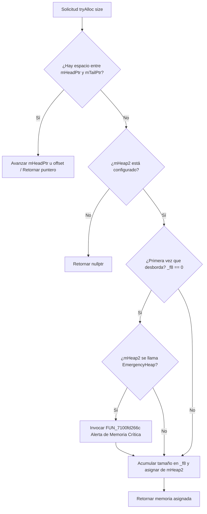

# Clase `ksys::util::DualFrameHeap`
Namespace: `ksys::util`
Hereda de: [[Documentación/Decompilación/Nintendo Switch/sead/Referencia/Módulos/heap/FrameHeap|sead::FrameHeap]].

## 1. Introducción

En el motor de **The Legend of Zelda: Breath of the Wild** (`uking`), la gestión de memoria combina asignadores de propósito general con asignadores lineales de alta velocidad. Mientras que `ksys::util::DualHeap` implementa un gestor dinámico de bloques libres basado en `sead::ExpHeap`, **`ksys::util::DualFrameHeap`** es la especialización basada en **`sead::FrameHeap`** (asignador lineal o *bump/stack allocator*).

`DualFrameHeap` extiende el concepto clásico de un *FrameHeap* dotándolo de:
1. **Fallback automático en dos niveles (`mHeap2`):** Si el buffer local se satura, las solicitudes excedentes se canalizan a un heap secundario de respaldo.
2. **Detección y alerta de emergencia:** Identificación en caliente de reservas sobre `EmergencyHeap`, alertando al gestor de actores para mitigar situaciones de falta crítica de memoria (OOM).
3. **Ajuste estricto (*auto-shrinking* vía `adjust()`):** Capacidad de empaquetar datos secuenciales durante la carga y recortar exactamente la memoria sobrante para regresarla al heap padre.

---

## 2. Jerarquía de Clases y Layout de Memoria

```
sead::IDisposer
 └── sead::Heap
      └── sead::FrameHeap (0x0F0 bytes)
           └── ksys::util::DualFrameHeap (0x108 bytes)
```

### Layout de Memoria en Nintendo Switch (NX 1.5.0, AArch64)

`DualFrameHeap` tiene un tamaño total de **`0x108` bytes (264 bytes)**:

| Offset | Tipo | Nombre | Propósito |
|---|---|---|---|
| `0x000` | `sead::FrameHeap` | *(base)* | Cabecera estándar de `FrameHeap` (vtable, mutex, límites de arena y estado). |
| `0x038` | `void*` | `mStart` | Dirección base del área de memoria gestionada. |
| `0x040` | `size_t` | `mSize` | Tamaño total asignado al heap. |
| `0x048` | `sead::Heap*` | `mParent` | Heap padre que suministró el bloque de memoria. |
| `0x090` | `HeapDirection` | `mDirection` | Dirección de asignación (`1 = cHeapDirection_Forward`, `-1 = cHeapDirection_Reverse`). |
| `0x098` | `sead::CriticalSection` | `mCS` | Mutex de exclusión mutua para operaciones multihilo (`0x40` bytes). |
| `0x0D8` | `sead::BitFlag16` | `mFlag` | Banderas de control (`cEnableLock`, advertencias, debug fill). |
| `0x0E0` | `void*` | `mState.mHeadPtr` | Puntero móvil frontal (*head pointer*) de asignación hacia adelante. |
| `0x0E8` | `void*` | `mState.mTailPtr` | Puntero móvil trasero (*tail pointer*) de asignación hacia atrás. |
| `0x0F0` | `sead::Heap*` | `mHeap2` | Puntero al **Heap Secundario** de respaldo/emergencia. |
| `0x0F8` | `size_t` | `_f8` | Acumulador métrico de bytes asignados desde el heap secundario. |
| `0x100` | `u8` | `_100` | Bandera/estado interno de inicialización. |

---

## 3. Comparativa de Arquitectura: `DualHeap` vs. `DualFrameHeap`

Nintendo implementó dos clases gemelas para resolver dos patrones de asignación diametralmente opuestos:

| Característica | `DualHeap` (`ExpHeap`) | `DualFrameHeap` (`FrameHeap`) |
|---|---|---|
| **Mecanismo Base** | Lista enlazada de bloques libres (`sead::MemBlock`). | Dos punteros lineales (*Head* y *Tail* bump allocator). |
| **Complejidad de Asignación** | $O(N)$ (búsqueda de bloque adecuado por tamaño/alineación). | $O(1)$ (simple incremento o decremento de puntero). |
| **Liberación Individual** | Permitida (`free(ptr)`, `resizeFront`, `resizeBack`). | **No permitida** (`free` es un no-op). |
| **Desfragmentación / Ajuste** | Propenso a fragmentación externa a lo largo del tiempo. | Fragmentación interna nula; recortable al byte con `adjust()`. |
| **Sobrecarga por Asignación** | 32 bytes (`0x20`) por cada bloque asignado. | **0 bytes** de metadatos por asignación. |
| **Caso de Uso Principal** | Ciclo de vida dinámico: Actores vivos, físicas de Havok. | Carga por lotes y recursos estáticos: Tablas de flags, árboles de IA, animaciones AS. |

---

## 4. Funcionamiento Interno

### A. Creación y Construcción Bidirrecional (`create` / `tryCreate`)

Al invocar `DualFrameHeap::create(...)` o `tryCreate(...)`:

1. **Alineación a 8 bytes:** Si el tamaño solicitado es `0`, consulta `parent1->getMaxAllocatableSize(8)`. El tamaño se redondea hacia arriba a múltiplos de 8 bytes: `(size + 7) & ~7`.
2. **Validación de umbral:** Si el tamaño útil es menor a `sizeof(DualFrameHeap)` (`0x108`), la creación aborta retornando `nullptr`.
3. **Reserva jerárquica tolerante a fallos:**
   - Si `parent1` es un `DualHeap` o `DualFrameHeap`, se usa `tryAlloc(..., &from_heap2)`. Si el padre no tiene memoria suficiente, la asignación se realiza desde el heap secundario del padre (`parent1 = parent_dual->mHeap2`).
4. **Construcción mediante *Placement New*:**
   - **Forward (`cHeapDirection_Forward`):** La estructura del heap se coloca al inicio del buffer (`buf`).
   - **Reverse (`cHeapDirection_Reverse`):** La estructura se coloca al final del buffer:
     $$\text{heap\_addr} = \text{buf} + \text{size} - \text{sizeof}(\text{DualFrameHeap})$$
5. **Inicialización de Punteros de Marco (`initialize_`):**
   Con el mutex bloqueado (`ConditionalScopedLock`), se configuran los límites iniciales de asignación:
   - En *Forward*: `mHeadPtr` inicia en `buf + 0x108` y `mTailPtr` en `buf + size`.
   - En *Reverse*: `mHeadPtr` inicia en `buf` y `mTailPtr` en `buf + size - 0x108`.
6. **Registro en el árbol:** Se añade como hijo activo del padre con `parent1->pushBackChild_(heap)`.

```
[Layout de Memoria en Creación Forward]
┌────────────────────────┬──────────────────────────────────────────────┐
│ DualFrameHeap (0x108)  │ Espacio libre para allocs hacia adelante     │
└────────────────────────┴──────────────────────────────────────────────┘
▲ buf                    ▲ mHeadPtr                                     ▲ mTailPtr

[Layout de Memoria en Creación Reverse]
┌──────────────────────────────────────────────┬────────────────────────┐
│ Espacio libre para allocs                    │ DualFrameHeap (0x108)  │
└──────────────────────────────────────────────┴────────────────────────┘
▲ buf = mHeadPtr                               ▲ mTailPtr               ▲ buf + size
```

---

### B. Asignación con Fallback y Detección de Emergencia (`tryAlloc`)

Cuando un sistema solicita memoria a `DualFrameHeap`:



1. **Intento Primario:** Ejecuta la rutina estándar de `FrameHeap`. Si el espacio entre `mHeadPtr` y `mTailPtr` es suficiente para acomodar el tamaño y la alineación solicitada, la reserva tiene éxito de forma inmediata y en tiempo constante $O(1)$.
2. **Desvío al Heap Secundario (`mHeap2`):** Si el buffer local está lleno y existe `mHeap2`:
   - **Monitoreo de emergencia:** Si es la primera asignación que desborda (`_f8 == 0`), inspecciona el nombre del heap secundario. Si coincide con `"EmergencyHeap"`, el juego invoca inmediatamente el sistema de alerta de actores (`FUN_7100fd266c`) para notificar la escasez crítica de recursos.
   - **Contabilidad métrica:** Añade los bytes solicitados a `_f8`.
   - **Asignación de respaldo:** Delega la llamada virtual a `mHeap2->tryAlloc(size, alignment)`.

---

### C. Recorte de Memoria Sobrante (`adjust`)

Una de las operaciones más poderosas de `DualFrameHeap` es su método virtual `adjust()`.

Cuando se cargan recursos o estructuras de datos cuyo tamaño exacto final no se conoce a priori:
1. Se crea un `DualFrameHeap` solicitando todo el espacio disponible del padre (`parent->getMaxAllocatableSize()`).
2. Se cargan e instancian todos los objetos de forma consecutiva (los punteros `mHeadPtr` avanzan empaquetando los datos).
3. Se invoca **`heap->adjust()`**:
   - `adjust()` calcula el espacio remanente que quedó libre entre `mHeadPtr` y el final del heap.
   - Llama a `mParent->resizeFront()` o `mParent->resizeBack()` para encoger el heap al tamaño exacto que ocuparon los datos cargados.
   - Toda la memoria no utilizada se libera y regresa al heap padre en el acto, logrando **cero desperdicio de memoria**.

---

## 5. Casos de Uso Clave en la Arquitectura de BotW

`DualFrameHeap` es utilizado extensivamente en subsistemas neurálgicos del juego:

### 1. Sistema de Parámetros y Banderas del Juego (`ksys::gdt::Manager`)
En `src/KingSystem/GameData/gdtManager.cpp`:
- **`allocParam1()`:** Asigna un `DualFrameHeap` de dirección `Forward` para crear e inicializar la estructura masiva de banderas del juego (`TriggerParam`). Tras copiar y ordenar los flags, ejecuta `heap->adjust()` para fijar el tamaño exacto del bloque de parámetros.
- **`allocRetryBuffer()`:** Crea un `DualFrameHeap` de **1 MB (`0x100000`)** con dirección **`cHeapDirection_Reverse`** en el heap de respaldo para guardar el estado de retry. El crecimiento inverso asegura que esta memoria de persistencia temporal se sitúe al extremo final del espacio direccionable, sin interferir con las reservas dinámicas frontales.

### 2. Carga y Deserialización de Recursos de Actores (`res::ResourceAS`, `res::ResourceAIProgram`)
- Durante el streaming de animaciones (`ResourceAS`) y grafos lógicos de comportamiento (`ResourceAIProgram`), la función utilitaria `util::tryCreateDualHeap(parent_heap)` instancia un `DualFrameHeap` como espacio de trabajo de carga.
- Los nodos del árbol de IA o pistas de animación se asignan linealmente sin sobrecarga de encabezados de bloque (`MemBlock`).

### 3. Físicas y Compuestos Estáticos (`ksys::phys::StaticCompound::doCreate_`)
- Las mallas de colisión y geometrías rígidas compuestas del mundo se construyen sobre un `DualFrameHeap`. Si una estructura de colisión compleja supera el presupuesto esperado, el desborde es absorbido por el heap secundario sin corromper la escena.

---

## 6. ¿Por qué es fundamental para la estabilidad de Breath of the Wild?

1. **Rendimiento de Carga y Cero Sobrecarga de Metadatos:**
   En un mundo abierto donde constantemente se cargan y descargan chunks y assets, el costo de asignar miles de objetos pequeños con encabezados `sead::MemBlock` de 32 bytes provocaría un sobrecosto inaceptable de memoria y tiempo de CPU. `DualFrameHeap` asigna a velocidad de puntero ($O(1)$) y con 0 bytes de sobrecarga por objeto.
2. **Inmunidad contra la Fragmentación Externa:**
   Al operar como una pila cerrada, no existe el concepto de huecos o fragmentación interna desordenada. Al descargar la escena o el actor, el heap entero se destruye o se vacía en un solo paso (`freeAll()` o destrucción de rama).
3. **Resiliencia ante Picos Inesperados (Tolerancia a Fallos):**
   Gracias al enlace con `mHeap2` y la integración con el sistema de alerta de `EmergencyHeap`, un pico transitorio en el número de parámetros o de geometrías de física no termina en un cuelgue inmediato del juego; el desborde se absorbe y el motor puede aplicar medidas correctivas.
4. **Optimización Milimétrica de la RAM de Nintendo Switch:**
   Con los 4 GB de memoria compartida de la consola (de los cuales solo una fracción está reservada para el juego), la combinación de reserva holgada + `adjust()` permite que los recursos utilicen exactamente los bytes que requieren, devolviendo cada byte sobrante para el streaming del mapa.
