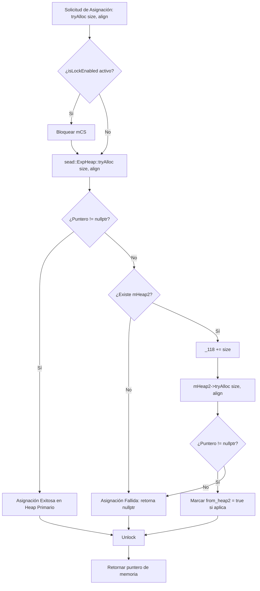
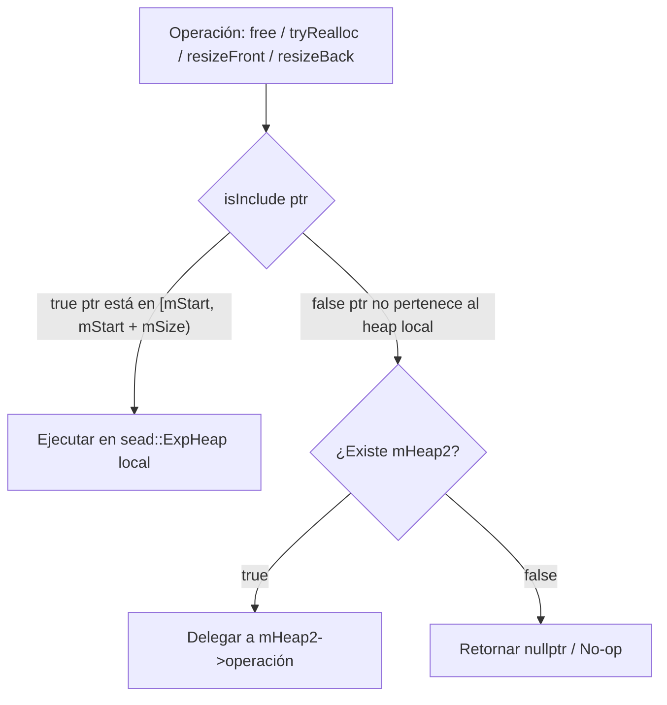

# Arquitectura y Funcionamiento de `ksys::util::DualHeap`

## 1. Introducción

En el motor de **The Legend of Zelda: Breath of the Wild** (`uking`), la gestión de memoria constituye uno de los subsistemas de mayor criticidad debido a la naturaleza continua del mundo abierto (*seamless open-world*), el streaming continuo de recursos desde la memoria no volátil, y la generación dinámica de cientos de actores (enemigos, física de ragdolls, vegetación interactiva, partículas y NPCs) en tiempo real.

Para mitigar los problemas clásicos de fragmentación y agotamiento de memoria local, Nintendo y el equipo de KingSystem implementaron una arquitectura de **Heaps Duales** (`DualHeap` y `DualFrameHeap`).

[`ksys::util::DualHeap`](file:///home/jorge/botw/src/KingSystem/Utils/HeapUtil.h#L12) es una especialización de [`sead::ExpHeap`](file:///home/jorge/botw/lib/sead/include/heap/seadExpHeap.h#L9) (*Extended Primitive Heap* de la librería base de Nintendo) que provee una **estrategia de asignación con respaldo dinámico (*fallback*) en dos niveles** y liberación arbitraria no secuencial de bloques.

---

## 2. Jerarquía de Clases y Layout de Memoria (NX 1.5.0)

### Jerarquía de Herencia

```
sead::IDisposer
 └── sead::Heap
      ├── sead::INamable
      ├── sead::hostio::Reflexible
      └── sead::ExpHeap (0x110 bytes)
           └── ksys::util::DualHeap (0x128 bytes)
```

> [!NOTE]
> `DualHeap` no debe declararse con el especificador `final`. Hacerlo provoca que Clang 4.0.1 devirtualice llamadas internas críticas (como `this->isInclude()` y `this->getSize()`), rompiendo el despacho polimórfico original observado en la tabla virtual y en el binario compilado.

### Layout de Memoria en Nintendo Switch (64 bits)

| Offset | Tipo | Nombre | Propósito |
|---|---|---|---|
| `0x000` | `void*` | `_vptr_IDisposer` | Puntero a la tabla virtual principal (`vtable`). |
| `0x008` - `0x018` | `sead::ListNode` | `mListNode` | Enlace para las listas de objetos que heredan de `IDisposer`. |
| `0x020` | `sead::SafeString` | `mName` | Nombre identificador del heap (utilizado en depuración y profiling). |
| `0x028` | `const char*` | `mStringTop` | Puntero directo al string del nombre. |
| `0x030` | `void*` | `_vptr_Reflexible`| Puntero secundario a la interfaz de reflexión para HostIO. |
| `0x038` | `void*` | `mStart` | Dirección de inicio del área asignable del heap. |
| `0x040` | `size_t` | `mSize` | Tamaño total en bytes gestionado por el heap local. |
| `0x048` | `sead::Heap*` | `mParent` | Puntero al heap padre del cual se originó este heap. |
| `0x050` - `0x068` | `sead::OffsetList<Heap>` | `mChildren` | Lista de heaps hijos creados dentro de este heap. |
| `0x070` - `0x088` | `sead::DisposerList` | `mDisposerList` | Lista de destructores automáticos registrados en este heap. |
| `0x090` | `HeapDirection` | `mDirection` | Dirección de crecimiento (`cHeapDirection_Forward = 1`, `cHeapDirection_Reverse = -1`). |
| `0x098` - `0x0d0` | `sead::CriticalSection` | `mCS` | Mutex de exclusión mutua para operaciones multihilo seguras. |
| `0x0d8` | `sead::BitFlag16` | `mFlag` | Banderas de configuración (e.g. `cEnableLock`, `cDisposing`). |
| `0x0dc` | `u8` | `mAllocMode` | Modo de búsqueda de bloques libres (`FirstFit = 0`, `BestFit = 1`). |
| `0x0dd` | `u8` | `mFindFreeBlockMode`| Modo de iteración de bloques (`Auto = 0`, `FromFreeList = 1`, etc.). |
| `0x0e0` - `0x0f0` | `MemBlockList` | `mFreeList` | Lista doblemente enlazada de bloques de memoria libres disponibles. |
| `0x0f8` - `0x108` | `MemBlockList` | `mUseList` | Lista doblemente enlazada de bloques de memoria actualmente asignados. |
| `0x110` | `sead::Heap*` | `mHeap2` | **Puntero al Heap Secundario** (heap de respaldo o emergencia). |
| `0x118` | `size_t` | `_118` | **Métrica de fallback:** Total acumulativo de bytes asignados desde `mHeap2`. |
| `0x120` | `u8` | `_120` | Flag de estado / control interno del DualHeap. |

---

## 3. Arquitectura del Sistema de Memoria Dual y Flujo de Asignación

### El Problema de los Heaps Convencionales
En un [`sead::ExpHeap`](file:///home/jorge/botw/lib/sead/include/heap/seadExpHeap.h#L9) tradicional, la memoria reside en un búfer continuo y aislado. Si un subsistema crítico (por ejemplo, el motor físico de Havok o un actor complejo con múltiples efectos de partículas) agota su espacio local debido a picos de demanda o fragmentación externa severa:
1. La asignación falla devolviendo `nullptr`.
2. El sistema desencadena una aserción (*crash*) o descarta el spawn del objeto, provocando fallas visuales o inestabilidad.

### La Solución Dual
`DualHeap` articula dos fuentes de memoria cooperativas:
1. **Heap Primario (Local / Base `ExpHeap`):** Búfer local y rápido reservado específicamente para el subsistema o actor.
2. **Heap Secundario (`mHeap2`):** Un heap global de reserva compartida (como `EmergencyHeap`, `DebugHeap` o el heap general de la escena).

### Diagrama de Flujo de Asignación (`tryAlloc`)



---

## 4. Ciclo de Vida y Creación (`DualHeap::tryCreate`)

La función [`DualHeap::tryCreate`](file:///home/jorge/botw/src/KingSystem/Utils/HeapUtil.cpp#L53) implementa una secuencia estricta para reservar, posicionar y estructurar el nuevo heap:

### A. Cálculo y Validación de Tamaño
1. Si `size == 0`, se consulta el espacio máximo asignable del padre mediante `parent1->getMaxAllocatableSize(alignment)`.
2. Se alinea el tamaño resultante hacia arriba a múltiplos de 8 bytes: `(size + 7) & ~7`.
3. Se verifica el umbral mínimo indispensable para albergar la cabecera del heap y al menos un bloque de memoria utilizable:
   $$\text{tamaño} > \text{sizeof}(\text{DualHeap}) + \text{sizeof}(\text{sead::MemBlock}) = 0x128 + 0x20 = 0x148 \text{ bytes}$$
   Si el tamaño no supera `0x148`, la creación aborta retornando `nullptr`.

### B. Asignación con Reconocimiento Jerárquico de Padres
Al reservar el bloque base (`buf`) desde `parent1`:
* **Si `parent1` es un `DualHeap`:** Se intenta asignar desde su `ExpHeap` primario. Si no hay espacio disponible, se acumula el tamaño en el contador `_118` del padre y se asigna desde el `mHeap2` del padre, reasignando la jerarquía para que `parent1 = parent1->mHeap2`.
* **Si `parent1` es un `DualFrameHeap`:** Delega en la sobrecarga con flag de fallback `tryAlloc(size, align, &from_heap2)`. Si provino del heap secundario, se ajusta el puntero del padre.
* **Cualquier otro `sead::Heap`:** Realiza una asignación estándar llamando a `parent1->tryAlloc()`.

### C. Construcción Bidirrecional (Forward vs. Reverse)
`DualHeap` soporta ambas direcciones de crecimiento de memoria:

```
[Dirección Forward (Normal)]
┌──────────────────┬──────────────────┬──────────────────────────────────────────┐
│ DualHeap (0x128) │ MemBlock (0x20)  │ Espacio Libre para Asignaciones...       │
└──────────────────┴──────────────────┴──────────────────────────────────────────┘
▲ buf              ▲ heap + 1

[Dirección Reverse (Invertida)]
┌──────────────────────────────────────────┬──────────────────┬──────────────────┐
│ Espacio Libre para Asignaciones...       │ MemBlock (0x20)  │ DualHeap (0x128) │
└──────────────────────────────────────────┴──────────────────┴──────────────────┘
▲ buf (mStart)                              ▲ block            ▲ buf + size - 0x128
```

1. **Forward (`cHeapDirection_Forward`):**
   - El objeto `DualHeap` se construye al inicio del búfer mediante *placement new*.
   - El bloque de gestión inicial (`sead::MemBlock`) se posiciona inmediatamente a continuación (`reinterpret_cast<DualHeap*>(buf) + 1`).
2. **Reverse (`cHeapDirection_Reverse`):**
   - El objeto `DualHeap` se coloca al final del búfer: `buf + size - sizeof(DualHeap)`.
   - El bloque inicial `sead::MemBlock` se posiciona al comienzo del búfer (`buf`).

### D. Inicialización de la Lista Libre y Vinculación
- El bloque libre recibe el espacio restante:
  $$\text{mSize} - (\text{sizeof}(\text{DualHeap}) + \text{sizeof}(\text{sead::MemBlock}))$$
- Se inserta en la lista libre interna mediante `pushToFreeList_(block)`.
- El nuevo `DualHeap` se registra formalmente en el árbol de heaps como hijo activo de su padre: `parent1->pushBackChild_(heap)`.

---

## 5. El Mecanismo de Enrutamiento por Pertenencia (`isInclude`)

A diferencia de un heap ordinario donde todos los punteros liberados o reasignados deben pertenecer a su propio rango de memoria, `DualHeap` puede haber asignado punteros tanto de su propio `ExpHeap` como de su heap secundario `mHeap2`.

Por esta razón, todas las funciones de gestión de bloques utilizan **enrutamiento por pertenencia** mediante la función virtual `this->isInclude(ptr)`:



### Implementación en Código
- **[`free(void* ptr)`](file:///home/jorge/botw/src/KingSystem/Utils/HeapUtil.cpp#L221):**
  Si `isInclude(ptr)` es verdadero, llama a `sead::ExpHeap::free(ptr)`. Si es falso y `mHeap2` no es nulo, llama a `mHeap2->free(ptr)`.
- **[`tryRealloc(void* ptr, size_t size, s32 alignment)`](file:///home/jorge/botw/src/KingSystem/Utils/HeapUtil.cpp#L198):**
  Si el puntero pertenece al heap local, ejecuta `sead::ExpHeap::tryRealloc(ptr, size, alignment)`. En caso contrario, delega la reasignación a `mHeap2->tryRealloc`.
- **[`resizeFront`](file:///home/jorge/botw/src/KingSystem/Utils/HeapUtil.cpp#L228) y [`resizeBack`](file:///home/jorge/botw/src/KingSystem/Utils/HeapUtil.cpp#L236):**
  Ajustan el tamaño del bloque modificando su cabecera `sead::MemBlock` correspondiente en el heap donde fue asignado.
- **[`freeAll()`](file:///home/jorge/botw/src/KingSystem/Utils/HeapUtil.cpp#L210):**
  Limpia todos los bloques locales con `sead::ExpHeap::freeAll()`, propaga la limpieza al heap secundario con `mHeap2->freeAll()`, y **resetea el contador de fallback** `_118 = 0`.

---

## 6. Métricas y Espacio Disponible (`getFreeSize` y `getMaxAllocatableSize`)

Debido a la naturaleza de dos niveles, consultar la memoria disponible requiere calcular los recursos combinados sin violar las cotas superiores del sistema:

### 1. `getFreeSize()`
Calcula la suma del espacio libre en ambos niveles, acotada por el tamaño total del heap local:
```cpp
size_t free_size = sead::ExpHeap::getFreeSize();
size_t add = 0;
if (mHeap2)
    add = mHeap2->getFreeSize();
free_size += add;
size_t total_size = getSize();
return free_size < total_size ? free_size : total_size;
```
> **Por qué se acota con `total_size`:** En la arquitectura de `sead`, las consultas de `getFreeSize()` sobre un heap hijo no deben retornar un valor mayor al tamaño total que declara el propio heap (`getSize()`), aun cuando el heap de respaldo secundario global disponga de gigabytes de memoria libre.

### 2. `getMaxAllocatableSize(int alignment)`
Determina el bloque continuo más grande que puede asignarse de inmediato:
```cpp
size_t size = sead::ExpHeap::getMaxAllocatableSize(alignment);
size_t max_alloc = 0;
if (mHeap2)
    max_alloc = mHeap2->getMaxAllocatableSize(alignment);
size = size > max_alloc ? size : max_alloc;
size_t total_size = getSize();
return size < total_size ? size : total_size;
```
Evalúa cuál de los dos heaps ofrece el mayor bloque indivisible para la alineación dada, garantizando que una asignación subsecuente de ese tamaño tenga éxito (ya sea localmente o mediante fallback).

---

## 7. Diagnóstico e Inspección en Tiempo de Ejecución (`dumpYAML` y HostIO)

`DualHeap` sobreescribe el método virtual de diagnóstico [`dumpYAML`](file:///home/jorge/botw/src/KingSystem/Utils/HeapUtil.cpp#L272) para integrarse con las herramientas de depuración conectadas por red de Nintendo (*HostIO* / *MemoryViewer*).

### Estructura de Salida YAML Generada

Cada llamada a `dumpYAML(stream, indent)` produce un bloque YAML formateado mediante un búfer local [`sead::FixedStringBuilder<128>`](file:///home/jorge/botw/lib/sead/include/prim/seadStringBuilder.h#L194):

```yaml
- name: "HavokDualHeap"
  start_address: 0x0000007130000000
  end_address: 0x0000007130200000
  parent: "SceneHeap"
  direction: Forward
  size: 2097152
  free_size: 1548288
  max_allocatable_size: 1048576
  heap_type: DualHeap
  alloc_mode: First Fit
  use_list_size: 42
  free_list_size: 5
```

### Particularidades Técnicas de `dumpYAML`
1. **Llamadas Base No Virtuales:** Invoca directamente `sead::ExpHeap::getFreeSize()` y `sead::ExpHeap::getMaxAllocatableSize(8)` sin pasar por la vtable, lo que reporta las métricas intrínsecas del búfer primario del heap para análisis de fragmentación local.
2. **Representación de Padres Nulos:** Si `mParent == nullptr`, emite `"--"` en el campo `parent`.
3. **Mapeo de Enumeraciones:**
   - Dirección: `mDirection == cHeapDirection_Forward ? "Forward" : "Reverse"`
   - Estrategia de Asignación: `mAllocMode == AllocMode::FirstFit ? "First Fit" : "Best Fit"`
4. **Visualización de Nodos en HostIO:**
   - [`makeMetaString_`](file:///home/jorge/botw/src/KingSystem/Utils/HeapUtil.cpp#L349): Si los bloqueos están desactivados, asigna `"Icon=CIRCLE_BLACK"` al string meta del nodo para identificarlo visualmente en el árbol de memoria.
   - [`genInformation_`](file:///home/jorge/botw/src/KingSystem/Utils/HeapUtil.cpp#L357): Propaga el contexto a `sead::ExpHeap::genInformation_` cuando el bloqueo está habilitado.

---

## 8. Tabla Virtual (Vtable Layout en memoria `0x710250bb30`)

La tabla virtual principal de `DualHeap` reside en la dirección estática `0x710250bb30`. Consta de 26 ranuras de funciones virtuales (más la entrada de RTTI):

| Slot | Offset | Dirección | Función Asociada | Origen / Sobrescritura |
|:---:|:---:|---|---|---|
| 0 | `0x00` | `0x71010befc4` | `DualHeap::~DualHeap()` | Sobrescrito por `DualHeap` |
| 1 | `0x08` | `0x71010bf008` | `DualHeap::~DualHeap()` *(deleting)* | Sobrescrito por `DualHeap` |
| 2 | `0x10` | `0x71010bf9e0` | `DualHeap::checkDerivedRuntimeTypeInfo` | Sobrescrito (`SEAD_RTTI_OVERRIDE`) |
| 3 | `0x18` | `0x71010bfb00` | `DualHeap::getRuntimeTypeInfo` | Sobrescrito (`SEAD_RTTI_OVERRIDE`) |
| 4 | `0x20` | `0x7100b04c14` | `sead::Heap::getName` | Heredado de `sead::Heap` |
| 5 | `0x28` | `0x7100b0502c` | `sead::ExpHeap::destroy` | Heredado de `sead::ExpHeap` |
| 6 | `0x30` | `0x71010bf05c` | `DualHeap::tryAlloc(size, alignment)` | Sobrescrito por `DualHeap` |
| 7 | `0x38` | `0x71010bf258` | `DualHeap::free(void*)` | Sobrescrito por `DualHeap` |
| 8 | `0x40` | `0x71010bf2cc` | `DualHeap::resizeFront(void*, size_t)` | Sobrescrito por `DualHeap` |
| 9 | `0x48` | `0x71010bf360` | `DualHeap::resizeBack(void*, size_t)` | Sobrescrito por `DualHeap` |
| 10 | `0x50` | `0x71010bf100` | `DualHeap::tryRealloc(void*, size_t, s32)` | Sobrescrito por `DualHeap` |
| 11 | `0x58` | `0x71010bf1a8` | `DualHeap::freeAll()` | Sobrescrito por `DualHeap` |
| 12 | `0x60` | `0x7100b06638` | `sead::ExpHeap::getStartAddress` | Heredado de `sead::ExpHeap` |
| 13 | `0x68` | `0x7100b06640` | `sead::ExpHeap::getEndAddress` | Heredado de `sead::ExpHeap` |
| 14 | `0x70` | `0x7100b0664c` | `sead::ExpHeap::getSize` | Heredado de `sead::ExpHeap` |
| 15 | `0x78` | `0x71010bf3f4` | `DualHeap::getFreeSize()` | Sobrescrito por `DualHeap` |
| 16 | `0x80` | `0x71010bf448` | `DualHeap::getMaxAllocatableSize(int)` | Sobrescrito por `DualHeap` |
| 17 | `0x88` | `0x7100b04ef4` | `sead::ExpHeap::isInclude` | Heredado de `sead::ExpHeap` |
| 18 | `0x90` | `0x7100b0704c` | `sead::ExpHeap::isEmpty` | Heredado de `sead::ExpHeap` |
| 19 | `0x98` | `0x7100b0705c` | `sead::ExpHeap::isFreeHashCalc` | Heredado de `sead::ExpHeap` |
| 20 | `0xa0` | `0x71010bf4b0` | `DualHeap::isResizable()` | Sobrescrito (retorna `false`) |
| 21 | `0xa8` | `0x71010bf4b8` | `DualHeap::isAdjustable()` | Sobrescrito (retorna `false`) |
| 22 | `0xb0` | `0x7100b06f38` | `sead::ExpHeap::check` | Heredado de `sead::ExpHeap` |
| 23 | `0xb8` | `0x71010bf4c0` | `DualHeap::dumpYAML(WriteStream&, int)` | Sobrescrito por `DualHeap` |
| 24 | `0xc0` | `0x71010bf9d0` | `DualHeap::genInformation_` | Sobrescrito por `DualHeap` |
| 25 | `0xc8` | `0x71010bf91c` | `DualHeap::makeMetaString_` | Sobrescrito por `DualHeap` |

---

## 9. Comparativa Arquitectónica: `DualHeap` vs. `DualFrameHeap`

KingSystem utiliza dos variantes principales de heaps duales. Cada una responde a perfiles de asignación diametralmente distintos:

| Característica | `ksys::util::DualHeap` | `ksys::util::DualFrameHeap` |
|---|---|---|
| **Clase Base** | [`sead::ExpHeap`](file:///home/jorge/botw/lib/sead/include/heap/seadExpHeap.h#L9) | [`sead::FrameHeap`](file:///home/jorge/botw/lib/sead/include/heap/seadFrameHeap.h#L11) |
| **Tamaño del Objeto** | `0x128` bytes | `0x108` bytes |
| **Patrón de Liberación** | **Arbitrario:** Puede liberar bloques individuales en cualquier orden mediante puntero (`free(void*)`). | **Secuencial / Bloque:** No permite liberar punteros individuales; se libera todo el marco mediante `freeHead()` o `freeAll()`. |
| **Estructura Interna** | Listas enlazadas de bloques libres (`mFreeList`) y bloques en uso (`mUseList`) con cabeceras `sead::MemBlock`. | Punteros directos de pila (*stack allocation*): cabecera de marco `mHead` y cola `mTail`. |
| **Sobrecarga de Asignación** | Mayor tiempo de búsqueda (`O(n)` según modo FirstFit/BestFit) y overhead de cabecera por bloque (0x20 bytes). | Extremadamente rápida (`O(1)` incremento de puntero) y sin overhead de metadatos por bloque. |
| **Casos de Uso Típicos** | Subasignadores de memoria dinámicos persistentes como Havok Physics ([`HavokMemoryAllocator`](file:///home/jorge/botw/src/KingSystem/Physics/System/physHavokMemoryAllocator.h#L14)). | Ciclo de vida por frame de actores dinámicos ([`actActorHeapUtil`](file:///home/jorge/botw/src/KingSystem/ActorSystem/actActorHeapUtil.cpp)) y buffers temporales de carga. |

---

## 10. Integración en los Subsistemas de Breath of the Wild

### 1. Asignador de Memoria Física Havok (`HavokMemoryAllocator`)
El motor de físicas Havok maneja miles de cuerpos rígidos, formas de colisión y datos de contacto en tiempo real.
- En [`HavokMemoryAllocator::initDualHeap`](file:///home/jorge/botw/src/KingSystem/Physics/System/physHavokMemoryAllocator.cpp#L10), el sistema crea un `DualHeap` con dirección hacia adelante (`cHeapDirection_Forward`) y bloqueo activo.
- Cuando la simulación física sufre una sobrecarga repentina (e.g. decenas de barriles explosivos detonando simultáneamente cerca de estructuras destruibles), la memoria local se llena y el asignador absorbe automáticamente el exceso desde `mHeap2` sin provocar ralentizaciones ni crasheos.
- La consulta de tamaño libre [`HavokMemoryAllocator::getHeapFreeSize()`](file:///home/jorge/botw/src/KingSystem/Physics/System/physHavokMemoryAllocator.cpp#L28) utiliza `sead::DynamicCast<sead::ExpHeap>(mHeap)` para inspeccionar la memoria sin violar el encapsulamiento.

### 2. Gestión de Heaps en Actores (`ActorHeapUtil` y `BaseProc`)
Cada entidad en el mundo de BotW (enemigos como Bokoblins, guardianes, flechas, armas, animales) hereda de la arquitectura `BaseProc`.
- Los actores pueden crearse en un `DualHeap` o `DualFrameHeap` individual según si requieren reservar recursos dinámicos persistentes que se crean y destruyen durante el combate o la animación.
- La función de utilidad [`tryCreateDualHeap(sead::Heap* parent)`](file:///home/jorge/botw/src/KingSystem/Utils/HeapUtil.h#L132) detecta si el heap padre es un `DualHeap`; de ser así, extrae automáticamente su heap secundario con `parent_ex->getHeap2()` para propagar la jerarquía de respaldo a los sub-heaps hijos.

### 3. Profiling y Detección de Fugas en QA de Nintendo (`_118`)
En los ejecutables de desarrollo de Nintendo, la métrica `_118` era auditada periódicamente. Si un actor o sistema mostraba un incremento monótono en `_118` tras varios minutos de juego, indicaba una fuga de memoria (*memory leak*) o un dimensionamiento incorrecto del búfer primario en los archivos de parámetros del actor (`bgparamlist` / `ActorLink`).

---

## 11. Registro de Funciones Descompiladas y Matching (100% OK)

Todas las funciones de [`ksys::util::DualHeap`](file:///home/jorge/botw/src/KingSystem/Utils/HeapUtil.cpp) están implementadas en estricto orden de enlace binario y cotejadas al **100% exacto (`OK`)** con `tools/check`:

| Dirección | Calidad | Símbolo Mangled | Tamaño (bytes) |
|---|:---:|---|:---:|
| `0x71010bec74` | `O` | `_ZN4ksys4util8DualHeap6createEmRKN4sead14SafeStringBaseIcEEPNS2_4HeapES8_iNS7_13HeapDirectionEb` | 8 |
| `0x71010bec7c` | `O` | `_ZN4ksys4util8DualHeap9tryCreateEmRKN4sead14SafeStringBaseIcEEPNS2_4HeapES8_iNS7_13HeapDirectionEb` | 724 |
| `0x71010bef50` | `O` | `_ZN4ksys4util8DualHeap8tryAllocEmiPb` | 116 |
| `0x71010befc4` | `O` | `_ZN4ksys4util8DualHeapD1Ev` / `D2Ev` | 68 |
| `0x71010bf008` | `O` | `_ZN4ksys4util8DualHeapD0Ev` | 76 |
| `0x71010bf05c` | `O` | `_ZN4ksys4util8DualHeap8tryAllocEmi` | 164 |
| `0x71010bf100` | `O` | `_ZN4ksys4util8DualHeap10tryReallocEPvmi` | 168 |
| `0x71010bf1a8` | `O` | `_ZN4ksys4util8DualHeap7freeAllEv` | 176 |
| `0x71010bf258` | `O` | `_ZN4ksys4util8DualHeap4freeEPv` | 116 |
| `0x71010bf2cc` | `O` | `_ZN4ksys4util8DualHeap11resizeFrontEPvm` | 148 |
| `0x71010bf360` | `O` | `_ZN4ksys4util8DualHeap10resizeBackEPvm` | 148 |
| `0x71010bf3f4` | `O` | `_ZNK4ksys4util8DualHeap11getFreeSizeEv` | 84 |
| `0x71010bf448` | `O` | `_ZNK4ksys4util8DualHeap21getMaxAllocatableSizeEi` | 104 |
| `0x71010bf4b0` | `O` | `_ZNK4ksys4util8DualHeap11isResizableEv` | 8 |
| `0x71010bf4b8` | `O` | `_ZNK4ksys4util8DualHeap12isAdjustableEv` | 8 |
| `0x71010bf4c0` | `O` | `_ZNK4ksys4util8DualHeap8dumpYAMLERN4sead11WriteStreamEi` | 1116 |
| `0x71010bf91c` | `O` | `_ZN4ksys4util8DualHeap15makeMetaString_EPN4sead22BufferedSafeStringBaseIcEE` | 180 |
| `0x71010bf9d0` | `O` | `_ZN4ksys4util8DualHeap15genInformation_EPN4sead6hostio7ContextE` | 16 |
| `0x71010bf9e0` | `O` | `_ZNK4ksys4util8DualHeap27checkDerivedRuntimeTypeInfoEPKN4sead15RuntimeTypeInfo9InterfaceE` | 288 |
| `0x71010bfb00` | `O` | `_ZNK4ksys4util8DualHeap18getRuntimeTypeInfoEv` | 92 |

---

## 12. Lecciones Técnicas de Decompilación y Reglas del Compilador

Durante el proceso de reverse engineering y matching con Clang 4.0.1, se identificaron varios comportamientos cruciales:

1. **Prevención de Inlining Cruzado (`[[gnu::noinline]]`):**
   La función `DualHeap::tryAlloc(size, align, bool*)` era inlineada agresivamente por Clang en el cuerpo de `DualFrameHeap::tryCreate`. Fue necesario anotarla con `[[gnu::noinline]]` en la unidad de traducción para preservar el símbolo independiente de 116 bytes y permitir que ambas funciones alcancen el 100% de matching simultáneamente.
2. **Patrón de Bloqueo Manual en `dumpYAML`:**
   El uso de wrappers RAII como `sead::ConditionalScopedLock` introduce un destructor con llamada virtual que fuerza a Clang a asignar un registro callee-saved adicional (`x26`), alterando toda la disposición de registros (`stp x26, x25` en vez de `str x25`). Emplear la secuencia manual:
   ```cpp
   sead::CriticalSection* cs = nullptr;
   if (isLockEnabled()) {
       cs = const_cast<sead::CriticalSection*>(&mCS);
       cs->lock();
   }
   // ...
   if (cs)
       cs->unlock();
   ```
   reproduce con exactitud quirúrgica la asignación de registros original (`x19` a `x25`) y los branches `tbnz` / `cbz`.
3. **Naturaleza de los Trampolines `0x71010bf054` y `0x71010bf058`:**
   En revisiones preliminares del archivo `uking_functions.csv`, estas dos direcciones de 4 bytes fueron erróneamente etiquetadas como `getFreeSize` y `getMaxAllocatableSize`. El análisis del desmontaje y de las referencias cruzadas demostró que son *linker range extension veneers* (saltos directos `b sead::ExpHeap::getFreeSize` y `b sead::ExpHeap::getMaxAllocatableSize`) generados por el linker de Nintendo para salvar distancias de salto entre unidades de traducción distantes. Las verdaderas funciones miembro residen en `0x71010bf3f4` (84 bytes) y `0x71010bf448` (104 bytes), tal como ratifica la tabla virtual de `DualHeap`.
